# Prometheus & Grafana 复现文档（P5–P8）

## 1. 这一节做什么

这一节的目标不是“背概念”，而是把一条最小可用的监控链路跑起来：

1. 用 Docker 启动 Prometheus，暴露 `9090` 端口，让它抓取自己的指标；
2. 用 Docker 启动 Grafana，暴露 `3000` 端口；
3. 在 Grafana 里添加 Prometheus 数据源，并点 `Save & test` 验证连通；
4. 在 Grafana Explore 和 Prometheus 查询页里，用 Prometheus 自身指标理解四种指标类型：Counter、Gauge、Histogram、Summary；
5. 用 PromQL 做标签过滤、范围向量、`rate`、`increase`、聚合 `sum/avg/max/min/count`、`by/without`、`topk`、算术和错误率表达式。

最终你应该能在浏览器里完成这些验证：

- `http://localhost:9090` 打开 Prometheus；
- 查询 `up` 返回 `1`；
- 查询 `rate(prometheus_http_requests_total[5m])` 能看到按 handler/code 拆分的多条线；
- 查询 `sum by (handler) (rate(prometheus_http_requests_total[5m]))` 能看到按 handler 聚合后的线；
- Grafana 的 Explore 里选择 Prometheus 数据源，查询 `up` 有结果。

本节不包含：Node.js 业务应用接入、Dashboard 正式搭建、告警规则、生产级权限与持久化。课里到 P8 结束时还没有做业务应用，P8 末尾才说下一节会用一个简单 Node.js 应用让 Prometheus 拉指标。因此本文不会编造一个“课程里的 Node 应用”。

---

## 2. 讲师原话（带出处）

> "我会执行 docker run……用 --name 把它命名为 grafana……把 3000 端口映射到 3000 端口……镜像位于 grafana/grafana。"
> —— p005 [00:56]

> "首次登录时，Grafana 其实使用另一套默认值：它有默认凭据。因此我会把用户名输入为 admin，密码也输入为 admin。"
> —— p005 [02:53]

> "这里写的 localhost 实际上指的是容器本身，而不是宿主机。"
> —— p005 [07:43]

> "我遇到了“name or service not known”这个报错，因为这是 Linux 里一个有点典型的小坑。"
> —— p005 [09:07]

> "计数器是一种……只增不减的累积指标。"
> —— p006 [00:54]

> "仪表指标是一种可以任意上升或下降的指标。"
> —— p006 [02:52]

> "范围向量实际上不能直接绘图，它们应当配合函数使用。"
> —— p007 [09:02]

> "它会计算每秒的平均增长速率，并自动处理计数器重置。"
> —— p008 [02:53]

> "你实际上可以使用 by 子句按特定标签进行聚合。"
> —— p008 [10:53]

> "按样本值取最大的 k 个元素。"
> —— p008 [23:18]

这些原话对应了本节最容易踩坑的三件事：Grafana 默认账号、容器内 `localhost` 的含义、以及 Counter 必须配合 `rate` 之类函数才有意义。

---

## 3. 从零复现

### 3.1 目录结构

在任意空目录下创建：

```text
prom-grafana-demo/
├── docker-compose.yml
├── README.md
├── promql-cheatsheet.md
├── prometheus/
│   └── prometheus.yml
└── grafana/
    └── provisioning/
        └── datasources/
            └── prometheus.yml
```

依赖版本说明：

- 需要 Docker Engine 和 Docker Compose v2；
- 课程里没有固定镜像版本，讲师直接拉取 `grafana/grafana`，没有传版本号，所以本文使用 `latest`；
- Prometheus 在 P5 之前已经启动，但逐字稿没有展示 P5 的 Prometheus 启动命令。为了“从零复现”，本文补一个最小 `prom/prometheus:latest` 配置；
- 端口固定为 Prometheus `9090`、Grafana `3000`；
- Grafana 管理员环境变量使用 `GF_SECURITY_ADMIN_USER=admin`、`GF_SECURITY_ADMIN_PASSWORD=admin`。课里说的是默认 `admin/admin`，这两个环境变量是复现时为了明确固定账号密码而加的。

### 3.2 方案 A：用 Docker Compose 一键跑起来（推荐复现方式）

先把第 4 节的 5 个文件原样保存到对应路径，然后执行：

```bash
cd prom-grafana-demo
docker compose up -d
docker compose ps
```

预期能看到两个容器在运行：`prometheus` 和 `grafana`。具体列名以你的 Docker 版本为准，核心是状态为 `Up`。

验证 Prometheus：

```bash
curl -s http://localhost:9090/-/ready
```

或者直接浏览器打开：

```text
http://localhost:9090
```

在查询框输入：

```promql
up
```

点 `Execute`，应当看到值为 `1`。这表示 Prometheus 抓取目标健康。

验证 Grafana：

```text
http://localhost:3000
```

首次登录：

```text
用户名：admin
密码：admin
```

Grafana 可能提示修改密码。课里讲师说本地学习可以跳过，直接保持 `admin`。生产环境不要这么做。

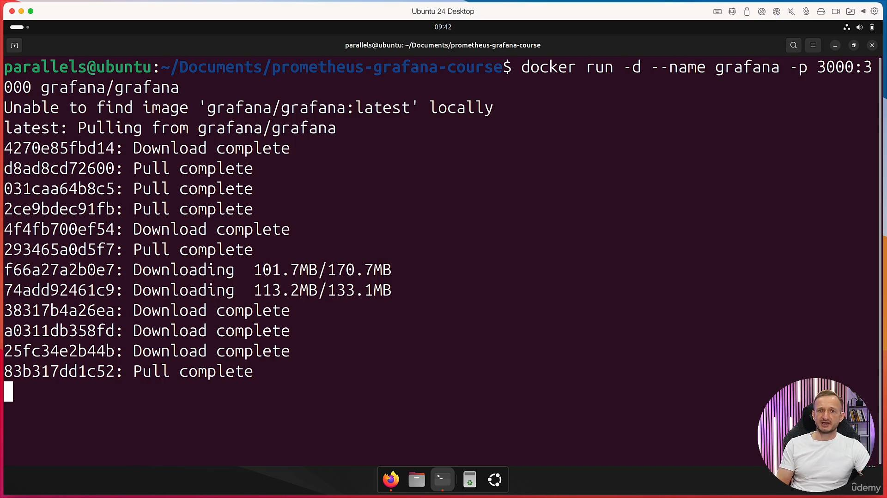

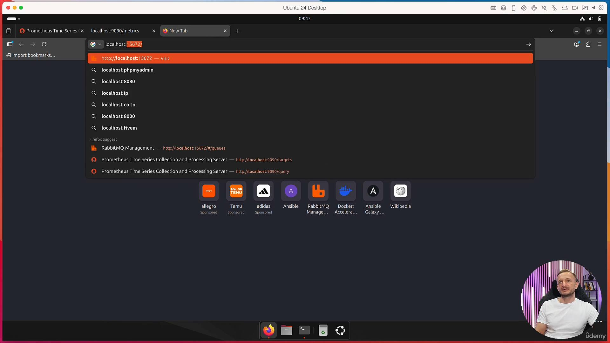

### 3.3 方案 B：完全按课程手工 `docker run`

如果你想严格贴近 P5 的操作，可以不用 Compose，改用两条 `docker run`。注意：Prometheus 的启动命令在 P5 逐字稿里没有出现，下面第二条 Grafana 命令与讲师一致；第一条 Prometheus 命令是为复现补齐的最小命令。

先创建配置目录：

```bash
mkdir -p prom-grafana-demo/prometheus
cd prom-grafana-demo
```

保存第 4 节的 `prometheus/prometheus.yml` 后执行：

```bash
docker run -d \
  --name prometheus \
  -p 9090:9090 \
  -v "$PWD/prometheus/prometheus.yml:/etc/prometheus/prometheus.yml:ro" \
  prom/prometheus:latest

docker run -d \
  --name grafana \
  -p 3000:3000 \
  grafana/grafana:latest
```

查看容器：

```bash
docker ps
```

应能看到 `prometheus` 和 `grafana` 两个容器。Grafana 访问地址仍是 `http://localhost:3000`，账号密码仍是 `admin/admin`。

手工方案下，Grafana 连接 Prometheus 的 URL 不能填 `http://localhost:9090`。原因是 Grafana 运行在容器里，它看到的 `localhost` 是 Grafana 容器自己，不是你的宿主机。P5 讲师原话说：

> "这里写的 localhost 实际上指的是容器本身，而不是宿主机。"
> —— p005 [07:43]

课程里的做法是：

1. 先试 `http://host.docker.internal:9090`；
2. 在 Linux 上出现 `name or service not known`；
3. 改用宿主机 IP，例如 Docker bridge 网关 `172.17.0.1:9090`，连接成功。

在 Linux 上查看 Docker bridge 网关：

```bash
ip -4 addr show docker0
```

常见输出里会有 `172.17.0.1`。如果你的环境不是这个地址，以实际输出为准。然后在 Grafana 数据源 URL 里填：

```text
http://172.17.0.1:9090
```

macOS / Windows Docker Desktop 通常可以试：

```text
http://host.docker.internal:9090
```

Linux 如果也想让 `host.docker.internal` 可用，可以在启动 Grafana 时加：

```bash
docker run -d \
  --name grafana \
  -p 3000:3000 \
  --add-host=host.docker.internal:host-gateway \
  grafana/grafana:latest
```

这是对课程坑位的工程化补法；课里只提到“可以把两个容器放到同一个网络”，但没有展开具体命令。

### 3.4 在 Grafana 里连接 Prometheus

如果你用方案 A 的 Compose，本文已经通过 provisioning 自动添加数据源，URL 是：

```text
http://prometheus:9090
```

因为 Compose 默认会给两个服务创建同一个网络，Grafana 容器可以用服务名 `prometheus` 访问 Prometheus。

如果你用方案 B 手工容器，或者想完全按课程点 UI，操作路径是：

1. 打开 `http://localhost:3000`；
2. 左侧进入 `Connections`；
3. 选择 `Data sources` 或 `Add new connection`；
4. 搜索 `Prometheus`；
5. 点击 `Add new data source`；
6. `Connection URL` 填：
   - Compose 方案：`http://prometheus:9090`
   - 手工 Linux 方案：`http://172.17.0.1:9090`
   - macOS/Windows 可试：`http://host.docker.internal:9090`
7. 其他设置保持默认；
8. 点 `Save & test`。

成功时页面会提示已经成功查询 Prometheus API。P5 讲师看到成功后说可以开始可视化数据。

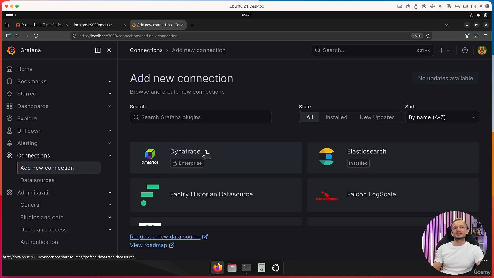

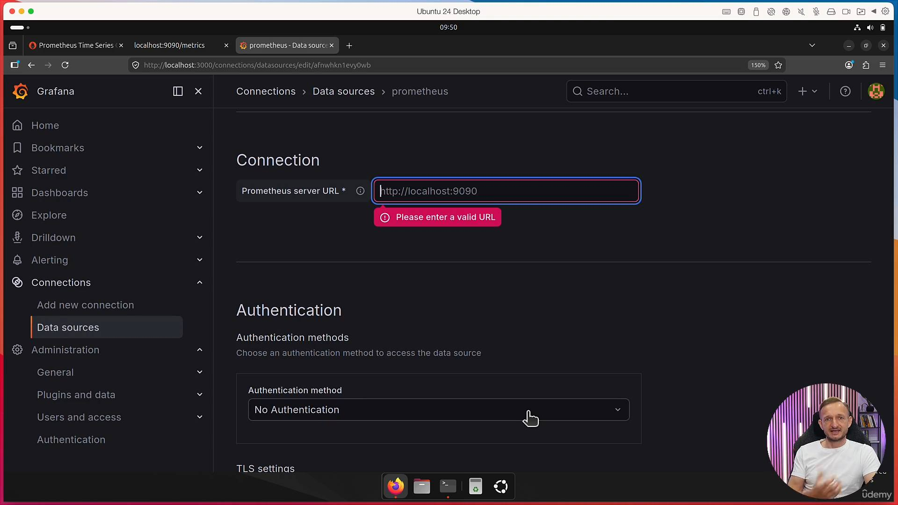

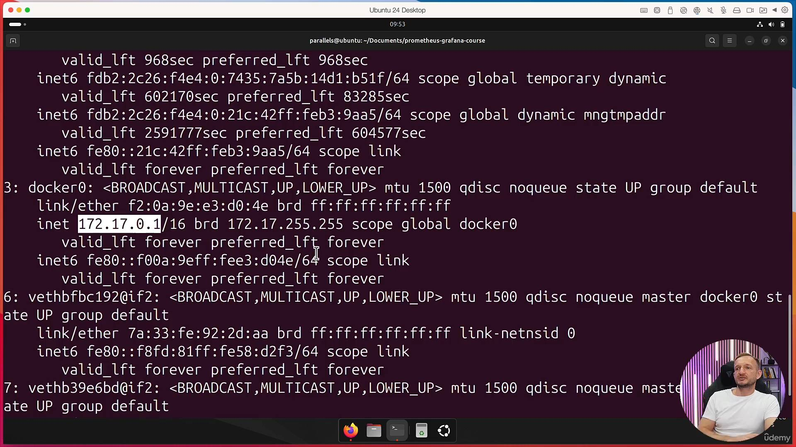

连接成功后，打开 Grafana 左侧的 `Explore`，数据源选择 `Prometheus`，查询：

```promql
up
```

如果能看到值为 `1`，说明 Grafana → Prometheus 链路通了。

### 3.5 用 Prometheus 自身指标练习 P6–P8

P6 到 P8 的所有查询都基于 Prometheus 暴露的自身指标。下面按“先验证类型，再写 PromQL，再做聚合”的顺序复现。

#### 3.5.1 指标类型验证（P6）

**Counter：只增不减的累计值**

查询：

```promql
prometheus_http_requests_total
```

这是 Prometheus 处理 HTTP 请求的累计计数。图上的线只会上升或在无请求时变平，不会自然下降。应用重启时 Counter 会归零，这是正常现象。

在 JS/Node 里可以类比为：

```js
let totalRequests = 0;
totalRequests += 1;
```

进程重启后这个变量回到 `0`。

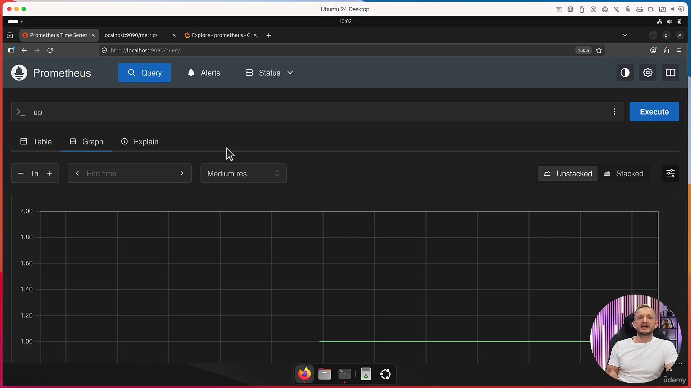

**Gauge：可上可下的瞬时值**

查询：

```promql
go_goroutines
```

这是当前 Go routine 数量，会上下波动。课程用它演示 Gauge 的典型形态。

再查询：

```promql
prometheus_tsdb_head_series
```

这是当前内存中的时间序列数量。它是 Gauge，可能上升，也可能因为序列过期或服务消失而下降。

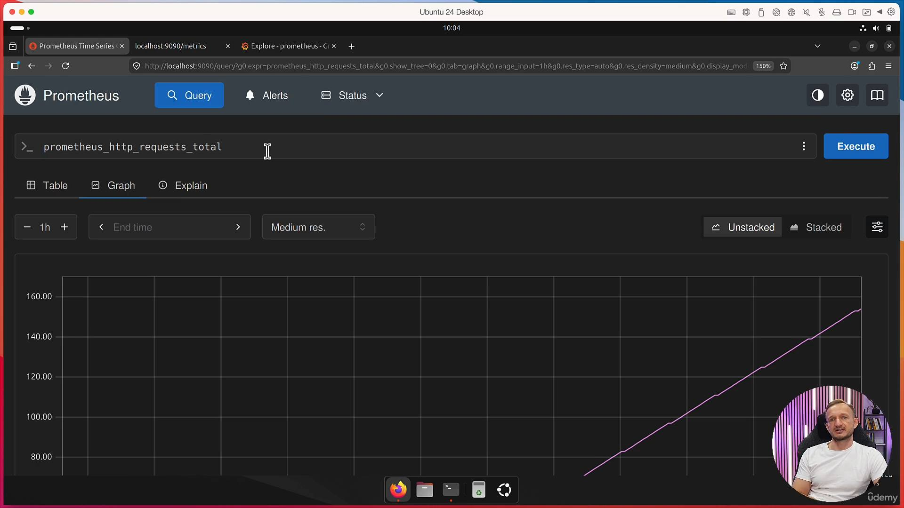

**Histogram：按 bucket 统计分布**

查询：

```promql
prometheus_http_request_duration_seconds_bucket
```

你会看到很多带 `le` 标签的序列。`le` 表示“小于等于某个边界”的桶，例如 `0.1`、`1`，以及特殊的 `+Inf`。`+Inf` 是兜底桶，承接所有观察值。

课程没有展开具体的百分位函数名，所以本文不把某个函数名说成讲师讲过的内容。你只需要先理解：Histogram 把请求耗时分桶计数，后续可以基于桶算分位数。

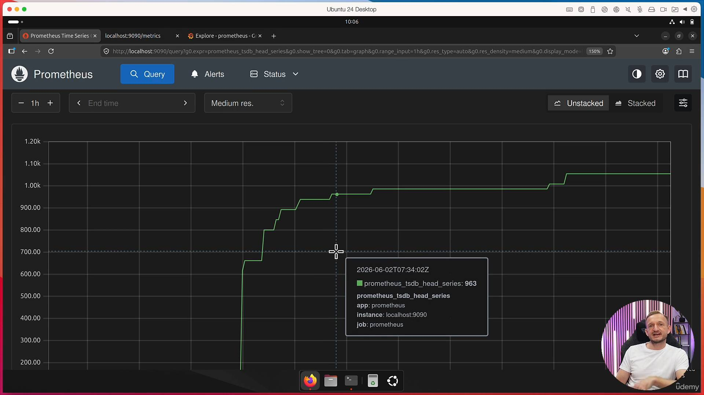

**Summary：课程只点到为止**

课程说 Summary 也会记录观察值并计算分位数，但分位数在应用侧计算，和 Histogram 查询时计算不同。讲师明确说 Summary 不如 Histogram 常用，本节不深入。因此本文也不展开 Summary 的查询。

**Labels 与时间序列**

查询：

```promql
prometheus_http_requests_total
```

点开结果可以看到 `handler`、`code`、`job`、`instance` 等标签。每个标签组合就是一条时间序列。课程里用 `handler` 和 `code` 解释为什么同一指标会出现多条不同颜色的线。

常用过滤：

```promql
prometheus_http_requests_total{handler="/metrics"}
prometheus_http_requests_total{code!="200"}
prometheus_http_requests_total{handler=~"/api.*"}
prometheus_http_requests_total{code!~"5.."}
```

PromQL 标签匹配运算符：

- `=` 精确匹配；
- `!=` 不等于；
- `=~` 正则匹配；
- `!~` 负正则匹配。

P7 讲师用 `handler=~"/api.*"` 演示“以 /api 开头”的匹配。注意 PromQL 正则默认是全匹配，所以写 `/api.*` 而不是只写 `/api`。

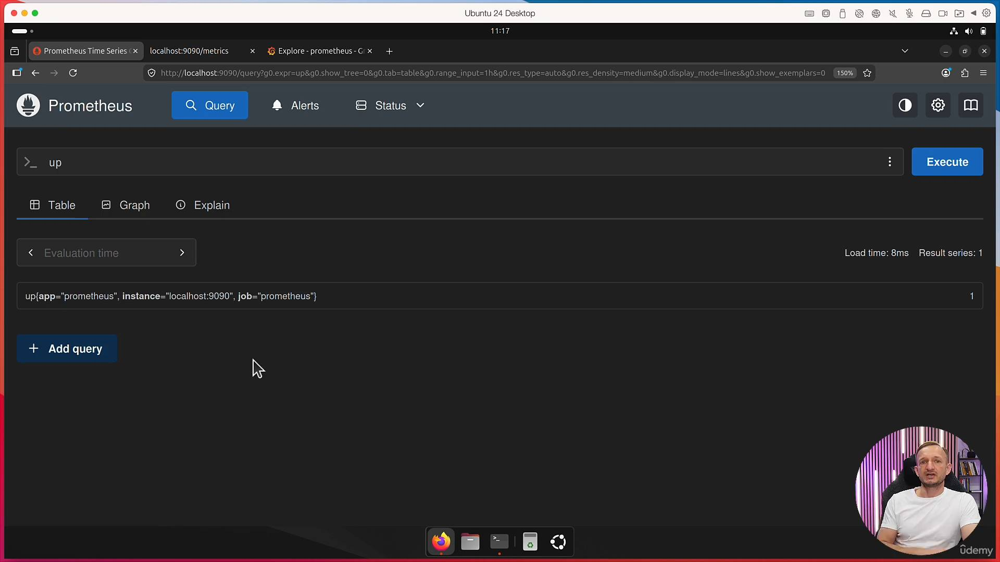

#### 3.5.2 PromQL 基础（P7）

**Instant vector：当前时刻的值**

```promql
up
```

返回每个时间序列的最新值。`1` 表示目标健康，`0` 表示不健康。

**Range vector：一段时间内的值**

```promql
prometheus_http_requests_total[5m]
```

`[5m]` 表示取最近 5 分钟的所有样本。Range vector 不能直接在 Graph 里画图，课程里会看到错误。它要配合函数使用。

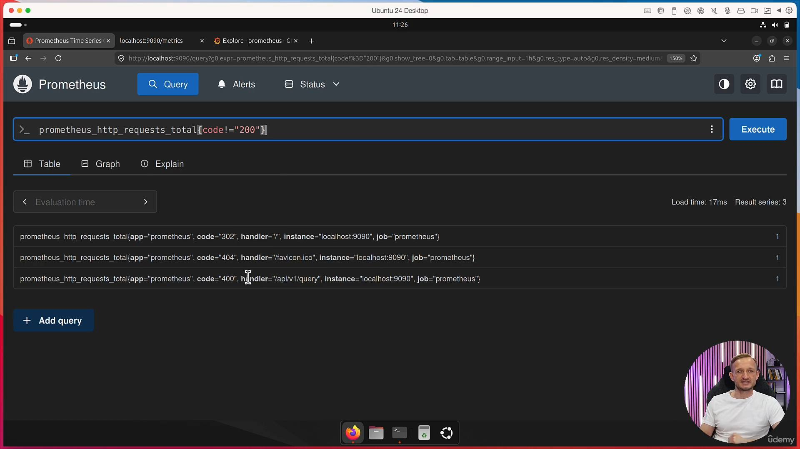

**rate：Counter 的每秒增长率**

```promql
rate(prometheus_http_requests_total[5m])
```

`rate` 对 Counter 在 5 分钟窗口内计算每秒平均增长速率，并自动处理 Counter 重启归零造成的不连续。P8 讲师原话说：

> "它会计算每秒的平均增长速率，并自动处理计数器重置。"
> —— p008 [02:53]

**increase：窗口内的总增量**

```promql
increase(prometheus_http_requests_total[5m])
```

`increase` 看的是 5 分钟窗口内总共增加了多少，不是每秒速率。讲师举例：如果 `rate` 是每秒 2 个请求，5 分钟窗口的 `increase` 约为 `2 * 300 = 600`。

**算术运算：把每秒换成每分钟**

```promql
rate(prometheus_http_requests_total[5m]) * 60
```

把每秒请求数乘以 60，得到每分钟请求数。

**比较运算**

```promql
up == 1
```

只返回 `up` 等于 1 的序列。也可以用 `>`、`<`、`>=`、`<=`、`!=`。

**offset：看历史值**

```promql
prometheus_http_requests_total offset 5m
```

查看 5 分钟前的 Counter 值。课程用它比较当前值和过去值。

#### 3.5.3 函数与聚合（P8）

**rate 的窗口选择**

```promql
rate(prometheus_http_requests_total[1m])
```

窗口短，图更敏感但更抖。

```promql
rate(prometheus_http_requests_total[5m])
```

窗口长，图更平滑但反应慢。课程说 5 分钟可以作为常用默认值。

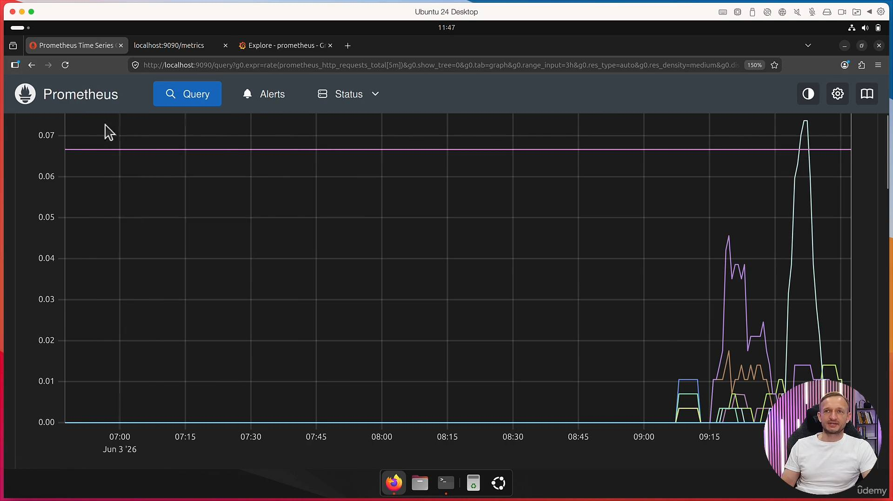

**sum：把所有序列聚合成一条线**

```promql
sum(rate(prometheus_http_requests_total[5m]))
```

原来按 handler、code 拆成很多条线，外层套 `sum` 后变成一条总请求速率线。

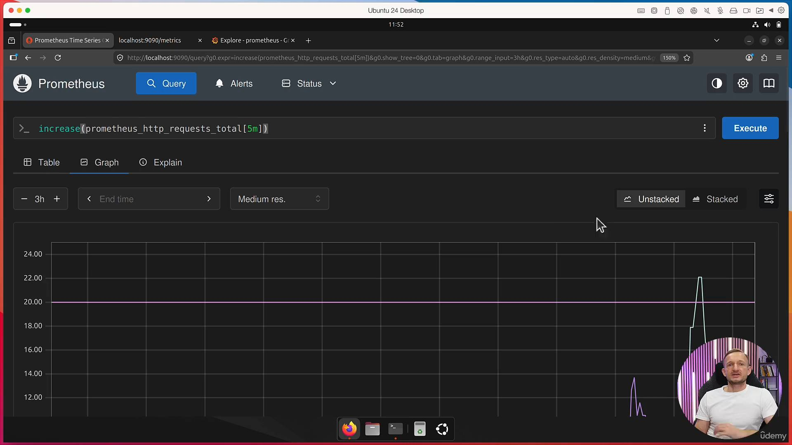

**avg / max / min / count**

```promql
avg(rate(prometheus_http_requests_total[5m]))
max(rate(prometheus_http_requests_total[5m]))
min(rate(prometheus_http_requests_total[5m]))
count(prometheus_http_requests_total)
```

`count` 返回当前有多少个唯一标签组合的时间序列。

**by：保留指定标签做分组聚合**

```promql
sum by (handler) (rate(prometheus_http_requests_total[5m]))
```

按 `handler` 分组，把所有状态码合并，只保留每个 endpoint 的请求速率。

```promql
sum by (code) (rate(prometheus_http_requests_total[5m]))
```

按状态码分组，看不同 `code` 的请求速率。

```promql
sum by (handler, code) (rate(prometheus_http_requests_total[5m]))
```

保留 handler 和 code 两个维度，每条线是一个唯一组合。

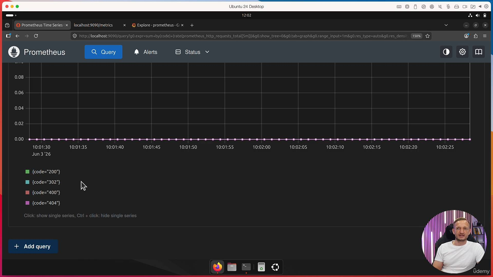

**without：反向聚合，指定要丢掉的标签**

```promql
sum without (instance) (rate(prometheus_http_requests_total[5m]))
```

保留除 `instance` 之外的其他标签。课程解释：`by` 是“保留哪些”，`without` 是“丢掉哪些”。如果标签很多，用 `without` 可能更省事。

**topk：取 Top K**

```promql
topk(3, rate(prometheus_http_requests_total[5m]))
```

取请求速率最高的 3 条时间序列。课程说 `topk` 接收排名数字和输入向量，每个时间点都展示前 K 条。

**错误率百分比**

课程演示了两个版本。第一个是 5xx 错误率：

```promql
100 * sum(rate(prometheus_http_requests_total{code=~"5.."}[5m]))
/
sum(rate(prometheus_http_requests_total[5m]))
```

但课程环境里没有 5xx 数据，所以返回 no data。讲师随后改成“非 200 都算错误”的演示版本：

```promql
100 * sum(rate(prometheus_http_requests_total{code!="200"}[5m]))
/
sum(rate(prometheus_http_requests_total[5m]))
```

这个表达式是：错误请求速率 ÷ 总请求速率 × 100。课程里因为把非 200 都算进去，图上会看到较高的百分比。实际生产里要按你的业务定义决定是只算 5xx，还是把 4xx 也算进去。

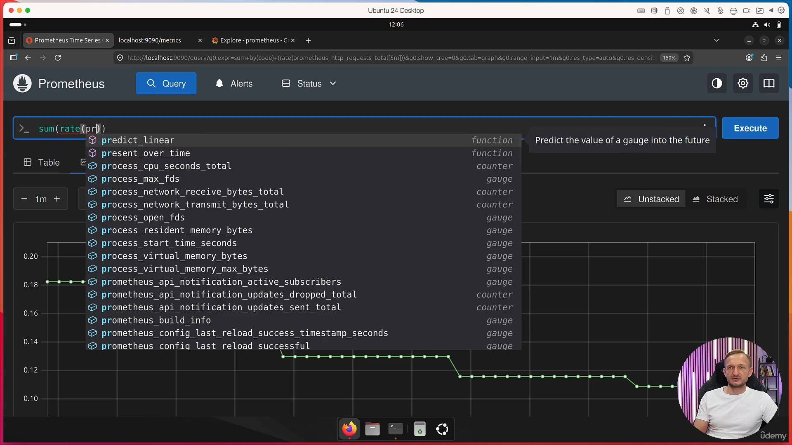

**对 Gauge 做聚合**

```promql
max(go_goroutines)
avg(go_goroutines)
```

聚合运算符不只对 Counter 有效，也可以对 Gauge 使用。课程用 `go_goroutines` 演示了 `max` 和 `avg`。

### 3.6 命令逐条解释

这一节把复现过程中出现的命令按“做什么、关键参数、成功表现、失败时先看什么”解释清楚。它不是课程逐字稿的新增内容，而是为了让复现过程可检查、可排错。

```bash
cd prom-grafana-demo
```

进入项目目录。后续的 Compose 文件、卷挂载路径都是相对当前目录解析的。如果不在这个目录执行，`./prometheus/prometheus.yml` 可能找不到，容器会启动失败或 Prometheus 使用错误配置。成功表现是 `pwd` 显示项目根目录，并且 `ls` 能看到 `docker-compose.yml`。

```bash
docker compose up -d
```

让 Compose 读取当前目录的 `docker-compose.yml`，创建网络、卷和容器，`-d` 表示后台运行。成功时会拉取镜像并启动两个服务。常见失败包括：Docker daemon 未启动、端口 `9090` 或 `3000` 被占用、YAML 缩进错误、本地配置文件路径不存在。排查顺序是 `docker compose config` 校验配置，再 `docker compose ps` 看服务状态，再 `docker logs prometheus` 或 `docker logs grafana` 看日志。

```bash
docker compose ps
```

查看 Compose 管理下的容器状态。重点不是列名，而是服务是否处于 `Up`。如果显示 `Exit` 或 `Restarting`，说明容器反复退出，需要看日志。如果端口映射没有出现，检查 `ports` 字段。

```bash
curl -s http://localhost:9090/-/ready
```

从宿主机请求 Prometheus 的就绪端点。`-s` 表示静默模式，减少进度输出。成功时通常返回类似 `Prometheus Server is Ready.` 的文本。失败时先确认容器是否 `Up`，再确认宿主机端口是否映射到 `9090:9090`。如果 `curl` 返回 `Connection refused`，常见原因是容器没启动或端口被其他程序占用。

```bash
docker run -d \
  --name prometheus \
  -p 9090:9090 \
  -v "$PWD/prometheus/prometheus.yml:/etc/prometheus/prometheus.yml:ro" \
  prom/prometheus:latest
```

手工启动 Prometheus。`-d` 后台运行，`--name prometheus` 固定容器名，`-p 9090:9090` 把宿主机 9090 映射到容器 9090，`-v` 把本地配置只读挂载到容器内 `/etc/prometheus/prometheus.yml`，`:ro` 表示只读。常见错误是容器名冲突（之前已存在同名容器）、本地文件路径错误、配置文件 YAML 语法错误。排查可先 `docker ps -a` 看是否已有同名容器，必要时 `docker rm -f prometheus` 后重建。

```bash
docker run -d \
  --name grafana \
  -p 3000:3000 \
  grafana/grafana:latest
```

手工启动 Grafana。`-p 3000:3000` 让宿主机浏览器可以访问 `http://localhost:3000`。注意这条命令没有挂载 provisioning 数据源配置，所以需要后续在 Grafana UI 里手工添加 Prometheus 数据源。若浏览器打不开，先看 `docker ps` 中 grafana 是否 `Up`，再看 `docker logs grafana` 是否有启动错误。

```bash
docker ps
```

查看正在运行的容器。与 `docker compose ps` 相比，它看的是所有运行中的容器，不局限于当前 Compose 项目。成功表现是能看到 `prometheus` 和 `grafana`，并且端口映射正确。

```bash
ip -4 addr show docker0
```

在 Linux 上查看 Docker bridge 网络接口的 IPv4 地址。手工方式下，Grafana 容器要访问宿主机上的 Prometheus 时，不能写容器自己的 `localhost`，需要写宿主机的可达地址。常见输出中 `docker0` 的地址是 `172.17.0.1`。如果实际输出不同，以实际输出为准。不要把示例 IP 当成所有机器都固定的地址。

```bash
docker run -d \
  --name grafana \
  -p 3000:3000 \
  --add-host=host.docker.internal:host-gateway \
  grafana/grafana:latest
```

这是 Linux 下让 Grafana 容器解析 `host.docker.internal` 的工程化补法。`--add-host` 会给容器增加一条 hosts 记录，`host-gateway` 由 Docker 解析为宿主机网关。课里只提到可以把两个容器放到同一个网络，没有展开这条命令；这里明确标为复现补法，不把它说成讲师原操作。

```bash
docker compose down
```

停止并删除 Compose 创建的容器和网络，但默认保留 named volume。用于日常停止复现环境。成功后可再次 `docker compose up -d` 恢复。

```bash
docker compose down -v
```

在停止和删除容器的同时删除 named volume。`-v` 会删除 Prometheus 和 Grafana 的持久化数据，包括 Grafana 里手工创建的数据源、仪表盘等。只在确认不需要保留数据时使用。

### 3.7 常见错误与排查

**错误 1：Grafana 里填 `http://localhost:9090` 后 `Save & test` 失败。**  
这是本节最核心的坑。Grafana 在容器里运行时，`localhost` 指 Grafana 容器自身，不是宿主机。P5 讲师原话已经明确说明：

> "这里写的 localhost 实际上指的是容器本身，而不是宿主机。"
> —— p005 [07:43]

Compose 方案应使用 `http://prometheus:9090`，因为同一 Compose 网络内可以用服务名解析。手工容器方案在 Linux 上可使用 `http://172.17.0.1:9090`，macOS/Windows 可先试 `http://host.docker.internal:9090`。如果 Linux 上 `host.docker.internal` 报 `name or service not known`，这就是讲师遇到的 Linux gotcha，改用宿主机网关地址或加 `--add-host`。

**错误 2：Prometheus 容器反复退出。**  
先执行 `docker logs prometheus`。常见原因是 `prometheus.yml` 缩进错误、挂载路径写错、配置文件不存在。可用 `docker compose config` 检查 Compose 文件本身，再确认 `./prometheus/prometheus.yml` 是否存在。YAML 对缩进敏感，`scrape_configs` 下的层级不能随意空格混用。

**错误 3：端口被占用，出现 `address already in use`。**  
说明宿主机 `9090` 或 `3000` 已被其他进程占用。可先停止占用端口的程序，或临时改映射端口。但改端口后浏览器地址和 Grafana 数据源 URL 要相应调整。本文为保持与课程一致，固定使用 `9090` 和 `3000`。

**错误 4：Prometheus 查询 `up` 没有结果。**  
先确认 Prometheus 自己是否在抓取自己。本文的最小配置里 `targets: ["localhost:9090"]` 是在 Prometheus 容器内部解析的，指向 Prometheus 容器自己的 9090 端口，因此对“抓取 Prometheus 自身”是合理的。若没有结果，检查查询时间范围是否覆盖当前时间、页面是否在 Graph 而不是 Table、配置是否被正确挂载。还可打开 Prometheus 的 `Status -> Targets` 看目标状态。

**错误 5：直接查询 range vector 在 Graph 里报错。**  
例如直接查 `prometheus_http_requests_total[5m]`。P7 讲师说：

> "范围向量实际上不能直接绘图，它们应当配合函数使用。"
> —— p007 [09:02]

Range vector 表示一段时间内的多个样本，Graph 需要的是可绘制的瞬时向量。应配合 `rate`、`increase` 等函数使用，或在 Table 视图查看原始样本。

**错误 6：`rate` 图看起来不对或没有数据。**  
`rate` 面向 Counter，窗口内至少需要足够样本。如果窗口太短、抓取间隔太长、刚启动不久，可能没有足够数据点。窗口 `[1m]` 更敏感也更抖，`[5m]` 更平滑。Counter 重启归零时 `rate` 会处理不连续，但不要把 Gauge 当 Counter 做 `rate` 解释。

**错误 7：5xx 错误率返回 no data。**  
课程环境里没有 5xx 数据，所以 `code=~"5.."` 的表达式没有结果。这不是表达式必然错误，而是当前没有匹配序列。讲师随后改成 `code!="200"` 的演示版本。生产里要明确定义错误：只算 5xx，还是把 4xx 也算入。`code!="200"` 会把非 200 都算进去，可能得到较高百分比，不能直接当成生产错误率定义。

**错误 8：Grafana Explore 查询无结果，但 Prometheus 页面有结果。**  
先确认 Explore 顶部数据源选的是 Prometheus，而不是其他数据源；再确认时间范围；再确认数据源 `Save & test` 是否成功。若数据源 URL 错，Prometheus 页面本身能打开，但 Grafana 仍然查不到。

### 3.8 Prometheus 前台与 Grafana Explore 的对照

这里的“前台”指浏览器里直接操作的 Prometheus Web UI 和 Grafana Explore。两边执行的是同一条 PromQL，但界面职责不同。

| 操作 | Prometheus Web UI `http://localhost:9090` | Grafana Explore | 对照说明 |
| --- | --- | --- | --- |
| 查询 `up` | 在查询框输入后点 `Execute`，可看 Graph/Table | 选择 Prometheus 数据源后输入同一查询 | 两边结果应一致；Grafana 多一层数据源连通性 |
| 查询 Counter 原始值 | 能看到累计曲线或表格 | 同样能显示，但通常用于探索 | Counter 原始值只适合观察累计增长，不适合直接当速率 |
| 查询 range vector | Graph 可能报错，Table 可看样本 | 同样不适合直接画图 | 必须配合函数 |
| 查询 `rate(...)` | Graph 显示每秒速率曲线 | Explore 显示同样曲线，可切换可视化 | 两边都应出现按标签拆分的多条线 |
| 查询 `sum by (...)` | 聚合后线数减少 | 同样减少 | `by` 保留指定标签做分组 |
| 查询 `topk(...)` | 每个时间点取前 K 条 | 同样 | 不是“整段时间只有一个 Top K” |
| 数据源配置 | Prometheus 自身不需要在页面里配数据源 | 需要在 Grafana 配 Prometheus 数据源 | Grafana 的数据源 URL 是容器网络问题的高发点 |
| 成功标志 | `up` 为 `1`，Targets 健康 | `Save & test` 成功，Explore 能查到 `up` | 两条链路都通才算复现完成 |

### 3.9 复现检查清单

1. **目录和文件齐全。** 确认 `docker-compose.yml`、`prometheus/prometheus.yml`、`grafana/provisioning/datasources/prometheus.yml` 都在正确路径。缺文件会导致挂载失败或数据源不出现。
2. **Compose 配置可解析。** 执行 `docker compose config`，没有 YAML 报错再启动。
3. **容器处于 Up。** 执行 `docker compose ps`，`prometheus` 和 `grafana` 都应运行。
4. **Prometheus 就绪。** `curl -s http://localhost:9090/-/ready` 成功，浏览器能打开 `http://localhost:9090`。
5. **Prometheus 能查 `up`。** 查询 `up` 返回 `1`，说明自身抓取目标健康。
6. **Grafana 能登录。** 打开 `http://localhost:3000`，使用 `admin/admin` 登录。
7. **数据源连通。** Compose 方案应看到 provisioning 的 Prometheus 数据源；手工方案需在 UI 添加并 `Save & test` 成功。
8. **Explore 能查 `up`。** Grafana Explore 选择 Prometheus，查询 `up` 有结果。
9. **Counter 原始查询有曲线。** 查询 `prometheus_http_requests_total` 能观察到累计增长。
10. **Gauge 查询有波动。** 查询 `go_goroutines` 或 `prometheus_tsdb_head_series` 能看到上下变化。
11. **Histogram bucket 有 `le` 标签。** 查询 `prometheus_http_request_duration_seconds_bucket` 能看到多个桶和 `+Inf`。
12. **range vector 报错可解释。** 直接查 `[5m]` 在 Graph 报错属于预期，换成 `rate(...)` 后正常。
13. **聚合结果符合预期。** `sum(rate(...))` 变单线，`sum by (handler)` 按 handler 分组，`sum without (instance)` 丢掉 instance。
14. **`topk` 行为正确。** `topk(3, rate(...))` 每个时间点显示前 3 条。
15. **错误率表达式可解释。** 5xx 版本可能 no data；非 200 版本可能百分比较高，二者都不能脱离业务定义直接下结论。
16. **停止和清理方式明确。** 日常停止用 `docker compose down`；确认不保留数据时才用 `docker compose down -v`。

---

## 4. 完整代码

### 4.1 `docker-compose.yml`

```yaml
services:
  prometheus:
    image: prom/prometheus:latest
    container_name: prometheus
    ports:
      - "9090:9090"
    volumes:
      - ./prometheus/prometheus.yml:/etc/prometheus/prometheus.yml:ro
      - prometheus-data:/prometheus
    restart: unless-stopped

  grafana:
    image: grafana/grafana:latest
    container_name: grafana
    ports:
      - "3000:3000"
    environment:
      GF_SECURITY_ADMIN_USER: admin
      GF_SECURITY_ADMIN_PASSWORD: admin
    volumes:
      - ./grafana/provisioning:/etc/grafana/provisioning:ro
      - grafana-data:/var/lib/grafana
    depends_on:
      - prometheus
    restart: unless-stopped

volumes:
  prometheus-data:
  grafana-data:
```

### 4.2 `prometheus/prometheus.yml`

```yaml
global:
  scrape_interval: 15s
  evaluation_interval: 15s

scrape_configs:
  - job_name: "prometheus"
    metrics_path: /metrics
    static_configs:
      - targets: ["localhost:9090"]
```

### 4.3 `grafana/provisioning/datasources/prometheus.yml`

```yaml
apiVersion: 1

datasources:
  - name: Prometheus
    type: prometheus
    access: proxy
    url: http://prometheus:9090
    isDefault: true
    editable: true
```

### 4.4 `promql-cheatsheet.md`

````markdown
# PromQL 练习清单

## 1. 指标类型验证

```promql
up
prometheus_http_requests_total
go_goroutines
prometheus_tsdb_head_series
prometheus_http_request_duration_seconds_bucket
```

## 2. 标签过滤

```promql
prometheus_http_requests_total{handler="/metrics"}
prometheus_http_requests_total{handler=~"/api.*"}
prometheus_http_requests_total{code!="200"}
prometheus_http_requests_total{code!~"5.."}
```

## 3. 范围向量与函数

```promql
prometheus_http_requests_total[5m]
rate(prometheus_http_requests_total[5m])
increase(prometheus_http_requests_total[5m])
rate(prometheus_http_requests_total[5m]) * 60
```

## 4. 比较与 offset

```promql
up == 1
prometheus_http_requests_total offset 5m
```

## 5. 聚合

```promql
sum(rate(prometheus_http_requests_total[5m]))
avg(rate(prometheus_http_requests_total[5m]))
max(rate(prometheus_http_requests_total[5m]))
min(rate(prometheus_http_requests_total[5m]))
count(prometheus_http_requests_total)
sum by (handler) (rate(prometheus_http_requests_total[5m]))
sum by (code) (rate(prometheus_http_requests_total[5m]))
sum by (handler, code) (rate(prometheus_http_requests_total[5m]))
sum without (instance) (rate(prometheus_http_requests_total[5m]))
topk(3, rate(prometheus_http_requests_total[5m]))
max(go_goroutines)
avg(go_goroutines)
```

## 6. 错误率

```promql
100 * sum(rate(prometheus_http_requests_total{code=~"5.."}[5m]))
/
sum(rate(prometheus_http_requests_total[5m]))
```

```promql
100 * sum(rate(prometheus_http_requests_total{code!="200"}[5m]))
/
sum(rate(prometheus_http_requests_total[5m]))
```
````

### 4.5 `README.md`

````markdown
# Prometheus + Grafana 复现项目

## 启动

```bash
docker compose up -d
docker compose ps
```

## 地址

- Prometheus: http://localhost:9090
- Grafana: http://localhost:3000

## Grafana 登录

- 用户名: admin
- 密码: admin

## 验证 Prometheus

浏览器打开 http://localhost:9090，在查询框执行：

```promql
up
```

应返回 1。

## 验证 Grafana 数据源

Grafana 已通过 provisioning 自动添加 Prometheus 数据源，URL 为：

```text
http://prometheus:9090
```

打开 Grafana Explore，选择 Prometheus，执行：

```promql
up
```

应能看到结果。

## 停止

```bash
docker compose down
```

## 清空持久化数据

```bash
docker compose down -v
```

注意：`-v` 会删除 Prometheus 和 Grafana 的 named volume。
````

---

## 5. 逐行解释

### 5.1 `docker-compose.yml`

- `services:`：Compose 的服务列表，下面每个缩进项都是一个可启动的服务。
- `prometheus:`：第一个服务名。Compose 网络里其他容器可以用 `prometheus` 这个 DNS 名访问它，Grafana provisioning 中的 `http://prometheus:9090` 就依赖这个服务名。
- `image: prom/prometheus:latest`：使用官方 Prometheus 镜像。课程没有固定版本，所以这里用 `latest`。生产环境应固定 tag。
- `container_name: prometheus`：容器名固定，便于 `docker ps` 和 `docker logs prometheus`。
- `ports: - "9090:9090"`：宿主机 9090 映射到容器 9090。Prometheus 默认 Web 端口是 9090。
- `volumes: - ./prometheus/prometheus.yml:/etc/prometheus/prometheus.yml:ro`：把本地 Prometheus 配置只读挂载到容器默认配置路径。`:ro` 表示容器内不能修改该文件，减少误改。
- `- prometheus-data:/prometheus`：把 Prometheus 数据目录挂到 named volume，容器重建后数据仍在。若执行 `docker compose down -v`，该 volume 会被删除。
- `restart: unless-stopped`：除非人工停止，否则容器异常退出后自动重启。复现时方便，生产还要结合资源限制和监控。
- `grafana:`：第二个服务名，Compose 网络内可通过 `grafana` 访问。
- `image: grafana/grafana:latest`：使用官方 Grafana 镜像。课程直接拉取 `grafana/grafana`，未固定版本。
- `container_name: grafana`：固定容器名，便于查看日志。
- `ports: - "3000:3000"`：宿主机 3000 映射到容器 3000，浏览器访问 `http://localhost:3000`。
- `environment:`：设置 Grafana 环境变量。
- `GF_SECURITY_ADMIN_USER: admin`：固定管理员用户名为 `admin`，与课程默认账号一致。
- `GF_SECURITY_ADMIN_PASSWORD: admin`：固定管理员密码为 `admin`。这是本地复现配置，生产环境不应使用弱密码。
- `volumes: - ./grafana/provisioning:/etc/grafana/provisioning:ro`：把本地 provisioning 目录只读挂载进 Grafana，使数据源配置可以自动加载。
- `- grafana-data:/var/lib/grafana`：持久化 Grafana 数据目录，包括数据库、插件等。
- `depends_on: - prometheus`：声明启动顺序依赖。它只保证启动顺序，不保证 Prometheus 已经完全就绪；应用层仍要 `Save & test` 验证。
- `volumes: prometheus-data: grafana-data:`：声明两个 named volume，供上面的服务挂载。

### 5.2 `prometheus/prometheus.yml`

- `global:`：全局配置块。
- `scrape_interval: 15s`：默认每 15 秒抓取一次目标。窗口函数如 `[5m]` 要在这个间隔下有足够样本。
- `evaluation_interval: 15s`：规则评估间隔。本文没有告警规则，但保留该配置符合常规结构。
- `scrape_configs:`：抓取任务列表。
- `- job_name: "prometheus"`：任务名为 `prometheus`，会作为 `job` 标签出现在指标上。
- `metrics_path: /metrics`：抓取指标路径，Prometheus 自身默认暴露 `/metrics`。
- `static_configs:`：静态目标列表。
- `- targets: ["localhost:9090"]`：在 Prometheus 容器内部抓取自己的 9090 端口。这里的 `localhost` 是 Prometheus 容器自身，不是宿主机；这与 Grafana 数据源 URL 里的 `localhost` 含义不同，要区分场景。

### 5.3 `grafana/provisioning/datasources/prometheus.yml`

- `apiVersion: 1`：Grafana provisioning 的数据源 API 版本。
- `datasources:`：数据源列表。
- `- name: Prometheus`：Grafana 中显示的数据源名称。
- `type: prometheus`：数据源类型为 Prometheus。
- `access: proxy`：Grafana 后端代理访问 Prometheus，浏览器不直接跨域请求。
- `url: http://prometheus:9090`：Compose 网络内通过服务名访问 Prometheus。手工 `docker run` 时不能照抄这个地址，因为手工方案没有这个 Compose 服务名。
- `isDefault: true`：设为默认数据源，新建 Explore 查询时默认选中。
- `editable: true`：允许在 UI 中编辑。生产可按需要设为不可编辑以固定配置。

### 5.4 `promql-cheatsheet.md`

该文件是练习清单，按“指标类型、标签过滤、范围向量与函数、比较与 offset、聚合、错误率”分组。它的作用是逐条对照复现结果，而不是替代 Prometheus 官方文档。每条查询在 Prometheus UI 和 Grafana Explore 中都可以执行，结果形状应一致；差别主要在 Grafana 的可视化和数据源选择。

### 5.5 `README.md`

README 给出启动、访问地址、登录账号、验证方式、停止和清理命令。`docker compose down` 只停止并删除容器和网络，`docker compose down -v` 会额外删除 named volume，属于破坏性操作，执行前要确认数据不再需要。

---

## 6. 最终验收标准

完成以上步骤后，至少满足以下条件，才算 P5–P8 的复现闭环完成：

1. `http://localhost:9090` 可打开，`up` 返回 `1`；
2. `prometheus_http_requests_total` 能看到 Counter 累计曲线；
3. `go_goroutines` 能看到 Gauge 上下波动；
4. `prometheus_http_request_duration_seconds_bucket` 能看到 `le` 桶和 `+Inf`；
5. 直接查询 `prometheus_http_requests_total[5m]` 在 Graph 中报错，配合 `rate` 后正常；
6. `sum by (handler)`、`sum by (code)`、`sum without (instance)` 的线数变化符合聚合逻辑；
7. `topk(3, ...)` 每个时间点显示前 3 条；
8. 5xx 错误率可能 no data，非 200 错误率可能较高，两者都能解释原因；
9. Grafana `Save & test` 成功，Explore 查询 `up` 有结果。

## 7. 课里没讲但你会撞上的

| 现象 | 原因 | 怎么办 |
| --- | --- | --- |
| Grafana 数据源 URL 填 `http://localhost:9090` 后 `Save & test` 失败。 | 课里讲过：Grafana 在容器里运行，URL 里的 `localhost` 指 Grafana 容器自身，不是宿主机。 | Compose 方案填 `http://prometheus:9090`；手工 Linux 方案填宿主机 Docker 网关地址（如 `http://172.17.0.1:9090`），macOS/Windows 可试 `http://host.docker.internal:9090`。 |
| Linux 上填 `http://host.docker.internal:9090` 报 `name or service not known`。 | 课里讲过：这是 Linux 的 gotcha，`host.docker.internal` 默认可能不解析。 | 用 `ip -4 addr show docker0` 查实际网关填 IP；或启动 Grafana 时加 `--add-host=host.docker.internal:host-gateway`（这条命令是课里没讲、文档补充的复现补法）。 |
| 手工 `docker run` 起 Grafana 后，照抄 Compose 的 `http://prometheus:9090` 连不上。 | 课里没讲（补充）：手工容器没有 Compose 的服务名 `prometheus`，该 DNS 名只在 Compose 网络里可用。 | 手工方案按课程 UI 添加数据源，并填宿主机可达地址；或改用 Compose 方案使用服务名。 |
| 直接查询 `prometheus_http_requests_total[5m]` 并切到 Graph 报错。 | 课里讲过：range vector 不能直接画图，要配合函数使用。 | 改成 `rate(prometheus_http_requests_total[5m])` 或 `increase(...)`；只想看原始样本时用 Table。 |
| `rate(prometheus_http_requests_total[5m])` 出来很多条线，图很乱。 | 课里讲过：同一指标被 `handler`、`code` 等标签拆成多条时间序列。 | 加标签过滤，或用 `sum by (handler)`、`sum by (code)` 等聚合。 |
| 过滤 `handler="/metrics"` 后仍有多条线。 | 课里讲过标签会拆分时间序列；补充说明：`code` 等其它标签仍不同。 | 再加 `code="200"` 等过滤，或用 `sum by (...)` 聚合。 |
| 5xx 错误率表达式返回 no data。 | 课里讲过：当前环境没有 `code=~"5.."` 的序列，不是表达式必然写错。 | 用 `code!="200"` 的演示版本验证表达式结构；生产要按业务定义错误范围。 |
| 把 `code!="200"` 的错误率直接当生产错误率，发现百分比很高。 | 课里讲过：这个演示把非 200 都算错误，包含 3xx/4xx 等。 | 生产里明确只算 5xx，还是把 4xx 也算入；不要直接套演示定义。 |
| 原始 Counter `prometheus_http_requests_total` 累计值很大、线很多，看不出请求速率。 | 课里讲过：Counter 只增不减，原始累计值不适合直接看变化；多标签会拆成多条线。 | 用 `rate(...)`/`increase(...)` 转成速率或增量，再做 `sum by` 等聚合。 |
| 刚启动就查 `rate(...[1m])` 没数据或很抖。 | 课里没讲（补充）：窗口内样本不足，抓取间隔是 15s。 | 等样本足够；常用 `[5m]` 更平滑；检查 `scrape_interval` 和容器启动时间。 |
| Prometheus 页面查 `up` 没有结果。 | 课里没讲（补充）：可能时间范围不覆盖当前、抓取配置未生效、容器未就绪或配置未挂载。 | 看 `Status -> Targets`，`curl -s http://localhost:9090/-/ready`，检查 `prometheus.yml` 挂载和查询时间范围。 |
| `prometheus` 容器反复退出。 | 课里没讲（补充）：常见是 `prometheus.yml` 缩进错误、挂载路径写错或文件不存在。 | `docker logs prometheus` 看日志，`docker compose config` 校验 Compose 文件，确认 `./prometheus/prometheus.yml` 存在且 YAML 正确。 |
| `docker compose up -d` 报 `address already in use`。 | 课里没讲（补充）：宿主机 `9090` 或 `3000` 已被占用。 | 停止占用端口的程序，或临时改端口映射；改端口后浏览器地址和 Grafana 数据源 URL 要同步改。 |
| Compose 刚启动就点 `Save & test` 失败，或 Explore 暂时无数据。 | 课里没讲（补充）：`depends_on` 只保证启动顺序，不保证 Prometheus 已经就绪。 | 等几秒重试；先 `docker compose ps` 和 `curl /-/ready` 确认 Prometheus 就绪。 |
| 手工 `docker run` 方案进 Grafana 后找不到自动添加的 Prometheus 数据源。 | 课里没讲（补充）：手工命令没有挂载 `grafana/provisioning`，不会自动创建数据源。 | 按 UI 在 Connections/Data sources 里手动添加 Prometheus 并 `Save & test`；或改用 Compose/挂载 provisioning。 |
| Grafana 菜单和视频不一样，找不到 Data sources。 | 课里讲过：直接拉 `grafana/grafana` 未固定版本，`latest` 的 UI 可能变化。 | 去 `Connections` 下找 `Data sources` 或 `Add new connection` 搜索 Prometheus；生产应固定 tag。 |
| `docker compose down -v` 后 Grafana 里手工建的数据源/仪表盘没了。 | 课里没讲（补充）：`-v` 会删除 named volume，持久化数据被清空。 | 日常停止用 `docker compose down`；确认不保留数据时才用 `down -v`。 |
| 对 Gauge 使用 `rate` 并当 Counter 解释。 | 课里没讲（补充）：`rate` 面向 Counter；Gauge 可上下波动，不适合按 Counter 解释。 | Gauge 用 `max`/`avg`/`min` 或直接看瞬时值；Counter 才用 `rate`/`increase`。 |
| `handler=~"/api"` 匹配不到 API。 | 课里没讲（补充）：PromQL 正则默认全匹配，写 `/api` 不会匹配 `/api/...`。 | 写成 `handler=~"/api.*"`。 |
