# Prometheus & Grafana 实战：给 Node.js 应用接自定义指标、做仪表盘、配告警

> 覆盖 P009–P012。读完之后你应该得到这样一个东西：一个跑在宿主机 `3001` 端口的 Node.js API，`/metrics` 上暴露自定义指标；一个 Prometheus 容器把它抓走；一个 Grafana 仪表盘用两个面板 + 两个变量把它画出来；一条告警规则在 500 比例超过阈值时，通过 webhook 打回你的 Node 应用，并在终端里打印出来。

---

## 1. 这一节做什么

这四节是一条完整的"从代码到告警"的链路，缺任何一环后面都做不下去。按顺序是：

| 环节 | 产物 | 关键位置 |
|---|---|---|
| 埋点 | `demo-app/index.js`，Express 应用，端口 **3001** | 宿主机 |
| 抓取 | `prometheus.yml`，两个 scrape job | 课程根目录 |
| 可视化 | Grafana Dashboard（2 个 panel、2 个变量） | Grafana 容器 `3000` |
| 告警 | Alert rule + Webhook contact point | Grafana → `http://<docker0 IP>:3001/webhook/alert` |

最终目录结构（讲师的做法是把 Prometheus 配置放在课程根目录，应用放在子目录）：

```
prometheus-grafana/
├── prometheus.yml
└── demo-app/
    ├── index.js
    ├── package.json
    └── node_modules/
```

三个必须先记住的坑，它们贯穿全文：

1. **端口不能用 3000**。讲师的原话是 Grafana 已经占了 3000，所以应用换 3001。
2. **Prometheus 容器里的 `localhost` 不是你的宿主机**，抓应用必须用 docker 网桥地址（讲师机器上是 `172.17.0.1`）。
3. **Grafana 容器里的 `localhost` 也不是你的宿主机**，webhook 同理。

---

## 2. 讲师原话（带时间点）

关于指标注册表是什么：

> "registry 是存储我们所有指标的地方，而 collectDefaultMetrics 会自动设置标准指标，例如内存使用、CPU 使用、一些事件循环延迟以及其他 Node.js 进程指标。"
>
> —— p009 [08:34]

关于为什么必须暴露 `/metrics`（讲师把 pull-based 口误说成 "pool-based"）：

> "这是一种基于拉取的机制，对吧？因此 Prometheus 需要能够访问某种端点。这就是为什么我们需要暴露这个 /metrics 端点，让 Prometheus 来抓取。"
>
> —— p009 [16:28]

关于抓取地址为什么不能写 `localhost`：

> "这里请记住，我们实际上会把 host.docker.internal 改成之前已经给 Grafana 使用的那个 IP 地址……所以 host.docker.internal 在你那里可能不起作用。"
>
> —— p009 [24:00]

关于 Grafana 查询编辑器的两种模式：

> "这里的 Prometheus 查询编辑器有两种模式：构建器模式和代码模式……代码模式实际上只是使用 PromQL，也就是我们本课程中已经用过的原始 PromQL。"
>
> —— p010 [05:11]

关于多选变量为什么必须用 `=~`：

> "这个 ~= 语法，是因为……它是一个正则表达式匹配器，而当我们使用多选变量时，它正是必需的，因为 Grafana 会把它们转换成正则表达式模式。"
>
> —— p011 [09:28]

关于告警规则从面板里搬走了：

> "在旧版本的 Grafana 中，你可以在面板编辑器内找到告警选项卡……但在当前版本的 Grafana 中，那些告警规则位于告警功能这个专用区域，并且是独立于仪表板进行管理的。"
>
> —— p012 [04:19]

关于 webhook 接收端：

> "我们正在创建一个 POST 路由，用于 Webhook 告警。该请求会经过 express.json 中间件，因此会解析 JSON，然后我们只会在控制台输出一条日志，表示已收到告警。"
>
> —— p012 [13:07]

关于容器访问宿主机：

> "Grafana 位于容器内部。因此，如果它在容器内部，localhost 就意味着它是容器内的本地地址，但我们的端点位于宿主机上。"
>
> —— p012 [14:56]

---

## 3. 从零复现

下面每一步都写了"你输入什么、你应该看到什么"。卡住了就对照第 6 节的检查清单。

### 步骤 0：前置条件

- 一个 Linux 环境（讲师用的是 Ubuntu 系，Node 通过 apt 装），能跑 docker。
- 已经有 Prometheus 和 Grafana 容器在跑（前面课程装过）。用 `docker ps` 确认一下。

### 步骤 1：装 Node 和 npm

讲师先 `node --version` 发现没有，然后：

```bash
sudo apt update
sudo apt install nodejs
node --version      # 讲师机器上是 v18.x
sudo apt install npm
npm --version
```

注意讲师这里有个细节值得记住：**apt 里 `nodejs` 和 `npm` 是两个独立包**，装完 node 不一定有 npm，要单独装。讲师说 "如果你从这里安装，可以看到应该会返回 node -v 和 npm -v。但你现在可以看到，通过 APT 安装的话，它们是独立的包。"（p009 [02:51]）。

讲师说 "只要是 18 以上的版本都可以。"（p009 [02:23]），不用纠结版本。也可以走 nvm 或官网安装包，课里只是提了一句，没细讲。

### 步骤 2：初始化项目

```bash
mkdir demo-app
cd demo-app
npm init -y
```

得到 `package.json`。讲师随后用 VS Code 打开这个目录（课里没规定编辑器，终端里用 nano/vim 写也行）。

### 步骤 3：装依赖

```bash
npm install express prom-client
```

装完 `package.json` 里应该出现两个 dependencies，目录下多出 `node_modules`。讲师特意解释了一句 node_modules 是什么："node_modules 就是下载并安装后存放软件包和第三方依赖的地方。"（p009 [06:11]）。

### 步骤 4：写 index.js

完整代码在第 4 节，直接整份复制成 `demo-app/index.js` 即可。P009 阶段可以先不要 `/webhook/alert` 那段，到 P012 再加（我在代码里用注释标出来了）。

### 步骤 5：跑起来并验证

```bash
node index.js
```

期望输出：

```
Demo app listening on http://localhost:3001
Metrics available at http://localhost:3001/metrics
```

讲师在这里踩过一个坑：第一次跑报 `Express is not found`，原因是 `require` 里写错了包名（"找不到 Express，说明某处有拼写错误。"）。他还提到 `app.listen` 曾误写成大写 `Listen`。这两个都是拼写问题，看到类似报错先回代码里对一遍大小写和包名。

浏览器打开 `http://localhost:3001/api/users`，拿到 Alice/Bob/Charlie：

```json
[
  { "id": 1, "name": "Alice" },
  { "id": 2, "name": "Bob" },
  { "id": 3, "name": "Charlie" }
]
```

再打开 `http://localhost:3001/api/products`，多刷几次，会随机拿到 500。

最后打开 `http://localhost:3001/metrics`，会看到一整屏纯文本。前面一大段是 Node 进程的默认指标（`heap`、`event loop lag` 之类），滚到底部才是你自定义的三个。

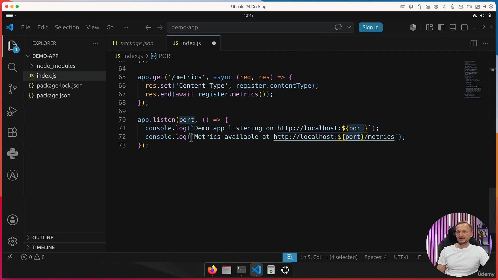

这一步是整条链路的"水源"。讲师的做法是先打开 `/metrics` 确认有内容（此时 `api_active_connections` 是 0，因为还没发过请求），再去打几次 `/api/users` 和 `/api/products`，回来刷新 `/metrics`，就能看到 counter 里出现 `GET /api/users 200` 这样的组合，以及 histogram 的一排 bucket（p009 [21:08]–[21:35]）。

### 步骤 6：停掉旧的 Prometheus 容器

```bash
docker ps
docker stop prometheus
docker ps
docker rm prometheus
```

讲师是"stop 完再删"，为的是用新配置重新起一个（p009 [22:04]）。

### 步骤 7：写 prometheus.yml

放在**课程根目录**（不是 `demo-app` 里面）。讲师一开始是在 `demo-app` 里用 nano 写的，后来 `mv` 到上一层，因为后面 `docker run` 是在根目录执行的。完整内容见第 4 节，唯一需要你改的是 `172.17.0.1`。

怎么拿到这个 IP：讲师的说法是"访问我的 IP 地址，我在这里会用我的网桥。"（p009 [24:00]），也就是 `ip a` 看 docker0 网桥的地址（Linux 上通常是 `172.17.0.1`）。macOS / Windows 上大概率没有这个网桥，直接用 `host.docker.internal` 替换。

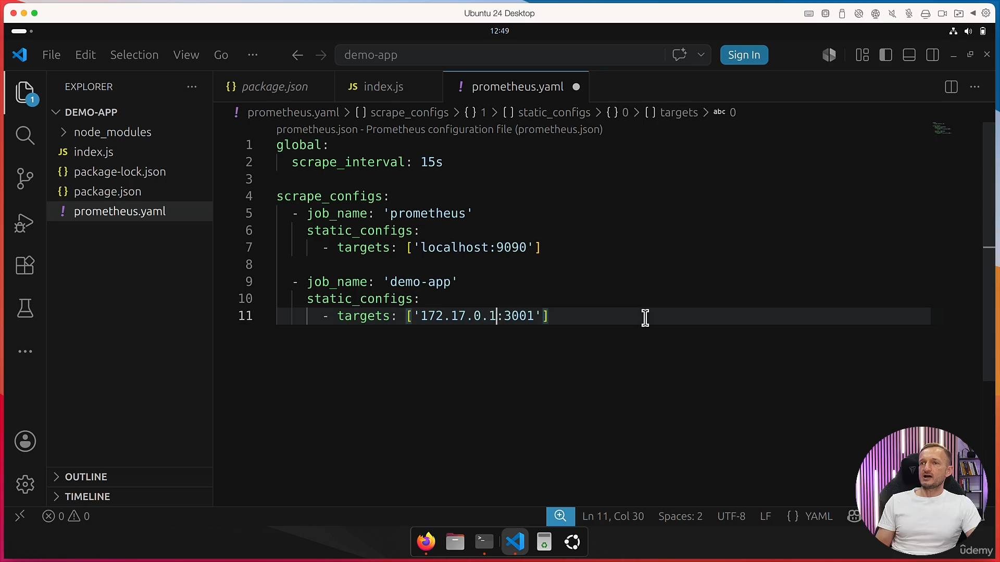

### 步骤 8：用新配置启动 Prometheus

在课程根目录执行：

```bash
docker run -d \
  --name prometheus \
  -p 9090:9090 \
  -v $(pwd)/prometheus.yml:/etc/prometheus/prometheus.yml \
  prom/prometheus
```

讲师逐段拆过这条命令（p009 [26:24]–[27:21]）：`-d` 后台、`--name` 起名、`-p 9090:9090` 端口映射、`-v $(pwd)/...:/etc/prometheus/prometheus.yml` 把宿主机的配置文件挂进容器覆盖默认配置、最后是镜像名。

验证：

```bash
docker ps
```

应该能看到 `prometheus` 和 `grafana` 两个容器。

然后浏览器打开 `http://localhost:9090`，进 **Status → Configuration**（讲师说的是 "configuration" 页），能看到你写的那份 YAML，滚下去两个 job 都在。再进 **Status → Targets**（讲师说 "target health"），应该看到**两个 endpoint 都是 UP**：一个是 prometheus 自己，一个是 demo-app。讲师的原话是 "我们有两个端点，它们都正常运行。"（p009 [28:17]）。

### 步骤 9：在 Prometheus 里先查一次

在查询框输入：

```promql
api_request_total
```

点 Execute，切到 Graph 标签。能看到带 `endpoint` / `method` / `status` 标签的序列。讲师在这里确认了两件事：标签值和他写进代码的一致，`status` 里确实出现过 500（p009 [29:45]）。

再试：

```promql
rate(api_request_total[1m])
```

此时图几乎是平的，因为流量太少。讲师的处理是"生成一些流量。"，然后图就起来了（p009 [31:09]）。**先在这里把查询跑通再进 Grafana**，这是讲师反复强调的思路——"这就是为什么我想先从 Prometheus 讲起，因为现在再进入 Grafana 会稍微容易一些。"（p010 [15:49]）。

### 步骤 10：Grafana 建第一个面板

打开 Grafana（`http://localhost:3000`）→ 左侧 Dashboards → New → **New dashboard**。

讲师提到他跑的界面是 Grafana **v13**，用的是动态布局和新的编辑体验，所以和你可能看过的老教程长得不一样（p010 [01:25]）。他建议：概念不变，按钮位置可能变。

点面板区里的蓝色 **+** → 添加一个 panel → hover 面板 → **Configure** / **Visualize**（p010 [02:48]）。这会打开面板编辑器，数据源默认已经是 Prometheus。

数据源下方把查询编辑器切到 **Code** 模式（有 Builder / Code 切换），输入：

```promql
sum by (endpoint) (rate(api_request_total[1m]))
```

点 Run queries。上方预览区会出现两条线：`API products` 和 `API users`。

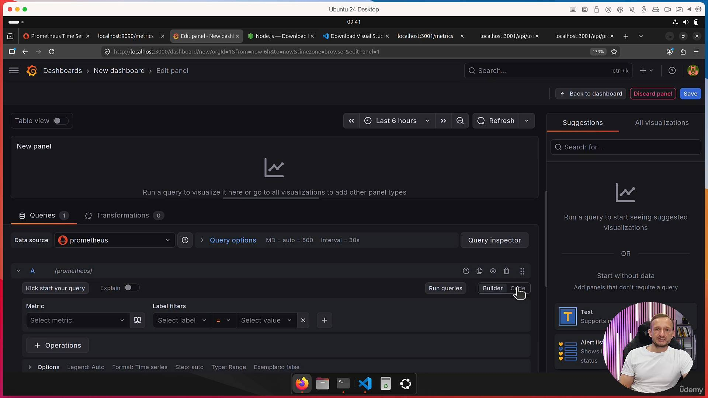

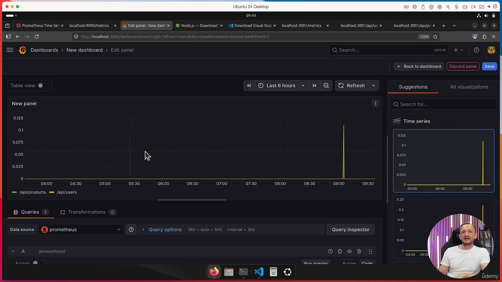

右侧改设置：

- **Title**：`Request rate by endpoint`
- **Description**：讲师建议写一句人话，比如 "按端点显示传入请求的速率。"，理由是团队里可能有几十上百人看这块板（p010 [09:03]）。
- **Visualization**：默认就是 Time series，讲师顺手点了一下 Stat 演示效果，然后又切回来（面板类型有几十种，右侧有 Suggestions 和 All）。

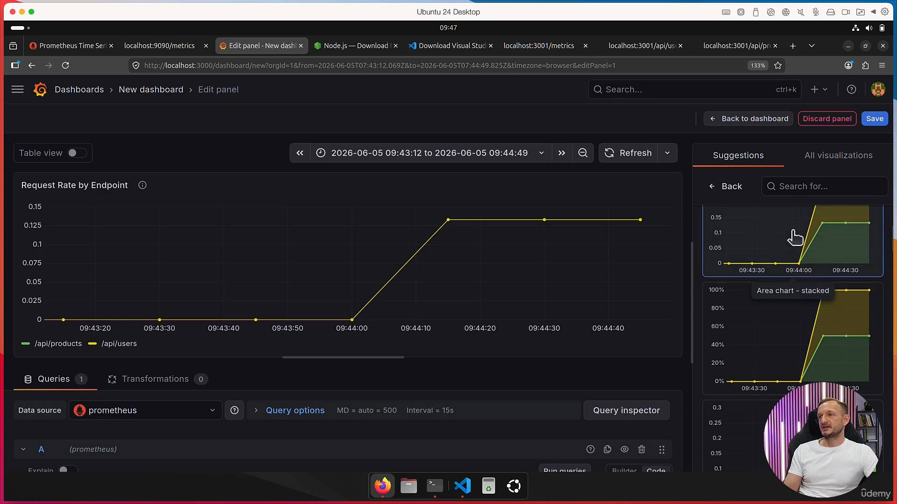

下面的 Legend、Axis、Graph styles 都是可选的，讲师只是演示了一下（legend 从 list 换 table、位置从 bottom 换 right、线宽、透明度之类），**不做也不影响后续**。改完点右上角 **Back to dashboard**。

### 步骤 11：Grafana 建第二个面板

在 dashboard 里再加一个 panel，还是 Code 模式，输入：

```promql
sum(rate(api_request_total{status="500"}[1m]))
```

标题设成 `Error rate`。这条线大部分时间是 0，因为 500 是随机的。讲师特意用这个查询演示了标签过滤的写法（p010 [15:49]），也顺便在 Builder 模式里展示了一下"这段 PromQL 在 UI 里长什么样"。

两个面板加起来，dashboard 就成型了。讲师演示了拖拽布局（layout 从 custom 换成 auto / dynamic 会影响面板能不能自由拉伸）。最后右上角 **Save**，名字取 `demo-app monitoring`（讲师原话是 "就叫它 A demo app，或者 demo app monitoring。"），可以给个 folder。保存后从 Home → Dashboards 就能重新进来。

### 步骤 12：加 endpoint 变量

进入 dashboard 的 **Edit** 模式 → 右下角/顶部 **Settings**（或者面板区旁边那个 **Add variable** 的 +），进入 Variables → **Add variable**。

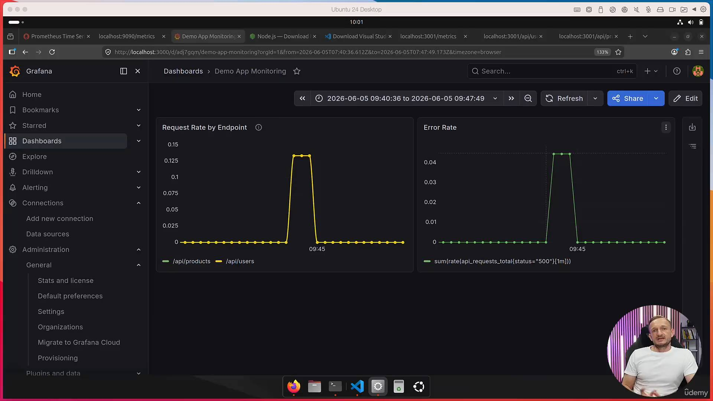

按讲师的填法：

| 字段 | 值 |
|---|---|
| Select variable type | `Query`（默认） |
| Name | `endpoint` |
| Label | `Endpoint` |
| Data source | `Prometheus` |
| Query type | `Label values` |
| Label | `endpoint` |
| Metric | `api_request_total` |

下面的 **Preview of values** 应该显示 `API products` 和 `API users`——这一步很重要，先确认变量查得出值，再去改面板查询。

再勾两个开关：

- **Multi-value**：允许多选
- **Include All option**：多一个 All 选项

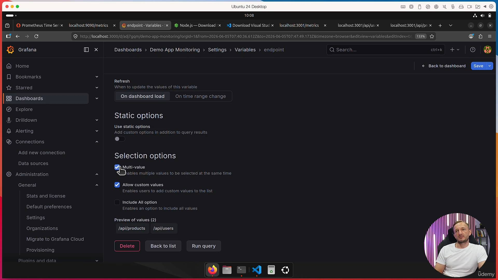

保存 dashboard。回到 dashboard 顶部，应该多出一个 **Endpoint** 下拉框，能选 All / API products / API users。

### 步骤 13：让面板用上变量

这一步是把上一步的下拉框"接线"到查询。回到第一个面板（Request rate），把查询改成：

```promql
sum by (endpoint) (rate(api_request_total{endpoint=~"$endpoint"}[1m]))
```

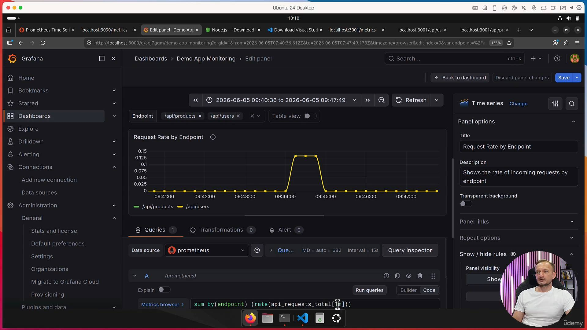

关键点：**必须用 `=~` 而不是 `=`**。原因是多选变量会被 Grafana 展开成正则，形如 `API products|API users`（讲师原话："Grafana 会把它们转换成正则表达式……比如端点一|端点二。"，p011 [09:28]）。用 `=` 会直接查不到数据。

保存，回 dashboard，切换 Endpoint 下拉框，第一条曲线会跟着变。讲师特意指出：**只有你改过的那个面板会变，Error rate 面板不动**，因为它的查询里没引用变量（p011 [10:25]）。

### 步骤 14：加 time 变量

同样位置 Add variable，这次类型选 **Custom**（值是手工填的）：

| 字段 | 值 |
|---|---|
| Name | `time` |
| Label | `Time` |
| Values | `1m,5m,10m,30m,1h` |

不要勾 Multi-value，也不要勾 Include All。

然后回到面板，把查询里的 `[1m]` 换成 `[$time]`：

```promql
sum by (endpoint) (rate(api_request_total{endpoint=~"$endpoint"}[$time]))
```

讲师在这里犯了一个很典型的错，值得单独记：他先写成了 `$interval`，Grafana 直接报 `unexpected character in duration`，因为变量名是 `time` 不是 `interval`（p011 [13:46]）。**Grafana 会在后端做语法校验并把错误直接怼在查询框上**，看到这个报错先检查变量名拼写。

### 步骤 15：加 webhook 接收端点

打开 `demo-app/index.js`，在 `app.listen` 之前插入：

```js
app.post('/webhook/alert', (req, res) => {
  console.log('ALERT RECEIVED');
  console.log(JSON.stringify(req.body, null, 2));
  res.json({ status: 'received' });
});
```

并且确保文件顶部已经有 `app.use(express.json());`（没有它 `req.body` 就是 undefined）。

改完后**必须重启进程**——讲师特意说明这里没有热重载："我们这里没有热重载之类的东西。我们不会去监听变化，需要先杀掉服务器再重新启动一次。"（p012 [14:01]）。`Ctrl+C` 然后 `node index.js`。

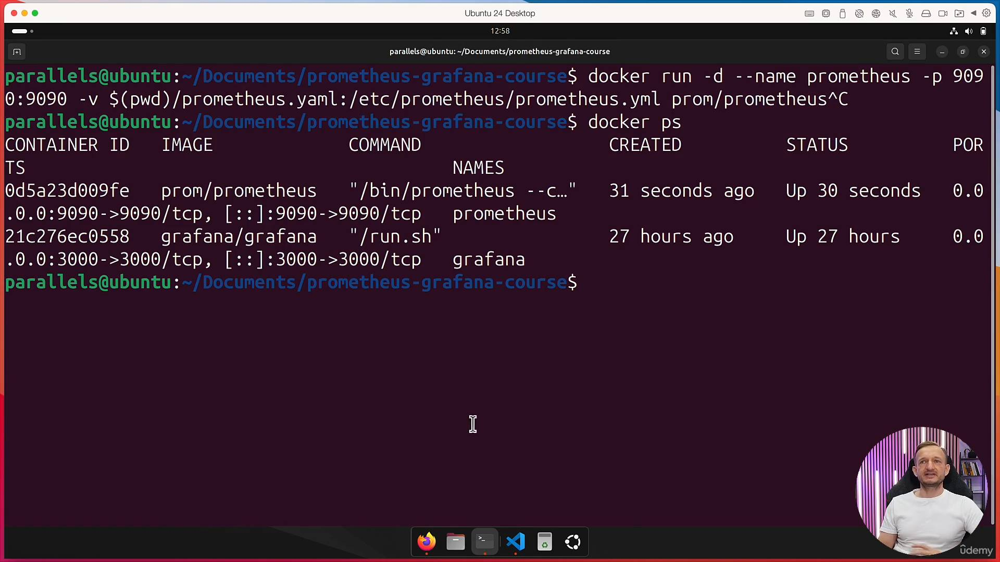

### 步骤 16：创建 contact point 并测通

Grafana 左侧 **Alerting** → **Contact points** → **New contact point**：

- Name：`webhook notification`
- Integration：**Webhook**
- URL：`http://172.17.0.1:3001/webhook/alert`（同样，这里不能用 localhost）
- HTTP method：POST（讲师展开 Optional Webhook Settings 确认过，可选 POST/PUT）

点 **Test** → 选预置消息 → Send test notification。然后回头看你的终端：

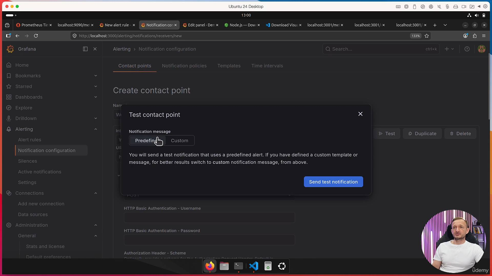

能看到 `ALERT RECEIVED` 和一大坨 JSON。讲师点评了这个 payload：里面有 summary、alert name、instance、fingerprint、labels，还有一个带 `\n` 的 message 字段，"那可以被解析为文本，也许显示在 Slack 频道里，或者通过邮件发送。"（p012 [16:42]）。字段名以你实际收到的为准，课里没有逐个念。

测通后 **Save contact point**。

### 步骤 17：创建告警规则

**Alerting** → **Alert rules** → **New alert rule**。

1. **Rule name**：`high error rate`
2. **Query**：数据源选 Prometheus，把比例公式抄进去（讲师是打开 dashboard 里那个面板，把查询复制过来，避免手打出错）：

```promql
sum(rate(api_request_total{status="500"}[1m])) / sum(rate(api_request_total[1m])) * 100
```

3. **Alert condition**：保持默认的 threshold 表达式，`is above` **10**。

   讲师这里口述有个小口误，他说 "如果我们设为 0，这意味着当错误率超过 10% 时告警就会触发。"，但实际填进阈值框的是 10。按 10 填：错误率超过 10% 才触发。他顺带说生产上你可能用 5% 甚至 1%。

4. 点 **Preview** 跑一次，状态应该是 **Normal**（当前没错误）。

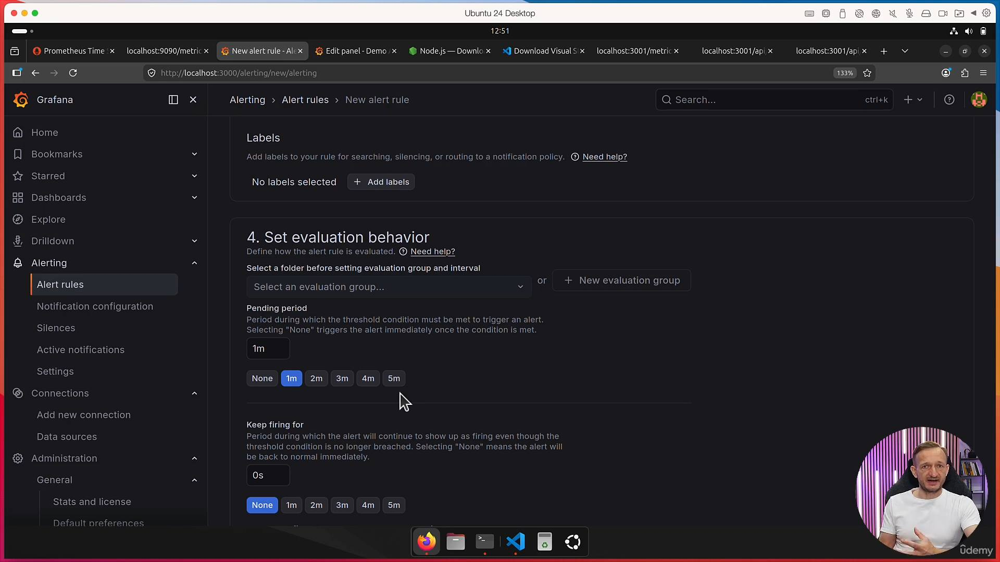

5. **Folder**：新建 `demo alerts`；**Evaluation group**：新建 `demo group`，interval 保持 1m（每分钟评估一次）。
6. **Pending period**：`2`。含义是错误率要连续两分钟高于 10% 才真的触发，用来过滤瞬时尖刺。
7. **Keep firing for**：`none`，即条件一恢复就回 Normal。
8. **Contact point**：选刚才那个 `webhook notification`。
9. **Save**。

### 步骤 18：把它打炸

对着 `http://localhost:3001/api/products` 疯狂刷新（或者用第 7 节的脚本），让 500 比例稳定超过 10%。然后等——因为评估间隔 1 分钟 + pending 2 分钟，讲师的说法是"这取决于我之前提到的分钟数。"（p012 [22:25]）。

在 Alerting → Alert rules 里能看到规则状态从 Normal → Pending → **Firing**，并且带上触发时的 value（讲师看到的是 11%）。同时终端里会再收到一次 webhook，`ALERT RECEIVED`。

停止制造错误，等错误率掉下去，状态会回到 Normal，并且**再发一次 webhook 表示 resolved**。讲师说这是完整告警流程的价值："你会收到通知，知道问题在哪里发生，以及什么时候被修复。"（p012 [21:56]）。

---

## 4. 完整代码

### 4.1 `demo-app/package.json`

课里没指定版本号（讲师只执行了 `npm install express prom-client`，版本由 npm 当时决定）。下面这份是文档作者验证过能跑的组合；你自己 `npm install` 后版本号会以实际写入为准。

```json
{
  "name": "demo-app",
  "version": "1.0.0",
  "description": "Prometheus & Grafana course demo app",
  "main": "index.js",
  "scripts": {
    "start": "node index.js"
  },
  "dependencies": {
    "express": "^4.19.2",
    "prom-client": "^15.1.3"
  }
}
```

### 4.2 `demo-app/index.js`

这是**完整文件**，直接保存即可运行。P009 阶段可以先删掉标注了 `P012` 的两块（`app.use(express.json())` 和 `/webhook/alert`），到告警那节再加回来。

```js
// demo-app/index.js
const express = require('express');
const promClient = require('prom-client');

const app = express();
const PORT = 3001; // 不用 3000，Grafana 占着

// P012 才需要：解析 webhook 的 JSON body
app.use(express.json());

// ---------- 指标注册表 ----------
const register = new promClient.Registry();

// 自动采集 Node 进程默认指标（内存、CPU、event loop lag 等）
promClient.collectDefaultMetrics({ register });

// ---------- 自定义指标 ----------

// 1) Counter：请求总数
const apiRequestTotal = new promClient.Counter({
  name: 'api_request_total',
  help: 'Total number of API requests',
  labelNames: ['method', 'endpoint', 'status'],
  registers: [register],
});

// 2) Gauge：当前活跃连接数（可升可降）
const apiActiveConnections = new promClient.Gauge({
  name: 'api_active_connections',
  help: 'Number of active connections',
  registers: [register],
});

// 3) Histogram：请求耗时分布
const apiRequestDuration = new promClient.Histogram({
  name: 'api_request_duration_seconds',
  help: 'Duration of HTTP requests in seconds',
  labelNames: ['method', 'endpoint'],
  buckets: [0.1, 0.5, 1, 2, 5],
  registers: [register],
});

// ---------- 业务端点 ----------

// 用户端点：永远 200
app.get('/api/users', (req, res) => {
  apiActiveConnections.inc();

  const end = apiRequestDuration.startTimer();

  // 模拟一段耗时操作
  setTimeout(() => {
    end({ method: 'GET', endpoint: '/api/users' });

    apiRequestTotal.inc({
      method: 'GET',
      endpoint: '/api/users',
      status: '200',
    });

    apiActiveConnections.dec();

    res.status(200).json([
      { id: 1, name: 'Alice' },
      { id: 2, name: 'Bob' },
      { id: 3, name: 'Charlie' },
    ]);
  }, Math.random() * 500);
});

// 商品端点：随机 500，用来制造错误率
app.get('/api/products', (req, res) => {
  apiActiveConnections.inc();

  const end = apiRequestDuration.startTimer();

  setTimeout(() => {
    const failed = Math.random() < 0.3;
    const status = failed ? 500 : 200;

    end({ method: 'GET', endpoint: '/api/products' });

    apiRequestTotal.inc({
      method: 'GET',
      endpoint: '/api/products',
      status: String(status),
    });

    apiActiveConnections.dec();

    if (failed) {
      res.status(500).json({ error: 'internal server error' });
    } else {
      res.status(200).json([
        { id: 1, name: 'Product A' },
        { id: 2, name: 'Product B' },
      ]);
    }
  }, Math.random() * 800);
});

// ---------- 指标暴露端点 ----------
app.get('/metrics', async (req, res) => {
  res.set('Content-Type', register.contentType);
  res.end(await register.metrics());
});

// ---------- P012：接收 Grafana webhook ----------
app.post('/webhook/alert', (req, res) => {
  console.log('ALERT RECEIVED');
  console.log(JSON.stringify(req.body, null, 2));
  res.json({ status: 'received' });
});

// ---------- 启动 ----------
app.listen(PORT, () => {
  console.log(`Demo app listening on http://localhost:${PORT}`);
  console.log(`Metrics available at http://localhost:${PORT}/metrics`);
});
```

关于两处课里没交代、由本文补全的地方，先说明白：

- **users / products 的返回体字段**：讲师只说 users 返回 Alice/Bob/Charlie（p009 [14:39]），products 只说"拿到一些商品"，具体字段没讲。上面的 `id` / `name` 是本文补的，不影响任何指标。
- **具体用什么 API 记录耗时**：讲师只说"观察持续时间。"（p009 [14:11]），上面用的是 prom-client 的 `startTimer()`。你换成 `const t = Date.now()` + `observe((Date.now()-t)/1000)` 效果等价。

### 4.3 `prometheus.yml`（课程根目录）

```yaml
global:
  scrape_interval: 15s

scrape_configs:
  - job_name: "prometheus"
    static_configs:
      - targets: ["localhost:9090"]

  - job_name: "demo-app"
    static_configs:
      # Linux 上是 docker0 网桥地址；macOS/Windows 换成 host.docker.internal
      - targets: ["172.17.0.1:3001"]
```

`scrape_interval` 的具体值课里没讲（讲师只说"global 就是抓取间隔。"），15s 是 Prometheus 镜像默认值。**如果你在 macOS 或 Windows 上，把 `172.17.0.1` 换成 `host.docker.internal`**，讲师的提示是："内部主机可能在你那里用不了。"（p009 [24:00]）——反过来说，在他的 Linux 环境上 `host.docker.internal` 不生效。

### 4.4 启动命令汇总

```bash
# 1. 应用
cd demo-app
node index.js

# 2. Prometheus（在课程根目录执行）
docker run -d \
  --name prometheus \
  -p 9090:9090 \
  -v $(pwd)/prometheus.yml:/etc/prometheus/prometheus.yml \
  prom/prometheus
```

Windows PowerShell 里 `$(pwd)` 不生效，用 `${PWD}` 或者写绝对路径。

---

## 5. 逐行解释

### 5.1 Node 应用部分

**`const express = require('express')`** — CommonJS 写法。你写 React 时用的 `import express from 'express'` 是 ESM，Node 里默认还是 CJS，加 `"type": "module"` 才能用 import。课里没提这个区别，但混用会直接报错。

**`const PORT = 3001`** — 讲师的理由很实在：Grafana 在 3000，同机部署会冲突（p009 [07:37]）。他在这句之前口述了一段"比如说 3000……所以我们把端口设为 3000 以避免冲突。"，是口误，代码和终端输出里都是 3001。

**`const register = new promClient.Registry()`** — 注册表就是"指标仓库"。讲师的说法是 "注册表就是我们存储所有指标的地方。"（p009 [08:34]）。你要注意：**每个指标都传了 `registers: [register]`**，讲师也是一路这么讲的（"and we are passing this registers"）。如果漏了，指标会进默认全局注册表，`register.metrics()` 里就看不到它——这是自己动手时最常见的"指标写了但不显示"。

**`promClient.collectDefaultMetrics({ register })`** — 一行代码换来一堆 Node 进程指标：堆内存、CPU、event loop lag 等。讲师强调这给了你"一个可靠的基线……实际上不用写任何代码。"（p009 [09:01]）。你打开 `/metrics` 时看到的前面那一大段就是它产出的。

**Counter `api_request_total`** — 只增不减的累计值。三个标签 `method` / `endpoint` / `status` 是讲师点名的（"我们会有一个方法、一个端点和一个状态。"，p009 [10:26]）。标签组合越多，Prometheus 存的序列越多，后面第 7 节会讲这个代价。

**Gauge `api_active_connections`** — 可升可降，讲师明确说这就是选 gauge 而不是 counter 的原因："这些非常适合像活跃连接数这样上下波动的值。"（p009 [11:23]）。

**Histogram `api_request_duration_seconds`** — `buckets: [0.1, 0.5, 1, 2, 5]` 对应讲师说的"0.1 秒以内、0.5 秒以内、1 秒以内、2 秒以内、5 秒以内"（p009 [12:19]）。**bucket 是累积的**：`le="0.5"` 那个桶里包含了所有 ≤0.5s 的请求，不是 0.1~0.5 区间的。名字里带 `_seconds` 是 Prometheus 的命名约定，单位统一用秒。

**`app.use(express.json())`** — 中间件，相当于前端的 body-parser。没有它，`/webhook/alert` 里的 `req.body` 永远是 undefined。课里只在 P012 加这段时才提到它。

**`apiActiveConnections.inc()` / `.dec()`** — 一进一出必须配对。这里有个 Node 特有的点值得说清楚：`setTimeout` 不会阻塞事件循环，所以请求 A 挂起 200ms 期间，请求 B 也能进来把 gauge 加到 2。讲师演示时看到"刷新几次之后 active connections 还是 0"，正是因为每个请求都已经走完 `dec()` 了（p009 [21:35]）。如果你在前端写过"请求计数器"，逻辑是一回事。

**`apiRequestDuration.startTimer()` / `end({...})`** — `startTimer()` 返回一个函数，调用它时带上标签，prom-client 自己算耗时并塞进对应 bucket。

**`String(status)`** — 标签值必须是字符串。传数字在某些版本会被强制转换，显式 `String()` 最稳。

**`res.set('Content-Type', register.contentType)`** — 这是 Prometheus 文本格式的 MIME 类型。讲师的说法是"我们设置内容类型只是为了让 Prometheus 知道返回的是什么。"（p009 [16:57]）。

**`app.get('/metrics', ...)`** — 整条链路的接口点。讲师把它单列为"最重要的部分。"：因为 Prometheus 是拉模式，没有这个端点它什么都拿不到。

**`app.get('/api/products')` 里的随机失败** — 讲师的说法是"我们在这里添加了一些故意的故障……因为这样可以让我们在指标中看到错误率，这也是你在生产环境中可能会监控的内容。"（p009 [15:34]）。0.3 这个概率课里没给具体数值，本文取的这个值能保证你刷十几下就能触发告警。

### 5.2 PromQL 部分

**`sum by (endpoint) (rate(api_request_total[1m]))`**

- `rate(...[1m])`：把 counter 在 1 分钟窗口内换算成"每秒增长多少"。counter 只增，直接画没意义，`rate` 才是请求速率。
- `sum by (endpoint) (...)`：把所有其他标签（`method`、`status`、`instance`、`job`）聚合掉，只按 `

## 6. 复现检查清单

- [ ] **应用启动与端口**：运行 `node index.js`，应看到 `Demo app listening on http://localhost:3001` 和 `Metrics available at http://localhost:3001/metrics`；浏览器打开 `http://localhost:3001/api/users` 应返回 Alice/Bob/Charlie。若看到端口冲突，确认应用没占用 3000，Grafana 仍在 3000。
- [ ] **products 随机失败**：多次刷新 `http://localhost:3001/api/products`，应有时返回商品列表、有时返回 500。验证 `/metrics` 里 `status` 标签会同时出现 200 和 500 的组合。
- [ ] **`/metrics` 有默认指标和自定义指标**：浏览器打开 `http://localhost:3001/metrics` 应看到纯文本；前面是 Node 进程默认指标，滚到底部应出现 `api_active_connections`、`api_request_total`、`api_request_duration_seconds`。未发请求时 gauge 为 0；打几次 users/products 后刷新，counter 应出现 `GET /api/users`、`GET /api/products` 等标签组合，histogram 的 bucket 应有数值，gauge 通常回到 0。
- [ ] **`prometheus.yml` 位置和内容**：确认文件在课程根目录，不在 `demo-app` 里面；文件里应有 `prometheus` 和 `demo-app` 两个 job。Linux 上 demo-app target 应为 `172.17.0.1:3001`；macOS/Windows 应换成 `host.docker.internal:3001`。验证方式：Prometheus 的 Status → Configuration 能看到这份 YAML，两个 job 都在。
- [ ] **Prometheus 容器与 Targets**：`docker ps` 应看到 `prometheus` 和 `grafana` 两个容器。浏览器打开 `http://localhost:9090` → Status → Targets，应看到两个 endpoint 都是 UP：Prometheus 自己和 demo-app。
- [ ] **Prometheus 里基础 PromQL 跑通**：在查询框执行 `api_request_total`，点 Execute / Graph，应看到带 `endpoint`、`method`、`status` 标签的序列，且 status 里应出现过 500。再执行 `rate(api_request_total[1m])`，先造一些流量，图应从几乎平线变成有波动。
- [ ] **Grafana 两个面板**：第一个面板查询 `sum by (endpoint) (rate(api_request_total[1m]))`，预览区应出现 API products 和 API users 两条线，标题为 `Request rate by endpoint`。第二个面板查询 `sum(rate(api_request_total{status="500"}[1m]))`，标题为 `Error rate`，大部分时间应为 0。保存 dashboard 后能从 Home → Dashboards 重新进入。
- [ ] **endpoint 变量**：Variables 里 Name 为 `endpoint`，类型 Query，Query type 为 Label values，Label 为 `endpoint`，Metric 为 `api_request_total`；Preview of values 应显示 `API products` 和 `API users`。勾选 Multi-value 和 Include All option 后，dashboard 顶部应出现 Endpoint 下拉框，可选 All / API products / API users。
- [ ] **endpoint 变量接到面板**：第一个面板查询应改为 `sum by (endpoint) (rate(api_request_total{endpoint=~"$endpoint"}[1m]))`，必须用 `=~`。切换 Endpoint 下拉框，第一条曲线应跟着变；Error rate 面板不应变化，因为它的查询没引用变量。
- [ ] **time 变量**：Variables 里新增 Custom 类型，Name 为 `time`，Label 为 `Time`，Values 为 `1m,5m,10m,30m,1h`，不要勾 Multi-value / Include All。把面板查询里的 `[1m]` 换成 `[$time]`，切换 Time 下拉框应正常重查，不应报 `unexpected character in duration`；报错时先检查变量名是不是误写成 `$interval`。
- [ ] **webhook 接收端点**：`demo-app/index.js` 里应有 `app.use(express.json())` 和 `app.post('/webhook/alert', ...)`。改完必须 `Ctrl+C` 后重新 `node index.js`。Grafana Contact points 的 Webhook URL 应为 `http://172.17.0.1:3001/webhook/alert`（macOS/Windows 用 `host.docker.internal`），不能是 localhost。点 Test → Send test notification 后，终端应打印 `ALERT RECEIVED` 和完整 JSON，而不是 `req.body` 为 undefined。
- [ ] **告警规则配置**：Alert rules 里应有一条 `high error rate`，查询是 `sum(rate(api_request_total{status="500"}[1m])) / sum(rate(api_request_total[1m])) * 100`，阈值 `is above` 填 `10`，Folder 为 `demo alerts`，Evaluation group 为 `demo group`，Pending period 为 `2`，Keep firing for 为 `none`，Contact point 为 `webhook notification`。点 Preview 当前无错误时应为 Normal。
- [ ] **告警触发与恢复**：对 `/api/products` 持续制造 500，使错误率稳定超过 10%，等待评估间隔 1 分钟 + pending 2 分钟，Alert rules 状态应从 Normal → Pending → Firing，终端应收到 `ALERT RECEIVED`。停止制造错误后，状态应回到 Normal，并再收到一次表示 resolved 的 webhook。

## 7. 课里没讲但你会撞上的

| 现象 | 原因 | 怎么办 |
|---|---|---|
| `node index.js` 报 `Cannot use import statement outside a module`，或改成 ESM 后报 `require is not defined` | 课里没讲：Node 默认是 CommonJS，示例代码用 `require`；照前端习惯写 `import` 会报错。文档 5.1 补充了 CJS/ESM 区别。 | 按示例统一用 `require('express')` / `require('prom-client')`；如果要用 ESM，就在 `package.json` 加 `"type": "module"` 并统一改 `import`，不要两种写法混用。 |
| `/metrics` 里只有默认 Node 指标，看不到 `api_request_total` 等自定义指标 | 课里没讲：漏写 `registers: [register]` 时，指标会进默认全局注册表，而 `/metrics` 用的是自定义 `register.metrics()`，所以自定义指标不显示。文档 5.1 补充这是常见问题。 | 给每个 `Counter`、`Gauge`、`Histogram` 都补上 `registers: [register]`；改完重启 Node，再刷新 `/metrics` 确认自定义指标出现。 |
| Histogram 的 bucket 一直没有数据，或不知道请求耗时该怎么记录 | 课里没讲：逐字稿只说 “observing the duration”，没指定 prom-client 的具体 API；文档用 `startTimer()` 补全。 | 用示例的 `const end = apiRequestDuration.startTimer()`，请求结束时 `end({ method, endpoint })`；或者用 `Date.now()` 算出秒数后调用 `observe({ method, endpoint }, seconds)`。 |
| Windows PowerShell 里执行 `docker run -v $(pwd)/prometheus.yml:...` 后，Prometheus 里的配置不是自己的 | 课里没讲：讲师是在 Linux 终端演示，PowerShell 不会按预期展开 `$(pwd)`；文档 4.4 补充了这个问题。 | 改用 `${PWD}/prometheus.yml`，或者写绝对路径；启动后到 Prometheus 的 Status → Configuration 确认 YAML 内容正确。 |
| macOS/Windows 上 Prometheus Targets 里 demo-app 是 DOWN，Linux 上正常 | 课里没讲清平台差异：课里只提示 `host.docker.internal` 可能不工作，示例 target 用的是 docker0 的 `172.17.0.1`；文档补充 macOS/Windows 要换地址。 | 把 `prometheus.yml` 的 demo-app target 从 `172.17.0.1:3001` 换成 `host.docker.internal:3001`；改完重建/重启 Prometheus 容器，再回 Targets 看是否 UP。 |
| 照逐字稿里 “if we would do a zero... exceeds 10%” 把阈值填成 0，告警几乎一直触发 | 课里没讲清：讲师口述有口误，实际阈值框填的是 10，0 和 10% 的说法混在一起；文档步骤 17 已纠正。 | 阈值填 `10`，即错误率超过 10% 才触发；生产上可再按 5% 或 1% 调；Preview 当前无错误时应为 Normal。 |
| `status` 标签写成数字 `200` 而不是字符串，指标标签值不符合预期或和查询对不上 | 课里没讲：Prometheus 标签值是字符串；示例里 `'200'` 和 `String(status)` 是有意的，文档 5.1 补充“显式 String 最稳”。 | 统一写 `status: '200'` / `status: String(status)`，不要混数字和字符串；重启后到 `/metrics` 和 Prometheus 查询确认标签值。 |
| 不知道 `scrape_interval` 填多少，抓取频率和预期不同 | 课里没讲：逐字稿只说 “global is just scrape interval”，没给具体值；文档 4.3 补充 15s 是镜像默认值。 | 写 `scrape_interval: 15s`，或者省略 global 接受默认值；改完重建/重启 Prometheus，在 Targets 看 Last scrape 按该间隔更新。 |
