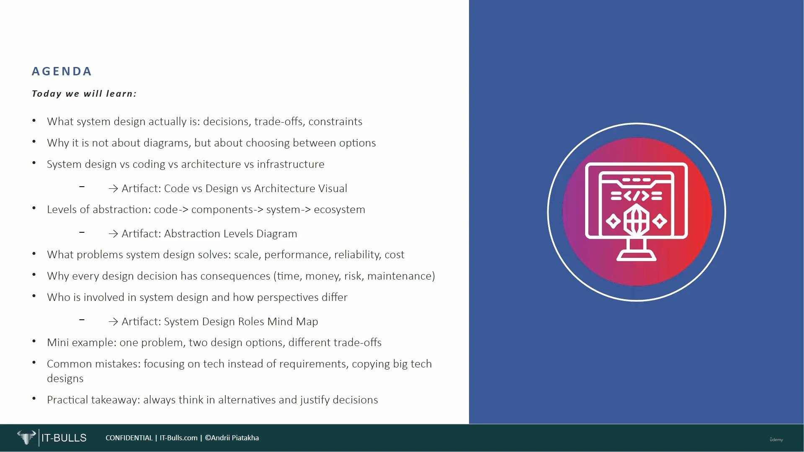
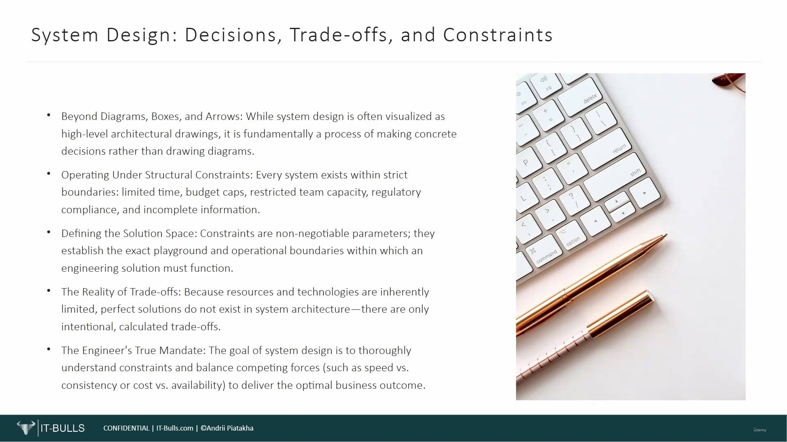
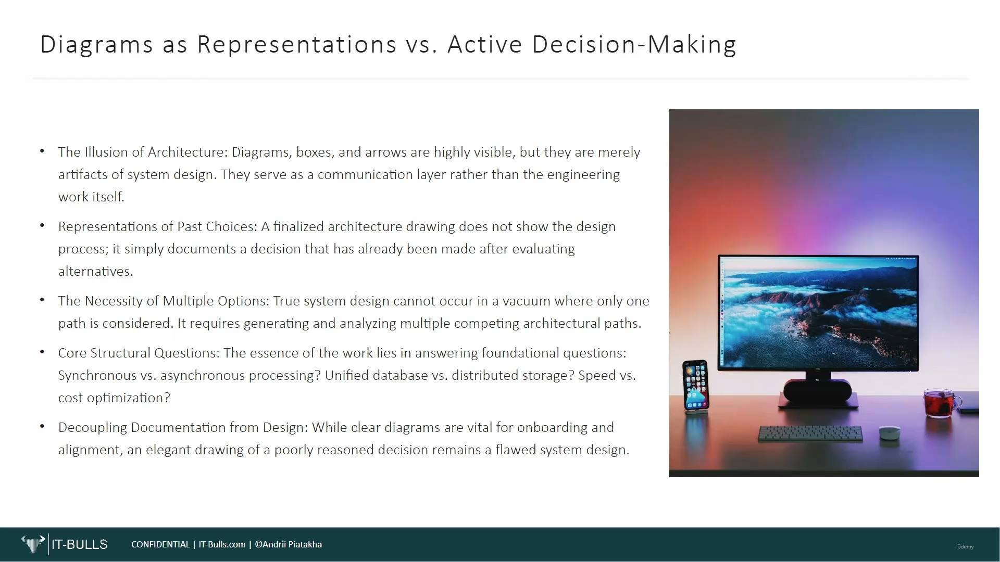
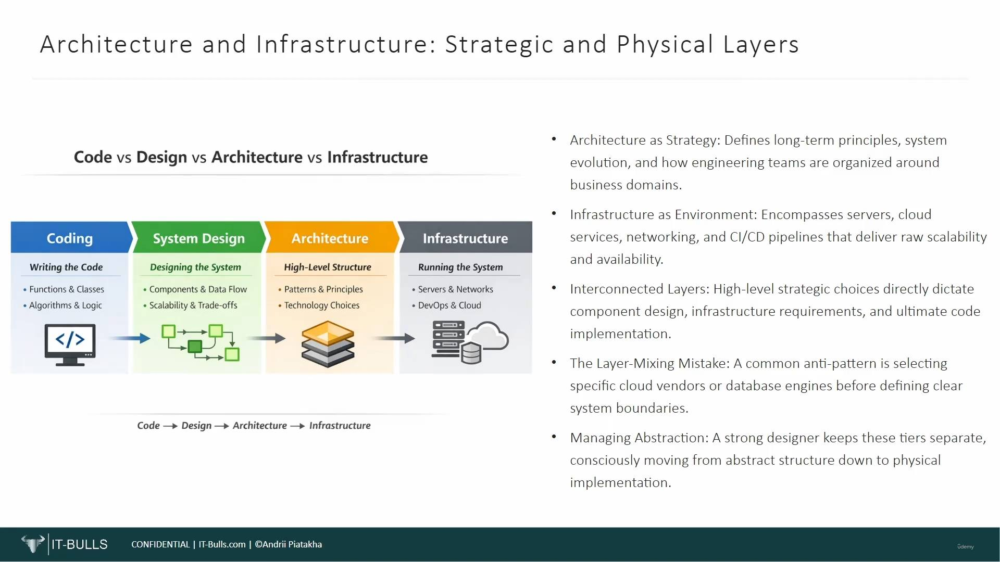
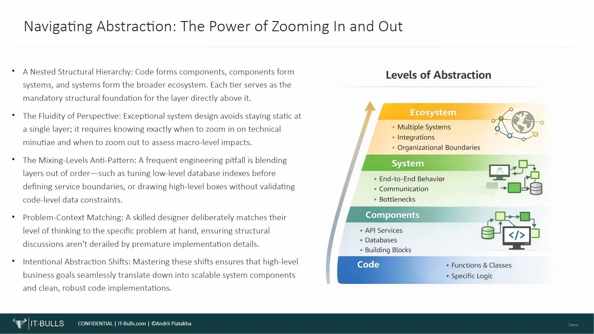
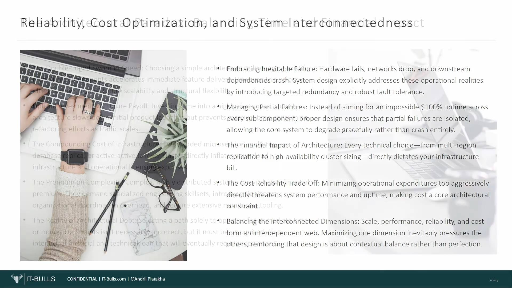
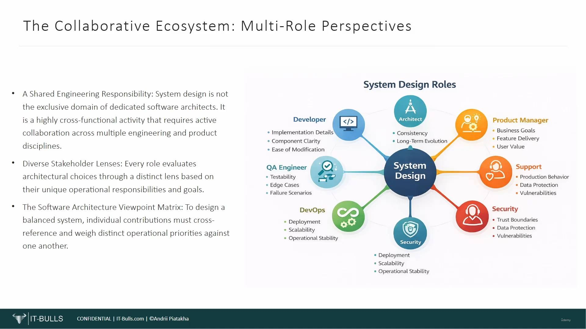
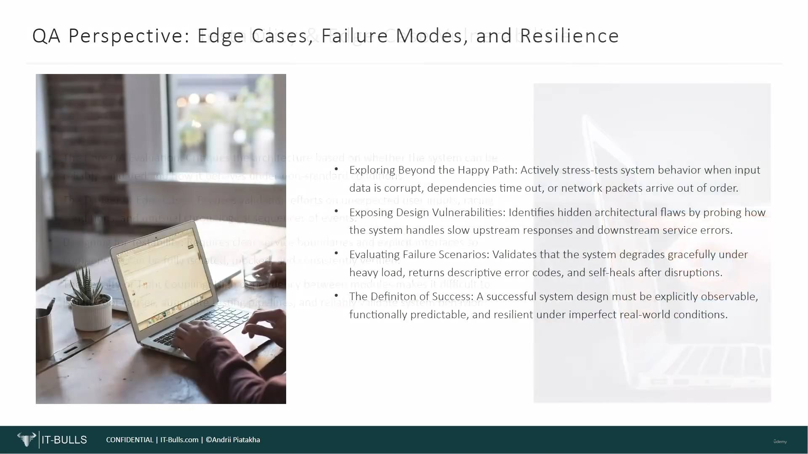
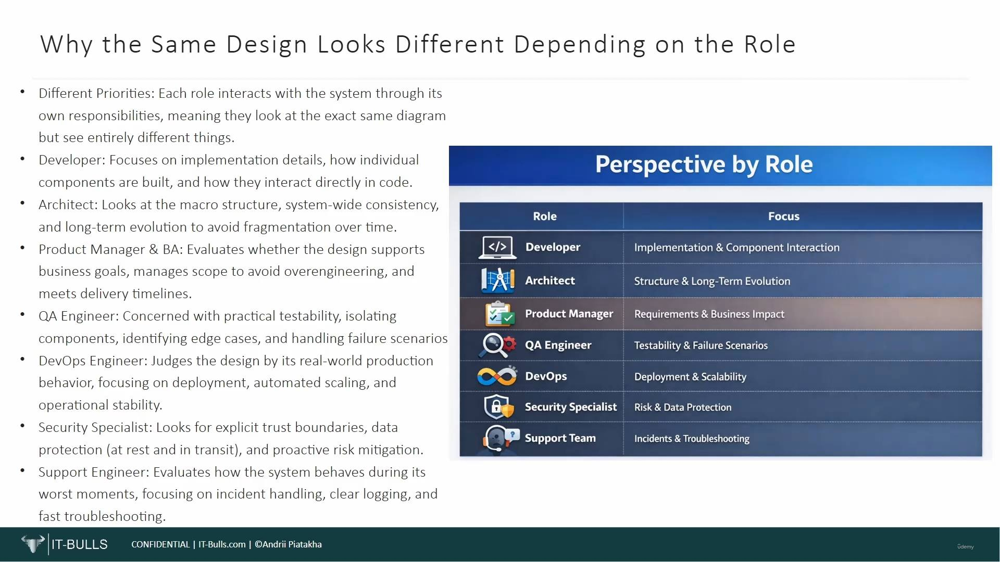
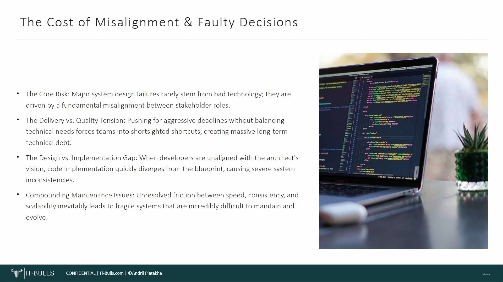

# System Design for Developers｜P001–P002 复现文档

> 这是一门**纯讲解课**：P001 与 P002 全长约 53 分钟，讲师自始至终没有打开编辑器、没有敲命令、没有给出任何目录结构或依赖清单。所以这份文档按「纯讲解课」的规范来写——第 3 章复现的是**讲师的推导动作**（需求 → 约束 → 估算 → 方案 → 取舍），第 4 章把推导落成**可用的设计产物**（决策表、职责表、接口草案、数据模型、容量估算表、RACI 表）。凡是讲师没讲、由本文档补出来的内容，都会明确标注；第 4 章末尾那段 Node 代码会标注「课里没有代码，以下为示意」。

---

## 1. 这一节做什么

这两节课解决的是一个非常前置的问题：**当你面对一个还没成形的系统，第一步到底该做什么。**

P001 给出的答案可以压成一句话：系统设计不是画图，是**在约束下做决策，并为选中的方案承担后果**。它先拆掉「系统设计 = 画架构图」这个误解，再把 coding / system design / architecture / infrastructure 四层分开，然后给出四级抽象阶梯（code → components → system → ecosystem），接着说明系统设计实际在解决四类问题（scale、performance、reliability、cost），再论证每一个决策都会在 time、money、risk、maintenance 四个方向上留下账单，之后列出参与系统设计的七类角色，最后用一个「文件上传」的小例子演示同一个需求怎么分裂出两个都合法、但代价完全不同的方案，并以两个最常见错误收尾（先选技术、照抄大厂）。

P002 把 P001 里「角色」那一小段单独拎出来放大：系统设计不是架构师的独角戏，而是开发、架构、产品/业务分析、QA、DevOps、安全、支持七方共同参与的协作过程；同一张图在七个人眼里是七个东西；错位的代价是把问题推迟到生产环境；解决办法是把决策权用 RACI 明确下来，并用 stakeholder map 把「谁在乎什么」显性化。



**这份文档最终要让你能交付的东西**：一份可以直接拿去评审的「文件上传功能」设计包——包含约束清单、容量估算、两个候选方案、一张决策记录、组件职责表、接口与数据模型草案、RACI 责任表，以及一份自检清单。你照着第 3 章的步骤走一遍，产出的就是讲师在 P001/P002 里描述的那种「可被讨论、可被追责、可被复用」的设计，而不是一张好看的幻灯片。

---

## 2. 讲师原话

关于「系统设计到底是什么」，讲师的原话是：

> "system design is not about diagrams. It is about decisions. More specifically, It is about making decisions under constraints." —— p001 [02:25]



紧接着他把「约束」具体化了，这一段是后面所有推演的起点，值得逐字记住：

> "You have limited time, limited budget, limited team capacity and often incomplete information. You may also have constraints coming from business goals, compliance requirements or existing legacy systems. These constraints are not optional. They define the space in which your solution must exist." —— p001 [02:25]

由此推出「没有完美方案，只有权衡」：

> "There is no perfect solution. There are only trade-offs. ... when you choose one option, you are not just selecting a solution. You are also accepting its downsides." —— p001 [02:50]

关于「为什么图不是设计」：

> "A diagram is just a representation of a decision that has already been made. ... If you jump straight into drawing a diagram, you are often skipping the most important step – evaluating alternatives. You end up documenting a solution instead of designing it." —— p001 [04:16]



四层的区分，讲师是配着同一张视觉图讲的：

> "Coding is about implementation. ... System design ... you are not writing code, but deciding how different parts of the system interact. ... architecture ... is more about long-term structure and strategic decisions. ... infrastructure is about where and how the system runs." —— p001 [06:09] – [07:35]



四级抽象阶梯：

> "At the lowest level we have code. ... One level above that we move to components or services. ... If we go higher, we reach the system level. ... at the highest level, we have the ecosystem. ... good system design is not about staying at one level. It is about knowing when to zoom in and when to zoom out." —— p001 [09:03] – [10:27]



系统设计实际解决的四个维度与四种后果：

> "these dimensions, scale, performance, reliability and cost, are interconnected. Improving one often affects the others" —— p001 [12:47]
>
> "Let's start with time. ... Now consider money. ... Then there is risk. ... And finally, maintenance. ... Maintenance cost is often the longest lasting consequence of your decisions and it is frequently underestimated." —— p001 [13:44] – [15:38]



角色那一段，P001 只做了目录级的列举，P002 才展开：

> "Developers, architects, product managers, QA engineers, DevOps, security specialists, and even support teams. What is important here is not just who they are, but what they care about." —— p001 [16:31]



P002 的核心论点——同一张图，七种读法：

> "even when everyone is looking at the exact same diagram, they are not seeing the same thing. ... The design itself does not change, but the interpretation does." —— p002 [19:23] – [20:22]


QA 的视角单独摘一句，因为它直接决定第 4 章接口草案里要不要留 status 字段：

> "they look at testability. A well-designed system makes it possible to test components in isolation, verify interactions between them and reproduce issues consistently. ... What happens if input data is invalid? What if a dependency responds slowly or returns an error?" —— p002 [12:05] – [12:29]



错位的后果：

> "misalignment leads to decisions that optimize one dimension while ignoring others. The result is predictable. Systems that are difficult to scale, hard to maintain, risky to operate, and expensive to evolve." —— p002 [22:41]



决策权归属，讲师用的是责任分配矩阵（转写稿把它听成了 "俄罗斯式模型"，从上下文和它描述的四种角色来看，指的是 **RACI**）：

> "Some people are responsible for making the decision, others are accountable for the outcome, some are consulted and others are simply informed. ... an architect is often accountable for major architectural decisions. ... Product managers and business analysts are consulted ..." —— p002 [23:39] – [24:35]



---

## 3. 从零复现

这一章的目标不是「理解概念」，而是**产出一份能评审的设计包**。讲师在 P001 [18:50] – [20:41] 用文件上传做示例，我们就用同一个题目，把他的推导动作一步一步做实。

### Step 0：准备记录载体

建一个目录，后面每一步的产物都落成文件。课里没讲目录结构，以下是本文档的建议布局：

```
design/
  upload-feature/
    00-requirements.md      # Step 1 产物
    01-constraints.md       # Step 2 产物
    02-estimates.md         # Step 3 产物
    03-options.md           # Step 4 产物
    04-decision.md          # Step 5/6 产物（决策记录）
    05-components.md        # Step 6 产物（职责表）
    06-api-and-data.md      # Step 6 产物（接口与数据模型草案）
    07-raci.md              # Step 7 产物
```

### Step 1：把需求写成「用户可见行为」，不写技术

讲师在 P001 只给了一句需求：用户上传一个文件，系统存储它并返回响应（"用户上传一个文件，我们把它存起来，仅此而已"，p001 [18:50]）。这句话里的处理动作是模糊的，**必须在 Step 1 把它逼清楚**，否则后面估算无从谈起。

写成三条：

1. 用户选择一个不超过 20 MB 的文件提交，系统必须给出明确的结果：接受或拒绝，以及拒绝的原因。
2. 用户能在之后查到这次上传的最终状态（成功 / 失败 / 处理中）。
3. 处理成功后，用户能拿到一个可访问的结果地址。

> 注意：讲师没有说处理动作具体是什么。「process the file」在他的例子里是黑盒。为了让估算有物理意义，本文档假设处理 = 类型与大小校验 + 生成缩略图，单文件 CPU 时间约 3 秒。**这个 3 秒是本文档的假设，不是讲师给的数字。**

### Step 2：列约束，一条不许省

讲师在 p001 [02:25] 给的约束类别是：时间、预算、团队产能、信息不完整、业务目标、合规要求、遗留系统。逐条落到本示例：

| 约束类别 | 本示例取值 | 来源 |
|---|---|---|
| 时间 | 6 周内可上线 | 本文档假设 |
| 预算 | 不接受为这个功能单独采购商业队列服务 | 本文档假设 |
| 团队产能 | 3 人（1 前端、1 后端、1 全栈），无人有消息队列运维经验 | 本文档假设 |
| 信息不完整 | 未来 12 个月的增长率未知，只知道「可能会有一波推广」 | 本文档假设 |
| 业务目标 | 上传不能阻塞用户继续使用页面 | 来自 Step 1 需求 2、3 |
| 合规 | 文件可能含个人信息，需能按用户删除 | 本文档假设 |
| 遗留系统 | 已有关系型数据库和对象存储账号 | 本文档假设 |

这一步的纪律是：**每一行都要能说出「如果不满足会怎样」**。说不出来的，就是伪约束，删掉。

### Step 3：估算，把形容词换成数字

讲师没有给任何数字。但「这个方案能不能扛住」这种判断，没有数字就只能是感觉。所以这一步必须自己算，且把假设写在数字旁边。

**输入假设（全部是本文档设定）**

- 日活用户 DAU = 100,000
- 人均每日上传 2 个文件
- 平均文件大小 300 KB，P99 为 5 MB，硬上限 20 MB
- 单文件处理时间 3 秒（CPU 密集 + 一次外部调用）
- 流量高峰集中在 4 小时内，峰值系数取 10

**推算**

- 日上传量 = 100,000 × 2 = **200,000 个/天**
- 平均 QPS = 200,000 ÷ 86,400 ≈ **2.3 req/s**
- 峰值 QPS = 2.3 × 10 ≈ **23 req/s**
- 峰值在途处理数 = 23 × 3 = **69 个并发处理槽**
- 若单 worker 实例并发度为 4，则所需实例数 = 69 ÷ 4 ≈ **18 个**（取 20）
- 日增存储 = 200,000 × 300 KB = 60,000,000 KB ≈ **60 GB/天**（按 1 GB = 10⁶ KB）
- 年增存储 = 60 GB × 365 ≈ **21.9 TB/年**（单副本，未计压缩）
- 若对象存储按 3 副本，则年增 ≈ **65.7 TB**
- 队列积压风险：若 worker 集群整体不可用 1 小时，积压任务 = 23 × 3,600 ≈ **82,800 条**

这一组数字，直接决定了后面两个方案谁更站得住：**同步方案需要 18–20 个实例常驻才能扛住 3 秒的处理时间**，而异步方案需要的是「队列 + 20 个 worker + 一个能查状态的地方」。

### Step 4：写出两个候选方案，都要写到能落地的程度

讲师在 p001 [18:50] – [20:41] 给了两个方案。这里把它们补全到「能交给开发排期」的粒度。

**方案 A：同步处理**

用户 POST 上传 → 服务端在同一请求内完成校验、处理、写入正式存储 → 直接返回结果。
链路：`Client → Upload API（校验 + 处理 + 存储）→ 响应`。
优点：一个进程、一个请求、无需队列、无需状态表、出错即返回错误。
缺点：请求时长 = 上传时间 + 3 秒处理 + 存储时间；高峰期 69 个在途请求会同时压在 API 进程上；处理逻辑一旦变慢（比如外部依赖抖动），整个 API 一起变慢。

**方案 B：异步处理**

用户 POST 上传 → 服务端只做「收下 + 存临时位置 + 投递任务」→ 立刻返回 202 和查询地址 → 后台 worker 慢慢处理 → 用户轮询状态。
链路：`Client → Upload API → 临时存储 + 队列 → Worker（处理 + 正式存储 + 更新状态）→ Client 轮询 GET 状态`。
代价，讲师原话点得很清楚："我们需要队列、后台工作进程、重试逻辑和监控。这还会带来新的挑战，例如处理故障和确保一致性。"（p001 [20:15]）

### Step 5：做取舍，把「放弃的代价」也写下来

按讲师给的四个维度（scale / performance / reliability / cost，p001 [12:47]）加上他后来说的 time / money / risk / maintenance（p001 [13:44]），做成决策表（见第 4 章 4.1）。关键动作不是打分，而是**给每一列写一句「选它就要接受什么」**。

### Step 6：定方案，并把结构固化成职责表、接口、数据模型

按 Step 3 的数字推：23 req/s 峰值 × 3 秒 = 69 个在途处理，方案 A 要么堆 20 个常驻实例（钱和运维都吃紧），要么在高峰期让用户排队等 3 秒以上（违反业务目标）。而团队 3 人、无人有队列运维经验，方案 B 的复杂度必须靠「托管队列 + 单一种类 worker + 极简状态机」压下去。**结论是选 B，但把 B 的复杂度预算写死**（见 4.1 的「复杂度预算」一栏）。

### Step 7：用 RACI 和 stakeholder map 对齐

这一步不是开会喊口号，是**填表**。P002 [23:39] 起讲的 RACI，在这个示例上的落地见 4.6。填完之后必须能回答三个问题：这个决策谁拍板？谁被执行结果反噬？谁在看但没被通知？

### Step 8：用「常见错误」清单做一次自检

讲师在 p001 [21:11] – [22:37] 给了两个错误：先选技术而不是先看需求；照抄大厂而不看上下文。做成两句可勾选的检查：

- 我们的方案里，有没有任何一个组件是「因为听说它好」而存在的？能不能说出它对应哪条约束？
- 我们的方案里，有没有任何一个东西是从规模大得多的系统抄来的？它的前提在我们这里成立吗？

---

## 4. 完整代码

> 本课是纯讲解课，讲师全程没有写代码、没有敲命令、没有给配置。下面是把第 3 章推导落成的**设计产物**。4.1–4.6 是文档形态的产物；4.7 是一段示意代码，**课里没有代码，以下为示意**。

### 4.1 决策记录（`04-decision.md`）

| 维度 | 方案 A 同步 | 方案 B 异步 | 本项目的选择依据 |
|---|---|---|---|
| Time（交付速度） | 快，2 周可上 | 慢，4–5 周 | 6 周窗口内 B 可接受，且 B 的慢主要花在监控与重试上，不能省 |
| Money（成本） | 需 ~20 个常驻实例扛峰值 | 需队列 + ~20 个 worker，但 worker 可弹性 | 两者算力相近，B 多出的是队列与状态存储的钱 |
| Risk | 外部依赖抖动直接打穿 API | 依赖抖动被队列吸收 | 选 B 的直接理由 |
| Maintenance | 逻辑简单，但改处理流程要动 API | 处理流程独立演进，但多一个状态机要维护 | 接受 B 的维护成本，换来处理逻辑可独立迭代 |
| Scale | 峰值 23 req/s × 3 s = 69 在途，同步模型下 API 与处理耦合 | 队列吸收峰值，worker 按积压扩容 | 选 B 的核心理由 |
| Performance（用户可感延迟） | 单请求 3–4 秒 | 提交 < 500 ms，结果靠轮询 | 满足「上传不能阻塞用户」的业务目标 |
| Reliability | 失败即用户重传，无重试 | 有重试与死信，但需处理重复 | 接受「重复处理」这个新风险 |
| 复杂度预算（硬约束） | — | 只允许 1 个队列、1 类 worker、4 个状态 | 团队 3 人、无队列经验，超出即回到 A |

**决策**：采用方案 B。
**明确接受的下行风险**：① 多一个状态机要维护；② 必须实现幂等，否则重试会造成重复处理；③ 必须做积压监控，否则故障时无感。
**明确放弃的收益**：方案 A 的「一个请求搞定、没有中间态」的简单性。

### 4.2 组件职责表（`05-components.md`）

| 组件 | 唯一职责 | 不负责 | 失败时的表现 |
|---|---|---|---|
| Upload API | 校验类型/大小、写临时存储、投递任务、返回 202 与状态地址 | 不做任何文件处理 | 返回 4xx/5xx，不产生任务 |
| 临时存储 | 暂存原始文件，带 TTL | 不作为长期存储 | 写入失败 → API 报错，用户重传 |
| 队列 | 缓冲任务、支持重投 | 不存业务状态 | 不可用 → 任务投递失败，API 报错 |
| Worker | 取任务、处理、写正式存储、更新状态 | 不暴露给用户 | 崩溃 → 任务回到队列（靠可见性超时） |
| 状态存储 | 记录 uploadId 的状态机与结果地址 | 不存文件本体 | 不可用 → 状态查询失败，处理结果仍在 |
| 监控/告警 | 队列积压深度、失败率、处理时长 | 不参与业务逻辑 | — |

状态机只允许四个状态：`PENDING → PROCESSING → SUCCEEDED | FAILED`，`FAILED` 在人工或自动重试时可回到 `PENDING`。

### 4.3 接口草案（`06-api-and-data.md`）

> 课里没有给出任何接口定义，以下是本文档为了让方案可落地而补的草案。

```
POST /api/uploads
  Content-Type: multipart/form-data
  Body: file=<binary>
  200/202 Response:
  {
    "uploadId": "up_01J8X...",
    "status": "PENDING",
    "statusUrl": "/api/uploads/up_01J8X..."
  }
  4xx Response:
  { "error": "FILE_TOO_LARGE" | "UNSUPPORTED_TYPE" | "EMPTY_FILE" }

GET /api/uploads/{uploadId}
  200 Response:
  {
    "uploadId": "up_01J8X...",
    "status": "PENDING" | "PROCESSING" | "SUCCEEDED" | "FAILED",
    "resultUrl": "https://.../thumb.jpg",   // 仅 SUCCEEDED 时存在
    "error": "PROCESSING_FAILED",           // 仅 FAILED 时存在
    "attempts": 1,
    "createdAt": "2025-01-01T00:00:00Z",
    "updatedAt": "2025-01-01T00:00:05Z"
  }
  404 Response:
  { "error": "NOT_FOUND" }
```

`statusUrl` / `resultUrl` / `attempts` 这些字段名是本文档草案，课里未出现，实际实现请以你自己的接口契约为准。

### 4.4 数据模型草案

> 同为本文档草案，讲师未给任何表结构。

```
uploads
  id            string     PK        -- uploadId
  owner_id      string     idx       -- 用于按用户删除（合规约束）
  original_key  string               -- 临时存储路径
  result_key    string     null      -- 正式存储路径
  size_bytes    bigint
  content_type  string
  status        string     idx       -- PENDING/PROCESSING/SUCCEEDED/FAILED
  attempts      int        default 0
  last_error    string     null
  created_at    timestamp
  updated_at    timestamp
  processed_at  timestamp  null
```

`owner_id` 上必须有索引——这不是性能考虑，是 Step 2 里那条合规约束的直接产物。

### 4.5 容量估算表（`02-estimates.md`）

| 指标 | 算式 | 结果 | 假设来源 |
|---|---|---|---|
| 日上传量 | 100,000 × 2 | 200,000 /天 | 本文档设定 |
| 平均 QPS | 200,000 ÷ 86,400 | ≈ 2.3 req/s | 本文档设定 |
| 峰值 QPS | 2.3 × 10 | ≈ 23 req/s | 峰值系数为本文档设定 |
| 峰值在途处理 | 23 × 3 | ≈ 69 | 3 秒处理时间为本文档假设 |
| Worker 实例数 | 69 ÷ 4 | ≈ 18（取 20） | 单实例并发 4 为本文档假设 |
| 日增存储 | 200,000 × 300 KB | ≈ 60 GB/天 | 平均 300 KB 为本文档假设 |
| 年增存储（单副本） | 60 × 365 | ≈ 21.9 TB | — |
| 年增存储（3 副本） | 21.9 × 3 | ≈ 65.7 TB | 副本数为本文档假设 |
| 故障 1 小时积压 | 23 × 3,600 | ≈ 82,800 条 | 用于设告警阈值 |

告警阈值建议直接取这张表：积压 > 82,800 即视为 worker 集群不可用，因为这是「全线停摆一小时」的量级。

### 4.6 RACI 表（`07-raci.md`）

> R = 负责执行，A = 对结果担责，C = 决策前被咨询，I = 决策后被通知。角色名沿用讲师在 p001 [16:31] 列出的七类。

| 决策项 | 开发 | 架构 | 产品/BA | QA | DevOps | 安全 | 支持 |
|---|---|---|---|---|---|---|---|
| 上传接口形态（202 + 轮询） | R | A | C | C | I | I | I |
| 同步 vs 异步 | C | A | C | C | C | I | I |
| 存储选型与生命周期 | R | A | I | I | C | C | I |
| 处理流水线内容 | R | C | C | C | I | C | I |
| 重试策略与死信阈值 | R | A | I | C | C | I | I |
| 上线节奏与灰度 | C | I | C | C | A/R | C | I |
| 信任边界与文件校验规则 | C | C | I | C | I | A/R | I |

填这张表的验收标准很朴素：**每一行有且只有一个 A**。出现两个 A，说明这个决策没人担责。

### 4.7 示意代码

> **课里没有代码，以下为示意**，目的是把 4.2 的职责表跑起来看一遍。用 Node 原生能力，不引第三方库；你在真实项目里做异步任务，通常会落到某个队列服务或 Redis 之上的任务库上，这些讲师全程没提。

```javascript
// upload-api.js —— 只做收下、暂存、投递、返回，不做处理
import express from "express";
import crypto from "node:crypto";

const app = express();
const tasks = [];              // 示意用内存队列；真实项目替换为持久化队列
const uploads = new Map();     // 示意用状态存储；真实项目替换为数据库

app.post("/api/uploads", express.raw({ limit: "20mb", type: "*/*" }), (req, res) => {
  const size = req.body?.length ?? 0;
  if (size === 0) return res.status(400).json({ error: "EMPTY_FILE" });
  if (size > 20 * 1024 * 1024) return res.status(400).json({ error: "FILE_TOO_LARGE" });

  const uploadId = "up_" + crypto.randomUUID();
  uploads.set(uploadId, {
    uploadId,
    status: "PENDING",
    attempts: 0,
    createdAt: new Date().toISOString(),
    updatedAt: new Date().toISOString(),
  });
  tasks.push({ uploadId, buffer: req.body });
  res.status(202).json({
    uploadId,
    status: "PENDING",
    statusUrl: `/api/uploads/${uploadId}`,
  });
});

app.get("/api/uploads/:uploadId", (req, res) => {
  const rec = uploads.get(req.params.uploadId);
  if (!rec) return res.status(404).json({ error: "NOT_FOUND" });
  res.json(rec);
});
```

```javascript
// worker.js —— 取任务、处理、写结果、更新状态
async function processOne(task) {
  const rec = uploads.get(task.uploadId);
  if (rec.status !== "PENDING") return;        // 幂等闸门：非 PENDING 直接丢弃
  rec.status = "PROCESSING";
  rec.attempts += 1;
  rec.updatedAt = new Date().toISOString();
  try {
    const resultKey = await doHeavyWork(task.buffer);   // 示意：校验 + 生成缩略图
    rec.status = "SUCCEEDED";
    rec.resultUrl = resultKey;
  } catch (err) {
    rec.lastError = String(err?.message ?? err);
    rec.status = rec.attempts >= 3 ? "FAILED" : "PENDING";  // 简单重试上限
  } finally {
    rec.updatedAt = new Date().toISOString();
  }
}
```

在 JS/Node 里，4.1 里说的「幂等闸门」对应的就是上面那句 `if (rec.status !== "PENDING") return;`——因为队列可能重复投递，同一个 `uploadId` 有可能被执行两次。这不是后端特有的概念，前端做重复提交拦截时用的是同一个思路。

---

## 5. 逐行解释

**为什么 Step 2 的约束表里每一行都要写「不满足会怎样」。** 讲师在 p001 [02:25] 说约束"先界定你的解决方案必须在什么范围内存在"。如果一条约束说不出违反后的具体后果，它就没有约束力，只会让方案变复杂。比如「团队无人有队列运维经验」这一条，它的直接后果是 4.1 里那条「复杂度预算：只允许 1 个队列、1 类 worker、4 个状态」——这不是审美偏好，是产能约束换算出来的硬指标。

**为什么 Step 3 要算「峰值在途处理数」而不是只算 QPS。** 只算 QPS 会得出「23 req/s，很小」的错觉，于是觉得同步方案完全够用。但真正压垮同步方案的是 23 × 3 = 69 这个在途数：每个在途请求都占着一个进程内的并发槽。讲师在 p001 [19:20] 说"如果许多用户同时上传文件，服务器可能会过载"，这个「overloaded」的具体形态就是 69 个并发槽同时被占住。没有这个乘法，你就只能凭感觉判断。

**为什么决策表的每一列都要写「选它就要接受什么」。** 讲师在 p001 [02:50] 的措辞是"你不只是在选择一个解决方案，也是在接受它的缺点"。这是取舍的定义，不是修辞。所以 4.1 里方案 B 那一行下面必须跟三条「明确接受的下行风险」，否则这份决策记录就只是「我选了 B」的公告，评审时没人能拿它做判断。

**为什么选 B 而不是 A，理由不能是「B 更先进」。** 讲师在 p001 [22:08] 明确批评照抄大厂架构："他们的解决方案是针对他们自己的问题优化的，而不是你的问题。……你会在并不必要的情况下继承复杂性。"。选 B 的合法理由只有两条：① 业务目标要求上传不阻塞用户，方案 A 在峰值下做不到；② 69 个在途处理让方案 A 的算力需求变成 20 个常驻实例。**如果这两条不成立，选 B 就是在照抄。**

**为什么 4.2 的职责表要写「不负责」那一列。** 讲师在 P002 [06:51] 讲开发视角时说了一句很关键的话："如果设计中各组件边界清晰明确，开发就会变得可预测。开发者知道一段逻辑应该放在哪里"。边界是靠「不负责」定义的，不是靠「负责」。Upload API 明确「不做任何文件处理」，处理逻辑才能独立演进；Worker 明确「不暴露给用户」，才不会有第二个接口偷偷返回处理结果。

**为什么状态机只准四个状态。** 这是 QA 视角倒逼出来的。P002 [12:29] 说 QA 关心 "如果某个依赖响应缓慢或返回错误，会发生什么？"。状态越少，可枚举的路径越少，测试用例越可控。四个状态 = 4 条边（PENDING→PROCESSING、PROCESSING→SUCCEEDED、PROCESSING→FAILED、FAILED→PENDING），测试矩阵是可穷举的；如果加上「已取消」「部分成功」「等待外部回调」之类，路径数会指数上升，而团队只有 3 人。

**为什么 4.3 的接口里要有 `statusUrl` 和 `attempts`。** `statusUrl` 是为了让客户端不必自己拼查询地址——这是 P002 [05:52] "当这些视角彼此协调一致时，良好的系统设计才会自然形成" 的最小兑现：客户端不需要知道后端的路由结构。`attempts` 是为了支持与 QA 排查：P002 [18:04] 说支持团队需要"快速了解正在发生什么、问题出在哪里"，一个「已重试 3 次」的字段，比让支持翻 worker 日志便宜得多。

**为什么 4.4 的 `owner_id` 上必须有索引。** 这不是性能调优，是 Step 2 的合规约束「需能按用户删除」的直接产物。如果删不干净，方案在评审时就会被安全角色拦下（P002 [15:42] 讲信任边界与数据保护）。索引在这里是**约束的可执行形式**。

**为什么 4.5 要算「故障 1 小时积压 82,800 条」。** 这个数字的唯一用途是定告警阈值。P002 [14:21] 说 DevOps 关心"系统能否在无需人工干预的情况下应对负载突增？"，反过来也成立：不能干预的系统等于没有运维。如果告警阈值凭感觉设成「积压 > 1000」，一次正常的高峰波动就会误报；设成「积压 > 100000」，一次真故障会被淹没。8 万这个量级，是「全线停摆一小时」的物理量，有明确语义。

**为什么 4.6 的 RACI 每行只能有一个 A。** 讲师在 P002 [25:02] 说得很直接："缺乏这种清晰性时，团队常常会陷入混乱。多个人都以为别人负责，或者太多人试图影响某个决策，却没有明确的负责人。"。两个 A 就等于零个 A——出问题时双方都认为该对方兜底。注意「上传接口形态」那一行 A 在架构，「信任边界」那一行 A 在安全，这是有意分权的：安全相关的事，架构师无权拍板。

**为什么 4.7 的 worker 里要先判断 `status !== "PENDING"`。** 这是方案 B 独有的风险，也是讲师点名的新挑战。他在 p001 [20:15] 说异步方案引入了"处理故障并确保一致性"。一致性在队列场景里最常见的破法就是重复执行：队列为了保证不丢消息，宁可重复投递。所以处理函数第一步必须是幂等闸门，而不是直接干活。在 JS/Node 里，这就是一个内存状态的判断；在有任何并发的系统里，这个判断必须落在存储层的原子操作上（对应到 Node，就是数据库的条件更新语句，而不是先读后写）。

---

## 6. 复现检查清单

照着这份清单逐条打勾，全部通过才算把 P001–P002 的方法跑通了一遍。

**推导阶段**
- [ ] `00-requirements.md` 里的需求写的是「用户可见行为」，没有出现任何技术名词
- [ ] `01-constraints.md` 的每一行都写了「不满足会怎样」，说不出后果的已删除
- [ ] `02-estimates.md` 的每一个数字旁边都标了「本文档假设」或「讲师原文」，没有一处裸数字
- [ ] 估算里算了「峰值在途处理数」，没有只算 QPS
- [ ] `03-options.md` 里至少两个方案，每个都写到了「能交给开发排期」的粒度，而不是一句 slogan

**决策阶段**
- [ ] `04-decision.md` 的每一列都有「选它就要接受什么」
- [ ] 决策理由能对应到具体的约束或估算，不是「业界都在用」
- [ ] 方案 B 的复杂度预算写成了硬数字（队列数、worker 种类数、状态数）
- [ ] 已明确写出放弃方案 A 的哪项收益

**结构阶段**
- [ ] `05-components.md` 每个组件都有「不负责」一列，且能通过「删掉它会发生什么」的测试
- [ ] `06-api-and-data.md` 的状态机是可穷举的，状态数 ≤ 4
- [ ] 合规约束在数据模型上有对应的字段与索引（如 `owner_id`）
- [ ] 告警阈值是从估算表推出来的，不是拍脑袋写的

**对齐阶段**
- [ ] `07-raci.md` 每一行有且只有一个 A
- [ ] 至少有一个决策的 A 不在架构师身上（说明责任真的分下去了）
- [ ] 能回答「这个决策谁被执行结果反噬」——被反噬的人必须在 C 或 A 里

**自检阶段**
- [ ] 逐个组件问过：「它是为哪条约束存在的？」
- [ ] 逐个组件问过：「它是从哪个规模大得多的系统抄来的？前提在这里成立吗？」

---

## 7. 课里没讲但你会撞上的

以下全部是**讲师两节课没有覆盖**、但按第 3 章把方案 B 跑起来时一定会遇到的问题。列在这里是为了让你在评审时提前有答案，不是为了补课。

1. **队列的重复投递是必然的，不是异常。** 讲师只说了需要 retry logic（p001 [20:15]），没说重试会带来重复执行。你必须在 worker 入口做幂等判断，且这个判断要能扛住两个 worker 同时处理同一个 `uploadId` 的情况——纯内存判断只能挡住同一进程内的重复，跨进程要靠存储层的原子条件更新。

2. **临时文件会变成孤儿。** 方案 B 里文件先落临时位置，如果 worker 一直失败，临时文件永远不会被转正也不会被删。你需要临时存储的 TTL 策略 + 一个定期清理任务。讲师没提这一点。

3. **大文件与请求超时。** 20 MB 的上传在弱网下可能超过网关默认超时。讲师没提具体限制，你需要在网关层显式配一个足够大的请求体上限和超时值，否则用户看到的是「上传到 99% 然后失败」。

4. **状态查询会被轮询打爆。** 用户提交后如果前端每 500 ms 轮询一次，23 req/s 的峰值上传会变成几百 req/s 的查询。需要给 `GET /api/uploads/{id}` 加短 TTL 缓存，或者把轮询间隔做成退避式。课里没讲。

5. **失败重试必须有退避和上限。** 无上限重试 + 无退避 = 队列被同一个毒消息塞满。4.7 里那个「3 次上限」是示意，真实项目还应加指数退避和死信队列，让毒消息能被人工捞出来。课里没讲死信。

6. **上传的文件本身就是最大的攻击面。** 讲师在 P002 [15:42] 提到信任边界与数据保护，但没有具体到「上传文件要校验真实类型而不是只看扩展名」「存储桶不能公开可读」「生成缩略图的进程要隔离」。这些是这条功能线上最容易出事的地方。

7. **成本的大头常常是出口流量，不是存储。** 4.5 算出年增 21.9 TB，但真正贵的是用户反复下载结果文件。估算表里应该补一行「月出口流量」，课里没提。

8. **多角色对齐不是开一次会就完事。** P002 讲了 RACI 和 stakeholder map，但没讲这些表怎么维护。实践上，RACI 要随决策项一起放在决策记录旁边，每次新增一个决策项就加一行；否则三个月后表就过期了，而过期的 RACI 比没有 RACI 更容易误导人。

9. **「信息不完整」这条约束会一直存在。** 讲师把它列进了约束清单（p001 [02:25]），但没说怎么处理。可操作的做法是：在决策记录里显式写「本决策在增长率超过 X 时失效」，给自己留一个 revisable 的触发条件，而不是假装已经想清楚了未来 12 个月。