# System Design for Developers P12–P13：API 通信模式与数据存储选型

> 课程：BV1td4w6oEmH ｜ 覆盖 P012（APIs and Communication Patterns）、P013（Data Storage Fundamentals）
>
> **先说明一件事**：这两节课都是纯讲解课，逐字稿里没有任何代码、命令、配置文件或终端输出。讲师全程在白板/PPT 上做推导。所以本文的第 3、4 节按"纯讲解课"的方式写——**复现讲师的推导过程**，并把结论落成可以直接拿去用的决策表、估算表和接口草案。文中任何一段代码都会明确标注"课里没有代码，以下为示意"。

---

## 1. 这一节做什么

这两节课解决两个"选型"问题，都是系统设计里最容易靠习惯和直觉做错的地方。

**P012 解决的是"组件之间怎么说话"。** 讲师先把 API 从"一个技术端点"重新定义成"一份塑造组件交互方式的契约"，然后按**时间维度**把通信切成同步和异步两大类，再往下拆成四种具体模式：请求-响应（request-response）、事件驱动（event-driven）、回调（callback）、轮询（polling）。最后给出一套四判据的选择方法：**延迟（latency）、耦合（coupling）、可靠性（reliability）、用户体验（user experience）**。收尾讲了一个高频错误：**按习惯选模式，而不是按需求选模式**。

**P013 解决的是"数据存在哪、怎么存"。** 讲师把系统里的数据分成五类——事务型（transactional）、分析型（analytical）、大对象（blobs）、日志（logs）、会话（session）——然后论证一件事：这五类的访问模式（access pattern）完全不同，用一套存储去装全部数据，等于"为一种场景优化、把其他场景削弱"。核心结论一句话：**存储要跟着访问模式走，而不是跟着流行度走。**

对前端转 AI 应用工程师的人来说，这两节课的落点非常具体：

- P012 直接对应你天天写的 `fetch` / `await`。请求-响应就是你写的同步调用；事件驱动就是你把结果丢进队列、用后台任务处理；回调就是第三方模型服务做完活以后回调你的 webhook；轮询就是你写个 `setInterval` 去查任务状态。
- P013 对应你把用户的对话、上传的图片、推理日志、登录会话分别放在哪。全都塞进一个 Postgres 表，就是讲师点名批评的那个错误。

本节的**最终产物**是四份可以直接拿去用的东西：

| 产物 | 用途 | 对应节 |
|---|---|---|
| 通信模式选型决策表 | 一条业务流程该用哪种交互模式 | 第 4 节 表 A |
| 数据类别 → 存储形态对照表 | 系统里每一类数据该落在什么形态的存储上 | 第 4 节 表 B |
| 容量估算表骨架 | 用读写比、保留期、轮询频率量化判断 | 第 4 节 表 C |
| 数据流动草图 | 一条数据在系统里"活几次" | 第 3 节 步骤 6 |


---

## 2. 讲师原话（带出处）

> "应用程序接口是系统不同部分相互通信的接口。……在实践中，应用程序接口不只是一个技术端点，更是一种规范组件如何交互的契约。"
> —— p012 [01:26]

> "同步通信更有利于即时性和简单性，异步通信更有利于韧性和灵活性。两者在合适的场景中都有用，并没有哪一个天然更好。"
> —— p012 [04:12]
> （注：逐字稿这里 "反过来反而更好" 应是 "本质上更好"，即"没有哪个天然更好"。）

> "因为常见并不等于普适，它只意味着这往往是最实用的起点。"
> —— p012 [06:07]

> "事件驱动通信降低了这种依赖，因为生产者和消费者通过事件而不是直接调用来建立更松散的连接。"
> —— p012 [09:25]

> "一方会说：这是我的请求，完成后请回调这个地址。"
> —— p012 [10:46]

> "在实践中，这意味着基于回调的流程通常需要幂等性、安全检查以及对请求状态的良好跟踪。"
> —— p012 [12:04]
> （注：逐字稿 "a dim potency" 是 **idempotency（幂等）** 的转写错误。讲师这句话的意思是：回调流程通常需要幂等、安全校验和良好的请求状态跟踪。）

> "客户端会反复发送诸如“现在就绪了吗”这样的请求。"
> —— p012 [13:02]

> "轮询对某些流程来说可以接受，但当延迟、规模或流量使反复询问变成不必要的工作时，它就成了糟糕的选择。"
> —— p012 [14:53]

> "不存在普适的最佳模式，因为不同流程关注的重点不同。"
> —— p012 [14:53]

> "系统设计中一个非常常见的错误，就是仅仅因为某种通信模式熟悉就选择它。"
> —— p012 [19:37]

> "系统设计中的数据存储不只关乎数据保存在哪里，还关乎数据如何被写入、读取、更新、保留，以及如何随时间被使用。"
> —— p013 [01:23]

> "这里的关键因素是访问模式。我们需要问数据是如何被使用的。"
> —— p013 [02:49]

> "存储应遵循访问模式，而不是追随趋势、潮流或当前最受关注的某种技术。"
> —— p013 [09:52]

> "所以真正的问题从来不是哪种存储技术最出名，而是哪种存储模型适合这些数据和这种工作负载。"
> —— p013 [11:15]

> "同一条数据在一个系统内可能经历多个生命周期。它可能始于一次用户操作，成为一条事务记录，之后出现在日志中，最终被复制到分析存储中用于报表。"
> —— p013 [14:04]

> "例如，关系型数据库对事务型数据可能非常合适，但对于大型二进制文件或追加密集型日志，可能变得昂贵或低效。"
> —— p013 [16:58]
> （注：逐字稿 "up and heavy" 是 **append-heavy（追加密集）** 的转写错误。）

> "目标不是为了技术多样性而追求多样性，而是采用与系统真实行为相匹配的存储策略。"
> —— p013 [18:25]

---

## 3. 从零复现：把讲师的推导过程走一遍

这一节不是"复述知识点"，而是把讲师在屏幕上一步步推的路径重新走一遍。你照着这个顺序做，最后会得到一份属于自己的选型结论。

### 步骤 1（P012）：先把"API"从端点降级为契约

讲师做的第一件事不是讲模式，而是**换定义**。如果 API 只是"一个 URL"，那选型问题就退化成"该暴露什么字段"；讲师坚持 API 是**契约**，于是选型问题变成"两个组件在时间上如何互相依赖"。

**你要做的动作**：拿你手上任意一条调用链（比如"用户点发送 → 后端调模型 → 返回结果"），写下三行：

1. 谁调用谁（方向）
2. 调用方在拿到结果之前能不能继续干活（时间依赖）
3. 被调用方挂了，调用方会怎样（失败传播）

这三行决定了后面所有选型。**课里没讲这三行该怎么写，这是把讲师的定义落到操作上的唯一方式。**

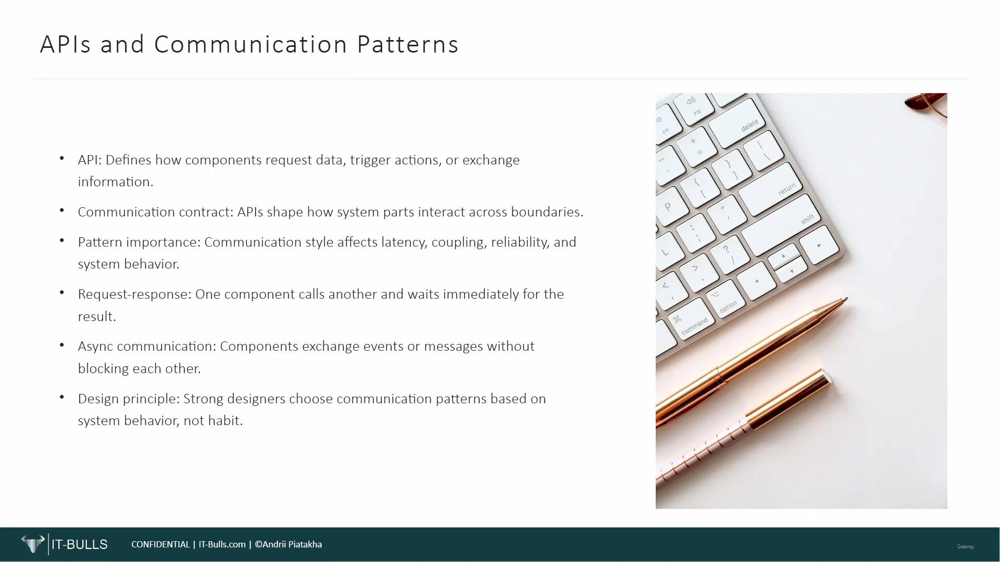

### 步骤 2（P012）：按时间维度二分——同步还是异步

讲师在屏幕上用序列图做了第一次切分：同步是"发出请求后等待响应再继续"，异步是"发送方不以同样方式等待，工作可以稍后通过队列、事件或后台进程完成"。

**约束条件（讲师给的）**：

- 调用方**需要立即答案** → 同步。例：登录提交凭证、请求账户数据。
- 调用方**不需要立即答案** → 异步。例：后台任务、通知、文件处理、可以稍后完成的工作流。

**代价（讲师给的）**：

- 同步：更简单易懂，但**运行时依赖更紧**。
- 异步：解耦更好、更能吸收尖峰，但**跟踪状态和失败更复杂**。

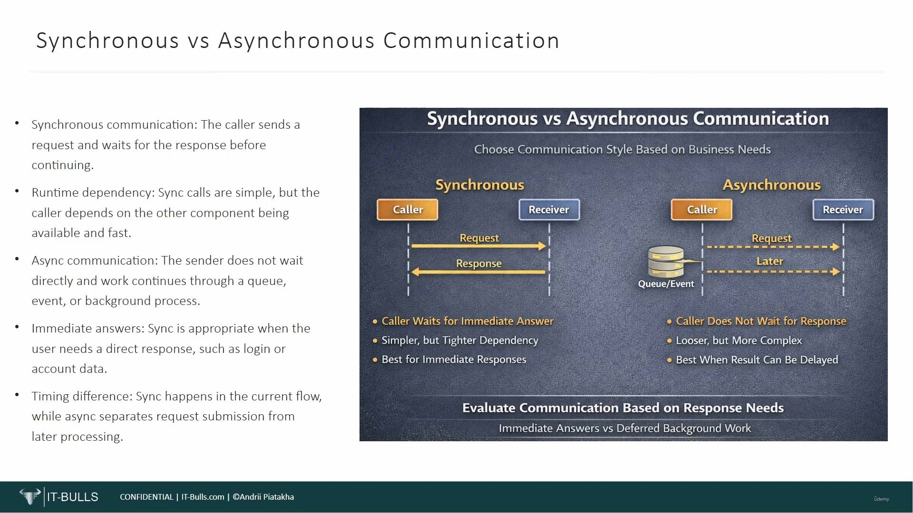

### 步骤 3（P012）：四个模式逐个过，每个都问"它把什么变简单了、把什么变难了"

讲师对四种模式的推导是同一个模板，你复现时也照这个模板走：

**① 请求-响应**——一问一答。讲师说它是"最自然的沟通模型"，"简单、直接、开发者和系统都好推理"，因此成了系统设计里的**默认选项**。代价：调用方要等，所以延迟、故障、过载会直接传导到对方。讲师的原话结论是"常见并不等于通用"，它是个好的**起点**，不是万能解。


**② 事件驱动**——不再直接调用，而是"一方发出事件，其他方感兴趣就自己反应"。讲师给的例子是电商下单：订单服务发布一个 `order placed` 事件，然后库存服务去锁库存、另一个服务发确认邮件、再一个更新分析——**原始服务不需要直接调用它们中的任何一个**。代价：流程不再是直线，跟踪难、事件可能迟到、消费者处理速度不一、调试更难。

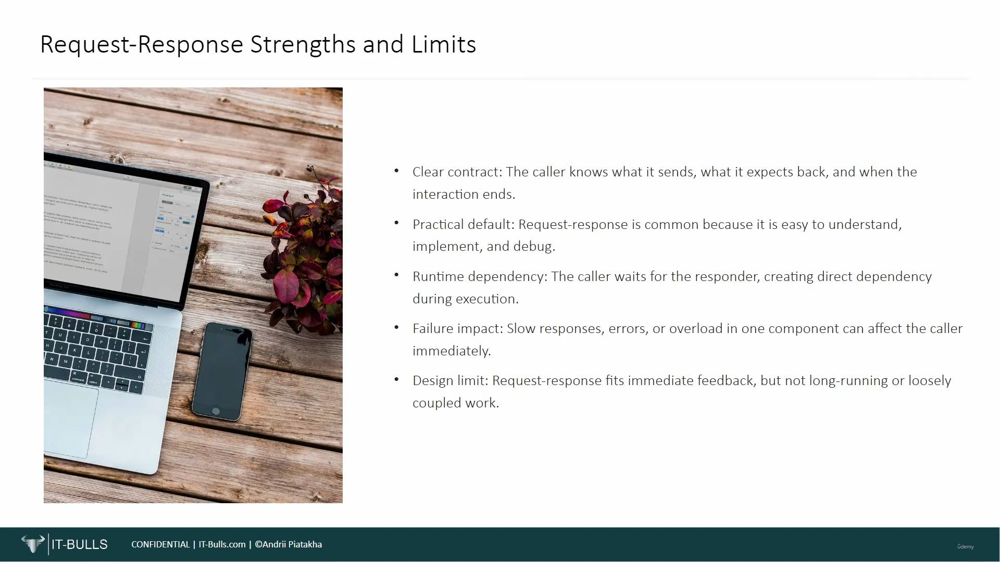

**③ 回调**——"我把请求给你，你做完之后回调我这个地址"。流程是：客户端发请求并带上 callback URL → 对方接受工作、异步处理 → 结果就绪后，对方**发一个新的请求回到你的回调端点**。适合长任务：文件处理、支付确认、报告生成、第三方核验。代价（讲师明确点名三条）：接收方必须暴露**稳定端点**、要处理**迟到或重复的通知**、要**校验回调的真实性**；实践上还需要**幂等**、安全校验和请求状态跟踪。

**④ 轮询**——客户端按固定间隔反复问"现在好了吗"。讲师给的适用条件很明确：结果**预计很快**出来、**频率适中**、**重复检查的成本低**；或者你**控制不了对方系统**（外部服务不支持回调也不支持事件），这时轮询可能是唯一可行选项。失效条件同样明确：请求频繁、结果耗时长、同时检查的客户端多——此时系统收到大量不产生新信息的查询，给网络、API 层甚至背后的数据库带来无谓负载。

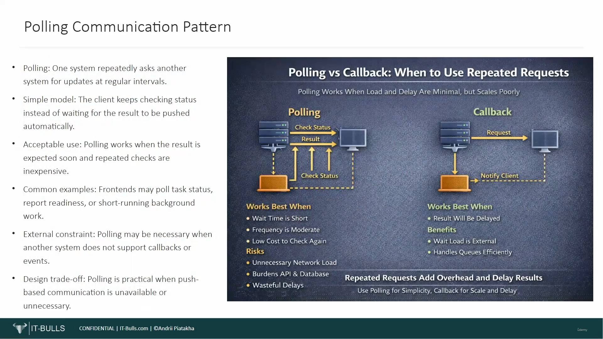

### 步骤 4（P012）：用四判据收敛

讲师给的四个判据，是这四个问题：

1. **用户现在就需要结果吗？** 需要 → 同步；可以稍后 → 异步。
2. **能接受多少耦合？** 直接请求-响应在运行时依赖更紧（对方那一刻必须在线）；事件驱动/异步降低这个依赖，但更难追踪。
3. **一边慢或不可用时会发生什么？** 如果临时故障不该立刻打断整条流程 → 异步模式通过缓冲工作和允许重试来帮忙；如果必须"立刻成功或立刻失败" → 同步更合适。
4. **简单性和韧性哪个更重要？**

讲师的总结句是："用户现在就需要结果吗？多少耦合可以接受？如果一方变慢或不可用，会发生什么？与韧性相比，简单性有多重要？" ——一旦这四个问题的答案清楚，模式选择就变得很容易论证。

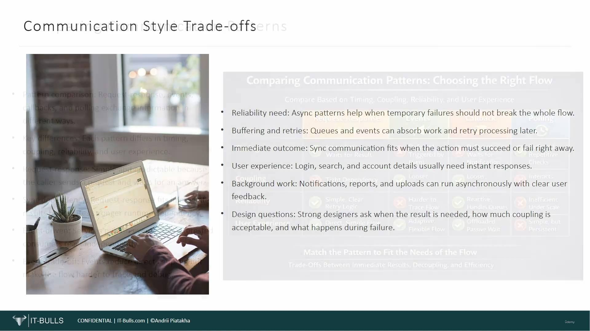

### 步骤 5（P012）：避开"按习惯选"这个坑

讲师在最后点名的错误是：团队把同一种交互风格复制到系统每个角落，不是因为最合适，而是因为最熟。两种方向的翻车他都举了：

- 对**长耗时**的工作用**同步调用** → 制造无谓等待和更紧的服务依赖。
- 对**需要立即确认**的事情用**异步事件** → 流程难懂、极难调试。

讲师强调：问题不在模式本身，而在**模式与真实需求的不匹配**。

### 步骤 6（P013）：先分类，再谈存哪

讲师在 P013 的第一刀不是选数据库，而是**画数据分类图**。五类数据：

| 类别 | 讲师的定义 | 讲师说的典型例子 |
|---|---|---|
| 事务型 transactional | 支撑核心业务运转，要求正确性、一致性、可靠更新 | 订单、支付、账户余额、用户记录 |
| 分析型 analytical | 不是为了跑当笔交易，而是理解模式、趋势、随时间变化的表现 | 报表、看板、历史分析、BI |
| 大对象 blobs | 大的二进制对象，主要挑战是体积 | 图片、视频、音频、PDF、文档 |
| 日志 logs | 事件流，记录系统里随时间发生了什么 | 请求、错误、状态变更、审计事件、运维细节 |
| 会话 session | 临时的用户相关状态 | 登录上下文、购物车内容、短生命周期的应用状态 |

讲师强调：**这些不是标签，每一类都有自己的访问模式、保留需求和性能要求**。把它们一视同仁，结果就是"低效、昂贵、难扩展"的存储。

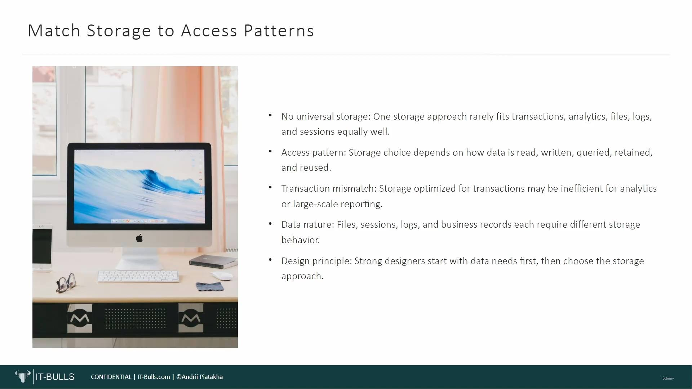

### 步骤 7（P013）：把事务型和分析型拉开

讲师对这两类的对比是整节课最锋利的一刀：

- **事务型**：业务正在"做事"的时候用——创建订单、更新余额、确认支付、改账户信息。要求**快读快写、强正确性、可靠更新**。工作负载由**大量小而频繁的操作**组成，每条都必须正确且及时。
- **分析型**：用来理解"已经发生了什么"。支撑报表、看板、趋势和跨历史的大范围查询。**不是一次看一条记录，而是横跨很多记录回答更宽的问题**。工作负载通常**读密集**、扫描数据量大、更在意聚合和洞察而不是即时更新速度。

**由此得出的设计约束**：为事务访问优化的系统，遇到大的分析查询会吃力；为分析构建的系统，不适合高频事务更新。讲师的原话结论是"优秀的系统设计者会尽早分离这些关注点"。

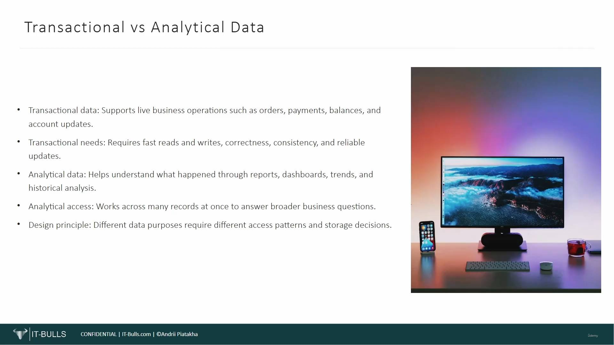

### 步骤 8（P013）：把 blob / logs / session 拆开

讲师特别指出，这三类经常被"因为都不是经典业务记录"而粗暴归为一堆，但它们的访问模式完全不同：

- **Blobs 的挑战是体积**。写入频率通常低于事务记录，但占用的存储和带宽很大，所以**常用对象存储而不是传统数据库表**来处理。
- **Logs 是事件流**。**追加密集（append-heavy）、增长很快**，主要用于事后监控、调试、合规或分析，而不是直接的用户交互。
- **Session 数据**读写都非常频繁，但**不需要长期存在**，所以**速度和过期行为**比长期存储重要得多。

一句话总结讲师的映射：**blob 要高效处理大文件，log 要追加密集且面向时间的存储，session 要快访问 + 有限生命期。**

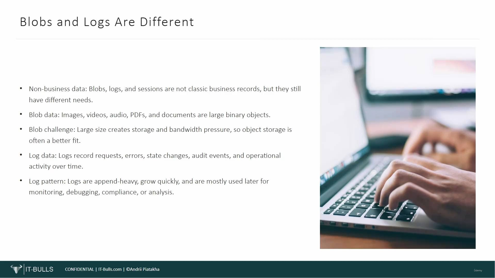

### 步骤 9（P013）：访问模式优先于流行度

讲师给出的提问清单（这是他希望你在选存储前先回答的）：

- 数据是**读多还是写多**？
- 需不需要**强一致**？
- 查询是**按 key、按范围，还是走聚合**？
- 数据是**临时的、只追加的，还是长期存活的**？

讲师的原话："这些问题通常远比某项技术是否被认为现代或流行重要得多。" 他同时点名了"炒作是系统设计中的危险捷径"——团队因为某个存储听起来可扩展、时髦、被大公司用，就选了它，却没检查自己的负载是否真需要那些强项，结果换来不必要的复杂度、更高的成本和更难运维的系统。

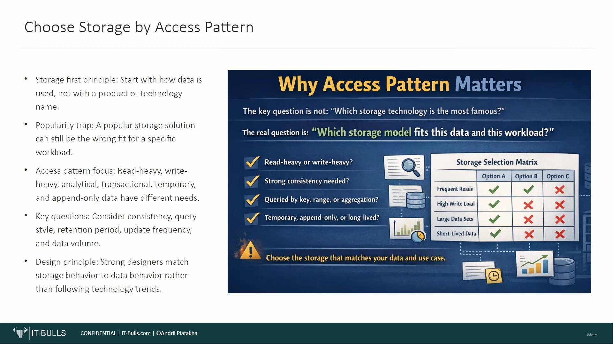

### 步骤 10（P013）：读密集 vs 写密集，压力点不同

- **读密集系统**：主导活动是取数据。常见于内容平台、商品目录、看板、搜索型应用。重点是**快读、缓存、索引、副本**，因为用户体验高度依赖数据返回速度。
- **写密集系统**：系统不断创建、更新、追加数据。例：日志管道、事件摄入、交易记录、运维系统中的高频更新。重点是**在不制造太多争用和延迟的前提下承受持续写入**。

讲师还指出这会反过来影响存储**周围**的架构：读密集常受益于缓存、副本或专门的读模型；写密集可能需要**批处理、对追加友好的存储、基于队列的摄入，或者谨慎的分区**来分散负载。以及那个关键的交叉代价：**为读优化的系统在写变频繁时可能表现很差**（索引、副本、面向查询的结构都会带来开销），**为写优化的系统可能不适合复杂或高响应的读查询**。

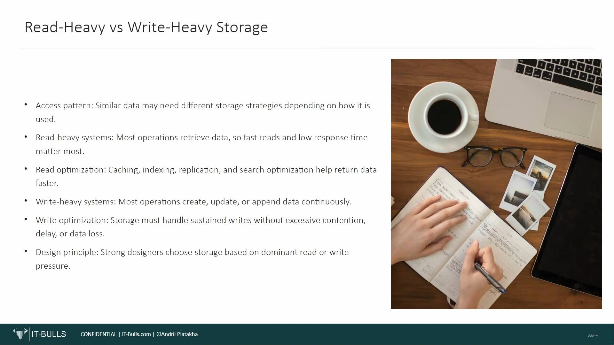

### 步骤 11（P013）：把数据当成"会流动的东西"看

讲师最后打开数据流图：数据从客户端或外部来源进入 → 经过 API 和应用逻辑 → 被存储 → 被再次读取 → 被转换 → 有时继续送往缓存、队列、分析管道或其他服务。他的关键句是"**A single piece of data may have several lives inside one system**"：它可能起初是一次用户动作，变成一条事务记录，后来出现在日志里，最终被复制进分析存储用于报表。

由此推出三条工程结论：

1. 存储选型不只在影响持久化——**写慢，请求路径就慢；读贵，面向用户的延迟就上升**。
2. 存储扛不住吞吐，压力会**向外扩散**，波及 API、队列、后台任务和其他依赖组件。
3. 图中数据被**复制、转换、延迟**的那些点，往往就是一致性、延迟和运维复杂度的取舍所在。

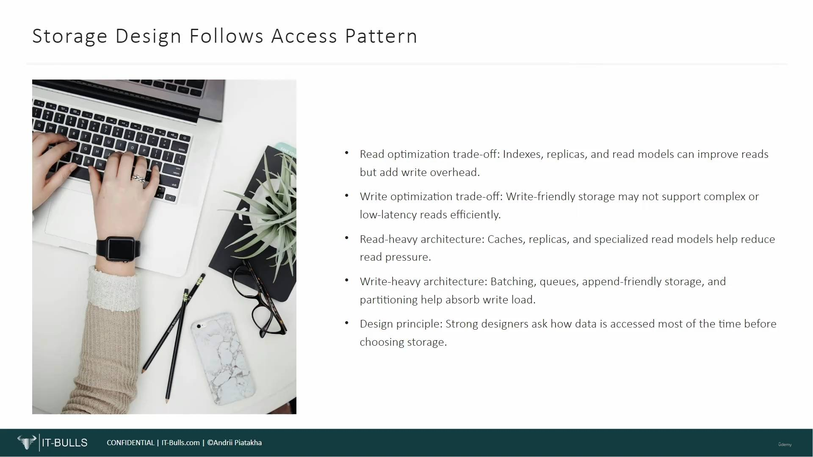

### 步骤 12（P013）：收在"一个存储装所有数据"这个错误上

讲师说这个错误一开始很有吸引力：一个数据库、一套运维模型、一套工具。但五类数据的读写方式、保留时长、查询方式都不同，硬塞进一个模型，等于"**为一种用例优化，同时削弱其他用例**"。

他给的两个方向的反例：

- 关系型数据库对事务型数据很好，但对大二进制文件或追加密集的日志会变得昂贵或低效。
- 对象存储对文档和媒体很出色，但完全不适合快速的、结构化的事务更新。

讲师特意补了一句限定，这句话很重要，别读成"每个系统都要上多套存储"：**这不意味着每个系统都需要很多数据库；它意味着当数据类型明显有不同需求时，不该把某一种存储自动当成万能解。目标是让存储策略匹配系统的真实行为，而不是为了技术多样性而多样性。**

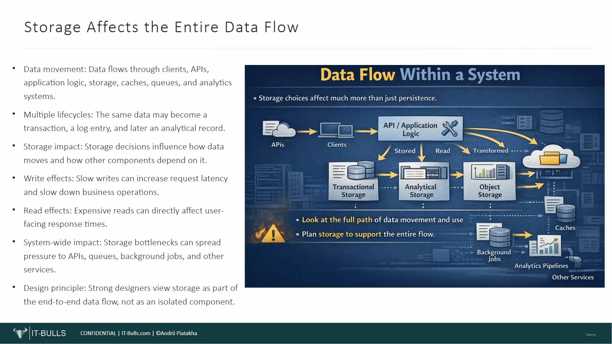

---

## 4. 完整代码：本节的交付物

> 本节是纯讲解课，**课里没有代码**。下面四份产物是把讲师的口头推导整理成可以直接填、直接用的表与草案。最后附一段**示意代码**（已标注），只用来帮你建立"模式差异在代码长什么样"的直觉，不是讲师讲过的实现。

### 表 A：通信模式选型决策表

用法：拿一条具体业务流程，逐行回答，最后看命中哪一行最多的模式。判据列就是讲师给的四个问题。

| 判据 | 请求-响应 | 事件驱动 | 回调 | 轮询 |
|---|---|---|---|---|
| 调用方需要立即答案吗 | **需要**（讲师：登录、取账户数据） | 不需要 | 不需要，但要"完成时被通知" | 不需要，但要"能查到状态" |
| 运行时耦合 | **紧**：对方当时必须在线 | **松**：生产者不直接调用消费者 | 中：需要暴露稳定端点 | 中：需要状态查询接口 |
| 一方慢/挂掉时 | 直接传导到调用方 | 可缓冲，消费者各自处理 | 首发请求可先结束，结果稍后送达 | 调用方自己重试，浪费在等待上 |
| 可靠性手段 | 超时、重试、熔断（**这些词课里没讲，是通用工程词**） | 讲师提到：缓冲工作、允许重试 | 讲师明确要求：幂等、安全校验、请求状态跟踪 | 降低频率、退避（**课里没讲退避**） |
| 主要代价 | 调用方要等；延迟/故障/过载互相影响 | 流程不再是直线，难追踪、事件可能迟到、消费者速度不一、调试难 | 要处理**迟到或重复的通知**、要验真 | 结果越慢、客户端越多，浪费越大 |
| 讲师给的适用信号 | 下一步依赖结果；清晰与即时反馈最重要 | 多个组件要响应同一个业务动作 | 长任务：文件处理、支付确认、报告生成、第三方核验 | 结果很快、频率适中、检查成本低；或对方不支持回调/事件 |

### 表 B：数据类别 → 访问模式 → 存储形态

| 数据类别 | 讲师描述的访问模式 | 讲师点到的存储形态 | 保留/时效要求 |
|---|---|---|---|
| 事务型 transactional | 大量小而频繁的操作，要快读快写、强正确性 | 关系型数据库（讲师举例时点名） | 长期，且必须正确 |
| 分析型 analytical | 读密集，扫描大量数据，重聚合与洞察 | "分析型存储"（**讲师未点名具体产品**） | 长期历史 |
| 大对象 blobs | 写频率低于事务记录，但体积大、占带宽 | **对象存储**（讲师明确说"通常通过对象存储来处理"） | 跟随业务策略 |
| 日志 logs | 追加密集、增长快、事后读取 | 追加密集、面向时间的存储（**讲师未点名产品**） | 用于监控/调试/合规/分析 |
| 会话 session | 高频读写、短生命周期 | 快访问 + 明确过期行为的存储（**讲师未点名产品**） | 过期即弃 |

> 注意：讲师全程只说存储**形态**（relational database / object storage / analytical storage），**没有点名任何一个具体产品或厂商**。这张表的第三列严格按逐字稿填写，没有替讲师补产品名。

### 表 C：容量估算表骨架

> **课里没有给出任何数字，也没有给公式。** 讲师只给了定性的判断（"轮询在结果变慢时越等越浪费"、"日志增长很快"、"会话数据短命"、"读密集/写密集压力点不同"）。下面这张表是把这些定性判断变成可填的算式——**算式是本文补的，不是讲师讲的**，请按自己的场景填数。

| 指标 | 算式 | 对应讲师的哪句话 |
|---|---|---|
| 轮询总检查次数 | 客户端数 × 每秒轮询次数 × 结果平均就绪耗时（秒） | "结果就绪前等待的时间越长，轮询就越浪费" —— p012 [14:25] |
| 轮询无效请求占比 | (总检查次数 − 实际拿到结果的次数) ÷ 总检查次数 | "不产生有用新信息的状态检查" —— p012 [13:57] |
| 日志日增存储量 | 每秒追加条数 × 单条字节数 × 86400 | "日志数据通常以追加写入为主，并且增长很快" —— p013 [08:01] |
| 日志保留期总占用 | 日志日增存储量 × 保留天数 × 副本份数 | "会按不同时长保留" —— p013 [16:29] |
| 会话存储峰值占用 | 并发活跃会话数 × 单会话字节数 | "生命周期短，且访问非常频繁" —— p013 [02:22] |
| 读/写比 | 单位时间读请求数 ÷ 单位时间写请求数 | "数据是读多还是写多？" —— p013 [10:20] |
| 大对象存储占用 | 对象数 × 平均对象体积 × 副本份数 | "它们可能会消耗大量存储和带宽" —— p013 [08:01] |

填完这张表，你的选型结论应该能直接用讲师那句话复述出来：**"哪种存储模型适合这类数据和这种工作负载？"**

### 数据模型 / 接口草案

> **课里没有给出任何字段设计。** 讲师只给了一个事件的名字示例：订单服务发布 **`order placed`**。下面这份草案保留了这个事件名，其余字段是本文补的示意，用来说明"事件驱动"里"事件"大概长什么样。

```
事件名：order placed            ← 讲师在 p012 [08:57] 明确举的例子
发布者：订单服务
订阅者（讲师举的三个）：库存服务、确认邮件服务、分析更新
载荷字段：课里没讲，需按你自己的业务定义
```

### 示意代码（课里没有代码，以下为示意）

> 下面这段只为对照"同一条业务流程在四种模式下的代码形态差异"。**不是讲师讲过的实现**，也不含任何讲师提到的库或框架。

```js
// ===== 课里没有代码，以下为示意 =====

// ① 请求-响应：调用方等结果
async function getUserSync(userId) {
  const res = await fetch(`https://api.example.com/users/${userId}`);
  return res.json();               // 拿到结果才继续往下走
}

// ② 事件驱动：发布一个事件，不管谁来消费
async function placeOrder(order) {
  const res = await fetch('https://api.example.com/events', {
    method: 'POST',
    headers: { 'Content-Type': 'application/json' },
    body: JSON.stringify({ type: 'order placed', payload: order }),
  });
  return res.status;               // 发布成功即可，不等库存/邮件/分析
}

// ③ 回调：带上 callback URL，先结束这次请求
async function startLongJob(input, myCallbackUrl) {
  const res = await fetch('https://provider.example.com/jobs', {
    method: 'POST',
    headers: { 'Content-Type': 'application/json' },
    body: JSON.stringify({ input, callbackUrl: myCallbackUrl }),
  });
  return res.json();               // 只拿到"已受理"，结果稍后回调进来
}
// 你需要在 /callback 端点上做三件事（讲师点名的三条）：
//   - 幂等：同一条通知重复到达，结果不能重复生效
//   - 验真：确认这次回调确实来自对方
//   - 状态跟踪：能查到这个请求当前处于哪一步

// ④ 轮询：反复问"现在好了吗"
async function pollUntilReady(jobId, intervalMs = 1000) {
  while (true) {
    const res = await fetch(`https://provider.example.com/jobs/${jobId}`);
    const job = await res.json();
    if (job.status === 'done') return job.result;
    await new Promise((r) => setTimeout(r, intervalMs));
  }
}
```

---

## 5. 逐行解释：每个决策为什么这样定，不这样会怎样

**表 A 为什么把"调用方需要立即答案吗"放在第一行？**
因为讲师在 P012 里做的第一刀就是时间维度。同步/异步的分野不是技术选择，而是业务事实：用户点登录，下一步就是进主页，等不了；用户点"生成报告"，可以先去干别的。先答这一题，剩下三行才有意义。如果跳过这题直接问"耦合"，你会陷入"事件驱动听起来更先进"的陷阱——这正是讲师在 p012 [19:37] 批评的那种按习惯选。

**为什么"运行时耦合"这一行要写"对方当时必须在线"？**
讲师的原话是 "一个组件依赖另一个组件在那一刻可用"。这个"at that moment"是耦合的精确含义：不是编译期依赖、不是部署依赖，而是**运行时那一刻的可用性依赖**。请求-响应把这个依赖暴露得最直接；事件驱动通过事件把生产者和消费者松开了（讲师 p012 [09:25]）。在 Node 里，这就是 `await fetch(...)` 和"往队列里 push 一条消息然后返回"的区别——前者对方 500 你就 500，后者对方挂了消息还在队列里。

**为什么"回调"一行要单列"幂等、验真、状态跟踪"三条？**
因为讲师在 p012 [12:04] 明确说 callback 流程"通常需要幂等性、安全检查，以及良好的请求状态跟踪"。这三条不是可选优化，而是回调模式的**入场费**：你的回调端点暴露在公网上（所以必须验真）；网络重试和对方重发会导致同一条通知到两次（所以必须幂等）；一次请求跨越了两次 HTTP 生命周期（所以必须能在中间查询状态）。少了任何一条，回调就会变成一个"看起来更优雅、实际更危险"的轮询替代品。

**为什么"轮询"一行写"结果越慢、客户端越多，浪费越大"？**
讲师在 p012 [14:25] 给的量化直觉是："结果就绪前等待的时间越长，轮询就越浪费。" 把这句话翻成算式就是表 C 第一行：检查次数 = 客户端数 × 频率 × 等待时长。三个因子任何一个变大，浪费都线性放大。这也是为什么讲师说轮询"对某些流程来说可以接受"，但量变会引起质变——**不是轮询错了，是场景变了**。

**表 B 为什么按"访问模式"列而不是按"数据重要程度"列？**
因为讲师在 p013 [02:49] 给的判据是 "这里的关键因素是访问模式"，并且在 p013 [09:52] 说得更绝对："存储应当遵循访问模式，而不是追随潮流、时尚，或当前最受关注的任何技术。" 按重要程度列，你会得出"所有数据都重要，都要用最好的数据库"这种没有信息量的结论；按访问模式列，五类数据自然分道扬镳。

**为什么"事务型"和"分析型"一定要分两个存储？**
讲师在 p013 [06:36] 给的对比是工作负载形态的差异：事务型是"大量小而频繁的操作"，分析型是"读取密集，扫描更大量的数据"。一个为大量小操作优化的存储（索引、行式结构、即时一致性），碰上横跨海量记录的聚合查询会吃力；一个为聚合扫描优化的结构，碰上高频单行更新会拖垮。讲师的原话结论："针对事务型访问优化的系统，在处理大型分析查询时可能会吃力；而为分析场景构建的系统，则可能不适合高频事务型更新。"

**为什么日志和会话不能和 blob 塞一起？**
讲师在 p013 [08:57] 把三者的压力点说得非常具体：blob 的压力是**体积**（存储和带宽），log 的压力是**追加速度和时间维度**（append-heavy、grows quickly、按时间读），session 的压力是**速度 + 过期**（read/update frequently、does not need to live forever）。三者的"最优形态"根本不在同一个坐标轴上。硬塞进一个模型，讲师的原话是"我们常常会为了性能，或因为运维行为不佳，而制造不必要的成本"。

**为什么表 C 是骨架而不是结论？**
因为讲师**从头到尾没有给过任何一个数字**。他给的全部是定性判据。强行编造"日活 10 万、QPS 3000"这类数字，会让你误以为这是课程内容。这张表的正确用法是：你填自己的数，然后用讲师的那四个问题去解读结果——算出来轮询无效请求占比 95%，就该上回调；算出来日志保留期总占用远超预算，就该重新谈保留策略。

**表 A 最后一行为什么要保留"或对方不支持回调/事件"这个条件？**
因为讲师在 p012 [13:29] 讲得很实在："系统设计通常是在现实约束下选择可行的方案，而不是选择看起来理想的方案。" 轮询在技术上常常是"最差但唯一可行"的选项——当你调的是一个不给你 webhook、也不给你事件流的外部服务时，反复查就是唯一能做的事。这条留在表里的意义是：**承认约束，而不是假装约束不存在。**

---

## 6. 复现检查清单

做完下面这些，你就算把 P012–P013 落地了：

**P012 相关**

- [ ] 挑出你系统里**至少三条**跨服务调用链，每条写下：方向、调用方能否继续、对方挂掉的传播后果
- [ ] 对每条链回答讲师的四个问题：要立即结果吗？能接受多少耦合？一边慢/挂掉会怎样？简单性和韧性哪个重要？
- [ ] 用表 A 逐行对照，给每条链选定模式，并写下**为什么不是另外三种**
- [ ] 找出你系统里**用同步调用做长任务**的地方（讲师点名的坑）
- [ ] 找出你系统里**用异步事件做需要立即确认**的地方（讲师点名的另一个坑）
- [ ] 如果你在用轮询：算出表 C 里的"轮询无效请求占比"。超过你能接受的水平，就评估回调
- [ ] 如果要用回调：确认你的回调端点具备**幂等、验真、状态跟踪**这三件事

**P013 相关**

- [ ] 把你系统里所有数据列出来，逐条归入五类之一（事务型 / 分析型 / blob / log / session）
- [ ] 对每一类回答讲师的四个提问：读多还是写多？要不要强一致？按 key/范围/聚合查？临时/只追加/长期？
- [ ] 用表 B 对照，标出当前存储形态和"访问模式建议形态"**不一致**的类别
- [ ] 找出"用一个存储装所有数据"的具体位置，评估是保留还是拆分（注意讲师的原话：目标不是技术多样性）
- [ ] 画出你自己的数据流图，标出**数据被复制、被转换、被延迟**的点
- [ ] 在数据流图上标出：哪一段是写慢会拖垮请求路径的、哪一段是读贵会拉高用户延迟的
- [ ] 用表 C 填一遍自己的数：读/写比、日志日增与保留期占用、会话峰值占用、轮询开销

**通用**

- [ ] 每个选型结论都能用一句话说清"如果反过来选，会在哪个具体场景下坏掉"

---

## 7. 课里没讲但你会撞上的

这一节专门标注**课程没有覆盖、但你动手时会立刻碰到**的东西。这里出现的任何名词都不是讲师讲的。

1. **具体产品选型。** 讲师通篇只说存储**形态**（relational database / object storage / analytical storage），没有点名任何一个产品、云服务或开源项目。你需要自己把形态映射到具体技术，而这个映射课里没讲。

2. **消息中间件的具体行为。** 讲师说事件驱动"通过队列、事件或后台进程"完成，但**投递语义（至少一次 / 至多一次）、消息顺序、消费位点管理**这些课里完全没讲。而这几个恰恰决定了你的消费者需不需要幂等——讲师在回调那一节提了幂等，但没把它推广到事件消费上。

3. **超时、重试、熔断、退避。** 讲师讲"一边慢或不可用时会发生什么"时停在概念层，没有给任何具体机制。表 A 里我在"可靠性手段"一行标注了这是通用工程词，不是课程内容。

4. **一致性模型的具体名称。** 讲师在 P013 提到"是否需要强一致"，但没展开任何一致性模型。你在设计读副本时一定会撞上"读到自己刚写的数据"这类问题，课里没讲。

5. **数据在多个存储之间复制时的一致性代价。** 讲师在 p013 [15:32] 明确说"数据被复制、转换、延迟的点…往往引入一致性、延迟和运维复杂度的取舍"，但他**只指出了这里有取舍，没有给解法**。

6. **回调端点的安全实现细节。** 讲师要求"验证回调是否真实可信"，但**签名算法、密钥轮换、时间戳防重放**这些课里一个字都没有。

7. **Node/JS 侧的对应物。** 讲师全程用架构语言，没有落到任何语言。对应关系是：请求-响应 ↔ `await fetch(...)`；事件驱动 ↔ 进程内 `EventEmitter` 或跨进程的消息队列或托管队列；回调 ↔ 一个接收 POST 的路由；轮询 ↔ `setInterval` + `fetch` 轮询循环。**这个映射是本文补的，讲师没讲。**

8. **"多少套存储算合理"。** 讲师给了边界条件——"这不意味着每个系统都需要很多数据库"，但**没有给判断阈值**。实践中这条线要靠表 C 的数字和团队运维能力来定，课里没讲。

9. **成本和预算。** 讲师反复提"不必要的复杂性，更高的成本"，但从头到尾没有给任何成本模型或单位价格。表 C 只算容量和请求量，不折算成钱。