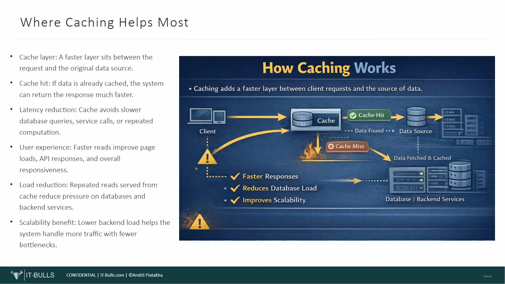
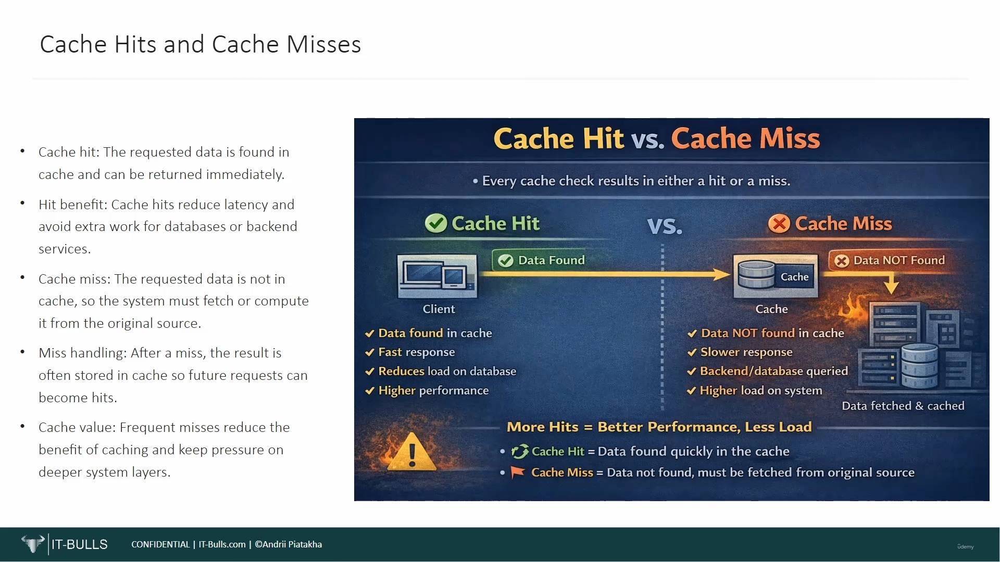
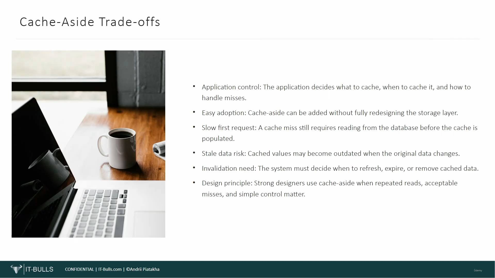
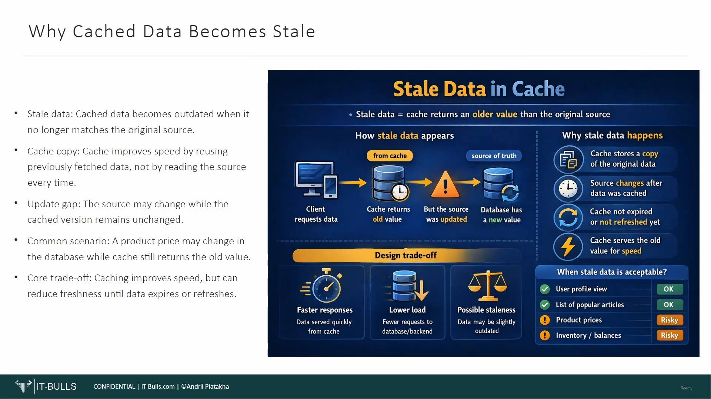
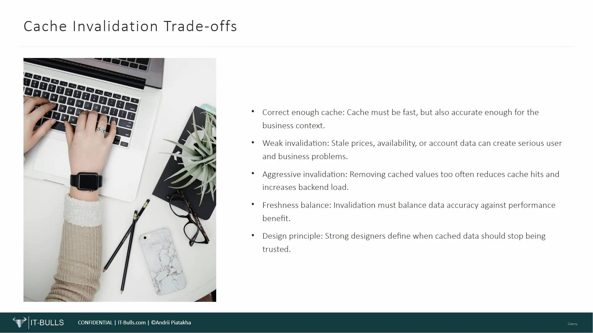
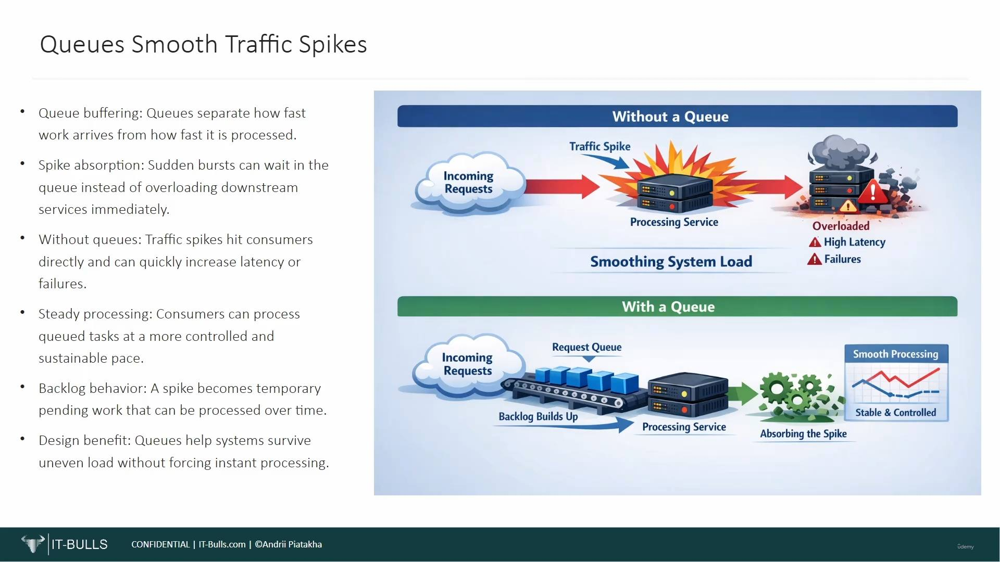
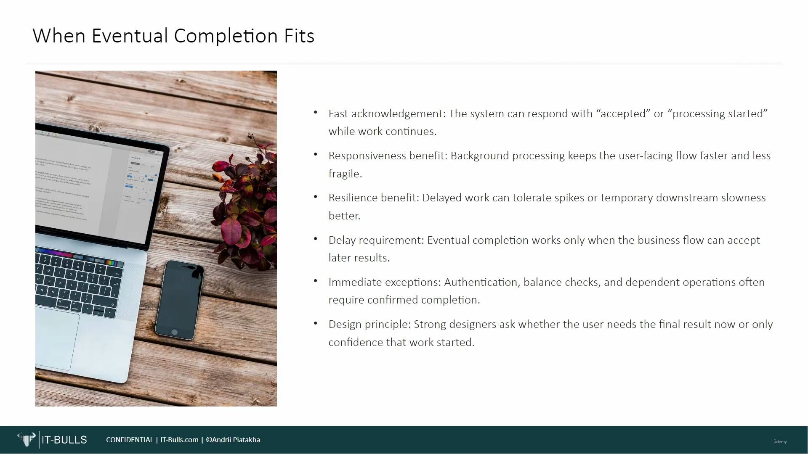

# System Design for Developers：缓存、队列与后台处理（P14–P15）复现文档

## 1. 这一节做什么

本课程由两节系统设计概念课组成（BV1td4w6oEmH，P14–P15），不带实际操作，只有白板式讲解。P14 讲缓存的本质、命中/未命中、Cache-Aside 模式、TTL、脏数据与失效；P15 讲队列、缓冲与后台处理，以及异步化带来的顺序、可见性、重复和失败处理问题。读完本文后，你应该能：

- 判断一个读请求该不该加缓存，并算出缓存能降低多少延迟和数据库压力；
- 画出一张 Cache-Aside 架构图，说清 TTL 和失效策略的取舍；
- 判断一个任务该不该放进队列，并估算积压量；
- 设计一张包含重试与死信队列的异步处理流程图。

课程是纯概念课，没有可运行的代码仓库。因此这份文档会把你需要的设计决策、估算公式和接口草案整理成可直接复用的表，并在需要时提供标注为“示意”的代码片段。

## 2. 讲师原话

下面摘录两节课中与核心决策直接相关的原话，方便你对照原始时间点回看。

- 「Caching is the practice of storing data in a faster, temporary location so that the system does not need to fetch or recompute it every time.」—— p014 [01:21]
- 「Every time the system checks the cache one of two things happens. Either the data is already there which is called a cache hit or it is missing which is called a cache miss.」—— p014 [05:34]
- 「If the data is missing, the application loads it from the main storage and then places it into the cache for future use.」—— p014 [07:58]
- 「TTL stands for Time to Live and it defines how long a cached value is allowed to remain in the cache before it expires.」—— p014 [09:52]
- 「Stale data appears when the value stored in cache is no longer the same as the value in the original data source.」—— p014 [11:46]
- 「A queue is usually the place where work waits. One component produces messages or tasks and another component consumes them later.」—— p015 [01:51]
- 「Retries are a way for a system to try an operation again after it fails.」—— p015 [07:27]
- 「use retries for temporary failures, combine them with back off and limits」—— p015 [09:17]
- 「When a message keeps failing, the system needs somewhere safe to move it instead of retrying forever. That is where a dead letter queue comes in.」—— p015 [09:46]
- 「Instead of one direct flow, we now have delayed work, background state, and more moving parts.」—— p015 [16:10]

注意：原文中有一处口误 “dead letter Q”，本文统一写作 “dead-letter queue”。

## 3. 从零复现

这一节把讲师的推导过程拆成「需求 → 约束 → 估算 → 方案 → 取舍」五个步骤。每一步的结论都是基于课里的定性描述推算出来的；课里只给方向，没有给具体数值的地方，我会标明“示意”。

### 3.1 缓存部分：从重复读到大流量

**需求**：系统里存在大量重复读取的数据，例如产品详情页、用户资料、配置值、热门内容或高频查询结果。用户希望响应更快，数据库不希望被重复读打满。

**约束**：
- 数据库仍是唯一事实来源（source of truth），缓存只是副本。
- 业务允许一份数据在短时间内不新鲜（例如产品描述可以接受几分钟延迟）。
- 数据不能变化太快，否则缓存的命中率会很低。

**估算（示意）**：
设数据库查询一次平均 10 ms，缓存读取一次平均 1 ms。若命中率为 H，则平均响应时间约为：

```
平均延迟 = H × 1ms + (1-H) × 10ms
```

当 H=0 时，延迟 10 ms（等于没加缓存）；当 H=90% 时，延迟 = 0.9×1 + 0.1×10 = 1.9 ms，下降约 81%。流量层面：假设数据库能承受 1000 QPS，加上 90% 命中率后，只有 10% 的请求落到数据库，即 100 QPS，于是数据库能支持的业务 QPS 可扩大到约 10000 QPS。这个计算说明“缓存吸收重复读”为什么能同时降低延迟和保护后端。



**方案**：采用 Cache-Aside 模式。请求先查缓存，命中直接返回；未命中则查数据库，回填缓存再返回。给缓存条目设置 TTL，到期后自动失效，下一次请求重新从数据源加载。





**取舍**：
- TTL 越长，命中率越高，延迟越低，但脏数据存活时间越长。
- TTL 越短，数据越新鲜，但 miss 变多，数据库压力回升。
- 强一致要求高时，TTL 不能解决“源数据已改、缓存未改”的窗口，必须配合失效或主动更新。





### 3.2 队列部分：从同步阻塞到异步完成

**需求**：有些任务不需要在用户请求返回前完成，例如发邮件、生成报告、图片缩放、支付确认通知、更新分析数据。如果这些任务都阻塞在请求路径中，用户等待时间会被拉长，下游一慢整个请求就失败。

**约束**：
- 用户需要立刻收到“请求已被接受”的确认，而不是“最终结果”。
- 不可能无限重试同一任务，也不能让失败任务直接消失。
- 任务可以延迟完成，但不能丢失。

**估算（示意）**：
假设峰值到达率 A = 1000 任务/秒，消费者处理能力 C = 500 任务/秒。没有队列时，超过 500 的部分会立即失败或拖垮下游。有队列时，积压速率 = A - C = 500 任务/秒。如果尖峰持续 T = 60 秒，积压量约为：

```
Backlog = (A - C) × T = (1000 - 500) × 60 = 30000 任务
```

尖峰结束后，消费者继续以 C 的速率消化积压，清空时间为 Backlog / C = 30000 / 500 = 60 秒。这个“把瞬时超载转成延后工作”的能力，就是队列作为缓冲的价值。



**方案**：采用 Producer-Consumer 模型。生产者把任务写入队列后立即返回；消费者按自己的速率从队列取任务处理。为临时失败增加重试（retry）与退避；超过最大重试次数后，把消息送入死信队列（DLQ），由人工或补偿流程处理。


**取舍**：
- 异步化提升响应速度、弹性和可扩展性，但代价是流程不再是一条直线。
- 队列不是魔法：如果消费者长期慢于生产者，积压会无限增长，需要监控积压量。
- 重试可以提高成功率，但无限制重试会放大下游压力；必须设置重试上限和退避。
- 消息可能被重复消费，业务操作需要具备幂等性（课里点名了“duplicates”这个挑战，但没给解决方案，见第 7 节）。



## 4. 完整代码

课里没有代码。下面把两节课的结论落成三张设计表和一段示意代码。示意代码只是帮你把流程“翻译”成可读的实现，不是课程原始内容，也不能直接运行（需要补全数据库 SDK 和队列连接等环境）。

### 4.1 设计决策表

| 决策点 | 缓存场景（P14） | 队列场景（P15） | 依据 |
|---|---|---|---|
| 是否引入 | 数据读多写少、重复读高、允许短暂陈旧 | 任务不需要立即完成、下游可能慢/抖 | 讲师：重复访问是缓存的理由；异步用于“immediate completion is not required” |
| 组件位置 | 在 Client/API 与 Database 之间加一层 Cache | 在 Producer 与 Consumer 之间加 Queue | 讲师：cache 是更快的第一道查找层；queue 是等待区 |
| 过期/保留策略 | TTL，到期后从源重新加载 | 消息被消费后出队；失败按重试策略处理 | 讲师：TTL 是限制脏数据存活时间的最简单方式 |
| 失败处理 | 缓存 miss 时回源并回填 | 有限次重试 + 退避，超限进 DLQ | 讲师：不能 retry forever，也不能 silently lost |
| 一致性模型 | 最终一致（允许短暂 stale） | 最终完成（eventual completion） | 讲师：缓存是副本；异步改变系统模型为 eventual completion |

### 4.2 组件职责表

| 组件 | 缓存场景职责 | 队列场景职责 |
|---|---|---|
| Client / API | 接收请求；先读缓存 | 接收请求；把任务写入队列 |
| Cache / Queue | 以 KV 缓存数据；按 TTL 失效 | 暂存消息；解耦生产与消费 |
| Database / Consumer | 作为 source of truth；处理 cache miss | 实际执行业务任务；失败时重试 |
| DLQ（仅队列） | 无 | 保存超过重试上限的消息，供人工检查 |

### 4.3 接口/数据模型草案

缓存条目（示意）：

```js
// 缓存 key 设计
// key: product:{id}
// value: { id, name, price, updatedAt }
// ttl: 300 秒（示意值，需按业务调整）

{
  key: "product:42",
  value: "{ \"id\": 42, \"name\": \"Coffee Cup\", \"price\": 19.99, \"updatedAt\": \"2026-01-01T00:00:00Z\" }",
  ttl: 300
}
```

队列消息（示意）：

```js
// 队列消息
{
  messageId: "msg_123456",          // 生产端生成的唯一 ID
  taskType: "send_email",
  payload: { to: "user@example.com", template: "welcome" },
  createdAt: "2026-01-01T00:00:00Z",
  retryCount: 0                     // 每次重试 +1
}
```

### 4.4 容量估算表

| 指标 | 估算公式 | 示意结果 |
|---|---|---|
| 平均响应延迟 | `H × cache_latency + (1-H) × db_latency` | H=0.9, cache=1ms, db=10ms → 1.9ms |
| 落到数据库 QPS | `total_qps × (1-H)` | total=10000 QPS, H=0.9 → 1000 QPS |
| 队列积压量 | `(arrival_rate - consume_rate) × spike_duration` | (1000-500)/s × 60s = 30000 |
| 清空积压时间 | `backlog / consume_rate` | 30000 / 500/s = 60s |

### 4.5 示意代码：Cache-Aside

```js
// 课里没有代码，以下为示意。
// 用最朴素的 Map 模拟缓存，实际请用 Redis/Memcached 等外部缓存。
const cache = new Map();

async function getProductWithCacheAside(db, productId, ttlMs = 300_000) {
  const key = `product:${productId}`;

  // 1. 先查缓存
  const cached = cache.get(key);
  if (cached) {
    const { value, expireAt } = cached;
    if (expireAt > Date.now()) {
      return JSON.parse(value); // cache hit
    } else {
      cache.delete(key);        // TTL 过期，视为 miss
    }
  }

  // 2. cache miss：回源数据库
  const row = await db.query(`SELECT * FROM products WHERE id = ?`, [productId]);
  if (!row) return null;

  // 3. 回填缓存，写 TTL
  const value = JSON.stringify(row);
  cache.set(key, { value, expireAt: Date.now() + ttlMs });

  return row;
}
```

### 4.6 示意代码：队列消息处理骨架

```js
// 课里没有代码，以下为示意。
// 展示了 producer-consumer + retry + DLQ 的控制流，不绑定具体队列产品。

class Queue {
  constructor() { this.messages = []; this.dead = []; }
  push(msg) { this.messages.push(msg); }

  // 模拟消费者拉取
  async poll() {
    const msg = this.messages.shift();
    if (!msg) return null;

    try {
      await process(msg);
      return { ok: true };
    } catch (err) {
      msg.retryCount += 1;
      if (msg.retryCount > 3) {
        this.dead.push(msg);          // 超过上限进 DLQ
        return { ok: false, dead: true };
      }
      this.messages.push(msg);         // 否则放回队列等待重试
      return { ok: false, retry: true };
    }
  }
}

async function process(msg) {
  // 实际业务处理，如发送邮件、生成报告…
  // 如果下游临时不可用，这里会 throw，触发重试
}
```

注意：示意代码为了短小易懂，没有加入退避（backoff）、幂等、消费确认等细节；课里没讲这些实现，请把它当作概念参考，不要直接用于生产。

## 5. 逐行解释

这一节逐条解释上一节的设计表和代码里的关键决策，以及如果不这样设计会发生什么。

### 5.1 缓存时段：为什么先查缓存、回填缓存、设置 TTL

- **缓存 key 用 `product:{id}`**：用业务主键作为 key 才能保证一个产品只有一份缓存；如果 key 不稳定，同一个产品可能会在缓存里存在多份，命中率下降。
- **TTL 设 300 秒**：这是一个典型的“中间值”。设太长，产品价格改了但缓存仍返回旧价；设太短，miss 增多，数据库压力回升。具体数值应该根据“价格多久变一次、用户能接受多久的旧价格”来决定，课里特别强调“TTL is a design decision based on business meaning, not guesswork”。
- **miss 时回源数据库并回填**：这是 Cache-Aside 的核心。如果不回填，第一次请求永远 miss，后续请求也不会受益；如果提前预热所有数据，代价又太高，所以“按需回填”在大多数场景最划算。
- **过期后删除缓存而非直接更新**：示意代码在 TTL 到期后 `cache.delete(key)`，下一次 miss 重新查库。课程里没有明确推荐“删除还是更新”，只说“cache invalidation is one of the hardest parts”；删除是一种保守做法，可以避免并发写库和写缓存顺序不一致的问题。
- **数据库仍是 source of truth**：缓存里的数据只是一份“可能过期的副本”。如果不坚持这一点，缓存和数据库发生不一致时，系统会不知道该相信谁。

### 5.2 队列时段：为什么生产者不等待消费者、为什么重试要设上限、为什么要有 DLQ

- **生产者只把消息推入队列就返回**：如果生产者必须等消费者完成，就退化成同步调用，下游一慢，生产者跟着慢；引入队列的意义就消失了。
- **`retryCount` 累加并在超过 3 次后进入 DLQ**：3 次是一个示意上限。如果没有上限，一个永远失败的消息会不断被重试，挤占正常消息的处理资源；如果没有 DLQ，直接丢弃消息又会让任务“静默失败”，业务方无感知。
- **DLQ 保存失败消息而不是直接删除**：讲师明确说“failed messages should not simply disappear”。DLQ 让失败变得可见、可追踪；运维人员可以查看失败原因、修复后把消息重新放回队列。
- **`msg.retryCount += 1` 放在 catch 里**：只有真正抛异常才算一次失败。如果失败后不放回队列，任务会丢失；如果放回队列但没有重试上限，又可能无限循环。
- **示意代码没有退避**：课里没有讲 backoff 细节，但讲师提到“combine them with back off and limits”（p015 [09:17]）。实际必须有退避，否则大量失败消息同时重试，会再次打爆下游。

### 5.3 估算公式逐行解释

- **`平均延迟 = H × cache_latency + (1-H) × db_latency`**：H 是命中率。命中时只花缓存读的时间，未命中时花缓存读 + 数据库读（也包含回填开销）。这个公式帮助理解：即使缓存只比数据库快 10 倍，只要命中率足够高，整体延迟也能大幅下降。
- **`落到数据库 QPS = total_qps × (1-H)`**：如果命中率是 90%，只有 10% 的请求会穿透到数据库。数据库能承受的 QPS 不变，但系统整体能扛住的流量扩大了 `1/(1-H)` 倍。这就是“缓存帮助扩展性”的量化含义。
- **`积压量 = (到达率 - 处理率) × 尖峰持续时长`**：只要处理率低于到达率，队列就会积压。这个公式必须配合监控使用：如果积压持续增长，说明消费者能力不足，而不是队列“自动解决了问题”。
- **`清空时间 = 积压量 / 处理率`**：尖峰过后，积压以处理速率匀速消化。如果处理率长期小于到达率，积压会永远清不完，最终成为问题本身。

## 6. 复现检查清单

你可以用下面这些条目自检：是否能在不看课程笔记的情况下，独立复现两节课的设计推演。

- [ ] 我能画出包含 Cache、Database、Client 的 Cache-Aside 数据流图，并标出 hit 和 miss 的路径。
- [ ] 我能用公式 `H × cache_latency + (1-H) × db_latency` 解释加缓存后平均延迟为什么下降。
- [ ] 我能口头解释 TTL 越长/越短分别对命中率、数据库压力和脏数据窗口的影响。
- [ ] 我能说明“stale data”为什么是缓存的有意取舍，而不是简单的 bug。
- [ ] 我能画出 Producer、Queue、Consumer、DLQ 四个组件的关系图，并标出重试路径。
- [ ] 我能写出 `Backlog = (arrival_rate - consume_rate) × duration`，并解释尖峰如何被消化。
- [ ] 我能说出异步化带来的至少两个新问题（例如顺序、重复），并指出为什么需要幂等设计。
- [ ] 我能解释为什么 DLQ 比“无限重试”和“直接丢弃”都更安全。

## 7. 课里没讲但你会撞上的

以下内容不在课程逐字稿里，但你在真实项目里几乎一定会遇到。这里列出来，避免你把课程范围当成完整方案。

- **具体缓存产品与命令**：课里没有提到 Redis、Memcached，也没有讲 `SET EX`、`GET`、`DEL` 之类的命令。真实开发中还需要选型、设计 key 前缀、配置内存淘汰策略。
- **缓存穿透 / 击穿 / 雪崩**：课里没讲。穿透指缓存和数据库都没有的数据被大量查询；击穿指同一个热点 key 过期瞬间大量请求打到数据库；雪崩指大量 key 同时过期。这三类问题是缓存实战中的高频故障。
- **队列产品选型**：课里没有提 Kafka、RabbitMQ、SQS 等具体产品。真实系统要根据顺序性、吞吐量、延迟、消息留存时间、运维成本做选择。
- **消息顺序保证**：课里只提了“ordering is a source of complexity”，没有给方案。要保证顺序通常需要分区（partition）和按 key 路由。
- **幂等消费**：课里点出了“duplicates become a real issue”，但没讲解决方案。常见做法是消费端保存已处理消息 ID 或使用业务唯一键做去重。
- **退避策略（backoff）**：讲师原话提到“combine them with back off and limits”，但没有展开。常用策略是固定退避、指数退避加抖动（jitter），避免每次重试都在同一时刻打爆下游。
- **死信的人工处理流程**：课里只说让运营/支持团队检查，没讲具体工具。真实系统中需要为 DLQ 设计告警、管理界面或脚本，支持把消息重新放回队列。
- **分布式事务与最终一致性**：课里讨论的是队列本身，但没有涉及跨服务事务。异步化后“请求接受”和“实际完成”之间的 gap 需要靠 saga、补偿事务或对账任务来收敛。

如果你在前端/Node.js 环境中实现这些，可以直接把第 4.5 和 4.6 节的示意代码改造成基于 `ioredis` 的 Cache-Aside 和一个基于 BullMQ / RabbitMQ 的消费者脚本。课程本身没有给出 Node 示例，以上改动均属于你实现时的补充，而不是课程内容。