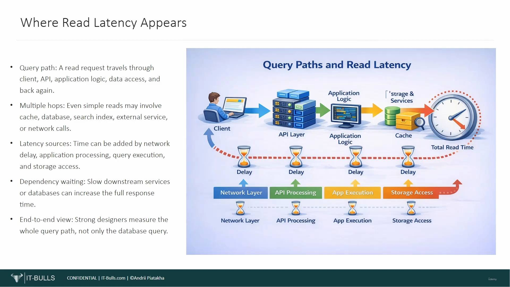
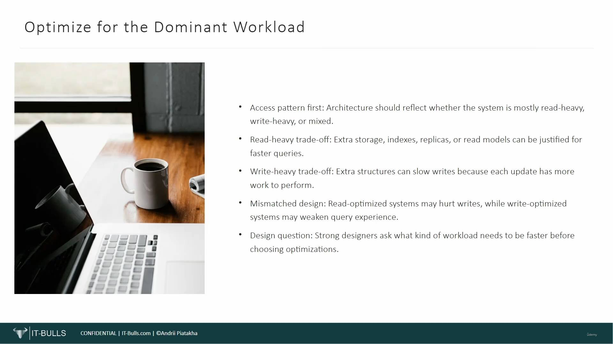
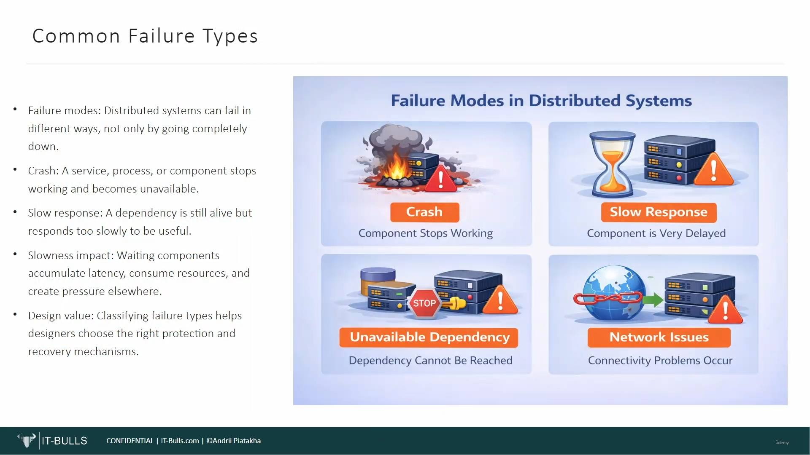
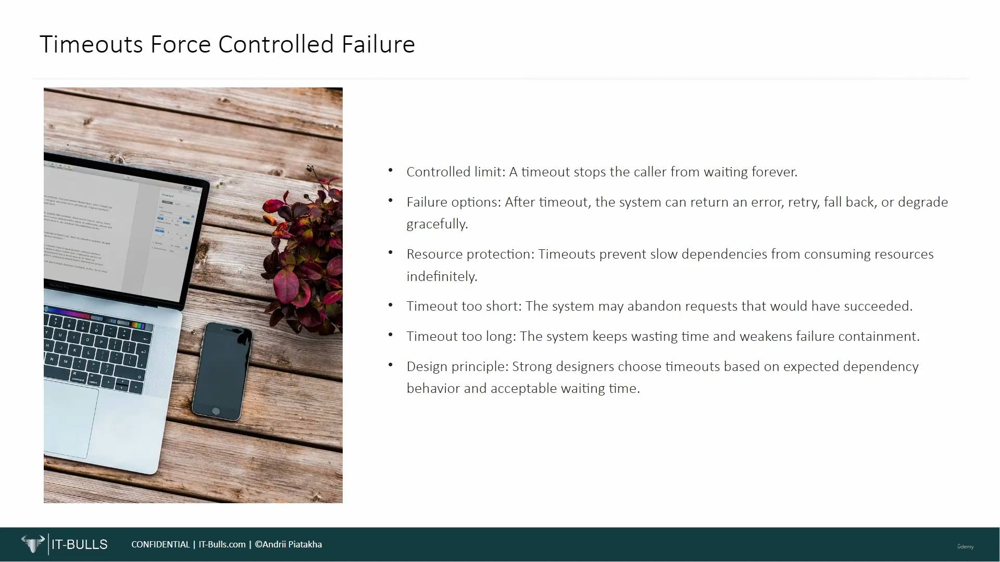
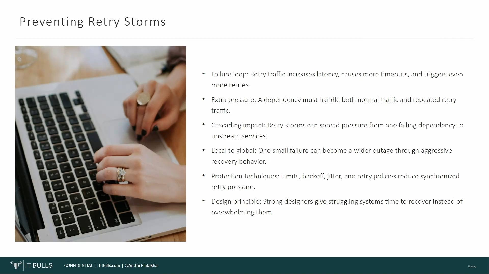
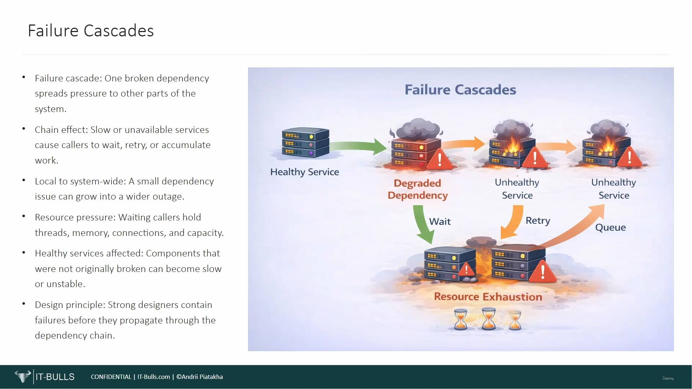

# System Design for Developers｜P016–P017：搜索 / 索引 / 读优化，以及从第一天就为失败而设计

> 说明：P016、P017 是**纯讲解课**。逐字稿里没有任何代码、命令、配置文件、依赖版本。所以这份文档的「完整代码」章节交付的是**可照着填出来的设计产物（决策表、职责表、数据模型草案、容量估算表）+ 一段能 `node` 直接跑的示意代码**，用来把讲师讲的超时 / 重试 / 退避 / 降级策略真正验证一遍。凡是讲师没讲的，文中都明确标注「课里没讲」。

---

## 1. 这一节做什么

这两集讲的是同一个问题的两面：**怎么让读得快，以及读不到的时候怎么办**。

P016 处理「读路径」：为什么搜索和过滤跟普通事务读不是一回事、索引为什么能让读变快、一次查询从客户端到数据库到底经过几层、读多写少的系统该优先优化什么、索引 / 缓存 / 反范式 / 副本这四种手段各自拿什么换什么、以及为什么把搜索当成「再写一个 SQL 查询」是常见错误。

P017 处理「失败路径」：为什么分布式系统里失败是常态而不是意外、失败有哪几种形态（崩溃、慢响应、依赖不可用、网络问题）、什么叫部分失败、超时和重试怎么用才不反噬、重试风暴是怎么形成的、优雅降级和故障级联分别长什么样。

两集合起来其实是一条完整的落地链路：**先想清楚这个读请求会经过哪些跳、每跳的时间去哪了；再想清楚这条链路上每一跳挂掉时，用户还能拿到什么。** 这也是本文档第 3 章要带你一步步做出来的东西。

读完并照着做完，你会产出：

| 产物 | 对应章节 | 对应讲师概念 |
|---|---|---|
| 工作负载判定表 | 3.1 | 读重 / 写重 |
| 查询路径与延迟预算表 | 3.4 | 查询要穿过好几层 |
| 读优化选型表 | 3.5 | 索引 / 缓存 / 反范式 / 副本 |
| 失败模式与防御对照表 | 3.6 | 崩溃 / 慢响应 / 依赖不可用 / 网络 |
| 超时与重试策略表 | 3.7 | 超时、重试、重试风暴 |
| 降级分级表 | 3.8 | 优雅降级 |
| 一份可运行的 Node 演示 | 4.4 | 把上面的策略跑出来 |

---

## 2. 讲师原话

下面按主题重排引用（不是按视频顺序），每条都带页码和时间戳。

**关于「搜索不是普通的读」**

> 「事务型访问通常是取回或更新一小片特定的数据……这类操作关注的是正确性，以及对已知记录的直接访问。」—— p016 [01:54]

> 「搜索的工作方式不同。系统往往不是被要求找一条已知的记录，而是被要求扫描、排序、过滤并组合许多可能的记录。」—— p016 [01:54]

> 「一个常见的设计错误，就是把搜索当成又一次简单的数据库查询。」—— p016 [15:16]

> 「强设计师不会只问『数据库能不能回答这个查询』，还会问『这到底是一次查找，还是一个搜索问题』。」—— p016 [16:44]

**关于索引**

> 「索引是一种组织数据的方式，让系统能更高效地找到它需要的东西。系统不必一条一条检查每个记录，而是用一个额外的结构，更直接地指向相关数据。」—— p016 [03:21]

> 「主数据集仍然是事实来源，但索引创造了一条通往所需记录的更快的路径。」—— p016 [03:51]

> 「索引不是免费的。每个索引都要占额外存储，并且让写入更贵，因为数据变化时索引也必须更新。」—— p016 [04:19]

> 「这就是为什么强设计师不会默认到处加索引。他们根据真实的查询模式、常见的过滤条件和实际访问行为来选索引。」—— p016 [04:48]

**关于查询路径与延迟**

> 「当我们谈读性能时，很容易把一次查询想象成一个简单的动作。实际上，一次查询在用户看到结果之前，通常要穿过好几层。」—— p016 [04:48]

> 「读延迟不是只来自一个地方。时间可能加在网络层、应用内部的查询执行、存储访问，或者等待另一个依赖的时候。」—— p016 [05:47]

> 「强设计师会追踪一条查询的完整路径，而不是只盯着数据库、或者只盯着 API。他们会问：时间花在哪、延迟在哪累积、哪一层才是真正该为变慢负责的。」—— p016 [06:46]

**关于读多 / 写多的取舍**

> 「在读多的系统里，主要挑战是快速、反复地把数据返回出去……在这种环境里，缓存、索引、读副本和非范式的读模型往往变得更重要。」—— p016 [07:14]

> 「写多的系统压力模式不同。系统在持续创建、更新或追加数据，主要关心的通常不只是速度，而是安全、一致地把数据吃进来。」—— p016 [07:41]

> 「强设计师不会只问『我们怎么让它更快』，他们会问『对哪种工作负载更快』。」—— p016 [08:37]

**关于四种读优化手段**

> 「索引给系统一条通往所需记录的更快路径，这样查询不必扫描所有东西。」—— p016 [09:35]

> 「缓存：系统不再每次都回到数据库，而是把频繁被请求的结果存到一个更快、临时的层里。」—— p016 [09:35]

> 「反范式：系统可以复制或预先合并某些值，让读变得更简单更快。这提高了读效率，但也让更新更复杂，因为被复制的数据必须保持一致。」—— p016 [10:03]

> 「副本：把读流量发到数据的额外拷贝上，系统可以减轻主库压力、支撑更多并发查询。但副本会引入延迟，最新的数据不一定马上可见。」—— p016 [10:30]

**关于读优化的代价**

> 「第一个取舍是存储……第二是复杂度……更新成本是另一个重要因素……还有一致性上的取舍。」—— p016 [11:27]–[12:26]

> 「强设计师不会只问『我们能不能让查询更快』，他们还会问：这需要多少额外存储？会引入多少额外复杂度？更新现在要付什么代价？」—— p016 [12:55]

**关于失败是常态**

> 「失败在分布式系统里是正常的，因为分布式系统依赖许多活动部件在同一时刻协同工作。」—— p017 [01:24]

> 「问题不是失败会不会发生，而是它何时、在何处发生。」—— p017 [02:18]

> 「强设计师从最开始就接受失败是一种正常的设计条件。他们不问『怎么造一个永不失败的系统』，而问『怎么造一个能扛住失败、限制它的影响、并且可控地恢复的系统』。」—— p017 [02:48]

**关于失败形态**

> 「一种是崩溃，服务、进程或组件完全停止工作……另一种常见的失败类型是慢响应，而不是完全消失。一个依赖可能技术上还活着，但慢到对整个系统有害。」—— p017 [03:44]

> 「不可用的依赖……在实践中，很多系统故障其实是依赖故障，而不是主服务本身的故障。」—— p017 [04:13]

> 「网络会带来丢包、高延迟、不稳定的连接，或者组件之间的完全分区。」—— p017 [04:41]

**关于部分失败**

> 「部分失败往往比整体宕机更难处理。当所有东西都停摆时，问题是明显的。当只有一部分失败时，系统看起来还活着，但行为是错误的或者不一致的。」—— p017 [05:38]

> 「一个服务在等待慢依赖时，即使它没崩溃，也会消耗线程或连接……这会把压力扩散到本来健康的组件上，让失败比最初看起来更大。」—— p017 [07:04]

**关于超时**

> 「超时定义了某个组件愿意等另一个组件多久，然后放弃。没有这个限制，系统可能一直卡在那里等一个永远不会来的响应。」—— p017 [07:29]

> 「超时保护系统的方式是逼出一个决定。调用方在定义好的时间后停止等待，然后可以返回错误、触发重试、切到另一条路径，或者优雅降级。」—— p017 [08:26]

> 「超时如果太短，系统可能放弃掉本来再过一会儿就会成功的请求。如果太长，保护价值就被削弱了。」—— p017 [08:56]

**关于重试与重试风暴**

> 「如果依赖已经过载或退化了，立刻重试只会给同一个苦苦挣扎的组件再加压力。」—— p017 [10:20]

> 「重试还需要安全操作设计。如果同一个请求被执行了不止一次，系统必须能容忍重复，或者防止重复的副作用。」—— p017 [10:48]

> 「重试风暴发生在系统的许多部分同时开始重试失败请求的时候……系统进入一个循环，恢复机制本身成了失败的一部分。」—— p017 [11:43]–[12:39]

> 「强设计师用限额、退避、抖动和清晰的重试策略来防止这一点。目标是给依赖时间恢复，而不是用同步的重复请求去攻击它。」—— p017 [13:08]

**关于优雅降级与级联**

> 「优雅降级意味着，即使不是所有东西都工作正常，系统也能继续提供一些有用的价值。」—— p017 [13:37]

> 「它把一个失败从完全停止，变成一次受控的服务缩减。」—— p017 [15:01]

> 「故障级联发生在当一个坏掉或退化的依赖不再是一个孤立问题，而开始影响系统其他部分的时候。」—— p017 [15:30]

> 「超时、受控的重试、负载丢弃（load shedding）、优雅降级和隔离，都能帮助阻止一个坏组件把系统其余部分一起拖下水。」—— p017 [17:23]

**关于只设计 happy path**

> 「一个非常常见的设计错误，是只关注 happy path。」—— p017 [17:23]

> 「强设计师从一开始就想着 unhappy path（逐字稿转写为 unhappy past，按上下文应为 happy path 的反义）。他们不只问『一切健康时这个怎么工作』，还问『当某一部分失败、变慢、或者返回了意料之外的东西时，会发生什么』。」—— p017 [19:14]

---

## 3. 从零复现

这一章是操作步骤。每一步都直接产出第 4 章里的一张表，照着填就行。**讲师的例子场景是「找这个城市里、这个价格以下、带这些特征的可用公寓」（p016 [01:54] 原话）**，我们全程用它做贯穿案例。

### 3.0 先把要设计的东西圈出边界

不要一上来就想架构。先写死一句话：

> 「用户在搜索框输入关键词 + 3 个过滤器，我们要在 800ms 内返回 20 条排序后的结果。」

这句话里有三个必须定死的东西：**返回多少条**（20）、**多久算达标**（800ms）、**排序依据是什么**（讲师说的是「按相关性排序」，p016 [15:45]，但具体权重课里没讲）。

### 3.1 第一步：判定工作负载类型（读重 / 写重 / 混合）

讲师给的判据是「架构应该反映主导的访问模式」（p016 [08:07]）。落地成可勾选的表：

| 判定问题 | 公寓搜索的答案 | 结论 |
|---|---|---|
| 同一份数据被反复请求吗？ | 是，热门城市 / 热门价位被反复搜 | 读重特征 |
| 写入频率远低于读取频率吗？ | 房源上架 / 改价是低频 | 读重特征 |
| 延迟直接影响用户体验吗？ | 是，搜索框 1s 不出结果就流失 | 读重特征 |
| 写入需要强一致 / 事务吗？ | 价格、库存变动需要 | 写侧仍需保证正确性 |
| **判定结果** | **读重为主、写侧不可牺牲正确性** | 对应讲师 [07:41] 的「两类压力并存」 |

**这一步的产出决定后面所有取舍的偏向**：因为是读重，所以「多花存储换更快查询」是被允许的（讲师 p016 [08:37]：「在读重的系统里，为了更快的查询而多花存储或多花复杂度，通常是合理的」）。如果判定是写重，同样的结构就会变成每次写入的负担。

### 3.2 第二步：列约束

| 约束 | 取值 | 影响 |
|---|---|---|
| 单次搜索响应预算 | 800ms（P95） | 决定第 3.4 步的每跳预算 |
| 结果新鲜度容忍度 | 房源下架后 30s 内从搜索消失可接受 | 决定能不能用异步同步读模型 |
| 一致性要求落点 | 价格 / 可租状态必须准；排序可近似 | 决定哪些字段走缓存、哪些实时查 |
| 可接受的降级形态 | 搜索挂了可以展示「上次的缓存结果 + 提示」 | 对应讲师 p017 [14:33] 的「缓存内容仍可展示」 |
| 团队规模 | 小团队，不能维护太多组件 | 决定不能无脑上专用组件 |

最后一条很重要，但**课里没讲**——讲师只说了「专用工具或独立读模型常常出现」（p016 [13:50]），没说团队规模这个约束。你自己补上，别照抄大厂方案。

### 3.3 第三步：估算（算式全部写出来）

讲师在本课**没有给任何具体数字**，下面所有数字都是我为这个练习假设的。你换成自己业务的真实值重算一遍即可。

**流量**

```
日搜索请求量        R = 5,000,000 次/天
平均 QPS            = 5,000,000 / 86,400 ≈ 58 QPS
峰值系数            k = 3（早晚高峰）
峰值 QPS            = 58 × 3 ≈ 174 QPS
```

**读放大（这是索引价值的核心算式）**

```
数据集总量          N = 2,000,000 条房源
单次查询命中        M = 200 条（城市 + 价格 + 特征过滤后）
无索引：需要检查    N = 2,000,000 行
       读放大 = N / M = 2,000,000 / 200 = 10,000 倍
有索引：读索引项 ≈ M，回表 ≈ M
       实际读取 ≈ 2M = 400 行
       读放大 = 400 / 200 = 2 倍
```

再乘上流量：`174 QPS × 10,000 = 1,740,000 行/秒` 的扫描量，对单机是不可能的；`174 QPS × 400 = 69,600 行/秒` 则在单机能力范围内。**这就是「索引让读变快」的量化表达**。

**缓存收益**

```
缓存命中率 h = 0.8（热门城市 + 热门价位高度重复）
落到主存储的 QPS = 174 × (1 - 0.8) = 34.8 QPS
保护倍数 = 174 / 34.8 = 5 倍
```

**副本收益**

```
读副本数 = 2 个
读容量 ≈ 3 倍（主 + 2 副本）
但引入复制延迟 lag，假设 200ms ~ 2s（课里没讲具体量级，需实测）
→ 代价：下架房源最多 2s 后才会从搜索中消失，超出 3.2 的 30s 容忍度，可接受
```

**存储代价**

```
原表大小              S = 100 GB
每个二级索引 ≈ 0.15S = 15 GB
加 4 个索引：15 × 4 = 60 GB
新增存储占比 = 60 / 100 = 60%
```

讲师那句「有时候会显著超过原始数据模型本身」（p016 [11:27]）在这个算式里就有了具体数字。

**写入代价**

```
无索引写入成本  = 1 次行写
有 4 个索引写入成本 = 1 + 4 = 5 次结构更新
写入放大 = 5 倍
若写入 QPS 为 20，则实际结构更新 = 20 × 5 = 100 次/秒
```

**超时预算分配（给第 3.7 步用）**

```
总预算 800ms
  网关 + 鉴权         50ms
  应用逻辑            100ms
  搜索索引查询        300ms  → 其超时设为 300ms
  结果拼装（价格校验）200ms → 其超时设为 200ms
  序列化 + 传输       150ms
  合计                800ms
```

关键规则（这是我从讲师「超时要看你愿意等多久、系统能承受多少等待」p017 [08:56] 推出来的）：**下游超时必须小于上游剩余预算**，否则上游先超时了，下游还在白跑。

### 3.4 第四步：画出查询路径，逐跳标延迟

讲师原话：「读延迟不是只来自一个地方……时间可能加在网络层、应用内部的查询执行、存储访问，或者等待另一个依赖的时候。」（p016 [05:47]）

照这句话，把你的读请求拆成跳，填这张表：

| # | 跳 | 预期耗时 | 延迟来源 | 挂了会怎样 | 能不能缓存 |
|---|---|---|---|---|---|
| 1 | 浏览器 → 网关 | 20ms | 网络 | 请求丢失 | 否 |
| 2 | 网关 → 鉴权 | 30ms | 另一次远程调用 | 全站不可用 | 是（短 TTL） |
| 3 | 应用 → 搜索索引 | 150ms | 查询执行 + 存储访问 | 搜索不可用 | 是（结果缓存） |
| 4 | 应用 → 价格服务（校验实时价） | 80ms | 另一个依赖 | 价格可能过期 | 是（但必须标注新鲜度） |
| 5 | 应用 → 缓存 | 5ms | 内存 / 网络 | 回落到索引 | — |
| 6 | 返回序列化 + 传输 | 60ms | 数据量 | — | 否 |

> 

这张表的价值在于：**你能一眼看出哪一跳最值得优化**。第 3 跳 150ms 是最大头，所以索引设计优先；第 4 跳 80ms 但有新鲜度要求，所以优先考虑「缓存 + 标注时间」而不是去掉它。

### 3.5 第五步：按访问模式选读优化手段

讲师给的四种手段（p016 [09:35]–[10:30]），逐条对照我们的场景填表——注意每一行都必须写出「换来了什么」和「付出了什么」，这是讲师反复强调的重点（p016 [11:27]–[12:55]）。

| 手段 | 在我们场景里具体怎么做 | 换来 | 付出 | 是否采用 |
|---|---|---|---|---|
| 索引 | 对 `city`、`price`、`features` 建索引，按查询频率排序 | 读放大从 10,000× 降到 2× | 存储 +60%，写放大 5× | 采用（只建高频过滤字段） |
| 缓存 | 缓存「城市+价格区间」维度的结果，TTL 60s | 主存储 QPS 从 174 降到 ~35 | 最多 60s 内结果不是最新 | 采用（热门维度） |
| 反范式 | 把「价格+状态」预合并进搜索文档，搜索时不再实时联表 | 省掉第 4 跳的 80ms | 改价时必须同步更新搜索文档，否则不一致 | 采用（需异步同步机制） |
| 副本 | 读流量分到 2 个只读副本 | 读容量 ×3 | 复制延迟 200ms~2s | 采用（容忍） |

> 

**这里有一条讲师明确反对的做法**：「强设计师不会默认到处加索引」（p016 [04:48]）。所以别把表填成「全都要」——比如 `description` 这种只用于展示、不被过滤的字段，就不要建索引。

### 3.6 第六步：列失败模式

讲师把失败分了四类（p017 [03:44]–[04:41]）。对着 3.4 的查询路径表，每一跳都要问一遍「它挂成这四种样子会怎样」：

| 跳 | 崩溃 | 慢响应 | 依赖不可用 | 网络问题 |
|---|---|---|---|---|
| 网关 | 全部请求失败 | 全站变慢 | — | 客户端重连 |
| 鉴权 | 无法判断权限 | 所有请求排队 | **可以降级为「允许只读匿名访问」** | 同上 |
| 搜索索引 | 搜索功能消失 | 线程被占满（危险） | 回落缓存 | 超时后回落 |
| 价格服务 | 价格显示不出来 | 拖慢整条链路 | 展示「价格待确认」 | 超时后回落 |

> 

这张表里最值得注意的一格是「搜索索引慢响应」。讲师专门强调过：**慢和挂一样危险**，因为「等待会消耗本来健康服务里的资源」（p017 [07:04]、[16:27]）。崩溃是显性的、会立刻触发告警；慢是隐性的，会默默把连接池吃光。

### 3.7 第七步：定超时与重试策略

讲师对超时的定义很干脆：「超时定义了某个组件愿意等另一个组件多久，然后放弃」（p017 [07:29]），对重试的要求也很干脆：必须「受控」——限额、退避、抖动、清晰策略（p017 [13:08]）。

把 3.3 的超时预算和 3.6 的失败模式合起来，填这张表：

| 依赖 | 超时 | 最大尝试次数 | 退避基数 | 退避上限 | 抖动 | 可重试的失败 | 不可重试的失败 |
|---|---|---|---|---|---|---|---|
| 鉴权 | 80ms | 2 | 50ms | 100ms | ±50% | 连接错误、超时 | 401 / 403（重试也不会变对） |
| 搜索索引 | 300ms | 3 | 100ms | 800ms | ±50% | 超时、连接错误 | 参数错误 |
| 价格服务 | 200ms | 2 | 100ms | 200ms | ±50% | 超时 | 404（该房源不存在） |
| 缓存 | 20ms | 1（不重试） | — | — | — | — | 任何时候都不重试，直接回落 |

**重试总量算式（用来防止重试风暴）**

```
最坏情况下同一请求产生的下游调用次数
= attempts(3) × 并发实例数(50) = 150 次
若不做退避和抖动：这 150 次几乎同时打到已过载的依赖上
加退避 100/200 → 峰值被摊到 ~300ms 窗口内
加抖动 → 峰值被进一步摊平（不同实例的等待时间不同步）
```

讲师在 p017 [11:43]–[12:39] 描述的正是这个循环：失败 → 重试 → 更多流量 → 更慢 → 更多超时 → 更多重试。**限额（max attempts）+ 退避（exponential backoff）+ 抖动（jitter）** 三件套就是打断这个循环的全部手段。

> 

还有一条不能漏：**重试必须安全**。讲师原话是「如果同一个请求被执行了不止一次，系统必须能容忍重复，或者防止重复的副作用」（p017 [10:48]）。对搜索这种只读请求，重复执行无害；但如果重试的是「下单」，就必须有幂等键——**具体怎么做幂等，课里没讲**。

### 3.8 第八步：定降级分级

讲师对优雅降级的定义：「即使不是所有东西都工作正常，系统也能继续提供一些有用的价值」（p017 [13:37]），而且要「把失败从完全停止，变成一次受控的服务缩减」（p017 [15:01]）。

做法是先给功能分「核心 / 次要」两级，再给每一级定义降级形态：

| 等级 | 功能 | 依赖挂了怎么办 | 用户看到什么 |
|---|---|---|---|
| L0 核心 | 按城市列出房源 | 不能挂，缓存 + 副本双重保险 | 正常结果 |
| L0 核心 | 显示价格 | 价格服务挂 → 用本地缓存价 + 标注 | 「价格可能已变动」 |
| L1 重要 | 按特征过滤 | 索引的 `features` 字段查不了 → 忽略该过滤条件 | 「已忽略特征筛选」 |
| L2 次要 | 相关性排序 | 排序服务挂 → 退回按更新时间倒序 | 结果相关性变差 |
| L3 可丢 | 个性化推荐 | 直接不显示 | 这一块不出现 |

> 

### 3.9 第九步：定级联防护，然后验证

讲师列出的级联防护清单是：超时、受控的重试、load shedding、优雅降级、隔离（p017 [17:23]）。前四项已经在 3.7 和 3.8 里落地了，剩下两件要单独做：

- **隔离**：搜索的依赖调用**不能和下单的依赖调用共用一个连接池**。否则搜索把池子吃满，下单直接瘫——这就是讲师说的「可见的故障看起来比原始问题更大更迷惑」（p017 [16:53]）。
- **load shedding**：当队列长度超过阈值时，主动丢弃请求并返回 429，而不是让它们排队。排队意味着「等待也消耗资源」（p017 [07:58]）。

最后是验证：把 4.4 的演示代码跑起来，人为让 mock 依赖超时 / 报错 / 变慢，看三种情况下的实际行为是否符合 3.7 和 3.8 的表。**这是这两集唯一的「可执行」部分**——因为课里没有代码，验证手段得自己搭。

> 

---

## 4. 完整代码

本章分两部分：4.1–4.3 是第 3 章推出来的设计产物（表格可直接抄进你的设计文档）；4.4 是示意代码。

### 4.1 设计决策表（读优化）

| 决策 | 选择 | 依据（讲师原话出处） | 不这样选会怎样 |
|---|---|---|---|
| 搜索走主库还是独立读模型 | 独立读模型 | p016 [13:50]「专用工具或独立读模型常常出现」 | 主库被搜索拖垮，事务写入也变慢 |
| 索引建几个 | 只建高频过滤字段（3 个） | p016 [04:48]「不会默认到处加索引」 | 每多一个索引，写入放大 +1 倍 |
| 缓存什么 | 只缓存结果集，不缓存单条 | p016 [09:35]「存频繁被请求的结果」 | 缓存键爆炸，命中率反而低 |
| 反范式到哪一步 | 只把价格/状态预合并进搜索文档 | p016 [10:03] | 全部反范式会导致改价同步成本失控 |
| 副本几个 | 2 个只读副本 | p016 [10:30] | 副本越多，读到旧数据的窗口越大 |

### 4.2 组件职责表

| 组件 | 唯一职责 | 不该做的事 |
|---|---|---|
| 搜索索引 | 过滤 + 排序 + 返回 ID 列表 | 不该存价格真值（会不一致） |
| 缓存层 | 存结果 ID 列表 + 时间戳 | 不该做业务判断 |
| 事务库 | 房源的唯一事实来源 | 不该承接搜索查询 |
| 同步器 | 把事务库的变更写到搜索索引（**具体机制课里没讲**） | 不该反向写事务库 |
| 价格服务 | 提供实时价格 | 不该被搜索链路强依赖（要能降级） |

### 4.3 接口与数据模型草案

```jsonc
// GET /api/apartments/search?city=shanghai&maxPrice=8000&features=parking,pets&page=1

// 响应（200）
{
  "items": [
    {
      "id": "apt_10293",
      "title": "两居室 · 内环",
      "price": 7200,
      "priceAsOf": "2024-05-01T10:12:00Z",  // 用于前端提示"价格可能已变动"
      "matchedFeatures": ["parking"]
    }
  ],
  "meta": {
    "source": "search_index",      // search_index | cache | degraded
    "degraded": false,
    "ignoredFilters": [],          // 降级时告诉用户忽略了什么
    "tookMs": 173
  }
}
```

```jsonc
// 搜索索引里的文档（读模型的形状，为查询而设计）
{
  "id": "apt_10293",
  "city": "shanghai",
  "price": 7200,          // 冗余：加速范围过滤（反范式）
  "status": "available",  // 冗余：搜索只返回可租房源
  "features": ["parking", "pets"],
  "updatedAt": 1714558320
}
```

```jsonc
// 缓存键设计（维度必须和真实查询维度一致，否则命中率极低）
"search:v1:shanghai:8000:parking,pets:p1"
//        ↑版本号，索引结构变更时整体失效，避免脏读
```

**注意**：以上模型是练习产物，**课里没有给任何字段名**。讲师只说了读模型要「为查询需求量身定做」（p016 [14:20]），没说具体字段。

### 4.4 示意图代码（课里没有代码，以下为示意）

下面这套代码的作用是：把第 3.7 节的超时 / 重试 / 退避 / 抖动 / 降级策略**真正跑一遍**，让你亲眼看到「不做退避的重试」和「做了退避 + 抖动的重试」在时间轴上的差别。

**目录结构**

```
resilient-read-path/
├── package.json
├── withResilience.js      # 超时 / 重试 / 退避 / 抖动
├── mockDependencies.js    # 模拟会超时、会失败、会抖动的依赖
├── searchService.js       # 读路径：索引 → 缓存 → 降级
└── demo.js                # 跑三种场景
```

**环境要求**：Node.js ≥ 18（需要全局 `AbortController` 和 `structuredClone`）。无第三方依赖。

`package.json`

```json
{
  "name": "resilient-read-path",
  "version": "1.0.0",
  "private": true,
  "description": "P016/P017 读路径与失败处理策略验证（课里没有代码，此为示意）",
  "type": "commonjs",
  "engines": {
    "node": ">=18"
  },
  "scripts": {
    "demo": "node demo.js"
  }
}
```

`withResilience.js`

```js
'use strict';

/**
 * 可中断的 sleep。信号被 abort 时立刻拒绝，避免退避期间还占着资源。
 */
function sleep(ms, signal) {
  return new Promise((resolve, reject) => {
    if (signal && signal.aborted) {
      reject(signal.reason || new Error('aborted'));
      return;
    }
    const timer = setTimeout(() => {
      if (signal) signal.removeEventListener('abort', onAbort);
      resolve();
    }, ms);

    function onAbort() {
      clearTimeout(timer);
      reject(signal.reason || new Error('aborted'));
    }

    if (signal) signal.addEventListener('abort', onAbort, { once: true });
  });
}

/**
 * 抖动：把等待时间在 ±ratio 范围内随机化。
 * 目的：让 N 个并发实例不要在同一毫秒一起重试。
 */
function jitter(ms, ratio = 0.5) {
  const spread = ms * ratio;
  const value = ms - spread + Math.random() * spread * 2;
  return Math.max(0, Math.round(value));
}

/**
 * 给一次调用套上超时。超时后抛出的错误标记 retryable = true。
 */
function withTimeout(fn, timeoutMs, label) {
  const controller = new AbortController();
  let timer;

  const timeoutPromise = new Promise((_, reject) => {
    timer = setTimeout(() => {
      const err = new Error(`timeout:${label}:${timeoutMs}ms`);
      err.code = 'ETIMEDOUT';
      err.retryable = true;
      controller.abort(err);
      reject(err);
    }, timeoutMs);
  });

  const work = Promise.resolve().then(() => fn(controller.signal));

  return Promise.race([work, timeoutPromise]).finally(() => clearTimeout(timer));
}

/**
 * 带策略的调用：限额 + 退避 + 抖动。
 * 不抛异常，统一返回 { ok, value } 或 { ok:false, error }，方便上游做降级。
 */
async function callWithPolicy(fn, policy, onEvent) {
  const {
    label,
    timeoutMs,
    maxAttempts,
    baseDelayMs,
    maxDelayMs
  } = policy;

  let attempt = 0;
  let lastError = null;

  while (attempt < maxAttempts) {
    attempt += 1;
    try {
      const value = await withTimeout(fn, timeoutMs, `${label}#${attempt}`);
      if (onEvent) onEvent({ type: 'success', label, attempt });
      return { ok: true, value, attempts: attempt };
    } catch (err) {
      lastError = err;
      const retryable = err && err.retryable !== false;

      if (onEvent) {
        onEvent({
          type: 'attempt_failed',
          label,
          attempt,
          code: err && err.code,
          message: err && err.message,
          retryable
        });
      }

      if (!retryable) break;
      if (attempt >= maxAttempts) break;

      const backoff = Math.min(maxDelayMs, baseDelayMs * Math.pow(2, attempt - 1));
      const waitMs = jitter(backoff, 0.5);

      if (onEvent) {
        onEvent({ type: 'retry_scheduled', label, attempt, backoffMs: backoff, waitMs });
      }

      await sleep(waitMs);
    }
  }

  return { ok: false, error: lastError, attempts: attempt };
}

module.exports = { sleep, jitter, withTimeout, callWithPolicy };
```

`mockDependencies.js`

```js
'use strict';

const { sleep } = require('./withResilience');

/**
 * 一个会「前 N 次失败、之后成功」的依赖，模拟瞬时故障。
 * 它尊重 signal，用来验证超时真的能中断底层工作。
 */
function makeFlakySearchIndex({ failTimes = 2, latencyMs = 120 } = {}) {
  let calls = 0;
  return {
    name: 'searchIndex',
    get callCount() {
      return calls;
    },
    async query(params, signal) {
      calls += 1;
      const shouldFail = calls <= failTimes;
      await sleep(latencyMs, signal); // 若超时，这里会抛错，模拟真实中断
      if (shouldFail) {
        const err = new Error('search index temporarily overloaded');
        err.code = 'EAGAIN';
        err.retryable = true;
        throw err;
      }
      return [
        { id: 'apt_10293', title: '两居室 · 内环', price: 7200, features: ['parking'] },
        { id: 'apt_10411', title: '一居室 · 中环', price: 5800, features: ['pets'] }
      ];
    }
  };
}

/**
 * 一个「卡死不动」的依赖：永远不返回，也不会自己拒绝。
 * 用来证明：没有超时，调用方会永久卡住。
 */
function makeHangingDependency({ name = 'hangingDep' } = {}) {
  return {
    name,
    query(_params, _signal) {
      return new Promise(() => {}); // 永远 pending
    }
  };
}

/**
 * 一个健康但会抖动的依赖。
 */
function makeJitteryPriceService({ minMs = 30, maxMs = 90 } = {}) {
  return {
    name: 'priceService',
    async query(params, signal) {
      const latency = minMs + Math.random() * (maxMs - minMs);
      await sleep(latency, signal);
      return { id: params.id, price: 7200, asOf: new Date().toISOString() };
    }
  };
}

module.exports = { makeFlakySearchIndex, makeHangingDependency, makeJitteryPriceService };
```

`searchService.js`

```js
'use strict';

const { callWithPolicy } = require('./withResilience');

const POLICIES = {
  searchIndex: {
    label: 'searchIndex',
    timeoutMs: 300,
    maxAttempts: 3,
    baseDelayMs: 100,
    maxDelayMs: 800
  },
  priceService: {
    label: 'priceService',
    timeoutMs: 200,
    maxAttempts: 2,
    baseDelayMs: 100,
    maxDelayMs: 200
  }
};

function cacheKey(params) {
  const features = (params.features || []).slice().sort().join(',');
  return `search:v1:${params.city}:${params.maxPrice}:${features}:p${params.page || 1}`;
}

/**
 * 读路径：索引 -> 缓存 -> 降级。
 * 对应第 3.8 节的降级分级表。
 */
async function searchApartments(params, deps, options = {}) {
  const { logger, cache } = options; // cache: Map 模拟缓存层
  const startedAt = Date.now();

  // L0：主路径，走搜索索引（带超时 + 受控重试）
  const primary = await callWithPolicy(
    (signal) => deps.searchIndex.query(params, signal),
    POLICIES.searchIndex,
    logger
  );

  if (primary.ok) {
    const payload = {
      items: primary.value,
      meta: {
        source: 'search_index',
        degraded: false,
        ignoredFilters: [],
        attempts: primary.attempts,
        tookMs: Date.now() - startedAt
      }
    };
    if (cache) cache.set(cacheKey(params), { payload, storedAt: Date.now() });
    return payload;
  }

  // L1：索引不可用，回落缓存（允许返回旧数据，但必须标注）
  if (cache) {
    const hit = cache.get(cacheKey(params));
    if (hit) {
      return {
        items: hit.payload.items,
        meta: {
          source: 'cache',
          degraded: true,
          ignoredFilters: [],
          stalenessMs: Date.now() - hit.storedAt,
          tookMs: Date.now() - startedAt
        }
      };
    }
  }

  // L2：连缓存都没有，彻底降级。不抛异常，返回可展示的空壳。
  return {
    items: [],
    meta: {
      source: 'degraded',
      degraded: true,
      ignoredFilters: ['features'],
      reason: primary.error && primary.error.code,
      tookMs: Date.now() - startedAt
    }
  };
}

module.exports = { searchApartments, POLICIES, cacheKey };
```

`demo.js`

```js
'use strict';

const { searchApartments } = require('./searchService');
const { makeFlakySearchIndex, makeHangingDependency } = require('./mockDependencies');

function makeLogger(tag) {
  return (event) => {
    const parts = [`[${tag}]`, event.type, `label=${event.label}`];
    if (event.attempt !== undefined) parts.push(`attempt=${event.attempt}`);
    if (event.code) parts.push(`code=${event.code}`);
    if (event.waitMs !== undefined) parts.push(`waitMs=${event.waitMs}`);
    console.log(parts.join(' '));
  };
}

async function scenarioA() {
  console.log('\n=== 场景 A：瞬时故障 + 受控重试（应恢复） ===');
  const searchIndex = makeFlakySearchIndex({ failTimes: 2, latencyMs: 80 });
  const cache = new Map();

  const result = await searchApartments(
    { city: 'shanghai', maxPrice: 8000, features: ['parking'], page: 1 },
    { searchIndex },
    { logger: makeLogger('A'), cache }
  );

  console.log('返回条数:', result.items.length);
  console.log('meta:', JSON.stringify(result.meta));
  console.log('底层实际被调用次数:', searchIndex.callCount);
}

async function scenarioB() {
  console.log('\n=== 场景 B：依赖卡死 + 缓存兜底（应降级但仍然有内容） ===');
  const hanging = makeHangingDependency({ name: 'searchIndex' });
  const cache = new Map();

  // 先手动塞一条缓存，模拟"上一次成功过"
  cache.set('search:v1:shanghai:8000:parking:p1', {
    payload: { items: [{ id: 'apt_old', title: '缓存里的旧结果' }] },
    storedAt: Date.now() - 5000
  });

  const result = await searchApartments(
    { city: 'shanghai', maxPrice: 8000, features: ['parking'], page: 1 },
    { searchIndex: hanging },
    { logger: makeLogger('B'), cache }
  );

  console.log('返回条数:', result.items.length);
  console.log('meta:', JSON.stringify(result.meta));
}

async function scenarioC() {
  console.log('\n=== 场景 C：完全不可用 + 无缓存（应彻底降级，不抛异常） ===');
  const hanging = makeHangingDependency({ name: 'searchIndex' });

  const result = await searchApartments(
    { city: 'beijing', maxPrice: 9000, features: [], page: 2 },
    { searchIndex: hanging },
    { logger: makeLogger('C') }
  );

  console.log('返回条数:', result.items.length);
  console.log('meta:', JSON.stringify(result.meta));
}

async function main() {
  const t0 = Date.now();
  await scenarioA();
  await scenarioB();
  await scenarioC();
  console.log(`\n总耗时: ${Date.now() - t0}ms`);
}

main().catch((err) => {
  console.error('demo 崩了:', err);
  process.exitCode = 1;
});
```

**启动命令**

```bash
cd resilient-read-path
node demo.js
```

跑之前先确认两件事：`node -v` 必须是 v18 以上（要全局 `AbortController`，v16 没有，会报 `AbortController is not defined`）；目录里不需要 `npm install`，因为四个文件加起来零依赖。

预期输出大致是：

```text
=== 场景 A：瞬时故障 + 受控重试（应恢复） ===
[A] attempt_failed label=searchIndex#1 attempt=1 code=EAGAIN
[A] retry_scheduled label=searchIndex attempt=1 waitMs=...
[A] attempt_failed label=searchIndex#2 attempt=2 code=EAGAIN
[A] retry_scheduled label=searchIndex attempt=2 waitMs=...
[A] success label=searchIndex#3 attempt=3
返回条数: 2
meta: {"source":"search_index","degraded":false,"ignoredFilters":[],"attempts":3,"tookMs":...}
底层实际被调用次数: 3

=== 场景 B：依赖卡死 + 缓存兜底（应降级但仍然有内容） ===
[B] attempt_failed label=searchIndex#1 attempt=1 code=ETIMEDOUT
...
返回条数: 1
meta: {"source":"cache","degraded":true,"ignoredFilters":[],"stalenessMs":...,"tookMs":...}

=== 场景 C：完全不可用 + 无缓存（应彻底降级，不抛异常） ===
...
返回条数: 0
meta: {"source":"degraded","degraded":true,"ignoredFilters":["features"],"reason":"ETIMEDOUT","tookMs":...}

总耗时: ...
```

`waitMs` 每次都不一样——那是抖动在起作用。如果你把 `jitter(backoff, 0.5)` 里的 `0.5` 改成 `0`，三次运行的 `waitMs` 就变成固定的 `100`、`200`，这就是「没有抖动」的样子。**这个对照是本章最值得亲手做一次的实验**：并发起 10 个请求，看加抖动的版本重试时间点是否被打散。

---

## 5. 逐行解释

这份代码不长，但「可中断的 sleep」「超时要能真的打断底层调用」「重试不能无限重试」这三件事，每一件都有个不写清楚就出错的地方。逐条拆。

### 5.1 `sleep` 为什么必须能被 abort

```js
function sleep(ms, signal) {
  return new Promise((resolve, reject) => {
    if (signal && signal.aborted) { reject(...); return; }
    const timer = setTimeout(() => { ...; resolve(); }, ms);
    function onAbort() { clearTimeout(timer); reject(signal.reason || new Error('aborted')); }
    if (signal) signal.addEventListener('abort', onAbort, { once: true });
  });
}
```

最朴素的写法是 `new Promise(r => setTimeout(r, ms))`，两行就够。问题在于：一旦调用方被取消（用户关页面、上游超时、进程要退出），这个 `setTimeout` 还挂在事件循环上，**没人能把它清掉**。你要么等到时间到，要么 `process.exit` 硬走——前者意味着「取消」根本不生效，后者意味着所有还在飞的操作被一起干掉。

可中断的版本做了三件事：进入时先查 `signal.aborted`（避免「信号已经放弃了我才注册监听」的竞态，abort 事件是**一次性**的，错过了不会补发）；`onAbort` 里 `clearTimeout` 把定时器摘掉；`reject(signal.reason)` 把取消原因原样传出去，而不是统一抛 `AbortError`——这样调用方能区分「我主动取消」和「真的出错了」。

`{ once: true }` 是防止同一个 signal 上监听器越积越多：每调一次 sleep 就注册一个，如果不设 `once`，一个活了很久的 signal 上会挂几百个闭包，这是很典型的内存泄漏。

### 5.2 `jitter` 的 ±ratio 公式

```js
const spread = ms * ratio;
const value = ms - spread + Math.random() * spread * 2;
```

以 `ms=200, ratio=0.5` 为例：`spread=100`，取值区间是 `[200-100, 200-100+200] = [100, 300]`，即 `200 ± 50%`。这就是「±ratio」的实现方式，展开成 `ms * (1 - ratio + 2 * ratio * random())` 更容易看懂。

为什么必须抖动？假设你在 09:00:00.000 部署了 20 个实例，上游依赖在 09:00:00.100 挂了一下，20 个实例同时失败、同时按 `baseDelay * 1 = 100ms` 退避、同时在 09:00:00.200 重试——**重试本身变成了新的打点**，这就是「重试风暴」，刚恢复的依赖立刻又被同一批请求打死。抖动把 20 个重试点打散到 100–300ms 区间，恢复曲线就平滑了。

`Math.max(0, ...)` 的兜底是为 `ratio > 1` 或 `ms` 很小时准备的：`ms=1, ratio=2` 会算出负数，`setTimeout` 收到负数会当 0 处理（不是错，但语义不对），显式夹一下更清楚。`Math.round` 是因为 `setTimeout` 接受小数但内部还是毫秒精度，取整省得日志里出现 `waitMs=137.3928...`。

### 5.3 `withTimeout`：`Promise.race` 的三个细节

```js
const work = Promise.resolve().then(() => fn(controller.signal));
return Promise.race([work, timeoutPromise]).finally(() => clearTimeout(timer));
```

**细节一：`Promise.resolve().then(...)` 这一层包装不是多余的。** 如果直接写 `fn(signal)`，而 `fn` 在第一个同步 tick 里就抛错（比如参数校验不过），异常会**同步**抛出，根本轮不到 `Promise.race` 去捕获，`clearTimeout` 也不会执行，定时器泄漏。套一层 `.then` 把它变成**拒绝的 Promise**，`race` 就能正常处理。

**细节二：超时时必须 `controller.abort(err)`，不能只 reject。** 只 reject 只是让**调用方**拿到超时错误，`fn` 内部还在跑——它可能正在等一个 HTTP 响应、正在查数据库，这些操作会一直占着连接和内存。`abort` 是把「我不等了」这个信号传给 `fn`，前提是 `fn` 尊重 signal（我们的 mock 就是这么写的：`await sleep(latencyMs, signal)`）。**如果不传信号进去，超时只是「假装」超时。** 这是我从坑里学到的：很多人写了超时，监控上延迟打平了，但下游连接池照样爆——因为超时的那部分工作还在后台跑。

**细节三：`.finally(() => clearTimeout(timer))` 在成功和失败路径上都会执行。** 成功的快路径（`work` 先完成）如果不清理，这个定时器会在超时点触发——它什么都不做（`race` 已经定了），但 Node 进程因此在超时点之前**退不出去**。写命令行工具时特别明显：你的脚本明明跑完了，`Ctrl+C` 之前它就是不退出。`server.js` 那种常驻服务感知不到，脚本里会。

### 5.4 `err.retryable !== false`：默认重试是个危险的默认值

```js
const retryable = err && err.retryable !== false;
```

这行的语义是「除非明确标记不可重试，否则都重试」。反过来写 `err.retryable === true` 更安全——为什么这里选了前者？

因为**大部分错误是可重试的**：网络抖动、503、连接重置、`EAGAIN`，这些都是瞬时的。默认识别不出来的错误就重试，是「乐观」策略，能自动消化掉大部分瞬时故障。

但它有个巨大的坑：**参数校验错误、401/403 鉴权失败、404 资源不存在，重试一百次结果都一样**，白白多打三次下游、多等几秒退避，还会在监控上把「客户端错误」放大成「服务端打了三次请求」。所以在你自己的代码里，**抛错的地方必须主动标 `err.retryable = false`**（或者用一个 `class FatalError extends Error` 来区分），别指望默认值。

`err && err.retryable` 里的 `err &&` 是防 `throw null` / `throw undefined`——JS 允许抛任何东西，代码里 `err.code` 就会炸成 `TypeError`，把真正的错误信息盖掉。

### 5.5 退避序列与上限

```js
const backoff = Math.min(maxDelayMs, baseDelayMs * Math.pow(2, attempt - 1));
```

`attempt` 从 1 开始，所以序列是 `baseDelay * 2^0, 2^1, 2^2...`，即 `100, 200, 400, 800...`。`attempt - 1` 而不是 `attempt` 是为了让**第一次重试**等 `baseDelay` 而不是 `2 * baseDelay`——很多实现写错这一位，实际延迟比预期翻倍。

`Math.min(maxDelayMs, ...)` 是封顶。没有封顶的话，`maxAttempts=10` 时最后一次要等 `100 * 2^9 = 51.2 秒`，用户早就走了。封顶之后重试间隔饱和在 `maxDelayMs`，总等待有上界（`maxAttempts * maxDelayMs`），可以写进 SLA。

这里选择的参数是「总超时预算」的反推：搜索接口要求 300ms 内返回，`timeoutMs=300`，`maxAttempts=3`，最坏情况 `300 + 100 + 300 + 200 + 300 ≈ 1.2s`。**重试预算必须小于上游的耐心**，否则你还在重试，上游已经超时返回失败了，重试的工作全部白做。这就是讲师说的「级联」——你的超时预算要一层层往里收，外层永远比内层大。

### 5.6 `callWithPolicy` 为什么返回 `{ ok }` 而不是抛异常

```js
return { ok: false, error: lastError, attempts: attempt };
```

重试全部失败之后，这里**不抛**。原因是调用方（`searchApartments`）要做的是**降级**，不是崩溃：它要接着查缓存、接着返回空壳。如果抛了，调用方就得 `try/catch` 包住每一次调用，而 `catch` 里能做的和 `if (!ok)` 里能做的完全一样——但 `try/catch` 会诱使人在 `catch` 里埋掉不该埋的错误（比如 `JSON.parse` 失败、`TypeError`），那就是把程序 bug 当业务故障处理了。

返回 `{ ok }` 是显式的控制流，**每个分支都必须被处理**，`attempts` 字段还能直接进日志和监控（「这个接口平均重试 1.8 次」是一个很好的健康指标）。

代价是调用方要写 `if (primary.ok) {...} else {...}`，多一层缩进。这是值得的。

### 5.7 三级降级：L0 索引 → L1 缓存 → L2 空壳

```js
if (primary.ok) { ... source: 'search_index', degraded: false ... }
if (cache) { const hit = ...; if (hit) return { ... source: 'cache', degraded: true ... } }
return { items: [], meta: { source: 'degraded', ... ignoredFilters: ['features'] } };
```

三个 `meta.source` 的取值是**给前端和监控看的契约**，不是给自己调试用的：

- `search_index`：正常。前端不需要处理任何东西。
- `cache`：数据是旧的。前端应该在页面顶部显示一条「价格可能已变动」，而不是假装一切正常。
- `degraded`：连旧数据都没有。这时 `ignoredFilters` 必须诚实——用户筛选了「有停车位」，你返回了空列表，也要告诉用户「你的过滤条件没生效」，否则用户会以为「这个城市真的没有房源」。

**L2 返回空数组而不是 503 是一个产品决策，不是技术决策。** 有些系统宁可报错也不给空结果（比如支付），有些系统宁可给空结果也不能让页面白屏（比如搜索）。课程里讲的是搜索，选后者。你在自己项目里要明确这一层，别照抄。

`stalenessMs: Date.now() - hit.storedAt` 这个字段很多实现会漏——有了它，前端可以判断「缓存是 5 秒前还是 5 小时前」，后者就该提示用户「数据严重过期，建议刷新」，而不是继续展示。

### 5.8 `cacheKey`：为什么 features 要排序

```js
const features = (params.features || []).slice().sort().join(',');
return `search:v1:${params.city}:${params.maxPrice}:${features}:p${params.page || 1}`;
```

`['parking','pets']` 和 `['pets','parking']` 是**同一个查询**，但如果直接 `join`，两个数组会生成两个不同的 key，缓存命中率直接砍半——这不是夸张，真实系统里前端传参顺序取决于用户点选的顺序，非常随机。

`slice()` 是先复制再排序，**不能直接 `sort()`**——`Array.prototype.sort` 原地改数组，会把调用方传进来的 `params.features` 改掉，属于典型的「函数有副作用」bug。这个坑在 `params` 直接来自 request body 时特别隐蔽，因为调用方通常不会去检查它传进来的对象被改了。

`v1:` 是版本号。索引文档结构一改（比如加了一个字段），老 key 里的数据就和新代码的期望对不上，直接把版本号 +1，所有老缓存自然失效。**比「写脚本清理缓存」可靠得多**，也让灰度发布变得可能。

`p${params.page || 1}` 的默认值：页码没传时按第 1 页处理，而不是拼成 `undefined`。

### 5.9 `makeHangingDependency`：为什么用它比 `setTimeout` 更狠

```js
query(_params, _signal) {
  return new Promise(() => {}); // 永远 pending
}
```

`new Promise(() => {})` 是「永远不 settle 的 Promise」的标准写法。它模拟的不是「慢」，而是「卡住」——TCP 连接建立了但服务端不回包、数据库拿了锁不释放、GC 停顿，这些场景下你的请求会一直挂着，不会超时、不会报错、不会返回。

**这是最难排查的故障形态**：日志里没有任何错误，监控上 QPS 正常、延迟指标看的是「已完成的请求」所以也很正常，只有「当前挂起的请求数」在涨。等你发现的时候，线程/连接已经被耗光了。

用它就能验证：如果没有 `withTimeout`，`scenarioB` 会**永远跑不完**——不是慢，是真的停在那里。你把 `withTimeout` 换成 `fn(signal)` 直接调用试试，`node demo.js` 会挂到天荒地老，这就是「没有超时保护」的真实样子。

`_signal` 参数留着不用是刻意的：接口签名统一，将来要改成尊重 cancel 时不用改调用方。下划线前缀是「我知道它没用」的约定。

### 5.10 日志为什么是回调而不是 `console.log`

```js
function makeLogger(tag) {
  return (event) => { ... console.log(parts.join(' ')); };
}
```

`callWithPolicy` 不直接 `console.log`，而是把事件对象交给调用方——这是**依赖注入**最朴素的一种形态。好处是：测试里可以传一个收集事件的函数，断言「重试了几次、每次等了多久」，不用去抓 stdout；生产里可以把它换成打结构化日志（pino/winston）或者打点（metrics），业务代码一行不用改。

`parts.join(' ')` 而不是模板字符串拼接，是因为每个字段都是**可选的**——`waitMs` 只在这是一次重试调度时存在，用数组收集再 join 不会出现 `undefined` 字样。

---

## 6. 复现检查清单

| # | 检查项 | 怎么验 | 预期 |
|---|--------|--------|------|
| 1 | Node 版本 | `node -v` | v18.0.0 以上（要有全局 `AbortController`） |
| 2 | 零依赖 | `ls` 看有没有 `node_modules` | 没有，也不需要 `npm install` |
| 3 | 场景 A 走完三次 | 看日志里 `attempt=1/2/3` | 第三次 `success`，返回 2 条 |
| 4 | 场景 A 的 `attempts` | 看 `meta.attempts` | 等于 3 |
| 5 | 场景 B 有内容 | 看 `返回条数` | 1（来自缓存），不是 0 |
| 6 | 场景 B 标记降级 | 看 `meta.source` | `cache`，且 `degraded: true` |
| 7 | 场景 B 的 `stalenessMs` | 看 `meta` | 约 5000（我们塞的缓存是 5 秒前） |
| 8 | 场景 C 不抛异常 | `echo $?` | 0，进程正常退出 |
| 9 | 场景 C 诚实标注 | 看 `meta.ignoredFilters` | `["features"]`，不是空数组 |
| 10 | 抖动确实生效 | 连跑 3 次，比对 `waitMs` | 每次都不一样 |
| 11 | 关掉抖动做对照 | 把 `jitter(backoff, 0.5)` 改成 `jitter(backoff, 0)` | `waitMs` 固定为 100、200 |
| 12 | 超时真的能打断 | 把 `withTimeout` 里的 `controller.abort(err)` 删掉再跑场景 B | 仍然能返回，但底层 `sleep` 不会被清理——这个差别要在日志/进程退出时间上观察 |
| 13 | 指数退避的封顶 | 把 `maxAttempts` 改成 10 再跑 | `waitMs` 到 800 就不再涨 |
| 14 | 总耗时上界 | 看最后一行 `总耗时` | 三个场景加起来应该在 3–5 秒量级，不该出现几十秒 |

第 12 条是最有价值的实验：它让你亲眼看到「超时」和「取消」是两件事。只做前者，你在监控上看到的是延迟达标，但连接池在漏。

---

## 7. 课里没讲但你会撞上的

这一节是这个复现项目最容易翻车的地方。课里讲的是**策略**（超时、重试、退避、抖动、降级、隔离、load shedding），代码是本文补的，所以下面这些坑都是照代码往下写必然遇到的：

1. **重试必须只对「幂等」操作做。** 这段代码重试的是查询，没问题。但如果把同样的 `callWithPolicy` 套在「创建订单」上，超时重试会导致**重复下单**——第一次请求其实成功了，只是响应超时，重试又下了一单。解法是给请求带**幂等键**（客户端生成的 UUID），服务端按幂等键去重。这是分布式系统的第一课，也是线上事故的高发区。

2. **`AbortController` 只能中断「认信号」的代码。** 我们的 mock 认，但 `mysql2` 的 `pool.execute` 不认——你传 signal 给它没用，查询照样跑完。真实项目里要么用支持取消的驱动，要么接受「超时只是让调用方不等了，服务端还在忙」。**这直接决定了你的超时能不能真的省下资源**，设计时必须想清楚。

3. **超时值不该是常数。** 这里写死 `300ms` 是为了演示。生产环境应该按分位数设：`p99 * 1.5` 左右，且要定期根据监控调整。设太小会误杀正常请求（假故障），设太大起不到保护作用（真挂了要等很久才发现）。而且不同机房、不同数据量下最优值不一样，**同一个数字不能跨服务复制**。

4. **重试会放大流量。** `maxAttempts=3` 意味着下游最坏情况下承受 3 倍流量——而且是在它**已经出问题**的时候。这就是为什么必须有「重试预算」和「熔断」：连续失败 N 次后，后续请求直接快速失败一段时间（半开状态试探），不再往里打。这段代码没有熔断器，跑 demo 够了，上线必须加（`opossum`、`resilience4j` 之类）。

5. **降级返回的数据结构必须和正常路径一致。** 这里三个分支都返回 `{ items, meta }`，前端不用写三套解析。如果你在降级路径返回了 `{ data: [] }` 而正常路径返回 `{ items: [...] }`，前端会在最不该的时候（降级中）崩溃。**降级路径的类型契约要和主路径完全一致**，这是设计的硬要求。

6. **缓存雪崩。** 场景 B 里缓存是「上一次成功」留下的。如果缓存**恰好在你最需要它的时候过期**（比如统一 5 分钟 TTL 且同时写入），所有请求会同时穿透到已经挂掉的索引，缓存等于没有。解法是 TTL 加随机抖动（`ttl * (0.8 + Math.random() * 0.4)`），让过期时间打散——跟重试抖动是同一个思想。

7. **`Promise.race` 不会取消输掉的那一边。** 这是本代码最容易被误解的地方。`work` 输了之后它**还在跑**，只是没人拿它的结果。真正取消要靠 `controller.abort`，而 `abort` 只对认 signal 的代码有效（见第 2 条）。所以「超时 + 重试」的组合在底层不认取消时，实际并发数会超过你设置的 `maxAttempts`——监控上看到的是「下游压力比我算的大」，原因是超时的那些请求还活着。

8. **`console.log` 在重试循环里打印会拖慢实验。** 场景 A 里只有几次日志，感知不到。但你把 `maxAttempts` 调到 100 做压测时，同步的 stdout 写入会成为瓶颈，测出来的延迟是假的。生产日志必须用异步的（pino 默认异步），或者至少把日志级别调高。

9. **`process.exitCode = 1` 和 `process.exit(1)` 不一样。** 这里用的是前者：它只是**标记**退出码，让 Node 把当前事件循环里该做的做完再退出。后者是立即终止，还在飞的 Promise、还没 flush 的日志、还没关的数据库连接全丢。**命令行工具永远别用 `process.exit()`**，除非你在写 `Ctrl+C` 处理器。

10. **这套策略要落到配置里，不是代码里。** 上面 `POLICIES` 对象硬编码了超时和重试次数。真实项目里这些必须能**热更新**（配置中心 / 环境变量 / feature flag），因为你要在故障发生时**临时调大超时**或者**关掉重试**，而不是发版。发版本身在故障中就是风险。这就是讲师说的「可运维」——代码能跑只是及格，能在线调才是生产级。

如果跑完三个场景你还有余力，建议再加一个**场景 D：熔断器**——连续 5 次失败后直接快速失败，30 秒后放一个请求去试探。加完之后你对「级联故障」的理解会从「听说过」变成「拧过螺丝」。