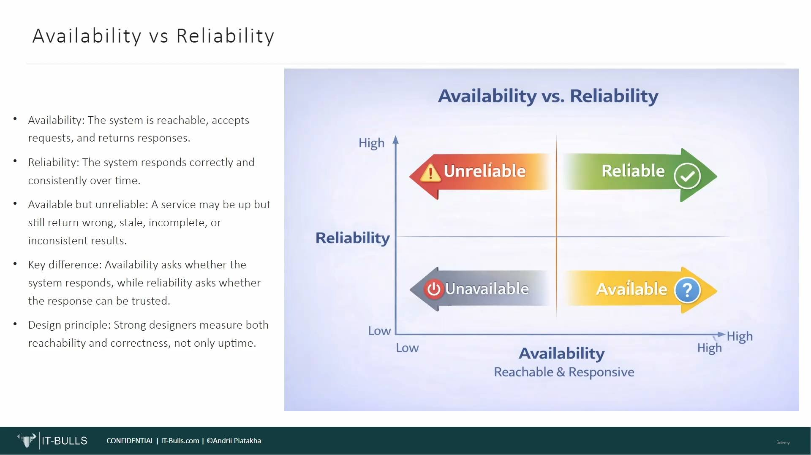
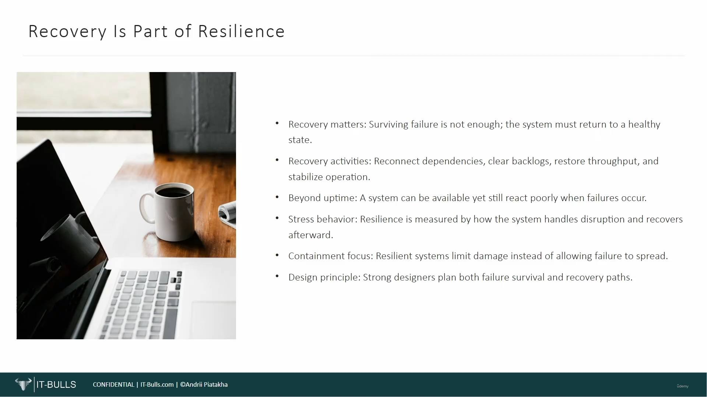
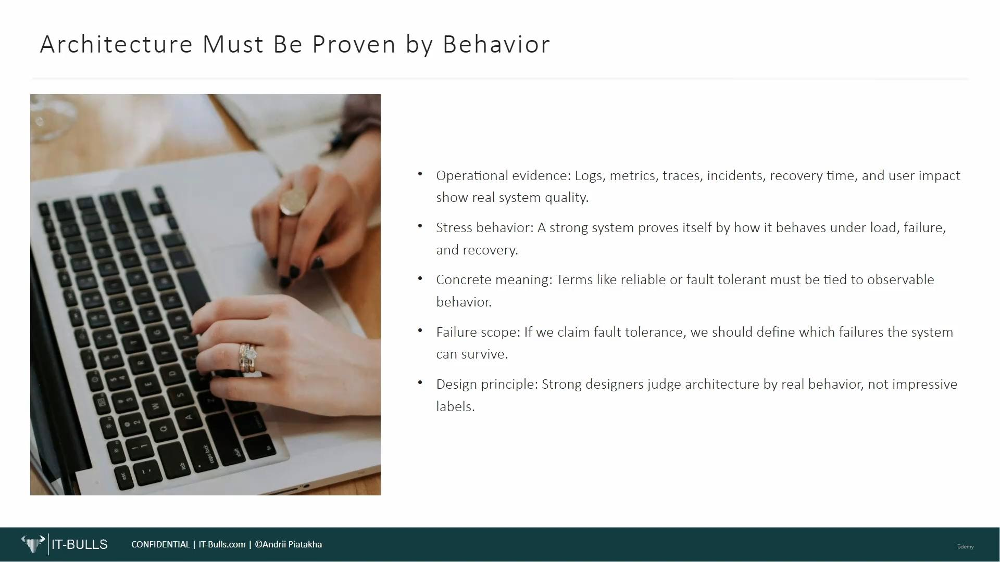
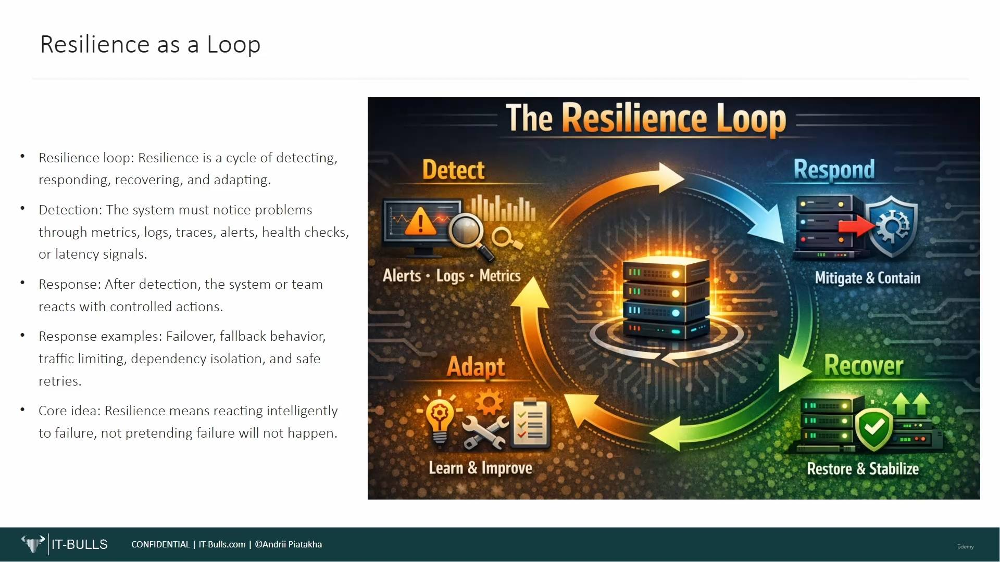
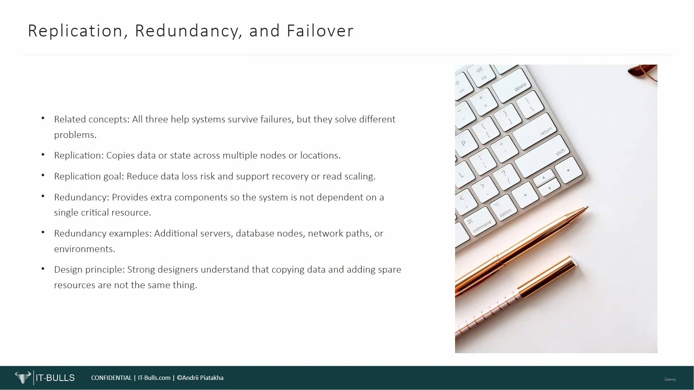
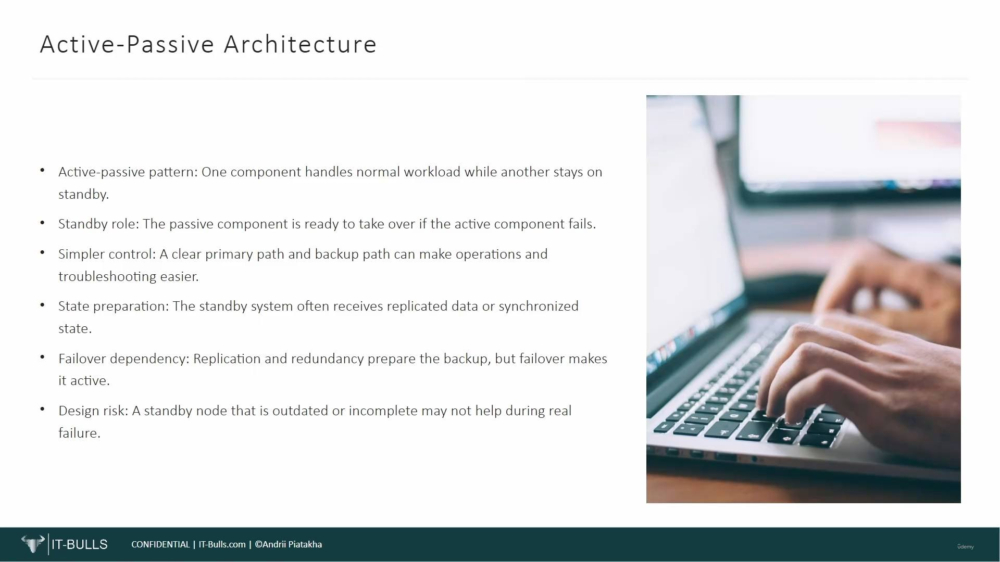
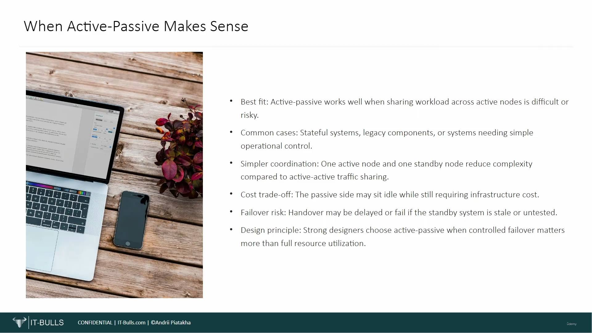
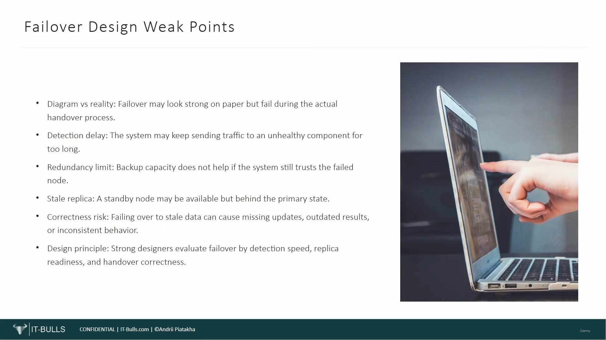

# System Design for Developers — P18–P19：可用性、可靠性、韧性与故障转移

## 1. 这一节做什么

这两讲（P018、P019）没有代码、没有终端命令，是纯概念与架构判断课。所以本文的「复现」不是复现一个可运行的服务，而是复现讲师的**判断流程**，并把它落成一套可以直接拿去做设计评审的产物：

1. 用**可观测行为**而不是形容词，给系统贴上 `availability / reliability / resilience / fault tolerance` 四个标签（P018）。
2. 沿着依赖链往下盘，找出「关键路径上的弱依赖」，因为**系统很少比它依赖的东西更可靠**（P018）。
3. 用 `detection → response → recovery → adaptation` 这个循环来设计运维能力，而不是写一句“我们是高可用架构”（P018）。
4. 区分 `replication / redundancy / failover` 三层，选 `active-passive` 还是 `active-active`，并把 `detection delay / stale replica / split brain / operational mistake` 四类失效点写进检查表（P019）。

最终交付物是一个目录：

```
design-review/
├── quality-claims.md      # 四个术语的判据、证据、当前结论、缺口
├── dependencies.md        # 依赖清单：是否关键路径、故障表现、降级后用户看到什么
├── redundancy-choice.md   # 冗余模式对比与选型理由
├── failover-checklist.md  # 故障转移失效点自查表
└── failover-check.mjs     # 示意脚本：把上面几张表变成可跑的检查（课里没有代码）
```

给前端转 AI 应用工程师的一句话定位：你平时写的是「请求进来、调模型、返回结果」。这两讲讲的是——当模型 API 变慢、向量库超时、数据库主库挂掉时，你的服务**应该表现成什么样**，以及你凭什么说它做到了。


---

## 2. 讲师原话（带「—— pNNN [MM:SS]」）

**四个词不能互换，因为它们回答的是不同问题。**

> “Availability is about whether the system is accessible when someone tries to use it.” —— p018 [01:50]

> “Reliability is about whether the system consistently does the right thing over time.” —— p018 [02:17]

> “Resilience is different again. It is about how the system behaves when something goes wrong.” —— p018 [02:17]

> “Fault tolerance is the ability of a system to continue operating even when one or more components fail.” —— p018 [07:05]

**可用 ≠ 可靠，这是本课最容易被忽略的一句。**

> “A system can be available, meaning it responds, but still be unreliable if it returns incorrect results, fails important operations or behaves inconsistently.” —— p018 [02:17]

> “The system may be reachable almost all the time and still create bad user outcomes because the business operation itself is not dependable.” —— p018 [04:14]



**容错讲的是「故障进行中」，恢复讲的是「故障之后」。**

> “Recovery happens after failure. Fault tolerance is about continuing during failure.” —— p018 [08:28]

> “It turns individual failures into manageable events instead of system-wide stops.” —— p018 [08:56]



**系统的可靠性上限由依赖决定。**

> “A system is rarely more reliable than the dependencies it relies on.” —— p018 [14:01]

> “Every dependency adds another chance for delay, error, or unavailability.” —— p018 [14:01]



**韧性是一个循环，不是一次性动作。**

> “The first step is detection.” —— p018 [16:46]

> “resilience is best understood as a loop, not as a fixed property.” —— p018 [18:06]



**复制、冗余、故障转移：给备份、给余量、给切换机制。**

> “Replication means copying data or state across multiple nodes or locations.” —— p019 [01:50]

> “Redundancy is broader. It means having extra components so the system is not dependent on a single instance of a critical resource.” —— p019 [01:50]

> “Failover is the mechanism that actually switches the system from a failed component to a healthy one.” —— p019 [02:19]

> “Without failover, the backup may exist and still not help in time.” —— p019 [02:19]



**主备与双活的取舍。**

> “Active passive architecture is a pattern in which one component actively handles the workload while another component remains on standby, ready to take over if the active one fails.” —— p019 [07:32]

> “Active Active architecture means that multiple nodes are active at the same time and share real production traffic.” —— p019 [09:47]

> “Once several nodes are active at the same time, the system must deal with coordination consistent routing shared state and data synchronization.” —— p019 [11:09]





**有冗余不等于高可用。**

> “Redundancy means the system has extra components, but high availability requires more than simply having backups.” —— p019 [14:24]

> “Two application servers don't help much if both rely on the same failing database, the same broken network path, or the same overloaded external service.” —— p019 [15:50]


**四类典型失效点。**

> “One common failure point is detection delay.” —— p019 [16:46]

> “Another major issue is stale replicas.” —— p019 [17:11]

> “Split brain is a different kind of risk.” —— p019 [17:39]

> “A failover design may be sound in theory, but if configuration is wrong, runbooks are unclear, health checks are misconfigured, or teams do not test the process regularly, the real handover can fail under pressure.” —— p019 [18:09]



---

## 3. 从零复现

这一节把讲师的推导过程按「需求 → 约束 → 估算 → 方案 → 取舍」走一遍。注意：**课里没有给公式、没有给数值、没有给代码**，下面出现的算式和示例数字是我为了让流程可执行补的，凡是补的地方都会标出来。

### 第一步：需求——先把形容词翻译成用户可见的承诺

不要写“我们要高可用”。写成下面这种句子，每一句都能被验证：

- 用户发起一次问答，**在正常负载下 10 秒内**必须拿到完整回答或明确的失败提示（不能转圈到超时）。
- 模型供应商不可用时，**核心问答仍可降级返回缓存答案或提示稍后重试**，而不是整个页面 500。
- 数据库主库故障后，**写入最多中断 X 分钟**，恢复后**不允许出现两条互相冲突的业务记录**。
- 故障恢复后，**积压的任务必须在 Y 分钟内清空**，且用户能看到状态从“处理中”走到终态。

对应讲师的观点：不要问“这个系统是不是 resilient”，要问“依赖失败时它到底怎么表现”（p018 [12:37] 附近讲了：行为才是真相）。

### 第二步：约束——把不能动的东西先写死

逐条问，答案写进 `design-review/redundancy-choice.md` 的“约束”区：

| 约束 | 为什么它决定方案 |
|---|---|
| 是否有状态 | 有状态（会话、任务队列、向量索引）时，主备比双活好控；无状态服务双活成本低 |
| 能否容忍读到旧数据 | 能容忍 → 备库延迟可接受；不能容忍（如扣费、权限）→ 必须走主或强一致路径 |
| 预算 | 主备的备机大部分时间闲着；双活资源利用率高但协调成本高 |
| 团队运维能力 | 双活要求有人能处理一致性、路由、脑裂；没人值班就不要选 |
| 故障时能否降级 | 能降级 → 韧性设计空间大；不能降级 → 只能靠冗余硬扛 |

课里对“有状态系统更适合主备”的说法在 p019 [08:26]–[08:54]：workload 难以安全地在多个活跃节点间共享时，active-passive 是务实选择。这就是约束决定方案。

### 第三步：估算——用算式把“感觉”变成排序

课里没有给公式。以下是通用的串联可用性算法，只用来**排序风险**，不要当成精确预测：

**串联（关键路径上任一环挂了整体就挂）：**

```
A_total = A_1 × A_2 × … × A_n
年停机分钟 ≈ (1 - A_total) × 365 × 24 × 60 = (1 - A_total) × 525600
```

示例（假设四个关键依赖的可用性分别是 0.999、0.999、0.995、0.99）：

```
A_total = 0.999 × 0.999 × 0.995 × 0.99 ≈ 0.9831
年停机 ≈ (1 - 0.9831) × 525600 ≈ 8893 分钟 ≈ 6.2 天
```

现在只把最弱的 0.99 提到 0.999：

```
A_total = 0.999 × 0.999 × 0.995 × 0.999 ≈ 0.9920
年停机 ≈ (1 - 0.9920) × 525600 ≈ 4196 分钟 ≈ 2.9 天
```

结论：**先修最弱的一环**，不是先加机器。

**并联（同一层两个副本都挂才挂，且假设故障独立）：**

```
A_layer = 1 - (1 - A)^2
```

0.99 的单副本变成双副本：`1 - 0.01² = 0.9999`，看起来提升巨大。但讲师在 p019 [15:50] 明确说了：两个应用服务器如果共用同一个数据库、同一条网络路径、同一个外部服务，那这个“独立”假设不成立。所以真实值要打折——**共用依赖会让并联公式失效**，这一点必须写进估算表的备注。

**故障转移时间预算（课里没给具体数值，这里只是让你把账算清楚）：**

```
用户可接受中断 = 检测时间 + 判定时间 + 切换时间 + 客户端重连时间
```

四项里任何一项超预算，冗余就白买了。这正好对应讲师说的 detection delay 和 failover 本身也会失败（p019 [13:28]、[16:46]）。

### 第四步：方案——先选冗余模式，再设计切换

按课里的分类，把候选模式列成表（见第 4 节表 C），然后强制自己回答三个问题：

1. 这个模式保护的是**哪个具体故障**？（机器挂？网络断？整个可用区挂？依赖变慢？）
2. 切换时**用户看到什么**？（一秒白屏？重试一次成功？还是数据错乱？）
3. 切换失败时**谁来兜底**？（降级？限流？人工？）

回答不出来，就说明这个模式只是“图上好看”，不是设计。

### 第五步：演练与复盘——把 resilience 当循环跑

课里把韧性拆成 `detection → response → recovery → adaptation`（p018 [16:21] 起）。落到可执行动作：

- **Detection**：你要能回答“我怎么知道它挂了”。课里提到 metrics、logs、traces、alerts、failed health checks、abnormal latency（p018 [16:46]）。具体阈值课里没讲，需要你自己压测确定。
- **Response**：failover、fallback、限流、隔离依赖、带保护的重试（p018 [17:15] 附近）。注意“带保护”三个字——没有退避的重试会把小故障放大成大故障。
- **Recovery**：清积压、恢复连接、把状态拉回稳定（p018 [17:41]）。
- **Adaptation**：调阈值、改保护、修瓶颈、纠正错误假设（p018 [18:06]）。

演练的最小可行版本：在预发环境手动把备节点断开，记录“从断开到用户可见恢复”的真实秒数，和第三步的预算对比。课里强调了“teams do not test the process regularly”是常见失效点（p019 [18:09]），所以这一步不是可选项。

### 第六步：写质量声明，禁止形容词裸奔

每个术语后面必须跟证据。写不出来就写“未知”，不要写“高可用”。这是本课最后一段的核心：`precision builds trust, while exaggerated language usually hides risk`（p018 [20:26] 附近）。

---

## 4. 完整代码

> **课里没有代码。** 下面所有表格和脚本都是把 P018/P019 的判断标准落成可执行产物的示意，不是讲师提供的实现。脚本里的字段名是本示意自定义的，不是课程输出里的字段。

### 表 A：四术语判据表（`quality-claims.md` 的表头）

| 术语 | 讲师的定义要点 | 可观测判据 | 需要的证据 | 常见误用 |
|---|---|---|---|---|
| Availability | 用户来访问时系统是否可达、能否响应（p018 [01:50]） | 请求被接受并返回响应 | 可用性指标、健康检查结果、错误率 | 把“能响应”当成“结果正确” |
| Reliability | 是否长期稳定地做对的事（p018 [02:17]） | 结果正确、关键操作成功、行为一致 | 业务成功率、数据校验、错误率 | 只看 uptime，不看业务结果 |
| Resilience | 出问题时如何表现：吸收、继续、恢复（p018 [02:47]） | 依赖故障时仍有部分功能；能回到稳定态 | 故障演练记录、恢复耗时、积压清理 | 把“没出过事”当成韧性 |
| Fault tolerance | 组件故障期间仍能继续运行（p018 [07:05]） | 关键路径在组件丢失时仍可用 | 冗余切换记录、降级记录 | 把“恢复快”当成“容错” |

### 表 B：依赖清单（`dependencies.md`）

> 示例行是按课里的“关键/非关键依赖”分类方法填的，**具体依赖不是课里的案例**。

| 依赖 | 在关键路径 | 故障表现 | 是否有降级 | 降级后用户看到什么 | 负责人 |
|---|---|---|---|---|---|
| 模型 API | 是 | 变慢 / 限流 / 报错 | 有 | 返回缓存答案或“稍后重试” | |
| 向量库 | 是 | 超时 / 结果缺失 | 部分 | 只做关键词检索 | |
| 主数据库 | 是 | 不可写 / 连接失败 | 无 | 写入排队，读走缓存 | |
| 缓存 | 否 | 命中率下降 | 有 | 变慢但可用 | |
| 消息队列 | 是（异步链路） | 积压 | 有 | 状态停在“处理中” | |

### 表 C：冗余模式选型（`redundancy-choice.md`）

| 模式 | 保护什么 | 切换速度 | 一致性风险 | 成本 | 运维复杂度 | 适合场景 |
|---|---|---|---|---|---|---|
| 基本备用（主备） | 单机 / 单实例故障 | 中（要检测+切换） | 低（单主） | 备机闲置 | 低 | 有状态、求稳、团队小 |
| 双活 | 单节点故障 + 容量 | 快（流量本已分散） | 高（路由、共享状态、同步） | 利用率高 | 高 | 无状态、流量大、有人值班 |
| 多层冗余 | 应用 / 数据库 / 存储 / 网络路径 / 可用区 | 取决于层 | 取决于层 | 叠加 | 叠加 | 单层冗余不够时补短板 |

讲师对双活的提醒：多个活跃节点不只是分担流量，还**分担责任和风险**（p019 [12:05] 附近）。

### 表 D：故障转移失效点自查（`failover-checklist.md`）

| 失效点 | 真实表现 | 必须回答的问题 | 证据 |
|---|---|---|---|
| Detection delay | 流量还在打挂掉的节点 | 多久能确认它不健康？误判率多少？ | 探测间隔、确认次数、历史误报 |
| Stale replica | 切换成功但数据是旧的 | 备节点落后多少秒可接受？超了怎么办？ | 复制延迟监控 |
| Split brain | 两个节点都认为自己是主 | 怎么防止同时写？发现后先停什么？ | 冲突记录、仲裁机制说明 |
| Operational mistake | 配置错、runbook 不清、健康检查配错、没演练 | 上次演练是什么时候？谁执行？ | 演练报告、变更记录 |

### 表 E：估算表（示例数字，非课程数据）

| 项 | 算式 | 结果 |
|---|---|---|
| 串联可用性 | 0.999 × 0.999 × 0.995 × 0.99 | ≈ 0.9831 |
| 年停机 | (1 − 0.9831) × 525600 | ≈ 8893 分钟 ≈ 6.2 天 |
| 修最弱环后 | 0.999 × 0.999 × 0.995 × 0.999 | ≈ 0.9920 |
| 修后年停机 | (1 − 0.9920) × 525600 | ≈ 4196 分钟 ≈ 2.9 天 |
| 双副本理论值 | 1 − (1 − 0.99)² | 0.9999（共用依赖时需打折） |
| 切换预算 | 检测 + 判定 + 切换 + 客户端重连 | 必须 ≤ 用户可接受中断 |

### 示意脚本：`design-review/failover-check.mjs`

Node 18+ 直接运行：`node design-review/failover-check.mjs`。无第三方依赖。

```js
// design-review/failover-check.mjs
// 课里没有代码。以下为示意实现：把 P018/P019 的判断标准落成可跑的检查。
// 字段名是本文件自定义的，不是课程输出。

const dependencies = [
  { name: 'llm-api',    critical: true,  availability: 0.995 },
  { name: 'vector-db',  critical: true,  availability: 0.999 },
  { name: 'primary-db', critical: true,  availability: 0.999 },
  { name: 'cache',      critical: false, availability: 0.99  },
];

// 串联可用性：关键路径上任一环挂了，整体就挂。
function chainAvailability(list) {
  return list
    .filter((d) => d.critical)
    .reduce((acc, d) => acc * d.availability, 1);
}

// 年停机分钟数
function minutesDownPerYear(a) {
  return Math.round((1 - a) * 365 * 24 * 60);
}

// 故障转移决策：先看脑裂，再看主是否健康，再看是否确认失败，最后看备节点新鲜度。
// 顺序很重要：宁可停写，也不要带着两个主继续跑。
function decideFailover(snapshot) {
  if (snapshot.splitBrainSignals > 0) {
    return {
      action: 'halt-writes-and-escalate',
      reasons: ['出现多节点同时自认为主的迹象，先停止写入并人工介入'],
    };
  }
  if (snapshot.activeHealthy) {
    return { action: 'keep-active', reasons: ['主节点健康，不切换'] };
  }
  if (!snapshot.failureDetected) {
    return {
      action: 'keep-active-and-observe',
      reasons: ['主节点不健康但尚未确认失败，继续观测并加大探测'],
    };
  }
  if (snapshot.standbyStaleSeconds > snapshot.maxAcceptableStaleSeconds) {
    return {
      action: 'block-writes-and-degrade',
      reasons: ['备节点数据过旧，直接切换会把旧数据暴露给用户'],
    };
  }
  return {
    action: 'promote-standby',
    reasons: ['主节点已确认失败，且备节点新鲜度可接受，执行切换'],
  };
}

const critical = dependencies.filter((d) => d.critical);
const total = chainAvailability(dependencies);

console.log('== 关键路径依赖 ==');
console.table(critical);
console.log(`串联可用性: ${total.toFixed(4)}`);
console.log(`年停机分钟: ${minutesDownPerYear(total)}`);

const scenarios = [
  {
    label: '正常',
    snapshot: {
      activeHealthy: true,
      failureDetected: false,
      standbyStaleSeconds: 1,
      maxAcceptableStaleSeconds: 30,
      splitBrainSignals: 0,
    },
  },
  {
    label: '主挂但未确认',
    snapshot: {
      activeHealthy: false,
      failureDetected: false,
      standbyStaleSeconds: 2,
      maxAcceptableStaleSeconds: 30,
      splitBrainSignals: 0,
    },
  },
  {
    label: '备节点太久没同步',
    snapshot: {
      activeHealthy: false,
      failureDetected: true,
      standbyStaleSeconds: 120,
      maxAcceptableStaleSeconds: 30,
      splitBrainSignals: 0,
    },
  },
  {
    label: '疑似脑裂',
    snapshot: {
      activeHealthy: false,
      failureDetected: true,
      standbyStaleSeconds: 1,
      maxAcceptableStaleSeconds: 30,
      splitBrainSignals: 1,
    },
  },
];

console.log('\n== 故障转移决策 ==');
for (const s of scenarios) {
  const d = decideFailover(s.snapshot);
  console.log(`${s.label} -> ${d.action}`);
  for (const r of d.reasons) console.log(`  - ${r}`);
}
```

运行后会打印依赖表、串联可用性与年停机分钟，以及四个场景下 `decideFailover` 返回的动作。它不能替代真实监控，只是把“先判脑裂、再判新鲜度、最后才切换”这个顺序固化成代码，防止值班时慌乱。

---

## 5. 逐行解释

**表 A 的四行。** 第一行 Availability 的判据写成“请求被接受并返回响应”，是因为讲师把可用性限定在“可访问、能响应”（p018 [01:50]）。第二行 Reliability 的判据必须是“结果正确、操作成功、行为一致”，否则就会掉进讲师点名的坑：系统一直在线但一直返回错的结果（p018 [04:14]）。第三行 Resilience 的判据是“依赖故障时仍有部分功能、能回到稳定态”，因为讲师把韧性定义成吸收 + 恢复两半（p018 [06:07] 起）。第四行 Fault tolerance 单独列出来，是因为讲师明确区分了“故障期间继续运行”和“故障之后恢复”（p018 [08:28]）——两者不能互相替代。

**表 B 为什么要写“降级后用户看到什么”。** 讲师说依赖分关键和非关键，非关键依赖挂了系统仍可通过 fallback 或优雅降级运行（p018 [15:24] 附近）。但“有降级”这句话本身不可验证。写成“返回缓存答案”或“只做关键词检索”，才能在演练时对着看。如果写不出来，说明这个依赖其实没有降级，只是你希望它有。

**表 C 的三行不是按“先进程度”排的。** 主备一行在“运维复杂度”上写“低”、在“成本”上写“备机闲置”，对应讲师对 active-passive 的评价：它简单、可控，但被动侧大部分时间闲着（p019 [09:23]）。双活一行在“一致性风险”和“运维复杂度”都写“高”，对应讲师的原话——多个活跃节点要处理协调、路由一致性和状态同步（p019 [11:09]），还会带来数据不一致、请求命中不同新鲜度的副本、脑裂等风险（p019 [11:35]）。多层冗余那一行是提醒：冗余不是只在应用层做一层就完事，讲师说系统可能在一个层看起来冗余、在另一个层仍然脆弱（p019 [19:55] 附近）。

**表 D 的四行对应讲师点名的四类失效点。** Detection delay 放在第一行，因为它是所有后续动作的前提；讲师说系统需要时间才能意识到组件不健康，这段延迟里流量还会继续打向失败节点（p019 [16:46]）。Stale replica 放在第二行，因为它最隐蔽——切换“成功”了，但用户看到旧数据，这属于讲师说的“故障转移发生了，但替代者并没有真正准备好提供正确结果”（p019 [17:11]）。Split brain 放在第三行，因为它的后果不是不可用，而是**一边看起来在运行一边破坏一致性**（p019 [17:39]）。Operational mistake 放最后但同等重要：配置错、runbook 不清、健康检查配错、不演练，都会让纸面设计在真实压力下失效（p019 [18:09]）。

**表 E 的算式。** `A_total = A_1 × … × A_n` 只适用于“关键路径上串联”的假设，所以我在表里只对 `critical: true` 的依赖求和。年停机用 `(1 - A) × 525600`，525600 是 365×24×60，这个数字写死是为了让不同方案能横向比。并联公式 `1 - (1 - A)^2` 前面必须加一句“故障独立假设”，否则会得出虚高的结论——这正是讲师说“两个应用服务器共用同一个数据库时帮助不大”的意思（p019 [15:50]）。切换预算那一行没有数字，因为**课里没有给任何具体秒数**，需要你压测后自己填。

**脚本 `chainAvailability`。** `filter((d) => d.critical)` 是在实现“不是所有依赖都同等重要”（p018 [15:24]）；如果不过滤，把一个非关键缓存算进关键路径，会低估整体可用性，导致你去修一个不重要的东西。

**`decideFailover` 的分支顺序。** 第一个 `if` 判 `splitBrainSignals > 0`，放在最前面，因为脑裂时最危险的动作就是“赶紧切换”，那会变成两个主同时写。返回 `halt-writes-and-escalate` 的意思是先止血再人工处理。第二个 `if` 是主健康就不动，避免不必要的抖动。第三个 `if` 处理“看起来不健康但还没确认”，对应 detection delay——这时候切，可能是误判。第四个 `if` 判备节点新鲜度，对应 stale replica：`standbyStaleSeconds > maxAcceptableStaleSeconds` 时返回 `block-writes-and-degrade`，宁可降级也不要把旧数据当新数据给用户。最后才是 `promote-standby`。这个顺序本身就是第 4 节表 D 的可执行版本。

**脚本里的字段名。** `splitBrainSignals`、`standbyStaleSeconds`、`maxAcceptableStaleSeconds` 都是本示意自定义的，不是任何监控系统的输出字段。真实系统里这些值从哪里来，课里没讲，你需要按自己用的监控/探测方案去映射。

**给前端的一点类比。** 主备切换在单进程 Node 里没有直接对应物；但当你把同一个后台任务交给多个 worker 或多个副本同时消费同一个队列时，就会出现等价的“双主”问题——两个 worker 都认为这个任务归自己。讲师说的 split brain 在分布式存储里是节点之争，在你的队列消费里就是重复处理与状态覆盖。处理思路一致：先保证同一时刻只有一个执行者，再谈切换。

---

## 6. 复现检查清单

- [ ] `design-review/` 目录已建，五个文件都有内容，没有空表头。
- [ ] 四个术语每一个都写了“可观测判据 + 证据 + 当前结论”，没有出现只有形容词没有证据的行。
- [ ] 依赖清单里每个“关键路径”依赖都写了“降级后用户看到什么”；写不出来的已标为“无降级”。
- [ ] 串联可用性算式已代入你自己的依赖数值，并算出年停机分钟。
- [ ] 已确认“最弱的一环”是哪个依赖，并写了下一次要修它的理由。
- [ ] 冗余模式已选型，且写明了“保护的是哪个具体故障”。
- [ ] 有状态 / 无状态、能否容忍旧数据、预算、值班能力四条约束都已记录。
- [ ] 切换时间预算拆成了检测、判定、切换、客户端重连四段，每段有估值或标“未知”。
- [ ] 表 D 四类失效点逐条有答案，`split brain` 那条写明了“发现后先停什么”。
- [ ] `node design-review/failover-check.mjs` 能跑通，四个场景输出符合预期顺序。
- [ ] 已做至少一次故障演练，记录了真实恢复秒数（不是理论值）。
- [ ] 复盘里至少有一条 `adaptation` 动作（调阈值 / 改保护 / 修瓶颈 / 纠正假设）。
- [ ] 文档里没有出现“高可用 / 企业级 / 金融级”这类没有证据支撑的词。

---

## 7. 课里没讲但你会撞上的

**1）探测参数怎么定。** 课里说了 detection delay 是失效点，也提到 health checks、timeouts、监控信号，但**没有给探测间隔、超时时间、连续失败几次才判定**。这些要靠压测和误报率来调：探得太紧会误切，探得太松会拖长中断。

**2）健康检查本身会说谎。** 课里提到 health checks 可能被配错（p019 [18:09]），但没展开。实际会撞上的是：进程活着但依赖全挂，健康检查还返回 OK；或者检查路径太深，探针自己先超时。你需要区分“进程活着”和“能处理真实请求”。

**3）DNS / 连接池 / 客户端缓存会拖长切换。** 课里没讲。服务端已经切到备节点，客户端还在用旧地址或旧连接，用户侧仍然报错。切换预算里“客户端重连”那一段就是留给这个的。

**4）重试会把小故障放大。** 课里在 response 阶段提到“带保护的重试”（p018 [17:15] 附近），但没讲具体策略。没有退避和上限的重试，在依赖变慢时会变成流量放大器，把“慢”打成“挂”。

**5）双活的一致性问题没有解法。** 课里点出了数据可能不一致、请求可能命中不同新鲜度的副本、可能出现脑裂（p019 [11:35]），但**没有讲具体怎么防**（比如仲裁、租约、单写者）。这块需要你按存储选型单独补课。

**6）积压清空是恢复的一部分，但课里没给方法。** 讲师说要 clear backlog（p018 [17:41]），但没说限速、分批、丢弃策略。恢复后一上来就全速清积压，很可能把刚恢复的依赖再打挂。

**7）演练的组织成本。** 课里强调要测试（p019 [18:09]），但没讲怎么在真实团队里排期、怎么避免演练影响生产、谁来签字。这是流程问题，不是技术问题。

**8）成本。** 课里说主备的被动侧会闲置、双活资源利用率更高（p019 [09:23]、[10:41]），但没有给成本模型。真实决策里，备机闲置的账单和双活的协调人力，往往比技术优劣更能决定选型。

**9）LLM 应用特有的依赖抖动。** 课里没讲。模型 API 的延迟分布长尾很重，还带限流；这类依赖的“慢”比“挂”更常见。表 B 里把模型 API 的故障表现写成“变慢 / 限流 / 报错”就是为此——只按“挂没挂”设计，会漏掉最主要的故障形态。

**10）术语在团队里的漂移。** 课里说不同角色对 reliable 的理解可能不同（p018 [10:20] 附近）。实际会撞上的是：产品说“稳定”，运维说“没告警”，你说“错误率低”，三个人说的是三件事。把表 A 放进评审模板，比在会上争论词义有用。