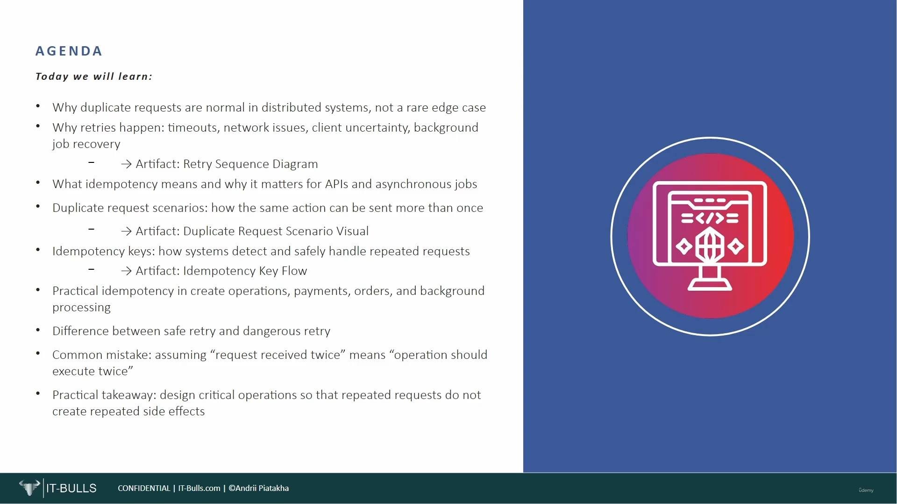
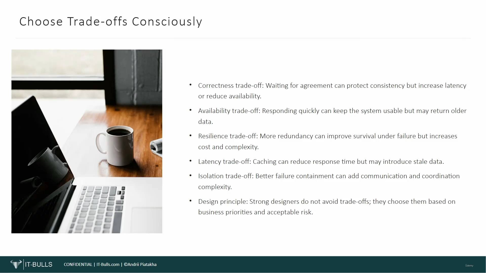
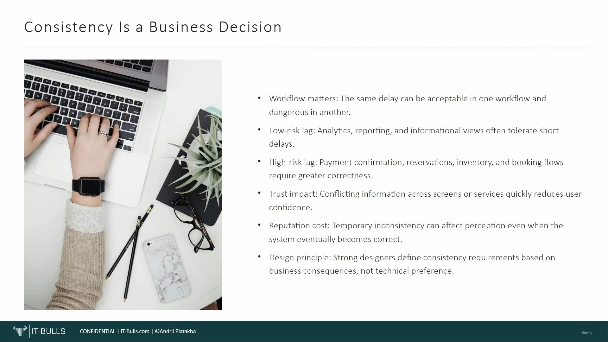
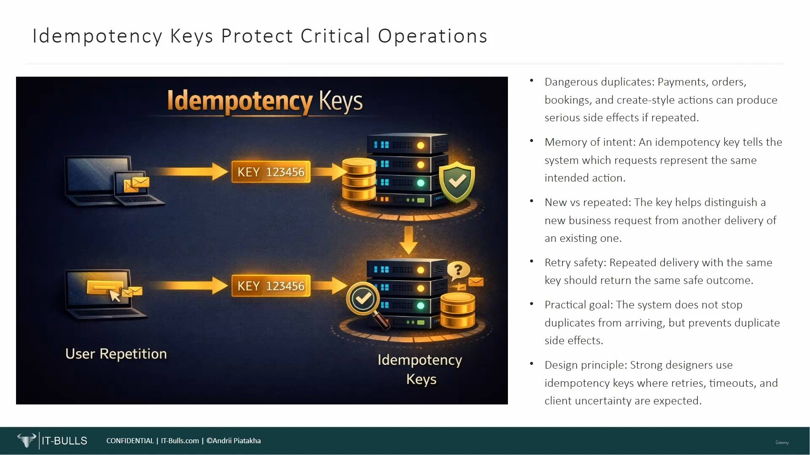
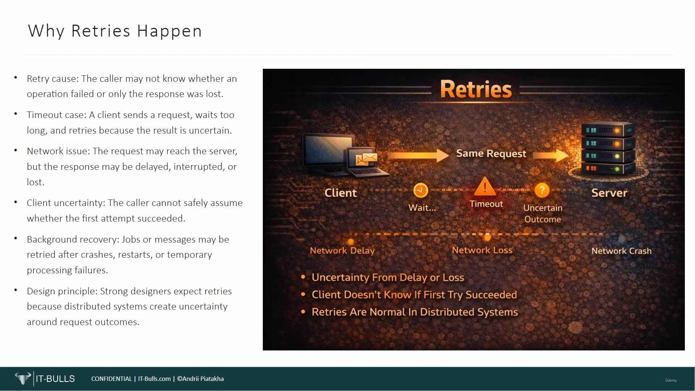
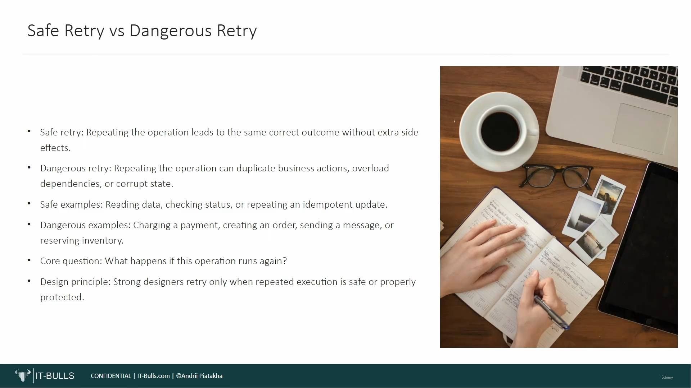

# System Design for Developers（BV1td4w6oEmH）P20–P21 复现文档

> **先说清楚这门课的性质**：P020 与 P021 是纯讲解课，逐字稿里**没有一行代码、没有仓库地址、没有依赖版本、没有启动命令**。所以本文档的「复现」不是 `npm install && npm start`，而是**把讲师的两套推导过程还原成可以拿去开会、可以拿去写实现的两份设计产物**：
>
> 1. **一致性等级决策表**（P020）——哪个业务该强一致、哪个可以最终一致；
> 2. **幂等与重试清单**（P021）——哪些操作必须幂等、幂等键长什么样、什么重试是安全的。
>
> 第 4 章里唯一那段 Node 代码是**本文补的示意实现**，不是讲师写的，代码块前会明确标注。

---

## 1. 这一节做什么

这两节课解决的是同一个问题的两个面：**分布式系统里，「网络不可靠」这件事会逼你做哪些业务决策。**

- **P020「一致性 vs 可用性的取舍」**：讲师不给公式、不给 CAP 定理的推导，而是把「一致性」从一个技术名词拆回成一句业务问题——**「如果系统在几秒钟内显示了旧数据或互相矛盾的数据，会发生什么？」** 然后给出一个三要素判断框架（workflow / user expectation / business risk），并用 payments、inventory、feeds、notifications、analytics 五个场景做对照，说明为什么不能全站一套策略。
- **P021「幂等、重试与重复请求」**：讲师先论证「重复请求在分布式系统里是常态而不是意外」，再论证「exactly once 比想象中难得多」，于是把工程起点换成「假设同一个请求我还会再看到一次，我的操作能不能安全地被看第二次」。核心工具是 **idempotency key（幂等键）**：它是一份「意图的记忆」，让系统能区分「这是一个新请求」和「这是同一个请求的又一次投递」。

**这一节真正的产出物**（照着做就能得到）：

| 产物 | 来自 | 用途 |
|---|---|---|
| 一致性等级决策表（表 A） | P020 | 给每个业务写清楚「能不能容忍陈旧数据」 |
| 一致性三问 checklist（表 B） | P020 | 评审时逐条问，防止一上来就聊数据库 |
| 幂等范围表（表 C） | P021 | 标出哪些接口/任务必须幂等 |
| 安全重试 vs 危险重试对照表（表 D） | P021 | 决定「这个重试能不能加」 |
| 幂等键接口草案（表 E） | P021 | 直接可以拿去写 API 文档 |
| 容量估算模板（表 F） | 课里没讲，本文补 | 幂等记录要存多少、存多久 |

---

## 2. 讲师原话（带时间戳）

### P020

> "一致性关心的是系统不同部分在同一时刻是否呈现相同数据；可用性关心的是请求到达时系统是否能够作出响应。"
> —— p020 [01:22]

> "如果系统在给出响应前坚持先达成强一致，那么可用性可能受损，因为有些请求必须等待或失败。如果系统在发生故障或中断期间仍持续响应，那么部分响应可能反映的是较旧或不完整的状态。"
> —— p020 [02:51]

> "强一致性意味着，一旦数据写入，系统的每个相关部分都会立即看到更新后的值，或者表现得仿佛只存在一个当前真实值。"
> —— p020 [05:42]

> "最终一致性意味着，系统不保证变更后每个节点都会立即显示最新值，而是保证如果不再有新的更新持续到达，所有副本最终会随时间收敛到同一状态。"
> —— p020 [07:36]

> "对一致性的分析要从工作流出发，而不是从数据库技术出发。"
> —— p020 [14:08]

> "系统设计中一个非常常见的错误，是把一致性当成仅仅是数据库的一项设置或低层的技术偏好。"
> —— p020 [18:25]

讲师在 P020 开头把整节课的大纲摆出来，后面每一段都对回这张大纲，复现时建议先把这张图记住当作目录：


### P021

> "在分布式系统中，重复请求是正常的，因为跨网络通信从来都不是完全确定的。"
> —— p021 [01:24]

> "“恰好一次”的实现远比人们最初想象的要困难。更现实的起点是假设同一个请求可能再次出现，并据此设计操作，使其能够安全地处理这种情况。"
> —— p021 [03:16]

> "幂等性意味着，在第一次成功执行之后，重复同一操作不会产生额外的副作用。"
> —— p021 [05:59]

> "幂等键是系统识别两个传入请求实际上属于同一项预期操作的最实用方法之一。"
> —— p021 [10:12]

> "安全重试与危险重试的区别，始于一个简单的问题：如果再次执行同一操作，会发生什么？"
> —— p021 [14:42]

> "分布式系统中一个非常常见的错误，是假设同一个请求到达两次，就一定代表两个相互独立的意图。"
> —— p021 [17:09]

P021 的大纲页，同样是全篇的骨架：



---

## 3. 从零复现

下面把讲师的推导**按步骤重放**。注意每一步的「输入」和「输出」——你照着走一遍，得到的应该和表 A–D 一致。凡是我加的东西，都会写「本文补」或「课里没讲」。

### 3.1 P020：一致性等级的推导

**Step 0 · 需求：先把两个词定义清楚**
- 一致性（consistency）= 系统的不同部分在同一时刻是否显示同一份数据。
- 可用性（availability）= 请求到达时，系统是否**能回应**。
- 输出：这两个词经常被混为一谈，必须先分开。注意讲师说的可用性是「能不能回应」，不是说「回应得对不对」——一个返回旧数据的 200 也是「可用」。

**Step 1 · 约束：为什么会冲突**
- 在单机上，只有一份本地状态，保持「一个清晰、即时的视图」很容易。
- 一旦系统跨机器、跨区域、跨服务，不同节点看到事件的时间点会不同，通信可能延迟、被丢弃、被中断。
- 于是系统面对一个二选一：**等一下，保住单一一致视图**；或者**先回应，承认部分节点还没达成一致**。
- 这一步的结论就是全篇的地基：冲突不是设计得不好，而是分布式这个前提本身带来的。



**Step 2 · 展开约束：不止一致性/可用性这一对**
讲师明确说，同样的拉扯关系还出现在别处：
- 更高的容错（resilience）→ 需要更多冗余 → 成本上升；
- 更低延迟 → 需要缓存 → 接受陈旧数据；
- 更好的服务隔离 → 故障不外溢 → 但通信复杂度上升。
- 所以「找一个全都要的设计」是错误目标，正确目标是「**有意识地选**」。

**Step 3 · 估算：这里课里是空的，你要自己补**
- **课里没有给任何数值**——没有 P99 延迟、没有「几个 9」的可用性、没有复制延迟的具体毫秒数。讲师全程用「a few seconds」「slightly older」「short delay」这类定性表述。
- 本文补一个你落地时必须填的估算模板（表 F 的 P020 部分）：**用户可感知的陈旧窗口 = 缓存 TTL + 消息队列积压 + 副本复制延迟 + 前端轮询间隔**。这四项里任何一项你没测过，你都答不出「几秒钟」到底是几秒。

**Step 4 · 方案：把一致性劈成两档，并给出各自的适用域**

| 档位 | 讲师的定义 | 代价 | 适用信号 |
|---|---|---|---|
| 强一致 Strong | 写入后，所有相关部分立即（或表现得像只有一份当前真相）看到新值；成功写入后用户不会再读到旧版本 | 需要额外协调、节点间更多等待、更严格的写入规则 → 可用性下降、延迟上升 | 下一步动作依赖「当前真实状态」；两件冲突的动作不能都成功 |
| 最终一致 Eventual | 不保证立刻看到最新值；只保证**如果没有新更新继续进来，所有副本最终收敛到同一状态** | 用户可能短暂看到旧数据，两台设备可能不一致，两个服务可能短期互相矛盾 | 临时陈旧无害；用户更在意响应速度和可用性 |

讲师在讲最终一致时，明确让你看屏幕上的「一致性光谱」，也就是说这不是二元对立，而是一条可以在不同业务上取不同点的轴：



**Step 5 · 取舍：三问框架**
讲师给的判断顺序是固定的，不能跳：

1. **Workflow（这个用户/服务此刻在做什么？）** —— 如果下一个动作建立在当前状态上，陈旧数据会直接导致错误决策（支付、预订、余额、库存检查）。如果是推荐流、分析看板、通知计数、动态流，慢一点仍然有用。
2. **User expectation（用户看到什么就信什么）** —— 即使底层最终正确，一个页面显示 completed、另一个还显示 processing，体验就是坏的。
3. **Business risk（陈旧数据能造成多大破坏？）** —— 财务损失、重复操作、合规问题、信任崩塌，只要沾上一条，通常就值得付强一致的协调成本。

**Step 6 · 场景落地（表 A 的来源）**
讲师明确说这几类业务「都涉及分布式数据，但延迟的业务后果完全不同」，所以不能用一套策略。逐条见第 4 章表 A。

**Step 7 · 反面：常见错误**
把一致性当成「数据库的一个设置项」或「底层技术偏好」，一上来就聊强一致/最终一致/副本/传播延迟，而不先问业务流程要什么。两个方向的翻车：到处上最强一致（白付延迟和复杂度），或者轻率接受最终一致（后来才发现旧数据打断了关键用户动作）。

### 3.2 P021：幂等与重试的推导

**Step 0 · 需求：为什么重复请求是常态**
- 客户端发出请求后没收到响应，原因可能是**响应丢了/延迟了/被中断**，而不是操作失败。此刻客户端只有一个现实选择：重发。
- 讲师列的重复来源（这是他明确列举的，不是我加的）：用户重复点击/刷新、客户端自动重连、重试、后台任务崩溃后重启、消息系统在缺少或延迟 ack 时重新投递、响应在回程丢失。
- 关键论断：**「收到两次」不等于「想表达两次意图」**。

**Step 1 · 约束：为什么不能靠「exactly once」**
- 讲师原话：exactly once 比人们第一反应以为的难得多。
- 所以设计起点改成：**假设同一个请求我还会再看到一次**。

**Step 2 · 方案 A：定义幂等**
幂等 = 同一个操作重复执行，在第一次成功执行之后不再产生额外副作用。用业务话说：同样的请求来多次，最终状态还是那一个，而不是动作被执行了多次。

**Step 3 · 方案 B：幂等键的流程（讲师给的 5 步）**
1. 客户端在请求里带上一个唯一 key，代表**一次业务操作**；
2. 服务端收到请求，先查这个 key 是否已见过；
3. 没见过 → 正常执行业务动作，并**把结果和 key 一起存下来**；
4. 又来了同一个 key → **不执行第二次业务动作**，识别为「已处理操作的重复投递」；
5. 安全返回上一次的结果，或确认「该操作已完成」。

讲师说这是「intent 的记忆」，让系统能区分「新请求」和「同一请求的又一次投递」。注意他特别强调：判断依据不是时间、也不是 payload 长得像，而是**客户端给的那个 key**。



**Step 4 · 重试为什么会发生（时序层面）**
讲师让你看屏幕上的重试时序图，并逐步讲：客户端发请求 → 等待 → 响应回来之前超时 → 从客户端视角「操作状态未知」→ 重发同一请求。网络问题造成同样的模式：连接可能在请求已被接收**之后**断掉，或者响应路径被打断。后台任务是同一个剧本：worker 处理了一部分、崩溃/重启/断连，恢复时无法安全假设第一次已经完成，于是再跑一次。



**Step 5 · 取舍：安全重试 vs 危险重试**
讲师给的判断是两问：
1. **这个操作重复执行安全吗？**（读数据、再查一次状态、重复一个最终状态相同的更新 → 通常安全；扣款、建单、发消息、占库存 → 危险）
2. **目标系统此刻健康到能承受再一次尝试吗？**（即使技术上可重复，太多客户端同时立刻重试一个已经在挣扎的依赖，会在最糟的时刻加压，让恢复更难）



**Step 6 · 反面：常见错误**
「收到两次 = 两个意图」。后果：第二笔扣款、重复订单、同一封邮件发两遍、同一个记录被改两次。

---

## 4. 完整代码（本节是纯讲解课，产物是决策表与接口草案）

> **课里没有代码。** P020/P021 全程没有出现编辑器、终端、仓库或依赖。下面表 A–F 是把讲师讲的内容整理成可以直接填、直接贴进设计文档的产物。第 4.7 节那段 Node 代码是**本文补的示意实现**，用于让你看到「幂等键」落到代码里长什么样，**不是讲师提供的**。

### 4.1 表 A：一致性等级决策表（P020 核心产物）

| 业务场景 | 讲师给的位置 | 陈旧/矛盾数据会造成什么（讲师原话要点） | 结论 |
|---|---|---|---|
| 支付 Payments | 严格侧（strict side） | 确认两次、漏掉、或各服务显示不一致 → 直接财务损失与信任问题 | 强一致，值得付额外协调成本 |
| 库存 Inventory（多人抢同一批限量商品时尤其） | 敏感 | 显示过期可用量 → 超卖、冲突预订 | 强一致 |
| 订票 / 预订 Booking | 敏感（与库存同理） | 两个冲突动作不能都成功 | 强一致 |
| 账户余额 / 交易记录 | 严格侧 | 用过期信息批准动作 | 强一致 |
| 订单状态追踪 Order tracking | 敏感（讲师用订单时间线举例） | 一个界面说已确认、另一个说 processing 甚至 not found → 用户困惑、信任快速下降 | 至少不能在同一决策点上矛盾 |
| 动态流 Feeds | 宽容 | 最新帖子晚一点出现在所有地方 | 最终一致 |
| 推荐 Recommendations | 宽容 | 同上 | 最终一致 |
| 通知 Notifications | 宽容 | 只要在合理时间内到达即可 | 最终一致（可接受最终送达） |
| 分析看板 Analytics | 最宽容 | 落后几秒到几分钟仍然有用 | 最终一致 |
| 搜索索引 / 内容计数（讲师列举的同类项） | 宽容 | 短暂旧数据 | 最终一致 |

> 表格最后一行「搜索索引/内容计数」讲师是在讲最终一致的适用域时列举的（"信息流、推荐、分析、社交计数器和搜索索引"），我没有替他扩写别的场景。

### 4.2 表 B：一致性三问 checklist（评审时逐条问）

| # | 问题 | 若答「是」 | 若答「否」 |
|---|---|---|---|
| 1 | 用户/服务的**下一个动作**是否依赖当前真实状态？ | 倾向强一致 | 可以最终一致 |
| 2 | 如果同一个决策点上有两个界面/两个服务给出矛盾答案，用户会明显感到「坏了」吗？ | 需要更强的可见性保证 | 容忍 |
| 3 | 短暂陈旧是否可能造成财务损失、重复操作、合规问题或信任下降？ | 倾向强一致 | 容忍 |

讲师的原话总结是：把这三件事放在一起，问「什么必须立刻正确、什么可以稍后变正确、用户能安全地容忍什么」。

### 4.3 表 C：幂等范围表（P021 核心产物）

| 操作 | 重复执行的后果（讲师列举） | 必须幂等？ | 备注 |
|---|---|---|---|
| 扣款 / 支付请求 | 同一笔意图被扣两次 | **必须** | 讲师说支付系统常用唯一操作标识或与业务动作绑定的幂等键 |
| 创建订单 | 平台生成重复订单 | **必须** | 用户可能多次点 Place Order，或网络重试 |
| 创建工单 / 账户条目（create 类） | 一条意图变成两条记录 | **必须** | 讲师说 create 是最容易「一次意图变两条记录」的地方 |
| 退款 | 重复退款 | **必须**（与支付同侧） | 讲师在 API 场景里列举了 issuing a refund |
| 占库存 | 重复占用 | **必须** | 讲师列入「真实业务后果」清单 |
| 后台任务：发邮件 / 更新记录 / 触发下游动作 | 重复发信、重复改记录、下游被触发两次 | **必须** | 讲师说「在重复执行危险的地方」而不是「重复投递可能的地方」才用幂等 |
| 读取数据 | 无副作用 | 天然安全 | 讲师把「再读一次、再查一次状态」列为安全重试 |
| 重复一个最终状态相同的更新 | 无副作用 | 通常安全 | 同样被列为安全重试 |

### 4.4 表 D：安全重试 vs 危险重试对照表

| 维度 | 安全重试 | 危险重试 |
|---|---|---|
| 副作用 | 重复执行不产生额外副作用 | 重复执行产生重复业务动作 |
| 典型操作 | 读数据、查状态、收敛到同一最终状态的更新 | 扣款、建单、发消息、占库存 |
| 时机 | 有限次、时机合适、有幂等或去重保护 | 立即、无上限，不管依赖是否健康 |
| 对系统的影响 | 帮助恢复 | 在依赖已经挣扎时加压，让恢复更难 |
| 讲师的原话判据 | 「重复执行会不会导致同样正确的结果、不产生额外副作用」 | 「重复执行会不会造成重复业务动作、压垮依赖或破坏状态」 |

### 4.5 表 E：幂等键接口草案

> **课里没给字段名。** 讲师只讲了行为（客户端带唯一 key → 服务端查 → 首次执行并存结果 → 同 key 再来则返回旧结果）。下表字段名是本文约定的草案。

请求侧：

| 位置 | 名称（本文约定） | 说明 |
|---|---|---|
| Header | `Idempotency-Key` | 客户端生成，代表**一次业务操作**，不是「一次 HTTP 请求」 |
| Body | 原业务载荷 | 讲师强调判断依据是 key，不是 payload 相似度 |

服务端记录侧（草案）：

| 字段（本文约定） | 含义 |
|---|---|
| `key` | 幂等键，唯一 |
| `state` | `in_progress` / `done` |
| `status` + `body` | 首次执行的结果，供重放时原样返回 |
| `expires_at` | 过期时间（课里没讲该留多久，见第 7 章） |

行为约定：

- key 首次出现 → 执行业务动作 → 存结果；
- key 已存在且已完成 → **不执行业务动作**，返回上一次结果；
- key 已存在且仍在进行中 → 讲师**没有讲**这种情况怎么处理（本文示意实现里返回 409，见第 7 章）。

### 4.6 表 F：容量估算模板（课里没给任何数字，以下为本文补的算式）

P021 · 幂等记录规模：

```
日新增幂等记录 = 写请求 QPS × 86400
总量          = 日新增 × 保留天数
存储          = 总量 × 单条记录字节数
```

举例（**数字是本文假设，不是讲师的**）：写请求 100 QPS → 100 × 86400 = 8.64M/天；保留 7 天 → 60.48M 条；单条 400 B → 约 24 GB。

P020 · 陈旧窗口：

```
用户可感知陈旧时间 = 缓存 TTL + 队列积压 + 副本复制延迟 + 前端轮询间隔
```

把每一项都换成你系统里**测出来的**数字，再和表 A 对照：如果某个强一致场景的陈旧窗口大于 0，那里就有一个待修的洞。

### 4.7 示意实现：幂等键落在代码里是什么样

> **课里没有代码，以下为示意。** 讲师没有提过 Express、没有提过任何语言或存储。这段代码只是把 4.5 的行为约定写成可运行的形态，帮你理解「key 查过没有 → 存结果 → 重放返回旧结果」这条主线。生产环境还需要什么，见第 7 章。

`package.json`：

```json
{
  "name": "idempotency-demo",
  "version": "1.0.0",
  "type": "module",
  "engines": {
    "node": ">=18"
  },
  "scripts": {
    "start": "node server.js"
  },
  "dependencies": {
    "express": "4.19.2"
  }
}
```

`server.js`：

```js
// server.js —— 幂等键示意实现（课里没有代码，本文件为本文补充）
import express from 'express';
import { randomUUID } from 'node:crypto';

const app = express();
app.use(express.json());

const TTL_MS = 24 * 60 * 60 * 1000;
// key -> { state: 'in_progress' | 'done', status, body, expiresAt }
const store = new Map();

function sweepExpired() {
  const t = Date.now();
  for (const [key, rec] of store) {
    if (rec.expiresAt <= t) store.delete(key);
  }
}

function httpError(statusCode, message) {
  const err = new Error(message);
  err.statusCode = statusCode;
  return err;
}

// 真正的副作用放在这里：示意用 setTimeout 模拟下游支付网关
async function executePayment(payload) {
  if (!payload || typeof payload.amount !== 'number' || payload.amount <= 0) {
    throw httpError(400, 'amount must be a positive number');
  }
  if (!payload.currency) {
    throw httpError(400, 'currency is required');
  }
  await new Promise((resolve) => setTimeout(resolve, 300));
  return {
    paymentId: 'pay_' + randomUUID(),
    amount: payload.amount,
    currency: payload.currency,
  };
}

app.post('/payments', async (req, res) => {
  const key = req.get('Idempotency-Key');
  if (!key) {
    return res.status(400).json({ error: 'Idempotency-Key header is required' });
  }

  sweepExpired();

  const existing = store.get(key);

  // 情况一：key 已见过，且首次执行已完成 -> 重放旧结果，不执行业务动作
  if (existing && existing.state === 'done') {
    return res
      .status(existing.status)
      .set('Idempotent-Replayed', 'true')
      .json(existing.body);
  }

  // 情况二：key 已见过，但首次仍在进行中
  if (existing && existing.state === 'in_progress') {
    return res
      .status(409)
      .json({ error: 'a request with this Idempotency-Key is still in progress' });
  }

  // 情况三：首次见到这个 key -> 先占位，再执行业务动作
  store.set(key, {
    state: 'in_progress',
    status: 0,
    body: null,
    expiresAt: Date.now() + TTL_MS,
  });

  try {
    const result = await executePayment(req.body);
    store.set(key, {
      state: 'done',
      status: 201,
      body: result,
      expiresAt: Date.now() + TTL_MS,
    });
    return res.status(201).json(result);
  } catch (err) {
    // 失败不缓存为最终结果，允许客户端用同一个 key 再来一次
    store.delete(key);
    return res
      .status(err.statusCode || 500)
      .json({ error: err.message });
  }
});

app.listen(3000, () => {
  console.log('listening on http://localhost:3000');
});
```

复现命令（两个终端，或一个终端两次 curl）：

```bash
npm install
npm start
```

```bash
# 第一次：应当真的执行一次
curl -i -X POST http://localhost:3000/payments \
  -H 'Content-Type: application/json' \
  -H 'Idempotency-Key: 6f1c0a3e-demo-001' \
  -d '{"amount":1999,"currency":"CNY"}'

# 第二次：key 相同 -> 返回首次结果，不会生成新的 paymentId
curl -i -X POST http://localhost:3000/payments \
  -H 'Content-Type: application/json' \
  -H 'Idempotency-Key: 6f1c0a3e-demo-001' \
  -d '{"amount":1999,"currency":"CNY"}'

# 第三次：换 key -> 视为新操作，生成新的 paymentId
curl -i -X POST http://localhost:3000/payments \
  -H 'Content-Type: application/json' \
  -H 'Idempotency-Key: 6f1c0a3e-demo-002' \
  -d '{"amount":1999,"currency":"CNY"}'
```

你应当看到的差异：**第二次返回的 `paymentId` 与第一次完全相同**，并且带 `Idempotent-Replayed: true` 响应头；第三次是一个新的 `paymentId`。具体 `paymentId` 是随机 UUID，每次全新启动都不同，**实际输出以你本机为准**。

---

## 5. 逐行解释

### 5.1 表 A 的每一行为什么这样定

- **支付为什么放最严格一侧**：讲师给的判据是「如果支付被确认两次、漏掉、或跨服务显示不一致，结果是直接财务损失或严重信任问题」。注意他同时说了反面：强一致要付「额外协调、节点间更多等待、更严格写入规则」的成本，所以他的态度不是「支付重要所以到处都强一致」，而是「**在这个业务风险高到无法接受的地方**才用」。
- **库存为什么和支付同级**：因为多人竞争同一批限量商品时，读到过期可用量会让系统允许**本不该发生**的动作（超卖、冲突预订）。这里的判据不是「库存数据重不重要」，而是「用户是否会基于它立刻做决策」。
- **订单追踪为什么单列**：讲师用订单时间线举例——订单可能已成功创建，但另一部分系统短暂仍显示上一状态（payment 已确认，另一个界面还显示 processing 甚至 not found）。他没有说这里必须强一致，他说的是**用户不体验架构图，只体验产品此刻显示的东西**，所以这里是「用户体验 + 信任」维度的问题，不完全是数据正确性问题。
- **feeds/通知/分析为什么宽容**：共同特征是「数据是信息性的，不是决策性的」。讲师的原话逻辑是：用户短暂看到旧状态，但业务流程本身没坏。
- **为什么不能五行合成一行**：因为讲师整节课的落点就是这句——同一个延迟在一个工作流里无害，在另一个里致命。

### 5.2 表 B 三问的顺序为什么不能反

先 workflow、再 user expectation、再 risk。反过来的坏处：如果先问 risk，很容易把所有东西都判成高风险然后全站强一致（这正是讲师点名的第一个翻车方向）；如果先问 expectation，会被「看起来不舒服」主导，把纯展示型数据也升级。先把 workflow 定下来，另外两问才有参照物。

### 5.3 表 C 的判据为什么是「重复执行危不危险」而不是「重复投递可不可能」

讲师的原话是：把幂等用在**重复执行危险**的地方，而不只是**重复投递可能**的地方。这两个集合不一样——比如「查询余额」重复投递非常可能，但重复执行完全无害，就不需要幂等键；反过来「给用户发一封确认邮件」重复投递概率不一定高，但一旦重复就是用户可感知的错误。这个判据的价值在于：它让你按业务后果排优先级，而不是按概率。

### 5.4 表 D 里「时机」这一行为什么存在

很多人以为重试只有「能不能重」这一个变量。讲师补了第二个变量：**目标系统健康不健康**。即使操作本身可重复，大量客户端在依赖已经过载时立刻重试，会在最糟的时刻加压，让恢复更难。他的结论是：安全重试 = 有限次 + 时机合适 + 有幂等/去重保护；危险重试 = 无视副作用、无视系统状态、无视依赖健康，把调用当没发生过一样再打一次。

### 5.5 示意代码逐段解释

- `const store = new Map();` —— 这是「意图的记忆」在内存里的最小形态。讲师讲的「把结果和 key 一起存下来」就对应这一行 + 下面两处 `store.set`。**课里没讲存在哪**，这里用 Map 只是为了让示例零依赖可跑。
- `state: 'in_progress' | 'done'` —— 对应讲师流程里的「先查 key 是否见过」之后的两种分支。加 `in_progress` 是因为 Node 里 `await` 会让出执行权：两个同 key 请求可能几乎同时进来，都在 `store.get` 时看到空。这相当于**一把极简的锁**——在 Java 里你会想到 `synchronized`/数据库唯一约束，在 JS/Node 里对应的是「先同步占位，再异步执行」。
- `if (existing.state === 'done') return res.status(existing.status)...json(existing.body)` —— 这就是讲师说的「不执行第二次业务动作，安全返回上一次结果或确认已完成」。注意返回的是**首次的 status 和 body**，而不是 200 + 一条「已处理」，这样客户端拿到的东西和第一次成功时完全一样，客户端逻辑不用写分支。
- `set('Idempotent-Replayed', 'true')` —— 这个是本文加的调试便利，**课里没提**。它的作用是让你在 curl 输出里一眼看出「这次是重放，不是真的又执行了一次」。
- `if (existing.state === 'in_progress') return 409` —— **课里没讲**这种情况。这里选了「让客户端稍后再试」。理由写在 7.2。
- `store.set(key, { state:'in_progress', ... })` 放在 `try` **之前** —— 顺序很关键：必须在执行副作用之前占位，否则两个并发同 key 请求会双双通过检查。这是「先占坑再干活」。
- `catch` 里 `store.delete(key)` —— 失败不缓存为最终结果。因为失败可能是「确实没成功」（可以重试），也可能是「状态未知」（重试正是讲师推荐的做法）。如果失败也固化成 `done`，客户端就永远拿不到成功的可能了。**这个取舍课里没讲**，它是本文的实现选择。
- `sweepExpired()` —— 讲师没讲保留策略。这里每次请求顺手清理过期记录，是最省事的写法；真实系统不会这么做（见 7.1）。
- `executePayment` 里的两个 400 —— 用来演示「校验失败也走同一条错误路径」。注意它们在 `await` 之前抛出，所以实际上没有产生副作用；真实系统要更小心地区分「执行前失败」和「执行后未知」。

**关于 Node 的一点补充**：这里没有事务、没有行锁。Map 的读写在单线程里是原子的，但 `await` 之间不是。这就是为什么「先同步占位」这一步必须写在任何 `await` 之前。如果你把存储换成 Postgres，等价做法是给 `key` 加唯一索引，靠插入失败来占位——但这属于课里没讲的内容。

---

## 6. 复现检查清单

**P020 部分（一致性）**

- [ ] 我能不看资料说出 consistency 与 availability 的定义，并且说清 availability 是「能不能回应」而不是「回应得对不对」。
- [ ] 我能举出至少一个「等一下保一致」和「先回应保可用」的具体选择，并说出各自的代价。
- [ ] 我能说出讲师给的三个额外拉扯关系（冗余↔成本、缓存↔陈旧、隔离↔通信复杂度）。
- [ ] 表 A 的 10 行里，每一行我都能说出「为什么放这一侧」，而不是只标了结论。
- [ ] 我能用表 B 的三问，对一个新的业务（例如「AI 生成任务的额度扣减」）走一遍判断。
- [ ] 我意识到课里**没有**给任何延迟/可用性的具体数字，并且我已经为表 F 的陈旧窗口四项填上了自己系统测出来的值。
- [ ] 我能复述两个翻车方向：到处强一致（白付延迟）、轻率最终一致（旧数据打断关键动作）。

**P021 部分（幂等与重试）**

- [ ] 我能列出至少 5 种重复请求来源（用户重复点击、客户端自动重连、重试、后台任务重启/崩溃恢复、消息系统 ack 缺失或延迟重投、响应回程丢失）。
- [ ] 我能解释为什么「收到两次」≠「意图两次」。
- [ ] 我能用一句话定义幂等，并且强调「第一次成功执行之后」这个前提。
- [ ] 表 C 里每一行我都能说出判据是「重复执行危不危险」。
- [ ] 我能画出幂等键的 5 步流程（带 key → 查 → 首次执行并存结果 → 同 key 不再执行 → 返回旧结果）。
- [ ] 表 D 里我能说出「时机」这一维度为什么独立存在。
- [ ] 我能说出 exactly once 为什么不是可行的设计起点。

**代码部分（示意实现，课里没有）**

- [ ] `npm install && npm start` 能起来，控制台打印 `listening on http://localhost:3000`。
- [ ] 用同一个 `Idempotency-Key` 发两次，两次 `paymentId` 相同，第二次带 `Idempotent-Replayed: true`。
- [ ] 换一个 `Idempotency-Key`，拿到新的 `paymentId`。
- [ ] 不带 `Idempotency-Key` 时返回 400 和 `{"error":"Idempotency-Key header is required"}`。
- [ ] 传 `{"amount":0}` 时返回 400 和 `amount must be a positive number`，并且用同一个 key 改成合法请求重发**能成功**（验证失败没被缓存）。

---

## 7. 课里没讲但你会撞上的

### 7.1 幂等记录存在哪、留多久

**课里没讲。** 讲师只说「把结果和 key 一起存下来」，没说是内存、数据库还是别的，也没给保留期。你实际会撞上的问题：留太短，边界上的重试会穿透；留太长，存储和一致性成本上升。本文的估算模板在表 F，TTL 需要你自己按「客户端最长重试窗口」来定。

### 7.2 同一个 key 的并发请求（in-flight）

**课里没讲。** 讲师描述的流程是「查 key → 没有就执行」，没有覆盖「两个同 key 请求同时到达、都查到没有」的情况。示意代码里用「先同步占位 + 409」处理，但这只是本文的选择。真实系统还要考虑：客户端拿到 409 之后应该退避多久再试、要不要改成「等第一次完成再返回同一结果」。

在 JS/Node 里对应的是「`await` 之间不是原子的，必须先把标记写进共享状态再 `await`」；在 Java 里你会想到 `synchronized` 或数据库唯一约束（**知道即可**，语法不用记）。

### 7.3 key 由谁生成、怎么生成

**课里没讲。** 讲师只说「客户端包含一个唯一的 key，代表一次业务操作」。实践里要定：前端生成还是网关生成？刷新页面后 key 要不要保留（决定「刷新重复提交」会不会被去重）？key 要不要绑定用户/租户，防止不同用户撞 key？

### 7.4 同 key 但请求体不同怎么办

**课里没讲。** 讲师只说「不要只靠时间或 payload 相似度判断」。但如果客户端复用了 key 却改了金额，服务端应该返回旧结果（可能和请求体矛盾）还是报错？这是一个必须自己定的规则。

### 7.5 重试的具体策略：次数、退避、抖动

**课里只讲了原则，没给算法。** 讲师说「即使技术上可重复，太激进的重试也会在错误时刻加压」，但没有给指数退避、最大次数、jitter 这些具体做法 —— 这些词他都没提。你落地时仍需自己决定。

### 7.6 术语：CAP / PACELC / 线性一致性

**课里没有出现这些词。** 讲师全程用的是 "in tension"、"trade-off"、"consistency spectrum" 这类表述，没有把 P020 的内容挂到 CAP 定理上。如果你在评审里引用 CAP，那是你自己的补充，别说成「课里讲过」。

### 7.7 观测与告警

**课里没讲。** 幂等键命中率、重试率、409 比例、重放返回比例——这些指标讲师一个都没提。但没有它们，你无法知道幂等机制是不是真的在起作用，还是只是写在那儿没人走到。

### 7.8 前端侧的重复提交

**课里讲了「用户可能点两次」，但没讲前端怎么防。** 你可以用按钮 disable、提交后跳转来减少用户侧重复；但要记住讲师的判据：**重复投递是常态，前端只能降低概率，不能替代服务端的幂等**。网络层重试、消息重投、后台任务重启，这些前端一行都管不到。

### 7.9 本文延伸（不是讲师内容）

转到 AI 应用时你会立刻撞上同一组问题：一次 LLM 调用可能因为网关超时被重试而**重复计费**；一个工具调用（tool call）被重投而**重复写库**。按表 C 的判据，「扣额度」「写业务记录」「发通知」都属于重复执行危险的一侧，应当带幂等键；而「查一次任务状态」「重新拉一次结果」属于安全重试。这段是本文的类比，P020/P021 里没有涉及 LLM 或 AI 场景。