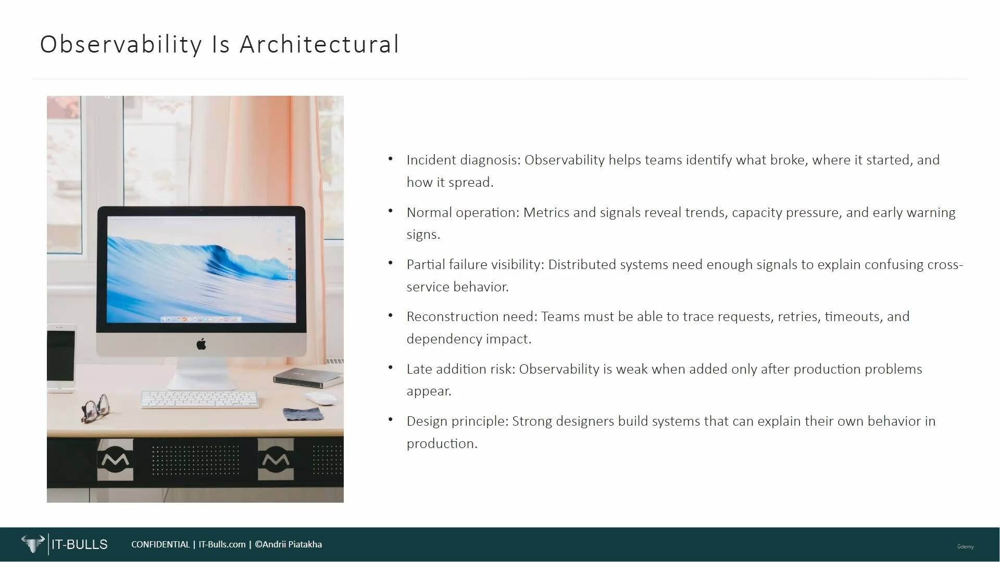
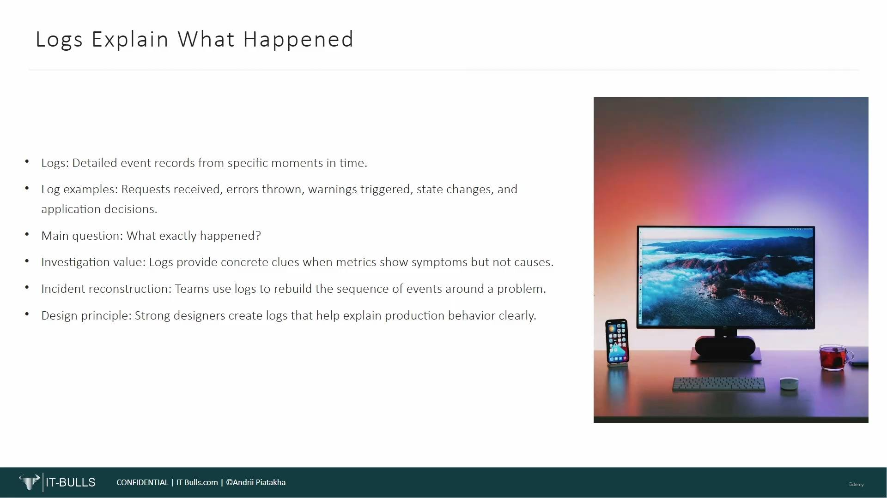
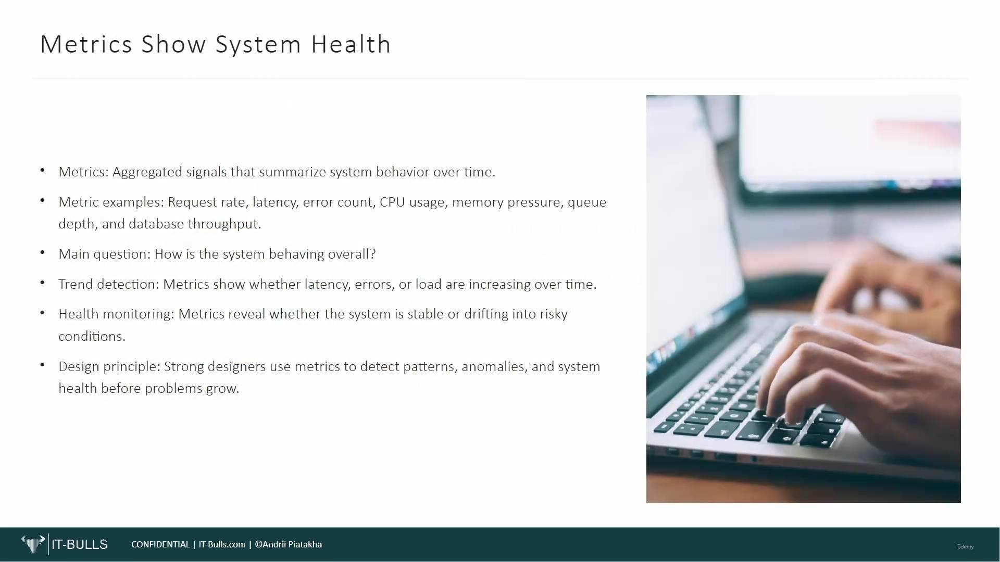
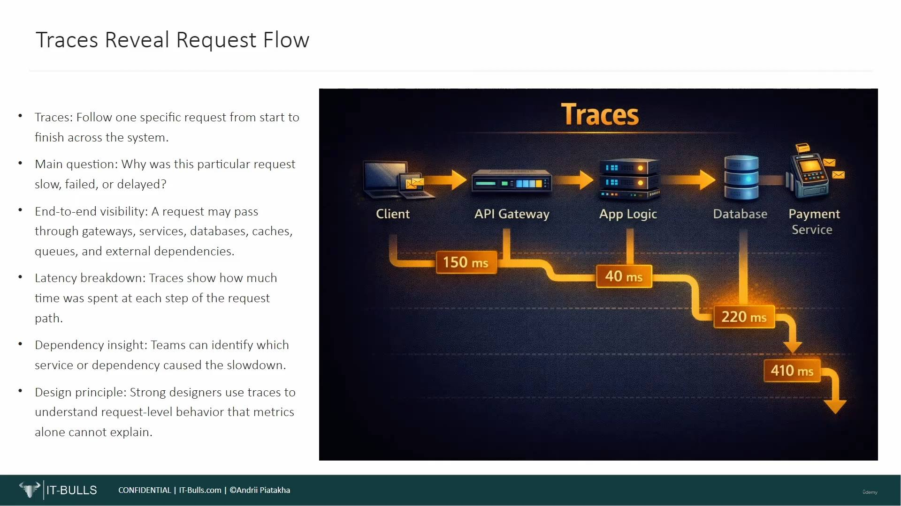
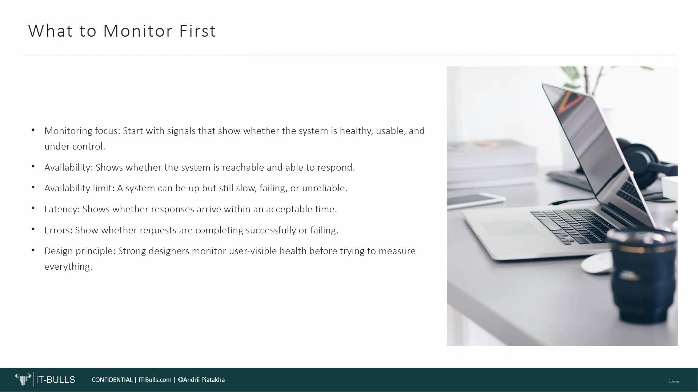
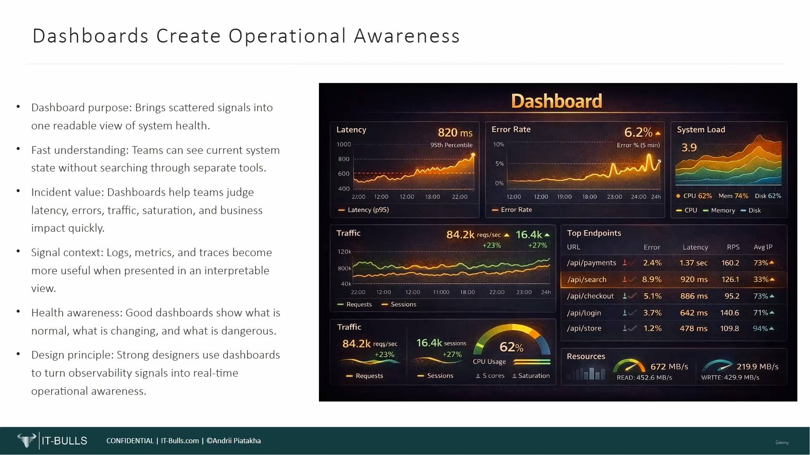
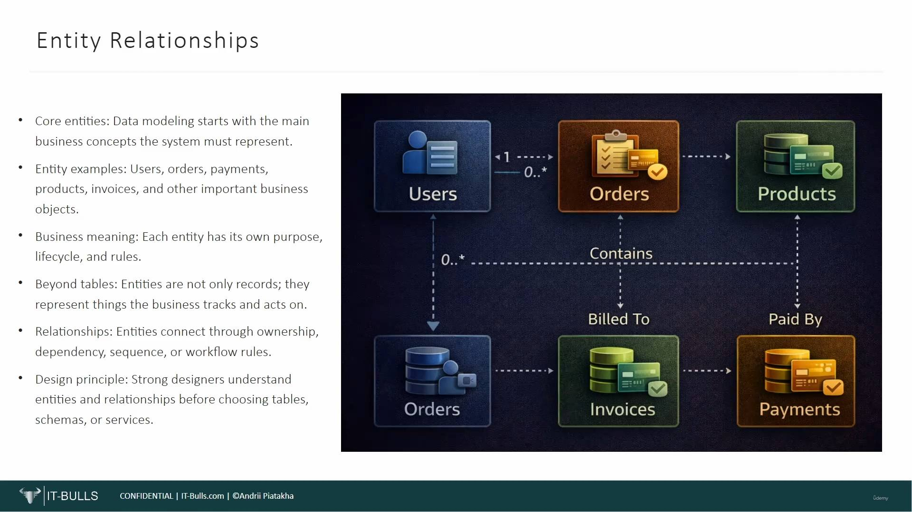
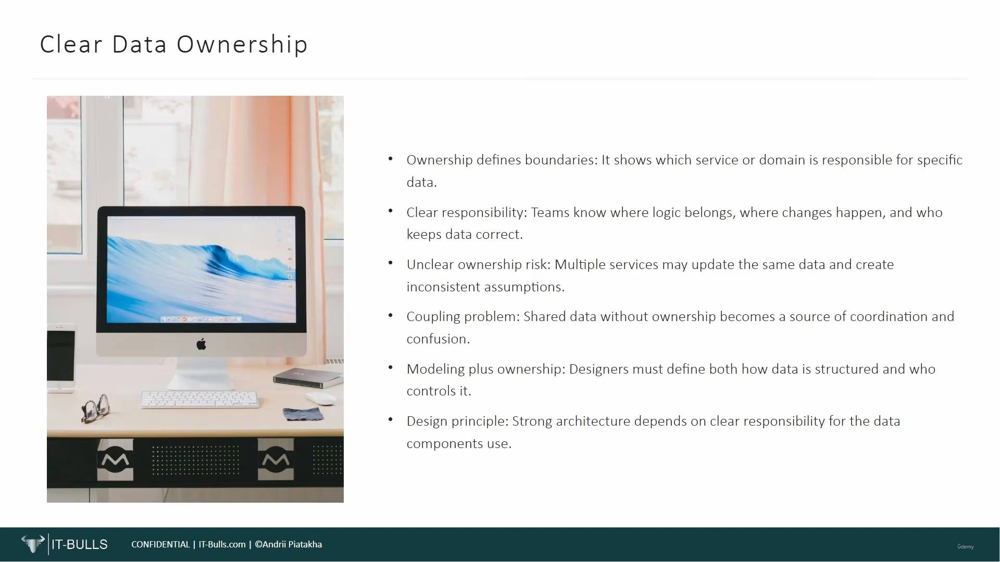
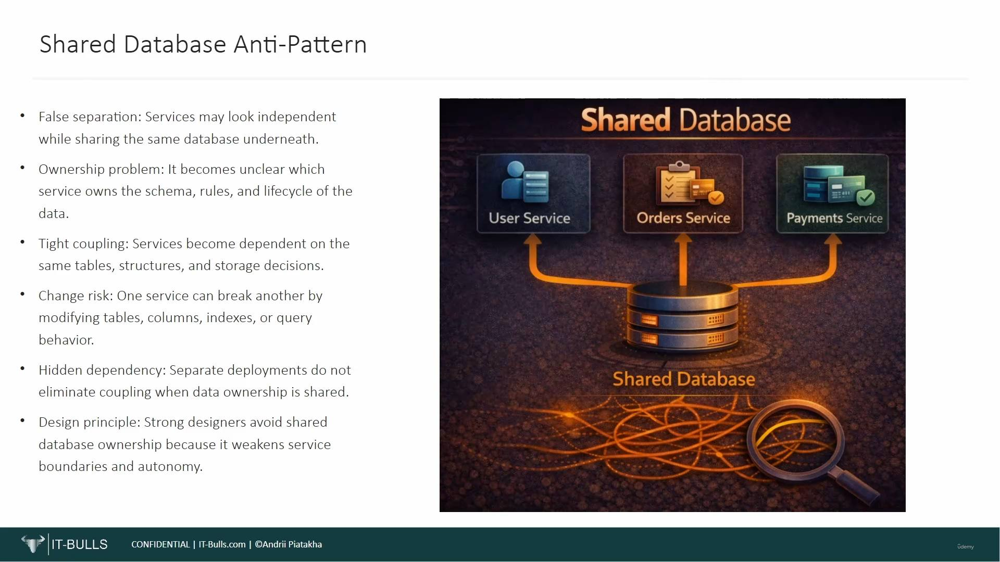
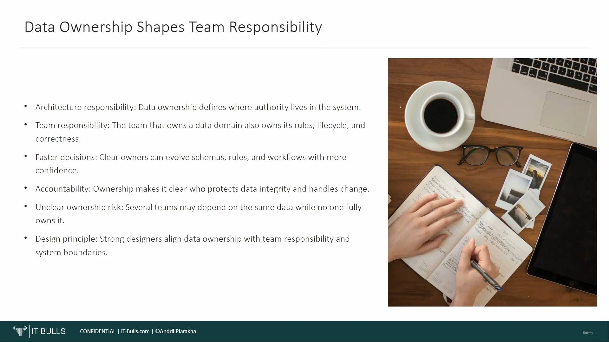

## 1. 这一节做什么

这两讲是纯讲解课，没有可运行代码，也没有指定日志/指标/追踪平台。P22 讲 **observability（可观测性）**：系统在生产环境里必须能通过外部产生的信号被理解，而不仅是“开发时能跑”。P23 讲 **data modeling（数据建模）与 data ownership（数据所有权）**：服务边界不能只看代码盒子，必须看数据属于谁、谁有权写、谁对正确性负责。

因此，这份文档的“复现”不是启动一个仓库，而是把两讲落成一套可评审、可执行的架构底稿：

- 用 logs / metrics / traces 三类信号设计可观测性；
- 先确定要回答的运维问题，再决定采什么；
- 用 availability、latency、errors、saturation、critical business flows 做首屏监控；
- 用 dashboard 把原始 telemetry 变成可判断的 operational awareness；
- 用实体关系草图识别核心实体；
- 给每个数据域指定唯一 owner；
- 审计“多个服务共享同一个数据库”的反模式；
- 用设计决策表记录为什么这样拆、不这样拆会怎样。

课里没有代码，所以下面第 4 节给的是**可直接落盘的完整 Markdown 设计底稿**，不是可执行程序。你可以新建一个目录，把三个文件保存进去，然后用任意 Markdown 编辑器打开评审。依赖版本：无；环境变量：无；启动命令：无。



---

## 2. 讲师原话（带「—— pNNN [MM:SS]」）

> "可观测性是指通过查看系统对外产生的信号，理解其内部正在发生什么的能力。"
> —— p022 [01:19]

这句话定下了整节的基调：可观测性不是“多打日志”，而是从外部信号反推系统内部发生了什么。

> "日志有助于详细说明发生了什么，指标有助于呈现模式和系统健康状况，追踪则有助于沿着完整路径把同一个请求串联起来。"
> —— p022 [05:06]

三类信号不是互相替代，而是回答不同问题。

> "指标呈现模式，追踪呈现路径，日志呈现细节。"
> —— p022 [13:29]

这是最值得记住的一句话。指标看趋势，追踪看路径，日志看细节。

> "可用性是首先要监控的内容之一，因为它回答的是最基础的问题：系统是否可达，并且究竟能否作出响应？"
> —— p022 [14:26]

监控不是一上来就采集一切，而是先回答“系统还活着吗、还能不能用”。

> "仪表盘把分散的信号汇聚到一处，并将其转化为一幅清晰易读的系统健康图景。"
> —— p022 [16:23]

Dashboard 的价值不是好看，而是让团队在事故中快速形成共同判断。

> "遥测数据只有在有助于回答运维问题时才有价值。"
> —— p022 [18:45]

如果采集之前没有明确问题，数据越多越像噪音。

> "系统设计中的数据建模，是指决定系统需要哪些数据、这些数据如何组织，以及不同数据之间如何关联的过程。"
> —— p023 [01:19]

数据建模不是只画表结构，它决定服务怎么交互、工作流怎么设计、以后怎么改。

> "数据所有权回答的是这样一个问题：系统由哪一部分负责某一组数据。"
> —— p023 [02:18]

所有权就是“谁有权创建、更新、校验、暴露这份数据”。

> "如果看屏幕上的图示，就能明白为什么共享数据库会成为一种如此危险的模式。"
> —— p023 [08:00]

多个服务直接读写同一个数据库，表面拆了服务，底层仍然耦合。

> "如果服务应当是相互独立的，那么所有权也应当是相互独立的，尤其是在数据层。"
> —— p023 [09:21]

服务边界和数据边界必须互相支持，否则只是“分布式外表、单体行为”。

> "一个团队只有拥有某项有意义的东西，并且能够在不就每个决策与整个组织反复协商的情况下改变它，才能真正独立推进工作。"
> —— p023 [13:09]

数据所有权不只是技术问题，也决定团队能不能真正自治。

> "系统设计中一个很常见的错误，是把系统拆成多个服务，却没有厘清数据所有权模型。"
> —— p023 [16:27]

这是 P23 的核心反模式：拆了服务，却没拆清楚数据所有权。

---

## 3. 从零复现

### 3.1 复现目标与目录

本课没有可运行项目，所以复现目标是产出一套“架构底稿”。建议目录如下：

```text
system-design-notes/
└── docs/
    ├── observability-plan.md
    ├── data-ownership-map.md
    └── design-decisions.md
```

依赖版本：无。  
环境变量名：无。  
启动命令：无；本课没有可启动程序。用任意 Markdown 编辑器打开三个文件即可评审。  
课里没指定具体工具，所以文档里不绑定任何日志、指标、追踪平台。

先建目录：

```bash
mkdir -p system-design-notes/docs
```

### 3.2 需求：先明确系统要“解释什么”

P22 的需求不是“把所有 telemetry 都收集起来”，而是：

1. 生产环境里系统必须可理解，而不是只在开发环境能跑；
2. 故障发生时，团队要知道问题在哪、为什么发生、下一步做什么；
3. 健康时也要看到趋势、容量压力和弱信号；
4. 分布式请求会经过服务、数据库、缓存、队列、网络，失败可能只在链路某一段；
5. 日志、指标、追踪必须组合使用，不能指望一个信号解释一切。

P23 的需求是：

1. 数据模型要表达真实业务世界，而不是只画表；
2. 每个数据域要有明确 owner，即谁有权创建、更新、校验、暴露；
3. 服务边界要跟数据边界对齐；
4. 避免多个服务共享同一个数据库直接读写；
5. 数据所有权还要落到团队责任上，否则事故时没人真正负责。



### 3.3 约束：为什么不能简单做

课里给出的约束很明确：

- 系统在生产中比图里复杂，请求会跨多个组件；
- 日志如果太吵、太模糊、缺上下文，就不可信、难搜索；
- 指标是聚合信号，能看趋势但不解释根因；
- 追踪能看单请求路径，但不适合替代日志细节；
- 采集过多 telemetry 会让重要信号更难找，dashboard 更乱，告警更吵；
- 共享数据库会让多个服务在 schema、规则、生命周期上纠缠；
- 服务拆开但数据所有权不清，会制造“模块化幻觉”；
- 数据所有权不清还会让团队责任不清，事故处理变慢。



### 3.4 估算：课里没给数字，复现时用可测口径

P22/P23 没有给出具体 QPS、延迟阈值、容量数字，也没有给估算公式。下面公式是复现时使用的通用口径，**不是讲师给出的数字**。所有数值必须用你的实际系统实测填入，不要拍脑袋。

- 错误率 = 失败请求数 ÷ 总请求数 × 100%
- 可用性 = 可响应成功请求数 ÷ 总请求数 × 100%（成功口径按业务定义）
- 饱和度 = 当前使用量 ÷ 上限 × 100%
- p95 延迟 = 95% 请求不超过的耗时，需要从实际请求分布统计
- 关键业务成功率 = 完成关键业务流的请求数 ÷ 发起关键业务流的请求数 × 100%

这些指标分别对应课里说的 availability、latency、errors、saturation、critical business flows。容量估算表放在第 4 节，数字列写“待实测”。



### 3.5 方案：按产物复现，而不是按视频时间流水账

#### 第一步：写“要回答的运维问题”

在 `observability-plan.md` 里先列问题，不要先列工具。例如：

- 用户连不上时，是网络、入口、应用还是依赖？
- 最近 20 分钟延迟升高，是全局还是某条请求路径？
- 错误率上升，是哪个依赖、哪个工作流、哪次部署之后？
- 系统离容量上限还有多远？
- 登录、下单、支付、提交这类关键业务流是否还能完成？

这一步对应 P22 的警告：没有问题的 telemetry 会变成噪音。


#### 第二步：定义 logs / metrics / traces 的职责

在文档里固定职责，避免团队把三类信号混用：

- logs：详细事件记录，回答“具体发生了什么”；
- metrics：聚合信号，回答“整体行为如何、是否在变坏”；
- traces：单请求端到端路径，回答“这个请求为什么慢/坏，时间花在哪”。



#### 第三步：设计首屏监控和 dashboard 布局

首屏不要塞满所有指标。按课里优先级，先放：

1. availability；
2. latency；
3. errors；
4. saturation；
5. critical business flows。

Dashboard 再按“当前状态、趋势、异常、业务影响”分区。课里强调 dashboard 不是装饰，而是让工程师、运维、产品相关方看同一张图，形成共享理解。



#### 第四步：画核心实体和关系草图

P23 说数据建模从业务真正关心的核心事物开始，例如 users、orders、payments、products、invoices。先不要急着画表或拆服务，先写：

- 核心实体是什么；
- 每个实体的业务含义、生命周期、规则；
- 实体之间有什么连接；
- 哪些实体在业务含义上紧密相关、经常一起变化。

课里明确举例：一个 user 可以有多个 orders。其他如 order 与 payment、product、invoice 的具体基数，课里没给，需要按业务确认。



#### 第五步：给每个数据域指定唯一 owner

在 `data-ownership-map.md` 里写清楚：

- 哪个服务/边界拥有哪份数据；
- 谁是 source of truth；
- 谁可以创建、更新、校验；
- 其他服务只能通过 owner 暴露的接口访问，不能直接改库；
- 生命周期事件由谁负责；
- 事故时哪个团队负责解释和修复。

课里举例：一个服务拥有 customer profiles，另一个拥有 orders，另一个拥有 payments。每个服务对自己数据是 source of truth。



#### 第六步：审计共享数据库反模式

检查是否存在：

- 多个服务直接读写同一张表；
- 多个服务都能改同一份 schema；
- 一个服务改列，另一个服务静默受影响；
- 业务规则在多个服务里重复实现；
- 表面拆服务，底层仍共享同一个数据库模型。

课里说得很直接：共享数据库会让服务边界只停留在表面，底层仍然紧耦合。如果服务要分开，数据层所有权也要分开。



#### 第七步：把数据所有权和团队责任对齐

数据所有权不是只写在架构图里。课里指出，它会影响团队自治、决策速度和事故责任。一个团队拥有一个有意义的边界，才能独立改规则、改 schema、做决策；否则每个小改动都要跨团队协调。



#### 第八步：写设计决策记录

最后把关键取舍写进 `design-decisions.md`：

- 为什么三类信号一起用；
- 为什么先监控五项；
- 为什么 dashboard 按 operational question 排；
- 为什么每个数据域只能有一个 owner；
- 为什么禁止多服务直接共享写库；
- 为什么服务拆分必须同步拆数据所有权；
- 为什么不用“先拆服务、数据以后再说”。

### 3.6 取舍：这样做的代价

- 只做 metrics 不够，因为 metrics 不解释根因；
- 只做 logs 不够，因为 logs 不擅长看整体趋势；
- 只做 traces 不够，因为 traces 只跟单请求，不替代事件细节；
- 采集越多不一定越清楚，可能让重要信号被淹没；
- 给每个数据域指定 owner 会增加前期设计成本，但减少后期协调成本；
- 禁止共享数据库会让跨边界访问变复杂，需要 owner 暴露受控接口；
- 服务拆得越多不等于越自治，数据所有权不清时拆得越多越乱。

---

## 4. 完整代码

课里没有代码；以下不是可执行程序，而是可直接保存的完整 Markdown 设计底稿，可视为本课要产出的“代码”。保存到第 3.1 节目的目录即可。

### 4.1 `docs/observability-plan.md`

```markdown
# 可观测性落地计划

> 来源：System Design for Developers P22。课里没有代码；本文件是设计底稿。
> 本文件不绑定具体日志/指标/追踪平台，工具选型课里没讲。

## 1. 先写要回答的运维问题

| 场景 | 要回答的问题 | 主要信号 | 成功判据 |
|---|---|---|---|
| 用户连不上 | 系统是否可达、是否能响应 | availability、metrics | 能判断是入口、应用还是依赖问题 |
| 延迟升高 | 是全局变慢，还是某条请求路径变慢 | metrics、traces | 能定位到具体路径/依赖 |
| 错误率上升 | 哪个依赖、工作流、部署之后开始出错 | metrics、logs、traces | 能定位到错误事件和上下文 |
| 容量压力 | 系统离上限还有多远 | saturation | 能在完全宕机前看到趋势 |
| 关键业务失败 | 登录、下单、支付、提交是否还能完成 | business flows、logs、traces | 能把技术信号连到业务影响 |

## 2. 三类信号职责

| 信号 | 回答的问题 | 最小内容 | 不负责什么 |
|---|---|---|---|
| Logs | 具体发生了什么 | 错误消息、请求 payload、状态变化、警告、request ID、时间戳、用户标识、依赖响应 | 不负责看全局趋势 |
| Metrics | 整体行为如何 | 请求率、延迟、错误数、CPU、内存压力、队列深度、数据库吞吐 | 不负责解释单条错误根因 |
| Traces | 这个请求为什么慢/坏 | 单请求经过的服务、数据库、依赖、每一步耗时 | 不负责记录所有事件细节 |

## 3. 首批监控信号

| 信号 | 定义 | 用途 | 备注 |
|---|---|---|---|
| Availability | 系统是否可达并能响应 | 最基本健康判断 | 只有可用不够，还要看慢和错 |
| Latency | 响应是否在可接受时间内 | 发现变慢和局部延迟 | 用 p95 等分布口径，具体口径待团队定 |
| Errors | 请求是否成功 | 发现失败和依赖异常 | 需要结合 logs/traces 定位 |
| Saturation | 离资源上限多近 | 提前发现容量压力 | CPU、内存、连接池、队列、线程、存储等 |
| Critical business flows | 登录、下单、支付、提交等关键流是否完成 | 把技术信号连到产品价值 | 不能只看服务器存活 |

## 4. 日志字段草案

| 字段 | 用途 | 是否必填 | 备注 |
|---|---|---|---|
| timestamp | 定位事件发生时间 | 是 | 课里提到时间戳 |
| request ID | 把一次请求相关事件串起来 | 是 | 课里提到 request IDs |
| user identifier | 定位受影响用户范围 | 按业务 | 注意隐私脱敏，课里没讲脱敏 |
| event / message | 说明发生了什么 | 是 | 错误、警告、状态变化 |
| component | 定位哪个组件产生事件 | 是 | 课里提到 affected component |
| error detail | 记录错误消息 | 出错时 | 课里提到实际错误消息 |
| payload detail | 记录输入/状态上下文 | 按业务 | 课里提到 payload details |
| dependency response | 记录依赖返回 | 按业务 | 课里提到 dependency responses |

## 5. Dashboard 布局

| 区域 | 内容 | 目的 |
|---|---|---|
| 顶部健康 | availability、当前错误率、当前流量 | 一眼判断系统是否可用 |
| 趋势区 | latency、error rate、traffic 随时间变化 | 看是否在变坏 |
| 饱和度 | CPU、内存、连接池、队列深度、存储压力 | 看是否接近上限 |
| 业务流 | 登录、下单、支付、提交成功率 | 看技术问题是否影响业务 |
| 下钻入口 | 按服务/依赖/路径查看 traces 和 logs | 从趋势进入路径和细节 |

## 6. 容量/健康估算表

> 课里没给具体数字和公式；以下为复现口径，数字必须实测填入。

| 指标 | 公式/口径 | 当前值 | 阈值 | 备注 |
|---|---|---|---|---|
| 错误率 | 失败请求数 ÷ 总请求数 × 100% | 待实测 | 待定 | 阈值课里没讲 |
| 可用性 | 可响应成功请求数 ÷ 总请求数 × 100% | 待实测 | 待定 | 成功口径按业务定 |
| 饱和度 | 当前使用量 ÷ 上限 × 100% | 待实测 | 待定 | 分资源分别统计 |
| p95 延迟 | 95% 请求不超过的耗时 | 待实测 | 待定 | 需要实际分布 |
| 关键业务成功率 | 完成关键流请求数 ÷ 发起关键流请求数 × 100% | 待实测 | 待定 | 按业务流分别统计 |

## 7. 反模式检查

- [ ] 是否在没列运维问题前就开始采集大量 telemetry？
- [ ] 是否有人把 metrics 当成根因解释？
- [ ] 是否有人把 logs 当成全局趋势工具？
- [ ] 是否有人把 traces 当成完整事件记录？
- [ ] Dashboard 是否只是数字堆砌，没有正常/变化/危险提示？
- [ ] 告警是否过多，导致重要信号被淹没？
- [ ] 日志是否缺少 request ID、时间戳、组件、错误上下文？
- [ ] 是否只监控机器，不监控关键业务流？
```

### 4.2 `docs/data-ownership-map.md`

```markdown
# 数据所有权地图

> 来源：System Design for Developers P23。课里没有代码；本文件是设计底稿。
> 实体和关系按课中举例起草；具体字段、基数、生命周期需按业务确认，课里没给。

## 1. 核心实体与所有者

| 实体/数据域 | 业务含义 | 所属边界（示例） | 唯一写入者 | 其他服务读取方式 | 生命周期事件 |
|---|---|---|---|---|---|
| Customer Profile | 用户/客户资料 | Customer Service | Customer Service | 通过所有者接口 | 创建、更新、停用 |
| Order | 订单 | Order Service | Order Service | 通过所有者接口 | 创建、取消、完成 |
| Payment | 支付 | Payment Service | Payment Service | 通过所有者接口 | 发起、成功、失败、退款 |
| Product | 商品 | Catalog Service | Catalog Service | 通过所有者接口 | 上架、下架、变更 |
| Invoice | 发票 | 按业务确认 | 按业务确认 | 通过所有者接口 | 开具、作废、重开 |

> 课里明确举例：一个用户可以有多个订单；customer profiles、orders、payments 可以由不同服务拥有。其他实体关系课里没给具体基数。

## 2. 实体关系草案

- User 1:N Order：课里明确举例“one user having many orders”。
- Order 与 Payment：一笔订单可能对应一次或多次支付/退款；具体基数课里没讲，需按业务确认。
- Order 与 Product：订单中如何引用商品、是否保存快照，课里没讲，需按业务确认。
- Invoice 与 Order/Payment：发票由订单还是支付触发、何时开具，课里没讲，需按业务确认。

## 3. 组件职责表

| 组件/边界 | 负责 | 不负责 |
|---|---|---|
| Customer Service | 客户资料创建、更新、校验、暴露 | 不直接改订单、支付数据 |
| Order Service | 订单规则、状态、生命周期 | 不直接改客户资料、支付记录 |
| Payment Service | 支付规则、支付状态、支付记录 | 不直接改订单、客户资料 |
| Catalog Service | 商品数据、上下架规则 | 不直接改订单、支付 |
| 外部消费者 | 通过 owner 暴露的接口读取所需数据 | 不直接写 owner 的数据库 |

## 4. 共享数据库反模式审计

| 检查项 | 是/否 | 证据 | 处理 |
|---|---|---|---|
| 是否有多个服务直接读写同一张表 | 待查 | 列出表和服务 | 指定唯一 owner，其他服务改走接口 |
| 是否有多个服务都能改同一份 schema | 待查 | 列出迁移脚本归属 | schema 变更权收归 owner |
| 是否一个服务改列导致另一个服务静默受影响 | 待查 | 查隐藏依赖 | 暴露受控接口，禁止直接依赖内部结构 |
| 业务规则是否在多个服务重复实现 | 待查 | 列出重复校验 | 规则收归数据 owner |
| 事故时是否不清楚谁负责这份数据 | 待查 | 列出数据域和团队 | 建立 owner/故障联系人表 |

## 5. 团队责任表

| 数据域 | Owner team | 决策权 | 故障联系人 | 备注 |
|---|---|---|---|---|
| Customer Profile | 待填 | schema、校验、生命周期 | 待填 | 必须唯一 |
| Order | 待填 | 订单规则、状态机 | 待填 | 必须唯一 |
| Payment | 待填 | 支付规则、支付状态 | 待填 | 必须唯一 |
| Product | 待填 | 商品规则 | 待填 | 必须唯一 |
| Invoice | 待填 | 开票规则 | 待填 | 必须唯一 |

## 6. 访问规则

1. 每个数据域只有一个 owner。
2. owner 是该数据的 source of truth。
3. 其他服务不得直接写 owner 的数据库。
4. 其他服务读取数据时，通过 owner 暴露的接口。
5. 跨边界工作流如果必须协调多个 owner，要显式设计异步/集成/一致性方案；课里没给具体实现。
6. 事故时由 owner team 解释数据规则和修复方案。
```

### 4.3 `docs/design-decisions.md`

```markdown
# 设计决策记录

| ID | 决策 | 理由 | 放弃的方案 | 代价/后续 |
|---|---|---|---|---|
| D1 | logs、metrics、traces 一起用 | 三者回答不同问题：细节、趋势、路径 | 只靠一种信号解释一切 | 需要团队统一职责，避免混用 |
| D2 | 先监控 availability、latency、errors、saturation、critical business flows | 这五项最早反映健康、可用、容量和业务影响 | 一上来采集所有 telemetry | 需要后续按问题扩展 |
| D3 | Dashboard 按运维问题组织 | 事故中需要快速形成共同判断 | 只堆数字和漂亮图 | 需要定期评审布局 |
| D4 | 每个数据域指定唯一 owner | 明确 source of truth、校验权和生命周期 | 多服务共同负责同一份数据 | 前期设计成本增加 |
| D5 | 禁止多个服务直接共享写同一个数据库 | 避免表面拆服务、底层强耦合 | 多服务直接读写同库 | 跨边界访问要经过接口 |
| D6 | 服务边界与数据边界一起设计 | 数据模型会影响服务边界、工作流和系统行为 | 先拆服务，数据以后再说 | 需要先做实体关系草图 |
| D7 | 数据所有权同时落到团队责任 | 事故时要知道谁解释、谁修复、谁决策 | 只画架构图，不落团队 | 需要组织层面确认 owner |
| D8 | 采集前先写要回答的问题 | telemetry 只有回答问题才有用 | 因为存储便宜就全收 | 需要持续清理噪音 |
```

---

## 5. 逐行解释

### 5.1 为什么先写“要回答的问题”，而不是先选工具

`observability-plan.md` 第 1 张表先列“场景、问题、主要信号、成功判据”。这是 P22 的核心顺序：先知道系统要解释什么，再决定采什么。课里说得很清楚，telemetry 只有在帮助回答运维问题时才有用；如果先采一大堆，最后会出现重要信号找不到、dashboard 变乱、告警变吵的问题。

在 JS/Node 项目里，这对应一个很常见的坑：一上来给每个函数加日志、给每个请求打点，结果事故时没人知道看哪一条。正确顺序是先写“用户连不上时我要看什么”“支付失败时我要看什么”，再决定 logs/metrics/traces 各自承担什么。

### 5.2 为什么 logs 要带 request ID、时间戳、组件、错误上下文

课里说 logs 是 detailed event records，记录错误消息、请求

## 6. 复现检查清单

- [ ] **目录和底稿文件已落盘**：验证 `system-design-notes/docs/` 下是否存在 `observability-plan.md`、`data-ownership-map.md`、`design-decisions.md`；应看到三个 Markdown 文件均可打开，内容分别对应第 4.1、4.2、4.3 节。
- [ ] **没有误找可运行程序**：验证目录中是否出现依赖文件、启动脚本或环境变量说明；应看到没有 `package.json`、启动命令、依赖版本、环境变量，因为课里没有可运行代码。
- [ ] **可观测性计划先写运维问题**：打开 `observability-plan.md`，验证第 1 节是否为“要回答的运维问题”表；应看到“场景 / 要回答的问题 / 主要信号 / 成功判据”四列，而不是先列工具。
- [ ] **三类信号职责没有混用**：验证第 2 节是否分别说明 Logs、Metrics、Traces 回答的问题、最小内容、不负责什么；应看到“趋势、路径、细节”职责区分清楚。
- [ ] **首批监控信号覆盖五项**：验证第 3 节是否包含 Availability、Latency、Errors、Saturation、Critical business flows；应看到每项都有定义、用途和备注，而不是只监控机器存活。
- [ ] **日志字段包含调查所需上下文**：验证第 4 节是否列出 timestamp、request ID、event/message、component、error detail 等字段；应看到 `user identifier` 旁标注按业务和隐私脱敏待确认，且脱敏细节没有被写成课里已讲内容。
- [ ] **Dashboard 按运维判断组织**：验证第 5 节是否有顶部健康、趋势区、饱和度、业务流、下钻入口；应看到布局目的是快速判断系统健康，而不是只堆数字。
- [ ] **容量/健康估算没有拍脑袋填数**：验证第 6 节公式是否符合第 3.4 节口径；应看到错误率、可用性、饱和度、p95 延迟、关键业务成功率的当前值和阈值仍为“待实测/待定”，或明确标注实测来源。
- [ ] **可观测性反模式检查存在且未伪装成已通过**：验证第 7 节是否为 `- [ ]` 检查项；应看到采集前问题、metrics 当根因、logs 当趋势、traces 当完整事件记录、告警噪音等检查项仍待逐条确认。
- [ ] **核心实体有唯一写入者**：打开 `data-ownership-map.md`，验证第 1 节每个实体/数据域是否有“唯一写入者”和“其他服务读取方式”；应看到其他服务通过所有者接口读取，而不是直接写库。
- [ ] **实体关系没有臆造基数**：验证第 2 节是否明确写出 User 1:N Order；应看到 Order 与 Payment、Order 与 Product、Invoice 与 Order/Payment 的具体基数标注为课里没讲、需按业务确认。
- [ ] **共享数据库反模式审计保留证据列**：验证第 4 节是否有“检查项 / 是/否 / 证据 / 处理”；应看到“是/否”为待查或基于证据填写，不能在没有表和服务清单时直接填“否”。
- [ ] **团队责任表没有编造团队名**：验证第 5 节 Owner team、故障联系人是否仍为待填或明确组织确认；应看到备注强调必须唯一，而不是虚构具体团队。
- [ ] **访问规则与数据所有权一致**：验证第 6 节是否包含唯一 owner、owner 是 source of truth、其他服务不得直接写库、通过 owner 接口读取、跨边界方案待设计；应看到跨边界一致性实现标注为课里没给具体实现。
- [ ] **设计决策记录覆盖关键取舍**：验证 `design-decisions.md` 是否包含 D1-D8；应看到每条都有决策、理由、放弃方案、代价/后续，且没有把课里没讲的工具选型或数字写成已确定结论。
- [ ] **补充内容标注清楚**：全局搜索“课里没讲”“待实测”“待确认”“待查”“补充”；应看到工具选型、具体阈值、实体具体基数、团队名、脱敏策略等没有被伪装成讲师原话或课程给定事实。

## 7. 课里没讲但你会撞上的

| 现象 | 原因 | 怎么办 |
|---|---|---|
| 按普通代码课去找安装依赖和启动命令，结果找不到入口 | 课里没讲（补充）：本课没有可运行代码、没有依赖版本、没有环境变量、没有启动命令，复现产物是 Markdown 设计底稿 | 只创建 `system-design-notes/docs/` 并保存三个 Markdown 文件，用 Markdown 编辑器评审 |
| 想先选日志、指标、追踪平台，再开始写文档 | 课里没讲（补充）：课里没有指定具体日志/指标/追踪平台，也没有工具选型 | 先写“要回答的运维问题”和三类信号职责，文档中不绑定平台 |
| 给 Order 与 Payment、Order 与 Product、Invoice 等关系填了具体基数 | 课里没讲（补充）：课里只明确举例“one user having many orders”，其他实体关系的基数、生命周期没给 | 保留“课里没讲，需按业务确认”，不要臆造 1:1、1:N 等具体基数 |
| 给 Payment、Invoice 等数据域直接填了 owner team 和故障联系人 | 课里没讲（补充）：课里讲了唯一 owner 原则，但没有给实际组织团队、责任人和故障联系人 | Owner team、故障联系人写“待填/待组织确认”，只确认“必须唯一”的原则 |
| 容量/健康估算表被填上具体 QPS、延迟阈值、错误率阈值 | 课里没讲（补充）：课里没给具体数字、阈值或容量估算公式；文档中的公式只是复现口径 | 当前值、阈值写“待实测/待定”，并注明数据来源；没有实测不要填数字 |
| 共享数据库审计表的“是/否”直接填成结论 | 课里没讲（补充）：课里讲共享数据库反模式，但没有给具体系统的表、服务、迁移脚本证据 | 先保留“待查”，列出涉及的表和服务、schema 迁移归属，再依据证据填写 |
| 想给日志里的 user identifier 写具体脱敏规则或合规策略 | 课里没讲（补充）：课里提到日志可含 user identifier 等上下文，但没有讲隐私脱敏和合规细节 | 在备注写“课里没讲，待安全/合规确认”，不要写具体脱敏算法或合规结论 |
| 把 dashboard 布局写成具体图表工具、查询语句或可视化实现 | 课里没讲（补充）：课里没有给 dashboard 工具、查询语言、图表实现 | 只写布局区域和目的，按可用性、延迟、错误、饱和度、关键业务流组织 |
| 文档里出现“已确认”“已通过”，但证据列还是待查 | 课里没讲（补充）：课里没有提供真实系统的审计证据，复现只产出底稿 | 把结论改成“待查/待确认”，补齐证据后再改状态 |
| 把补充的估算口径、待确认实体关系误当成讲师原话 | 课里没讲（补充）：课里没有给具体数字、团队名、实体基数、工具选型 | 在相关段落显式标注“课里没讲”“补充”“待实测”“待业务确认”，避免混合来源 |
