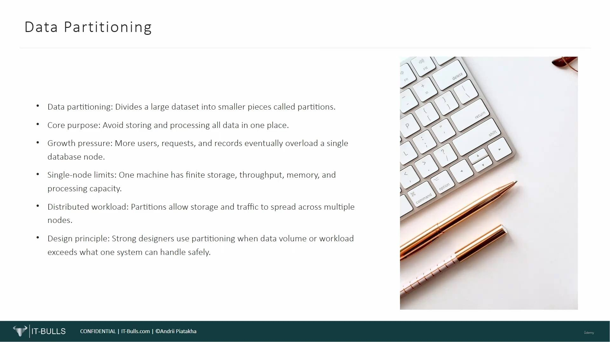
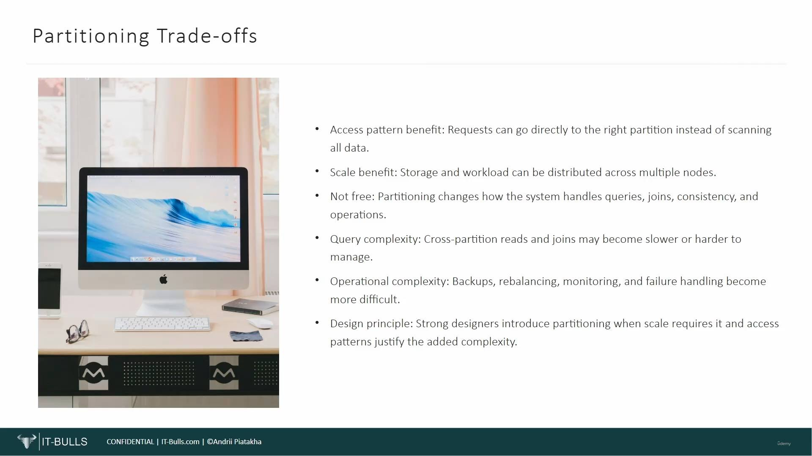
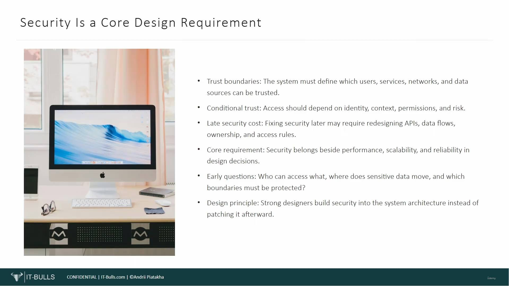
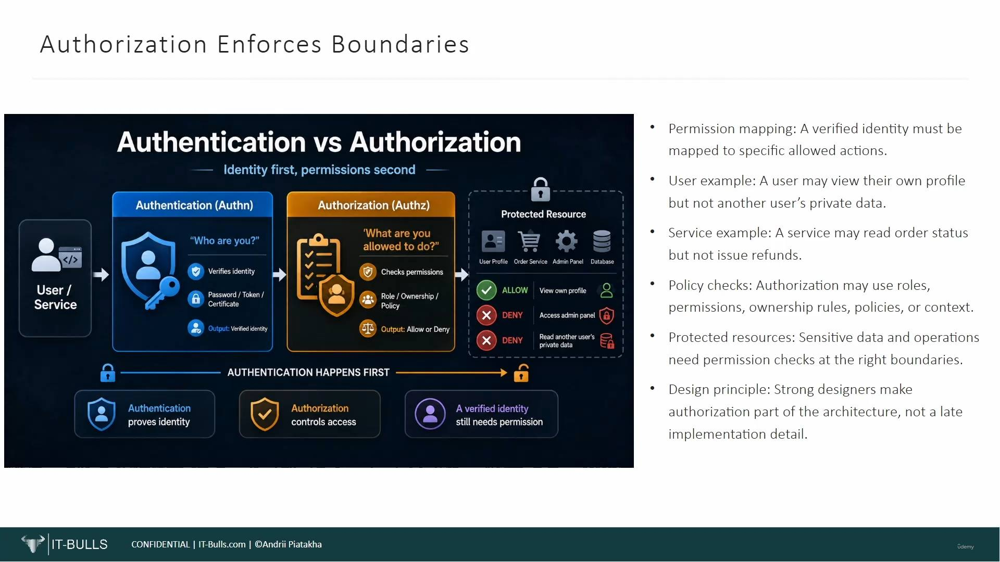
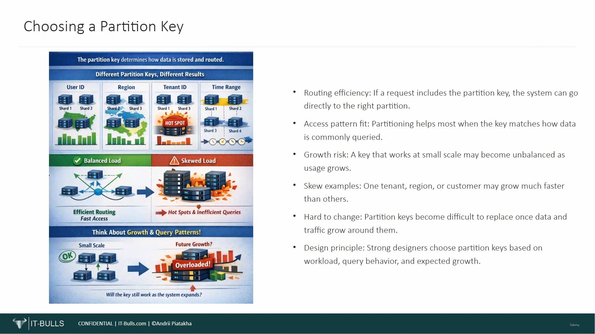
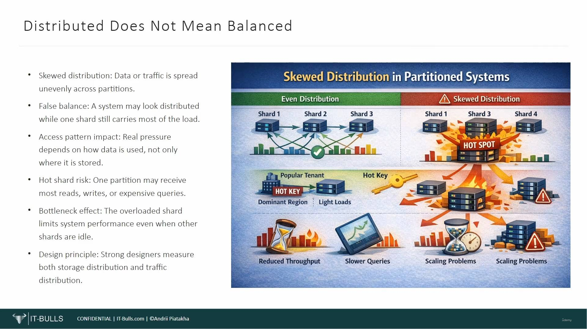
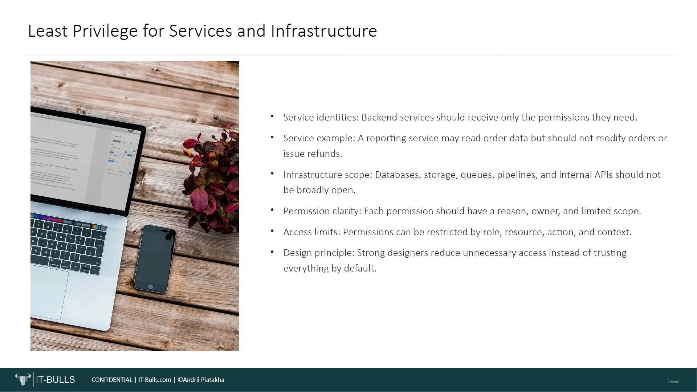
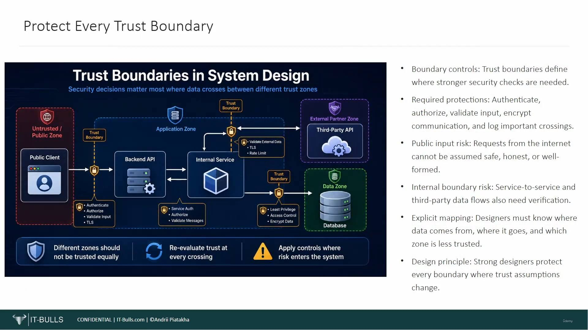
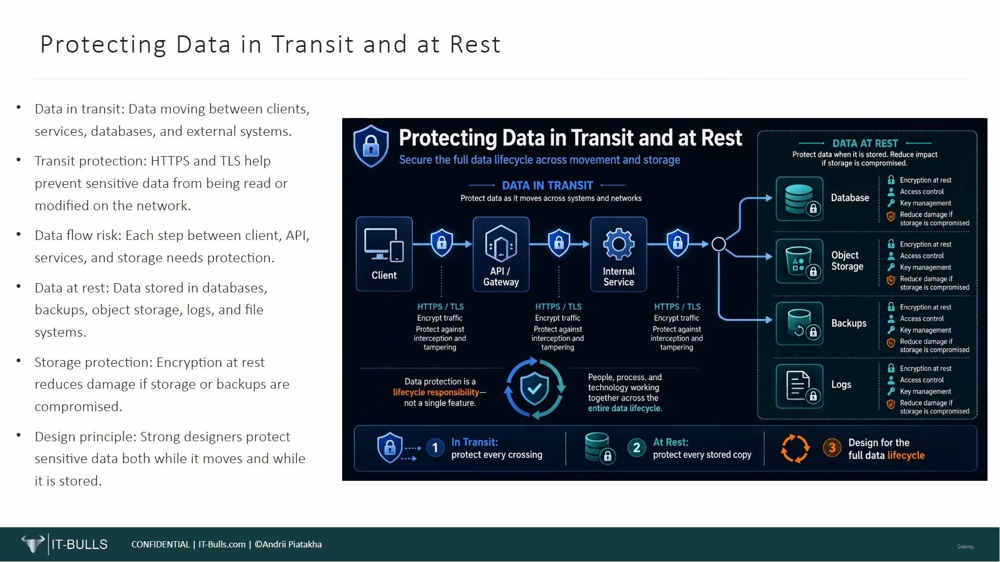
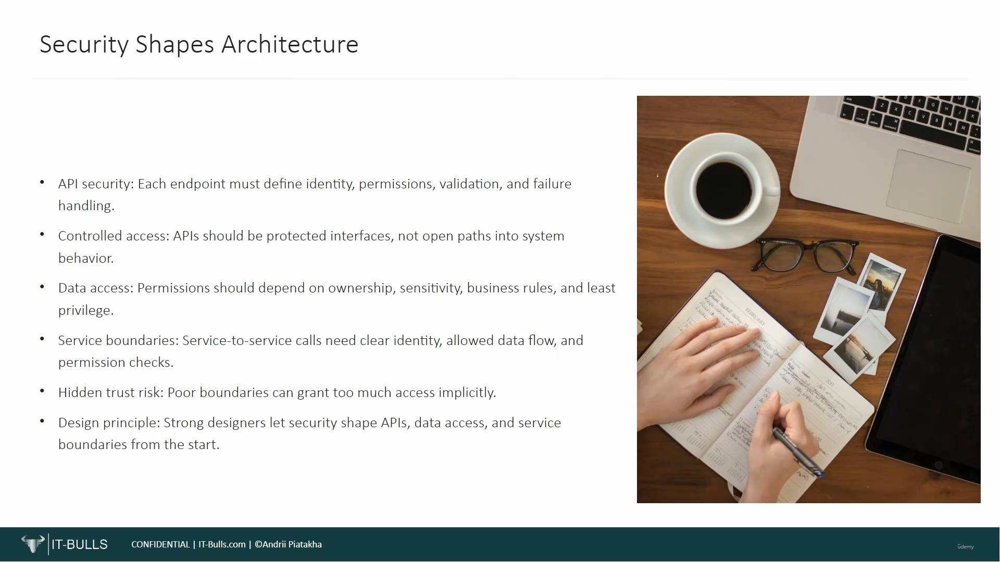

# System Design for Developers｜P24 数据分区与分发 · P25 安全基础

> 适配课程：BV1td4w6oEmH，覆盖 P024–P025
> 这两节是**纯讲解课**：讲师全程在白板/PPT 上推导概念，**没有写任何代码、没有敲任何命令、没有给出任何具体数字**。因此本文的"从零复现"复现的是**讲师的推导过程与决策顺序**；"完整代码"一节给出的是把讲师的概念落成可核对产物的**设计表 + 可运行示意脚本**，每处示意都明确标注。

---

## 1. 这一节做什么

这两节课合起来要回答一个问题：**当你把系统从"一台机器上的一个库"推到"多台机器上的多个库"时，哪些东西会变？**

P024 讲的是**数据的横向拆分**：数据多了装不下、请求多了扛不住，就要把数据切开放到不同地方。讲师反复强调的一句话是：分区不是"免费升级"，它会同时改变**一致性、查询模式、运维复杂度**。P025 讲的是**访问的横向约束**：数据分开了，谁能碰哪一块、在哪个边界上必须重新验证、数据在传输和静态存储时怎么保护。

两节课的共同方法论是一致的，也是我这份文档要帮你落地的核心：

> **先看真实工作负载（workload / access pattern），再选方案；不要先选方案，再假设负载会配合。**

本篇文档交付两个可归档的产物（纯文本/Markdown，可以放进你项目的 `docs/` 里直接提交）：

1. `partition-design.md` + `partition-key-matrix.md`——数据分布决策书；
2. `security-design.md` + `trust-boundaries.md` + `authz-matrix.md`——安全边界与权限矩阵。

外加两个可以 `node` 直接跑的实验脚本，用来把"偏斜分布"和"最小权限"从形容词变成数字。

建议的目录结构：

```
system-design/
├── 24-partitioning/
│   ├── partition-design.md      # 你手写的决策书（第 3 节产出）
│   ├── partition-key-matrix.md  # 分区键候选评估表（第 4 节模板）
│   └── route-demo.mjs           # 示意脚本：分区路由 + 偏斜演示
└── 25-security/
    ├── security-design.md       # 你手写的安全设计书（第 3 节产出）
    ├── trust-boundaries.md      # 信任边界清单
    ├── authz-matrix.md          # 身份 × 动作 × 资源 权限矩阵
    └── authz-demo.mjs           # 示意脚本：认证→授权→最小权限
```

运行环境：**Node 18 及以上**。两个脚本只用 Node 内置能力，零第三方依赖，不需要 `npm install`。

---

## 2. 讲师原话

下面按主题摘录，中英对照。英文是讲师原句，中文是我的转述，不是直译。

**关于分区是什么**

> "数据分区是指把大型数据集拆分成更小的部分，这样系统就不必在一个地方保存和处理所有数据。"
> —— p024 [01:25]

讲师紧接着给了一个很重要的定性：单个节点迟早会在**存储**或**吞吐**其中一项上成为限制。

> "然而，随着用户数、请求数和记录数不断增加，单台机器最终会在存储、吞吐量或这两方面成为瓶颈。"
> —— p024 [01:53]

**关于 partitioning 和 sharding 的区别**

这是 P024 里最容易被含糊过去、但讲师专门澄清的一点：

> "所以，简单来说，每个分片都是一个分区，但并非每个分区都一定是分片。"
> —— p024 [03:44]

即：partitioning 是"把数据切成块"这个更大的概念；sharding 通常指这些块被放到**不同的物理节点/实例**上。讲师说，逻辑分区可能只改善组织和查询行为，改动不大；而 sharding 会额外引入路由、再平衡、跨分片查询和运维复杂度。

**关于分区键**

> "分区键是系统用来决定一条数据应存放位置的取值。换句话说，它是一条规则，把每条记录映射到特定的分区或分片。"
> —— p024 [07:29]

讲师举的候选键：user ID、region、tenant ID、time range。并强调**这些键产生的流量形态完全不同**。

**关于分区之后会坏在哪**

> "一个常见问题是热分区。当过多流量、过多行程或过多重要数据集中到一个分区，而其他分区使用率很低时，就会出现这种情况。"
> —— p024 [09:51]

（"too many rides" 应为口误/转写误差，语义是"读写"。）

以及分布≠均衡：

> "看屏幕上的图示就能发现，仅有分布本身并不能保证均衡。"
> —— p024 [11:15]

**关于最常见的错误**

> "分区系统中一个非常常见的错误，是过早且过于随意地选择分区键。"
> —— p024 [15:24]

讲师给的替代做法是：把分区键选择当成**工作负载决策**，而不是**表结构决策**。

**关于安全为什么必须前置**

> "安全必须被视为一项设计输入，因为它从一开始就会影响系统的结构。"
> —— p025 [01:28]

讲师点名了三个"后期很难补"的架构级后果：服务边界不清 → 授权变难；数据归属不清 → 访问控制混乱；敏感数据流过太多组件 → 攻击面变大。

**关于认证与授权的分工**

> "身份认证回答的是“你是谁？”，而授权回答的是“你允许访问或修改什么？”"
> —— p025 [05:47]

**关于信任边界**

> "信任边界是数据请求或控制从一个安全上下文转移到另一个安全上下文的交界点。"
> —— p025 [09:33]

**关于把安全当清单**

> "把安全当成检查清单，就意味着把它视为开发后期需要逐项打勾的一组条目。"
> —— p025 [15:18]

讲师的态度是：清单有用（保证一致性、避免低级遗漏），但**不能替代设计**。

---

## 3. 从零复现

本节把两节课的推导过程拆成你可执行的步骤。每步都给出**你要写下来的东西**，因为这两节课的产物是文档，不是程序。

### 3.1 P024：数据分区设计（五步）

#### 第 1 步：需求——先把"谁访问什么"写下来

讲师在 [02:21] 说："大型系统很少以同等方式访问所有数据"，在 [06:04] 说路由命中就能避开"同一个存储引擎、同一个硬件瓶颈"。所以在选键之前，你必须先列出**真实的访问路径**。写一张表：

| 访问路径 | 由谁发起 | 频率（你自己的真实值） | 是否带"实体 ID" | 是否需要聚合 |
|---|---|---|---|---|
| 用户查自己的主页 | 终端用户 | ______ | 是（userId） | 否 |
| 运营看某租户全部订单 | 内部后台 | ______ | 是（tenantId） | 否 |
| 业务方跑月度营收报表 | 外部集成 | ______ | 否 | 是（跨全域） |
| 风控按时间窗扫最近 1 小时事件 | 内部服务 | ______ | 否（时间） | 是 |

**注意**：频率列我留空了。逐字稿里讲师**没有给出任何 QPS、数据量、分区数**，我不替你编。你必须用自己的真实观测值填。

#### 第 2 步：约束——单节点的上限在哪

讲师在 [05:08] 说单节点有物理极限：能存的数据量、能处理的读写量、能承受的流量。你要把这三项具体化：

| 约束项 | 当前单节点实测值 | 距离上限的余量 | 触顶预计时间 |
|---|---|---|---|
| 数据总盘 | ______ | ______ | ______ |
| 峰值写 TPS | ______ | ______ | ______ |
| 峰值读 QPS | ______ | ______ | ______ |
| 全量备份耗时 | ______ | ______ | ______ |

讲师在 [06:31] 特别提到"太大而无法在一处高效备份、恢复、维护"——所以**备份耗时**这一行不要漏。

#### 第 3 步：估算——写出算式（课里没给算式，以下是通用口径）

> ⚠️ **重要声明**：P024 **没有出现任何容量估算、分区数计算或公式**。下面三行算式是我按通用工程口径补的，**不是讲师原话**，请当成"你需要自己填的模板"。

```
需要的分区数 ≈ ceil( 数据总量 / 单分区目标容量 )
需要的写分片数 ≈ ceil( 峰值写 TPS / 单节点可承受写 TPS )
需要的读分片数 ≈ ceil( 峰值读 QPS / 单节点可承受读 QPS )
最终分片数 = max(上面三者)      # 取瓶颈那一项
```

代入你自己的数，得到 `N = ____`。把 `N` 写进文档。

#### 第 4 步：方案——候选分区键逐个评估

讲师在 [07:57] 给的候选是 user ID / region / tenant ID / time range。把它们填进第 4 节的 `partition-key-matrix.md`，四个候选都打一遍分。评分维度直接来自讲师的原话：

- 是否**均分数据**（[07:57] "spreads data"）
- 是否**均分流量**（[09:51] 热点分区）
- 是否**能直接路由**（[08:26] "如果请求包含键，系统通常可以直接定位到正确的分区"）
- 是否**支撑未来增长**（[08:53] "某个租户、某个区域或某个客户增长得快得多"）

#### 第 5 步：取舍——把分区后必然出现的问题先写下来

讲师在 [09:22]–[11:15] 列了四类必然后果：

1. **热分区 / 不均衡负载**——结构上分布了，行为上没有。
2. **跨分区查询**——讲师原话是系统"要去协调多个节点，增加延迟和复杂度"。
3. **再平衡**——分区要移动/拆分/重分配，而且"系统必须在数据被重排的同时继续工作"。
4. **一致性与运维复杂度上升**。

对每一条，你要在 `partition-design.md` 里写一行动作。**写不出动作的那一条，就是你项目的真实风险点。**





### 3.2 P025：安全设计（五步）

#### 第 1 步：需求——列出所有 actor

讲师在 [04:21] 明确说"服务也需要身份验证"，并举例：后端服务调后端服务、后台任务访问 API、外部系统对接内部端点。所以 actor 列表**不能只有用户**：

| Actor | 类型 | 如何证明身份（你的现状） | 现在能做什么（越具体越好） |
|---|---|---|---|
| 终端用户 | 人 | ______ | ______ |
| 客服坐席 | 人 | ______ | ______ |
| 报表服务 | 服务 | ______ | ______ |
| 外部合作方 | 外部系统 | ______ | ______ |
| 定时任务 | 服务 | ______ | ______ |

#### 第 2 步：约束——合规与既有设施

逐字稿没讲具体法规，也没讲任何云厂商能力。这一步你需要自己写：行业合规要求、现有 SSO 是否可复用、团队能维护什么。**课里没讲这部分，属于你要补的空白。**

#### 第 3 步：估算——权限规模（课里没给数字，以下是通用口径）

> ⚠️ 同前：P025 没有任何量化估算。以下算式是我补的模板。

```
权限条目数 ≈ 角色数 × 资源类型数 × 动作数
需要审计的边界数 ≈ 跨网络域的调用路径数 + 第三方集成数 + 人→后台的通路数
```

第一个数决定你是否需要一套策略引擎而不是硬编码 `if`；第二个数决定你的信任边界图有多大。

#### 第 4 步：方案——按讲师的顺序搭

讲师在 P025 的推进顺序本身就是施工顺序，**不要打乱**：

1. **认证**（[03:52]）：先确定"你是谁"。用户手段：密码、一次性验证码、生物识别、SSO、MFA。服务手段：也要能证明调用方合法。
2. **授权**（[05:47]）：把已认证身份映射到具体权限。检查维度讲师点了：角色、权限、归属（ownership）规则、策略、上下文条件。
3. **最小权限**（[07:13]）：给每个用户/服务/组件**只给它完成工作所需的访问**。讲师的原话很直接："不要授予更多权限，不要只为以防万一而授予，也不要因为配置更容易就授予宽泛权限。"
4. **信任边界**（[09:33]）：标出数据/请求/控制权从一个安全上下文进入另一个的点。讲师给的典型例子是"公网用户输入进入后端"。
5. **数据保护**（[11:28] / [11:58]）：传输中（HTTPS/TLS）+ 静态（数据库、备份、对象存储、日志、文件系统）。
6. **回灌到架构**（[12:54]）：API、数据访问、服务边界、运维四块都要被安全决策改变。

#### 第 5 步：取舍——写清"为什么不做更严的那一档"

安全设计的产物不是"越严越好"，而是"每个放宽都有署名和理由"。给 `security-design.md` 加一张表：

| 决策 | 选了哪档 | 放弃了什么 | 放宽理由 | 谁批准 | 复核日期 |
|---|---|---|---|---|---|
| 报表服务读订单 | 只读 | 不能改状态 | 报表只需展示 | ______ | ______ |
| 客服看客户资料 | 全量可见 | 不看支付设置 | 工单处理必需 | ______ | ______ |

讲师在 [08:09] 讲得很清楚：每多一个权限就是多一份风险，"blast radius"（爆炸半径）取决于这个身份被允许做什么。





---

## 4. 完整代码

> 本节标题按文档规范保留。**P024/P025 没有任何代码**，因此第一部分是讲师方案落成的**表格产物**（可直接抄进你项目 docs），第二部分是**标注为示意**的可运行脚本，用来验证概念。

### 4.1 产物一：`partition-key-matrix.md`（分区键候选评估表）

```markdown
# 分区键候选评估

评分 1–5，5 最好。评分必须有依据，不能只填数字。

| 候选键 | 均分数据 | 均分流量 | 直接路由命中率 | 抗未来增长 | 跨分区查询风险 | 合计 | 依据 |
|---|---|---|---|---|---|---|---|
| user_id        | 4 | 2 | 5 | 4 | 低  | 15 | 请求天然带 userId；但超级用户会造成单点读热点 |
| tenant_id      | 3 | 1 | 5 | 1 | 低  | 10 | B 端场景下单一大租户即可压垮一个分片 |
| region         | 2 | 3 | 4 | 2 | 中  | 11 | 区域数量有限且天然不均；跨区报表需扇出 |
| created_at(月) | 1 | 1 | 2 | 1 | 高  |  5 | 写入全落在最新时间片，历史片无人写 |
| tenant_id+seq  | 5 | 4 | 2 | 4 | 中高 | 15 | 加盐可拆散热点，但单租户全量查询需扇出 N 个分片 |
```

最后一行就是第 4.3 节脚本要验证的东西：**加盐能治偏斜，但代价是查询扇出**。

### 4.2 产物二：`trust-boundaries.md`（信任边界清单）

```markdown
# 信任边界清单

| # | 边界 | 从（较不信任） | 到（较信任） | 穿越数据 | 穿越时必须做什么 |
|---|---|---|---|---|---|
| 1 | 公网 → API 网关     | 浏览器/App | 后端      | 用户输入、凭证 | 认证、授权、输入校验、TLS |
| 2 | API 网关 → 业务服务 | 边缘       | 内部服务  | 已认证身份令牌 | 校验令牌、检查权限 |
| 3 | 业务服务 → 业务服务 | 内部服务 A | 内部服务 B | 业务数据 | 服务身份认证、明确允许的数据字段 |
| 4 | 业务服务 → 数据库   | 应用       | 存储      | 全部业务数据 | 只读/读写账号分离、加密连接 |
| 5 | 内部 → 第三方 API   | 内部服务   | 外部      | 必要时最小字段 | 出站白名单、不携带内部凭证 |
| 6 | 人 → 生产运维      | 运维人员   | 生产环境  | 配置、数据 | MFA、审批、审计日志 |
```

第 3 行和第 6 行是讲师在 [03:52] 和 [14:21] 反复强调的两处：服务之间不能默认互信；运维访问不受控时，"API 再安全也白搭"。

### 4.3 示意脚本：`24-partitioning/route-demo.mjs`

> ⚠️ **课里没有代码，以下为示意。** 这段脚本唯一目的是把 P024 的「分区键 → 分区映射」「热点分区」「偏斜分布」「跨分区查询代价」变成可运行的数字。它不连接任何数据库。

```js
// route-demo.mjs
// 课里没有代码，以下为示意。
// 运行：node route-demo.mjs      （Node 18+，无第三方依赖）

const SHARD_COUNT = 4;   // 分片数，对应第 3 步估算出来的 N
const SALT_COUNT = 4;    // 加盐桶数

// 一个稳定的字符串哈希。只为演示"同 key 永远落到同一分片"这个性质。
function hashKey(key) {
  let h = 0;
  for (let i = 0; i < key.length; i += 1) {
    h = (h * 31 + key.charCodeAt(i)) >>> 0; // >>> 0 强制无符号 32 位
  }
  return h;
}

// 方案 A：直接用分区键取模
function routeByKey(key) {
  return hashKey(key) % SHARD_COUNT;
}

// 方案 B：分区键 + 序号加盐后取模（用来拆散单 key 热点）
function routeBySaltedKey(key, seq) {
  const salt = seq % SALT_COUNT;
  return hashKey(`${key}#${salt}`) % SHARD_COUNT;
}

// 造数据：400 个普通用户各 1 条，外加 1 个"超级租户"的 40 条高读记录
function makeRecords() {
  const records = [];
  let seq = 0;
  for (let i = 1; i <= 400; i += 1) {
    records.push({ key: `user-${i}`, reads: 1, seq: seq++ });
  }
  for (let i = 0; i < 40; i += 1) {
    records.push({ key: 'tenant-big', reads: 200, seq: seq++ });
  }
  return records;
}

// 把一批记录路由出去，统计每个分片拿到的行数和读量
function distribute(records, routeFn) {
  const buckets = Array.from({ length: SHARD_COUNT }, () => ({ rows: 0, reads: 0 }));
  for (const r of records) {
    const shard = routeFn(r.key, r.seq);
    buckets[shard].rows += 1;
    buckets[shard].reads += r.reads;
  }
  return buckets;
}

function report(label, buckets) {
  const totalRows = buckets.reduce((a, b) => a + b.rows, 0);
  const totalReads = buckets.reduce((a, b) => a + b.reads, 0);
  const maxReads = Math.max(...buckets.map((b) => b.reads));
  console.log(`\n=== ${label} ===`);
  buckets.forEach((b, i) => {
    const rowPct = ((b.rows / totalRows) * 100).toFixed(1);
    const readPct = ((b.reads / totalReads) * 100).toFixed(1);
    console.log(
      `shard-${i}  rows=${String(b.rows).padStart(4)} (${rowPct}%)  ` +
      `reads=${String(b.reads).padStart(5)} (${readPct}%)`
    );
  });
  console.log(
    `最大读占比 = ${((maxReads / totalReads) * 100).toFixed(1)}%  ` +
    `（完全均衡时 ≈ ${(100 / SHARD_COUNT).toFixed(1)}%）`
  );
}

// 方案 B 的代价：查一个 key 的全量数据，要打多少个分片？
function fanoutFor(key) {
  const shards = new Set();
  for (let seq = 0; seq < SALT_COUNT; seq += 1) {
    shards.add(routeBySaltedKey(key, seq));
  }
  return shards.size;
}

const records = makeRecords();
report('方案A：直接用分区键取模', distribute(records, routeByKey));
report('方案B：分区键 + 序号加盐后取模', distribute(records, routeBySaltedKey));

console.log(`\n方案B 查 tenant-big 全量数据时，需要访问的分片数 = ${fanoutFor('tenant-big')}`);
console.log('这就是讲师说的 cross-partition query：拆散了热点，但查询要扇出。');
```

预期你会看到：方案 A 里 `tenant-big` 的全部 40 条高读记录都压在同一分片上，最大读占比远高于 25%；方案 B 把读压力摊平了，但查询 `tenant-big` 需要访问多个分片。**这正是讲师在 [10:18] 说的"结构上分布了，行为上没有均衡"和 [10:18] 之后讲的跨分区查询代价。**

### 4.4 产物三：`authz-matrix.md`（权限矩阵）

```markdown
# 身份 × 动作 × 资源 权限矩阵

原则（P025 [07:13]）：每格填 Y 必须有理由；填 N 是默认。

| 身份 \ 动作 | 读自己资料 | 读他人资料 | 读订单 | 改订单状态 | 发起退款 | 读生产日志 |
|---|---|---|---|---|---|---|
| 终端用户 customer | Y | N | 仅自己 | N | N | N |
| 客服 support      | Y | Y | 全部 | N | N | N |
| 报表服务 reporting| N | N | 只读 | N | N | N |
| 计费服务 billing  | N | N | 只读 | N | Y | N |
| 运维 oncall       | N | N | N | N | N | Y（带审计） |
```

### 4.5 示意脚本：`25-security/authz-demo.mjs`

> ⚠️ **课里没有代码，以下为示意。** 这段脚本把 P025 的三层（认证 → 授权 → 最小权限）落成一个纯函数判定，不涉及任何真实凭证格式或协议。

```js
// authz-demo.mjs
// 课里没有代码，以下为示意。
// 运行：node authz-demo.mjs

// ---- 第一层：认证（谁是调用方）----
// 真实系统里这里是校验密码/验证码/SSO 回调/令牌签名；这里用查表代替。
const IDENTITIES = {
  'session-user-42':  { id: 'u42',  type: 'user',    role: 'customer'  },
  'session-support-7':{ id: 's7',   type: 'user',    role: 'support'   },
  'token-reporting':  { id: 'svc-reporting', type: 'service', role: 'reporting' },
  'token-billing':    { id: 'svc-billing',   type: 'service', role: 'billing'   },
};

// ---- 第二层：授权（这个角色能做什么）----
// scope: 'self' 表示只能操作自己拥有的资源；'any' 表示不限归属。
const POLICY = {
  customer:  [{ action: 'profile:read', scope: 'self' },
              { action: 'order:read',   scope: 'self' }],
  support:   [{ action: 'profile:read', scope: 'any'  },
              { action: 'order:read',   scope: 'any'  }],
  reporting: [{ action: 'order:read',   scope: 'any'  }],
  billing:   [{ action: 'order:read',   scope: 'any'  },
              { action: 'refund:create',scope: 'any'  }],
};

function authenticate(credential) {
  return IDENTITIES[credential] ?? null;
}

function authorize(identity, action, resource) {
  if (!identity) {
    return { ok: false, reason: 'unauthenticated：还不知道你是谁' };
  }
  const rules = POLICY[identity.role] ?? [];
  const rule = rules.find((r) => r.action === action);
  if (!rule) {
    return { ok: false, reason: `forbidden：role=${identity.role} 没有 ${action}` };
  }
  if (rule.scope === 'self' && resource.ownerId !== identity.id) {
    return { ok: false, reason: `forbidden：${identity.id} 只能操作自己的资源` };
  }
  return { ok: true, reason: `allow：role=${identity.role} action=${action} scope=${rule.scope}` };
}

// ---- 跑几组用例 ----
const cases = [
  ['session-user-42',   'profile:read',  { ownerId: 'u42' }, '用户读自己的资料'],
  ['session-user-42',   'profile:read',  { ownerId: 'u99' }, '用户读别人的资料'],
  ['session-user-42',   'refund:create', { ownerId: 'u42' }, '普通用户发起退款'],
  ['session-support-7', 'profile:read',  { ownerId: 'u99' }, '客服读客户资料'],
  ['session-support-7', 'refund:create', { ownerId: 'u99' }, '客服发起退款'],
  ['token-reporting',   'order:read',    { ownerId: 'u01' }, '报表服务读订单'],
  ['token-reporting',   'refund:create', { ownerId: 'u01' }, '报表服务发起退款'],
  ['token-billing',     'refund:create', { ownerId: 'u01' }, '计费服务发起退款'],
  [null,                'order:read',    { ownerId: 'u01' }, '无凭证直接调用'],
];

for (const [cred, action, resource, label] of cases) {
  const identity = authenticate(cred);
  const result = authorize(identity, action, resource);
  console.log(`${result.ok ? 'PASS' : 'DENY'}  ${label.padEnd(16, ' ')} -> ${result.reason}`);
}
```

跑一下你会看到客服能读客户资料但**不能**退款、报表服务只能读不能改——这就是讲师在 [08:38] 举的"报表服务可能需要读取订单数据，但它不应该能修改订单或发起退款"。







---

## 5. 逐行解释

### 5.1 解释 `partition-key-matrix.md` 的每一行

**`user_id` 行——均分流量打到 2 分，为什么？**
不是数据不均，是**流量不均**。100 万用户里一定有账号的读频次高出一到两个数量级（讲师 [12:12] 说的 "某个热门租户、某个热点键"）。数据条数看起来平分，行为上不平分。

**`tenant_id` 行——抗未来增长只有 1 分？**
因为 P024 [08:53] 讲得很准：一个租户、一个区域、一个客户长得比其他快，键就崩了。如果你有 B 端大客户，单个 `tenant_id` 就能把整个分片占满。**如果你不确定未来三年的租户规模分布，这个键就是赌博。**

**`region` 行——为什么均分数据只有 2 分？**
区域数量天然有限（可能就几大区），分区数被区域数卡死；而区域间数据量差异巨大。同时跨区报表查询会退化成讲师 [10:18] 说的跨分区操作。

**`created_at(月)` 行——为什么均分流量只有 1 分？**
所有新写入都落在"当前这个月"的分区，历史分区只读。这是时间序键的经典陷阱：**写热点永远在同一个分片**。

**`tenant_id + seq` 行——为什么直接路由命中率掉到 2 分？**
因为加了盐之后，"给我这个租户的所有订单"这一个请求不再对应一个分片，而是要打 `SALT_COUNT` 个分片再合并。**这是用路由效率换负载均衡**，你在 4.3 的脚本里能亲眼看到这个数字。

### 5.2 解释 `route-demo.mjs`

- `hashKey()` 里的 `>>> 0`：JS 的数字是双精度浮点，位移操作会把中间值转成 32 位有符号整数，可能出现负数，再取模就会得到负索引。`>>> 0` 强制转无符号。**这是 Node 里做分桶时最容易踩的坑之一。**
- `routeByKey()` 的 `% SHARD_COUNT`：这是最朴素的映射规则。讲师的表述是"将每条记录映射到特定分区的规则"（[07:29]），取模就是一种具体规则。它满足"同 key 永远同分片"，但不满足"加节点时少搬数据"——讲师没讲扩缩容的搬迁策略，那是第 7 节的内容。
- `routeBySaltedKey()` 用 `seq % SALT_COUNT` 当盐，而不是用 `hashKey(key)` 当盐：如果用 key 派生盐，同一个 key 还是只有一个盐，热点一点也拆不掉。**必须引入一个 key 之外、且分布均匀的维度（这里用的是记录序号）。**
- `distribute()` 里同时累计 `rows` 和 `reads` 两个量：这是本脚本最核心的设计。只看 `rows`，方案 A 和方案 B 都"看起来很均衡"；只有看 `reads`，你才会发现方案 A 有个分片被打爆。这正好复刻讲师 [11:15] 的论点——**分布不等于均衡**。
- `report()` 里输出 `最大读占比` 并和 `100 / SHARD_COUNT` 对比：给出一个可核对的基线。如果最热分片超过基线的 2 倍，说明你的键已经出问题了。
- `fanoutFor()`：量化"加盐的代价"。这个函数返回的数字，就是一次"查某租户全量数据"要并发打的请求数。**数字越大，你用路由效率换来的均衡越贵。**

### 5.3 解释 `trust-boundaries.md` 的每一行

- **第 1 行（公网 → API 网关）**：讲师 [10:31] 的原话是"该边界很危险，因为系统不能假定请求是安全的、可信的或格式良好的"。所以这一行必须同时挂上认证、授权、输入校验、加密四件事，缺一不可。
- **第 2 行（网关 → 业务服务）**：很多人在这里只做"透传 token"，但讲师 [04:49] 说得很明确——"不应仅因某物位于系统内部就假定其可信"。内部调用也要验证调用方。
- **第 3 行（服务 → 服务）**：这里要写清"允许穿越哪些字段"，而不只是"允许调用"。讲师 [13:52] 提醒过：边界设计不好会形成"隐藏的信任路径，将过多访问权限隐式授予"。
- **第 4 行（服务 → 数据库）**：读写账号分离是最小权限在存储层的直接体现。
- **第 6 行（人 → 生产运维）**：[14:21] 讲师原话——"系统可以拥有安全的应用程序接口，但如果操作访问不受控制，仍然可能有风险。" 这一行不能空。

### 5.4 解释 `authz-demo.mjs`

- `IDENTITIES` 同时包含 `type: 'user'` 和 `type: 'service'`：对应讲师 [04:21] "服务也需要身份验证"。服务不是"内部所以免检"，它是需要被认证的身份。
- `authenticate()` 返回 `null` 表示认证失败，**而不是抛异常**：这样 `authorize()` 的第一行能统一处理"未认证"分支，避免出现"认证失败但代码继续往下跑"的情况。
- `authorize()` 里 `if (!identity)` 放在最前面：这是讲师 [05:47] 的先后顺序——先回答"你是谁"，再回答"你能做什么"。顺序反过来就会变成"谁都能试"。
- `rules.find(...)` 找不到规则时返回 `forbidden`：默认拒绝。这就是最小权限在代码层面的落地方式——**白名单，不是黑名单**。
- `rule.scope === 'self' && resource.ownerId !== identity.id`：这一步是讲师 [06:44] 说的"归属规则（ownership rules）"。它是"角色够了"之外的第二道检查。少了这一行，客服角色能读自己的资料，但普通用户也能读别人的。
- 用例数组里的最后一条 `[null, ...]`：故意留一个未认证用例，用来确认默认拒绝生效。**没有 DENY 用例的权限测试是不完整的。**





---

## 6. 复现检查清单

跑完这一遍，你应该能勾掉下面全部条目。

**P024 数据分区**

- [ ] `partition-design.md` 里有一张"访问路径表"，每一行的频率列都填了**你自己的真实值**（不是估的）
- [ ] 单节点约束表的四项（数据量、写 TPS、读 QPS、备份耗时）都有实测值
- [ ] 用第 3.1 节的三条算式算出了 `N`，并把它写进了文档
- [ ] `partition-key-matrix.md` 里至少评估了 4 个候选键，且**每一行都有"依据"列文字**
- [ ] 明确写出你选的那个键在**未来 12 个月**最可能出现的偏斜场景（哪个租户/区域/时间窗）
- [ ] 四条必然后果（热分区、跨分区查询、再平衡、一致性）每一条都有对应的动作行
- [ ] `node 24-partitioning/route-demo.mjs` 能跑通
- [ ] 能指认出方案 A 输出里"最大读占比"最差的是哪个分片
- [ ] 能说出方案 B `fanoutFor()` 输出的那个数字意味着什么代价

**P025 安全基础**

- [ ] actor 列表里**包含服务身份**，不只是人和外部系统
- [ ] `authz-matrix.md` 每一格的 Y 都能追溯到一个业务理由
- [ ] `trust-boundaries.md` 至少覆盖 6 条边界，且每条的"穿越时必须做什么"列不为空
- [ ] 传输中保护有明确落点（哪几段链接加密，用的是什么）
- [ ] 静态保护覆盖了**日志和备份**，不只是主库
- [ ] 运维访问（人 → 生产）有独立一行，且写明 MFA/审批/审计
- [ ] `node 25-security/authz-demo.mjs` 能跑通，且最后一条 `无凭证直接调用` 输出为 DENY
- [ ] 你能指出脚本里哪一行对应讲师说的 "least privilege"



---

## 7. 课里没讲但你会撞上的

这一节全部是**逐字稿没覆盖**的内容。我标出来，是为了让你不要在踩坑时误以为"课里讲过我没记住"。

**1）分区键改不动了怎么办。**
讲师在 [09:22] 只说了一句"一旦系统围绕它发展壮大，再改变它就困难得多"，**没有讲怎么改**。真实情况是：改键 = 全量数据重写 + 双写过渡 + 读路径切换。这是项目级的独立工程，不是配置变更。你要么现在就选对，要么预留一次重写窗口。

**2）扩缩容时节点增减的数据搬迁。**
讲师讲了 rebalancing 是"昂贵且有运维风险"，但**没有讲任何具体算法**。你如果自己实现路由，节点数从 4 变 5 时取模会让几乎所有 key 重新落位——这个现象课里没提，但它会直接打脸你的分区设计。

**3）跨分区查询怎么做。**
讲师说了它"会增加延迟和复杂性"，但**没有给解法**（没有讲任何汇总表、二级索引或异步物化方案）。你的选项基本只有三条：把查询改成带分区键、维护一份冗余的聚合视图、或者接受扇出合并。三条都要额外工程。

**4）分布式事务 / 跨分片一致性。**
讲师 [14:05] 只说"保持完全同步的视图变得更加困难"。**没有讲任何事务模型**。
> 前端背景提示：在 Node 里，单库事务用 `BEGIN/COMMIT` 就够；一旦跨分片，你就没有这个原语了，只能靠业务侧补偿（Saga 之类的思路）或接受最终一致。课里没讲这部分，别在这里假设有现成方案。

**5）认证的具体协议。**
讲师提到了 SSO、MFA、一次性验证码、令牌、证书（[03:52] / [04:49]），但**全程没有出现任何具体协议名或令牌格式**。凡是你在别处看到的"这节课讲了 OAuth / OIDC / JWT"——那不是这节课的内容。具体选型是你自己的工程决策。

**6）密钥管理与轮换的具体机制。**
讲师在 [14:21] 把 "机密管理、密钥轮换" 列为受安全设计影响的运维项，但**机制层面完全没展开**。这部分你需要单独找资料。

**7）最小权限的执行成本。**
讲师讲了原则（[07:13]），但没讲代价：权限拆得越细，配置项越多，越容易在发布时漏配导致线上故障。真实项目里你需要在"细"和"可维护"之间划线，这个划线的依据课里没有。

**8）审计日志到底记什么。**
讲师在 [14:21] 提到 audit logs，在 `trust-boundaries.md` 第 6 行我也让你写了审计，但**"记哪些字段、保留多久、谁能读审计日志"课里没讲**。最后一条尤其容易被忽略：审计日志本身往往包含敏感数据，它自己也要被保护。

**9）AI 应用里的直接对应（我的补充，非讲师内容）。**
你在做 LLM 应用时，P024 的"分区键 = 路由规则"对应的是**向量库的 collection / namespace 划分**和**对话历史的按用户分表**；P025 的"最小权限"对应的是**给 Agent 的工具权限范围**——一个只该读文档的 Agent 不该拿到写数据库的工具。这两处映射是我基于这两节课的方法论做的类推，课里没有提到 AI 应用场景。