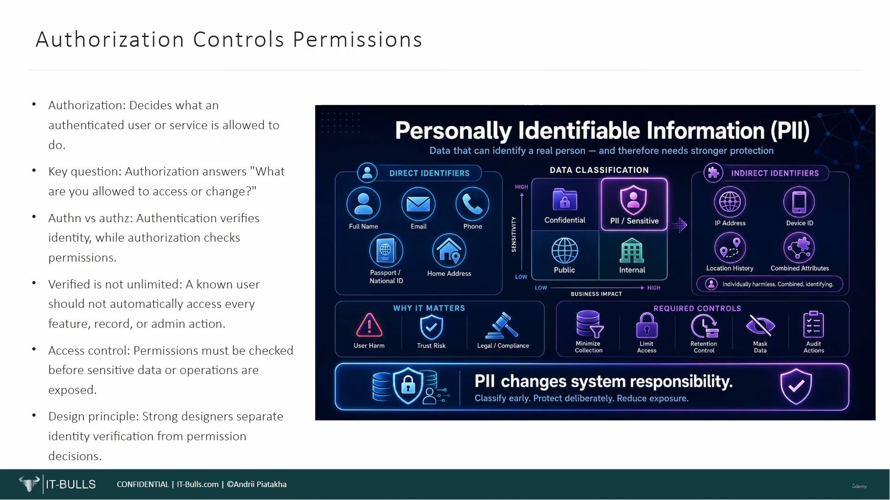
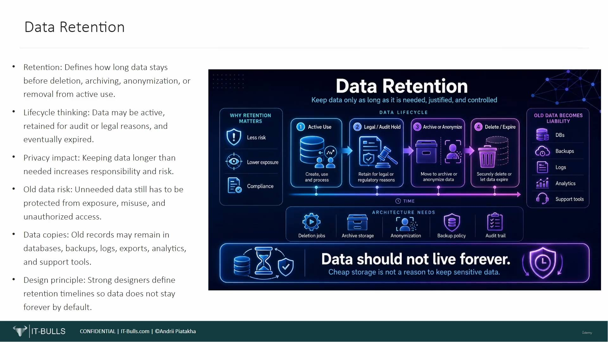
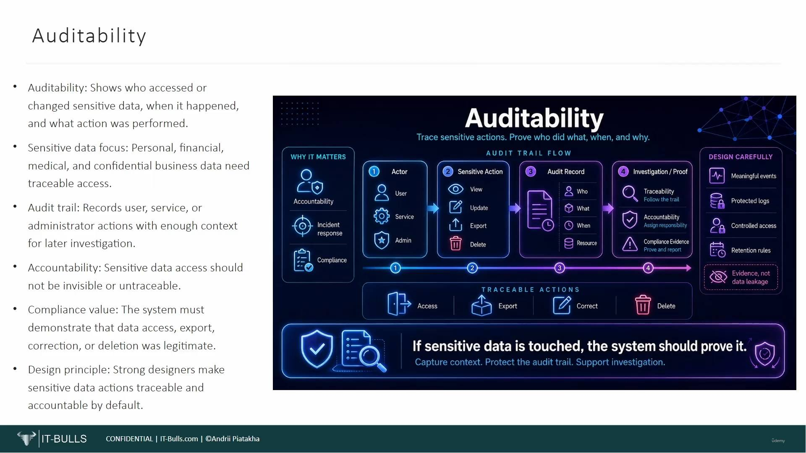
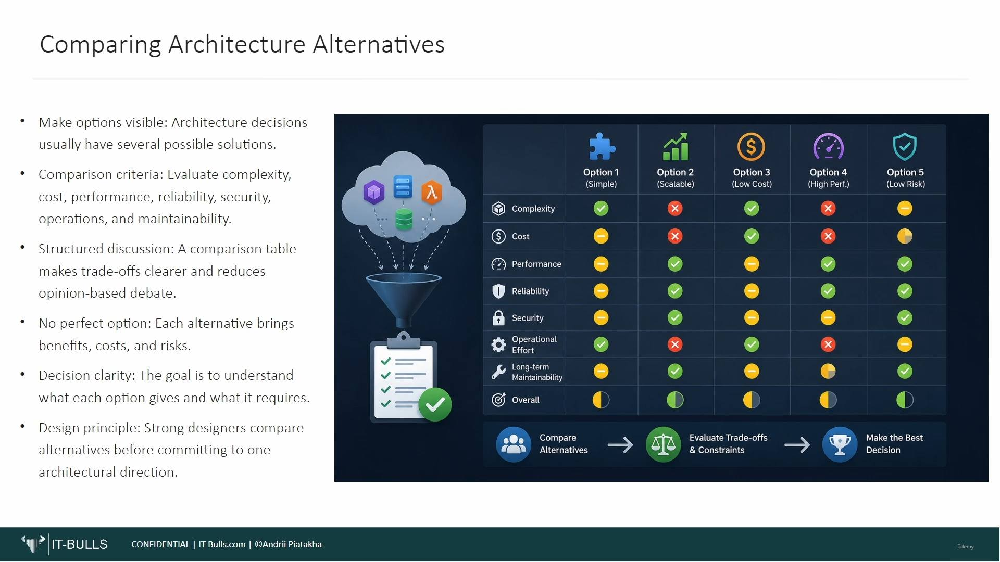
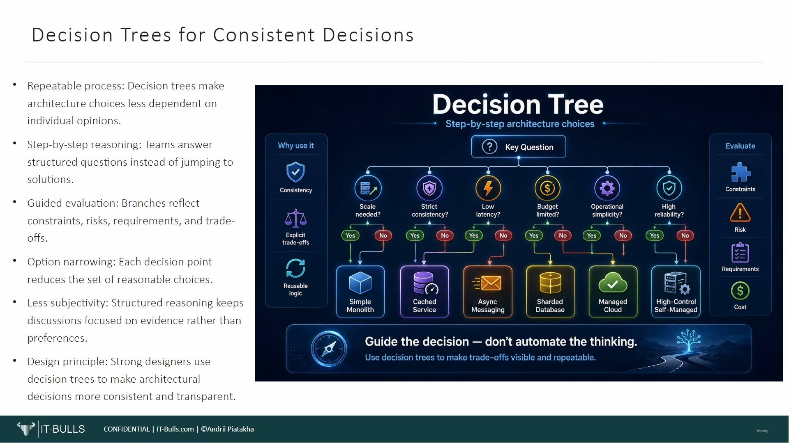
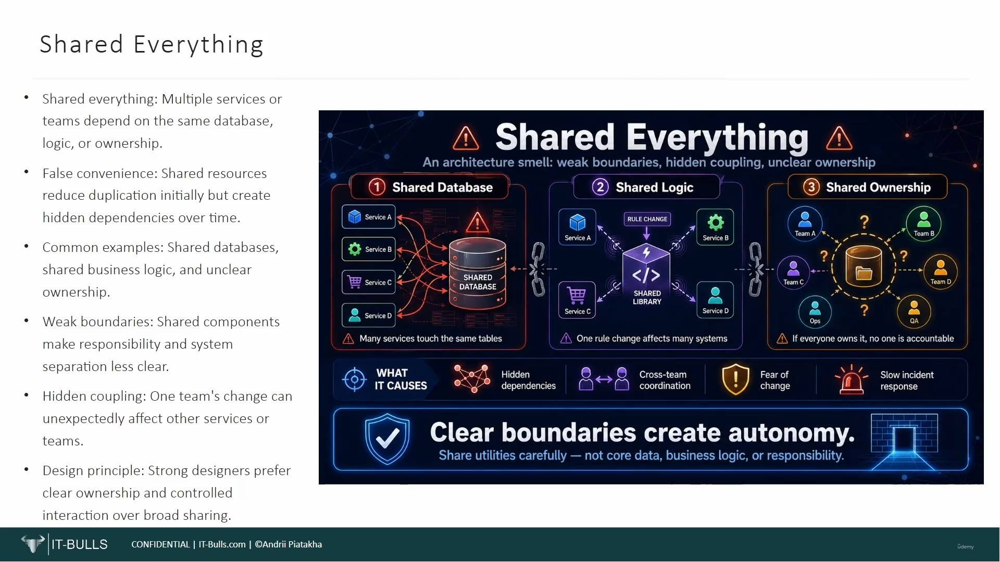
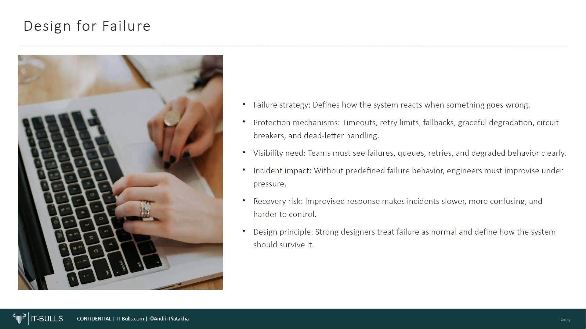
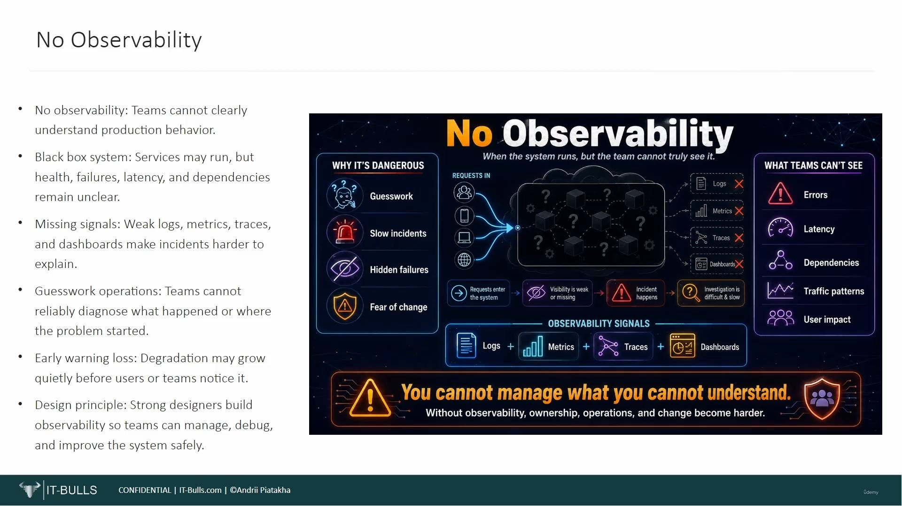

# System Design for Developers · P026–P028：把隐私、ADR 与架构异味落成一套可复用的设计文档

> 课程：System Design for Developers（BV1td4w6oEmH），覆盖 P026–P028。
> 这三讲是**纯设计讨论课**，逐字稿里没有任何可执行代码、没有依赖安装、没有启动命令。因此本文的“复现”不是跑一个服务，而是**把讲师在幻灯片上讲的结构，落成一个可以直接提交进你项目仓库的设计文档目录**。读者按第 4 节把文件建好、按第 3 节的推导顺序填完，就得到了这门课的实际产物。
>
> 全文唯一一段 JavaScript 出现在 4.8 节，已明确标注「课里没有代码，以下为示意」。

---

## 1. 这一节做什么

P026–P028 是三讲连续的“设计前置”内容，合起来回答同一个问题：**在写第一行业务代码之前，哪些东西必须先被写下来？**

- **P026（隐私 / 合规 / 敏感数据）**：先给数据分类，再决定收不收、存多久、谁能看、怎么留痕。核心结论是“最安全的敏感数据是系统从没收集过的数据”。
- **P027（Architecture Decision Records，架构决策记录）**：把“为什么选它、为什么不选另一个、我们接受了什么代价”写成短文档，防止半年后全队重新吵一遍。
- **P028（Common Architecture Mistakes，架构异味）**：给出七类“闻起来不对”的信号（过度工程、过早扩展、shared everything、隐藏耦合、缺失失败策略、所有权不清、缺乏可观测性），并说明怎么从“弱设计”改成“有意图的结构”。

三讲的共同方法论是：**决策要可见、约束要前置、代价要写下来**。所以本文的交付物是一个纯 Markdown 的文档仓库，不需要 Node、不需要 Docker、不需要数据库：

```
system-design-notes/
├── README.md
├── data-classification.md
├── retention-policy.md
├── audit-events.md
├── decision-tree.md
├── architecture-smell-checklist.md
├── before-after.md
└── adr/
    ├── 0000-template.md
    ├── 0001-async-messaging-for-workflow.md
    └── 0002-separate-audit-logs.md
```

环境要求只有两样：装了 `git` 的机器、任意能写 Markdown 的编辑器（VS Code 即可）。**课里没有讲任何具体工具、框架或云厂商**，所以文档里也不预设。

---

## 2. 讲师原话

下面按三讲各摘几句，保留英文关键词，方便你回去对时间轴。

**P026 · 隐私与合规**

> 隐私必须在系统设计阶段就被考虑，而不是等系统已经建好之后。（privacy must be considered during system design, not after the system is already built）
>
> —— p026 [00:00]

> 安全保护的是访问与边界，但隐私多问了一个问题：这份数据到底该不该被收集、存储或共享？（Should this data be collected, stored or shared at all?）
>
> —— p026 [02:43]

> 最安全的敏感数据，往往就是系统从未收集、从未存储、从未无理由共享的那份数据。
>
> —— p026 [04:07]

> 合规要求会重塑架构，因为它们在第一行代码写下之前就已经定义了规则。（Compliance requirements reshape architecture because they often define rules before the first line of code is written）
>
> —— p026 [13:08]

> 最常见的错误之一：先收集敏感数据，再去想怎么保护它。
>
> —— p026 [17:19]



> 没有清晰的时间线，所有数据都会因为“没人决定它该什么时候离开”而永远留在系统里。
>
> —— p026 [09:19]



> 可审计性意味着系统能证明：谁访问了敏感数据、谁修改了它、什么时候发生的、执行了什么操作。
>
> —— p026 [10:47]

> 审计轨迹必须被小心设计：它要提供证据，但不能自己变成另一份失控的数据副本。
>
> —— p026 [12:13]



**P027 · ADR**

> ADR 是短文档，记录重要的架构决策以及它背后的推理。（short documents that capture important architectural decisions and the reasoning behind them）
>
> —— p027 [01:24]

> ADR 应该从 context 开始，因为脱离上下文的决策后来很容易被误解。
>
> —— p027 [03:47]

> Consequences 是 ADR 变得诚实的地方。（Consequences are where the ADR becomes honest.）
>
> —— p027 [05:10]

> 在选定一个方案之前，团队应该先把备选方案摆到台面上。（Before choosing one option, a team should first make the alternatives visible.）
>
> —— p027 [05:39]



> 决策树帮团队一步一步走过架构选择，而不是直接跳到最喜欢的方案。
>
> —— p027 [12:13]



> 常见错误：只记录最终决策，把考虑过的备选方案全丢掉。
>
> —— p027 [16:18]

**P028 · 架构异味**

> 架构异味是“设计可能有问题、脆弱或过度复杂”的症状，它不是立刻的故障，而是早期信号。
>
> —— p028 [01:27]

> 过度工程，就是解法比问题本身更重。（the solution becomes heavier than the problem actually requires）
>
> —— p028 [03:19]

> 过早扩展，是在系统还没挣得那份规模之前，就替未来的流量和数据量做优化。
>
> —— p028 [05:36]

> 隐藏耦合，是指组件之间的连接方式在架构图上根本看不出来。
>
> —— p028 [10:20]



> 没有失败策略，意味着系统基本只为“顺利执行”而设计。
>
> —— p028 [12:37]



> 没有所有权，意味着某个服务、数据域、工作流或运维流程的责任是含糊的。
>
> —— p028 [14:55]

> 没有可观测性，团队就无法清楚看到系统在生产环境里的行为。
>
> —— p028 [17:11]



> 团队无法管理自己无法理解的东西。（teams cannot manage what they cannot understand）
>
> —— p028 [19:03]

---

## 3. 从零复现

这三讲没有代码，但有明确的推导路线。下面把每条线拆成「需求 → 约束 → 估算 → 方案 → 取舍」五步。**估算部分凡是讲师没有给出具体数字的，我会明确写“按讲师列举做的推演，课里没有数字”，算式只用于帮你填自己的项目。**

### 3.1 线一：隐私设计流程（P026）

**① 需求**：系统要处理用户数据，且业务上确实需要一部分个人信息（否则就没有这堂课）。目标是让“敏感数据进入系统”这件事是有目的、有保护、有归属、有生命周期的。

**② 约束**（讲师点名的几类）：
- 数据一旦进入系统，会扩散到 databases、backups、logs、analytics tools、exports、internal dashboards、test environments、third-party integrations。讲师在 [06:57] 和 [17:47] 两处分别列举，合并去重后是 **8 类落点**。
- 合规要求是架构约束，不是“事后贴的法律便签”（[13:08]）。
- 审计记录本身不能变成敏感数据的又一份副本（[12:13]）。

**③ 估算（推演，非讲师数字）**：

- **副本面**：`敏感字段暴露面 ≈ 字段数 × 副本落点数 P`。按上面合并的清单，P 最坏取 8。如果一份用户表有 5 个敏感字段，最坏暴露面是 40 个“字段-位置”对，而不是 5 个。这就是“数据最小化”的量化理由：每砍掉一个字段，暴露面按 P 倍缩小。
- **稳态存储量**：`稳态数据量 ≈ 日增量 × 保留天数`（通用的留存推演，课里没给公式）。保留天数从 365 改成 90，稳态量直接降到约 1/4。这是“保留期”的量化理由。
- **审计量**：`日审计事件数 ≈ 日活用户 × 人均敏感操作次数`。这个数字决定审计表要不要分区、保留多久，课里没讲具体值。

**④ 方案**（按讲师顺序落到文档）：

1. **数据分类**：先建分类矩阵，把 public / low-risk、PII、财务、健康、认证密钥、私信、位置历史、业务机密分开（讲师 [01:47] 与 [04:36] 列举的类别）。
2. **最小化**：逐字段问“为什么需要、谁用、必须存在多久、有没有更不敏感的替代”（[07:25]）。能聚合、脱敏、临时的就不要存原值。
3. **保留期**：每个类别写“用途 + 保留期 + 到期动作（删除 / 归档 / 匿名化 / 移出活跃使用）”（[08:52]）。
4. **可审计**：定义“哪些动作必须可追溯”，审计记录 who / when / what operation，但**不记录敏感原值**（[10:47]、[12:13]）。
5. **合规映射**：把法规/合同/内部政策翻译成数据模型、访问控制、存储选择、日志规则、运维流程（[14:28]–[14:56]）。

**⑤ 取舍**：
- 少收集 → 产品分析粒度变粗；讲师明确说“聚合、匿名化、伪匿名化、同意控制”是用来补这个缺口的（[15:52]）。
- 短保留 → 排查历史问题的窗口变短；讲师的说法是“没有清晰目的的数据就是负债”（[09:19]）。
- 审计不存原值 → 事后取证信息变少；换来的是“审计系统不成为第二份泄漏源”。

### 3.2 线二：ADR 撰写流程（P027）

**① 需求**：让一个半年后加入的人，能看懂“当时为什么这么选”。

**② 约束**：
- 决策会跨团队、跨时间存活（[01:52]）。
- 口头讨论会消失，参与者会离开（[08:00]）。
- 决策必须有状态，因为会变（[04:43]，讲师给的状态：proposed / accepted / deprecated / replaced）。

**③ 估算（推演）**：`ADR 数量 ≈ 重要决策数`，不是“所有决策”。讲师的判断标准是“影响多个团队或长期系统行为”（[02:21]），举的例子是异步通信、共享平台组件、拆服务边界、接受最终一致性。一个中型项目一季度大约个位数到十几条，课里没给数字，这里只是帮你判断“该不该写”。

**④ 方案**：固定四段结构 + 两个补充段：

| 段落 | 写什么 | 讲师依据 |
|---|---|---|
| Context | 问题、约束、目标、迫使决策的情境 | [03:47] |
| Decision | 直接、具体，不藏在模糊措辞后面 | [04:16] |
| Status | proposed / accepted / deprecated / replaced | [04:43] |
| Consequences | 得到什么、放弃什么、接受什么风险与复杂度 | [05:10] |
| Alternatives | 认真考虑过的其他方案，以及为什么没选 | [05:39]、[16:18] |
| Trade-offs | 用哪个优势换了哪个代价 | [08:00] |

**⑤ 取舍**：写 ADR 要花时间；换来的是不再重复讨论、决策可被公平评价（[08:58]）、约束变化时能快速判断“原来的理由还成立吗”（[15:21]）。

### 3.3 线三：架构异味审查流程（P028）

**① 需求**：在异味变成故障之前识别它。

**② 约束**：异味是渐进的，一次一个捷径累积而成（[02:24]）；它不会让系统今天就坏，但会让未来的变更更慢更险（[01:55]）。

**③ 估算（推演）**：`变更影响面 = 直接依赖数 + 隐藏依赖数`。架构图只能告诉你前一项；讲师的核心论点是后一项常常不可见（[10:49]、[12:10]）。所以审查的重点不是数箭头，而是问“如果我只改这一个服务，谁会坏”。

**④ 方案**：七项检查，每项给“信号 → 根因 → 纠正方向”：

1. **过度工程**：解法比问题重 → 为想象中的未来付费 → 问“这个复杂度解决了当前哪个真实问题”（[05:10]）。
2. **过早扩展**：分片、缓存、多区域、事件流早于证据 → 优化了错误的查询/分区键 → 先看当前负载与可测瓶颈（[07:02]、[07:29]）。
3. **shared everything**：共享库、共享表、共享所有权 → 边界变弱 → 共享基础设施和标准可以，核心数据与业务逻辑不要共享（[09:51]）。
4. **隐藏耦合**：图上看不出、运行时靠假设 → 隐式契约、发布顺序、字段语义 → 问“服务之间偷偷依赖了什么”（[12:37]）。
5. **缺失失败策略**：只设计 happy path → 超时/重试/队列无声增长 → 补超时、重试上限、回退、降级、熔断、死信、可见性（[14:00]）。
6. **所有权不清**：谁都被影响、没人负责 → 变更要审批却找不到审批人 → 明确服务生命周期、数据正确性、运维健康、安全姿态（[16:17]）。
7. **缺乏可观测性**：黑盒 → 日志/指标/追踪/看板不足 → 先问“正常时、故障时、变更后各需要知道什么”（[19:03]）。

**⑤ 取舍**：讲师明确说“更干净的架构不一定更复杂，往往是更少的不必要连接、更清晰的所有权和更简单的流程”（[20:27]）；并且不要一次修所有异味，先修今天风险最高的（[20:56]）。

---

## 4. 完整代码

> 再次说明：P026–P028 是纯讲解课，**课里没有可运行代码**。下面全部是可直接保存的 Markdown 文档；4.8 节那段 JS 是示意，已标注。

### 4.1 目录与初始化命令

```bash
mkdir -p system-design-notes/adr
cd system-design-notes
git init
```

### 4.2 `README.md`

```markdown
# System Design Notes

本仓库记录三类设计前置产物：

1. `data-classification.md` — 数据分类矩阵（P026）
2. `retention-policy.md` — 保留策略与到期动作（P026）
3. `audit-events.md` — 必须可审计的动作清单（P026）
4. `decision-tree.md` — 架构决策树（P027）
5. `architecture-smell-checklist.md` — 架构异味检查表（P028）
6. `before-after.md` — 弱设计 / 改进设计对照（P028）
7. `adr/` — 架构决策记录（P027）

规则：
- 敏感字段只要进系统，就必须在 `data-classification.md` 里有归属。
- 没有保留期的数据类别，视为“永久留存”，不允许。
- 重要决策必须有一条 ADR，且必须写 Alternatives 与 Trade-offs。
- 审查发现异味时，先记录，再按风险排序修复。
```

### 4.3 `data-classification.md`

```markdown
# 数据分类矩阵

| 类别 | 示例 | 敏感级别 | 处理要求 |
|---|---|---|---|
| 公开 / 低风险 | 产品名、公开文档 | 低 | 常规访问控制 |
| PII（可直接识别） | 全名、邮箱、电话、护照号、身份证、家庭住址 | 高 | 最小化收集、访问受限、日志脱敏、可审计 |
| PII（可间接识别） | IP、设备 ID、位置历史、属性组合 | 高 | 同上；组合使用时按高敏感处理 |
| 财务信息 | 支付明细、账单 | 高 | 加密存储、访问按角色、可审计 |
| 健康信息 | 健康记录 | 高 | 加密、严格最小化、可审计 |
| 认证密钥 | 密码、token、密钥 | 极高 | 不落日志、不落分析、独立存储 |
| 私信 | 用户间消息 | 高 | 访问受限、日志不记录原文 |
| 业务机密 | 合同、内部记录 | 高 | 按需授权、可审计 |

## 字段登记

| 字段 | 所属类别 | 为什么需要 | 谁使用 | 能否用更不敏感的替代 |
|---|---|---|---|---|
| <字段名> | <类别> | <明确用途> | <角色/服务> | <是/否 + 替代方案> |
```

### 4.4 `retention-policy.md`

```markdown
# 保留策略

数据生命周期：活跃使用 → 归档 / 匿名化 → 删除 / 移出活跃使用。

| 类别 | 用途 | 保留期 | 到期动作 | 责任方 |
|---|---|---|---|---|
| PII | <业务用途> | <天数> | 删除 | <团队> |
| 财务信息 | <用途> | <天数> | 归档（合规要求时） | <团队> |
| 审计记录 | 追责与调查 | <天数> | 归档 | <安全团队> |
| 日志 | 排障 | <天数> | 删除 | <平台团队> |
| 分析数据 | 产品决策 | <天数> | 匿名化 | <数据团队> |

## 规则

- 每个类别必须有明确用途，写不出用途的类别不允许存在。
- 备份、日志、导出、分析、测试环境、第三方集成必须遵循同一套保留规则。
- 到期动作必须有作业或流程执行，不能只写在文档里。
```

### 4.5 `audit-events.md`

```markdown
# 必须可审计的动作

| 事件 | 触发者 | 记录字段 | 明确不记录 | 保留期 |
|---|---|---|---|---|
| 查看敏感记录 | 用户/服务/管理员 | 主体标识、时间、操作、目标记录 ID | 记录内容原文 | <天数> |
| 导出敏感数据 | 同上 | 主体、时间、导出范围、目标 | 导出内容原文 | <天数> |
| 修改敏感记录 | 同上 | 主体、时间、字段名、前后值哈希 | 前后值原文 | <天数> |
| 删除敏感记录 | 同上 | 主体、时间、记录 ID、删除原因 | 记录内容原文 | <天数> |

## 规则

- 审计记录回答 who / when / what operation，不回答“内容是什么”。
- 审计记录的访问本身也要受限、也要被记录。
- 审计记录不能被应用日志覆盖或混在一起。
```

### 4.6 `adr/0000-template.md`

```markdown
# ADR-0000: <决策标题>

- 状态：proposed / accepted / deprecated / replaced
- 日期：<YYYY-MM-DD>
- 替代：<被替代的 ADR 编号，没有则写 N/A>

## Context

<问题、约束、目标、迫使决策的情境>

## Decision

<直接、具体地说决定了什么>

## Alternatives

| 方案 | 优点 | 缺点 | 未选原因 |
|---|---|---|---|
| A | | | |
| B | | | |

## Trade-offs

<用哪个优势换了哪个代价；接受了什么风险与复杂度>

## Consequences

- 架构：<服务边界、通信模式、数据归属、部署结构、失败行为>
- 运维：<监控、runbook、告警、备份、故障切换、应急步骤>
- 成本：<基础设施、存储、工具、工程时间>
- 团队协作：<协调增加还是减少、所有权变化>
- 未来变更：<迁移成本、锁定、长期复杂度>
```

### 4.7 `adr/0001-async-messaging-for-workflow.md`（示例，直接用讲师举的例子）

```markdown
# ADR-0001: 工作流采用异步消息

- 状态：accepted
- 日期：<YYYY-MM-DD>
- 替代：N/A

## Context

<该工作流当前同步调用，下游变慢会拖住主流程；需要解耦，但团队规模小。>

## Decision

该工作流改用异步消息解耦。

## Alternatives

| 方案 | 优点 | 缺点 | 未选原因 |
|---|---|---|---|
| 同步调用 | 简单、易调试 | 下游故障直接传导 | 已出现拖垮主流程 |
| 异步消息 | 解耦、削峰 | 一致性、可观测性、错误处理变复杂 | 选中 |

## Trade-offs

用“更好的一致性保障”换了“更强的解耦与可用性”。

## Consequences

- 架构：服务更解耦，但一致性从强变弱，需要定义重试与幂等。
- 运维：需要新的监控、告警、死信处理与 runbook。
- 成本：增加消息基础设施与工程时间。
- 团队协作：边界更清晰，但调试跨服务问题需要新的协作方式。
- 未来变更：引入迁移成本，后续换实现需要重放/对账方案。
```

### 4.7b `adr/0002-separate-audit-logs.md`

```markdown
# ADR-0002: 审计日志与应用日志分离

- 状态：accepted
- 日期：<YYYY-MM-DD>

## Context

<审计记录需要长期保留、访问受限；应用日志用于排障、保留期短。混在一起会导致审计被日志轮转删除，也会让敏感数据进入日志。>

## Decision

审计日志独立存储、独立保留期、独立访问控制。

## Alternatives

| 方案 | 优点 | 缺点 | 未选原因 |
|---|---|---|---|
| 共用日志系统 | 简单 | 保留期与权限冲突、审计被污染 | 不满足审计要求 |
| 分离 | 保留期与权限各自可控 | 多一套存储与运维 | 选中 |

## Trade-offs

用“多一套基础设施”换了“审计可信、日志不泄漏敏感数据”。

## Consequences

- 架构：多一条写入链路。
- 运维：审计存储需要备份与访问审计。
- 成本：额外存储与工程时间。
- 团队协作：应用团队与安全团队职责需要划清。
- 未来变更：审计 schema 变更需兼容历史记录。
```

### 4.8 示意代码：日志脱敏（**课里没有代码，以下为示意**）

```javascript
// 课里没有代码，以下为示意。
// 目的：演示 P026「日志不能成为敏感数据的又一份副本」这条约束在 Node 里的落点。
// 原生 JS，无第三方依赖。

const SENSITIVE_KEYS = new Set(['email', 'phone', 'idCard', 'address', 'password', 'token']);

function maskEmail(v) {
  const [name, domain] = String(v).split('@');
  if (!domain) return '***';
  return `${name.slice(0, 1)}***@${domain}`;
}

function redact(value) {
  if (Array.isArray(value)) return value.map(redact);
  if (value && typeof value === 'object') {
    const out = {};
    for (const [k, v] of Object.entries(value)) {
      if (SENSITIVE_KEYS.has(k)) {
        out[k] = k === 'email' ? maskEmail(v) : '***';
      } else {
        out[k] = redact(v);
      }
    }
    return out;
  }
  return value;
}

// 用法：写日志前先 redact(payload)
module.exports = { redact, maskEmail };
```

> 这段只是示意“不要把原值写进日志”。它不涉及讲师讲过的任何具体库，也不代表完整方案；真实项目还要考虑嵌套结构、错误对象、HTTP header、URL query 等位置。

### 4.9 `decision-tree.md`

```markdown
# 架构决策树（骨架）

> 骨架按 P027 讲师描述组织：从关键问题开始，按约束、风险、需求、取舍分叉。
> 具体分支需要按你的项目填写；课里没有给出固定的问题清单。

## 根问题

这次改动影响的是：单团队 / 多团队 / 长期系统行为？

- 单团队且短期 → 走“最简方案”分支，记录到 ADR 时标注“可低成本回退”。
- 多团队或长期 → 继续。

## 分支 1：一致性要求

- 必须强一致 → 优先单库/单服务，避免分布式事务。
- 可接受最终一致 → 考虑异步消息，但必须同时定义重试、幂等、死信。

## 分支 2：规模证据

- 有当前负载数据与可测瓶颈 → 按瓶颈优化。
- 只有“以后可能很大” → 不引入分片、多区域、复杂缓存。

## 分支 3：共享边界

- 核心数据或业务逻辑需要共享 → 先重新划边界。
- 只是共享基础设施/标准/工具 → 允许，但写清所有权与契约。

## 分支 4：失败与可观测性

- 新链路是否有超时、重试上限、回退、死信？没有 → 不允许上线。
- 是否能回答“正常时、故障时、变更后各需要知道什么”？不能 → 先补观测。
```

### 4.10 `architecture-smell-checklist.md`

```markdown
# 架构异味检查表

| 异味 | 信号 | 根因 | 纠正方向 | 今天风险 |
|---|---|---|---|---|
| 过度工程 | 层数/组件多于问题需要 | 为想象中的未来付费 | 每个复杂度必须对应一个当前真实问题 | 高/中/低 |
| 过早扩展 | 分片/多区域/事件流早于证据 | 优化了错误的瓶颈 | 先测当前负载，再决定 | |
| shared everything | 共享库承载业务逻辑、共享表被多服务读写 | 边界弱 | 核心数据与逻辑不共享，共享基础设施需明确契约 | |
| 隐藏耦合 | 改一个服务，另一个坏 | 隐式契约、发布顺序、字段语义 | 显式化契约，补契约测试 | |
| 缺失失败策略 | 只设计 happy path | 把失败当异常而非常态 | 超时、重试上限、回退、降级、熔断、死信、可见性 | |
| 所有权不清 | 谁都被影响、没人负责 | 责任未落到团队 | 明确生命周期、数据正确性、运维、安全、演进 | |
| 缺乏可观测性 | 故障时靠猜 | 日志/指标/追踪/看板不足 | 先定义“需要知道什么”，再补信号 | |

## 修复顺序

1. 先修今天风险最高的（通常是所有权不清、缺可观测性、可能级联失败的依赖）。
2. 不要一次修全部，避免制造更大扰动。
3. 每次修复记一条 ADR，写清 before / after 与取舍。
```

### 4.11 `before-after.md`

```markdown
# 弱设计 / 改进设计对照

> 讲师强调：改进后的版本不一定更“高级”，往往是更少的不必要连接、更清晰的所有权、更好的契约、更简单的流程。

| 维度 | 弱设计 | 改进设计 |
|---|---|---|
| 数据 | 多服务直接读写同一批表 | 明确数据归属，通过契约访问 |
| 逻辑 | 共享库承载业务规则 | 共享工具/标准，不共享业务行为 |
| 所有权 | 组件无明确负责团队 | 每个服务/数据域有负责团队 |
| 失败 | 只处理成功路径 | 超时、重试上限、回退、降级、死信 |
| 观测 | 出问题靠猜 | 日志、指标、追踪、看板覆盖关键流程 |
| 扩展 | 提前分片/多区域 | 按实测瓶颈扩展 |
| 决策 | 只在会议里讨论 | 有 ADR，含 alternatives 与 trade-offs |
```

---

## 5. 逐行解释

**5.1 `data-classification.md` 为什么先分类再谈保护**

讲师在 [04:07] 说“隐私感知设计始于理解系统处理什么数据、每类数据带来什么风险”。分类表不是 paperwork，它决定了后面三件事的输入：保留期按类别定、审计按类别定、访问控制按类别定。如果跳过分类直接写代码，敏感字段就会和普通字段混在同一张表、同一条日志里，后面再拆要动数据模型。

**5.2 为什么“字段登记”要写“能否用更不敏感的替代”**

对应讲师 [07:25] 的四个问题：为什么需要、谁用、必须存在多久、有没有更不敏感的替代。这一列是数据最小化的执行点。写不出替代方案的字段才允许收集；写得出替代方案的，就用聚合、脱敏或临时值代替。前端同学容易在这里踩坑：埋点里顺手把 `email`、`userId`、`deviceId` 一起上报，这些都属于“可间接识别”的 PII，按讲师分类要按高敏感处理。

**5.3 保留策略为什么必须有“到期动作”**

讲师在 [08:52] 明确保留不只是存储决策，而是隐私与合规决策；到期动作包括删除、归档、匿名化、移出活跃使用。只写“保留 90 天”而不写“90 天后谁做什么”，等于没写。对应到工程上，就是一个定时任务或数据管道步骤，不能只存在于文档。

**5.4 审计表为什么“记录字段”和“不记录字段”要并列**

讲师在 [12:13] 的原话是：审计轨迹要提供证据，但不能自己变成另一份失控的数据副本。所以表里同时有“记录 who/when/what operation”和“明确不记录原文”两列。这一条在实现上最容易走偏：很多人为了“方便排查”把整个请求体写进审计，结果审计库成了最敏感的库。

**5.5 ADR 模板为什么把 Alternatives 单独成段**

讲师在 [16:18] 把“只写最终决策、不写备选方案”列为常见错误。原因在 [16:45]：没有对比，后人会觉得这个选择是随意的。所以模板里 Alternatives 是独立表格，列“优点/缺点/未选原因”。Trade-offs 单独一段，是因为讲师在 [08:00] 强调“写下来才诚实”，要明确说“我们接受了什么代价”。

**5.6 状态字段为什么不能省**

讲师在 [04:43] 给了四个状态：proposed / accepted / deprecated / replaced。架构会变，六个月前正确的决策今天可能不再最优。状态字段让后人知道“这条还能不能推翻”，而不是把所有历史决策都当成现行约束。

**5.7 决策树为什么要先问“影响范围”**

讲师在 [12:13] 说决策树的价值是“一步一步走，而不是直接跳到最喜欢的方案”。根问题先问单团队/多团队/长期影响，是因为讲师在 [02:21] 把“影响多个团队或长期系统行为”作为该写 ADR 的判断标准。先分范围，再谈技术选项，能避免小改动被套上重流程。

**5.8 异味检查表为什么按“今天风险”排序而不是按严重程度**

讲师在 [20:56] 说不要一次修所有异味，先修今天风险最高的，比如所有权不清、缺可观测性、可能级联失败的依赖。按“今天风险”排序而不是“理论严重度”，是为了让修复动作可执行；否则团队会陷入“全都重要等于都不重要”。

**5.9 4.8 节示意代码为什么只做脱敏、不做别的**

因为讲师在 P026 只讲了“日志不能成为敏感数据副本”这条约束，没讲具体实现。示意代码只演示这条约束的落点，不引入任何讲师没提过的库，也不声称是完整方案。

**5.10 关于并发与一致性（给前端背景读者补一句）**

讲师在 P027 举的例子里有“接受最终一致性”（[02:21]），在 P028 讲缺失失败策略时提到重试与队列（[13:35]）。这些在后端对应消息队列、幂等键、死信队列；**课里没有点名任何具体产品**。在 JS/Node 里，你可以把它理解成“不要把异步当同步用”：发出去的消息可能重复、可能乱序、可能失败，消费端必须自己保证幂等。锁和事务这三讲没有展开，课里没讲。

---

## 6. 复现检查清单

把下面每项打勾，你的 `system-design-notes/` 就达到了这三讲的产出标准。

- [ ] 已创建 `system-design-notes/` 与 `adr/` 目录，并 `git init`。
- [ ] `README.md` 写明了六类文档和四条规则。
- [ ] `data-classification.md` 有分类矩阵，且每个敏感字段都有归属类别。
- [ ] 每个敏感字段都回答了“为什么需要 / 谁使用 / 能否替代”。
- [ ] `retention-policy.md` 每个类别都有用途、保留期、到期动作、责任方。
- [ ] 保留规则覆盖了数据库、备份、日志、导出、分析、测试环境、第三方集成。
- [ ] `audit-events.md` 每个事件都写了 who / when / what operation，且明确“不记录原文”。
- [ ] 审计记录的访问本身也受限、也被记录。
- [ ] `adr/0000-template.md` 含 Context / Decision / Status / Alternatives / Trade-offs / Consequences。
- [ ] 至少有一条真实 ADR（可以直接用异步消息或审计日志分离这两个例子）。
- [ ] 每条 ADR 都能回答“为什么不选另一个”。
- [ ] `decision-tree.md` 从“影响范围”开始分叉。
- [ ] `architecture-smell-checklist.md` 七项齐全，并按“今天风险”排序。
- [ ] `before-after.md` 每个维度都有弱设计与改进设计对照。
- [ ] 所有“以后可能有用”的字段，要么被删掉，要么写清了用途与保留期。
- [ ] 所有新链路都定义了超时、重试上限、回退、可见性（P028 失败策略）。
- [ ] 每个服务/数据域都有明确负责团队（P028 所有权）。
- [ ] 每个关键流程都能回答“正常时、故障时、变更后各需要知道什么”（P028 可观测性）。

---

## 7. 课里没讲但你会撞上的

这一节是补充背景，**不是讲师原话**，读的时候请和上面区分开。

**7.1 具体法规名，课里没点名**

讲师只说“许多法规”（many regulations，[03:12]），没有点名 GDPR、CCPA、HIPAA 等具体名称。你落地时需要自己确认适用哪部法规、有哪些本地化要求（例如区域存储、删除权、同意记录）。不要把本文档当成合规意见。

**7.2 ADR 存在哪、怎么编号，课里没讲**

讲师只讲结构和价值，没讲存放位置。实际项目里通常放在代码仓库的 `docs/adr/` 下，编号递增，一个决策一个文件。这条是常见做法，不是讲师要求。

**7.3 日志脱敏的具体实现，课里没讲**

P026 只说“日志要 mask / filter / 避免敏感值”（[15:52]），没给代码。4.8 节的 JS 是示意。真实项目还要处理错误对象、HTTP header、URL query、嵌套结构，以及日志采集端的二次过滤。

**7.4 前端埋点里的 PII，课里没单独讲**

讲师说 PII 包括 IP、设备 ID、位置历史、属性组合（[04:36]）。前端同学要注意：埋点 SDK 默认采集的设备信息、页面路径里的 ID、URL 参数，都可能落进“可间接识别”这一类。按讲师的最小化原则，埋点前就该问“这个字段真的需要吗”。

**7.5 决策树的边界，讲师自己给了提醒**

讲师在 [13:35] 说决策树是 guidance，不是 blind automation，不取代判断。所以 4.9 的骨架只能当起点，具体分支要按项目填，不能照抄。

**7.6 一致性、重试、幂等的具体机制，课里没展开**

P027 提到“接受最终一致”，P028 提到重试与队列，但都没讲具体机制。前端背景的读者需要知道：异步消息不等于“发出去就完了”，消费端要处理重复、乱序、失败。