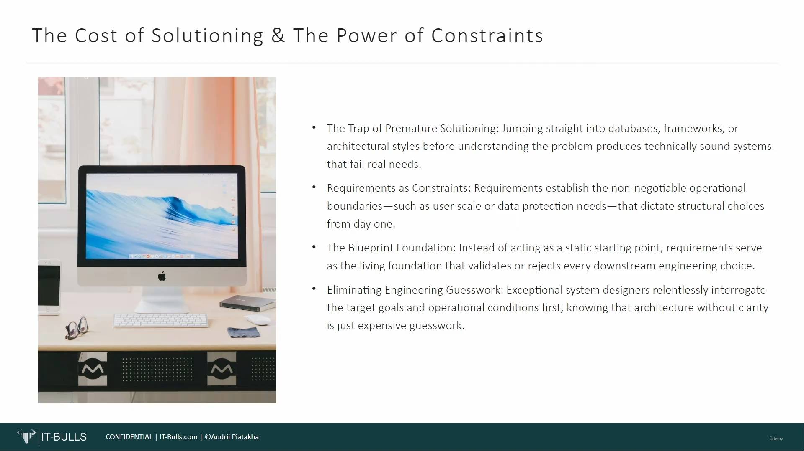
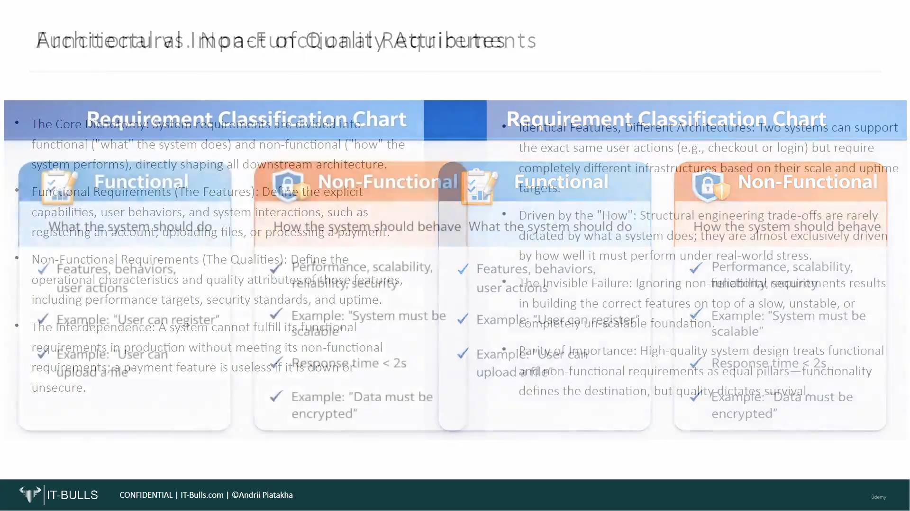
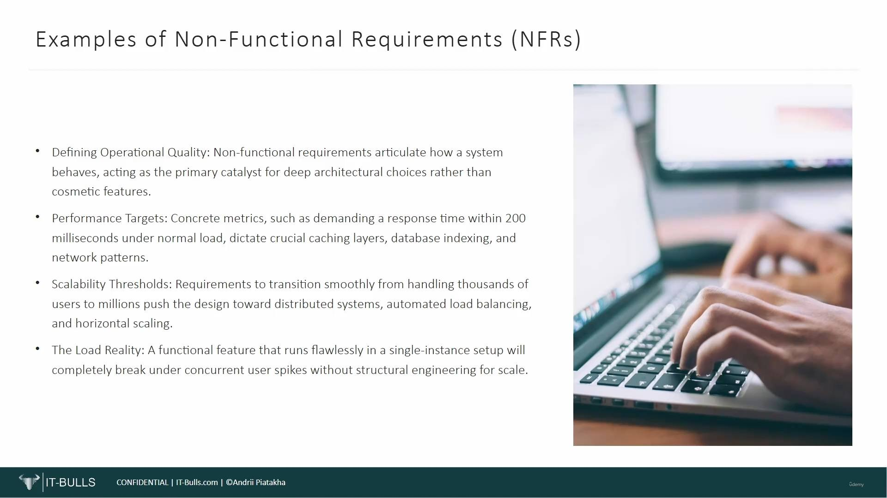
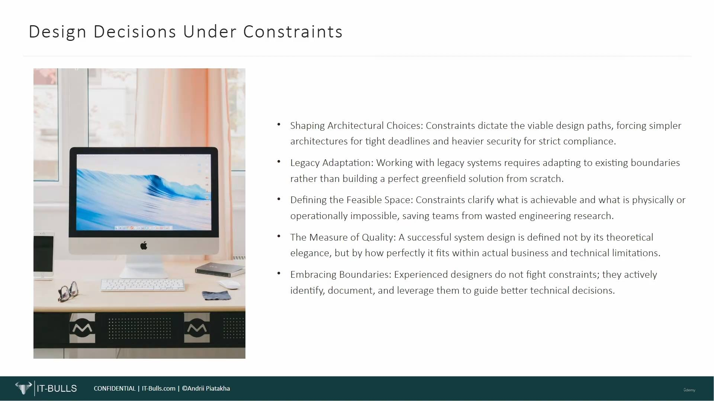
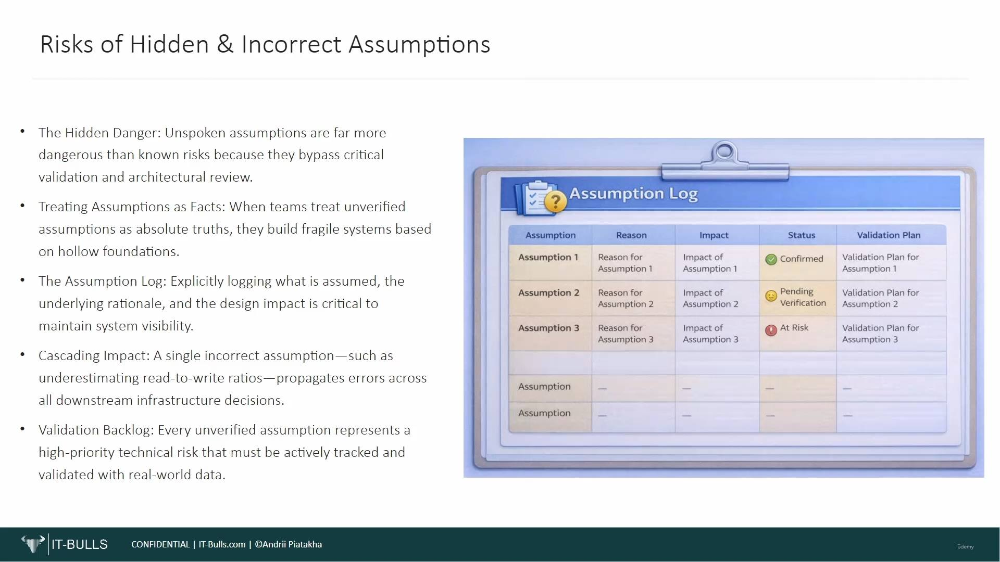
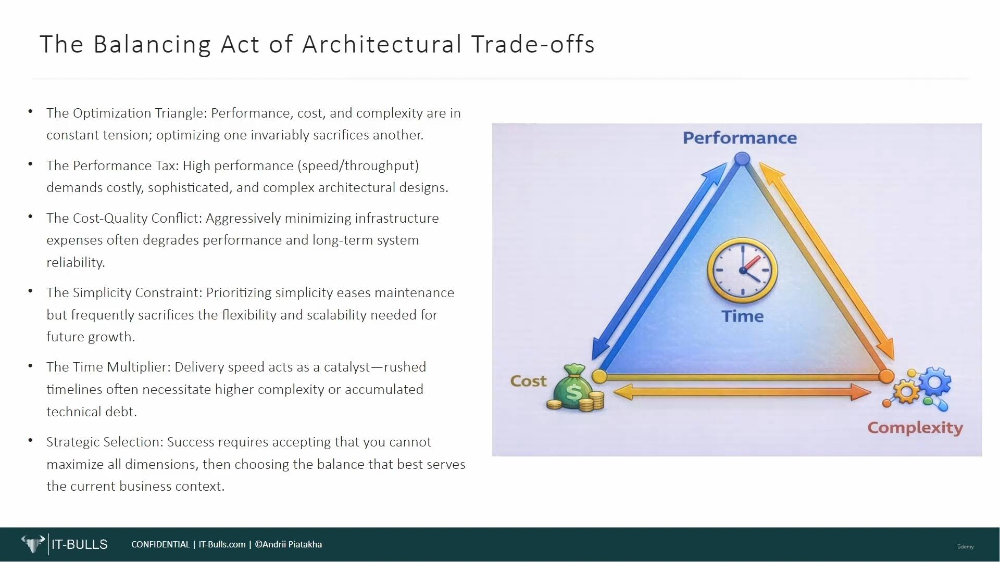
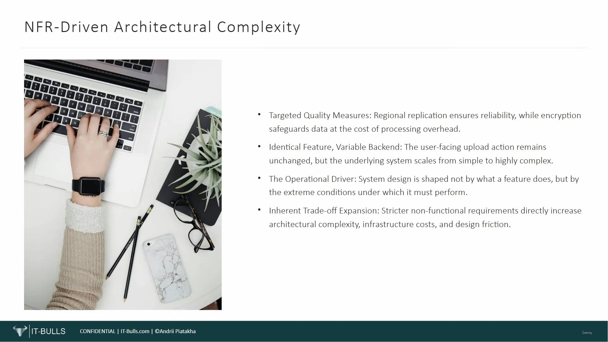
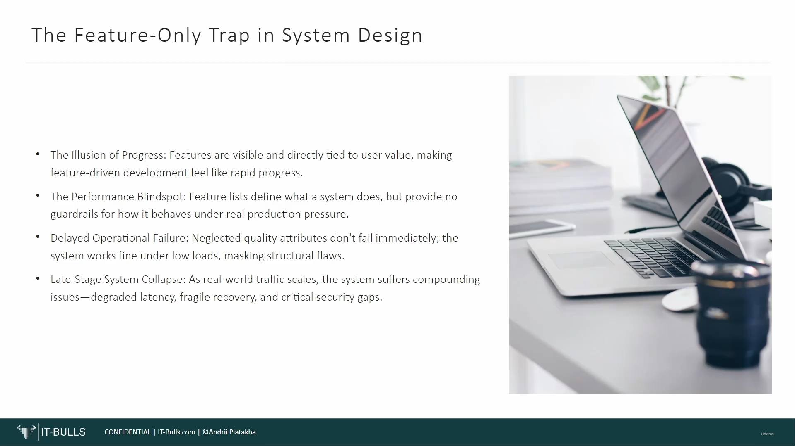

## 1. 这一节做什么

这两节不是编码课，而是系统设计的前置课：P003 讲**需求**，P004 讲**约束、假设与取舍**。讲师反复强调的中心句是：系统设计不是先选数据库、框架或架构风格，而是先回答“系统要做什么、在什么条件下做、哪些限制不能碰”。如果只列功能，不看质量属性，最后很容易做出“功能都有、真实流量一来就崩”的系统。

这篇文档把两节内容落成一个**可以直接照着复现的分析项目**：以讲师多次举例的“用户上传文件”为同一功能，先写需求卡，再列约束，再写假设日志，再做容量估算，最后形成设计决策记录。这样你复现的不是空泛概念，而是一套可以交给团队评审的设计文档。



讲师先区分了两类需求：功能需求描述“系统做什么”，非功能需求描述“系统在做这些事时表现如何”。这个区分直接决定后面的设计。功能需求定义系统表面，非功能需求定义系统性质；两个系统可以有完全相同的功能需求，却因为性能、扩展性、可靠性、安全要求不同，长成完全不同的架构。



这一节最终要交付的，不是“我懂了需求很重要”，而是一组可检查的文件：需求卡、约束清单、假设日志、容量估算表、决策记录。它们共同回答三个问题：**要做什么、不能突破什么、哪些数字还是假设。**

---

## 2. 讲师原话（带「—— pNNN [MM:SS]」）

> "需求描述系统应做什么，以及在什么条件下运行。"
> —— p003 [01:48]

> "功能需求描述系统应该做什么……非功能需求则描述系统在完成这些功能时应表现出怎样的行为。"
> —— p003 [04:10]

> "两个系统可以拥有完全相同的功能需求……但根据非功能需求的不同，架构可以完全不同。"
> —— p003 [04:38]

> "同一个功能可能需要异步处理、队列、分布式存储和多个服务。"
> —— p003 [11:19]

> "一张需求卡片……会写明该功能的描述、目标用户和预期结果……还会列出预期负载、性能目标、安全考量以及任何已知约束。"
> —— p003 [17:03]



> "没有哪个系统能脱离约束而存在。"
> —— p004 [01:25]

> "所谓假设，是指为了继续推进工作而认定其为真的事情。"
> —— p004 [06:07]



> "没有完美方案……只有权衡。"
> —— p004 [09:58]

> "性能、成本和复杂度……时间与这三者都密切相关。"
> —— p004 [11:49]

> "一个非常常见且危险的错误……是忽视约束，或者把假设当成事实。"
> —— p004 [16:08]

这些原话在文档里不是装饰。后面的需求卡、假设日志、容量估算和决策记录，都是对这几句话的落地。

---

## 3. 从零复现

这一节按纯讲解课的复现方式走：**需求 → 约束 → 假设 → 估算 → 方案 → 取舍 → 检查**。示例功能选“用户上传文件”，因为讲师在 P003 多次用它说明：同一个功能，小系统可以同步写单存储，大系统可能要异步处理、队列、分布式存储、失败重试、跨区域复制、加密和审计。

> 说明：讲师没有给出一个完整项目代码，也没有指定具体技术产品。下面出现的目录、模板、示例数值，是为了让你能动手复现分析方法；具体业务数字必须替换成你的真实数据。课里没有讲过的工具名，我不会说成讲师指定。

### 3.1 建目录

在任意笔记仓库里执行：

```bash
mkdir -p system-design-notes
cd system-design-notes
```

目录结构如下：

```text
system-design-notes/
├── README.md
├── 01-requirements-card.md
├── 02-constraints.md
├── 03-assumption-log.csv
├── 04-capacity-estimate.md
├── 05-decision-record.md
└── 06-review-checklist.md
```

依赖版本：**无第三方依赖**。Markdown 文件用任意 Markdown 编辑器打开；CSV 用任意表格软件打开。  
环境变量名：**无**。  
启动命令：**无**。本课不是编码课，不需要启动服务；复现的是设计产物。

### 3.2 先写需求卡，不要先选技术

打开 `01-requirements-card.md`，按“功能、用户、结果、非功能、约束、验收”六块写。功能需求只写系统必须支持的动作；非功能需求必须尽量量化。讲师在 P003 举的例子包括：200ms 响应、今天 1000 用户但未来 100 万用户、99.9% 可用性、加密数据、认证用户、防未授权访问。你可以把这些作为需求卡里的候选质量属性，但不要未经确认就当成事实。



### 3.3 列约束，不要写“理想架构”

P004 把常见约束分成预算、时间、团队、遗留系统、合规、截止日期。复现时逐条问：这条约束会砍掉哪些方案？例如预算有限会砍掉过度分布式方案；团队只有前端背景会砍掉需要重型运维的方案；遗留系统会限制数据模型和接口；合规会限制数据存储位置和访问方式。约束不是障碍，而是设计边界。

### 3.4 写假设日志，并给每条假设一个验证方式

假设日志至少包含：假设内容、为什么现在要假设、影响哪个设计、当前状态、验证方式、负责人、复查日期。讲师强调假设不是事实，是“为了推进而暂时相信的东西”。所以不能只写“假设流量不高”，要写“假设上线首月 DAU 10 万，峰值系数 3；若监控连续 7 天超过阈值，则触发扩容评审”。

### 3.5 做容量估算，把模糊词变成算式

课里没有给具体业务公式，但给了方向：用户数、流量、文件大小、性能目标会改变设计。下面用一组**练习示例值**演示算式。注意：这些数字不是讲师给出的，必须替换。

示例输入：

- DAU = 1,000,000（复现练习假设）
- 每人每天上传次数 = 2（复现练习假设）
- 平均文件大小 = 5 MB（复现练习假设）
- 峰值系数 = 5（复现练习假设）
- 副本数 = 3（复现练习假设；课里只提到复制方向，没给副本数）

计算：

- 日均上传请求 = 1,000,000 × 2 = 2,000,000 次/天
- 平均 QPS = 2,000,000 ÷ 86,400 ≈ 23.15 req/s
- 峰值 QPS = 23.15 × 5 ≈ 115.74 req/s
- 日均原始写入 = 2,000,000 × 5 MB = 10,000,000 MB ≈ 9.54 TB/天
- 峰值入口带宽 = 115.74 × 5 MB ≈ 578.7 MB/s ≈ 4.63 Gbps
- 年原始存储 = 9.54 TB/天 × 365 ≈ 3.4 PB/年
- 三副本日存储 = 9.54 × 3 ≈ 28.6 TB/天
- 三副本年存储 = 28.6 × 365 ≈ 10.4 PB/年

这些算式的作用不是追求精确，而是逼出问题：如果峰值带宽约 4.63 Gbps，单机同步处理还合适吗？如果年增 3.4 PB，存储成本和生命周期策略要不要提前设计？如果 99.9% 可用性意味着一年允许停机约 8.76 小时，故障转移和监控要不要进第一版？

### 3.6 形成方案与取舍

小系统方案：客户端上传，服务端同步接收，写单一存储，立即返回结果。优点是简单、开发快、成本低；缺点是扩展性、容错和峰值承载弱。适合用户少、文件小、性能要求不严格的情况。

大规模方案：上传与处理分离，接入层只负责接收和登记，队列承接处理任务，多个处理服务消费，分布式存储保存文件，失败重试，监控和审计贯穿。优点是能削峰、可扩展、失败可恢复；缺点是组件多、运维复杂、成本高、排障难。



这里的关键不是“大系统方案更高级”，而是：**功能没变，约束和非功能需求变了，方案才变。** 如果预算和时间不允许，硬上大规模方案就是 P004 说的“忽略约束”；如果把“低流量假设”当成事实，就是“把假设当事实”。

### 3.7 评审并留下决策记录

最后打开 `05-decision-record.md`，每条决策写：背景、选项、选择、理由、牺牲了什么、何时复查。这样未来有人问“为什么不用更简单的方案”或“为什么先不做跨区域复制”，文档能回答。

---

## 4. 完整代码

> 本课是纯讲解课，讲师没有给出可运行代码。以下不是“课程源代码”，而是按讲师讲的需求、约束、假设、取舍方法整理出的**完整可保存设计产物文件**。每个文件都可以直接复制保存。接口和数据模型是落地草案，不是讲师原话。

### 4.1 `README.md`

```markdown
# 文件上传服务系统设计复现

## 目的
用 P003/P004 的需求、约束、假设、取舍方法，产出可评审的设计文档。

## 文件
- 01-requirements-card.md：需求卡
- 02-constraints.md：约束清单
- 03-assumption-log.csv：假设日志
- 04-capacity-estimate.md：容量估算
- 05-decision-record.md：设计决策记录
- 06-review-checklist.md：评审检查清单

## 依赖与环境
- 无第三方依赖
- 无环境变量
- 无启动命令
- 用任意 Markdown/CSV 编辑器打开

## 使用顺序
1. 填需求卡
2. 填约束清单
3. 填假设日志
4. 用真实数据替换容量估算示例值
5. 写决策记录
6. 按检查清单评审
```

### 4.2 `01-requirements-card.md`

```markdown
# 需求卡：用户上传文件

## 1. 功能需求
- FR-1：用户可以上传文件。
- FR-2：系统接收文件后保存，并返回可追踪的上传结果。
- FR-3：用户可以查询自己上传文件的状态。
- FR-4：系统在处理失败时记录失败原因，并允许后续重试。

## 2. 目标用户与结果
- 用户：需要提交文件的终端用户。
- 期望结果：上传动作有明确结果，失败可感知，文件不丢失。

## 3. 非功能需求（尽量量化）
- NFR-1 性能：正常负载下，上传请求的接收响应目标为 200ms 量级；课里以 200ms 作为示例，真实目标需确认。
- NFR-2 扩展性：当前用户规模与未来用户规模必须写清；课里用 1000 到 100 万说明差异，本项目需替换为真实数字。
- NFR-3 可靠性：可用性目标示例为 99.9%；是否采用需业务确认。
- NFR-4 安全：传输和存储加密、用户认证、访问控制、审计记录。
- NFR-5 成本：存储和带宽成本必须有上限或预算区间。
- NFR-6 可维护性：团队能维护的组件数量有限，不能无限堆服务。

## 4. 已知约束
- 预算：待填
- 时间：待填
- 团队：待填
- 遗留系统：待填
- 合规：待填
- 截止日期：待填

## 5. 验收口径
- 功能验收：上传、查询状态、失败重试均可演示。
- 非功能验收：用压测和监控验证性能、峰值、错误率、恢复时间。
- 安全验收：未授权用户不能读取他人文件；审计日志可查。
```

### 4.3 `02-constraints.md`

```markdown
# 约束清单

| 约束类型 | 具体约束 | 对设计的影响 | 是否已确认 |
|---|---|---|---|
| 预算 | 基础设施预算上限待填 | 限制复制、跨区域、过度分布式方案 | 否 |
| 时间 | 首版上线日期待填 | 决定首版是否砍掉异步处理 | 否 |
| 团队 | 团队规模与技能待填 | 组件越多，维护成本越高 | 否 |
| 遗留系统 | 是否已有用户体系/存储/鉴权待填 | 决定接口适配和数据迁移成本 | 否 |
| 合规 | 数据存储位置、保留时间、访问审计待填 | 决定加密、审计、删除策略 | 否 |
| 截止日期 | 业务发布或合同节点待填 | 决定优先级和范围 | 否 |
| 技术环境 | 部署环境、网络出口、浏览器限制待填 | 决定上传方式和分片策略 | 否 |

## 使用规则
- 每条约束必须有负责人。
- 未确认的约束不能当成已解决。
- 约束变化时，必须回看决策记录。
```

### 4.4 `03-assumption-log.csv`

```csv
id,assumption,why_assume,affected_design,status,validation,owner,review_date
A-1,上线首月 DAU 为 10 万,当前无真实流量数据,容量估算与扩容策略,未验证,上线后监控 7 天 DAU 与峰值 QPS,待定,上线后第 8 天
A-2,每人每天上传 2 次,用于估算请求量,接入层与队列容量,未验证,统计上传接口调用次数,待定,上线后第 8 天
A-3,平均文件大小 5 MB,用于估算带宽和存储,存储成本与超时设置,未验证,统计文件大小分布,待定,上线后第 8 天
A-4,峰值系数 5,用于估算峰值 QPS,限流与扩容阈值,未验证,压测与真实峰值对比,待定,压测后
A-5,外部依赖可用性满足业务要求,第三方服务未给 SLA,重试与降级设计,未验证,收集依赖 SLA 与故障记录,待定,上线前
A-6,首版不需要跨区域复制,预算和时间未确认,存储架构,未验证,与业务确认 RTO/RPO,待定,设计评审前
A-7,团队可以维护队列和异步处理,团队技能未确认,是否采用异步方案,未验证,技能盘点与试运行,待定,设计评审前
```

### 4.5 `04-capacity-estimate.md`

```markdown
# 容量估算（示例值，必须替换）

> 课里没有给出这些业务数字；以下为复现练习的示例值，不是讲师给出的结论。

## 输入
| 输入项 | 示例值 | 来源 |
|---|---:|---|
| DAU | 1,000,000 | 练习假设 |
| 每人每天上传次数 | 2 | 练习假设 |
| 平均文件大小 | 5 MB | 练习假设 |
| 峰值系数 | 5 | 练习假设 |
| 副本数 | 3 | 练习假设；课里只提复制方向 |

## 计算
| 指标 | 算式 | 结果 |
|---|---|---:|
| 日均上传请求 | 1,000,000 × 2 | 2,000,000 次/天 |
| 平均 QPS | 2,000,000 ÷ 86,400 | ≈ 23.15 req/s |
| 峰值 QPS | 23.15 × 5 | ≈ 115.74 req/s |
| 日均原始写入 | 2,000,000 × 5 MB | 10,000,000 MB ≈ 9.54 TB/天 |
| 峰值入口带宽 | 115.74 × 5 MB | ≈ 578.7 MB/s ≈ 4.63 Gbps |
| 年原始存储 | 9.54 × 365 | ≈ 3.4 PB/年 |
| 三副本日存储 | 9.54 × 3 | ≈ 28.6 TB/天 |
| 三副本年存储 | 28.6 × 365 | ≈ 10.4 PB/年 |
| 99.9% 可用性年度停机预算 | 365 × 24 × (1 - 0.999) | ≈ 8.76 小时/年 |

## 结论候选
- 若真实峰值接近示例值，同步单机方案需要重点验证带宽、超时和失败重试。
- 若年存储接近 PB 级，必须提前设计存储生命周期和成本上限。
- 若 99.9% 可用性成立，需要监控、故障转移和恢复演练。
```

### 4.6 `05-decision-record.md`

```markdown
# 设计决策记录

## 决策 1：首版采用同步上传还是异步处理
- 背景：功能相同，但流量、文件大小、可靠性要求不同。
- 选项 A：同步接收并保存，立即返回。
- 选项 B：接入层接收后写队列，异步处理，返回任务状态。
- 选择：首版待定；若真实峰值低、文件小、预算紧，选 A；若峰值高、处理重、需要削峰，选 B。
- 理由：课里强调同一功能会因非功能需求产生不同设计。
- 牺牲：A 牺牲扩展性和容错；B 牺牲简单性和交付速度。
- 复查：拿到真实流量和压测数据后复查。

## 决策 2：存储与复制
- 选项：单存储 / 分布式存储 / 跨区域复制。
- 选择：待定。
- 理由：取决于可靠性目标、预算和合规。
- 牺牲：复制提高可靠性但增加成本和复杂度。

## 决策 3：安全
- 必须项：认证、访问控制、传输与存储加密、审计。
- 取舍：安全措施会增加复杂度和性能开销，但不能因功能优先而忽略。

## 决策 4：失败处理
- 选项：不重试 / 有限重试 / 重试加失败记录。
- 选择：至少有限重试并记录失败。
- 理由：课里提到失败和重试是大规模方案的一部分。
```

### 4.7 接口与数据模型草案

> 课里没有接口设计和数据模型；以下是落地草案，便于团队讨论，不是讲师给出的代码。

```text
POST /files
请求：multipart/form-data，字段 file
响应：{ "file_id": "...", "status": "UPLOADED" }

GET /files/{file_id}
响应：{ "file_id": "...", "status": "PROCESSING|READY|FAILED", "reason": "..." }
```

```text
表 file_assets
- file_id：唯一标识
- owner_id：上传者
- status：UPLOADED / PROCESSING / READY / FAILED
- size_bytes：文件大小
- created_at：创建时间
- updated_at：更新时间
```

### 4.8 `06-review-checklist.md`

```markdown
# 评审检查清单

- [ ] 功能需求和非功能需求分开写。
- [ ] 每条非功能需求尽量有数字或验收口径。
- [ ] 预算、时间、团队、遗留系统、合规、截止日期逐条确认。
- [ ] 每条假设都有状态和验证方式。
- [ ] 容量估算的输入值标注来源，示例值已替换。
- [ ] 每个关键决策写明牺牲了什么。
- [ ] 没有把假设当成事实。
- [ ] 没有在需求不清时先锁定技术。
```

---

## 5. 逐行解释

**需求卡为什么先写功能再写非功能？** 功能需求定义范围，非功能需求定义质量。讲师说功能定义系统表面，非功能定义系统性质。先把“用户能上传文件”写清，再写“响应多快、能扛多少用户、可用性多少、如何加密”，才能避免团队只做功能列表。若只写功能，后面每个人对“快”和“稳”的理解不同，就会像 P004 说的那样产生隐藏假设。

**为什么非功能需求要尽量量化？** “系统要快”不是可验收需求。“接收响应 200ms 量级”至少能触发讨论：200ms 是接收响应还是处理完成？课里用 200ms 作为示例，并说它会直接影响缓存、数据库优化和通信模式。复现时如果不量化，容量估算和压测都无从做起。

**为什么约束清单要写“对设计的影响”？** P004 说约束不是障碍，而是设计的一部分。预算约束会砍掉跨区域复制；时间约束会推动首版选简单架构；团队约束会砍掉团队维护不了的多服务方案；合规约束会强制加密、审计和访问控制。只列“预算有限”没有用，必须写它砍掉了哪个选项。

**假设日志为什么要有 `status` 和 `validation`？** 讲师说假设不是事实，是临时占位符，必须被确认或替换。`status` 让团队知道它还没被验证；`validation` 让假设有到期检查方式。没有这两列，假设就会变成“大家心里的默认事实”，最后系统按错误假设建成。

**容量估算为什么先算平均 QPS 再算峰值？** 平均 QPS 不能直接用于容量设计，因为流量有峰值。示例里平均约 23.15 req/s，峰值系数 5 后约 115.74 req/s。如果不算峰值，接入层、限流、队列和存储吞吐都会按低负载设计，真实高峰时容易超时。峰值系数本身是假设，必须进假设日志。

**为什么年存储要乘副本数？** 课里提到可靠性会引入冗余和复制。示例用 3 副本只是为了演示成本影响：原始 9.54 TB/天，三副本约 28.6 TB/天。课里没有给副本数，所以这个数字只能作为练习假设；真实项目必须根据可靠性目标和预算确认。

**为什么决策记录要写“牺牲了什么”？** P004 说没有完美方案，只有取舍。同步方案牺牲扩展性换取简单和速度；异步方案牺牲简单性换取削峰和容错；跨区域复制牺牲成本换取可靠性；加密和审计牺牲一部分性能和开发速度换取安全。不写牺牲，评审时就容易误以为某个方案“全面更优”。

**为什么接口草案只做最小字段？** 课里没有接口设计。这里的 `POST /files`、`GET /files/{file_id}` 和状态字段是为了让需求卡可落地，不是讲师指定。最小草案能帮助团队讨论“上传结果怎么返回”“失败原因怎么记录”“状态如何流转”，但真实字段必须以业务和合规要求为准。

**前端转 AI 应用工程师要注意什么？** 这里没有后端锁和事务的课堂讲解。课里没讲数据库事务、锁、幂等；但你在实现“文件状态从 PROCESSING 变 READY”时会撞上并发更新。JS/Node 里对应的是数据库事务或条件更新，例如在 ORM 里开 transaction，或用一条带状态条件的 UPDATE 避免重复处理。这个属于落地补充，不是讲师原话。



---

## 6. 复现检查清单

- [ ] 已创建 `system-design-notes/`，六个文件都存在。
- [ ] 需求卡里功能需求和非功能需求分开写。
- [ ] 每条非功能需求有数字、范围或验收口径。
- [ ] 约束清单覆盖预算、时间、团队、遗留系统、合规、截止日期。
- [ ] 每条约束写了“对设计的影响”和“是否已确认”。
- [ ] 假设日志每条都有 `status`、`validation`、`owner`、`review_date`。
- [ ] 容量估算的输入值都标注了来源，示例值已替换成真实值或明确标为假设。
- [ ] 已算出日均请求、平均 QPS、峰值 QPS、日写入、年存储、可用性停机预算。
- [ ] 决策记录至少覆盖同步/异步、存储复制、安全、失败处理。
- [ ] 每个决策都写了牺牲了什么。
- [ ] 没有把课里没讲的工具说成讲师指定。
- [ ] 没有把假设当成事实。
- [ ] 评审时能回答：为什么这样设计？如果不这样会怎样？


---

## 7. 课里没讲但你会撞上的

以下内容**课里没有讲**，但你真正落地“文件上传”时会遇到，提前列出来避免把设计文档当实现：

1. **具体存储产品选型**：课里只讲分布式存储、复制、加密等方向，没有指定对象存储、数据库或队列产品。你需要根据团队、预算、合规自己选。
2. **分片上传、断点续传、秒传**：课里没讲。大文件或弱网场景会撞上；前端需要切片、重试、校验，后端需要合并和幂等。
3. **上传凭证与签名 URL**：课里没讲。让客户端直传存储还是经服务端中转，是成本和安全的取舍。
4. **病毒扫描、内容审核、图片转码**：课里没讲。文件处理往往不只是“存起来”，还可能有安全扫描和格式转换。
5. **幂等与重复消费**：课里没讲。队列重试可能导致同一文件被处理多次；需要幂等键或状态条件更新。JS/Node 里可用数据库事务或条件更新实现。
6. **重试退避与死信处理**：课里提到失败和重试方向，但没给策略。无限重试会放大故障，需要上限、退避和失败记录。
7. **限流与配额**：课里没讲。按用户、IP、租户限流，避免单用户打满带宽。
8. **监控指标**：课里提到监控方向，但没给指标清单。至少关注上传成功率、P95/P99 延迟、队列堆积、存储增长、错误率。
9. **审计日志脱敏**：课里提到审计，但没讲日志里能不能存文件内容、用户标识如何脱敏。合规场景必须确认。
10. **数据保留与删除**：课里没讲。文件存多久、用户删除后副本何时删、备份是否保留，都会影响成本和合规。
11. **SLA 与 RTO/RPO**：课里用 99.9% 举例，但没讲恢复时间目标和恢复点目标。跨区域复制是否必要，要用这两个指标判断。
12. **成本生命周期**：课里提到成本是约束，但没给策略。冷热分层、压缩、去重、过期删除都需要真实数据支撑。



最后用一句话收束：这两节的可复现成果不是一段代码，而是一套**把需求、约束、假设、估算、取舍写清楚的设计文档**。你照着第 3 节建目录、填文件、算数字、写决策记录，就能把“用户上传文件”从一句功能描述，推进到可评审、可验证、可迭代的系统设计方案。