## 1. 这一节做什么

这一节覆盖 P5–P6，主题不是写某个框架的 CRUD，也不是搭一套可运行服务，而是把“系统设计”变成一套可以照着填、照着讲、照着检查的工作流。P5 给出从问题到方案的端到端框架：先定义上下文和问题，再拆功能/非功能需求，然后估算负载与规模，接着定义数据模型和数据流，再设计组件与交互，最后显式列出风险、约束、取舍，并用检查清单和一页纸画布收尾。P6 把其中“估算负载”这一步单独展开：活跃用户、并发用户、RPS、平均负载 vs 峰值负载、流量模式、读写模式、增长估算、无数据时如何做合理假设，以及一张负载估算工作表。

对前端转 AI 应用工程师的人来说，这一节的价值在于：你以后做 AI 应用，不会只问“接口怎么调”，而会先问“谁用、多少人同时用、峰值多少、读多还是写多、数据怎么流、哪里会堵、哪些假设没验证”。课程没有给 AI 案例，也没有给具体技术栈；它给的是一套可复用的设计顺序和估算表。下面我会按课程框架做一个“内部知识库问答后台”的复现练习，但所有具体数字、组件名和接口都是复现练习假设，不是讲师原话。课程本身没有代码、没有依赖版本、没有环境变量、没有启动命令，所以本文的“复现”是复现设计过程和设计产物，不是复现一个可运行仓库。

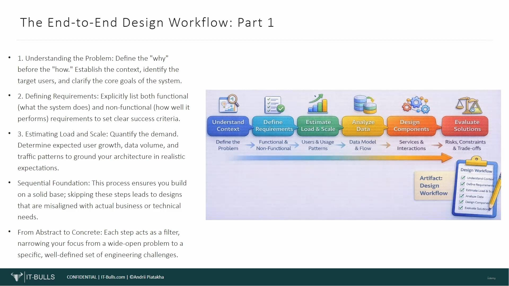

## 2. 讲师原话（带「—— pNNN [MM:SS]」）

P5 开头，讲师把这一节定位成一套结构化框架，而不是零散知识点：

> "我们会逐步讲解一个简单而有条理的框架，用于设计任何系统，从问题一直推进到解决方案。"
> —— p005 [00:00]

他解释为什么不能靠随机思考：

> "如果没有清晰的结构，这个过程很快就会变得不一致且不完整。"
> —— p005 [01:48]

端到端流程的起点不是架构，而是问题：

> "一切都始于对问题的理解。"
> —— p005 [03:43]

他强调步骤顺序，不要先画组件再补需求：

> "一个常见错误是跳过步骤，或者过早进入后续环节。"
> —— p005 [05:36]

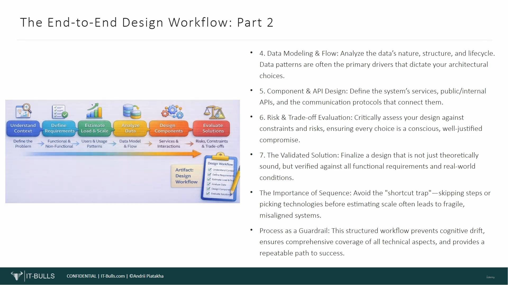

问题定义错了，后面再正确也没用：

> "即使把错误的问题正确地解决掉，仍然算是失败。"
> —— p005 [07:28]

需求是后续设计的基础：

> "需求是任何系统设计的基础。"
> —— p005 [07:56]

没有粗略估算，设计决策就是猜：

> "如果没有至少粗略的估算，设计决策就会变成凭空猜测。"
> —— p005 [09:51]

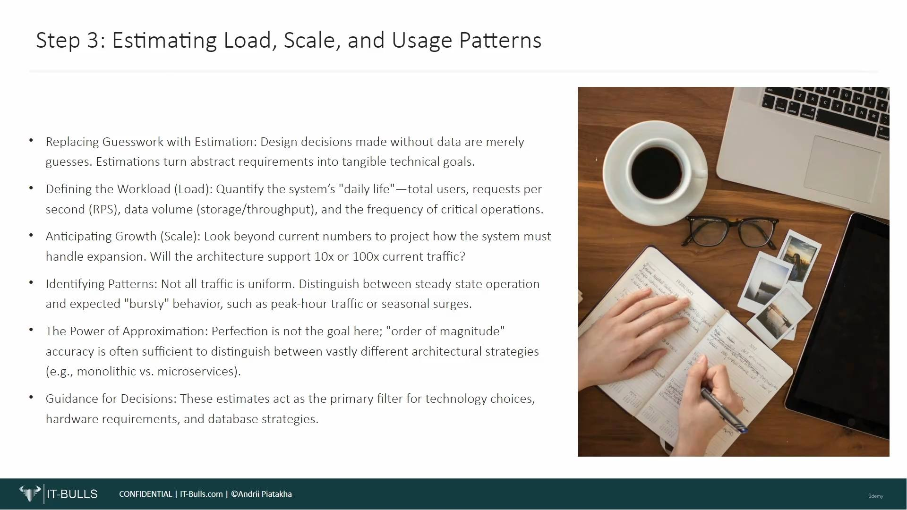

数据往往比服务划分更能决定架构：

> "许多架构决策最终都取决于数据的组织方式，以及数据在系统中的流动方式。"
> —— p005 [12:10]

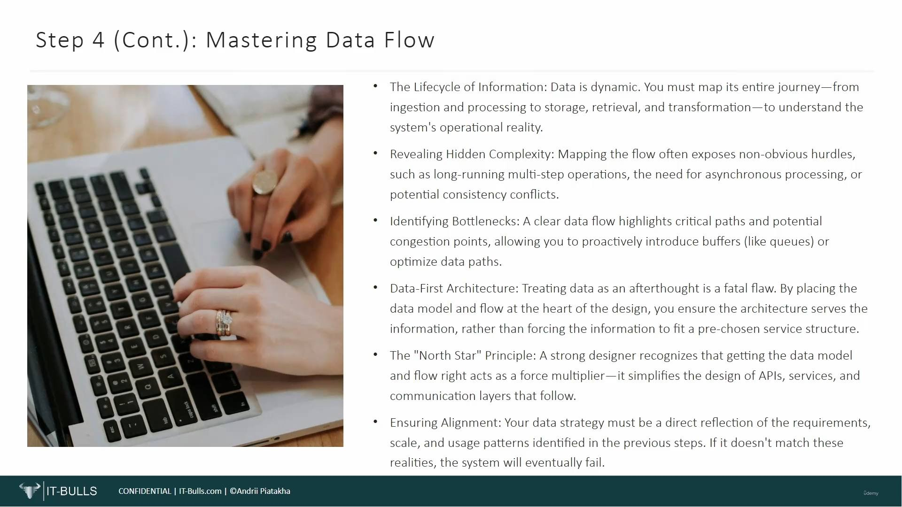

组件设计的关键原则是关注点分离：

> "这里的关键原则是关注点分离。"
> —— p005 [14:27]

风险、约束、取舍必须显式化：

> "任何设计都不是在理想条件下进行的。"
> —— p005 [16:48]

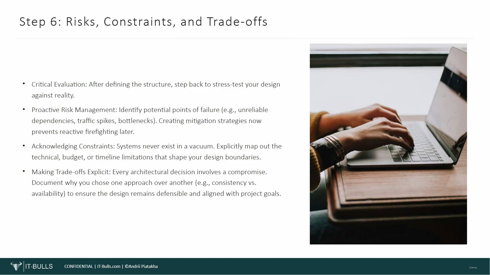

时间压力下容易漏关键项，所以需要检查清单：

> "在时间压力下工作时……很容易忽视一些关键方面。"
> —— p005 [19:11]

最后要把设计压到一页纸上：

> "这个思路是把整个设计呈现在一页纸上。"
> —— p005 [21:33]

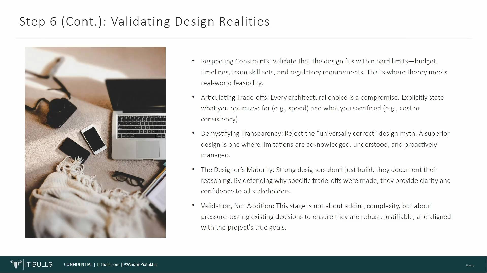

P6 的核心句是：没有数字的系统设计不完整。

> "没有数字支撑的系统设计是不完整的，而且在很多情况下并不可靠。"
> —— p006 [01:22]

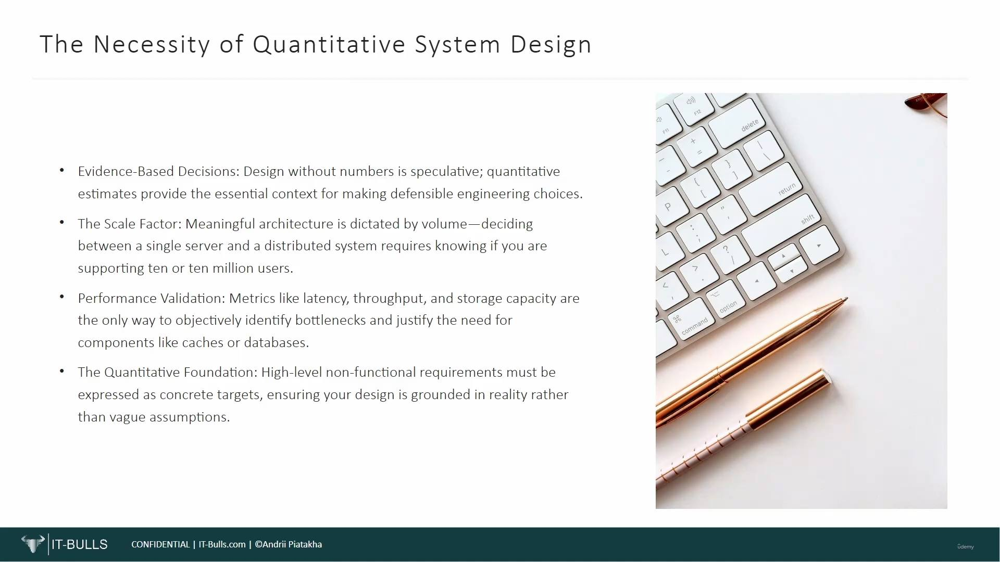

他要求把用户数翻译成并发，再翻译成请求率：

> "优秀的系统设计者总是先把用户数字转化为并发量，再转化为每秒请求数。"
> —— p006 [05:39]

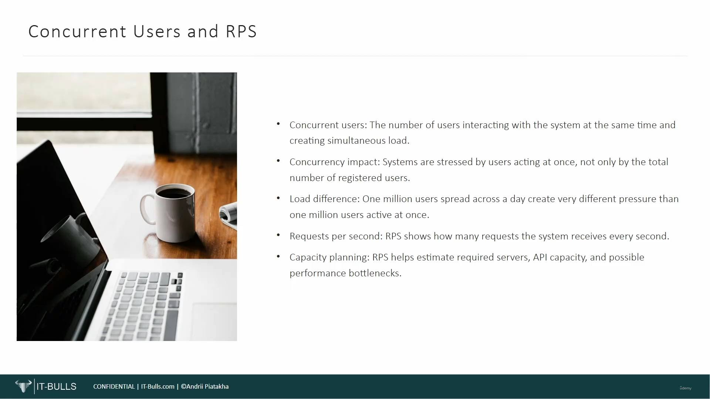

峰值负载才是决定系统行为的时刻：

> "系统不会在平均负载下失败，而会在峰值负载下失败。"
> —— p006 [06:36]

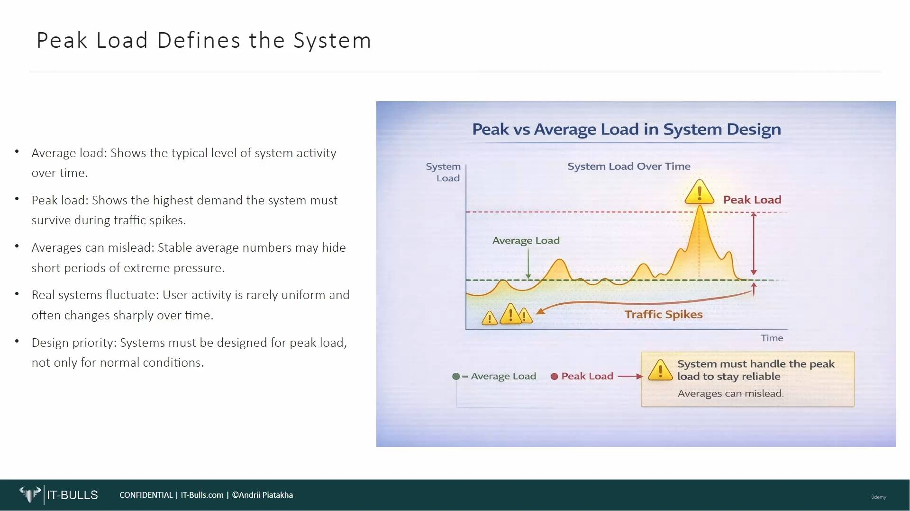

流量不是均匀的，要区分稳定、尖峰、季节性模式：

> "流量并不总是均匀的。"
> —— p006 [08:31]

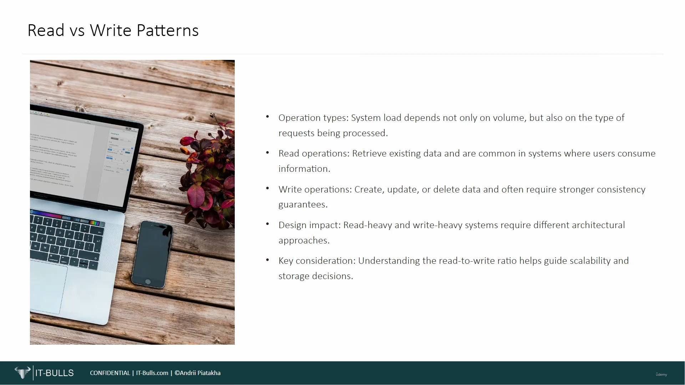

读写模式会直接改变设计选择：

> "并非所有请求都是等价的。"
> —— p006 [10:55]

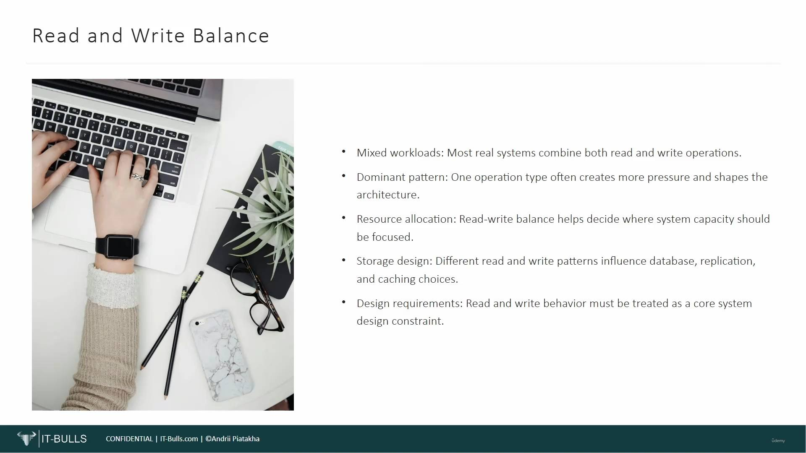

没有真实数据时，假设必须合理且透明：

> "关键不是回避它们，而是让它们合理且明确。"
> —— p006 [14:40]

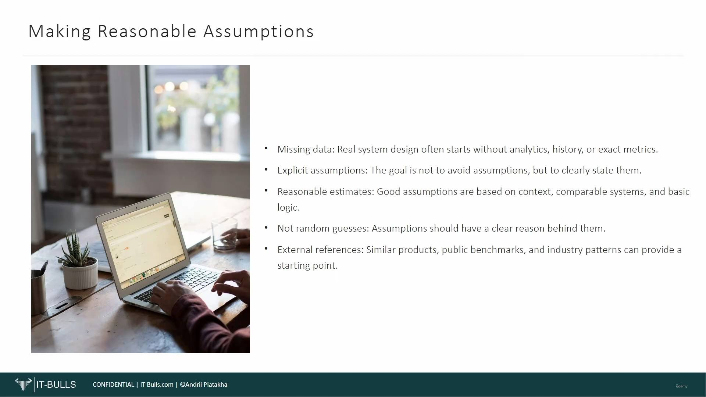

负载估算不是猜一个数，而是按步骤搭出可验证的画面：

> "负载估算不是猜一个单一数字，而是一个循序渐进的过程。"
> —— p006 [17:03]

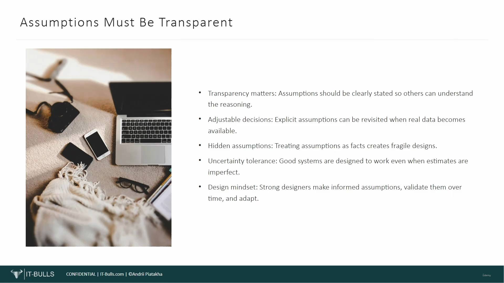

架构应该是需求和规模的结果，不是起点：

> "架构应当是对规模需求的回应，而不是起点。"
> —— p006 [20:22]

## 3. 从零复现

这一节按纯讲解课的复现方式写：把讲师的推导过程按步骤重放。你可以拿一张空白文档，按下面顺序填写。示例是我套用课程框架做的“内部知识库问答后台”练习；课程没有这个案例，也没有给任何具体技术选型。

### 3.1 先写问题，不写方案

讲师反复强调，第一步是理解上下文和问题。不要一上来写“我要用缓存、队列、微服务”。先填这张表：

| 项目 | 复现练习填写 |
|---|---|
| 用户是谁 | 公司内部员工、知识库维护人员 |
| 使用场景 | 员工上传文档、搜索/问答、查看历史；维护人员处理失败任务 |
| 要解决的问题 | 文档分散，查找慢，重复问答多 |
| 业务目标 | 缩短查找时间，减少重复答疑 |
| 非目标 | 不做公网开放，不做复杂权限矩阵，不做多租户计费 |
| 成功指标 | 查询 p95 响应时间、上传后可检索时间、峰值可用性、失败任务可追踪 |

问题陈述不要写“我们需要一个可扩展系统”，这句话在课程里被点名太模糊。可以写成：“为内部员工在文档查找和问答场景下，解决文档分散、查找慢的问题；成功指标是查询 p95 低于设定阈值、上传后可在约定时间内检索、峰值流量下不整体不可用。”这里的阈值是练习假设，不是课程数据。

### 3.2 拆功能需求和非功能需求

功能需求写“系统做什么”：

1. 用户登录。
2. 上传文档。
3. 文档异步处理，展示处理状态。
4. 输入问题并得到回答或检索结果。
5. 查看查询历史。
6. 维护人员查看失败任务并重试。

非功能需求写“做到什么程度”，并且尽量可度量：

| 非功能项 | 复现练习假设 | 为什么要写 |
|---|---|---|
| 响应时间 | 查询 p95 小于 3 秒；上传接口快速返回，不等待处理完成 | 课程要求避免“系统要快”这种不可测表述 |
| 峰值能力 | 平均 100 RPS，峰值按 3–5 倍估算 | P6 强调峰值决定系统行为 |
| 可用性 | 月度可用性目标 99.5% | 练习假设，课程没给具体数值 |
| 数据保留 | 文档保留 180 天，查询日志保留 30 天 | 影响存储估算 |
| 一致性 | 文档元数据与处理状态要一致；回答内容允许短时间缓存 | 课程要求显式取舍 |
| 成本 | 按峰值 500 RPS 设计，但不能无限堆机器 | 课程要求峰值与成本权衡 |

### 3.3 估算负载：按 worksheet 走

课程 P6 给的顺序是：总用户 → 活跃用户 → 并发用户 → 用户行为 → RPS → 读写拆分 → 峰值 → 增长。下面全部是复现练习假设。

| 步骤 | 公式/假设 | 结果 |
|---|---|---|
| 总用户 | 假设 100,000 注册用户 | 100,000 |
| DAU | 20% 日活 | 20,000 |
| 并发用户 | DAU 的 5% 同时在线 | 1,000 |
| 每用户请求 | 每个并发用户每分钟 6 次请求 | 0.1 RPS/人 |
| 平均 RPS | 1,000 × 0.1 | 100 RPS |
| 峰值 RPS | 平均 × 3 到 5 | 300–500 RPS |
| 读写比 | 90% 读，10% 写 | 平均读 90 RPS，写 10 RPS；峰值读 270–450 RPS，写 30–50 RPS |
| 文档增长 | 每天 1,000 份，平均 2 MB | 2 GB/天 |
| 180 天原始存储 | 2 GB × 180 | 360 GB |
| 加索引/元数据开销 | 按 20% 估算 | 432 GB |

这些比例不是课程给的固定系数，课程只给方法和顺序；真实项目要用埋点、日志、业务计划校准。这里写出来是为了让你看到“每个数字都有来源，假设可以改，公式不变”。

### 3.4 数据模型和数据流

按课程，先问“有哪些实体、怎么关联、数据怎么流动”。复现练习草案：

| 实体 | 关键字段 | 说明 |
|---|---|---|
| User | userId, name, role | 用户和角色 |
| Document | documentId, ownerId, fileName, size, status, createdAt | 文档元数据 |
| ProcessingJob | jobId, documentId, status, attempt, errorMessage | 异步处理任务 |
| QueryRecord | queryId, userId, question, answerRef, latencyMs, createdAt | 查询记录 |

数据流按顺序写：

1. 客户端调用上传接口。
2. 文档服务把文件写入对象存储，把元数据写入数据库。
3. 文档服务创建 ProcessingJob，投入队列。
4. 处理 worker 从队列取任务，更新状态。
5. 查询服务接收问题，先查缓存，再查元数据/检索结果，再调用外部模型服务。
6. 查询记录异步写入日志表。

这里出现的“对象存储、队列、缓存、外部模型服务”是复现练习的组件名，不是讲师在 P5–P6 里指定的技术选型。课程只讲了组件、交互、同步/异步、缓存、队列这些概念方向。

### 3.5 设计组件和交互

按“关注点分离”，每个组件只做一件事：

| 组件 | 职责 | 不负责什么 |
|---|---|---|
| API 网关 | 鉴权、限流、路由 | 不处理文档解析 |
| 文档服务 | 上传、元数据 CRUD、创建任务 | 不直接跑长任务 |
| 对象存储 | 存原始文件 | 不存查询状态 |
| 任务队列 | 缓冲上传处理任务 | 不做业务判断 |
| 处理 worker | 消费任务、更新状态、失败重试 | 不直接服务用户查询 |
| 查询服务 | 查询、缓存、调用外部模型服务 | 不处理文件上传 |
| 元数据数据库 | 存用户、文档、任务、查询记录 | 不存大文件 |
| 缓存 | 缓存热点查询/元数据 | 不作为唯一数据源 |
| 外部模型服务 | 生成回答 | 不负责权限和计费 |

交互上要回答课程里的问题：请求怎么走？哪些同步？哪些异步？失败怎么办？复现练习的选择是：上传同步返回“已接收”，处理异步；查询同步返回结果，但设置超时和降级；失败任务进入可重试状态，超过次数标记失败。课程提到同步简单但增加延迟和耦合，异步提升韧性但增加复杂度，这里就是那个取舍。

### 3.6 风险、约束、取舍

按课程，最后要停下来批判自己的设计：

| 风险/约束 | 可能后果 | 复现练习的缓解 |
|---|---|---|
| 峰值估算偏低 | 高峰期查询超时、队列堆积 | 按 3–5 倍峰值设计，限流和队列缓冲 |
| 增长估算偏高 | 过度设计、成本高 | 先做可水平扩展的边界，不提前拆过细 |
| 队列堆积 | 上传后长时间不可查 | 展示处理状态，worker 可扩容，失败可重试 |
| 缓存不一致 | 用户看到旧结果 | 设置短 TTL，关键状态不走缓存 |
| 外部模型服务慢 | 查询 p95 超标 | 超时、降级、限流；课里没讲具体实现 |
| 元数据和文件不一致 | 有记录无文件或反之 | 状态机 + 对账任务；课里没讲具体方案 |

### 3.7 一页纸画布

最后按课程把设计压成一页：

- 问题：内部文档分散、查找慢。
- 用户：员工、维护人员。
- 功能需求：登录、上传、异步处理、查询、历史、失败重试。
- 非功能：p95、峰值 RPS、可用性、保留期、成本边界。
- 规模：100,000 总用户、20,000 DAU、1,000 并发、100 平均 RPS、300–500 峰值 RPS。
- 数据：User、Document、ProcessingJob、QueryRecord。
- 数据流：上传 → 对象存储 + 元数据 DB → 队列 → worker；查询 → 缓存 → 查询服务 → 外部模型服务。
- 组件：网关、文档服务、worker、查询服务、缓存、DB、对象存储、队列。
- 取舍：异步换韧性但增加复杂度；缓存换延迟但可能旧数据；峰值设计换可用性但增加成本。
- 假设：所有比例均为练习假设，待真实数据校准。

## 4. 完整代码

这一节对应纯讲解课的“完整产物”。课程没有代码，所以没有目录结构、依赖版本、环境变量和启动命令；课里没给这些。下面把讲师的方法落成可直接填写和评审的表格。注意：所有具体数字、接口路径、字段名都是复现练习草案，不是讲师给出的实现。

### 4.1 设计决策表

| 决策点 | 可选方案 | 本复现选择 | 依据 | 代价/风险 |
|---|---|---|---|---|
| 上传处理 | 同步处理 / 异步队列 | 异步队列 | 课程讲异步提升韧性但增加复杂度 | 用户不能立刻看到结果，需要状态展示 |
| 读优化 | 直接查库 / 缓存 | 热点查询缓存 | P6 读多写少可缓存 | 可能读到旧数据 |
| 峰值策略 | 只按平均 / 按峰值 + 限流 | 按峰值设计并限流 | P6 峰值决定失败时刻 | 成本上升 |
| 数据存放 | 文件进数据库 / 文件与元数据分离 | 对象存储 + 元数据 DB | P5 数据模型影响架构 | 一致性和对账复杂 |
| 组件边界 | 一个大服务 / 按职责拆分 | 上传、处理、查询分离 | P5 关注点分离 | 运维和联调成本增加 |
| 增长策略 | 一次性过度设计 / 预留扩展点 | 先满足当前，保留水平扩展边界 | P6 增长不确定，避免过度/不足 | 需要持续复盘假设 |

### 4.2 组件职责表

| 组件 | 输入 | 输出 | 关键职责 | 失败时 |
|---|---|---|---|---|
| API 网关 | HTTP 请求 | 路由结果 | 鉴权、限流、路由 | 返回限流/鉴权错误 |
| 文档服务 | 文件、元数据 | documentId、jobId | 上传、元数据、建任务 | 回滚元数据或标记失败 |
| 对象存储 | 文件 | 文件引用 | 存原始文件 | 上传失败直接返回 |
| 任务队列 | jobId | 待处理任务 | 缓冲、解耦 | 堆积时告警/扩容 |
| 处理 worker | jobId | 状态更新 | 消费、重试、更新状态 | 标记失败，等待重试 |
| 查询服务 | 问题 | 回答/检索结果 | 查询、缓存、调用外部服务 | 超时降级 |
| 元数据 DB | 实体记录 | 查询结果 | 持久化元数据 | 事务/重试 |
| 缓存 | key | value | 热点数据 | 缓存失败回源 |
| 外部模型服务 | 问题/上下文 | 回答 | 生成回答 | 超时、限流、降级 |

### 4.3 接口草案

| 方法 | 路径 | 用途 | 输入 | 输出 | 备注 |
|---|---|---|---|---|---|
| POST | /documents | 上传文档 | 文件、ownerId | documentId、jobId、status | 快速返回，不等待处理 |
| GET | /documents/{id} | 查文档状态 | documentId | status、errorMessage | 前端轮询或推送，课里没讲推送 |
| POST | /queries | 提问 | userId、question | queryId、answer、latencyMs | 设置超时 |
| GET | /queries/{id} | 查历史 | queryId | question、answerRef、createdAt | 用于历史页 |
| POST | /jobs/{id}/retry | 重试任务 | jobId | status | 仅维护人员 |

### 4.4 数据模型草案

| 表/实体 | 字段 | 类型草案 | 说明 |
|---|---|---|---|
| User | userId | string | 主键 |
| User | role | string | employee/maintainer |
| Document | documentId | string | 主键 |
| Document | ownerId | string | 关联 User |
| Document | status | string | uploaded/processing/ready/failed |
| Document | storageRef | string | 对象存储引用 |
| ProcessingJob | jobId | string | 主键 |
| ProcessingJob | documentId | string | 关联 Document |
| ProcessingJob | attempt | number | 重试次数 |
| QueryRecord | queryId | string | 主键 |
| QueryRecord | latencyMs | number | 观测用 |
| QueryRecord | createdAt | string | ISO 时间 |

### 4.5 容量估算表

| 指标 | 公式 | 结果 | 说明 |
|---|---|---|---|
| DAU | 总用户 × 20% | 20,000 | 练习假设 |
| 并发用户 | DAU × 5% | 1,000 | 练习假设 |
| 平均 RPS | 并发用户 × 每用户每分钟请求 / 60 | 1,000 × 6 / 60 = 100 RPS | 6 次/分钟为假设 |
| 峰值 RPS | 平均 RPS × 3–5 | 300–500 RPS | 峰值倍数为假设 |
| 平均读 RPS | 平均 RPS × 90% | 90 RPS | 读写比假设 |
| 平均写 RPS | 平均 RPS × 10% | 10 RPS | 读写比假设 |
| 峰值读 RPS | 峰值 RPS × 90% | 270–450 RPS | 需压测验证 |
| 峰值写 RPS | 峰值 RPS × 10% | 30–50 RPS | 需压测验证 |
| 每日原始存储 | 1,000 份 × 2 MB | 2 GB/天 | 文档增长假设 |
| 180 天原始存储 | 2 GB × 180 | 360 GB | 保留期假设 |
| 加 20% 开销 | 360 GB × 1.2 | 432 GB | 索引/元数据粗略估算 |

## 5. 逐行解释

### 5.1 估算表逐行解释

“总用户 100,000”只是规模起点，不能直接拿来设计，因为课程明确说总用户数本身不够。把它乘 20% 得到 DAU，是为了从“注册过”变成“今天会用”的量级。20% 是练习假设；如果真实 DAU 是 5%，你按 20% 设计就会过度，如果真实是 50%，你按 20% 就会不足。课程要求假设显式，就是为了以后能改。

“DAU × 5% = 1,000 并发用户”是把日活翻译成同时在线。课程说系统压力来自并发，不来自总用户。5% 同样是假设。如果业务是公告类系统，并发比例可能很低；如果是工作日上午全员同时使用，比例会高很多。这个数字直接决定后面 RPS，所以必须标注来源。

“每用户每分钟 6 次请求 ÷ 60 = 0.1 RPS/人”是把用户行为翻译成请求率。为什么除以 60？因为 RPS 是每秒请求数，而行为假设是每分钟。若你按“每 session 10 次请求、平均 10 分钟”估算，也可以先算每 session 的请求量再除时间，但最终都要落到每秒。课程强调不要跳到一个孤立数字，而要能解释它怎么来的。

“1,000 × 0.1 = 100 平均 RPS”是平均负载。平均负载只能描述典型状态，不能描述最坏状态。课程的原话是系统不会在平均负载下失败，而是在峰值负载下失败。所以下一行必须乘峰值倍数。3–5 倍是练习假设；真实项目要看业务曲线。只按 100 RPS 设计，遇到 500 RPS 就会超时、队列堆积、连接池耗尽。

“读写比 90/10”是为了决定优化方向。课程说读多写少可以缓存、复制、读优化；写多读少要关注一致性、持久性、并发处理。这里 90% 读意味着缓存收益大，但缓存会带来旧数据风险，所以关键状态不能只放缓存。10% 写意味着队列和 worker 要按峰值写 RPS 设计，不能只按平均 10 RPS。

“每天 1,000 份 × 2 MB = 2 GB/天”是存储增长。课程提醒增长估算短期可预测、长期不确定。180 天 × 2 GB = 360 GB 是原始文件，乘 1.2 得到 432 GB 是粗略加索引/元数据开销。这里没有算备份、副本、日志，所以真实值会更高；课程没给这些系数，本文也不编固定值，只把它标成“粗略估算”。

### 5.2 决策表逐条解释

上传选择异步队列，是因为课程明确说同步简单但增加延迟和耦合，异步提升韧性和扩展性但增加复杂度。这里选异步，不是因为它“先进”，而是因为文档处理是长任务，不能让上传接口一直等。代价是用户不能立刻看到结果，所以必须有 status 字段和失败重试入口。如果不这样，上传接口会被长任务拖住，高峰期连接被占满。

热点查询用缓存，是因为读多写少。课程说读多系统可能受益于缓存。但缓存不是免费：用户可能看到旧数据。所以复现练习只缓存热点查询和非关键元数据，关键状态回源。如果不加这个限制，缓存会掩盖一致性问题。

按峰值设计并限流，是 P6 的直接推论。只按平均设计会在最忙的时候坏；只按无限峰值堆资源又成本过高。所以选择“按峰值设计关键路径 + 限流保护”，这是课程说的取舍：可靠处理峰值，同时保持经济上合理。

文件与元数据分离，是因为课程说数据模型和数据流常常决定架构。把大文件塞进数据库会让查询、备份、扩容都变重；分离后对象存储存文件，数据库存元数据，查询更轻。代价是要处理“有元数据没文件”或“有文件没元数据”的不一致，所以需要状态机和对账。

组件按职责拆开，是“关注点分离”。每个组件做一件事，系统更容易理解、开发和维护；拆得太粗会紧耦合，改一处影响多处。代价是联调和运维更复杂，所以不是越细越好，而是按职责边界拆。

增长策略选择“先满足当前，保留水平扩展边界”，对应课程说的短期准确、长期适应。过度设计会复杂且贵，设计不足会在增长时崩。复现练习不预测精确未来，而是把无状态服务、队列、存储这些边界留出来。

### 5.3 在 JS/Node 里对应什么

课程里的“并发用户”是业务并发，不是 JavaScript 单线程里的“同时执行”。Node 用事件循环和异步 I/O 可以同时挂起很多请求，但这不代表一个进程能无限扛并发；数据库连接池、外部模型服务连接、CPU 密集任务、内存都会限制你。对应做法是：用连接池限制数据库连接，用队列削峰，用限流保护下游，用超时和重试处理外部服务。

课程提到异步通信和一致性，但没有讲锁和事务的具体实现。在 Node 里，如果你要保证“同一文档不被重复处理”，不要用进程内变量当锁，因为多实例部署时无效；应该用数据库唯一约束、状态机条件更新或外部锁服务（课里没讲具体产品）。事务用数据库事务 API；跨请求的重复提交用幂等键和唯一约束。Java 等语言里的锁语法知道即可，这里不展开。

## 6. 复现检查清单

下面是我按 P5 的检查清单思路整理的复现清单，不是讲师逐项原文。每次做完设计，按顺序打勾：

- [ ] 我写清楚了用户是谁、场景是什么、业务目标是什么。
- [ ] 我写了非目标，避免范围膨胀。
- [ ] 问题陈述不是“需要可扩展系统”这种模糊句。
- [ ] 功能需求能列出用户动作和系统行为。
- [ ] 非功能需求有可度量指标，不只是“快、稳、安全”。
- [ ] 我估了总用户、DAU、并发用户、平均 RPS。
- [ ] 我估了峰值 RPS，并说明峰值倍数假设。
- [ ] 我校验了流量模式：稳定、尖峰、季节性，还是混合。
- [ ] 我标了读写比，并说明读多还是写多。
- [ ] 我写了增长假设和短期/长期不确定性。
- [ ] 所有假设都显式列出，没有把假设当事实。
- [ ] 我列了主要数据实体和关系。
- [ ] 我画了数据流：入口、处理、存储、读取、异步路径。
- [ ] 每个组件有清晰职责，没有“万能服务”。
- [ ] 我标了同步交互和异步交互，以及失败处理。
- [ ] 我列了风险、约束、取舍，并说清楚优化了什么、牺牲了什么。
- [ ] 我能把设计压到一页纸：问题、需求、规模、数据、组件、取舍。
- [ ] 我知道哪些数字需要压测或真实埋点校准。
- [ ] 我知道哪些实现课程没讲，需要另补。

## 7. 课里没讲但你会撞上的

第一，课程没有给具体技术选型。它没有说用哪个数据库、哪个缓存、哪个队列、哪个云服务；也没有给代码、目录结构、依赖版本、环境变量、启动命令。你照着本文能复现的是设计表和估算过程，不是一个可运行仓库。

第二，课程给了估算顺序，但没有给固定系数。DAU 比例、并发比例、每用户请求数、峰值倍数、读写比、存储开销，都需要你用真实数据校准。本文里的 20%、5%、6 次/分钟、3–5 倍、90/10、20% 都是复现练习假设，不是课程数据。真实项目里，假设写不清，后面所有容量结论都不可信。

第三，课程没有讲压测方法、监控告警、SLO/SLA 的具体定义、成本核算、安全合规、权限模型、数据保留策略的实现。它提到 operational aspects、failure scenarios、consistency，但没有展开到工具和代码。你会在落地时撞上这些：队列堆积怎么告警、重试多少次、死信怎么处理、缓存穿透怎么办、数据库连接池多大、限流按用户还是按 IP。

第四，课程没有讲锁、事务、幂等的具体实现。它提到并发、一致性、异步通信，但没有给方案。在 Node 里你会遇到：多实例下内存锁无效；重复提交需要幂等键；跨表更新需要事务；异步任务重试可能重复执行，需要去重。这些都要在组件设计后补，不要以为画了队列就自动可靠。

第五，如果你做 AI 应用，课程没有讲 AI 特有的问题：模型调用超时、流式响应、token 计费、上下文长度、重试与降级、内容安全、向量检索、模型服务限流。P5–P6 只给你系统设计框架和负载估算方法；AI 部分需要另补。你可以把“外部模型服务”当成一个外部依赖，用课程的风险、约束、取舍方法去分析它，但不要假称讲师讲过这些细节。

第六，课程没有讲“一页纸画布”的具体模板字段。它只说应该包含问题定义、关键需求、估算规模、主要组件、数据流、重要取舍。本文的模板是按这些点整理的；你可以按团队习惯改字段，但不要丢掉问题、需求、规模、数据、组件、取舍这六类信息。