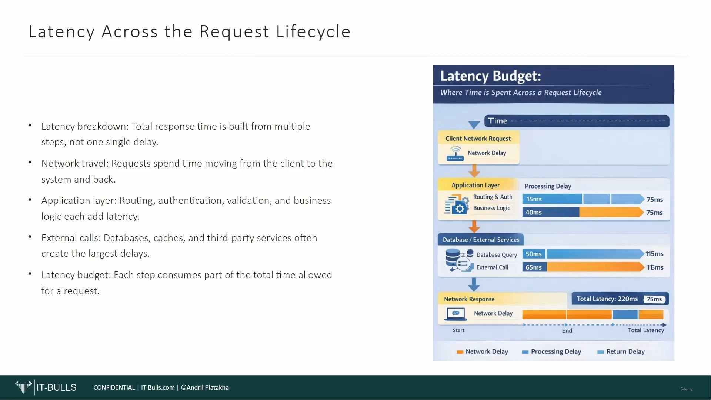
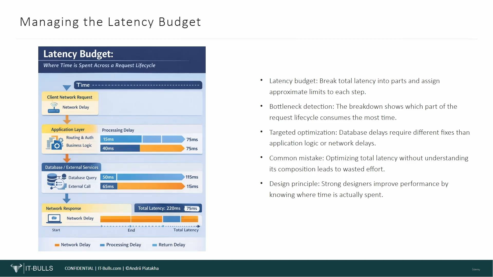
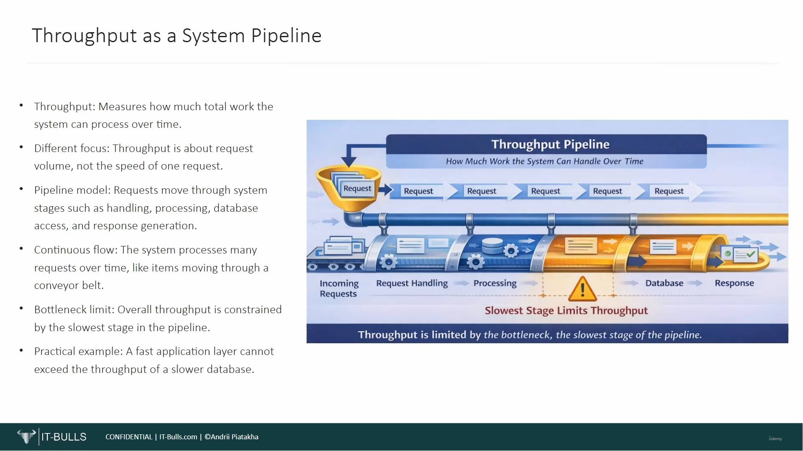
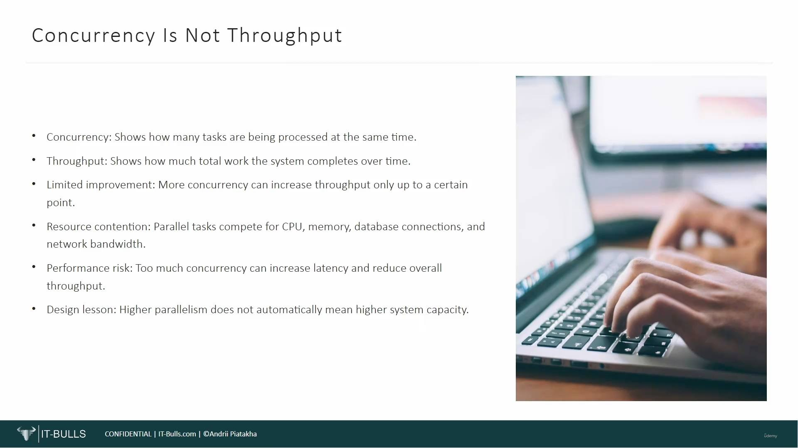
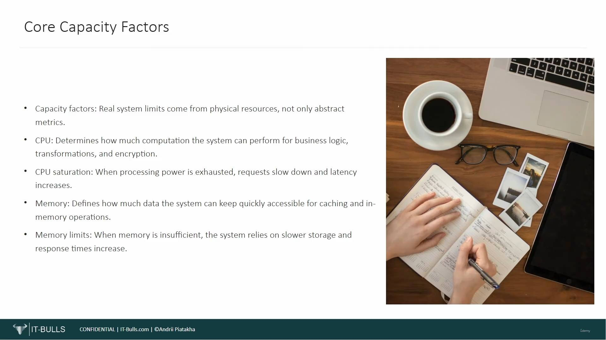
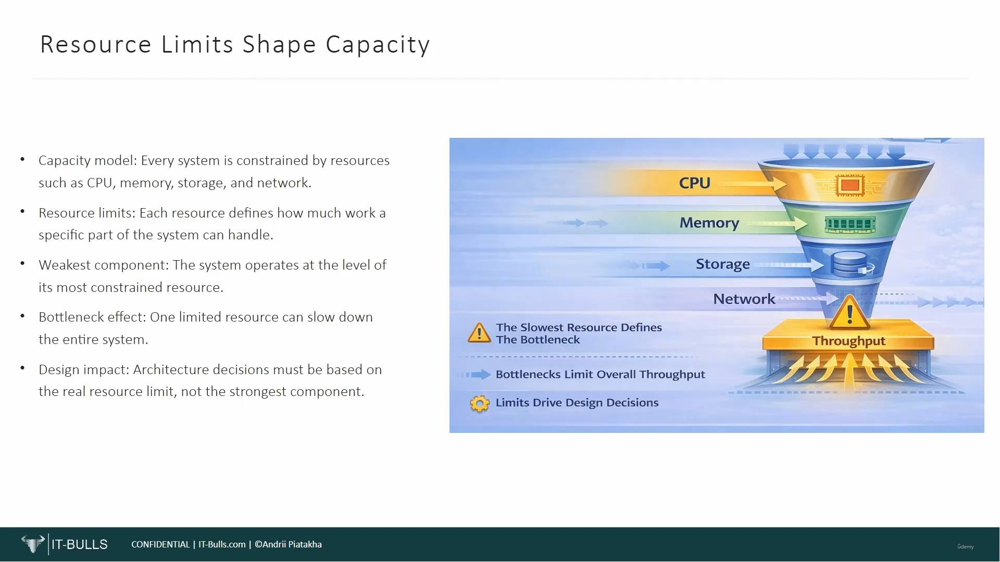
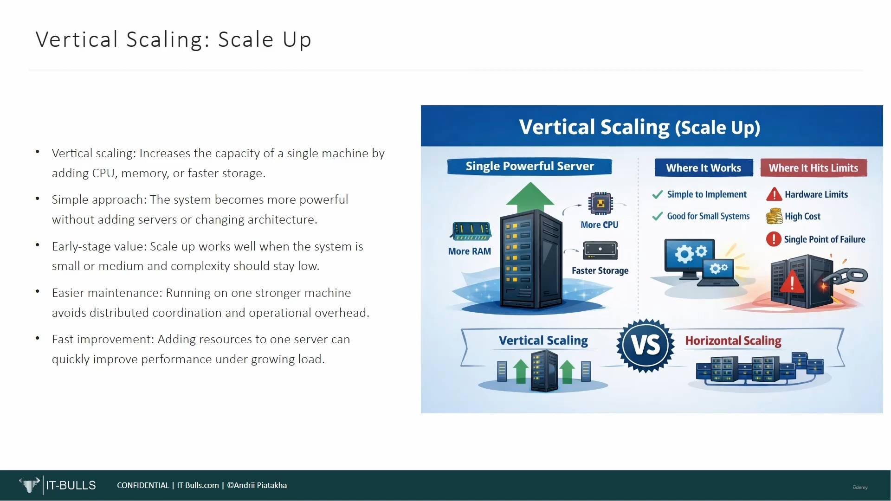
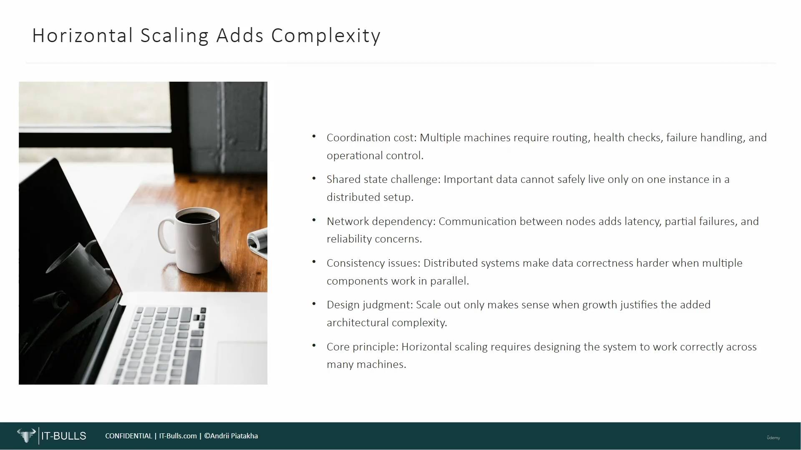
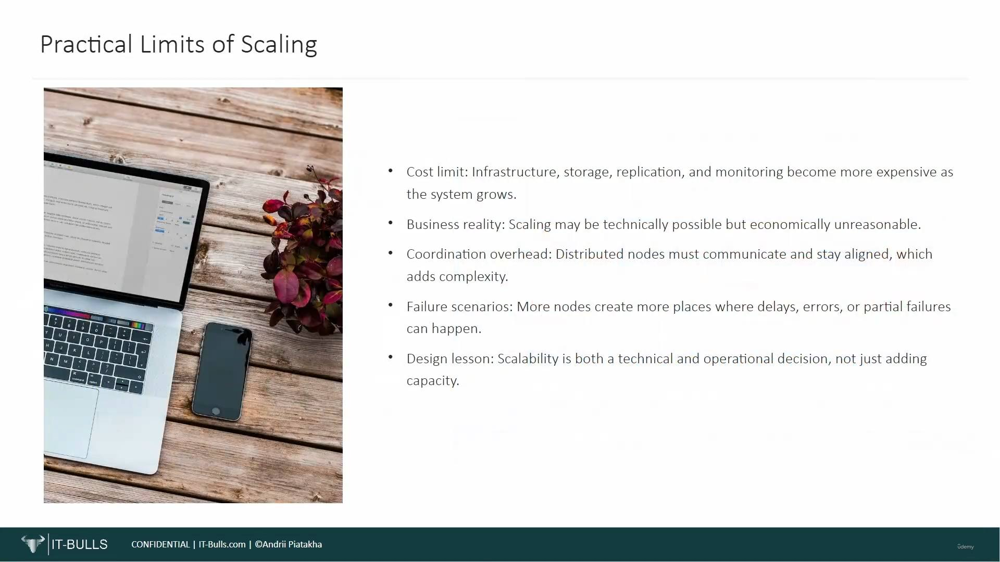
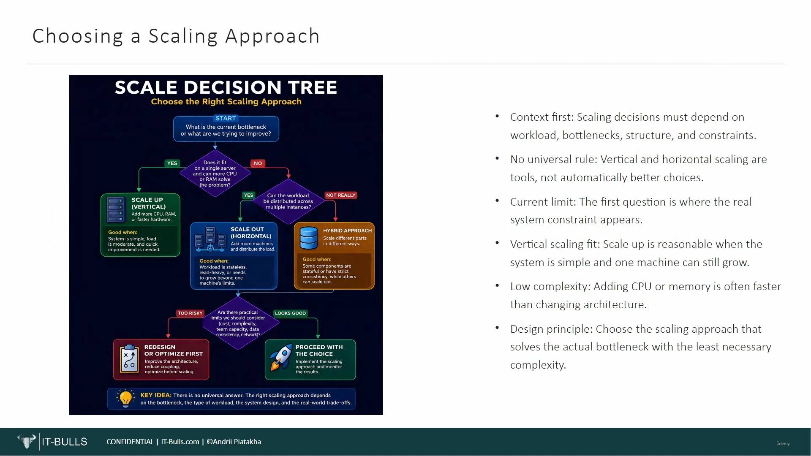

# System Design for Developers · P007–P008 复现文档
## 延迟 / 吞吐 / 容量 与 垂直 / 水平扩缩容

> 说明：这两讲是**纯讲解课**（白板 + PPT 图，逐字稿里没有任何代码、命令或配置文件）。因此本文严格按“纯讲解课”的写法组织：第 3 节把讲师的推导过程拆成可照着走的步骤，第 4 节把讲师的结论落成**设计决策表 / 组件职责表 / 容量估算表**这类可交付产物，凡是课里没讲的环节一律标注“课里没讲”，凡是补充的示意代码一律显式标注“课里没有代码，以下为示意”。

---

## 1. 这一节做什么

这两讲要解决的问题只有一个：**当有人问你“这个系统能扛多少”时，你能不能用一张表回答，而不是用形容词回答。**

P007 建立三个互相纠缠但绝不能混用的指标：

- **延迟（latency）**——单个请求从进到出要多久；
- **吞吐（throughput）**——单位时间内系统能完成多少个请求；
- **容量（capacity）**——系统在性能开始退化或开始报错之前，最多能承受多大负载。

P008 在此基础上回答“扛不住的时候怎么办”：

- **垂直扩容（scale up）**——把一台机器变强；
- **水平扩容（scale out）**——把机器变多，把负载摊开；
- 以及一个更重要的判断：**扩容不会消灭瓶颈，只会把瓶颈挪个位置。**

做完这两讲，你手上应该有的**可交付物**是五张表：

| 编号 | 产物 | 用途 |
|---|---|---|
| A | 三指标对照表 | 团队讨论时统一口径，避免“优化”变成各说各话 |
| B | 延迟预算表 | 把“慢”拆成若干段，找出占比最大的那一段 |
| C | 吞吐流水线表 | 找出最慢的一级，算出系统吞吐上限 |
| D | 容量因子表 | CPU / 内存 / 存储 / 带宽 / 网络，逐项写“饱和时先看到什么现象” |
| E | 扩缩容决策表 | 把“选垂直还是水平”从口味问题变成条件判断 |

这五张表都不需要写业务代码，但要填具体数字。**这两讲的产出是判断力，不是服务。**

---

## 2. 讲师原话（带「—— pNNN [MM:SS]」）

关于三个指标的定义，讲师把边界划得很死：

> "延迟关乎时间。它回答一个简单问题——单个请求从开始到处理完成需要多久？"
> —— p007 [01:54]

> "吞吐量关注的不是单个请求的耗时，而是单位时间内的处理量。"
> —— p007 [02:22]

> "容量定义了系统的上限，也就是系统在性能下降或发生故障之前能够承受的最大负载。"
> —— p007 [02:22]

关于“三者不能混为一谈”，讲师给了一个明确的错误清单：

> "一个常见错误是把这些指标割裂开来看。"
> —— p007 [03:18]

> "你可能延迟很低，但吞吐量也很低……也可能吞吐量很高，但延迟更高。"
> —— p007 [04:41]

关于延迟预算（latency budget），这是 P007 最可操作的一段：

> "我们不会把延迟当成单一数字，而是把它拆成多个部分，并为每个步骤设定大致的时间上限。这样就能找出哪里需要优化。"
> —— p007 [07:01]

> "如果大部分延迟来自数据库查询，那么优化应用逻辑帮助不大。"
> —— p007 [07:01]

关于吞吐与流水线：

> "系统的整体吞吐量受这条流水线中最慢阶段的限制。"
> —— p007 [08:26]

> "如果你的应用层每秒能处理数千个请求，但数据库只能处理几百个，那么系统吞吐量就会受数据库制约。"
> —— p007 [08:53]

关于并发不等于吞吐：

> "在某些情况下，提高并发反而会增加延迟，进而降低整体吞吐量。"
> —— p007 [11:21]

> "系统达到最大吞吐量时存在一个最优点。超过这个点后，继续增加并行度会带来收益递减，甚至导致性能退化。"
> —— p007 [11:47]

关于容量由最弱一环决定：

> "系统容量不是由最强的组件决定，而是由最弱的组件决定。"
> —— p007 [14:38]

> "如果数据库是瓶颈，可以引入缓存或复制；如果处理器过载，可以横向扩展；如果问题在网络，可以减少载荷大小，或把组件部署得更近。"
> —— p007 [16:02]

> "脱离上下文的改进不叫优化，只是把问题转移到别处。"
> —— p007 [18:18]

P008 对“可扩展性”的定义纠正：

> "可扩展性不只是增加资源，而是系统应对增长的能力。"
> —— p008 [01:53]

> "可扩展性是系统的一种属性，而不是到最后才采取的动作。"
> —— p008 [02:49]

垂直扩容与它的三个硬限制：

> "纵向扩展，也就是向上扩展，是指提升单台机器的容量。"
> —— p008 [03:49]

> "首先是物理上限……其次是成本因素……最后还有可靠性问题。如果所有东西都跑在一台机器上，这台机器就会成为单点故障。"
> —— p008 [04:45]

水平扩容与它的代价：

> "横向扩展，也就是向外扩展，是指通过增加更多机器并在它们之间分配工作来提升系统容量。"
> —— p008 [05:38]

> "不过，这种收益是有代价的：复杂性。"
> —— p008 [06:37]

> "一旦有了多台机器，就需要跨节点进行协调、请求路由、健康检查和故障处理。"
> —— p008 [06:37]

关于瓶颈移动：

> "扩展不会消除瓶颈，只会把瓶颈挪到别处。"
> —— p008 [07:34]

> "如果我们增加更多应用服务器，数据库可能成为新的瓶颈；如果我们优化数据库，网络又可能成为限制因素。"
> —— p008 [08:03]

> "每一次改进都会暴露出新的限制因素。"
> —— p008 [08:03]

关于现实约束与有状态组件：

> "第一个限制是成本……然后是协调……数据一致性是另一个主要限制……网络也会成为实实在在的约束……最后还有运维限制。"
> —— p008 [09:01]

> "无状态组件要容易扩展得多……有状态组件则难得多。"
> —— p008 [10:58]

关于决策方式：

> "正确的选择取决于工作负载、瓶颈、系统结构和实际约束。"
> —— p008 [14:23]

> "横向扩展很强大，但它并不会自动成为正确答案。"
> —— p008 [16:43]

---

## 3. 从零复现

这一节不是“再讲一遍知识点”，而是把讲师在白板上的推导，变成你可以按顺序做的动作。下面分 P007 与 P008 两条线，每条线都按 **需求 → 约束 → 估算 → 方案 → 取舍** 走一遍。

### 3.1 P007 线：给一个接口做“性能体检”

**需求**：接口现在平均 500ms，产品要求 200ms。你没有性能分析工具，只有日志。

**约束**：不能改数据库表结构，不能加机器（这两条是假设的项目约束，课里没有讨论具体项目）。

**步骤 1：先别测总数，先分段。**
讲师的说法是“延迟不是一整块，而是一串步骤组合起来的”，并且指出请求大致经过：客户端 → 网络 → 应用层（路由、鉴权、校验、业务逻辑）→ 外部组件（数据库、缓存、第三方服务）→ 构造响应 → 网络返回。—— p007 [06:06]



**步骤 2：给每段设“预算”。**
讲师强调“不是把延迟当一个数字，而是拆成部分，给每一步一个近似的时间上限”。—— p007 [07:01] 于是得到一张待填表（见第 4 节表 B）。预算的作用不是精确，而是**让“哪一段超了”这件事变成可判定的**。



**步骤 3：算占比，找最大项。**
填完表你会得到一行百分比。讲师的原话是：如果延迟主要来自数据库查询，优化应用逻辑基本没用；如果网络延迟占主导，那需要的是架构层面的改动（比如把组件挪近），而不是改代码。—— p007 [07:01]

**步骤 4：把视角从“单个请求”切到“整条流水线”。**
讲师把吞吐画成流水线：请求像传送带上的物品依次经过请求处理、业务处理、数据库交互、响应生成。**整体吞吐由最慢的一级决定。**—— p007 [08:26]



**步骤 5：估一次吞吐上限（这里是估算，不是测量）。**
讲师给的例子是定性的：“应用层能处理几千 req/s，数据库只能处理几百 req/s，那系统吞吐就被数据库卡住。”—— p007 [08:53] 把它写成算式就是：

```
系统吞吐上限 ≈ min(各阶段每秒处理量)
示例：min(2000, 300, 5000, 800) = 300 req/s
```

> 上面的具体数字是**示例演算**，课里只给了“几千 vs 几百”的量级对比，没有给精确值。

**步骤 6：在加并发之前，先确认瓶颈在哪。**
讲师明确说：并发是“同一时刻有多少任务在处理”，吞吐是“单位时间完成多少工作”，两者不是一回事；并发上去之后，CPU、内存、数据库连接、网络带宽都开始争抢，上下文切换本身也产生开销，最终可能延迟上升、吞吐反而下降。—— p007 [10:51]–[11:21]



**步骤 7：列容量因子，逐项问“饱和时我先看到什么”。**
讲师列了五项：CPU、内存、存储、带宽、网络。—— p007 [12:17]–[14:09]



**步骤 8：把“最弱一环”翻译成设计动作。**
讲师给的映射非常具体：数据库是瓶颈 → 引入缓存或复制；CPU 过载 → 水平扩展；网络是问题 → 减小 payload、把组件挪近。—— p007 [16:02]



**步骤 9：取舍检查——三个指标一起看。**
讲师最后反复强调的就是这条：只盯一个指标，会把问题挤到别处去。—— p007 [16:56]–[18:18]

### 3.2 P008 线：给一个系统决定“往上加还是往横加”

**需求**：服务撑不住了，要不要上多台机器？

**步骤 1：先把“可扩展性”定义对。**
讲师否掉了“可扩展性 = 加服务器”，改成“系统在用户变多、请求变多、数据变多、运维变复杂的情况下，仍能可靠运行、且不需要推倒重来的能力”。—— p008 [01:53]

**步骤 2：判断当前瓶颈是否在单机之内。**
如果系统还简单、还装得下一台机器、加 CPU 或内存就能改善，讲师说垂直扩容往往是更合理的选择，因为它实施更快、架构改动更小。—— p008 [14:23]



**步骤 3：检查垂直扩容的三道墙。**
物理上限（单机只能加到某个程度）、成本（越强的机器越贵，且贵得比收益快）、可靠性（单机即单点故障，挂了整个系统受影响）。—— p008 [04:45]

**步骤 4：只有在“工作负载能被干净地切开”时，才考虑水平扩容。**
讲师点名的典型是**无状态服务**——任何实例都能处理任何请求，加节点挂到负载均衡后面就能扩。同时明确列出代价：需要协调、请求路由、健康检查、跨节点故障处理，还要重新考虑共享状态；此外分布式引入延迟、部分失败、一致性问题。—— p008 [05:38]–[07:07]



**步骤 5：扩容前先承认“瓶颈会移动”。**
加应用服务器 → 数据库成为新瓶颈；优化数据库 → 网络成为限制；提升存储性能 → 瓶颈跑到 CPU 或内存。—— p008 [08:03]



**步骤 6：把现实约束列成清单。**
成本、协调、数据一致性、网络、运维复杂度。—— p008 [09:01]

**步骤 7：按“有状态 / 无状态”给每个组件分类。**
无状态组件好扩；数据库、存储系统这类持有关键数据的组件，必须保证一致性、持久性和操作顺序，扩起来难得多。—— p008 [10:58]

**步骤 8：走决策树。**
第一个问题是“当前限制到底在哪”；第二个问题是“工作负载能不能分布”；第三个问题是“这个组件是否持有关键共享数据”。三个问题答完，答案要么垂直、要么水平、要么混合（一部分 scale up、一部分 scale out）。—— p008 [14:23]



**步骤 9：反模式自检。**
讲师专门批评了“默认水平扩容”这件事：太早上水平扩容，会在还没有真实需求的时候先制造出一堆分布式问题。—— p008 [15:46]–[16:43]

---

## 4. 完整代码

> **课里没有代码，以下全部为表格化产物；唯一一段代码在第 4.6 节，已标注为“示意”。**

### 4.1 表 A：三指标对照表（P007）

| 指标 | 度量对象 | 单位 | 回答的问题 | 讲师给出的关系 | 只优化它的副作用 |
|---|---|---|---|---|---|
| 延迟 latency | 单个请求 | 毫秒 / 秒 | 一个请求从头到尾多久 | 延迟上升会拉低吞吐（p007 [04:41]） | 可能抬高资源用量与成本，或压低吞吐（p007 [17:26]） |
| 吞吐 throughput | 单位时间的完成量 | req/s、req/min、req/h | 单位时间能做多少活 | 靠并行提吞吐会加大资源占用，撞上容量上限（p007 [04:41]） | 提高并发可能引入争用，反而抬高延迟（p007 [17:26]） |
| 容量 capacity | 系统的上限 | 负载量 | 到什么程度开始退化或失败 | 受 CPU、内存、存储、网络带宽约束（p007 [02:22]） | 只加容量不找瓶颈，等于把问题挪到下一层 |

### 4.2 表 B：延迟预算表（P007 核心产物）

| 阶段 | 讲师描述的环节（p007 [06:06]） | 预算（示例） | 实测（待填） | 占比 | 状态 |
|---|---|---|---|---|---|
| client → server | 请求经网络进入系统 | 60 ms | — | — | — |
| 路由 / 鉴权 / 校验 | 应用层入口处理 | 40 ms | — | — | — |
| 业务逻辑 | 应用层主体计算 | 50 ms | — | — | — |
| 数据库 / 缓存 / 第三方 | 外部组件交互 | 300 ms | — | — | — |
| 构造响应 + 返回 | 再次经过网络 | 50 ms | — | — | — |
| **合计** | — | **500 ms** | — | 100% | — |

> 上表的时间数字是**示例值**，用来演示“拆段 + 设上限 + 算占比”这个方法；课里只讲了方法，没有给任何具体毫秒数。

### 4.3 表 C：吞吐流水线表（P007）

| 流水线阶段 | 每秒处理量（示例） | 是否最慢级 | 依据 |
|---|---|---|---|
| 请求处理 | 2000 | 否 | — |
| 业务处理 | 1800 | 否 | — |
| 数据库交互 | 300 | **是** | 与讲师“几千 vs 几百”的量级对比一致（p007 [08:53]） |
| 响应生成 | 5000 | 否 | — |
| **系统吞吐上限** | **≈ 300 req/s** | — | 由最慢一级决定（p007 [08:26]） |

### 4.4 表 D：容量因子表（P007）

| 资源 | 讲师说明它决定什么（p007 [12:17]–[14:09]） | 饱和时的表现 | 讲师给出的缓解方向（p007 [16:02]） |
|---|---|---|---|
| CPU | 系统能做多少计算（业务逻辑、数据转换、加密） | 请求变慢，延迟上升 | CPU 过载 → 水平扩展 |
| 内存 | 多少数据能保持在“随手可取”的状态 | 更多落到更慢的存储上，响应时间上升 | 课里只讲了“缓存和内存操作常用于提速”，未给具体缓解动作 |
| 存储 | 数据如何被持久化；SSD/HDD 影响明显 | 大数据集或复杂查询变慢 | 数据库是瓶颈 → 缓存或复制 |
| 带宽 | 单位时间能传多少数据 | 组件之间、系统到用户的数据传输变慢 | 减小 payload |
| 网络 | 组件之间通信的快慢与可靠性；跨机器跨地域时代价显著 | 分布式链路整体延迟抬升 | 把组件挪近（move components closer together） |

### 4.5 表 E：扩缩容决策表（P008）

| 判断条件 | 选择 | 讲师依据 |
|---|---|---|
| 系统还简单、还装得进一台机器、加 CPU/内存能改善 | 垂直扩容 | p008 [14:23] |
| 已接近单机上限，或工作负载能分布到多节点 | 水平扩容 | p008 [14:50] |
| 组件是无状态的（任何实例都能处理任何请求） | 水平扩容成本最低 | p008 [06:07] |
| 组件持有必须保持一致性的关键数据 | 水平扩容困难，考虑混合 | p008 [15:18] |
| 部分组件适合 up、部分适合 out | 混合（hybrid） | p008 [15:18] |

**表 E-2：垂直 vs 水平对比（P008）**

| 维度 | 垂直 scale up | 水平 scale out |
|---|---|---|
| 做法 | 给单机加 CPU / 内存 / 更快的存储 | 加机器，把负载摊到多台 |
| 架构改动 | 不需要引入分布式 | 需要负载均衡、路由、健康检查、故障处理 |
| 主要优势 | 简单、开发运维容易、见效快 | 能突破单机物理上限 |
| 硬限制 | 物理上限、成本增长快于收益、单点故障 | 协调开销、共享状态、网络依赖、一致性问题 |
| 适用前提 | 中小规模、早期阶段 | 工作负载可干净切分、无状态 |

**表 E-3：现实约束清单（P008 [09:01]）**

| 约束 | 讲师描述 |
|---|---|
| 成本 | 基础设施、存储、复制、监控都会变贵；到某点仍“能扩”但商业上不合理 |
| 协调 | 节点越多，通信与对齐开销越大，还会引入小系统里不存在的失败场景 |
| 数据一致性 | 数据分散到多机多地域后同步变难，往往要拿强一致换性能或可用性 |
| 网络 | 服务、数据库、地域之间的通信增加延迟，链路可能慢、不稳、过载 |
| 运维 | 大系统更难部署、监控、排查、恢复 |

### 4.6 示意代码：把延迟预算表跑起来

> **课里没有代码，以下为示意。** 目的只是让第 4.2 节的表可以用一段脚本生成，不代表讲师讲过任何实现。

```ts
// latency-budget.ts —— 课里没有代码，以下为示意
// 用法：把各段实测毫秒数填进 ms 字段，运行后得到占比与超预算项

type Segment = {
  name: string;
  ms: number;        // 实测耗时（毫秒）
  budgetMs: number;  // 预算上限（毫秒）
};

const segments: Segment[] = [
  { name: "client->server",        ms: 72,  budgetMs: 60  },
  { name: "routing+auth+validate", ms: 35,  budgetMs: 40  },
  { name: "business logic",        ms: 48,  budgetMs: 50  },
  { name: "db query",              ms: 310, budgetMs: 300 },
  { name: "response->client",      ms: 55,  budgetMs: 50  },
];

function report(segs: Segment[]): void {
  const total = segs.reduce((sum, s) => sum + s.ms, 0);
  const budget = segs.reduce((sum, s) => sum + s.budgetMs, 0);

  for (const s of segs) {
    const share = total === 0 ? 0 : (s.ms / total) * 100;
    const flag = s.ms > s.budgetMs ? "OVER" : "ok";
    console.log(
      `${s.name}\t${s.ms}ms\t${share.toFixed(1)}%\tbudget=${s.budgetMs}ms\t${flag}`
    );
  }

  console.log(`TOTAL\t${total}ms\tbudget=${budget}ms`);
  const worst = segs.reduce((a, b) => (b.ms > a.ms ? b : a));
  console.log(`BIGGEST SEGMENT\t${worst.name}\t${worst.ms}ms`);
}

report(segments);
```

运行方式（Node 18+ 均可，无需任何依赖）：

```bash
node latency-budget.ts
# 若 Node 版本不支持直接跑 .ts，先 tsc latency-budget.ts && node latency-budget.js
```

---

## 5. 逐行解释

### 5.1 为什么表 A 要写成“对照表”而不是“定义表”

讲师在 p007 [03:18] 说得很直白：常见错误就是把这几个指标孤立看待。对照表的价值在于它多出两列——**“讲师给出的关系”**和**“只优化它的副作用”**。这两列才是决策依据：当有人说“我们把延迟压到 100ms 吧”，你可以立刻反问“那吞吐和成本谁买单”。如果表里只有定义，这个反问就无从谈起。

再看讲师举的两个反例（p007 [04:41]）：低延迟 + 低吞吐 = 一次只处理一个请求但很快；高吞吐 + 较高延迟 = 大量并行但每个都慢。这两行如果你不写进表里，团队里一定有人以为“延迟低”就等于“系统强”。

### 5.2 表 B 的每一行为什么这么切

- **client → server**：讲师强调“即使是这最初一步也会引入延迟，分布式环境下尤其明显”。放在第一行，是为了防止一种常见误判——把网络问题算到应用代码头上。
- **路由 / 鉴权 / 校验 / 业务逻辑**：讲师把这四个都归在应用层，并说“每一步都加一点点”。拆成两行的原因是它们的优化手段完全不同：前三者通常是加缓存或改配置，业务逻辑往往要改算法。
- **数据库 / 缓存 / 第三方**：讲师说这些交互“通常是时间上最贵的，尤其涉及网络调用或磁盘操作”。这也是为什么示例里给它 300ms 的预算——它是整张表里最大的一块，符合“先优化占比最大项”的原则。
- **构造响应 + 返回**：容易漏。漏了它，你的分段加起来永远对不上总耗时，表就失去可信度。
- **合计行**：必须有。讲师的方法论是“拆开再合起来”，没有合计就无法判断预算总和是否已经超过产品要求。

### 5.3 表 C 为什么只写“最慢一级”就够

讲师给的规则是“整体吞吐由流水线最慢的一级决定”（p007 [08:26]）。这条规则的经济学含义是：**在非瓶颈阶段加资源，收益为零。** 所以表 C 只需要一列“是否最慢级”，其他列都是证据。这也解释了为什么讲师接着就讲并发（p007 [09:22]）——因为大多数人第一反应就是“那我就多开线程”，而这恰好是无效动作。

### 5.4 关于“并发最优点”，课里给了结论没给方法

讲师说存在一个最优点，超过它收益递减甚至退化（p007 [11:47]），但**课里没讲怎么找到这个点**。工程上通常的做法是：固定负载，按 1×、2×、4×、8× 递增加并发，同时记录吞吐和延迟，画两条曲线找拐点。这个方法课里没讲，属于你需要自己补的部分。

另外补一句给前端/Node 背景的读者：**在 Node 里，“并发”并不等于“并行”**——单线程事件循环可以同时挂起很多个 I/O 等待，但真正的 CPU 计算仍然是串行的。所以对 I/O 密集的服务，加并发通常有效；对 CPU 密集的服务，加并发只会让事件循环更堵。这一点课里没讲，但会直接影响你把表 C 用在什么类型的服务上。

### 5.5 表 D 中“内存”一行为什么缓解方向是空的

讲师在 p007 [13:13] 只说“内存影响系统能把多少数据保持随手可取；内存有限时系统会更依赖更慢的存储，从而拉长响应时间”。他给了现象，没给动作。所以表里这一格我留空并注明“课里未给具体缓解动作”，而不是替他补一个“加内存”——那样就成了编造。

### 5.6 表 E 为什么是决策表而不是决策树图

讲师在屏幕上画的是决策树（p008 [14:23]），但树图不方便执行。转成表的等价写法是：把每个分叉条件写成一行，“是”往哪走、“否”往哪走写清楚。三个条件对应三个问题：

1. **当前限制在哪？**（还装得进单机 → 垂直）
2. **负载能不能分布？**（能 → 水平；无状态服务是最典型能分布的情况）
3. **组件是否持有必须一致的关键数据？**（是 → 水平很难，考虑混合）

注意第 3 条不是“要不要水平”的否决项，而是“成本会高很多”的警告项。讲师在 p008 [15:18] 用的是“much harder”，不是“impossible”。

### 5.7 表 E-2 里“单点故障”这一行的分量

讲师把可靠性问题放在垂直扩容的三个限制的最后一条（p008 [04:45]），但它其实是**唯一一条不能靠花钱解决的**：物理上限可以买更大的机器，成本可以预算，但单机就是单点。这也是为什么讲师说垂直扩容“只在某个点之前有效”——那个点往往不是性能点，而是可用性点。

### 5.8 示意代码每一段在干什么

- `type Segment`：把“一段延迟”建模成“名字 + 实测 + 预算”三元组。三元组是刻意的——只有实测没有预算，你只能看到“慢”，看不到“该不该慢”。
- `segments` 数组：顺序必须和表 B 的行序一致，否则报表和文档会对不上，评审时没人信。
- `total`：各段实测求和。这一行是整套方法的地基——**如果各段之和与网关日志里的总耗时对不上，说明你漏了一段**（最常见漏的就是“构造响应 + 返回”）。
- `budget`：预算求和，用来和产品要求的目标值对比。示例里预算合计 500ms，正好是第 3.1 节设定的现状值——这意味着“当前预算等于现状”，等于没有改进目标，真实使用时这里应该填产品要求值。
- `share`：占比。这一列是决策依据：占比最大的那一段才是优化对象。
- `flag`：超预算标记。`OVER` 用大写是为了在终端里一眼扫到。
- `worst`：用一次遍历取最大值，为了在最后直接打印出“最大段是哪个”。讲师的原话是“如果延迟主要来自数据库查询，优化应用逻辑没用”——这行代码就是把那句话变成一行输出。
- 函数 `report` 返回 `void` 并直接打印，不做格式化、不做文件输出：这段是示意，不是生产埋点。

---

## 6. 复现检查清单

### P007 部分

- [ ] 表 A（三指标对照表）已填完，特别是“只优化它的副作用”一列，不能空着。
- [ ] 表 B（延迟预算表）的**合计行**与网关/日志里的真实总耗时误差在可接受范围内；对不上就说明漏段。
- [ ] 表 B 里占比最大的那一段，你已经能说出“优化它会动到哪一层”（代码 / 缓存 / 数据库 / 网络 / 架构）。
- [ ] 表 C（吞吐流水线表）里标出了唯一的最慢级，且这一级是用数据而不是直觉判断的。
- [ ] 你能回答：“如果给非瓶颈阶段加两倍资源，吞吐会变化多少？”（正确答案：几乎不变——依据 p007 [08:26]）
- [ ] 表 D（容量因子表）五项都写了“饱和时的表现”，且这些表现是你在系统里能观测到的现象，不是抽象描述。
- [ ] 你做过一次“并发递增实验”，并且确认当前并发量在最优点左侧还是右侧（课里给了结论没给方法，见 5.4）。
- [ ] 你能用一句话说明：为什么“降低延迟”和“提高吞吐”在这个系统里是冲突的，或者不冲突。

### P008 部分

- [ ] 你已经写清楚当前系统的**单机规格与利用率**，能判断“加 CPU/内存是否还能改善”。
- [ ] 你已经逐组件标注了**有状态 / 无状态**（依据 p008 [10:58]）。
- [ ] 你已经列出“扩容之后，下一个瓶颈会出现在哪”，而不是只写了“扩容解决性能问题”。
- [ ] 表 E-3（现实约束清单）五项里，至少三项你有具体的量化或负责人，而不是停留在名词。
- [ ] 决策表 E 走完之后，你选的方案是**最简单且能支撑预期增长**的那个，而不是最“现代”的那个（依据 p008 [16:43]）。
- [ ] 如果选的是水平扩容，你已经列出需要新增的东西：请求路由、健康检查、跨节点故障处理、共享状态方案。
- [ ] 你能说清楚为什么现在**不需要**水平扩容（如果你选的是垂直）——这是比选水平更难的自证。

---

## 7. 课里没讲但你会撞上的

这一节全部是**课里没讲**的内容，是你在把上面五张表落地时会遇到的坑。写在这里是为了让你知道“不是我没听懂，是课里确实没覆盖”。

1. **分位数与尾延迟：课里没讲。** 讲师全程用“一个请求多久”来描述延迟，没有提 p50 / p95 / p99。真实系统里平均值会骗人——1% 的慢请求可能拖垮整体体验。你填表 B 时，建议同时记平均值和最差值。

2. **排队与并发的数学关系：课里没讲。** 讲师说“存在一个最优点”，但没给公式。工程上常用的是“并发数 ≈ 吞吐 × 单请求耗时”这类关系来估算需要多少并发，但课里完全没有出现这个推导，需要你自己补。

3. **连接池：课里没讲。** 表 C 里“数据库交互 300 req/s”这个数字，在有连接池的系统里往往不是数据库算不动，而是池子太小。这是最常见的一种“假瓶颈”。

4. **压测方法：课里没讲。** 讲师反复说“找出最慢的一级”，但没讲怎么测出每一级的每秒处理量。你需要自己选一个压测手段（课里没提过任何工具名，这里也不替讲师指定）。

5. **Node/前端侧的对应物：课里没讲。** 讲师说的“多线程、多实例、分布式组件”在 Node 里对应的是 cluster 模块、多进程部署、以及把重计算挪到 worker 线程。这两讲的抽象结论可以照搬，但具体到 Node 的进程模型，需要另找资料。

6. **AI 应用特有的延迟结构：课里没讲。** 如果你做的是 LLM 应用，延迟预算表 B 需要多切一刀：**首 token 时间和后续流式输出时间**是两件不同的事，用户体验对前者的敏感度远高于后者。课里的“请求-响应一次完成”模型套不上，需要你自行改造表 B。

7. **“成本”这一项怎么量化：课里没讲。** p008 [09:01] 说成本是第一个现实限制，但没给任何估算方法（比如“每万请求多少成本”）。这一块需要结合你自己的云账单来做。

8. **事务与锁：课里没讲。** 两讲都没有涉及锁、事务、隔离级别。如果你在 P008 里决定把有状态组件水平拆分，**接下来立刻会撞上分布式事务问题**——课里只说了“必须保证一致性和操作顺序”，没有给任何方案。

9. **团队规模与架构边界的关系只点到为止。** p008 [13:24] 提到“系统变大团队也变大，组织结构开始影响技术设计”，但只讲了这一句，没有展开（例如几个团队对应几个服务这类话题课里没讲）。

10. **健康检查和故障处理的具体实现：课里没讲。** 讲师把它们列为水平扩容的必备件（p008 [06:37]），但没讲怎么设计探针、怎么处理部分失败。这是从“知道要做什么”到“能做出来”之间最大的一段空白。

---

**一句话收尾**：这两讲不产出服务，产出的是**判断顺序**——先分段（表 B），再找最慢级（表 C），再看资源（表 D），最后才决定往上加还是往横加（表 E）。跳过前面任何一步直接扩容，就是讲师在 p007 [18:18] 说的那句话：不是优化，只是把问题挪到别处。