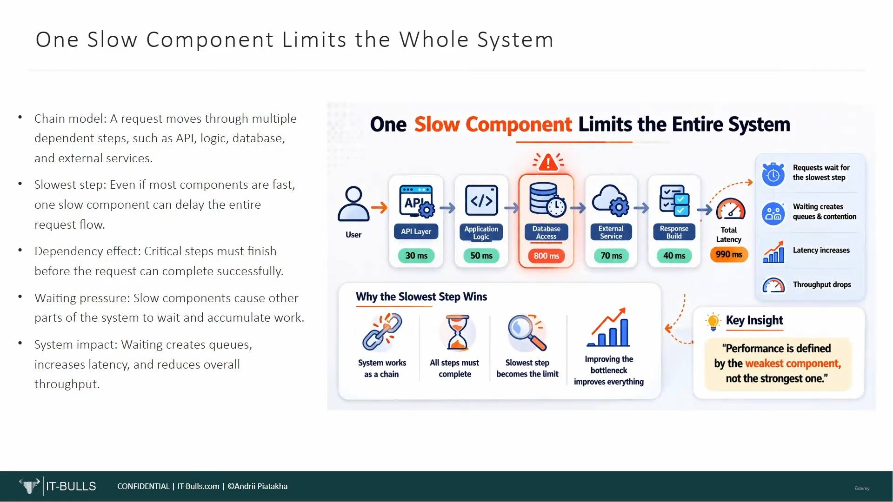
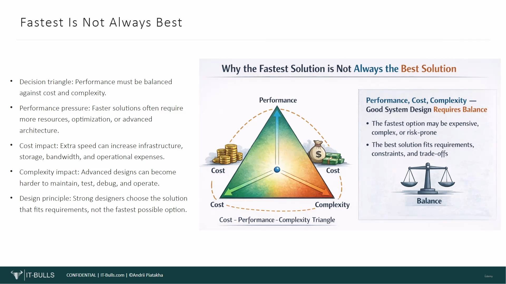
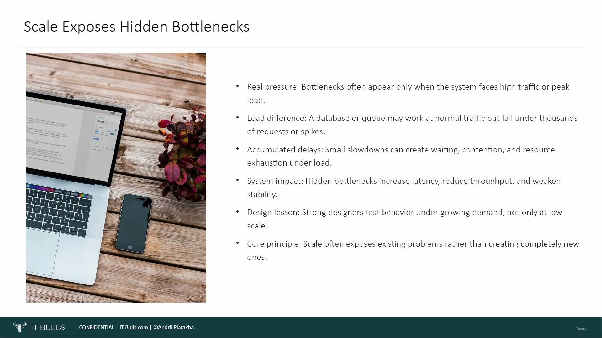
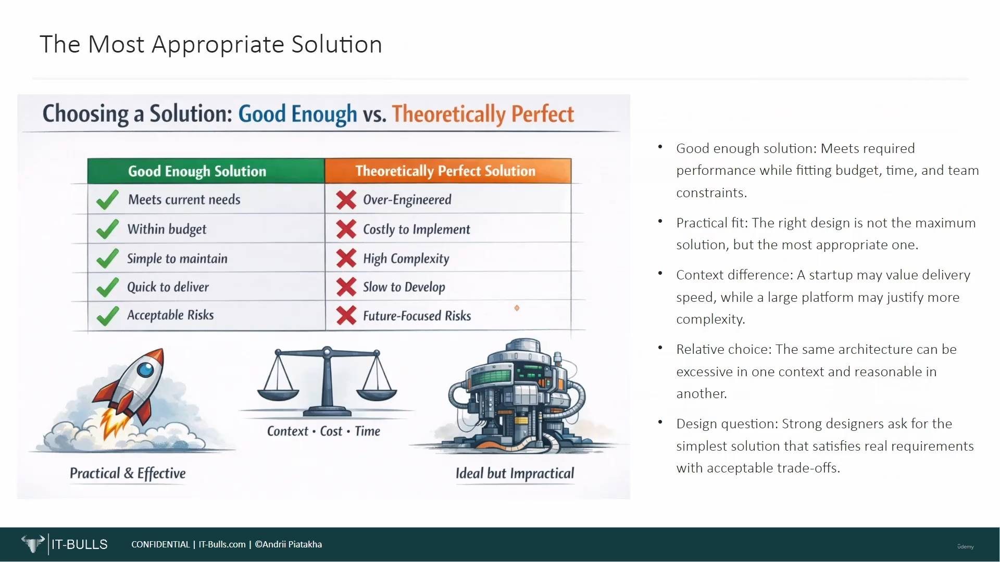
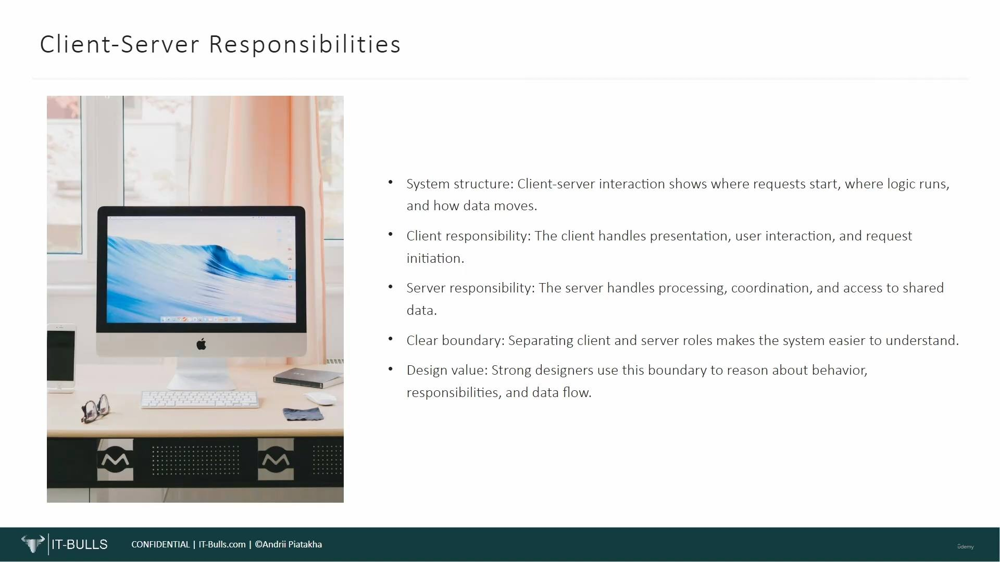
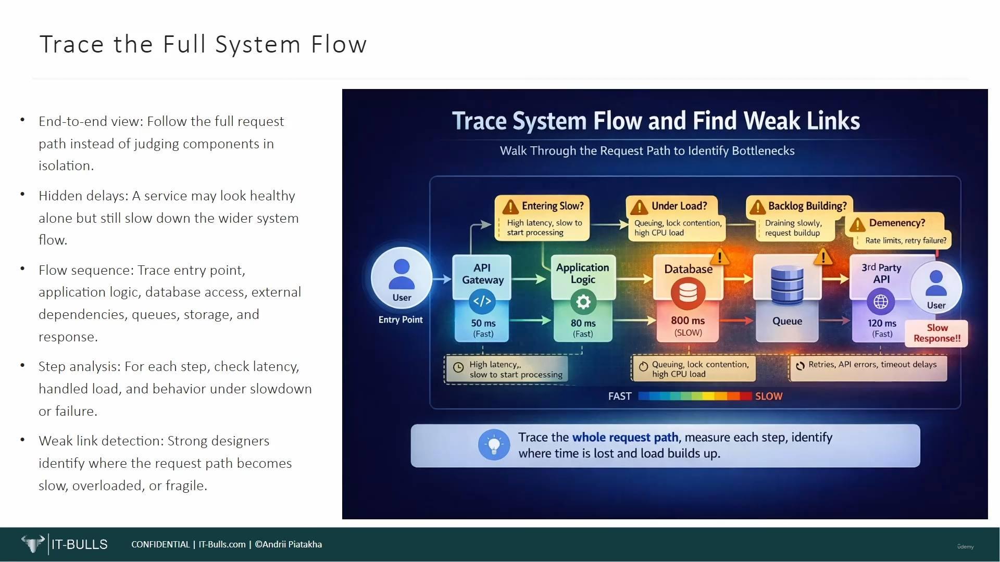
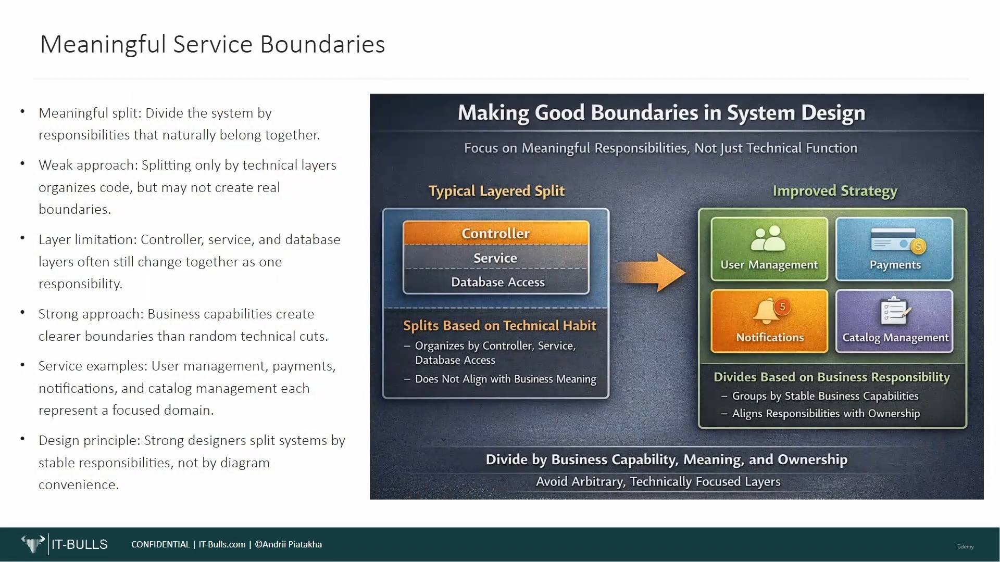
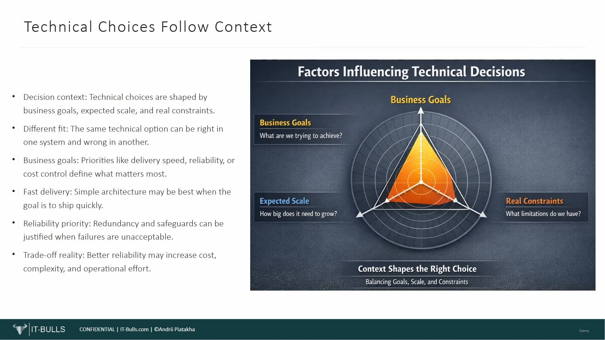
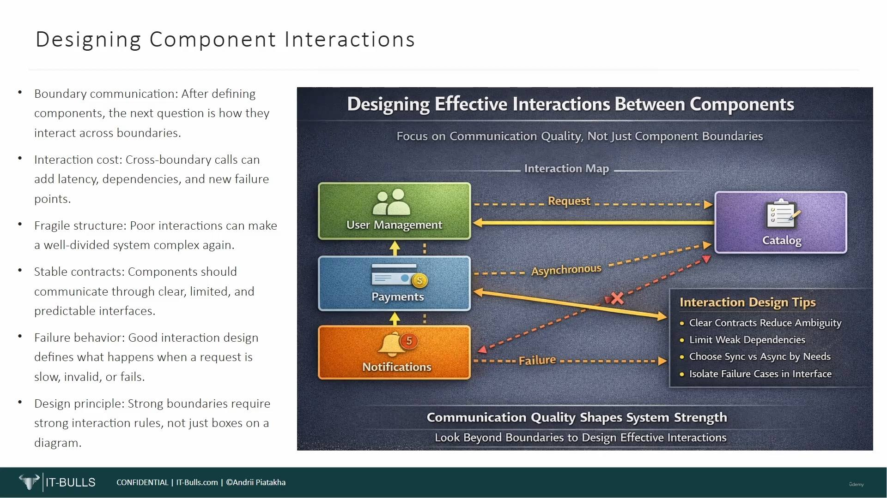

# System Design for Developers（BV1td4w6oEmH）P9–P11 复现手册：定位瓶颈、做性能权衡、划分服务边界

> 覆盖 P9（Bottlenecks & Hotspots）、P10（Performance / Cost / Complexity）、P11（Clients, Servers & Service Boundaries）。
> **重要前提**：这三节课是纯讲解课，逐字稿里没有任何代码、命令、配置或依赖版本。所以本手册的「第 4 节 完整代码」按纯讲解课的规则改为**可落地的设计产物**（决策表、职责表、接口草案、估算表），并在给出任何示意代码时明确标注「课里没有代码，以下为示意」。

---

## 1. 这一节做什么

这三节课连起来，其实是在交付一套**可以在真实项目里照着跑一遍的架构决策流程**，而不是三个孤立的知识点：

- **P9 教你怎么"看"**：一个系统不是按最快组件的速度运行，而是按最慢、最受限的那个组件的速度运行。你要做的是把一条完整请求链路摊开，逐段量耗时、量负载，找出那个"让其他所有人都在等它"的环节（bottleneck），以及那个"负载分配严重不均"的环节（hotspot）。
- **P10 教你怎么"选"**：找到瓶颈之后不要立刻开干。更快的系统几乎总要付出更多成本或更多复杂度，所以真正要回答的问题不是"能不能更快"，而是"这次优化值不值"。讲师给了一个三问句式：够快吗？够简单吗？够便宜吗？
- **P11 教你怎么"切"**：把系统切成若干块，边界要按**业务职责、数据归属、变更节奏**来划，而不是按技术分层或画图对称性来划。同时区分清楚 API 边界（对外怎么通信）和服务边界（内部拥有什么），否则会切出一堆"看起来模块化、实际上更耦合"的服务。

这一节完成后，你手上应该产出下面这 5 份文件（本手册第 4 节会给出完整模板，可以直接复制成文件）：

| 文件 | 作用 | 来自 |
|---|---|---|
| `capacity-estimate.md` | 把"大概多少人用"换算成 RPS、并发数、存储量 | P10 的"需求驱动设计" |
| `request-trace.md` | 一条请求经过的每一段耗时与负载 | P9 的"端到端追踪" |
| `tradeoff-matrix.md` | 候选方案在性能/成本/复杂度/交付/风险/可维护性上的对比 | P10 的"决策矩阵" |
| `boundary-map.md` | 每个服务的职责、拥有的数据、对外暴露的 API | P11 的"服务边界" |
| `api-contract.md` | 跨边界通信的契约草案 | P11 的"API 边界" |

如果你只想要一句话结论：**先把请求链路量出来，再用估算决定值不值得优化，最后按职责而不是按图层切服务。** 三件事的顺序不能反。



---

## 2. 讲师原话（带时间戳）

下面这些是逐字稿里可以直接支撑本手册做法的原句。个别地方逐字稿有明显语音转写误差，我在括号里标了按上下文的理解，不做过度发挥。

**关于瓶颈的本质**

> "系统的推进速度并不取决于最快的组件，而取决于最慢或受约束最严重的组件。"
> —— p009 [01:48]

> "再快的应用服务器也无法弥补缓慢的数据库。网络过载时，再快的数据库也无济于事。最慢的环节会成为其周围所有环节的制约因素。"
> —— p009 [03:42]

> "优化本已很快的组件，往往收益甚微；而优化真正的瓶颈，则可能改变整个系统的行为。"
> —— p009 [04:08]

**关于热点**

> "热点则略有不同。它指的是系统中承受的负载与其他部分明显不成比例的区域。例如，某个服务、某个分区、某个端点，甚至某条数据库记录，都可能被访问得远比其余部分频繁。"
> —— p009 [01:48]–[02:17]

> "有时，某个数据库分片会承受不成比例的流量，原因在于分区键选择不当。"
> —— p009 [07:55]（逐字稿此处转写为 "database shot"，按上下文应指 shard/分片）

**关于瓶颈为什么藏得住**

> "系统规模较小时，瓶颈往往不易显现，因为低流量不会对其薄弱环节施加足够压力。"
> —— p009 [06:05]

> "规模扩大并不总会制造问题。很多时候，它只是把原本已经存在的问题暴露出来。"
> —— p009 [07:26]

**关于端到端追踪**

> "每一步，我们都会问同样的问题：这部分需要多长时间？它能处理多大负载？如果它变慢或发生故障，会发生什么？"
> —— p009 [09:50]

**关于优化错地方**

> "他们可能会看到接口响应缓慢，就立刻优化应用代码；也可能注意到处理器使用率过高，便认定处理器是主要问题。然而，可见的问题并不总是真正的瓶颈。"
> —— p009 [11:15]

> "不要先优化最显眼的症状，而要先找到真正的瓶颈。"
> —— p009 [12:13]

**关于性能永远有代价**

> "当我们让系统变得更快时，通常是通过增加一些东西来实现的：更多硬件、更多副本、更多缓存层、更优化的存储，或更复杂的处理策略。而每一项改进都会增加成本、复杂度，或两者兼有。"
> —— p010 [01:24]

> "真正的问题不是哪种方案最快，而是哪种方案适合当前场景。"
> —— p010 [03:16]

**关于什么时候值得优化**

> "当有可度量的证据表明性能正在制约系统时，才进行优化；如果优化只是出于恐惧、习惯或完美主义，就应避免。"
> —— p010 [07:29]

> "我们现在是否确实有经过测量确认的优化需求？"
> —— p010 [14:02]

**关于边界**

> "服务边界定义系统中一部分在哪里结束、另一部分从哪里开始。从实际角度看，它划分了职责、数据所有权和行为。"
> —— p011 [04:41]

> "服务边界描述的是内部的所有权和范围，接口边界描述的则是对外接口。"
> —— p011 [07:04]

> "一种薄弱的做法是只按技术层次拆分系统，例如控制器、服务和数据库访问，而不考虑业务含义。"
> —— p011 [12:10]

> "问问自己：这些部分通常是因为同一个原因而变化，还是因为不同原因而变化？"
> —— p011 [13:32]

> "他们还会问：这种拆分是会减少耦合，还是会增加耦合？"
> —— p011 [17:47]



---

## 3. 从零复现

这一节把讲师在 P9–P11 里的推导过程还原成可以照着走的 7 步。**注意：课里没有给出任何具体业务的数字，下面第 3 步的算式是我为了演示方法而设的示例场景（一个 RAG 问答服务），数字是示意的，你必须换成自己的真实数据。**

### 第 1 步：把"需求"写成一句话的性能承诺

讲师反复强调决策要来自需求而不是偏好（p010 [04:42]："设计决策应当源于需求，而不是个人偏好。"）。所以先写下这句话，格式固定：

> 在 **正常流量** 下，**核心接口** 的 **p95 延迟** 不超过 **X ms**，错误率低于 **Y%**。

示例（示意）：`POST /ask` 在峰值 20 RPS 下 p95 ≤ 4000 ms，错误率 < 1%。

没有这句话，后面所有"优化"都是凭感觉。

### 第 2 步：列约束（P10 的第三边）

讲师在 p010 [12:08] 把约束具体化为：预算、团队规模、deadline、合规要求、遗留系统。把你自己项目的约束写成清单，每条都要有数字或事实：

- 预算：每月基础设施上限（写具体金额区间，本手册不替你定）
- 团队：能维护几个独立部署单元？（这是决定要不要拆微服务的关键）
- deadline：首发日期
- 合规：数据能否离开某个区域
- 遗留：哪些部分动不了

### 第 3 步：估算——把"多少人用"换算成工程数字

讲师没给估算公式，这一步是本手册补充的方法，**课里没讲具体算法**。但它是 P10「什么时候值得优化」的前提：没有量级，就没有"够不够快"。

示例场景（再次声明：数字为示意）：

```
DAU            = 10,000
人均请求        = 30 次/天
日请求总量      = 10,000 × 30 = 300,000 次/天

平均 RPS       = 300,000 / 86,400 s ≈ 3.5 RPS
峰值集中度      = 80% 请求发生在 20% 的时间里
峰值 RPS       = 300,000 × 0.8 / (86,400 × 0.2) ≈ 13.9 RPS
取设计余量 2×  → 设计目标 ≈ 28 RPS
```

然后估算每次请求的内部调用次数：

```
每次 /ask 请求：
  - LLM 调用      × 1     平均 3,000 ms
  - 向量检索      × 3     平均   80 ms（串行时共 240 ms）
  - 数据库查询    × 4     平均   20 ms（串行时共  80 ms）
```

### 第 4 步：画链路、找瓶颈（P9）

按讲师 p009 [09:22] 的顺序，把链路写成**入口 → 应用逻辑 → 数据库 → 外部依赖 → 队列 → 存储 → 响应**，每一跳填三列：耗时、负载、慢下来/挂掉会怎样（p009 [09:50]）。

用第 3 步的示意数字算总延迟：

```
串行总延迟 = 3000 + 3×80 + 4×20 = 3380 ms
LLM 占比   = 3000 / 3380 ≈ 88.8%
```

结论（这是 P9 的核心结论）：**LLM 那一步就是瓶颈**。此时把数据库查询从 20 ms 优化到 5 ms，总延迟从 3380 ms 降到 3380 − 4×15 = 3320 ms，只快了 **1.8%**。这就是讲师说的"改进本已很快的组件，往往收益甚微。"。

再把 3 次检索改成并行：

```
并行后 = 3000 + 80 + 80 = 3160 ms
```

只减少 220 ms。所以真正的杠杆在 LLM：流式输出、结果缓存、缩短 prompt、换更小的模型——这些才是针对瓶颈的优化。**讲师没有点名这几种优化手段，这是我基于他的框架做的应用。**

接着找热点（P9 第二半）：把请求按 `docId` 分组统计访问频次。假设发现某 1% 的文档承担了 70% 的检索请求——这就是热点，讲师说的"同一条数据库记录被访问的频率可能远高于其他记录。"（p009 [02:17]）。它可能让某一个分片先挂掉，而整体容量看起来还很富裕（p009 [08:24]）。



### 第 5 步：做权衡决策（P10）

针对第 4 步找到的瓶颈，列出至少 3 个候选方案，然后填决策矩阵（第 4 节给表格）。讲师在 p010 [07:55] 明确列出的比较维度是：**performance、cost、complexity、delivery speed、risk、maintainability**。

每个候选方案都要回答 P10 的三问（p010 [06:05]）：

1. 够快吗？（能不能把 p95 压到第 1 步的承诺以内）
2. 够简单吗？（团队现在能不能构建和运维）
3. 够便宜吗？（在预算内）

三问全"是"的方案优先。如果某方案在性能上大幅胜出但三问里挂了两项，按讲师的口径它就不是"更好"，只是"更贵"。

**这里最容易犯的错**（p010 [13:04]）：系统才 3.5 RPS 平均，就上分布式缓存、多级队列、服务拆分。讲师的原话是"为系统并不需要的速度付出代价，并非良好设计。那是伪装成提前准备的不必要复杂性。"（p010 [14:02]）



### 第 6 步：划服务边界（P11）

讲师在 p011 [12:10] 给了一个正反对比：

- **弱做法**：按 controller / service / database access 这样的技术层切。听起来分工清楚，但这几层其实"属于同一职责，并一同变化。"，切完还是耦合在一起。
- **强做法**：按业务能力或稳定领域切。讲师举的例子是 user management、payments、notifications、catalog management（p011 [12:38]）。

给每个候选边界过三道检验：

1. **职责检验**：这块东西"自然属于一起"吗？
2. **归属检验**（p011 [13:05]）：规则和数据是不是同一个所有者？
3. **变更检验**（p011 [13:32]）：这些代码是不是"为了同一个原因而改"？

然后区分两种边界（p011 [06:35]–[07:04]）：

- **服务边界** = 拥有什么（职责、业务逻辑、数据）
- **API 边界** = 别人怎么跟它说话（接口）

一个服务可以只承担一个职责，但对外暴露多个 API；反过来，多个 endpoint 不代表多个服务（p011 [07:04]："接口并不等同于底层的所有权边界。"）。

### 第 7 步：设计跨边界通信

讲师在 p011 [14:29] 强调"箭头和方框同样重要。"：

- 每次跨边界调用都带来延迟、依赖和新的故障点
- 契约要"清晰、有限且稳定。"：能请求什么、会返回什么、出错怎么办
- 同步 vs 异步要看流程需要，不看技术偏好（p011 [14:58]）

对前端出身的读者补一句：讲师说的"同步式，即一个组件立即等待响应。"，在 Node 里就是 `await fetch(...)`——调用方挂起等结果；"asynchronous" 则是丢进队列、靠回调/轮询/事件拿结果。**但队列具体用什么实现，课里没讲。**



---

## 4. 完整代码

> **本节说明**：P9–P11 是纯讲解课，**讲师全程没有写任何代码**。因此下面 4.1–4.5 是把你按第 3 节推导出的结论落成可用产物的模板（表格可直接复制成 `.md` 文件），4.6 是帮助你把第 4 步「measure each step」跑起来的示意代码，**课里没有代码，以下为示意**。

### 4.1 `capacity-estimate.md`（容量估算表）

数字全部来自第 3 步示例，**换成你自己的**。

| 指标 | 算式 | 结果 | 备注 |
|---|---|---|---|
| 日请求量 | 10,000 DAU × 30 次/天 | 300,000 /天 | 示意 |
| 平均 RPS | 300,000 ÷ 86,400 | ≈ 3.5 | 示意 |
| 峰值 RPS | 300,000 × 0.8 ÷ (86,400 × 0.2) | ≈ 13.9 | 假设 80% 流量在 20% 时间 |
| 设计 RPS | 峰值 × 2 | ≈ 28 | 余量系数自定 |
| 单请求 LLM 耗时 | 直接测量 | 3,000 ms | 示意 |
| 单请求检索耗时 | 3 × 80 ms 串行 | 240 ms | 示意 |
| 单请求 DB 耗时 | 4 × 20 ms 串行 | 80 ms | 示意 |
| 串行总延迟 | 3000 + 240 + 80 | 3,380 ms | 示意 |
| 瓶颈占比 | 3000 ÷ 3380 | ≈ 88.8% | **瓶颈 = LLM** |

### 4.2 `request-trace.md`（请求链路追踪表）

严格按讲师 p009 [09:22] 的顺序排，并按 p009 [09:50] 的三个问题填列。

| # | 环节 | 耗时（p50 / p95） | 负载（峰值 RPS） | 慢下来会怎样 | 挂掉会怎样 | 是否瓶颈/热点 |
|---|---|---|---|---|---|---|
| 1 | 入口（网关/鉴权） | 待测 | 待测 | 待测 | 待测 | 否 |
| 2 | 应用逻辑 | 待测 | 待测 | 待测 | 待测 | 否 |
| 3 | 外部 LLM 调用 | 3,000 / 待测 ms | 待测 | 整条请求线性变慢 | 请求全失败 | **瓶颈** |
| 4 | 向量检索 | 80 / 待测 ms | 待测 | 轻微 | 降级为无检索 | 否 |
| 5 | 数据库查询 | 20 / 待测 ms | 待测 | 轻微 | 请求失败 | 否 |
| 6 | 队列（异步任务） | 待测 | 待测 | 积压增长 | 任务丢失 | 待观察 |
| 7 | 存储（大对象） | 待测 | 待测 | 待测 | 待测 | 否 |
| 8 | 响应返回 | 待测 | 待测 | 待测 | — | 否 |

同时另起一张**热点表**，按被访问对象的 ID 聚合（对应讲师 p009 [07:55] 说的"分区键选择不当。"）：

| 对象类型 | Top 1% 对象承担的请求占比 | 是否热点 | 处理动作 |
|---|---|---|---|
| 文档（docId） | 70%（示意） | **是** | 复核分片键 / 预生成结果 |
| 用户（userId） | 待测 | 否 | — |
| 租户（tenantId） | 待测 | 否 | — |

### 4.3 `tradeoff-matrix.md`（权衡决策矩阵）

维度取自讲师 p010 [07:55] 的原话列举：performance / cost / complexity / delivery speed / risk / maintainability。候选方案是针对第 4 步"LLM 是瓶颈"这一结论列的，**方案本身是本手册的应用，不是讲师给的**。

| 方案 | Performance | Cost | Complexity | Delivery | Risk | Maintainability | 够快? | 够简单? | 够便宜? | 结论 |
|---|---|---|---|---|---|---|---|---|---|---|
| A. 什么都不做 | p95 3.4s | 最低 | 最低 | 立即 | 低 | 高 | 看承诺 | 是 | 是 | 若承诺 ≥4s 则选它 |
| B. 回答结果缓存 | p95 降到 <200ms（命中时） | 低 | 中 | 1–2 天 | 缓存一致性 | 中 | 是 | 是 | 是 | **优先** |
| C. 换更小的模型 | 降到 ~1.2s | 低 | 低 | 1 天 | 质量下降 | 高 | 是 | 是 | 是 | **优先** |
| D. 多副本 + 分布式缓存 + 拆分服务 | 略好 | 高 | 高 | 数周 | 高 | 低 | 是 | 否 | 否 | **按 P10 否决** |

判据来自 p010 [14:02]：**"我们目前是否有经过度量证实的需要，来实施这项优化？"** 在平均 3.5 RPS 的规模上，D 方案的答案是"没有"。

### 4.4 `boundary-map.md`（服务边界与职责表）

按讲师 p011 [12:38] 的"业务能力"划，不按技术层划。

| 服务 | 职责（一句话） | 拥有哪些数据 | 对外 API 边界 | 变更原因 | 依赖 |
|---|---|---|---|---|---|
| 问答服务 | 编排一次问答流程 | 会话状态、问答记录 | `POST /ask`、`GET /sessions/:id` | 交互逻辑变化 | 检索服务、模型网关 |
| 检索服务 | 文档切片与相似度检索 | 切片、索引 | `POST /search` | 召回策略变化 | 文档服务 |
| 文档服务 | 文档上传、解析、版本管理 | 文档元数据、原始文件 | `POST /documents` | 接入新格式 | 存储 |
| 模型网关 | 统一封装模型调用与降级 | 调用配额、路由表 | `POST /completions` | 换供应商/限流策略 | 外部模型 API |

边界自检（来自 p011 [13:32] / [17:47]）：

- 问答服务和检索服务**是否总是一起改**？如果是，说明该合并——这是讲师说的"如果两个区域总是同步演进，它们可能就应归于同一边界。"。
- 拆完之后跨服务调用次数是否明显增加？如果是，`will this split reduce coupling or increase it?` 的答案是"增加"，应回退。

### 4.5 `api-contract.md`（边界契约草案）

讲师在 p011 [14:33] 要求契约"清晰、有限且稳定。"，并明确要说清三件事：能请求什么、能期待什么、出错怎么办。

```http
POST /ask
Content-Type: application/json

{
  "sessionId": "s_123",
  "question": "文档里如何描述容量估算？",
  "topK": 3
}
```

| 场景 | 状态码 | 响应体要点 | 谁负责 |
|---|---|---|---|
| 成功 | 200 | `{ answer, citations[], traceId }` | 问答服务 |
| 参数非法 | 400 | `{ error: "INVALID_INPUT", field }` | 问答服务 |
| 下游检索超时 | 200 | `{ answer, citations: [], degraded: true }` | 问答服务（降级） |
| 模型网关全部失败 | 503 | `{ error: "上游不可用", retryAfter }` | 模型网关 |

> 注意：`degraded` / `retryAfter` 这类字段是本手册的草案设计，**课里没讲具体字段**。落地时字段名以你们团队实际约定为准。

### 4.6 示意代码：把"每一跳耗时"真的量出来

**课里没有代码，以下为示意。** 目的只有一个：让第 3 节第 4 步的 trace 表可以真填上数字，而不是拍脑袋。只用 Node 内置能力，不引入任何第三方库。

```javascript
// trace.js  —  运行：node trace.js
// 课里没有代码，以下为示意：把一次请求拆成若干阶段，分别记录耗时，
// 最后打印每段的 p50 / p95，用来填 request-trace.md 的表格。
import { performance } from 'node:perf_hooks';

// ---- 1) 一个极简的计时器：记录每个阶段的耗时 ----
function createTracer() {
  const spans = [];
  return {
    // name 形如 'llm' / 'search' / 'db'
    async measure(name, fn) {
      const start = performance.now();
      let ok = true;
      try {
        return await fn();
      } catch (err) {
        ok = false;
        throw err;
      } finally {
        spans.push({ name, ms: performance.now() - start, ok });
      }
    },
    getSpans() {
      return spans;
    }
  };
}

// ---- 2) 统计：p50 / p95（排序后取分位，样本少时只是示意） ----
function percentile(values, p) {
  if (values.length === 0) return 0;
  const sorted = [...values].sort((a, b) => a - b);
  const idx = Math.min(sorted.length - 1, Math.ceil((p / 100) * sorted.length) - 1);
  return sorted[idx];
}

function summarize(allRuns) {
  const byName = new Map();
  for (const spans of allRuns) {
    for (const s of spans) {
      if (!byName.has(s.name)) byName.set(s.name, []);
      byName.get(s.name).push(s.ms);
    }
  }
  const rows = [];
  for (const [name, list] of byName) {
    rows.push({
      stage: name,
      count: list.length,
      p50: Math.round(percentile(list, 50)),
      p95: Math.round(percentile(list, 95))
    });
  }
  return rows;
}

// ---- 3) 把下面几个函数换成你项目里真实的调用 ----
async function callLLM()       { await sleep(3000 + Math.random() * 600); return 'answer'; }
async function searchVector()  { await sleep(80   + Math.random() * 40);  return ['doc1']; }
async function queryDatabase() { await sleep(20   + Math.random() * 10);  return { id: 1 }; }

function sleep(ms) {
  return new Promise((resolve) => setTimeout(resolve, ms));
}

// ---- 4) 一次完整请求：阶段顺序与 request-trace.md 的表格一一对应 ----
async function handleAsk() {
  const tracer = createTracer();

  const answer = await tracer.measure('llm', callLLM);

  // 3 个检索片段并行 —— 对应第 3 节里"串行 240ms → 并行 80ms"的对比
  const [, , ] = await Promise.all([
    tracer.measure('search_1', searchVector),
    tracer.measure('search_2', searchVector),
    tracer.measure('search_3', searchVector)
  ]);

  await tracer.measure('db_1', queryDatabase);
  await tracer.measure('db_2', queryDatabase);
  await tracer.measure('db_3', queryDatabase);
  await tracer.measure('db_4', queryDatabase);

  return { answer, spans: tracer.getSpans() };
}

// ---- 5) 跑 N 次，输出表格 ----
async function main() {
  const RUNS = 20;            // 演示用；真实压测样本应远大于此
  const allRuns = [];

  for (let i = 0; i < RUNS; i++) {
    const { spans } = await handleAsk();
    allRuns.push(spans);
  }

  console.table(summarize(allRuns));
}

main();
```

跑起来后你会看到类似这样的输出（字段名以你实际运行为准）：

```
┌──────────┬───────┬──────┬──────┐
│  stage   │ count │ p50  │ p95  │
├──────────┼───────┼──────┼──────┤
│ llm      │    20 │ 3300 │ 3590 │
│ search_1 │    20 │   95 │  118 │
│ search_2 │    20 │   96 │  119 │
│ search_3 │    20 │   97 │  120 │
│ db_1..4  │    20 │  ~24 │  ~30 │
└──────────┴───────┴──────┴──────┘
```

**这张表就是 P9 要做的事情的机器版本**：谁最慢，一眼就能看出来，不用猜。

---

## 5. 逐行解释

### 5.1 解释第 3 步的估算

**`平均 RPS = 300,000 / 86,400 ≈ 3.5`**
一天 86,400 秒是固定常数。为什么必须先算平均？因为人对自己系统的规模往往有数量级错觉——"我们用户挺多的"可能是 3 RPS 也可能是 3,000 RPS，差三个数量级，对应的架构完全不同。讲师在 p009 [06:32] 说的"对数百个请求运行良好的数据库，在数千个请求下可能就难以招架。"就是在提醒这个量级差异。

**`峰值 RPS = 总量 × 0.8 / (86,400 × 0.2)`**
为什么不能直接用平均 RPS 做设计？因为瓶颈是**在峰值时刻**暴露的（p009 [06:57]："问题在平均条件下未必总能显现，但在峰值负载时就会变得明显。"）。80/20 是常用的经验假设，不是讲师给的数字，你可以按自己业务的真实曲线替换。

**`串行总延迟 = 3000 + 240 + 80 = 3380 ms`**
这里假设全部串行，是为了得到一个**上界**。真实系统一定有部分并行，所以 3380 ms 是"最坏情况"的估算起点。

**`LLM 占比 = 3000 / 3380 ≈ 88.8%`**
这个百分比就是"瓶颈的权重"。它的用途是快速判断优化收益上限：**动那 88.8% 的部分，天花板是 88.8%；动那 2.4% 的部分，天花板就是 2.4%。** 讲师在 p009 [04:08] 说的"应用服务器再快，也无法弥补数据库的缓慢。"，换成数字就是这个意思。

**`优化 DB 20ms→5ms 只快 1.8%`**
`(4 × 15) / 3380 ≈ 1.8%`。这个计算存在的意义是**拦住你**。前端出身的工程师特别容易去优化自己熟悉的那一层（把 SQL 加个索引、把查询合并一下），因为那部分"看得懂"。但数字告诉你这么做几乎没用。

**`并行检索 240ms → 80ms，总延迟只降 220ms`**
这条更能说明问题：你把检索的并发布局做得很漂亮，工程上完全正确，但用户感知只快了 6.5%。**这不是说并行是错的，而是说它不该是第一个做的。**

### 5.2 解释第 4 步的追踪表

**为什么要按"入口 → 应用 → 数据库 → 外部依赖 → 队列 → 存储 → 响应"的顺序排？**
这是讲师 p009 [09:22] 给的原顺序，它不是随意排的，它对应**一次请求真实经过的时间轴**。按组件分类（"数据库怎么样、缓存怎么样"）会把时间轴打断，你就看不到"等待"发生在哪一段之间。讲师在 p009 [10:17] 说的"是那些会无声地为周围一切制造等待与争用的组件。"，只有按时间轴排才看得见。

**为什么"慢下来会怎样"和"挂掉会怎样"要分两列？**
讲师 p009 [09:50] 提的是三个问题，我把第三个拆成两列，因为这两个后果性质完全不同：慢下来是**延迟问题**（用户等），挂掉是**可用性问题**（用户失败）。对 LLM 这一步来说，慢下来是全线变慢，挂掉是全线失败——两种情况的兜底策略完全不同（前者要超时+降级，后者要重试+兜底回答）。**课里没讲具体的降级策略**，这里只是把问题拆细。

**热点表为什么要按"对象 ID"聚合而不是按接口聚合？**
讲师在 p009 [07:55] 明确点名了"某个数据库分片会收到不成比例的流量，原因是分区键选择不当。"——**问题出在分片键上，也就是出在"数据对象"维度上**。如果你只按接口统计 QPS，所有接口看起来都很均匀，热点完全隐形。这就是讲师说的"系统在纸面上可能看起来均衡，但在现实中的表现可能大不相同。"（p009 [08:24]）。

### 5.3 解释第 5 步的决策矩阵

**为什么把"什么都不做"列成方案 A？**
因为讲师在 p010 [07:03] 明确说："当系统对当前需求而言性能已经足够好时，优化便没有意义。"当承诺是 p95 ≤ 4000 ms 而现状是 3380 ms 时，**"不做"就是正确工程决策**，不是偷懒。把"不做"写进矩阵，是为了让它成为一个被认真评估的选项，而不是默认被跳过。

**为什么方案 D（多副本 + 分布式缓存 + 拆服务）会被否决？**
它在 performance 一列可能是最优的，但按讲师 p010 [06:05] 的三问，它在"够简单"和"够便宜"两项上都是否。讲师在 p010 [01:54] 说过："一旦加入缓存、异步处理、分区或分布式协调，系统就会变得更难构建、测试和运维。"这句话的重点是"更难测试和运维。"——这是你的团队要长期承受的成本，不是一次性的。

**为什么"换更小的模型"排第一？**
因为它在三问上全过：快（1.2s）、简单（改一个配置/参数）、便宜（token 更少）。同时它直接作用在瓶颈上（88.8% 的那一段）。**注意：这是本手册的推理，讲师没有讨论过模型选型。**

**"Delivery speed" 这一维为什么必须列？**
讲师在 p010 [07:55] 列举决策维度时把 delivery speed 和 performance 并列。原因是：一个 3 周才能上线的优化，可能在优化上线时业务形态已经变了。对创业期产品，讲师在 p010 [09:18] 的原话是"可能比起架构上的复杂度，更需要交付速度。"。

### 5.4 解释第 6 步的边界划分

**为什么"按 controller / service / database access 切"是弱做法？**
讲师 p011 [12:38] 的解释是：这些层"仍然属于同一职责，并一同变化。"。举例：你加"支持 PDF 上传"这个需求，controller 要改、service 要改、data access 也要改——三层同时动，说明它们本来就是一个东西，切开只是让一次变更变成三次提交。

**为什么"变更原因"是最好用的检验标准？**
讲师 p011 [13:32]："这些部分通常是因同一原因而变化，还是因不同原因而变化？" 这个标准的好处是**它可以被观察**：翻 git log，看这两块代码在过去 20 次提交里是否有 15 次是同一个 PR 改的。如果是，就该合并；如果总是分别改，拆开就是合理的。这比"感觉它们应该分开"可靠得多。

**为什么"一个服务可以暴露多个 API，但多个 API 不代表多个服务"？**
这是讲师 p011 [07:04] 的核心区分。落到实践上：`POST /documents`、`GET /documents/:id`、`DELETE /documents/:id` 是**三个 API、一个服务**，因为它们操作同一份数据、遵循同一套规则、为了同一个原因变更。如果你按 endpoint 拆成三个服务，它们就要共享同一张表——讲师 p011 [17:18] 说的"拆分数据所有权。"问题就出现了：一次上传要跨三个服务协调，比不拆还脆弱。

### 5.5 解释 4.6 的示意代码

**`tracer.measure(name, fn)` 用 `finally` 记录耗时**
必须放 `finally`，否则某个阶段抛异常时这个 span 就丢了——而**出错的请求恰恰是最需要看耗时分布的**。这一点对应讲师 p009 [09:50] 的第三个问题"如果它变慢或发生故障，会发生什么？"。

**`Promise.all` 包住三次 search**
这是把第 3 步"串行 240ms → 并行 80ms"落到代码。注意 `measure` 内部是 `await fn()`，所以 `Promise.all` 里的三行是真正并发的。

**为什么 `RUNS = 20` 只够演示**
20 个样本算出的 p95 其实就是第 19 个值，统计意义很弱。要得到有意义的 p95，样本量通常要几百以上。**课里没讲样本量要求**，这是工程常识补充。

**为什么统计 p50 和 p95 两列而不是只算平均**
因为平均值会被少数极慢请求淹没。一个 3000 ms 的 LLM 调用里如果混了 1% 的 30 秒超时，平均只涨 27 ms，看起来"没事"，但 1% 的用户体验是灾难性的。讲师在 p009 [06:57] 强调过问题"在峰值负载时变得明显。"——在代码层面，peak load 的表现就是长尾。

**`db_1` 到 `db_4` 为什么分开命名**
如果全部叫 `db`，统计时 4 次调用会被混在一起算分位，你就看不出"4 次串行查询"这个结构。分开命名能让你一眼看到：有 4 个 20ms 的坑，而不是 1 个 80ms 的坑。这两个结论对应完全不同的优化方式（减少次数 vs 加快单次）。

---

## 6. 复现检查清单

照着勾，全部打勾才算把这三节课"跑通"。

**P9：找瓶颈**

- [ ] 我写下了 `request-trace.md`，且每个环节都有 p50 / p95 两列（不是只有一列"耗时"）
- [ ] 每个环节都填了"慢下来会怎样"和"挂掉会怎样"
- [ ] 我算出了瓶颈环节占总延迟的百分比，并写进文件
- [ ] 我算过"如果优化某个非瓶颈环节，总延迟能降多少"，并把数字写下来（用来拦住自己）
- [ ] 我按**对象 ID** 做过一次热点统计，不只是按接口统计 QPS
- [ ] 我能说出现在系统的瓶颈是哪一个具体环节，而不用"整体偏慢"这种描述



**P10：做权衡**

- [ ] 需求被写成了一句话的性能承诺（含延迟阈值、错误率、流量条件）
- [ ] 约束清单里每条都有具体数字或事实，没有"预算不多"这类虚词
- [ ] `tradeoff-matrix.md` 里"什么都不做"是一个正式候选方案
- [ ] 每个候选方案都过了三问：够快？够简单？够便宜？
- [ ] 决策矩阵包含了 delivery speed 和 maintainability，不只有 performance
- [ ] 我能回答"我们现在有**测量出来的**优化需求吗"，且答案有数据支撑

**P11：划边界**

- [ ] `boundary-map.md` 里的每个服务，职责都能用一句话说完
- [ ] 每个服务都写明了"拥有哪些数据"，没有两个服务共同拥有同一份数据
- [ ] 每个服务都写明了"变更原因"
- [ ] 我用 git log 抽查过至少一对服务：它们是否真的"为了不同原因变更"
- [ ] 我明确区分了 API 边界和服务边界，没有按 endpoint 数量推断服务数量
- [ ] 拆分后跨服务调用次数我数过，并且没有比拆分前明显增加
- [ ] `api-contract.md` 覆盖了"出错怎么办"，不只是成功路径



---

## 7. 课里没讲但你会撞上的

下面这些都是落地时一定会碰到的坑，**讲师在 P9–P11 里没有涉及**，列出是为了让你知道"知道边界在哪"。

1. **怎么真正采集到耗时数据。**
   讲师说了要 measure each step（p009 [10:22]），但没讲用什么采集。生产环境通常靠分布式追踪（traceId 贯穿全链路），本手册 4.6 的 `trace.js` 只是单进程内的示意，跨服务之后就不够用了。具体选型课里没讲。

2. **连接池耗尽的假象。**
   你在 trace 里可能看到"应用逻辑耗时 800ms"，但应用代码本身只跑了 5ms——剩下 795ms 在等数据库连接。这种"等待被算在调用方头上"的情况，会让你的瓶颈定位偏到错误的一层。**讲师没讨论这个陷阱。**

3. **重试放大会把热点变成雪崩。**
   讲师在 P9 讲了热点，在 P11 讲了异步通信，但没讲重试策略。一个被 70% 请求命中的热点文档一旦超时，客户端的自动重试会让它的负载翻倍——热点自己把自己压死。前端出身容易默认 `fetch` 失败就重试，这在热点场景下很危险。

4. **Node 的事件循环是另一种"瓶颈"。**
   P9 讲的"应用代码可能因为低效算法、阻塞操作而成为瓶颈。"（p009 [05:08]），在 Node 里对应得非常具体：一个 CPU 密集的正则、一次 `JSON.parse` 超大响应、一次同步的文件读取，都会阻塞整个事件循环，让**所有**并发请求一起变慢。这不是"某个请求慢"，是"所有请求一起慢"。课里没提 Node，这是给你的映射。

5. **缓存的失效策略才是难点。**
   4.3 的矩阵里方案 B 是"回答结果缓存"，讲师在 p010 [01:54] 把 caching layers 列为增加复杂度的手段之一，但**没讲缓存怎么失效**。RAG 场景下文档更新后缓存必须失效，这个"谁通知谁"的问题会直接把你 P11 学到的边界知识用上——缓存失效通知是一次跨边界通信。

6. **"够快"的阈值谁定。**
   讲师反复说"fast enough"（p010 [06:05]），但没说这个数字从哪来。实际上它通常来自业务方或产品指标，不是工程师拍脑袋。如果你自己定了个 200ms 然后为了它拆了三个服务，正好掉进 p010 [13:04] 描述的"优化太早"。

7. **拆分之后的事务问题。**
   讲师在 P11 [17:18] 提到 split data ownership 会让系统更脆弱，但没展开。一旦数据分属两个服务，原本一个数据库事务能保证的原子性就没了，你要自己做补偿逻辑。**在 JS/Node 里对应什么**：原本一个 `await db.transaction(...)` 搞定的事，现在要写成"先调 A 服务、失败则调 A 的补偿接口、再调 B"，而这个补偿接口本身也可能失败。这是拆服务最容易被低估的成本。

8. **决策矩阵会随时间过期。**
   4.3 里被否决的 D 方案，在流量涨到 300 RPS 之后可能就变成正确选择。讲师在 p010 [12:08] 说"在小产品上完美运行的方案，在高流量下也可能失效。"，反过来也成立：一个当前过早的方案，将来可能刚好。**建议给矩阵每行标注"重新评估的触发条件"**（比如"峰值 RPS > 100 时重看 D 方案"），这是本手册的建议，课里没讲。





---

**收尾一句**：这三节课真正交付给你的不是三个概念，而是一个**顺序**——先量（P9），再算值不值（P10），最后才动结构（P11）。顺序颠倒的话，你会得到一套很漂亮、很分布式、但没有任何人说得清为什么这么设计的系统。