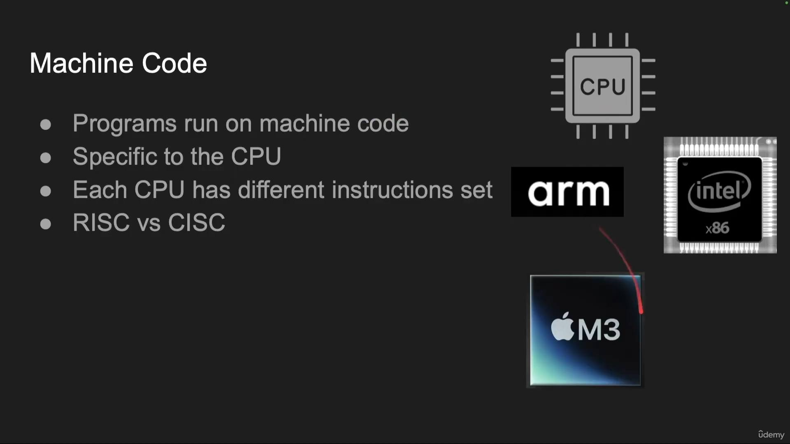
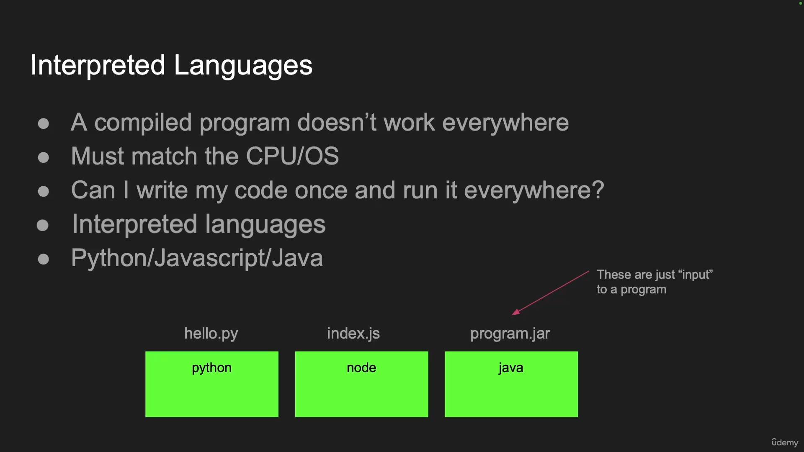
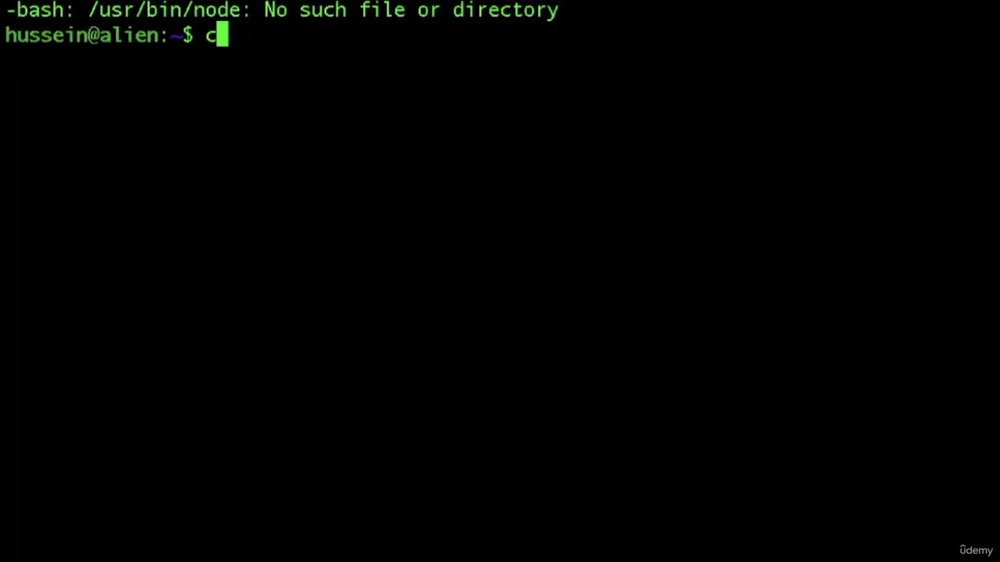
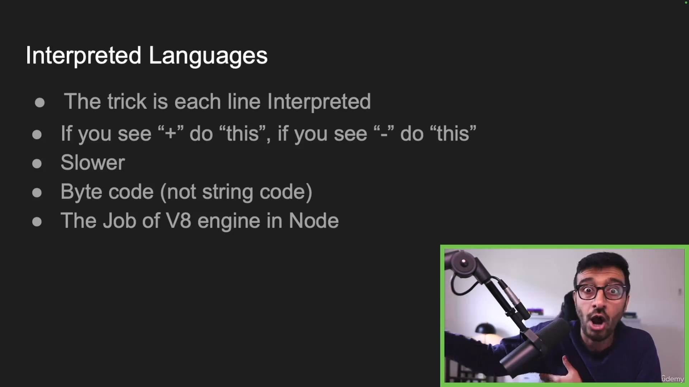
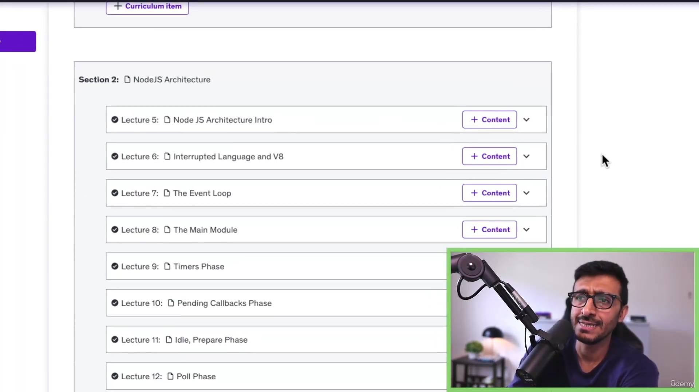

# NodeJS Internals（BV1jGRyBsEBa）P1–P7 复现文档

## 1. 这一节做什么

P1–P7 是这门课的「导论 + 环境准备 + 架构总览 + 解释型语言与 V8」。  
它没有让你马上写一个 Express 服务，而是在做三件可复现的事：

1. 把 Node.js 20 环境装好，并且跑通 `node -v`。
2. 把课程配套仓库 clone 到本地。
3. 建立 V8 执行 JavaScript 的心智模型：  
   JavaScript 源码 → V8 字节码 → 热点函数 JIT 编译为机器码 → CPU 执行。

如果你是前端转 AI 应用工程师，需要先理解一件事：你在 Node.js 里写的 JS，并不是最终被 CPU 执行的东西。真正被操作系统运行的是 `node` 这个可执行文件；你的脚本只是它的输入。后面所有关于事件循环、libuv、HTTP、流、Worker Threads 的内容，都建立在这个底层模型上。

从前端视角看，浏览器里你写的 JavaScript 也是先交给浏览器的 JavaScript 引擎处理，再由浏览器提供的 DOM、`fetch`、`localStorage` 等宿主 API 完成具体工作；到了 Node.js，JavaScript 仍然交给 V8，但宿主环境变成了 Node 运行时，文件、网络、进程等能力由 Node 的核心模块和底层库提供。所以不要把「JS 语法一样」误解成「运行环境一样」。你在浏览器里能直接访问 `document`，在 Node.js 里默认没有；你在 Node.js 里能直接 `require('fs')` 或 `import fs from 'node:fs'`，浏览器默认也没有。

这一节的目标不是背概念，而是让你能解释清楚：当你在终端执行 `node v8-shape.js` 时，shell 找到 `node` 可执行文件，操作系统启动这个进程，Node 初始化运行时并加载 V8，然后读取你的脚本，解析、生成字节码，热点代码再被 JIT 编译，最后执行 `console.log` 把结果写到终端。你后面观察事件循环、GC 停顿、libuv 线程池时，都是在这个进程模型里发生的。



---

## 2. 讲师原话

> “This course is all about getting into the balls, the bowels of Node.js.”

—— p001 [00:55]

这句话定下了课程基调：不是停留在 `npm install` 和写路由，而是往 Node.js 内部看。对前端开发者来说，这类似于从「会写 React 组件」继续往下理解浏览器渲染、事件循环、垃圾回收和网络栈。你不需要马上成为 C++ 或 V8 专家，但需要知道上层 API 背后有运行时、引擎和操作系统。

> “The first one being the Node.js architecture, two pieces really in the Node.js architecture, the V8 engine … And the second piece is the libUV library, which is the IO library.”

—— p004 [00:00]

课程把 Node.js 架构先拆成两大块：V8 引擎和 libUV IO 库。这里要建立一个基本对照：浏览器前端也有 JavaScript 引擎和宿主能力，只是浏览器宿主能力主要是 DOM、CSSOM、Web API；Node.js 的宿主能力则更多是文件、网络、进程、定时器等。V8 负责执行 JavaScript，libUV 负责大量 IO 相关能力。后面讲事件循环、非阻塞 IO、线程池时，会不断回到这个二分结构。

> “if it says hey execute this code in a second You're not gonna get a second. … It might be a second and few millisecond, might be five minutes later.”

—— p006 [05:34]

这句话说的是 `setTimeout`。它不代表“一定 1 秒后执行”，只代表“最快 1 秒后执行”。事件循环里如果前面有耗时任务，定时器会被推迟。

前端里也有同样的直觉：`setTimeout(fn, 1000)` 不是精确闹钟。如果主线程正在执行一个很长的同步任务，或者页面正在做大量布局、脚本计算，回调就只能等当前任务让出主线程后再执行。Node.js 里也一样，而且服务端还要考虑大量请求、GC 停顿、同步文件操作等问题。所以不要把定时器当成精确调度器，更不要用它做强实时控制。

> “The real program is not your stinking script. It's not your hello world. It's actually the node.js EXE that's the real program to the OS.”

—— p007 [22:42]

这句话非常关键：操作系统眼里的“程序”是 `node` 这个可执行文件，不是你的 `hello.js`。你的脚本只是被 `node` 读取和执行的输入。类比前端：浏览器标签页里运行的 JS 不是操作系统直接启动的程序，真正被操作系统启动的是浏览器进程；你的页面脚本是浏览器进程里的输入之一。理解这一点后，你才会自然地问：`node` 启动后初始化了什么？V8 什么时候创建 isolate？libuv 什么时候开始跑事件循环？你的脚本在哪个阶段被执行？

> “Take this function, literally compile it, actually compile it. Yes, just in time, in runtime compile this function.”

—— p007 [27:00]

这里讲 JIT：热点函数在运行时被编译成机器码。JS 不是一开始就整份编译成某个平台的可执行文件，而是由引擎在运行时解析、生成字节码，并对反复执行的代码做优化编译。前端开发者熟悉的“JS 是解释型语言”只是简化说法；现代引擎会混合解释、字节码和 JIT。你在 Chrome 里写的 JS 和 Node.js 里写的 JS 都可能经历类似 V8 流程，只是宿主环境不同。

> “It will obtain a mutex on it and say, hey, Don't touch it just a second guys … node will suffer as a result for these pauses.”

—— p007 [31:15]

这里讲的是 V8 垃圾回收。GC 扫描堆内存时会暂停 JavaScript 执行。前端开发者通常觉得“异步 = 不阻塞”，但 V8 的 GC 停顿发生在主线程上，`await` 不能避免这种停顿。

在浏览器里，这种停顿会表现为页面卡顿、掉帧；在 Node.js 服务里，它会表现为请求延迟抖动、事件循环延迟升高。这里的“锁 / 互斥量”在 Node.js/JavaScript 里的对应物是：**主线程全局停顿**。你写业务代码时，可以通过减少全局缓存对象、避免无限往数组里塞数据，来降低 GC 压力。后面课程如果继续展开 GC，你会更清楚为什么“内存泄漏”不只是内存变大，还会变成延迟问题。



---

## 3. 从零复现

### 3.1 准备操作系统

课程建议使用 **Ubuntu Linux**。Mac 也可以，但 Windows 在后面的系统调用观察中会很不方便。

如果你只有 Windows，课程里说的是：

> spin up a virtual box, just download Oracle VirtualBox or any VM and just spin up an Ubuntu machine

所以你可以：

1. 安装 VirtualBox。
2. 下载 Ubuntu 22.04 或 24.04 ISO。
3. 新建 Ubuntu 虚拟机。
4. 在 Ubuntu 里执行下面所有命令。

这一步的验证方式不是“我感觉装好了”，而是进入 Ubuntu 终端后能确认系统信息。例如可以执行 `uname -a` 看到 Linux 内核信息，执行 `lsb_release -a` 看到 Ubuntu 版本。如果你在 Windows 上直接用 PowerShell 跑后面的 `apt-get`，大概率会失败，因为命令和包管理器都不是同一套。虚拟机或 WSL2 的意义是给你一个真实的 Linux 用户态环境，这样 `apt`、`sudo`、`/tmp`、文件权限、进程观察都更接近课程演示。

常见错误与排查：如果虚拟机启动失败，先检查 BIOS/UEFI 里是否开启了虚拟化；如果 Ubuntu 里网络不可用，先检查虚拟机网络模式能否访问外网；如果 `sudo` 提示用户不在 sudoers 文件里，说明你当前用户没有管理员权限，需要在安装系统时创建的管理员账户下操作。前端开发者平时可能习惯 macOS 或 Windows 本机开发，但做 Node.js 内部复现时，Linux 环境能减少“命令不一样、路径不一样、系统调用看不到”的干扰。



### 3.2 安装 Node 20

打开 Ubuntu 终端，先安装 `curl` 和 `git`。这一步是文档补充的，课程里默认你有：

```bash
sudo apt-get update
sudo apt-get install -y curl git
```

然后按课程里的 NodeSource 方式安装 Node 20：

```bash
curl -fsSL https://deb.nodesource.com/setup_20.x -o /tmp/nodesource_setup.sh
sudo bash /tmp/nodesource_setup.sh
sudo apt-get update
sudo apt-get install -y nodejs
node -v
```

课程里最终显示：

```text
v20.18.3
```

这里逐条解释命令的含义。`sudo apt-get update` 是更新 apt 的软件包索引，不是升级已安装软件；它让系统知道仓库里有哪些包和版本。`sudo apt-get install -y curl git` 安装下载工具和版本控制工具，`-y` 表示自动回答 yes。`curl -fsSL ... -o /tmp/nodesource_setup.sh` 中，`-f` 表示 HTTP 错误时失败而不是输出错误页面，`-s` 是安静模式，`-S` 是出错时仍显示错误，`-L` 是跟随重定向，`-o` 是输出到文件。`sudo bash /tmp/nodesource_setup.sh` 是执行 NodeSource 脚本，把 Node 的 apt 源配置到系统里。之后再 `apt-get update`，最后 `apt-get install -y nodejs` 安装 Node.js 本体。注意课程里讲师口误说过 `npm install`，但正确命令是安装 `nodejs` 包。

常见错误与排查：如果 `curl: command not found`，说明第一步没装 `curl`；如果 `Could not get lock /var/lib/dpkg/lock-frontend`，通常是另一个 apt 进程正在运行，等它结束或重启终端再试；如果 `sudo bash /tmp/nodesource_setup.sh` 下载失败，先检查网络和 DNS；如果 `node -v` 显示旧版本，执行 `which node` 看实际调用的是哪个 `node`，再执行 `node -p process.version` 确认版本，必要时检查 apt 源优先级。安装完成后，`node -v` 能输出版本号，才说明后面的脚本有运行基础。

前端对照：前端项目里常用 `nvm`、`volta` 或 `fnm` 管理 Node 版本，而这里用的是系统级 apt 安装。两者目的相似，但作用范围不同。apt 安装的是系统全局 Node，nvm 安装的是当前用户可切换的 Node。课程先用最简单的方式把环境跑通，后面你完全可以用 nvm 复现。

### 3.3 克隆课程仓库

课程里给出的仓库名是 `node-course-content`。讲师在视频里也提到可以从 Udemy 的下载区下载 ZIP。

```bash
cd ~
git clone https://github.com/HusseinNasser/node-course-content.git
cd node-course-content
ls
```

这几条命令分别做：回到当前用户主目录；把远程仓库克隆到本地；进入仓库目录；列出目录内容确认克隆成功。`~` 在 Linux 里表示当前用户主目录，通常是 `/home/你的用户名`。`git clone` 会在当前目录下创建与仓库同名的文件夹。`ls` 是最低成本的验证：如果能看到课程文件，说明目录存在且可读。

常见错误与排查：如果提示 `git: command not found`，回到 3.2 安装 `git`；如果提示 `destination path already exists`，说明目标目录已经存在，可以进入目录后 `git pull`，或者删除旧目录后重新 clone；如果 GitHub 地址 404，不要硬猜地址，直接回到课程 P005 的附件区下载 ZIP 解压，这是讲师明确给的备选路径；如果 `ls` 为空，先执行 `pwd` 确认你在正确目录，再执行 `ls -la` 看隐藏文件。前端项目里你也经常遇到 clone 后忘记 `cd` 进目录、在错误目录执行 `npm install` 的情况，这里的排查思路一样：先确认路径，再确认命令。

### 3.4 验证 Node 能运行 JS

在任意目录创建 `v8-shape.js`：

```javascript
'use strict';

const x = 5;
const y = { a: 10, b: 20 };
const z = [90, 80];

console.log(x, y.a, y.b, z[0], z[1]);
```

运行：

```bash
node v8-shape.js
```

预期输出：

```text
5 10 20 90 80
```

这个脚本不是课程逐字稿里的代码，而是用来验证环境可运行的最小自检脚本。它故意同时放了数字、对象和数组，是为了后面解释 V8 如何表示这些值。运行成功的标准不是“没有报错”这么模糊，而是终端确实输出 `5 10 20 90 80`。如果输出顺序或数值不对，先检查文件内容是否被编辑器自动改写，再检查运行的是不是当前目录的 `v8-shape.js`。

常见错误与排查：如果 `node: command not found`，说明 Node 没装好或 PATH 没生效，回到 3.2 用 `which node` 排查；如果 `SyntaxError`，通常是复制时引号、分号或中文字符混入；如果运行后没有任何输出，检查是否把 `console.log` 删掉了；如果在浏览器控制台里跑这段代码，结果也能打印，但那是浏览器宿主环境，不是 Node 进程。前端对照：这就像你在浏览器 DevTools 里跑一段 JS 片段，只不过 Node 里 `console.log` 输出到终端标准输出，而不是 DevTools Console。


---

## 4. 完整代码

下面两份文件可以直接复制保存。

### `setup.sh`

把环境安装和仓库 clone 固化成一个脚本：

```bash
#!/usr/bin/env bash
set -euo pipefail

# 1. 安装基础工具
sudo apt-get update
sudo apt-get install -y curl git

# 2. 安装 Node 20
curl -fsSL https://deb.nodesource.com/setup_20.x -o /tmp/nodesource_setup.sh
sudo bash /tmp/nodesource_setup.sh
sudo apt-get update
sudo apt-get install -y nodejs

# 3. 验证版本
node -v

# 4. 克隆课程仓库
if [ ! -d "$HOME/node-course-content" ]; then
  git clone https://github.com/HusseinNasser/node-course-content.git "$HOME/node-course-content"
fi

cd "$HOME/node-course-content"
ls
```

保存后可以用两种方式执行：`bash setup.sh`，或者先 `chmod +x setup.sh` 再 `./setup.sh`。推荐用 `bash setup.sh`，因为脚本第一行虽然写了 bash shebang，但如果你从 Windows 复制文件到 Linux，可能带上 CRLF 换行，直接 `./setup.sh` 会报 `bad interpreter` 之类错误；用 `bash setup.sh` 更容易先跑起来。脚本里用 `set -euo pipefail` 是为了让错误尽早暴露：`-e` 表示命令失败就退出，`-u` 表示使用未定义变量就报错，`-o pipefail` 表示管道中任意一段失败都算失败。这样不会出现“前面下载失败了，后面还在继续装”的假成功。

前端对照：`setup.sh` 类似项目里的 bootstrap 脚本，只不过它安装的是系统级依赖；`v8-shape.js` 类似一个最小入口文件。前端项目常用 `npm install` 安装依赖，这里用 `apt-get` 安装运行时。两者都不是业务代码，但环境不对，后面所有实验都会变形。

### `v8-shape.js`

```javascript
'use strict';

const x = 5;

const y = {
  a: 10,
  b: 20,
};

const z = [90, 80];

console.log(x, y.a, y.b, z[0], z[1]);
```

保存后执行：

```bash
node v8-shape.js
```



---

## 5. 逐行解释

### `setup.sh`

| 行 | 作用 |
| --- | --- |
| `set -euo pipefail` | 脚本里任何一条命令失败就停止，避免“看起来装好了，其实没装好”。 |
| `sudo apt-get install -y curl git` | 保证后面下载 NodeSource 脚本和 clone 仓库的工具存在。课程里没提这一步，但新装 Ubuntu 很可能需要。 |
| `curl -fsSL https://deb.nodesource.com/setup_20.x -o /tmp/nodesource_setup.sh` | 下载 NodeSource 的安装脚本到本地。`-f` 失败时不要静默，`-s` 安静模式，`-S` 出错时显示错误，`-L` 跟随重定向。 |
| `sudo bash /tmp/nodesource_setup.sh` | 把 NodeSource 的 apt 源加到系统里。这是课程原话中“download the node sources into the APT”的部分。 |
| `sudo apt-get update` | 更新 apt 软件源列表，让系统知道 NodeSource 源里的包。 |
| `sudo apt-get install -y nodejs` | 安装 Node.js 本体，不是 `npm`。课程里讲师口误说过 `npm install`，但正确命令是 `apt-get install nodejs`。 |
| `node -v` | 验证是否装成了 `v20.18.3`。 |

继续解释脚本里的其他行。`#!/usr/bin/env bash` 是 shebang，告诉系统用环境里的 bash 执行脚本；它不是可选的装饰，而是让 `./setup.sh` 知道用哪个解释器。`set -euo pipefail` 拆开看：`-e` 是遇到非零退出码立即退出；`-u` 是把未定义变量当错误，防止 `$HOME` 拼错时静默克隆到根目录；`pipefail` 是让管道命令的失败可被捕获。`sudo apt-get update` 和后面的 `sudo apt-get update` 不是重复啰嗦：第一次是更新基础源，执行 NodeSource 脚本后 apt 源配置变了，所以需要再更新一次。`if [ ! -d "$HOME/node-course-content" ]; then ... fi` 是幂等处理：如果目录不存在才 clone，避免重复执行时报错。最后的 `cd` 和 `ls` 是进入仓库并列出内容，方便你确认脚本真的完成了目标。

常见错误与排查：如果在 `sudo` 处卡住，检查当前用户是否有 sudo 权限；如果 `apt-get install` 报依赖冲突，先 `sudo apt-get update` 再重试，仍失败时看具体包名和源；如果 `node -v` 输出旧版本，可能是系统里已有别的 Node 安装，执行 `which -a node` 看所有路径。前端开发者常把“命令没报错”当成成功，但这里要看 `node -v` 的实际输出。

### `v8-shape.js`

```javascript
const x = 5;
```

在 V8 中，数字是 primitive。课程里强调 JavaScript 没有真正独立的整数类型，数值在语言语义上按 Number 处理；V8 实现里会针对小整数做优化表示，但你在 JS 层面仍把它当数字使用。`const` 让绑定不可重新赋值，也让阅读代码的人知道 `x` 后面不会变成别的值。前端对照：浏览器里的 V8 也是这样处理 Number，你在 Chrome DevTools 里做数值运算和 Node 里没有本质语法差异。

```javascript
const y = { a: 10, b: 20 };
```

对象存在堆里。V8 内部会把对象形状和属性值分开理解：属性名、属性顺序、隐藏类等元信息用于快速定位，属性值本身存在对象对应的存储里。课程里用 `properties`、`elements`、hidden class / property descriptors 来解释：`a` 和 `b` 是命名属性，V8 需要知道 `a` 在对象里的位置，访问 `y.a` 时先根据隐藏类找到偏移，再去取值。第一次查找有成本，反复访问同一形状的对象时，V8 会做 inline caching，让后续访问更快。前端对照：你在浏览器里写 `obj.a` 也有同样的引擎优化，只是你平时看不到。

```javascript
const z = [90, 80];
```

数组也是对象，但它的整数索引访问走 `elements` 存储，通常比普通命名属性更直接。`90` 和 `80` 存在数组元素存储里，`z[0]` 就是按下标访问。这里不要误解成“数组一定比对象快很多”，真实性能取决于元素类型、是否混合类型、是否稀疏等。课程用这个例子是为了让你知道：JS 里的对象和数组不是黑盒，V8 对它们有内部表示。

```javascript
console.log(x, y.a, y.b, z[0], z[1]);
```

这行触发 V8 执行属性查找和数组索引访问，然后把结果交给 Node 的 `console` 实现输出到终端。学习这个例子，是为了理解“为什么对象属性访问会有成本，为什么 V8 要做 inline caching”。前端对照：浏览器里 `console.log` 输出到 DevTools，Node 里输出到标准输出；语法一样，宿主实现不一样。你在浏览器里看不到 hidden class，但 V8 仍然在背后维护对象形状。



---

## 6. 复现检查清单

- [ ] 你有一个 Ubuntu 虚拟机或 Unix 系统，Windows 裸机不符合课程建议。
- [ ] `curl -fsSL https://deb.nodesource.com/setup_20.x -o /tmp/nodesource_setup.sh` 成功执行。
- [ ] `sudo bash /tmp/nodesource_setup.sh` 成功执行。
- [ ] `node -v` 输出 `v20.18.3`。
- [ ] `cd ~/node-course-content && ls` 能看到课程内容。
- [ ] `node v8-shape.js` 输出：

```text
5 10 20 90 80
```

每条怎么验证：第一条用 `uname -a` 或 `lsb_release -a` 确认你确实在 Linux/Ubuntu 环境里，而不是在 Windows PowerShell 里硬跑 Linux 命令；如果你用 WSL2，可以用 `wsl -l -v` 看发行版状态。第二条执行完后用 `ls -l /tmp/nodesource_setup.sh` 确认文件存在且非空；如果命令返回 404，先检查网络，再看 NodeSource 对应版本是否仍可用。第三条执行完可以用 `echo $?` 看退出码是否为 0，并检查 apt 源是否已配置；如果脚本中途报错，不要继续往下装。第四条用 `node -v`、`which node`、`node -p process.version` 三个角度确认版本和路径；如果显示旧版本，先排查 PATH 和已有安装。第五条用 `pwd` 确认当前路径，用 `ls -la` 看目录内容，必要时用 `git -C ~/node-course-content remote -v` 确认仓库来源。第六条用 `node v8-shape.js` 看实际输出，必要时先 `node --check v8-shape.js` 做语法检查，再确认文件内容没有被编辑器改乱。

如果 `node -v` 不是 `v20.18.3`，先检查 NodeSource 脚本是否真的执行成功，再检查 apt 源是否更新。课程里说未来 Node 版本兼容性也不会有大问题，所以如果只能装到 Node 22 或更新版本，也可以继续。重要的是你能稳定运行 `node v8-shape.js` 并理解输出，而不是死磕一个小版本号。

---

## 7. 课里没讲但你会撞上的

先给一张速查表，后面的 7.1–7.6 再展开说明。

| 现象 | 原因 | 怎么办 |
| --- | --- | --- |
| `node: command not found` | Node 未安装，或安装了但不在 PATH | 用 `which node`、`command -v node` 检查；重新打开终端；按 3.2 重新安装或用 nvm 安装 |
| 下载 `setup_20.x` 返回 404 | NodeSource 地址失效、版本进入 EOL、网络/代理问题 | 不要死磕旧地址；按课程原则改用仍受支持的 LTS 版本，或用 nvm 安装 |
| `Cannot use import statement outside a module` | `.js` 被 Node 默认按 CommonJS 处理 | 在 `package.json` 加 `"type": "module"`，或把文件改成 `.mjs` |
| `setTimeout` 明显不准时 | 事件循环被同步长任务、GC 停顿等占用 | 拆分长任务，减少同步阻塞；不要依赖定时器做精确调度 |
| 服务响应偶尔变慢、延迟抖动 | 堆内存变大后 GC 停顿变长 | 减少全局缓存和大对象，避免数组/Map 无限增长；用压测和日志观察 |
| `node --print-bytecode` 输出太长看不懂 | 字节码格式随 Node/V8 版本变化 | 只看趋势和大致结构，不需要背输出 |
| 在 Windows 直接跑 `apt-get` 失败 | Windows 没有 apt 和 Linux 用户态 | 用 VirtualBox/Ubuntu 或 WSL2，按课程建议准备 Linux 环境 |

### 7.1 `nvm` 是更常见的 Node 版本管理工具

课程用的是 NodeSource 的 apt 源。实际前端项目里，你更可能遇到 `nvm`：

```bash
curl -o- https://raw.githubusercontent.com/nvm-sh/nvm/v0.39.7/install.sh | bash
nvm install 20
nvm use 20
```

课里没讲 `nvm`。它的好处是版本切换不影响系统全局环境，适合同时维护多个前端项目。排查时可以用 `nvm ls` 看已安装版本，用 `nvm current` 看当前版本。注意安装 `nvm` 后要重新打开 shell 或执行它提示的 source 命令，否则 `nvm` 命令可能找不到。

### 7.2 NodeSource 的 `setup_20.x` 可能在某天失效

如果你看到 `404`，说明 Node 20 可能已经进入 EOL 状态。课程里也说过：

> I know you might be watching this in years to come there will be node version 25 and 26 and maybe 30.

这时候不要死磕 Node 20，直接用 Node 22 LTS 也可以。这门课讲的是 Node 的底层原理，不会因为小版本号变化而完全失效。具体安装时，以 NodeSource 当前仍支持的 LTS 地址为准；如果地址不可用，就回到 nvm 或官方安装文档。前端对照：这就像老项目锁定了旧版 Node，但学习运行时原理时，不必被旧版本限制。

### 7.3 在 Windows 上不要硬跑 Linux 命令

课程里说 Windows 看不到系统调用细节，建议用 VirtualBox。另一个现代方案是 WSL2：

```bash
wsl --install -d Ubuntu
```

WSL2 也是一个完整的 Ubuntu 环境，比 VirtualBox 启动快。课里没讲 WSL2。它适合你既要保留 Windows 日常使用，又想跑 Linux 命令的场景。常见问题是 WSL2 没启用虚拟化、发行版没安装成功、网络代理没配置；先用 `wsl -l -v` 看状态，再进 Ubuntu 里执行 `uname -a` 验证。

### 7.4 `node --print-bytecode` 可以让你看到 V8 字节码

课程里讲了 V8 会把 JS 转成字节码再解释执行，但没讲怎么亲眼看到字节码。你可以试：

```bash
node --print-bytecode v8-shape.js
```

输出会非常长，而且不同 Node 版本格式不同。这个命令只是辅助理解，不需要背。你可以观察同一段代码里函数、常量、属性访问大致如何被翻译成字节码指令。前端对照：Chrome DevTools 里你更多看源码和性能面板，不太直接看字节码；Node 里用命令行参数可以把这个过程暴露出来。

### 7.5 `require` 和 `import` 不是随便二选一

课程 P006 里预告了 `require` vs `import`，但 P1–P7 还没展开。你写 Node 代码时如果看到：

```text
Cannot use import statement outside a module
```

大概率是因为 `.js` 文件被 Node 默认当成 CommonJS。解决办法是在 `package.json` 里加：

```json
{
  "type": "module"
}
```

或者把文件后缀改成 `.mjs`。这是课程后面才会细讲，但你很可能提前撞上。前端对照：浏览器里 `<script type="module">` 和打包工具会处理模块，Node 里模块类型由文件后缀和 `package.json` 决定，规则不完全一样。

### 7.6 GC 停顿不是 `await` 能绕开的

课程里说 V8 垃圾回收时会拿 mutex 锁住内存。对应到前端直觉：你以为 `await` 会把任务让给其他线程，但 Node.js 主线程只有一个 JavaScript 堆，GC 扫描堆时所有 JS 回调都会暂停。写服务时如果堆里对象太多，GC 停顿会变长。

这里的“锁 / 互斥量”在 Node.js/JavaScript 里的对应物是：**主线程全局停顿**。你写业务代码时，可以通过减少全局缓存对象、避免无限往数组里塞数据，来降低 GC 压力。前端对照：页面里大量 detached DOM、全局缓存、无限增长数组也会让 GC 更忙；Node 服务里则表现为延迟抖动和吞吐下降。排查时先看内存曲线和事件循环延迟，再定位是不是缓存没有上限、请求里创建了过多临时对象。