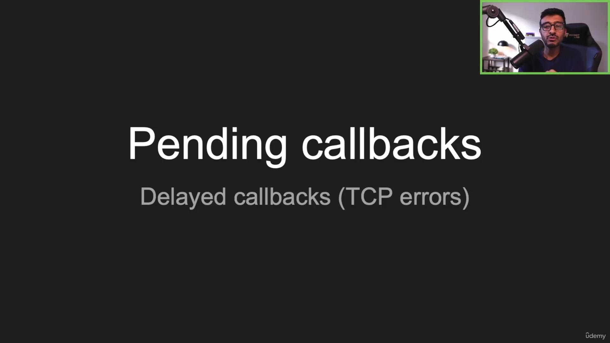
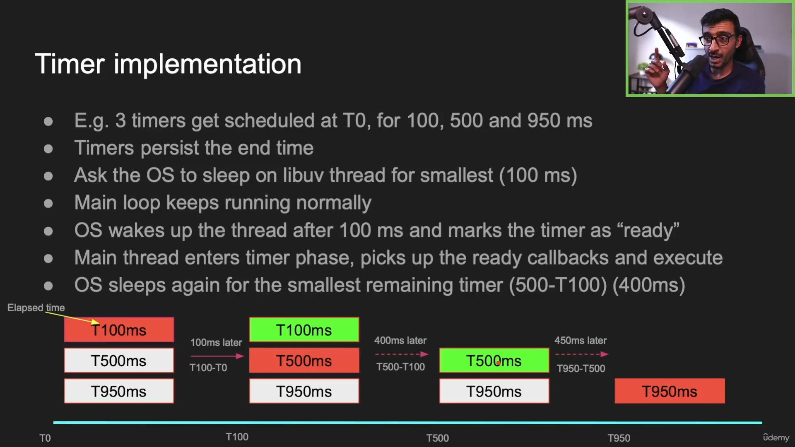
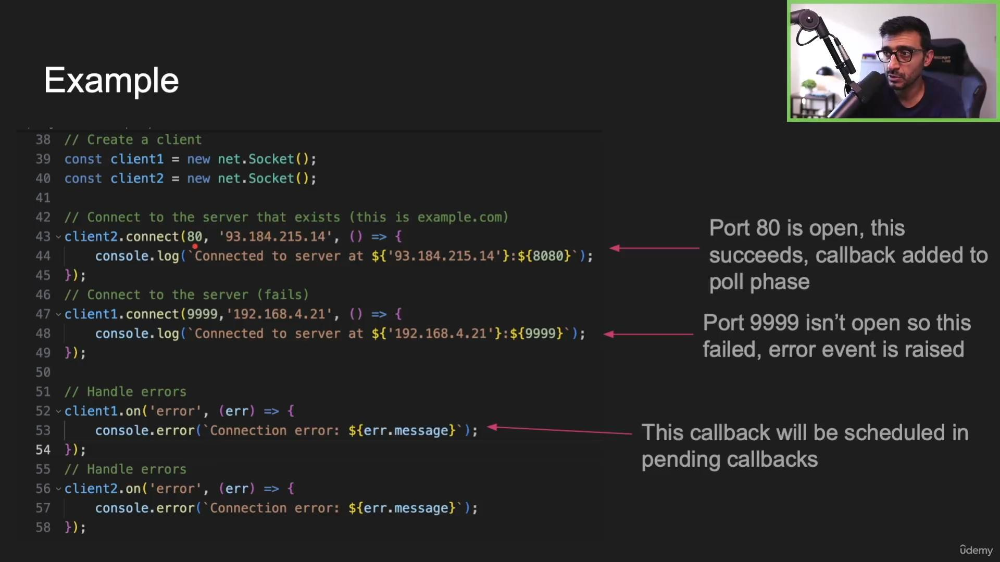
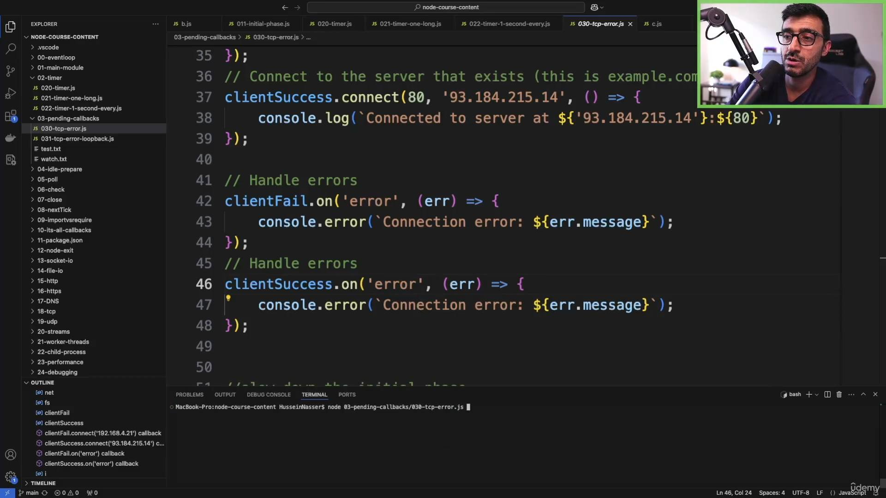
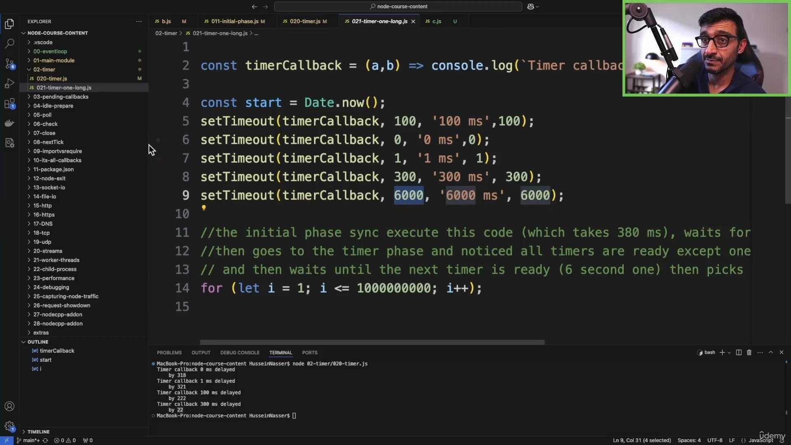
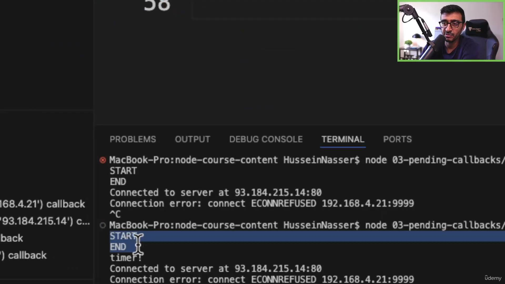

# Node.js 事件循环实战：Timers 阶段与 Pending Callbacks 阶段

## 1. 这一节做什么

这一节对应课程 **P010–P011**，主题是 Node.js 事件循环里的两个阶段：

- **P010：timers 阶段**。搞清楚 `setTimeout` 到底是怎么被执行的：libuv 如何用一个线程去“睡”，如何按到期时间排序，为什么定时器几乎总会延迟，以及同步阻塞代码会把定时器拖慢多少。
- **P011：pending callbacks 阶段**。搞清楚 TCP 连接错误这类“低优先级回调”为什么被推迟到后面的循环迭代，以及一个讲师自己测出来的例外：**loopback（127.0.0.1）错误不会排队，会立刻报**。

最终你会得到一个可以直接运行的目录，包含 6 个脚本：

```text
nodejs-event-loop/
├── package.json
├── 02-timers/
│   ├── 01-timer-basic.js
│   ├── 02-timer-long.js
│   └── 03-timer-every-second.js
└── 03-pending-callbacks/
    ├── 01-tcp-error.js
    ├── 02-tcp-error-with-timer.js
    └── 03-loopback.js
```

课里没有指定 Node 版本，也没有使用任何第三方依赖。你装一个当前 LTS 的 Node.js 即可，所有代码只用内置的 `net` 模块和 `Date.now()`。运行方式统一用 `node 文件路径` 或 `npm run 脚本名`。

---

## 2. 讲师原话

> “Timer callback gets scheduled. sorted by duration. … what we do is we really sleep, we sleep in the shortest duration.”
>
> 定时器回调会被调度，并按持续时间排序；libuv 真正做的是“睡最短的那个时间”。
>
> —— p010 [06:17]

> “So what we do is we sleep at the least amount of time, which is 100, 500, 950. Pick the least. Let's sleep for 100 millisecond.”
>
> 三个定时器分别是 100ms、500ms、950ms，那就先睡 100ms，醒来再检查剩下的。
>
> —— p010 [08:39]


> “Because in the timer you can submit arguments, which is amazing.”
>
> 因为 `setTimeout` 可以给回调传参数，这一点很好用。
>
> —— p010 [15:20]

> “This phase was created mainly for these things as called TCP errors.”
>
> pending callbacks 这个阶段主要是为 TCP 错误这类回调创建的。
>
> —— p011 [00:29]



> “This is the loop back. The loop back is an exception. … Loop back takes priority.”
>
> 这是 loopback。loopback 是一个例外，它会优先处理。
>
> —— p011 [06:42]

> “This is not nowhere in the dock, by the way. This is just my personal testing.”
>
> 这一点文档里没有写，是我自己测试发现的。
>
> —— p011 [07:10]

---

## 3. 从零复现

### 步骤 0：准备环境

课里没讲具体 Node 版本。你只需要确认终端里能运行：

```bash
node -v
npm -v
```

能打印出版本号即可。本文不依赖任何 npm 包，所以不需要 `npm install`。

### 步骤 1：创建目录

```bash
mkdir -p nodejs-event-loop/02-timers
mkdir -p nodejs-event-loop/03-pending-callbacks
cd nodejs-event-loop
```

### 步骤 2：创建 package.json

在项目根目录创建 `package.json`，内容见第 4 节。它只负责提供几个快捷命令，没有依赖。

### 步骤 3：创建 timers 的三个脚本

把第 4 节的 `02-timers/01-timer-basic.js`、`02-timers/02-timer-long.js`、`02-timers/03-timer-every-second.js` 原样保存。

先跑第一个：

```bash
npm run timer:basic
```

你会看到类似：

```text
[timer-0ms] 期望延迟 0ms，实际延迟 385ms，误差 385ms
[timer-100ms] 期望延迟 100ms，实际延迟 387ms，误差 287ms
[timer-300ms] 期望延迟 300ms，实际延迟 389ms，误差 89ms
```

具体数字取决于你的机器。关键现象是：**三个定时器都被同一个同步 `for` 循环拖慢了**。课里讲师跑出来的 0ms 定时器延迟约 385ms，100ms 的延迟约 287ms，300ms 的延迟约 89ms。你的机器可能快一些或慢一些，只要三个都明显大于期望值，就说明复现成功。



然后运行第二个：

```bash
npm run timer:long
```

这个脚本只有一个 6000ms 的定时器，同样被同步循环拖慢。课里讲师说第二个例子“same thing, same example, but I'm adding an extra time here”，也就是在同样的结构上把时长换成 6000ms。

最后运行第三个：

```bash
npm run timer:every
```

它会每秒打印一行，并且每次打印后重新记录 `start`，再排下一次 `setTimeout`。按 `Ctrl+C` 停止。

### 步骤 4：创建 pending callbacks 的三个脚本

把第 4 节的三个文件保存到 `03-pending-callbacks/`。

先运行：

```bash
npm run pending:tcp
```

预期顺序是：

1. 先打印 `start`；
2. 然后打印成功连接的 `connected to example.com:80`；
3. 最后才打印失败连接的 `connection error: ...`。

课里讲师用 `192.168.4.21` 这个“本网段里不存在”的地址制造失败，用另一个存在的地址制造成功。成功回调先执行，失败回调被推迟到 pending callbacks 阶段，所以看起来“错误来得很晚”。

再运行：

```bash
npm run pending:timer
```

这个版本多了一个 `setTimeout(..., 0)`。课里讲师加 timer 的目的就是让你看到：**timer 阶段先执行，pending callback 的错误后执行**。输出里 `timer fired` 通常出现在 `connection error` 之前。



最后运行：

```bash
npm run pending:loopback
```

这个脚本连接 `127.0.0.1:999`，本机大概率没有服务监听 999 端口。按照讲师的测试，loopback 的错误不会排到 pending callbacks，而是在当前阶段立刻报出来。所以你会看到错误和 timer 的先后关系与上一个脚本不同。



### 步骤 5：做两个对比实验

**实验 A：调换两个 socket 的创建顺序。**  
把 `01-tcp-error.js` 里成功 socket 和失败 socket 的代码块互换，再运行。课里讲师在 p011 [05:47] 演示过：“switch the order doesn't matter, same output”。你应该仍然看到成功先、失败后。

**实验 B：去掉同步阻塞。**  
把 `01-timer-basic.js` 里的 `for` 循环注释掉，再运行。三个定时器的误差会从几百毫秒降到个位数毫秒。课里讲师在 p010 [21:00] 也做了这个操作：“let's just remove the delay altogether. You can see that you're still getting a tiny bit of a delay.”



---

## 4. 完整代码

### `package.json`

```json
{
  "name": "nodejs-event-loop-timers-pending-callbacks",
  "version": "1.0.0",
  "private": true,
  "description": "复现 NodeJS 课程 P010-P011：timers 阶段与 pending callbacks 阶段",
  "main": "02-timers/01-timer-basic.js",
  "scripts": {
    "timer:basic": "node 02-timers/01-timer-basic.js",
    "timer:long": "node 02-timers/02-timer-long.js",
    "timer:every": "node 02-timers/03-timer-every-second.js",
    "pending:tcp": "node 03-pending-callbacks/01-tcp-error.js",
    "pending:timer": "node 03-pending-callbacks/02-tcp-error-with-timer.js",
    "pending:loopback": "node 03-pending-callbacks/03-loopback.js"
  }
}
```

### `02-timers/01-timer-basic.js`

```js
// 02-timers/01-timer-basic.js
// 目的：观察 timer 阶段被同步阻塞拖慢后的实际延迟。
// 对应课程 P010：timer callback 按 duration 排序，libuv 睡最短的那个。

const start = Date.now();

function timerCallback(name, expectedDelay) {
  const actualDelay = Date.now() - start;
  const drift = actualDelay - expectedDelay;

  console.log(
    `[${name}] 期望延迟 ${expectedDelay}ms，实际延迟 ${actualDelay}ms，误差 ${drift}ms`
  );
}

// setTimeout 的第三个及之后的参数会原样传给回调。
// 这里把定时器名字和期望延迟传进去，方便在回调里算误差。
setTimeout(timerCallback, 0, 'timer-0ms', 0);
setTimeout(timerCallback, 100, 'timer-100ms', 100);
setTimeout(timerCallback, 300, 'timer-300ms', 300);

// 讲师用 10 亿次空循环制造同步阻塞。
// 这段代码会在初始阶段同步执行，把后面的 timer 全部拖慢。
const BLOCK_ITERATIONS = 1e9;
for (let i = 0; i < BLOCK_ITERATIONS; i++) {
  // 故意空转
}
```

### `02-timers/02-timer-long.js`

```js
// 02-timers/02-timer-long.js
// 目的：观察 6 秒定时器在同步阻塞下的延迟。
// 对应课程 P010：第二个 timer 示例加了 6000ms 的时长。

const start = Date.now();

function timerCallback(name, expectedDelay) {
  const actualDelay = Date.now() - start;
  const drift = actualDelay - expectedDelay;

  console.log(
    `[${name}] 期望延迟 ${expectedDelay}ms，实际延迟 ${actualDelay}ms，误差 ${drift}ms`
  );
}

setTimeout(timerCallback, 6000, 'timer-6000ms', 6000);

// 同样的同步阻塞，用来观察 6000ms 定时器被拖慢多少。
for (let i = 0; i < 1e9; i++) {
  // 故意空转
}
```

### `02-timers/03-timer-every-second.js`

```js
// 02-timers/03-timer-every-second.js
// 目的：用递归 setTimeout 模拟“每秒执行一次”，并观察每次的延迟。
// 对应课程 P010：讲师在回调里重新记录 start，再排下一次。

let start = Date.now();

function tick() {
  const actualDelay = Date.now() - start;
  const drift = actualDelay - 1000;

  console.log(
    `[tick] 期望延迟 1000ms，实际延迟 ${actualDelay}ms，误差 ${drift}ms`
  );

  // 课里讲师强调：每次都要重新记录 start。
  start = Date.now();

  setTimeout(tick, 1000);
}

setTimeout(tick, 1000);
```

### `03-pending-callbacks/01-tcp-error.js`

```js
// 03-pending-callbacks/01-tcp-error.js
// 目的：观察 TCP 连接错误被推迟到 pending callbacks 阶段。
// 对应课程 P011：TCP errors 被排到后续循环迭代执行。

const net = require('net');

console.log('start');

// 一个大概率不存在的内网地址。
// 课里讲师用的是 192.168.4.21:80，这里保持同样的地址。
// 如果你所在网络会长时间超时，见第 7 节的替换建议。
const failingSocket = net.createConnection(
  { host: '192.168.4.21', port: 80 },
  () => {
    console.log('failing socket connected（理论上不会发生）');
  }
);

failingSocket.on('error', (err) => {
  console.log('connection error:', err.message);
});

// 一个确定可访问的地址，用来制造“成功回调先执行”的对比。
// 课里讲师用的是他自己网络里存在的一台机器。
const okSocket = net.createConnection(
  { host: 'example.com', port: 80 },
  () => {
    console.log('connected to example.com:80');
    // 课里没讲：连接成功后 socket 默认保持打开，脚本不会退出。
    // 这里主动 end()，让示例能正常结束。
    okSocket.end();
  }
);

okSocket.on('error', (err) => {
  console.log('ok socket error:', err.message);
});
```

### `03-pending-callbacks/02-tcp-error-with-timer.js`

```js
// 03-pending-callbacks/02-tcp-error-with-timer.js
// 目的：在 TCP 错误示例里加一个 0ms timer，观察 timer 阶段先于 pending callbacks。
// 对应课程 P011：讲师加 setTimeout 后，timer 先执行，错误后执行。

const net = require('net');

console.log('start');

const failingSocket = net.createConnection(
  { host: '192.168.4.21', port: 80 },
  () => {
    console.log('failing socket connected（理论上不会发生）');
  }
);

failingSocket.on('error', (err) => {
  console.log('connection error:', err.message);
});

const okSocket = net.createConnection(
  { host: 'example.com', port: 80 },
  () => {
    console.log('connected to example.com:80');
    okSocket.end();
  }
);

okSocket.on('error', (err) => {
  console.log('ok socket error:', err.message);
});

// 课里没讲：这里用 0ms 只是为了让 timer 阶段有回调可执行。
setTimeout(() => {
  console.log('timer fired');
}, 0);
```

### `03-pending-callbacks/03-loopback.js`

```js
// 03-pending-callbacks/03-loopback.js
// 目的：验证讲师说的 loopback 例外：127.0.0.1 的错误不会排到 pending callbacks。
// 对应课程 P011：loopback takes priority，错误在当前阶段立刻报出。

const net = require('net');

console.log('start');

// 连接本机 999 端口。本机大概率没有服务监听 999。
const socket = net.createConnection(
  { host: '127.0.0.1', port: 999 },
  () => {
    console.log('loopback connected（理论上不会发生）');
  }
);

socket.on('error', (err) => {
  console.log('loopback connection error:', err.message);
});

// 同样加一个 0ms timer，用来对比错误和 timer 的先后顺序。
setTimeout(() => {
  console.log('timer fired');
}, 0);
```

---

## 5. 逐行解释

### `01-timer-basic.js`

**`const start = Date.now();`**  
在注册任何定时器之前拍一个时间快照。讲师在 p010 [15:50] 说，延迟就是用“回调被调用的当前时间”减去“初始阶段记录的开始时间”，再减去定时器本身的时长。这个 `start` 就是那个“开始时间”。

**`function timerCallback(name, expectedDelay) { ... }`**  
定时器回调接收两个参数。第一个是定时器名字，第二个是期望延迟。这两个值不是 Node 自动给的，而是通过 `setTimeout` 的第三个、第四个参数传进去的。

**`const actualDelay = Date.now() - start;`**  
从注册定时器到回调真正执行，实际过去了多少毫秒。

**`const drift = actualDelay - expectedDelay;`**  
误差。如果定时器完全准时，`drift` 应该是 0。课里讲师反复强调：**几乎永远不会是 0**，因为操作系统调度、其他阶段、同步代码都会造成延迟。

**`setTimeout(timerCallback, 0, 'timer-0ms', 0);`**  
这里的第三个参数 `'timer-0ms'` 和第四个参数 `0` 会原样传给 `timerCallback`。讲师在 p010 [15:20] 专门提到这个能力：“in the timer you can submit arguments”。前端同学可能习惯写 `setTimeout(() => fn(a, b), 0)`，Node 允许直接写 `setTimeout(fn, 0, a, b)`。

**`for (let i = 0; i < 1e9; i++) {}`**  
同步阻塞。这段循环会在初始阶段执行完，才会进入事件循环的 timers 阶段。所以三个定时器全部被拖慢。讲师用 10 亿次循环，在它的机器上大约耗时 385ms。你的机器可能更快或更慢。这个数字不重要，重要的是“定时器被同步代码拖慢”这个现象。

### `02-timer-long.js`

结构和第一个脚本一样，只是把时长换成 6000ms。课里讲师说第二个示例“same example, but I'm adding an extra time here”，也就是同样的观察方法，换一个更长的定时器。运行后你会看到 `timer-6000ms` 的实际延迟比 6000ms 多出几百毫秒，多出来的部分就是同步循环的耗时。

### `03-timer-every-second.js`

**`let start = Date.now();`**  
注意这里是 `let`，不是 `const`。因为每次 tick 之后都要重新赋值。

**`start = Date.now();`**  
讲师在 p010 [24:52] 说：“I reset the start time every single time.” 每次回调执行完，把起点重置为当前时间，再排下一次 `setTimeout`。这样每一轮测量的都是“这一轮到下一轮”的延迟，而不是从程序启动开始累计的总时间。

**`setTimeout(tick, 1000);`**  
递归调度。课里讲师用这种方式实现“每秒执行一次”。它不是 `setInterval`，但效果类似。要注意：下一轮的 1000ms 是从本轮回调执行时开始算的，所以如果回调本身耗时 50ms，实际周期会接近 1050ms。这一点课里没展开讲，但在第 7 节会提醒。

### `01-tcp-error.js`

**`const net = require('net');`**  
引入 Node 内置的 TCP 模块。课里讲师说：“I am creating a socket, a client socket. I know the IP address, I know the port.” 创建一个客户端连接只需要主机和端口。

**`console.log('start');`**  
在创建任何 socket 之前打印，用来确认脚本开始执行。

**`net.createConnection({ host: '192.168.4.21', port: 80 }, callback)`**  
尝试连接 `192.168.4.21:80`。课里讲师说这个地址在他的子网里不存在，所以连接会失败。失败的错误回调会被排到 pending callbacks 阶段，而不是立刻执行。

**`failingSocket.on('error', (err) => { ... })`**  
监听错误事件。课里讲师说：“we will be scheduled in the pending callback.” 这个回调就是被推迟的那个。

**`net.createConnection({ host: 'example.com', port: 80 }, callback)`**  
连接一个确定存在的地址。课里讲师用的是他自己网络里的一台机器；这里换成 `example.com:80`，因为读者的本机不一定有那台机器。成功回调通常在 poll 阶段执行，所以它会先于失败回调打印。

**`okSocket.end();`**  
这一行课里没讲。加它是因为 TCP 连接成功后 socket 默认保持打开，Node 进程不会自动退出。调用 `end()` 让脚本能正常结束。如果你不关心进程退出，可以去掉，但那样终端会一直挂着。

### `02-tcp-error-with-timer.js`

在第一个脚本基础上加了：

```js
setTimeout(() => {
  console.log('timer fired');
}, 0);
```

课里讲师加 timer 的目的，是让你看到事件循环的阶段顺序：timer 阶段在 pending callbacks 之前。所以即使失败 socket 先创建，`timer fired` 也会先于 `connection error` 打印。讲师在 p011 [10:33] 说：“When do you think the timer will execute? Of course, right after the initial phase, the timer phase, and then we have this and then the pending callback at the end.”

### `03-loopback.js`

**`host: '127.0.0.1'`**  
loopback 地址。课里讲师在 p011 [06:42] 说：“This is the loop back. The loop back is an exception.” 他的测试结论是：loopback 连接失败不会排到 pending callbacks，而是在当前阶段立刻报错。原因是 loopback 就在本机，不存在“远端网络还没准备好”的问题，没有延迟的必要。

**`port: 999`**  
本机大概率没有服务监听 999。如果恰好有，换一个没人用的端口即可。



---

## 6. 复现检查清单

- [ ] `node -v` 能正常输出版本号。
- [ ] 目录结构包含 `02-timers/` 和 `03-pending-callbacks/`，且 6 个 `.js` 文件都存在。
- [ ] `npm run timer:basic` 能运行，三个定时器都打印了“实际延迟”和“误差”。
- [ ] `timer:basic` 里三个定时器的误差明显大于 0（通常在几十到几百毫秒）。
- [ ] 注释掉 `01-timer-basic.js` 里的 `for` 循环后，误差明显变小（个位数毫秒左右）。
- [ ] `npm run timer:long` 能运行，`timer-6000ms` 的实际延迟大于 6000ms。
- [ ] `npm run timer:every` 每秒打印一行，按 `Ctrl+C` 能停止。
- [ ] `npm run pending:tcp` 的输出顺序是：`start` → 成功连接 → `connection error`。
- [ ] 把 `01-tcp-error.js` 里两个 socket 的创建顺序对调，输出顺序仍然是成功在前、错误在后。
- [ ] `npm run pending:timer` 里 `timer fired` 出现在 `connection error` 之前。
- [ ] `npm run pending:loopback` 里 loopback 错误没有像上一个脚本那样“等很久”，而是很快出现。
- [ ] 所有脚本都能在几十秒内结束；如果 `pending:tcp` 卡住超过一分钟，看第 7 节关于内网地址超时的说明。

---

## 7. 课里没讲但你会撞上的

**1）`192.168.4.21` 不是你的内网地址时，可能卡很久。**  
课里讲师说这个地址在他子网里不存在，所以很快失败。但在你的网络里，发往 `192.168.4.21` 的 SYN 可能被路由到别处，或者一直没人回应，导致 TCP 重试。具体等多久取决于操作系统，可能几十秒，也可能更久。课里没讲这个超时值。如果你不想等，可以把 `failingSocket` 的 host 改成你本网段里一个确定不存在的主机，或者改成 `127.0.0.1` 的未监听端口——但注意，loopback 是讲师说的例外，它会立刻报错，不会进入 pending callbacks，演示效果就变了。

**2）`example.com:80` 可能被防火墙或网络策略拦住。**  
如果成功 socket 也报错，你就看不到“成功先、失败后”的对比。课里没讲怎么处理这种情况。最稳妥的办法是换成你内网里一台确定开放 80 端口的机器，或者先确认 `curl example.com` 能通。

**3）脚本不退出。**  
课里没讲 socket 的生命周期。TCP 连接成功后，socket 默认保持打开，Node 进程会一直挂着。本文在成功回调里加了 `okSocket.end()`，这是为了复现方便补上的。如果你去掉这一行，终端不会自己回到命令提示符。

**4）`setTimeout(fn, 0)` 不是真正的 0ms。**  
课里没讲 Node 的最小定时器精度。实际运行时，0ms 定时器也可能有 1ms 左右的延迟。讲师在 p010 [20:31] 也提到，他见过误差为 `-1` 的情况，因为 `Date.now()` 只有毫秒精度，测量本身有抖动。看到负数不用慌。

**5）递归 `setTimeout` 的周期会漂移。**  
讲师的“每秒执行一次”是：回调执行 → 重置 `start` → 再 `setTimeout(tick, 1000)`。这意味着下一轮的 1000ms 是从本轮回调执行时开始算的。如果回调本身耗时 50ms，实际周期会接近 1050ms，误差会慢慢累积。课里没讲这一点。如果你需要更稳定的周期，可以记录一个绝对的下次执行时间，用 `下次时间 - Date.now()` 作为延迟；但那就不是讲师这段代码了。

**6）不同 Node 版本、不同操作系统的输出顺序可能有细微差异。**  
课里没讲版本差异。事件循环的阶段顺序在 Node 大版本之间总体稳定，但网络栈、DNS 解析、定时器精度都会影响你看到的先后关系。讲师的结论是“大体可预测，但具体到某一次运行会有抖动”。复现时以你自己终端里的输出为准，不要拿本文的示例输出逐字比对。

**7）前端同学容易把“定时器延迟”理解成浏览器里的 `setTimeout` 不准。**  
方向是对的，但 Node 的 timers 阶段是 libuv 用单独的线程 `sleep` 实现的。课里讲师在 p010 [04:21] 说：“the sleeping thread is actually one of the LibUVs thread. It's just one thread that sleeps and it wakes up and it checks.” 主线程不会被 `sleep` 阻塞，所以 Node 还能继续处理其他阶段。你在浏览器里写的长任务会阻塞整个页面，在 Node 里同样会阻塞事件循环——这就是 `for` 循环能把三个定时器全部拖慢的原因。

**8）pending callbacks 不是“所有错误”都进。**  
课里讲师说这个阶段主要放 TCP 错误，UDP 错误也可能进，但不要理解成“所有异步错误都延迟”。比如 loopback 就是例外。你在写重试逻辑时，应该把重试挂在 `error` 事件回调里，而不是自己再包一层定时器——课里讲师在 p011 [08:09] 说：“You want to add the retry logic on the error event, right? So you can just retry it again.”