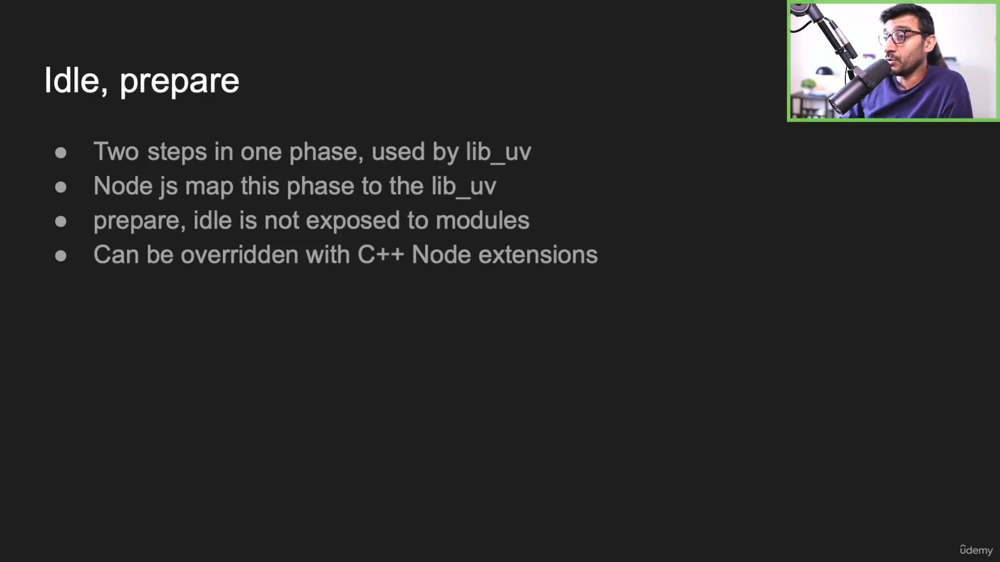
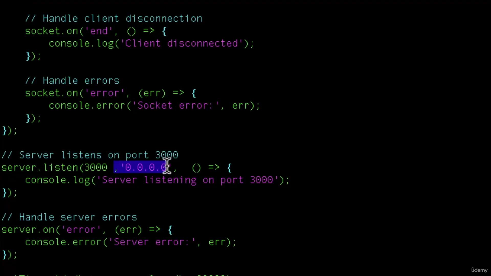
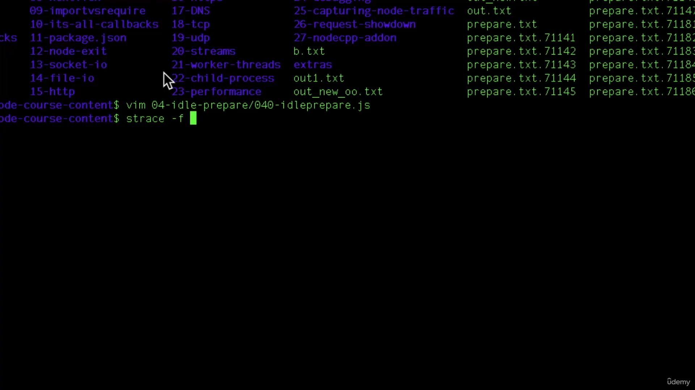
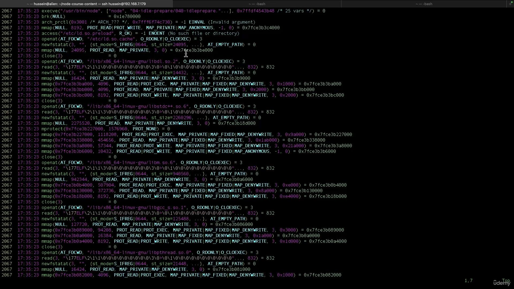
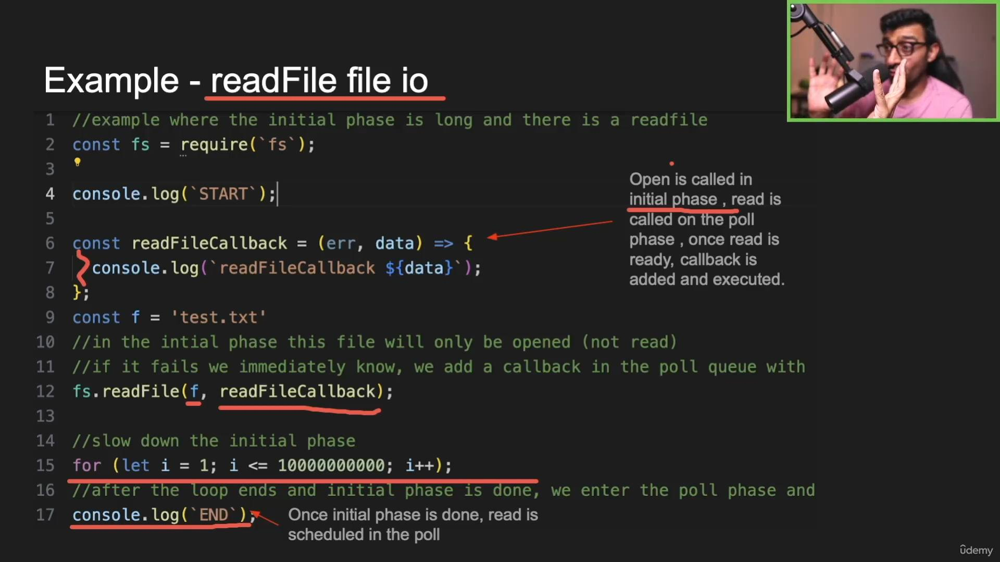
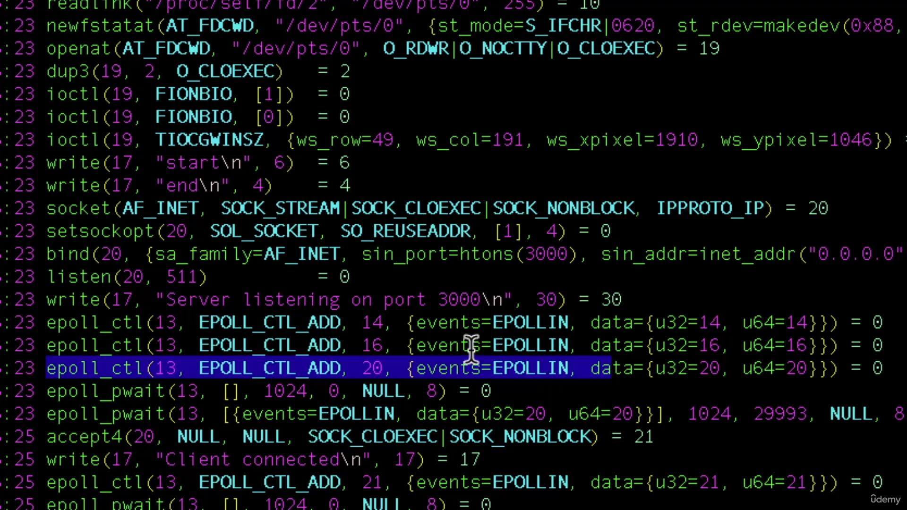

# NodeJS Internals P12–P13：idle/prepare 与 poll 阶段——用 strace 把 Node 对内核做的事看清楚

## 1. 这一节做什么

P12 和 P13 讲的是 Node 事件循环里紧挨着的两个阶段：**idle/prepare** 和 **poll**。

- **idle/prepare** 被讲师称为「invisible phase」——用户代码感知不到它，它是 Node/libuv 自己做内部工作的阶段。其中 idle 部分在每轮循环都会跑一些内部任务；prepare 部分则在为下一阶段（poll）做 IO 准备：把接下来要监听的 socket/file descriptor 注册进操作系统的异步 IO 数据结构里。Linux 上是 epoll，Mac/BSD 上是 kqueue，Windows 上是 IOCP，较新的 Linux 内核还有 io_uring。
- **poll** 是讲师口中「most important phase」。这里发生两件事：第一，真正的 IO 被 poll（询问内核「这些 fd 有没有就绪」）；第二，IO 完成后的回调被调度和执行。监听 socket、accept 连接、读写连接、读写文件，都绕不开这个阶段。

这一节不是纯理论课。讲师的核心动作是：**在 Linux 上用 strace 跟踪 node 进程，把「Node 到底向内核发了哪些系统调用」打印出来**，然后对着日志讲 socket、bind、listen、epoll_ctl、epoll_wait、accept、read、write、close 分别在什么时候发生。

你可以把这一节理解成一次「带日志的解剖」：不是背事件循环图，而是让每一句结论都能在 `prepare.txt` 或终端输出里找到对应证据。讲师反复强调事件循环不是 Node 自己发明的，而是 libuv 的循环，Node 只是把各个阶段映射出来。因此，看到 `epoll_ctl`、`epoll_wait`、`accept`、`read` 这些系统调用时，不要把它们当成 Node API 的内部细节，而要把它们看成 libuv 在 Linux 上完成异步 IO 的具体动作。你写的是 JavaScript，真正和内核打交道的是 libuv 以及它背后的系统调用。

你照着这篇文档做完，会得到：

1. 一个能跑的 TCP server 脚本，配合 telnet 制造连接；
2. 一份 `prepare.txt`，里面能看到 listener socket 的创建、bind、listen、注册进 epoll、accept 出新 fd、读写、从 epoll 删除的完整链路；
3. 一组 readFile 脚本，用终端输出顺序证明「初始阶段只 open，poll 阶段才 read」；
4. 两个 listen 脚本的对比，证明「只传 port 时 bind 在初始阶段完成；传 host 时 bind 被推迟到 poll 阶段」。

前端同学可以这样类比：Node 的主线程约等于浏览器的主线程。你在 Node 里写一个 `while` 长循环，所有 IO 回调都动不了，就像在浏览器里写 `while(true)` 把页面卡死。这一节要讲的，就是 Node 怎么靠 libuv 和 epoll 把「等待」从主线程里挪走。浏览器里你发起 `fetch` 后，主线程不会被网络等待卡死；Node 里你调用 `fs.readFile` 后，主线程也不应该被磁盘等待卡死。区别在于，浏览器把这些细节藏在 Web API 和事件循环后面，而这一节把 Node/libuv 向内核发出的系统调用摊开给你看。你不需要记住每个 fd 编号，但需要建立「JS 调用 → libuv 数据结构 → 系统调用 → 内核事件 → 回调」这条链路。

读这一节时还要建立一个重要习惯：**以日志为准，不以记忆为准**。不同 Node 版本、不同 Linux 发行版、不同 libc、是否在 WSL2、是否在容器里，都会让 fd 编号、系统调用名称、输出顺序出现细微差异。讲师机器上 listener 是 fd 20、连接是 fd 22、stdout 是 fd 17，但你的机器上很可能是别的数字。正确做法不是死记 20/22/17，而是看「先 socket，再 bind，再 listen，再 epoll_ctl，再 epoll_wait，再 accept」这个顺序，以及每个 fd 在后续日志里如何被复用、注册、读取和删除。

---

## 2. 讲师原话

下面这些句子直接来自逐字稿，后面标了出处。读的时候注意：讲师反复强调「这个循环不是 Node 的，是 libuv 的」，这是理解后面所有系统调用的前提。

> 「idle prepare... it's an invisible phase. It's not something that us users really care about. It's there for node to do some internal works, especially the idle part.」
>
> —— p012 [00:00]

> 「the preparing is we're preparing for to do an IO... you need to do certain data structures to actually perform that IO. Like an example for this is EpoL for Linux, KQ for Mac, BSD stuff, and IOCP for Windows and IO during recent Linux kernel upgrades.」
>
> —— p012 [00:56] / [01:24]

讲师这里说的「IO during」指的是 io_uring，逐字稿里没有展开拼写，后面 P13 他又提了一次「IOUring, which is the latest Linux implementation」。

> 「it's important to understand that this loop that we talked about is actually not nodes, but actually LibUVs... Node just maps the phases one-to-one to this libUV.」
>
> —— p012 [02:50]



> 「you do strace... dash if is very critical because node is a multi threaded application. I know I said single threaded. Yes, it's a single threaded when it comes to a node itself, but LibUV, which is the library that we reference is multi threaded.」
>
> —— p012 [10:06]

> 「the most important phase in Node.js and there's the pole phase. This is where IO are actually being executed and this is also where IO's are being IO callbacks are being executed.」
>
> —— p013 [00:00]

> 「say we have a desk SSD, and I'm doing a read... there will be a system call here that's called read that will be fired to the disk. And that will take a finite amount of time... in that time, node will block.」
>
> —— p013 [07:33]

> 「if there is no data that has been sent by the client of this connection, then that rate will block forever. It's a blocking operation. And that's the danger here.」
>
> —— p013 [10:42]

> 「The beauty of E-Poll Wait is you can actually get a timer inside... Node is smart enough to say, hey, if there isn't actually a timer in the other phase, I am going to E-Poll for that elapsed time.」
>
> —— p013 [11:41]

> 「when we read a file, especially the asynchronous version, what happens in the initial phase, right there is actually we're going to do an open... But then the actual read happens on the pull phase.」
>
> —— p013 [17:26]

> 「if you listen immediately and say just 8080, there is no I.O. needed to be honest here... The moment this code is executed in the initial phase right after start we will be able to connect to the server even though we didn't even get this line started.」
>
> —— p013 [34:29]

> 「if you pass me an address, then all bets are off. And I have no idea what you passed. I need to check. I need to DNS it. I need to resolve it... And that is an IO.」
>
> —— p013 [40:15]

引用之后，做实验时请把每句话对应到日志里。比如「invisible phase」不是让你去找一个叫 idle 的系统调用，而是让你理解：用户代码看不到这个阶段，但 libuv 会在 prepare 里做 epoll_ctl 之类的准备动作；「poll 是最重要的阶段」不是让你背定义，而是让你在 `epoll_wait` 返回后看到 `accept`、`read`、回调执行；「传 address 就需要 DNS/check」不是让你死记参数顺序，而是让你在 `listen-with-host.txt` 里看到 bind 被推迟。讲师的原话是线索，strace 日志是证据，两者对上了，这一节才算真的复现成功。

---

## 3. 从零复现

### 3.1 环境准备

讲师用的是 Ubuntu 机器。你需要：

- **Linux。** 讲师明确说：Mac 和 Windows 也能跑 Node，但抓系统调用最好的工具是 strace，他在 Mac 上没找到等价的。所以这一节最好在 Linux（物理机、虚拟机、WSL2 都行）上做。WSL2 里可以跑 strace，但文件系统性能和 fd 编号可能和讲师机器不同；你要比较的是系统调用顺序和相对时机，不是逐字逐行完全一致。如果你在容器里做实验，先确认容器允许 ptrace；有些容器默认禁止，strace 会直接报权限错误。
- **Node.js。** 逐字稿没有给出具体版本号。讲师提到「Node 23 的 io_uring 还没完全实现」，说明他讲课的时间点在这个附近。用 Node 20 或 22 LTS 都可以复现本节所有现象。版本差异见第 7 节。运行前先执行 `node -v`，把版本记下来；如果某条输出顺序和本文不完全一样，先看版本，再看日志，不要急着重装系统。
- **strace。** Ubuntu 上：

  ```bash
  sudo apt-get update
  sudo apt-get install -y strace
  ```

  安装后执行 `strace -V` 确认命令存在。常见错误是「`strace: command not found`」，这通常不是 Node 的问题，而是系统没装 strace，或者你在一台精简容器里。先解决工具问题，再跑实验。

- **telnet。** 较新的 Ubuntu 默认不装：

  ```bash
  sudo apt-get install -y telnet
  ```

  如果 `telnet` 不存在，先安装。本文所有连接实验都按 telnet 写；没有 telnet 时不要误以为 server 没起来，先确认工具本身可用。

- **两个终端。** 一个跑 strace + node，一个跑 telnet。或者一个本地终端 + 一个 SSH 会话，讲师就是这么干的。两个终端的好处是：你能一边看 server 输出，一边制造连接；如果只有一个终端，strace 输出和 telnet 输入会互相打断，排查起来很痛苦。

这一节还需要注意权限。strace 依赖 ptrace。如果执行 `strace ... node ...` 时报 `Operation not permitted`，常见原因是系统的 ptrace 限制、容器安全策略或用户权限不足。不要在不明后果的情况下随意修改系统安全配置；优先在允许 ptrace 的虚拟机、WSL2 或实验环境里做。你要观察的是 Node/libuv 的行为，不是和系统安全策略对抗。

### 3.2 建目录

```bash
mkdir -p ~/nodejs-internals/p012-p013
cd ~/nodejs-internals/p012-p013
```

把第 4 节的 7 个 `.js` 文件和 `test.txt` 都放进这个目录。建好后先 `ls` 看一眼，确认文件名没有拼错。后面很多错误不是 Node 的错，而是当前工作目录不对，导致 `test.txt` 找不到、脚本路径不对、`strace -o` 输出到别处。每次运行前先 `pwd`，确认自己在 `p012-p013` 目录里。

### 3.3 P12 实验：TCP server + strace

讲师在课里用的命令是：

```bash
strace -f -t -o prepare.txt node 04_...
```

文件名前缀 `04_` 是他自己的编号。这里我们按内容命名为 `p012-tcp-server.js`，命令变成：

```bash
strace -f -t -o prepare.txt node p012-tcp-server.js
```

三个参数的含义，讲师逐字讲过：

- `-f`：follow threads。他说 Node 本身是单线程，但 **libuv 是多线程的**，必须跟住所有线程，否则会漏掉大量系统调用。你如果只跟踪主线程，可能会看到主线程在 `epoll_wait`，但看不到线程池里处理文件 IO 的线程动作。P12 的 TCP 例子主要看主线程和网络 fd，但养成 `-f` 的习惯，后面 readFile 实验会更完整。
- `-t`：给每行加时间戳。后面你要靠时间戳判断「bind 到底发生在初始阶段还是 poll 阶段」。注意时间戳是 wall clock，strace 本身也会带来开销；你比较的是相对先后，不是把毫秒数当成性能基准。
- `-o prepare.txt`：把 strace 输出写到文件，不刷屏。文件名不要和别的实验混用，建议每次换一个名字，或者先删掉旧文件。否则你 grep 到的可能是上一次实验的残留。





server 启动后，在另一个终端里连它：

```bash
telnet 127.0.0.1 3000
```

连上后随便敲几个字符回车，你会看到 server 端打印 `received data: ...`，同时 telnet 里会回显你输入的内容（因为代码里 `socket.write(data)`）。然后按 `Ctrl+]`，输入 `quit` 断开。重复两三次，制造多个连接，这样 strace 日志里会出现多个 `accept` 出来的 fd。注意：`Ctrl+]` 是 telnet 的转义键，不是 Node 的快捷键；如果你按了没反应，先确认 telnet 窗口有焦点，再试一次。退出 telnet 后，server 端应该打印 `client disconnected`，strace 里对应连接 fd 的 `epoll_ctl` 删除和 `close` 也会出现。

等 30 秒，`server.close()` 触发，node 退出，strace 也退出。打开 `prepare.txt`，搜索这些关键字：

```bash
grep -n "socket\|bind\|listen\|epoll_ctl\|epoll_wait\|accept\|read(\|write(\|close(" prepare.txt
```



常见错误与排查：

- **`prepare.txt` 是空的**：先看 node 是否立刻报错退出。可以不加 strace 先运行 `node p012-tcp-server.js`，确认脚本能正常监听；再检查 `strace` 命令里的脚本路径。
- **`telnet: Unable to connect to remote host`**：先看 server 终端有没有打印 `server listening on 0.0.0.0:3000`；再看端口是不是 3000；如果你在另一台机器上连，确认防火墙和监听地址。本文用 `127.0.0.1` 最稳。
- **grep 不到 `accept`**：确认你确实用 telnet 连上并敲了字符；如果只是启动 server 没有连接，当然不会 accept。strace 文件名也要确认不是旧文件。
- **30 秒没到就以为程序卡住**：`setTimeout` 是 30 秒后关闭，耐心等；如果想提前结束，可以在 server 终端按 `Ctrl+C`，但这样 `server.close()` 的日志可能不完整。

### 3.4 P13 实验：readFile / connect / listen

依次跑：

```bash
node p013-readfile.js
node p013-readfile-timer.js
node p013-readfile-missing.js
node p013-socket-connect.js
```

前三个看终端输出顺序即可。第四个会连 example.com:80，连上后**不会自动退出**，需要 `Ctrl+C`。讲师专门解释了为什么——因为 epoll_wait 还在等这个连接上的数据，Node 认为「我还有活要干」。如果你在受限网络里连不上 example.com，可能会先看到 socket error；这时先确认网络和 DNS，不要把网络错误当成事件循环错误。实验目标是观察「连接存在时进程不退出」，不是必须访问某个特定网站。

然后做两组 strace 对比。

**第一组：文件不存在时，open 在初始阶段就失败。**

```bash
strace -f -t -o readfile.txt node p013-readfile-missing.js
grep -n "openat\|read(\|write(" readfile.txt
```

讲师原话里说的是「open at」，对应系统调用 `openat`。你会在日志里看到：先有一个 `openat` 对不存在的文件返回失败，再有一个 `openat` 对当前脚本文件成功，两个 open 都发生在初始阶段；真正的 `read` 在后面。这里不要死记「第一个 openat 一定是哪个文件」，要看 openat 的参数和返回值；文件名出现在 strace 输出里，结合 `ENOENT` 就能对上。若你的系统输出里是 `open` 而不是 `openat`，也不奇怪，跟 libc/内核有关，按实际输出理解即可。

**第二组：只传 port vs 传 host，bind 发生的时机不同。**

```bash
strace -f -t -o listen-port-only.txt node p013-listen-port-only.js
# 另开终端，趁 busy loop 还在跑的时候：
telnet 127.0.0.1 8080

strace -f -t -o listen-with-host.txt node p013-listen-with-host.js
# 另开终端：
telnet 127.0.0.1 4000
```

然后对比两份日志里的 `bind` 行：

```bash
grep -n "bind\|listen\|connect" listen-port-only.txt
grep -n "bind\|listen\|connect" listen-with-host.txt
```

`port-only` 版本里，`bind` 出现在很靠前的位置，和初始阶段的 busy loop 时间戳接近；`with-host` 版本里，`bind` 被推迟到初始阶段结束之后。



这组实验最容易犯的错是「busy loop 太快」。如果 `LOOP_COUNT` 太小，你还没开第二个终端，循环已经结束，两个版本看起来都能连上，对比就失效了。可以适当调大循环次数，但不要改成死循环；目标是制造一个可观察的初始阶段延迟。另一个常见错误是端口被上一次实验占用，启动时报 `EADDRINUSE`。遇到这种情况，先结束旧的 node 进程，或者临时换端口，并在 strace 文件名和 telnet 命令里同步修改。

---

## 4. 完整代码

> 说明：逐字稿是口述 + 屏幕操作，讲师没有逐行念出完整文件。下面每个文件都按他口述的行为补全成可直接保存运行的版本；凡是逐字稿没有明确说死的细节，都在注释里标了「课里没讲」。

### 4.1 `p012-tcp-server.js`

```js
// p012-tcp-server.js
// 对应 P12 09:12 附近：net 包起 TCP server，监听 data / end，
// listen 3000 所有网卡，30 秒后 close。
// 逐字稿口述了这些行为，但没有逐行展示完整文件。

const net = require('net');

const server = net.createServer((socket) => {
  console.log('client connected');

  socket.on('data', (data) => {
    // 讲师原话：收到数据「just print it」，同时 write 回连接。
    // 他说日志里会出现 write 17（屏幕）和 write 22（连接）。
    console.log('received data:', data.toString());
    socket.write(data);
  });

  socket.on('end', () => {
    console.log('client disconnected');
  });
});

// 讲师原话：监听 3000，用 0.0.0.0 监听所有网卡，
// 这样有线网和 Wi-Fi 都能连进来。
server.listen(3000, '0.0.0.0', () => {
  console.log('server listening on 0.0.0.0:3000');
});

// 讲师原话：30 秒后关闭 server。
setTimeout(() => {
  console.log('closing server');
  server.close();
}, 30 * 1000);
```

运行前确认当前目录正确。若 3000 端口被占用，server 会报错；先换端口或结束旧进程。实验时不要只看 server 终端，也要看 telnet 终端和 `prepare.txt`，三份输出对起来才能说明问题。

### 4.2 `p013-readfile.js`

```js
// p013-readfile.js
// 对应 P13 15:59 附近：readFile test.txt，打印 start / end / callback。

const fs = require('fs');

console.log('start');

fs.readFile('test.txt', (err, data) => {
  if (err) {
    console.error('read failed:', err.message);
    return;
  }
  console.log('readFile callback:', data.toString());
});

console.log('end');
```

这个脚本的关键不是文件内容本身，而是输出顺序。先运行一次，记住 `start`、`end`、`readFile callback` 的先后；再用 strace 看 `openat` 和 `read` 的时机。若报 `ENOENT`，先检查 `test.txt` 是否在当前目录。

### 4.3 `p013-readfile-timer.js`

```js
// p013-readfile-timer.js
// 讲师原话：「Exactly the same code, but we're adding a timer callback.」

const fs = require('fs');

console.log('start');

setTimeout(() => {
  console.log('timer callback');
}, 0);

fs.readFile('test.txt', (err, data) => {
  if (err) {
    console.error('read failed:', err.message);
    return;
  }
  console.log('readFile callback:', data.toString());
});

console.log('end');
```

这个脚本用来观察 timer 回调和 readFile 回调在输出里的相对位置。不同版本的 Node、不同系统负载下，具体先后可能有细微差别；你要结合事件循环阶段理解，而不是把某一次输出当成永恒定律。

### 4.4 `p013-readfile-missing.js`

```js
// p013-readfile-missing.js
// 对应 P13 28:13 附近：一个读不存在的文件，一个读 __filename。
// 讲师原话：不存在的文件在初始阶段 open 就失败，
// 回调被立刻调度到 poll 阶段的队列；__filename 的 read 要等 poll 阶段才发生。

const fs = require('fs');

console.log('start');

// 这个文件不存在：初始阶段 open 就会失败
fs.readFile('this-file-does-not-exist.txt', (err) => {
  if (err) {
    // err.message 是 Node 标准错误属性；逐字稿没有逐字念出这个字段名。
    console.log('missing file callback:', err.message);
  }
});

// __filename 是当前文件，一定能读到
fs.readFile(__filename, (err, data) => {
  if (err) {
    console.error('self read failed:', err.message);
    return;
  }
  console.log('self read callback, bytes:', data.length);
});

console.log('end');
```

> 小注：讲师原话说「If you require FS, then you get for free this underscore file name」。实际上 `__filename` 是 Node 的全局变量，不需要 `require('fs')`。这一点课里没展开，按原话理解即可。

运行这个脚本时，重点看两件事：不存在的文件是否很快在回调里报错；当前脚本文件是否还能在 `end` 之后被读到。再用 strace grep `openat`，把「初始阶段失败」和「poll 阶段读取」对上。

### 4.5 `p013-socket-connect.js`

```js
// p013-socket-connect.js
// 对应 P13 19:15 附近：连接 example.com:80。
// 讲师原话：连上后 Node 不会自动退出，因为 epoll_wait 还在等这个连接。

const net = require('net');

console.log('start');

const socket = net.connect(80, 'example.com', () => {
  console.log('connected to server');
});

socket.on('error', (err) => {
  // err.message 是 Node 标准属性；逐字稿没有逐字念出。
  console.error('socket error:', err.message);
});

console.log('end');
```

这个脚本预期不会自动退出。看到 `connected to server` 后，需要手动 `Ctrl+C`。如果你看到 `socket error`，先检查网络或 DNS；若一直没有任何输出，可能是连接过程还在等待，也按 `Ctrl+C` 结束，不要让它无限占着终端。

### 4.6 `p013-listen-port-only.js`

```js
// p013-listen-port-only.js
// 对应 P13 34:29 附近：只传 port。
// 讲师原话：只传 port 时 bind 不需要 IO，在初始阶段立刻完成；
// 即使初始阶段的 busy loop 还没跑完，客户端也能连上 8080。

const net = require('net');

const server = net.createServer((socket) => {
  console.log('client connected');
  socket.on('data', (data) => {
    console.log('received:', data.toString());
    socket.write(data);
  });
});

console.log('start');

// 只传 port：bind 在初始阶段就完成
server.listen(8080, () => {
  console.log('listening on 8080');
});

// 讲师原话：他在这里加了一个「very long loop」，让初始阶段变慢，
// 方便观察「初始阶段还没结束，端口已经可以连」。
// 循环次数课里没给具体值，下面这个数按机器速度调整。
let sink = 0;
const LOOP_COUNT = 3e9;
for (let i = 0; i < LOOP_COUNT; i++) {
  sink += i;
}
console.log('loop done', sink);

console.log('end');
```

如果你的机器跑得太快，可以调大 `LOOP_COUNT`；如果跑得太久，可以调小。注意代码里的 `sink` 是为了防止循环被优化掉，不要删掉它却只留下空循环。

### 4.7 `p013-listen-with-host.js`

```js
// p013-listen-with-host.js
// 对应 P13 39:45 附近：传 host。
// 讲师原话：一旦传了地址，就需要 DNS/校验，这是 IO，
// bind 被推迟到 poll 阶段，所以初始阶段还没结束时连不上。
// 讲师课里先写反了参数顺序，后来改成 port 在前才工作。
// 这里直接用正确顺序：listen(port, host, callback)。

const net = require('net');

const server = net.createServer((socket) => {
  console.log('client connected');
});

console.log('start');

server.listen(4000, '127.0.0.1', () => {
  console.log('listening on 127.0.0.1:4000');
});

console.log('end');
```

这个脚本和 port-only 版本对比时，最好用同一个观察方法：在 busy loop 期间尝试 telnet，并同时记录 strace 里的 bind 行。不要只凭「感觉连上了」下结论，要有日志或终端输出作证据。

### 4.8 `test.txt`

```text
hello world
```

逐字稿里讲师说文件内容就是 `hello world`。如果你改了内容，readFile 回调打印的文本会不同，但阶段顺序的解释不变。实验时建议先用原始内容，减少变量。

---

## 5. 逐行解释

### 5.1 `p012-tcp-server.js` 与 strace 日志对照

讲师在 P12 里带着大家从日志开头往下看。你会依次看到（fd 编号以你的实际输出为准，讲师机器上是 20、21、22、17）：

1. **`socket(...) = 20`**：创建 listener socket，返回 fd 20。讲师原话：「This is our listening socket... it's 20」。
2. **`bind(20, ...)`**：把 fd 20 绑到 3000 端口。讲师原话：「then I'm going to bind it to port 3000. That is the interesting part here.」
3. **`listen(20, ...)`**：开始监听。讲师原话：「by doing listening, calling that listen, now we're ready to receive connections」。
4. **`epoll_ctl(..., 20, ...)`**：把 listener socket 注册进 epoll。讲师原话：「We added that socket listener as part of the E-Poll to actually start receiving connections... And you need to do E-Poll control. That's done in the prepare stage.」具体是 add 还是 mod，以你的 strace 输出为准；讲师口述里叫「E-Poll control 的 add / delete」。
5. **`epoll_wait(...)`**：进入 poll 阶段等事件。讲师原话：「E-Poll in. give me any input that comes to that」。
6. **`accept(20, ...) = 22`**：有人连进来，accept 出一个新 fd。讲师原话：「accepting a connection creates a new socket connection for that client... now we get 22」。
7. **`epoll_ctl(..., 22, ...)`**：把新连接也注册进 epoll，准备读它上面的数据。讲师原话：「we add the 22 which is the new connection that we received we want to listen on data received on this guy」。
8. **`read(22, ...)` → `write(17, ...)` + `write(22, ...)`**：读到数据，打印到屏幕（fd 17 是 stdout），再写回连接。讲师原话：「we just print it... write 17 and write 22」。
9. **`epoll_ctl(..., 22, ...)`（delete）**：客户端断开，把 22 从 epoll 删除。讲师原话：「We do an E-Poll delete. We remove it. Again, this is also happening in the Prefere phase.」这里他口误说成 Prefere，指的是 prepare 阶段。

> 注意：`EPOLL_CTL_ADD` / `EPOLL_CTL_DEL` 这类常量名，逐字稿没有逐字念出。你 grep 时用 `epoll_ctl` 就够了，具体常量名以实际输出为准。



把这份列表读成一条「连接生命周期」：listener 先被创建并注册，然后 poll 等待；客户端连入后，accept 产生新 fd，新 fd 又注册进 epoll；数据到达后 read，再 write 回显；断开后 delete 并 close。这里最容易混淆的是「listener socket」和「连接 socket」：listener fd 负责接受连接，连接 fd 负责读写数据。你看到两个不同的 fd，不要以为 Node 创建了两个 server。前端类比一下：listener 像页面上一个「等待用户点击」的按钮，accept 像点击事件真的发生了并创建了一次具体交互；后续 read/write 是在这次交互上收发数据。按钮本身不会因为一次点击就消失，连接 socket 则会在客户端断开后从 epoll 删除。

还要注意系统调用名称的差异。你的日志里可能看到 `accept4` 而不是 `accept`，可能看到 `recvfrom` 而不是 `read`，也可能看到 `sendto` 而不是 `write`。这不改变讲师讲的结构；grep 时可以用更宽的模式，比如 `grep -n "accept、epoll、read、write、close" prepare.txt`，再根据上下文确认。不要因为名称差一个字符就认为实验失败。真正的失败是：你没有看到 listener 注册、没有看到 accept、没有看到新 fd 被加入 epoll，或者断开后没有删除。

### 5.2 `p013-readfile.js` 的输出顺序

终端输出是：

```text
start
end
readFile callback: hello world
```

讲师的原话解释是：`fs.readFile` 是异步版本，初始阶段只做 `open`（打开文件、拿元数据、确认存在），真正的 `read` 被推迟到 poll 阶段。所以 `start` 和 `end` 先打印，回调最后才执行。

这个顺序说明了一个关键点：异步 `readFile` 不是「在调用那一行立刻把文件读完再回来」，而是先发起准备工作，然后把真正的读取和回调交给后续阶段。你用 strace 看时，会看到 `openat` 相对靠前，`read` 和回调相对靠后；如果文件不存在，`openat` 在初始阶段就失败，错误回调会被调度到 poll 阶段的队列里。这里的「初始阶段」不是 JavaScript 的某一行代码，而是 Node/libuv 启动和当前轮循环的早期准备；「poll 阶段」也不是一个你能直接 `console.log` 出来的变量，而是你要通过系统调用和回调输出去推断的阶段。

**补充：`p013-readfile-timer.js` 的读法。** 这个脚本只多加了一个 `setTimeout(..., 0)`。它的作用是让你观察 timer 回调和 readFile 回调在输出中的相对位置。你不要背「timer 一定先」或「readFile 一定先」，而要看输出并回到事件循环阶段：timer 属于 timers 阶段，readFile 的完成回调属于 poll 阶段相关调度；实际先后会受到版本、系统负载、文件是否缓存等因素影响。实验的结论应该是「我能用输出和 strace 解释这次为什么是这个顺序」，而不是「所有机器永远一样」。

**补充：`p013-readfile-missing.js` 的读法。** 这个脚本同时发起两个 readFile：一个读不存在的文件，一个读 `__filename`。不存在的文件在初始阶段 `open` 就失败，所以它的错误回调会更早被放到队列里；当前脚本文件的 `open` 成功，真正的 `read` 要等 poll 阶段才发生。你运行后应该看到 `start`、`end` 先出现，然后是两个回调。具体谁先谁后，以你的输出为准；关键是你能在 strace 里找到失败 `openat` 和成功 `openat` 的先后，并解释「失败发生在准备阶段，读取发生在 poll 阶段」。

**补充：`p013-socket-connect.js` 为什么不退出。** 这个脚本连上 example.com:80 后不会自动退出，因为连接还在，`epoll_wait` 还在等这个 fd 上的事件，Node 认为还有活要干。讲师用这个例子说明 poll 阶段的等待不是「没事找事」，而是事件循环保持存活的机制之一。你按 `Ctrl+C` 结束它，不是因为它写错了，而是因为实验目的已经达到。前端类比：页面里还有一个未完成的 `fetch` 或 WebSocket 连接时，主线程不会因为一段同步代码跑完就「消失」；Node 进程也会因为还有活跃的 IO 而继续等。

**补充：两个 listen 脚本的对照。** `p013-listen-port-only.js` 只传 port，讲师说 bind 不需要 IO，在初始阶段立刻完成；所以即使 busy loop 还没跑完，另一个终端也能连上 8080。`p013-listen-with-host.js` 传了 host，讲师说一旦传地址就需要 check/DNS/resolve，这是 IO，bind 被推迟到 poll 阶段；所以在 busy loop 期间连不上，等初始阶段结束、poll 阶段推进后才 bind。你对比两份日志时，重点看 `bind` 行相对于启动时间和 busy loop 的位置，而不是看 fd 编号是否相同。若你的机器上 with-host 版本看起来也能很快连上，先确认地址形式、Node 版本和循环是否真的够长；不要为了迎合结论改日志，按实际输出解释。

---

## 6. 复现检查清单

下面每条都建议打勾，并且能说出「我用哪份输出验证了它」。检查清单不是形式，它的作用是防止你把「看过」当成「复现过」。

- [ ] **环境可用**：`node -v` 有输出；`strace -V` 有输出；`telnet` 命令存在。验证方式：三个命令分别执行，记录版本。若 `strace` 报权限错误，先解决权限或换实验环境。
- [ ] **目录和文件齐全**：`pwd` 在 `p012-p013`；`ls` 能看到 7 个 `.js` 和 `test.txt`。验证方式：运行 `ls -1`，逐个对照第 4 节文件名。
- [ ] **TCP server 能独立启动**：先不加 strace 跑 `node p012-tcp-server.js`，看到 `server listening on 0.0.0.0:3000`。验证方式：终端输出；若报 `EADDRINUSE`，先处理端口占用。
- [ ] **strace 能生成非空 `prepare.txt`**：运行 `strace -f -t -o prepare.txt node p012-tcp-server.js`，等 server 启动后 `ls -l prepare.txt`。验证方式：文件存在且大小不为 0；若为空，先检查命令和权限。
- [ ] **能看到 listener 的创建和注册**：`grep -n "socket、bind、listen、epoll_ctl、epoll_wait" prepare.txt`。验证方式：找到 socket 返回 fd、bind 到 3000、listen、epoll_ctl 注册、epoll_wait 等待的先后关系。
- [ ] **能制造至少一次 accept**：用 telnet 连接并敲字符，`grep -n "accept" prepare.txt`。验证方式：accept 返回一个新 fd，并在后续日志里看到这个 fd 被 epoll_ctl/read/write。
- [ ] **能看到读写回显**：server 终端打印 `received data:`；strace 里能看到对新连接 fd 的 read，以及对 stdout 和连接 fd 的 write。验证方式：把 telnet 里输入的字符和 server 输出对上；fd 编号可以不同，但顺序要能解释。
- [ ] **能看到断开清理**：telnet 退出后，server 打印 `client disconnected`；strace 里能看到对应 fd 的 epoll_ctl 删除和/或 close。验证方式：grep 新连接 fd，观察它从出现到删除的完整生命周期。
- [ ] **30 秒 close 行为可解释**：等待 `closing server`，确认 node 退出。验证方式：终端输出加进程是否结束；若有残留连接导致没退出，先关闭 telnet 再等。
- [ ] **readFile 顺序可复现**：运行 `node p013-readfile.js`，输出为 `start`、`end`、`readFile callback: hello world`。验证方式：多跑两次；若文件内容不同，确认你改过 `test.txt`。
- [ ] **readFile 的 strace 证据可对上**：运行 `strace -f -t -o readfile.txt node p013-readfile.js`，grep `openat` 和 `read`。验证方式：能指出 open 在初始阶段、read 在后续阶段的证据；若系统调用名不同，用实际名称解释。
- [ ] **timer 版本能解释相对顺序**：运行 `node p013-readfile-timer.js`，记录 timer 回调和 readFile 回调的先后。验证方式：不要只写「先/后」，要写出你观察到的顺序以及它和阶段的关系。
- [ ] **missing 版本能解释失败 open**：运行 `node p013-readfile-missing.js`，看到 missing file 回调和 self read 回调都在 `end` 后。验证方式：strace 里找到不存在的文件的失败 `openat`，以及当前脚本的读取。
- [ ] **connect 版本不自动退出**：运行 `node p013-socket-connect.js`，看到 `connected to server` 后用 `Ctrl+C` 结束。验证方式：记录你是否手动结束；若出现 socket error，记录错误信息并检查网络。
- [ ] **port-only 在 busy loop 期间可连接**：启动 `p013-listen-port-only.js`，在 `loop done` 之前用 telnet 连 8080。验证方式：telnet 成功，server 打印 `client connected`；strace 里 bind 出现在靠前位置。
- [ ] **with-host 的 bind 时机可对比**：启动 `p013-listen-with-host.js`，在初始阶段尝试连接 4000，并对比 `grep -n "bind"` 的位置。验证方式：以日志为准说明 bind 是否被推迟；若循环太快，调大 `LOOP_COUNT` 再试。
- [ ] **不把 fd 编号当结论**：检查自己有没有写「listener 一定是 20」。验证方式：换一次运行，观察 fd 可能变化；结论应写成「listener fd 先出现，连接 fd 后出现，具体编号以日志为准」。
- [ ] **每条结论都有证据**：随机挑一条你写的解释，问自己「哪一行日志/哪一段终端输出支持它」。验证方式：如果找不到证据，就把结论改成「以本次输出为准」或重新做实验。

---

## 7. 课里没讲但你会撞上的（表格：现象 / 原因 / 怎么办）

| 现象 | 原因 | 怎么办 |
|---|---|---|
| `strace: command not found` | 系统没装 strace，或在精简容器里 | 在 Ubuntu 执行 `sudo apt-get install -y strace`；容器里换到允许安装工具的实验环境 |
| `strace: ptrace(PTRACE_TRACEME, ...): Operation not permitted` | ptrace 被系统安全策略、容器策略或权限限制 | 优先换到允许 ptrace 的虚拟机/WSL2/实验环境；不要在不了解后果时随意改系统安全设置 |
| `prepare.txt` 为空或只有几行 | node 立刻报错退出、脚本路径错、strace 输出被覆盖 | 先不加 strace 运行 node；检查 `pwd` 和脚本名；每次实验用不同 `-o` 文件名 |
| `telnet: Unable to connect to remote host` | server 没启动、端口不对、监听地址不对、busy loop 期间 with-host 还没 bind | 看 server 终端输出；确认端口 3000/8080/4000；先试 `127.0.0.1`；对比 strace 的 bind 行 |
| `telnet` 命令不存在 | 新系统默认没装 telnet | `sudo apt-get install -y telnet`；先确认工具可用再判断 server |
| telnet 里按 `Ctrl+]` 没反应 | 焦点不在 telnet 窗口，或终端拦截了组合键 | 点击 telnet 窗口再试；进入 telnet 提示后输入 `quit`；实在不行关闭该终端 |
| `accept` 搜不到 | 没有真实连接，或只启动了 server | 用 telnet 连上并敲字符；确认 strace 文件不是上一次的旧文件 |
| 日志里是 `accept4` 不是 `accept` | libc/内核/Node 版本差异 | 用 `grep "accept"` 放宽匹配；按实际系统调用名解释，不要死记一个拼写 |
| 日志里是 `recvfrom`/`sendto` 不是 `read`/`write` | 系统调用封装和实现差异 | 用 `grep -n "read、write、recv、send"` 一起看；结论仍是「收发数据」 |
| fd 编号和讲师不同 | 操作系统、Node 版本、启动环境不同 | 不比较绝对编号，比较 fd 的出现顺序、注册、读写、删除的生命周期 |
| `epoll_ctl` 行很多，看不出哪条是 listener | libuv 还会注册内部 fd、timer、signal 等 | 先找 `socket` 返回的 fd，再 grep 这个 fd；用上下文确认 listener 和连接 fd |
| `readFile` 输出顺序和预期略有不同 | Node 版本、系统缓存、负载、线程池调度差异 | 多跑几次；以 `start/end/callback` 的异步关系为主，用 strace 的 `openat/read` 解释本次输出 |
| `readFile` 报 `ENOENT` | 当前目录没有 `test.txt`，或文件名拼错 | `pwd` 确认目录；`ls test.txt`；按代码里的文件名放置文件 |
| `listen` 报 `EADDRINUSE` | 端口被旧进程占用 | 结束旧 node 进程，或换端口；记得同步改 telnet 和 strace 文件名 |
| busy loop 期间 port-only 也连不上 | 端口/IP 不对、防火墙、server 启动失败，或循环已经结束 | 看 server 输出和 strace 的 bind/listen；确认在 `loop done` 前连接；必要时调大 `LOOP_COUNT` |
| with-host 看起来没有推迟 bind | 地址形式、Node 版本、循环太短导致观察不到 | 不强行套结论；对比 `grep -n "bind"` 的位置，确认循环是否真的覆盖了初始阶段 |
| busy loop 很快结束 | `LOOP_COUNT` 太小，或 V8 优化影响了空循环 | 保留 `sink` 并适当调大次数；不要改成死循环，保持可退出 |
| `p013-socket-connect.js` 一直不退出 | 连接还活着，`epoll_wait` 还在等事件 | 这是预期现象；观察完按 `Ctrl+C`。若报 socket error，先查网络/DNS |
| `write 17` 找不到 | stdout 被重定向、fd 编号不同、输出走了别的路径 | 不要死找 17；找 `write` 到终端/管道的记录，或直接以终端输出为准 |
| WSL2 里时间戳和讲师差很多 | 虚拟化、文件系统、调度开销不同 | 只比较相对先后；不要用 strace 时间戳做性能结论 |
| `server.close()` 后进程还在 | 还有活跃连接或未清理的句柄 | 关闭 telnet 连接，等待 close 完成；必要时 `Ctrl+C` 并记录残留原因 |
| 用 ESM 时 `__filename` 不可用 | `__filename` 是 CommonJS 里的全局变量 | 本节代码按 CommonJS 运行；若改 ESM，需要换等价的当前文件路径写法，但这不是本节实验目标 |
| 期待看到 io_uring 却没看到 | 本节 Linux 实验主要观察 epoll；io_uring 是讲师提到的另一种实现方向 | 不要把 io_uring 当成必须出现的系统调用；按你的内核和 Node 实际输出解释 epoll 链路 |