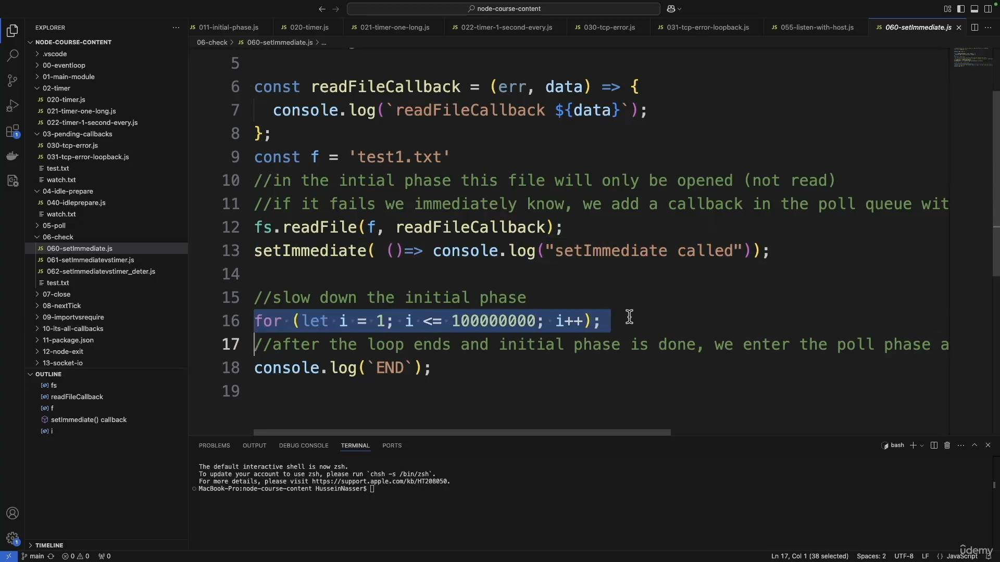
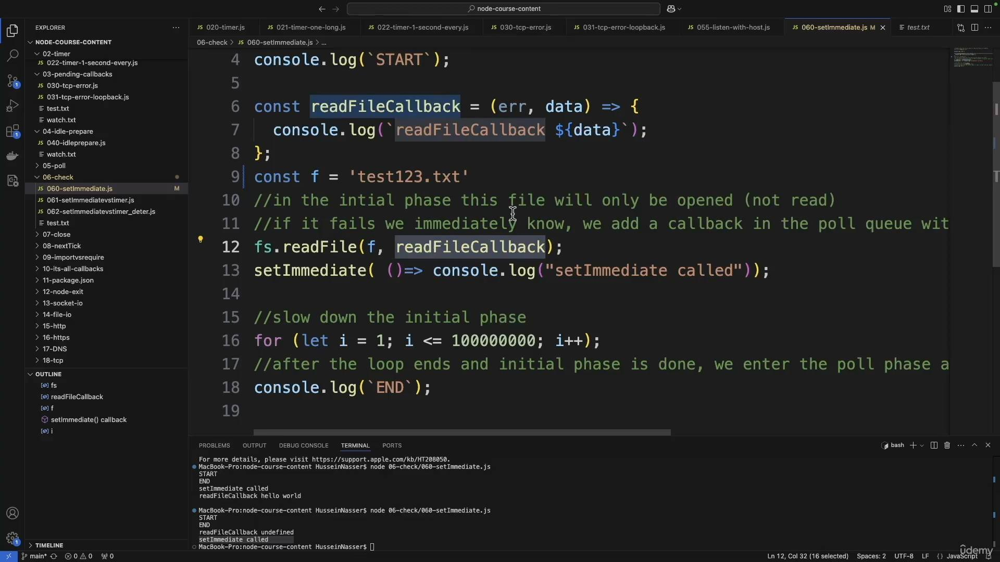
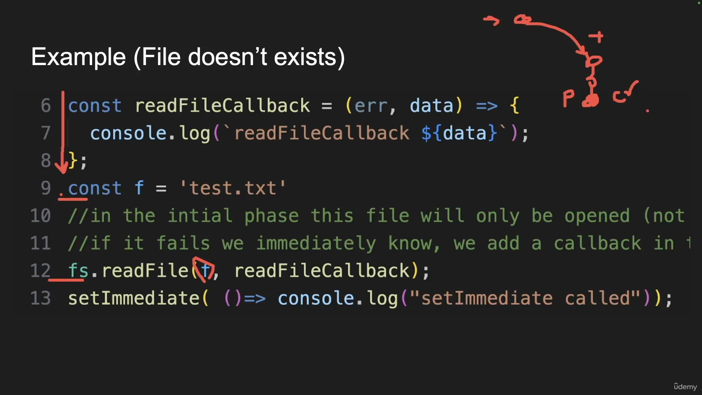
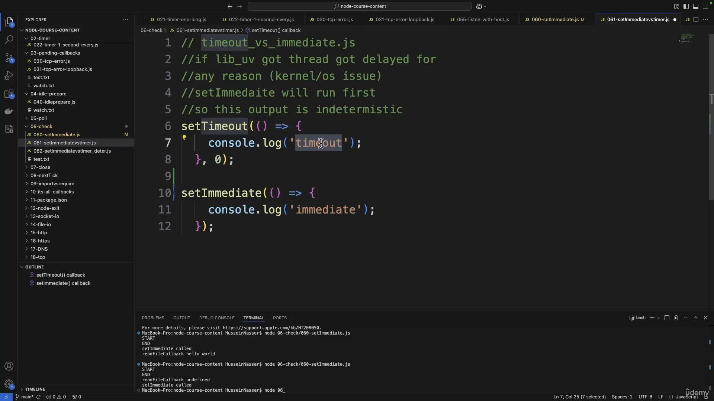
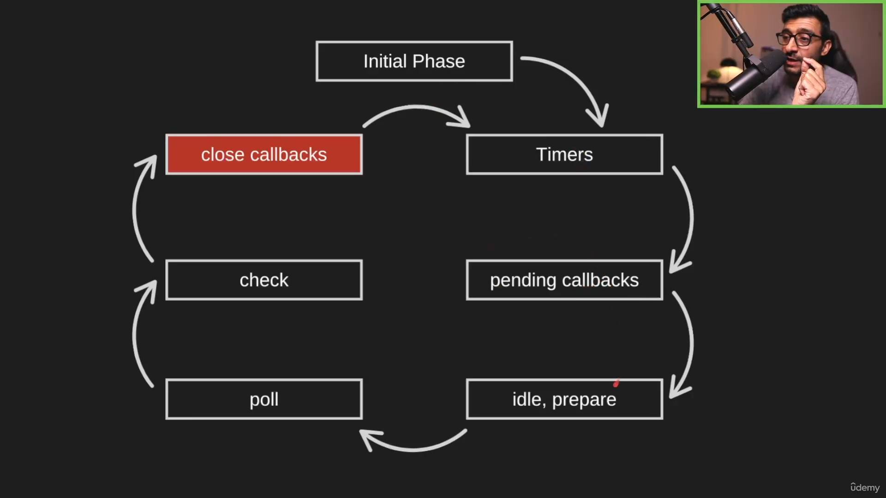
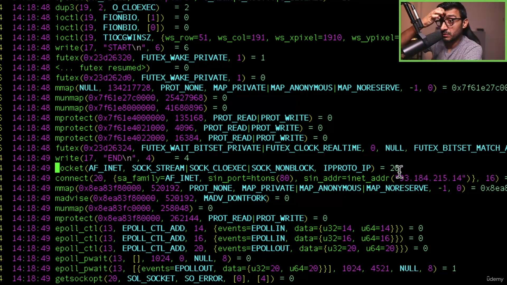
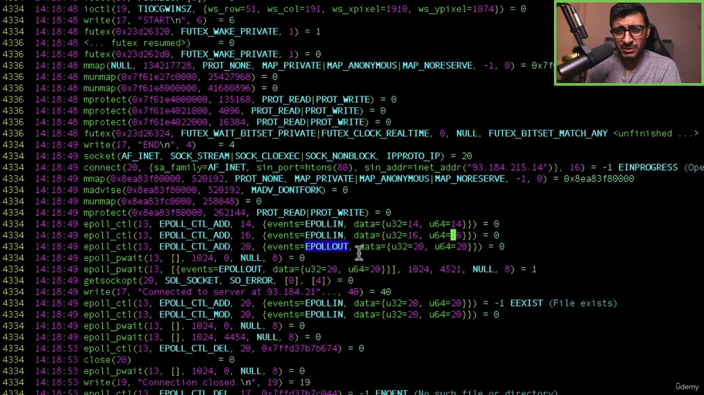
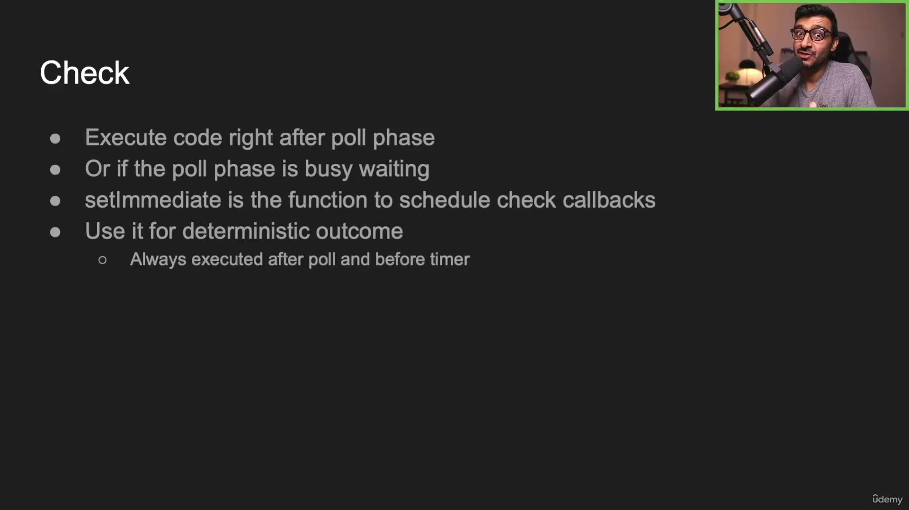

# NodeJS Internals · P14–P15：check 阶段与 close 阶段的可复现实录

> 课程：BV1jGRyBsEBa ｜ 覆盖 P14（check phase / setImmediate）、P15（close phase）
> 读者定位：会写 JS / 用过 Node CLI，但不熟悉 libuv 事件循环内部机制的前端转 AI 应用工程师
> 本文所有脚本都是**完整文件**，复制即跑；没有 npm 依赖，只用 Node 内置模块

---

## 1. 这一节做什么

P14 和 P15 是「事件循环各阶段」这条主线的收尾两讲，它们解决的是两个非常具体、可以亲手验证的问题：

1. **P14：为什么同一段 `fs.readFile` + `setImmediate` 的代码，文件存在和文件不存在时，打印顺序是相反的？** 讲师用白板逐阶段推演 + 四个可运行小脚本，把「check 阶段永远紧跟在 poll 阶段之后」这件事变成可预测、可复现的结论，并顺带解释清楚 `setTimeout(fn, 0)` 与 `setImmediate` 在顶层为什么**不可预测**、而在 IO 回调里为什么**必然可预测**。
2. **P15：`close` 为什么值得拥有一个独立阶段？** 讲师在 Ubuntu 机器上用 `strace -f -t` 追踪一个 `net.createConnection` + 5 秒后 `destroy()` 的脚本，把「关闭连接也是一次 IO」这件事从抽象说法落成 trace 文件里能看到的 `epoll_ctl` 增删记录，并说明为什么 close 回调要排在整轮迭代的最后。

**读完并照着做完，你会得到：**

- 一个可复现的实验目录，里面 4 个脚本分别对应课上的 4 个演示；
- 两段终端输出（文件存在 / 不存在）的对照，能自己讲清顺序反转的原因；
- 一份 `strace` 输出文件 `out.txt`，能在里面亲眼找到讲师指出的 socket 文件描述符与 epoll 相关行；
- 一套「用事件循环阶段解释输出顺序」的思考方式，而不是背结论。

**环境与依赖（写全）：**

| 项 | 值 | 说明 |
|---|---|---|
| Node.js | 22.x | 讲师在 P15 明确说自己用的是版本 22（—— p015 [18:15]）；P14 未提版本 |
| 依赖包 | 无 | 只用 `node:fs`、`node:net` 内置模块 |
| 环境变量 | 无 | 本课没有涉及任何环境变量 |
| 额外工具 | `strace` | 仅 P15 需要，且**只能在 Linux 上用**（讲师明确说 Mac 上做不了，—— p015 [12:01]） |
| 启动命令 | `node <文件名>` | 逐个脚本单独跑 |

目录结构（先建好，后面所有命令都在这个目录里执行）：

```
nodejs-event-loop/
├── test1.txt                  # 第一个实验要读的文件
├── 01-immediate-readfile.js   # 文件存在时的 readFile + setImmediate
├── 02-timer-vs-immediate.js   # setTimeout(0) vs setImmediate（顶层，不可预测）
├── 03-immediate-inside-io.js  # IO 回调内部的 setTimeout(0) vs setImmediate（必然可预测）
├── 04-close-socket.js         # 连接 example.com，5 秒后 destroy，监听 close
└── out.txt                    # strace 输出（运行后生成）
```

---

## 2. 讲师原话（带「—— pNNN [MM:SS]」）

按主题聚类，不按播放顺序罗列。

**关于 check 阶段的位置与意义：**

> "所以检查阶段紧跟在轮询阶段之后。……在那个 I/O 调度中、在回调里，你可以安排某个任务紧接着在检查阶段执行。"
> —— p014 [01:27]

> "你可以用这个漂亮的函数在这个阶段安排任务，它叫 setImmediate。"
> —— p014 [02:25]

> "所以我们知道，检查阶段与轮询阶段步调一致。轮询、检查，轮询、检查，轮询、检查，总是如此。"
> —— p014 [12:45]

**关于「顺序反转」这一核心现象：**

> "看起来检查阶段在轮询之前执行了，但事实并非如此，对吧？轮询阶段确实先执行了，只是读取文件的成本很高，所以我们把它延后了。"
> —— p014 [09:24]

> "如果文件不存在，我们会先执行读取文件的回调，再执行 setImmediate。这证明轮询阶段在检查阶段之前。"
> —— p014 [09:52]

**关于 `setTimeout(0)` 与 `setImmediate` 的顶层不可预测性：**

> "这里的输出是什么？输出完全是不可确定的。……绝对无法保证它会在第一次迭代中被唤醒。"
> —— p014 [16:30]

**关于 IO 回调内部两者的可预测性：**

> "所以我们总是、总是、总是会打印这个，因为当你用 setImmediate 安排某个任务时，它就已经准备好在那个阶段执行了。……如果你一直运行下去，永远不会出现 timeout immediate，而总是 immediate timeout、immediate timeout、immediate timeout，完全可预测。"
> —— p014 [22:10]

**关于 close 阶段的定位：**

> "关闭回调就是在这里被调度的。……设置专门关闭阶段的主要原因是，关闭事件的回调就在这里被调度。"
> —— p015 [00:28]

> "关闭某个东西需要时间，关闭某个东西本身就是一次 I/O。如果我关闭一个文件，那是在销毁文件描述符……如果我关闭连接，代价甚至更高，因为会有四次挥手。"
> —— p015 [01:26]

**关于 `strace` 观察到的现象：**

> "我们创建了一个套接字。这是一个客户端套接字……创建套接字时，我们立刻得到了一个文件描述符。……我们有一个 epoll 对象。epoll 本身的编号是 13。"
> —— p015 [15:51]

> "于是他们遇到一个错误，然后回过头去做一次修改操作。所以我的问题是，为什么不直接用 EPOLLOUT 和 EPOLLIN 做一次添加操作？这一点是可以改进的。"
> —— p015 [17:45]

---

## 3. 从零复现

下面每一步都写明「做什么 / 跑什么命令 / 应该看到什么」。如果你看到的结果不同，先看第 7 节，再回看第 5 节的时序推导。

### 步骤 0：准备 Node 版本

```bash
nvm install 22
nvm use 22
node -v          # 期望 v22.x.x
```

P15 的 strace 观察结论依赖具体 Node 版本（讲师原话：*"这完全取决于 Node 版本。在这个具体例子里，我用的是 22 版。"* —— p015 [18:15]）。所以先固定到 22，不要用 23/24 跑 P15 的对照实验。

### 步骤 1：创建实验目录和被读的文件

```bash
mkdir nodejs-event-loop && cd nodejs-event-loop
printf 'hello world\n' > test1.txt
cat test1.txt    # 期望输出 hello world
```

讲师在演示第一个脚本前，专门先确认了被读的文件存在、内容是可打印的（—— p014 [14:35]：*"先检查 test1 是否存在……test hello world，对。"*）。这一步别跳，否则你会跑成第二个实验的对照结果。

### 步骤 2：跑实验一 —— 文件存在时的 `readFile` + `setImmediate`

先把 `01-immediate-readfile.js`（完整代码见第 4 节）保存到目录里，然后：

```bash
node 01-immediate-readfile.js
```

**期望输出顺序（文件存在）：**

```
start
end
setImmediate called
read file: hello world
```

讲师现场就是这个顺序：*"可以看到，setImmediate 先被调用，随后是读取回调。"*（—— p014 [15:03]）。





### 步骤 3：跑实验一的对照 —— 文件不存在

不需要改代码，只要把文件名换成一个不存在的路径即可。**最省事的做法**是把脚本参数化（第 4 节我给的就是接受命令行参数的版本），或者临时改一下文件名重跑：

```bash
node 01-immediate-readfile.js does-not-exist.txt
```

**期望输出顺序（文件不存在）：**

```
start
end
read failed: ENOENT: no such file or directory, open 'does-not-exist.txt'
setImmediate called
```

注意 `read failed` 和 `setImmediate` 的顺序**反过来了**。这不是玄学，是 poll 阶段有没有真实 IO 要等的区别 —— 讲师为此专门画了第二遍白板（—— p014 [09:52]）：*"如果文件不存在，我们会先执行读取文件回调，再执行 setImmediate。这证明轮询阶段在检查阶段之前。"*



### 步骤 4：跑实验二 —— 顶层 `setTimeout(0)` vs `setImmediate`（不可预测）

```bash
node 02-timer-vs-immediate.js
```

**期望：每次输出都可能不同。** 讲师在 Mac 上连跑多次，既拿到过 `timeout` 先，也拿到过 `immediate` 先（—— p014 [17:54]：*"在这个例子里，我们得到的是先 setImmediate、后超时。先 setImmediate、后超时意味着定时器被延迟了。试几次之后，你可以看到，有时是先超时、后 setImmediate，有时是先 setImmediate、后超时。"*）。

建议连跑 10 次并统计：

```bash
for i in $(seq 1 10); do node 02-timer-vs-immediate.js; done
```

你会看到两种顺序混在一起。这就是「不可预测」的实证。



### 步骤 5：跑实验三 —— IO 回调内部再来一次（必然可预测）

```bash
node 03-immediate-inside-io.js
```

**期望输出（每次都一样）：**

```
start
read the script file
immediate
timeout
```

讲师对这个脚本的结论非常强硬：*"如果你一直运行下去，永远都不会得到先超时、后 setImmediate。它总是先 setImmediate、后超时，先 setImmediate、后超时，先 setImmediate、后超时。可预测。"*（—— p014 [22:10]）。同样建议连跑 10 次验证「永远不变」。

### 步骤 6：跑实验四 —— close 事件（先在任何系统上跑，看行为）

```bash
node 04-close-socket.js
```

**期望时间线：**

```
client success        # 第 0 秒左右，TCP 连上就打印
（等 5 秒）
connection closed     # destroy 生效后，整轮迭代末尾的 close 阶段打印
```

如果这个顺序没出现，多半是 `example.com:80` 被你的网络挡住了 —— 这是「课里没讲但你会撞上」的典型，第 7 节展开。




### 步骤 7：跑到 Linux 机器上做 strace（P15 的核心实验）

讲师在这一步明确说 Mac 做不了：*"我们不能在 Mac 上运行 strace。看到了吗？而最接近 strace 的是 fs_usage，这个东西很糟糕。"*（—— p015 [12:01]）。所以你需要一台 Linux（讲师是 SSH 到自己的 Ubuntu 机器，—— p015 [12:29]）。

```bash
# 在 Linux 上，装好 strace 之后
which strace || sudo apt-get install -y strace

# 进入实验目录，跑带 -f（跟随的子进程）和 -t（时间戳）的追踪，输出到 out.txt
strace -f -t -o out.txt node 04-close-socket.js
```

脚本本身要跑 5 秒，strace 会一直跟到进程退出。结束后：

```bash
wc -l out.txt
```

你会看到成百上千行（讲师原话：*"看看这一大堆东西……这里的每一行我并不都理解。"* —— p015 [14:53]）。**不要试图读完**，只按讲师教的思路，定位三样东西：

1. 创建 socket 的那一行附近——你会看到「创建一个 socket、得到一个文件描述符」的记录（讲师现场读到的是 `20`）；
2. `epoll` 相关的记录——讲师现场说 epoll 本身是 `13`，围绕它有一堆 `14`、`16`，他说自己也不确定那些是什么（—— p015 [15:51]：*"已经有一堆 14 和 16 了。说实话，我不知道这是什么。"*）；
3. 关闭前后 `epoll_ctl` 的「先加后改」以及最后的移除（—— p015 [17:45]、[19:39]）。





定位手段课里没给具体命令，你可以用自己顺手的方式（比如 `grep` 关键字），这只是检索技巧，不影响结论。


---

## 4. 完整代码

> 说明：逐字稿里讲师是一边写一边讲的，屏幕上只出现关键几行。以下四个文件是我把讲师口述的代码**补成可运行完整文件**的版本，补的部分（编码参数、错误分支、命令行参数、注释）都在第 5 节逐行说明里标出「这是补的，课里没念」。核心逻辑与讲师演示一致。

### 4.1 `test1.txt`

```
hello world
```

就一行。讲师现场 `cat` 出来是 `hello world`（—— p014 [14:35]）。

### 4.2 `01-immediate-readfile.js`

```js
// 01-immediate-readfile.js
// 演示：poll 阶段之后紧跟着 check 阶段
// 文件存在  -> setImmediate 先打印，readFile 回调后打印
// 文件不存在 -> readFile 回调先打印，setImmediate 后打印

const fs = require('node:fs');

const target = process.argv[2] || 'test1.txt'; // 补的：方便做「文件存在/不存在」对照

console.log('start');

fs.readFile(target, 'utf8', (err, data) => {
  if (err) {
    // 补的：文件不存在时，这个回调在 poll 阶段就已经就绪
    console.log('read failed:', err.message);
    return;
  }
  console.log('read file:', data.trim());
});

setImmediate(() => {
  console.log('setImmediate called');
});

console.log('end');
```

### 4.3 `02-timer-vs-immediate.js`

```js
// 02-timer-vs-immediate.js
// 演示：在顶层（initial phase）同时安排 timer 和 check，顺序不可预测

setTimeout(() => {
  console.log('timeout');
}, 0);

setImmediate(() => {
  console.log('immediate');
});
```

### 4.4 `03-immediate-inside-io.js`

```js
// 03-immediate-inside-io.js
// 演示：在 IO 回调（poll 阶段）内部安排 timer 和 check，顺序必然可预测

const fs = require('node:fs');

console.log('start');

fs.readFile(__filename, 'utf8', () => {
  // 这里已经在 poll 阶段里了
  setTimeout(() => {
    console.log('timeout');
  }, 0);

  setImmediate(() => {
    console.log('immediate');
  });
});

console.log('read the script file');
```

> 讲师在这里用的就是「读正在运行的这个脚本文件本身」：*"从技术上讲，文件名是存在的，对吧？因为这就是我们正在运行的文件。"*（—— p019 之前，p014 [19:21]）。所以用 `__filename` 是忠实复现；`read the script file` 这句是补的，方便你看清 poll 阶段的先后。

### 4.5 `04-close-socket.js`

```js
// 04-close-socket.js
// 演示：close 事件在整轮迭代的最后（close 阶段）被调度执行

const net = require('node:net');

const client = net.createConnection({ host: 'example.com', port: 80 }, () => {
  console.log('client success');
});

setTimeout(() => {
  client.destroy();
}, 5000);

client.on('close', () => {
  console.log('connection closed');
});
```

### 4.6 运行脚本一览

```bash
node 01-immediate-readfile.js                 # 文件存在
node 01-immediate-readfile.js does-not-exist.txt  # 文件不存在
node 02-timer-vs-immediate.js                 # 多跑几次
node 03-immediate-inside-io.js                # 多跑几次
node 04-close-socket.js                       # 等 5 秒
strace -f -t -o out.txt node 04-close-socket.js   # 仅 Linux
```

---

## 5. 逐行解释

### 5.1 `01-immediate-readfile.js` 的时序推演

这是全课最重要的一段推导，讲师在白板上走了一遍「文件存在」和「文件不存在」两条路（—— p014 [04:41] 起）。

**关键前提：`fs.readFile` 在 initial phase 只做「打开文件」，不做「读」。**

> *"In the initial phase, I go to here, says hey, fs.readFile, what do we do in the initial phase? We simply open the file, and we make sure the file can be open successfully."*（—— p014 [04:41]）

逐行看：

| 行 | 发生了什么 | 落在哪个阶段 |
|---|---|---|
| `const fs = require('node:fs')` | 加载内置模块 | initial phase（脚本求值） |
| `const target = ...` | 取命令行参数 | initial phase |
| `console.log('start')` | 立即打印 | initial phase |
| `fs.readFile(target, 'utf8', cb)` | **尝试打开文件**；成功则把「读」和「回调」一起排进 poll 阶段 | initial phase 里发起，实际 IO 在 poll |
| `setImmediate(cb2)` | 把回调排进 check 阶段 | initial phase 里调度，执行在 check |
| `console.log('end')` | 立即打印 | initial phase |

**路径 A：文件存在**

1. initial phase 打完 `start`、`end`，并把「读文件」挂到 poll 阶段、把「setImmediate 回调」挂到 check 阶段。
2. timers → pending callbacks → idle/prepare：都是空的。
3. 进入 **poll 阶段**：发现「要读文件 + 有个还没就绪的回调」。发起读 IO。**读文件是昂贵的，Node 不会在这里自旋等待**，于是本轮 poll 直接让出。
4. 进入 **check 阶段**：`setImmediate` 的回调**永远处于就绪状态**（不像 IO 回调要等数据），所以立刻执行 → 打印 `setImmediate called`。
5. 下一轮迭代回到 poll：此时文件已读完，回调标记为就绪，执行 → 打印 `read file: hello world`。

所以输出是 `start → end → setImmediate called → read file`。这也是为什么讲师说：*"看起来检查阶段在轮询阶段之前执行了，但事实并非如此。"*（—— p014 [09:24]）—— poll 阶段确实先跑了，只是它把读操作甩出去了，回调要等到下一轮。

**路径 B：文件不存在**

1. initial phase 里 `fs.readFile` 尝试打开文件，**立刻发现失败**（没有真实 IO 要做）。
2. 于是回调被以「已经就绪」的状态丢进 poll 阶段的队列。
3. 进入 poll 阶段：没有任何 IO 要等待，直接执行就绪回调 → 打印 `read failed: ...`。
4. 进入 check 阶段 → 打印 `setImmediate called`。

输出变成 `start → end → read failed → setImmediate called`。**这正是「poll 在 check 之前」的直接证据**，讲师原话：*"这证明轮询阶段在检查阶段之前。"*（—— p014 [09:52]）



**补的部分说明：**

- `'utf8'` 是我加的。不加编码时回调第二个参数是 Buffer，讲师现场打印出来是 `hello world`，说明他做了字符串化处理（可能是 `data.toString()`，逐字稿没念到）。两种写法等价，本文用 `'utf8'`。
- `err.message` 是我加的。讲师只说 *"在这种情况下，错误会被填充。"*（—— p014 [16:00]），没有念具体字段名。
- `process.argv[2]` 是我加的，目的是让「文件存在 / 不存在」两个实验共用同一个文件，避免你手动改代码。

### 5.2 `02-timer-vs-immediate.js` 为什么不可预测

两个调用都在 initial phase 注册：`setTimeout(fn, 0)` 进 timers 阶段，`setImmediate(fn)` 进 check 阶段。

问题在于：**timers 阶段在 event loop 的最前面，但「0 毫秒的定时器是否已到期」不由你决定。** 讲师的原话是：

> *"When I put that thread to sleep … there is absolutely no guarantee that this will wake up in the first iteration … because it could be delay context switching and as a result what are you gonna get is an unpredictable result."*（—— p014 [16:55]）

也就是说：

- 如果内核/libuv 唤醒得足够快、且 0ms 定时器在进入 timers 阶段时已到期 → 先打印 `timeout`；
- 如果定时器因为调度延迟没到期 → 本轮 timers 阶段空过，一路走到 check 阶段，先打印 `immediate`，下一轮才补上 `timeout`。

所以脚本**一个字都没写错**，输出就是会飘。讲师强调这是「靠机器速度决定」的现象，他那台机器上大部分时候是 `immediate` 先，但偶尔也能拿到 `timeout` 先（—— p014 [17:54]）。

**前端类比（课里没讲，供迁移）：** 浏览器里没有 `setImmediate`，通常用 `setTimeout(fn, 0)` / `MessageChannel` / `requestAnimationFrame` 做类似的事；而浏览器里 `setTimeout(0)` 也有 4ms 左右的最小钳制，同样「不保证顺序」。不要把这套 Node 阶段模型直接搬到浏览器上。

### 5.3 `03-immediate-inside-io.js` 为什么必然可预测

这个脚本和上一个只差一点：两个调度动作发生在 **`fs.readFile` 的回调内部**，也就是**已经在 poll 阶段里**了。

讲师逐帧推演（—— p014 [18:52] 到 [21:41]）：

1. initial phase 注册读操作，回调挂到 poll。
2. 第一轮 poll 发起读 IO，回调尚未就绪 → 让出，check 阶段空转。
3. 某一轮 poll：读完成，回调就绪，执行回调体。
4. 回调体里同时做两件事：把 `timeout` 排进 **timers**（在 poll 之前）、把 `immediate` 排进 **check**（在 poll 之后）。
5. **关键**：poll 之后的下一个阶段就是 check，而 timers 要等到**下一轮**才轮到。所以 `immediate` 先打印。
6. 下一轮 timers 阶段才轮到 `timeout` → 打印 `timeout`。

讲师原话：*"轮询阶段之后是什么？是超时吗？不是。轮询阶段之后是 setImmediate。所以我们总是、总是、总是会打印这个。"*（—— p014 [21:12]）

再补一句他给的理由，这也是全课最值得记住的一句：**`setImmediate` 的回调没有「未就绪」状态**，排进去就是可执行的；而 IO 回调和定时器回调都有「是否就绪」的状态位（—— p014 [21:12]：*"你不会出现 setImmediate 的回调尚未就绪这种状态……不像 I/O。"*）。

所以这个脚本的结论是**运行时不变式**，不是「通常如此」：无论机器多慢、`setTimeout` 写 0 还是 1，只要这两个调用写在 IO 回调里，`immediate` 一定在前。

### 5.4 `04-close-socket.js` 与 close 阶段

逐行：

| 行 | 作用 | 阶段 |
|---|---|---|
| `require('node:net')` | 加载 TCP 相关模块（讲师原话：*"需要引入 net，因为套接字就在那里。"* —— p015 [12:56]） | initial phase |
| `net.createConnection({host, port}, cb)` | 建立客户端连接；**立刻拿到一个文件描述符**（讲师在 trace 里读到 `20`） | initial phase 发起，网络 IO 在 poll |
| `console.log('client success')` | 连接建立后打印 | 回调在 poll 阶段执行 |
| `setTimeout(..., 5000)` | 5 秒后调用 `client.destroy()` | timers 阶段 |
| `client.destroy()` | **销毁连接也是一次 IO**（讲师原话：*"destroy 是一种输入/输出操作……没有什么是免费的。"* —— p015 [07:14]） | 由 timers 触发，真正做 IO 在 poll |
| `client.on('close', cb)` | 注册关闭回调 | 回调被排到 **close 阶段** |

为什么 close 要单独一个阶段？讲师的解释分两层：

1. **它是 IO，而且不便宜。** 关文件要销毁文件描述符；关 TCP 连接要走四次挥手（讲师口头描述为 *"防御、防御、破解，然后再防御一次。"*，最坏情况还会发 reset）—— p015 [01:26]。
2. **它是清理性质的低优先级工作。** 讲师原话：*"只是为了给更重要的事情减轻轮询阶段的负担，并且如果你想关闭连接，就把关闭阶段放到最后。"*（—— p015 [02:24]）。它和 pending callbacks 一样属于「往后放」的类别，区别是 pending callbacks 放得更靠后，因为那是错误路径，可能还要重试；而 close 是「东西已经不要了，收尾即可」。

**`strace` 里能看到什么（这部分只能看教师演示，字段名照抄他念到的）：**

- 创建 socket 时立刻得到一个文件描述符（他读到 `20`），这是**本地**的事，不代表连接已建立（—— p015 [15:51]）。
- 有一个 `epoll` 对象，编号 `13`，周围还有 `14`、`16`，讲师说自己也不知道那两个是什么（—— p015 [15:51]）。**不要替他解释，逐字稿到此为止。**
- 针对 `20` 的 epoll 操作：先关注「可写」（讲师念的是 EPOLLOUT），连接成功后才去关注可读（EPOLLIN）。讲师据此提出一个他认为可以改进的点：*"为什么你不直接用 EPOLLOUT 和 EPOLLIN 做一次添加？"*（—— p015 [17:45]）——这是他的**个人观察**，不是 libuv 的官方结论，复现时看到不同版本行为不同很正常。
- 关闭时：先在 prepare 阶段把 `20` 从 epoll 里摘掉（讲师说 *"在准备阶段，我们把连接（也就是 20）从 epoll 里移除了。"* —— p015 [19:39]），再在 poll 阶段真正发起关闭，等到底层确认「没有别的事要做」之后，close 回调才执行（—— p015 [20:38]）。
- trace 里每行开头的线程 ID 也是信息：讲师提示 *"如果做 Kafka 读取，读取发生在另一个线程上的概率会更高。"*（—— p015 [21:06]），也就是**文件读可能不在主线程**，但你的 JS 回调仍然只在主线程跑。

---

## 6. 复现检查清单

按顺序打勾，全勾完说明你把这两讲完整跑通了：

- [ ] `node -v` 输出 `v22.x.x`（P15 的 trace 结论依赖版本）
- [ ] 目录里存在 `test1.txt`，`cat` 出来是 `hello world`
- [ ] `node 01-immediate-readfile.js` 的输出顺序是 **start → end → setImmediate called → read file**
- [ ] `node 01-immediate-readfile.js does-not-exist.txt` 的输出顺序**反转**了：read failed 在 setImmediate 之前
- [ ] 你能不看本文，用自己的话解释上面两次顺序为什么不同（关键词：initial phase 只打开文件、poll 让出、check 回调恒就绪）
- [ ] `node 02-timer-vs-immediate.js` 连跑 10 次，**至少出现一次**两种顺序都出现过
- [ ] `node 03-immediate-inside-io.js` 连跑 10 次，**10 次全部**是 immediate 在前
- [ ] `node 04-close-socket.js` 能看到 `client success`，约 5 秒后看到 `connection closed`
- [ ] （Linux）`strace -f -t -o out.txt node 04-close-socket.js` 成功生成 `out.txt`
- [ ] （Linux）在 `out.txt` 里能找到创建 socket 得到文件描述符的那一行
- [ ] （Linux）在 `out.txt` 里能找到 epoll 对象编号，以及针对连接 fd 的 epoll 操作记录
- [ ] （Linux）在 `out.txt` 里能看到关闭前把连接从 epoll 里移除的记录，且它出现在 close 回调打印之前
- [ ] 你能说清「为什么 close 值得一个独立阶段」的两条理由（关闭本身是 IO；它是清理型低优先级工作）

---

## 7. 课里没讲但你会撞上的

以下都是**逐字稿里没有的内容**，是复现时会真实挡路的问题，写在这里免得你以为是自己的代码错了。

**1）`strace` 在 Mac 和 Windows 上跑不了。**
讲师明确说 Mac 不行（—— p015 [12:01]）。Windows 更不行。你需要一台 Linux（物理机、VM、云主机都行）。如果你用 Docker：
```bash
docker run --rm -it --cap-add=SYS_PTRACE -v "$PWD":/app -w /app node:22 bash
```
`--cap-add=SYS_PTRACE` 是必需的，否则 `strace` 会报权限错误。**这个参数课里没讲**，是容器复现的通用前提。

**2）`example.com:80` 需要出网。**
`04-close-socket.js` 连的是外网。公司网络/代理挡掉时，你可能看到连接根本建立不起来，`client success` 不打印，close 的行为也不同。改成本机可达的地址（例如你自己起一个 `node -e "require('net').createServer(s=>{}).listen(9000)"`，然后连 `127.0.0.1:9000`）能让实验更稳定。**课里没提这种替代方案。**

**3）`readFile` 不传编码时 `data` 是 `Buffer`。**
本文用了 `'utf8'`。如果你照讲师的口头代码省略编码，打印出来的会是 `<Buffer ...>`，不是 `hello world`。两种都对，只是展示效果不同。

**4）`setTimeout(fn, 0)` 在顶层「有时先有时后」这件事，只能多跑验证，不能靠单次结果下结论。**
单跑一次看到 `timeout` 先，不代表你的机器和讲师的不同，只代表这次调度恰好没延迟。至少跑 10 次。

**5）Node 版本会改变 `strace` 里的细节，甚至改变机制。**
讲师专门提醒：如果你在 trace 里看到 `io_uring`，建议回退到一个不带 io_uring 的版本，因为 *"io_uring 的工作方式非常不同，老实说，它值得单独开一门课。"*（—— p015 [18:42]）。所以跑 P15 的对照实验时，**先锁版本再下结论**。

**6）`epoll` 的那几个 fd 编号（13、20、14、16）是你这次运行的偶然值。**
不要把它们记成常量。讲师自己也说不知道 `14`、`16`、`17` 是什么（—— p015 [15:51]、[21:06]）。复现的目标是「能定位到类似的行」，不是「复现出 fd=20」。

**7）`close` 事件在不同抽象层含义不同。**
讲师提到同一个词在不同场合会有「before close / after close / on close」的歧义（—— p015 [10:36]）。在 Node 里 `net.Socket` 的 `'close'` 表示底层句柄已关闭；如果你后面用 `http.Agent`、数据库连接池，语义会变。判断顺序问题时，先确认你监听的是哪一层的 close。

**8）浏览器里没有 `setImmediate`。**
这套 check 阶段的模型是 Node/libuv 的，不是 Web 标准。前端转过来时最容易犯的错是把「`setImmediate` 比 `setTimeout(0)` 快」当成通用规律。在浏览器里这个函数根本不存在；在 Node 顶层它也**不可预测**（本文实验二已证明）。真正可预测的用法，是像实验三那样，**在 IO 回调内部**用它把大回调切碎、让出主线程——这正是讲师在 P14 开头说的 *"你可以利用 setImmediate 的思路，把一个大回调拆分成多个更小的回调。"*（—— p014 [00:58]）。

**9）关于线程：主线程只有一个，但 IO 不一定是。**
讲师在 trace 里提示「Kafka 读很可能发生在另一个线程」（—— p015 [21:06]）。这意味着：**你的 JS 回调永远串行**，但**底层 IO 可以并行**。写 AI 应用时（比如批量调推理接口、并发读大量小文件），这条区别决定了你是该用 `Promise.all` 做 IO 并发，还是该用 `setImmediate` 切分 CPU 计算。

---

**最后一句，用讲师自己的话收尾：**

> *"So we learn that the check phase is in lockstep with the poll phase. Poll phase, check, poll phase, poll, check, poll, check, always like that."* —— p014 [12:45]

把这句话和自己的两次终端输出对上，P14 就算真的学完了。