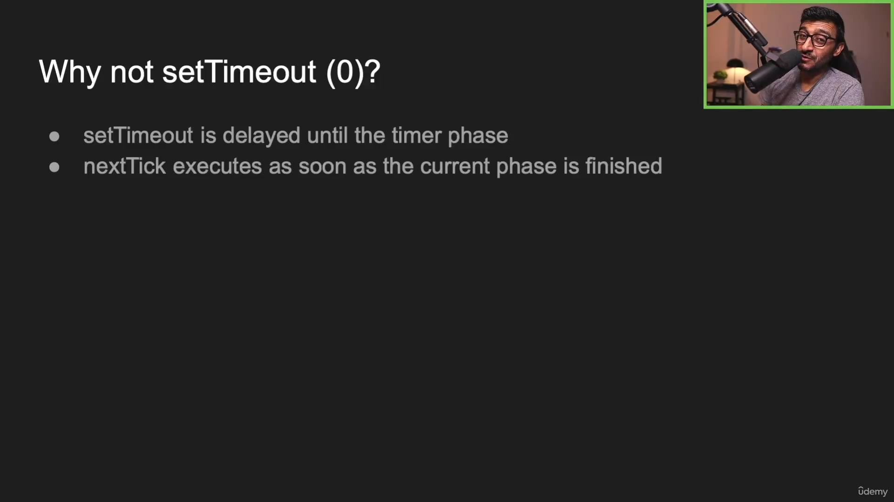
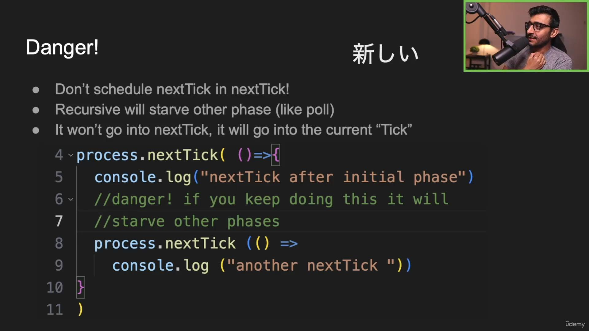
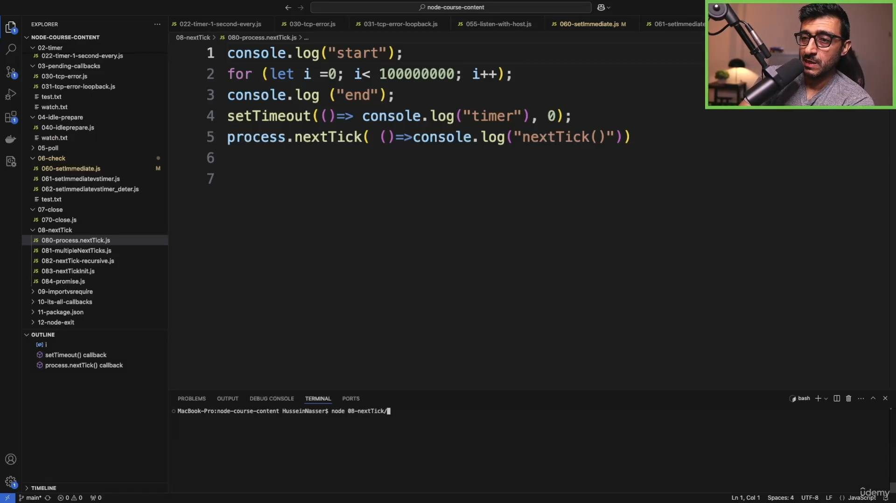
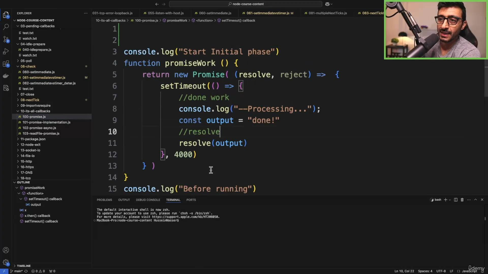
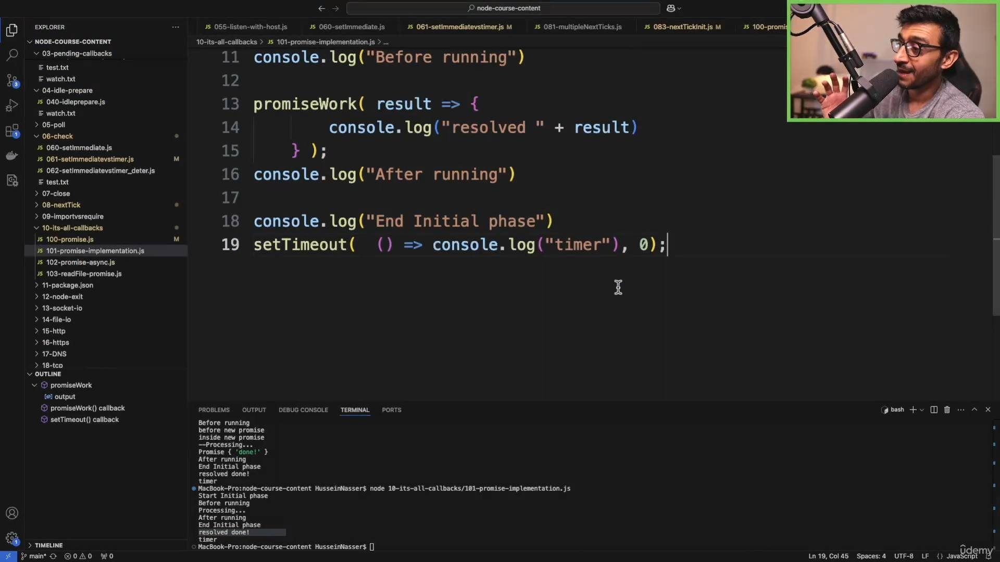
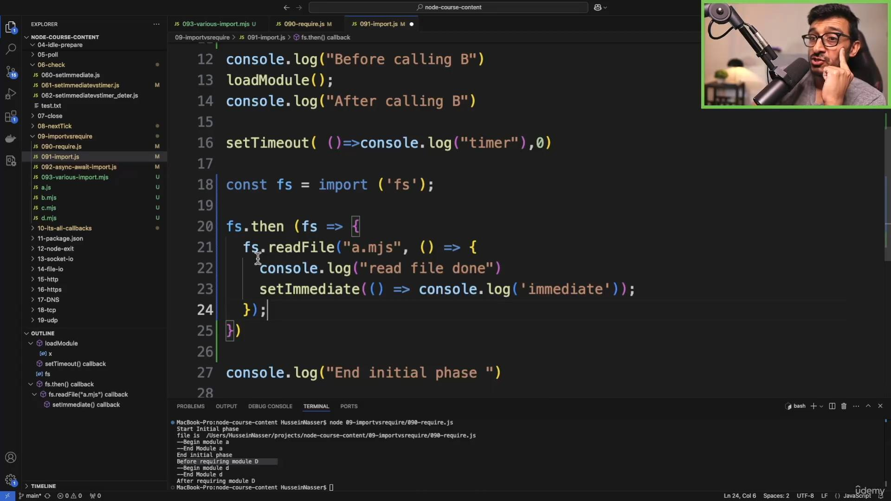
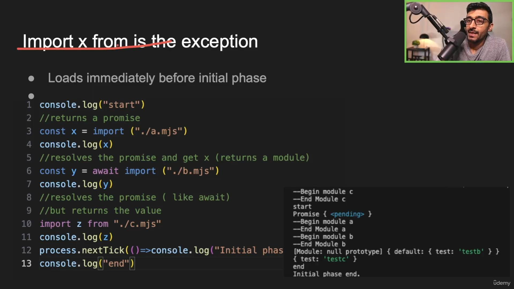
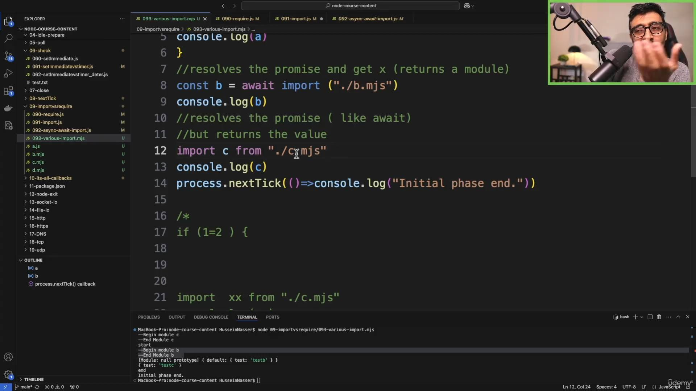

# NodeJS Internals（BV1jGRyBsEBa）P16–P18 复现文档

## 1. 这一节做什么

这一节覆盖 P16–P18，目标不是背概念，而是把 Node 里四条相互咬合的机制做成可运行、可观察的实验：

1. `process.nextTick` 到底插在事件循环的什么位置，为什么它比 `setTimeout(..., 0)` 更“确定”。
2. Promise 不是凭空出现的，它底层仍然由 callback 和 `process.nextTick` 驱动；`then` 回调、`resolve`、`reject` 的调度都能用普通 callback 模拟出来。
3. `async/await` 只是让 Promise 写法“看起来同步”；讲师的原话是“任何 `await` 之后的代码都变成回调”。
4. `require` 与 `import` 的加载时机不同：`require` 同步加载，`import()` 返回 Promise 并可 `await`，而静态 `import X from` 会在脚本最开始、甚至第一条 `console.log` 之前执行，且不能放进 `if` 条件里。

复现环境建议：

- Node 版本：Node 22.x。讲师在 P18 明确说他在用 22；实际请以你本机 `node -v` 为准。
- 第三方依赖：无。本复现不需要 `npm install`。
- 环境变量：无。本复现不需要任何环境变量。
- 文件类型：`.js` 按 CommonJS 运行，`.mjs` 按 ESM 运行；`.cjs` 明确表示 CommonJS。这样不需要依赖 `package.json` 的 `type` 字段。
- 启动方式：在项目根目录逐个执行 `node 文件名`。

先说明：逐字稿里讲师演示了文件名和零散代码，但没有给出可复制的完整仓库。下面的文件是按逐字稿描述重建的最小复现版本；命名、延时长度、辅助输出为复现需要而补齐，关键行为与讲师演示一致。课里没讲到的工程细节，我会在第七节标明。

复现时建议把每个实验单独运行，不要把多个实验一次性 `require` 或 `import` 到同一个入口文件里。否则多个模块的日志会混在同一段输出中，`start`、`end`、`then`、`nextTick` 的先后关系容易被其他实验干扰。每运行一个文件，先清空终端，再对照文中“关键观察”逐行检查输出。遇到顺序不一致时，先不要修改代码，先确认 Node 版本、当前目录、文件扩展名和启动命令是否正确。



## 2. 讲师原话（带「—— pNNN [MM:SS]」）

- “`process.nextTick` 会在每个阶段之后执行。” —— p016 [00:28]
- “不要在 `nextTick` 里面再排 `nextTick`，否则可能永远运行、饿死事件循环。” —— p016 [02:24]
- “`process.nextTick` 告诉你初始阶段什么时候结束。” —— p016 [04:50]
- “Promise 的回调实际上是在 `process.nextTick` 里调度的。” —— p017 [01:27]
- “`await` 之后的所有代码都会变成回调。” —— p017 [06:12]
- “`import()` 返回一个 Promise，你可以 `await` 它。” —— p018 [10:02]
- “静态 `import X from` 会在初始阶段之前加载，甚至在第一条 `console` 之前。” —— p018 [12:28]
- “`import` 声明只能放在模块顶层，不能放进 `if` 条件里。” —— p018 [18:34]
- “Promise 版 `readFile` 会比直接 `readFile` 稍慢，因为 `resolve/reject` 被延迟到 `nextTick`。” —— p017 [19:59]

这些原话的价值不只是“结论”，而是给出了观察方向：看 `nextTick` 与 timer 的相对顺序，看 Promise 的 executor 是否同步，看 `await` 后面的代码何时恢复，看 `require` 是否同步阻塞，看静态 `import` 是否先于模块主体执行。复现时应当把每条原话对应到至少一个输出顺序或一个可观察现象，而不是只记住术语。



## 3. 从零复现

### 3.1 建目录

在任意空目录执行：

```bash
mkdir -p node-internals-p16-p18/modules
cd node-internals-p16-p18
node -v
```

`mkdir -p` 会创建目录，并且如果父目录不存在会一并创建；如果目录已经存在，它不会报错。`cd node-internals-p16-p18` 进入项目根目录，后面的 `node 文件名` 都应当在这个根目录下执行。`node -v` 用来确认当前 `node` 命令实际调用的版本；如果提示 `command not found` 或 `node: command not found`，说明 Node 没装好或 `PATH` 没配置。如果版本不是 22.x，也不代表实验完全不能跑，但 timer、`setImmediate` 和模块加载的细节可能有差异，排查时要把版本记录下来。

只要 `node -v` 能输出 Node 22.x 即可。下面的命令都在 `node-internals-p16-p18` 根目录执行。若你在父目录运行，例如仍在 `node-internals-p16-p18` 外面执行 `node 01-nexttick-order.js`，Node 会报找不到文件；这时先用 `pwd` 确认当前目录，再用 `ls` 看入口文件是否存在。

### 3.2 实验一：`nextTick` 与 timer 的顺序

创建 `01-nexttick-order.js`，运行：

```bash
node 01-nexttick-order.js
```

`node 01-nexttick-order.js` 会读取当前目录下的 `.js` 文件，并按 CommonJS 执行。由于本实验没有 `require` 或 ESM 语法，扩展名和模块系统不会干扰结果。运行后应观察到 `start`、`end` 先同步打印，然后 `nextTick` 在当前阶段结束后执行，最后才进入 timer 阶段打印 `timer`。

关键观察：`nextTick` 会在 `timer` 之前输出。讲师用这个例子证明“`nextTick` 在当前阶段结束后、进入 timer 之前执行”。终端输出可对照讲师运行示例的截图。常见错误是把 `process.nextTick` 写进 `setTimeout` 回调里，此时它只会在 timer 回调内部被调度，不能用来证明顶层 `nextTick` 与 timer 的相对顺序。若输出中 `timer` 跑到 `nextTick` 前面，先检查是否把 `nextTick` 放到了异步回调里，或者是否运行了别的入口文件。与前端对照时，可以把它理解为“当前同步代码执行完后的优先回调”，但不要直接等同于浏览器里的每一个微任务细节。



### 3.3 实验二：用 `nextTick` 修改变量初始化顺序

创建 `02-nexttick-init.js`，运行：

```bash
node 02-nexttick-init.js
```

这个实验的核心不是“锁”或“并发”，而是同步代码的顺序。`let val;` 先让变量处于 `undefined`，`test()` 立刻调用时自然读到 `undefined`。随后 `val = 1`，再用 `process.nextTick(test)` 把第二次调用推迟到当前阶段之后，所以第二次能看到 `1`。

关键观察：直接调用 `test()` 时打印 `undefined`；`val = 1` 之后用 `process.nextTick(test)` 调度，`test` 在初始阶段结束后执行，打印 `1`。这就是讲师说的“变量初始化还没完成，但函数已经被调用”的修复方式。常见错误是以为 `process.nextTick(test)` 会立刻执行，实际上它只是排队；如果把 `val = 1` 放在 `test()` 之前，第一次调用也会打印 `1`，实验对比就消失了。与前端对照，这种写法类似把初始化完成后的逻辑放进微任务或延时回调，但 Node 的 `nextTick` 队列有自己的调度位置。

### 3.4 实验三：Promise 的 executor 是同步执行的

创建 `03-promise-basic.js`，运行：

```bash
node 03-promise-basic.js
```

`new Promise((resolve) => { ... })` 传入的函数叫 executor。`node 03-promise-basic.js` 运行后，executor 会立刻执行，所以 `inside new Promise executor` 会先于 `after calling promiseWork` 出现。`setTimeout(..., 100)` 只是把 `resolve('done')` 延后，`p.then(...)` 注册的回调则要等 Promise 状态变为 fulfilled 后再被调度。

关键观察：`new Promise(...)` 里的函数会立刻执行，所以 `inside new Promise executor` 会出现在 `after calling promiseWork` 之前；但 `then` 回调要等 `resolve` 之后，并且被调度到后面执行。常见错误是看到 `inside new Promise executor` 先打印，就误以为 `then` 也会同步执行；实际上 `then` 回调仍然异步。若长期看不到 `then received = done`，检查 `resolve` 是否被调用、`setTimeout` 是否因为异常没有跑完、以及是否把 `p.then` 写在了错误对象上。与前端 Promise 的语义一致，难点主要在调度位置而不是 API 用法。



### 3.5 实验四：用 `nextTick` 自己实现 Promise 调度

创建 `04-promise-from-nexttick.js`，运行：

```bash
node 04-promise-from-nexttick.js
```

这个实验故意不返回 Promise，而是让 `promiseWork` 接收一个 callback，并在 `process.nextTick` 里调用它。这样做的目的，是把“调用方先继续同步代码，等当前阶段结束后再执行回调”这一层调度手动写出来。运行后 `start`、`end` 先打印，随后才是 `promise work executed in nextTick` 和 `resolve = done`。

关键观察：`promiseWork` 接收 callback，并在 `process.nextTick` 里调用它。输出顺序是 `start` → `end` → `promise work executed in nextTick` → `resolve = done`。这对应讲师说的“Promise 底层就是 callback + nextTick”。常见错误是把 `promiseWork` 当成返回 Promise，于是写 `promiseWork().then(...)`，但这里它返回 `undefined`，会直接报 `Cannot read properties of undefined`。与前端对照，可以把 callback 理解成 `then` 注册的函数，把 `nextTick` 理解成调度层；但不要因此认为所有 Promise 实现都只有这一层，本实验只是最小模拟。



### 3.6 实验五：`async/await` 是回调化的 Promise

创建 `05-async-await.js`，运行：

```bash
node 05-async-await.js
```

`run()` 是 async 函数。调用 `run()` 后，函数体先同步执行到第一个 `await`。遇到 `await promiseWork()` 时，`run` 暂停，控制权回到调用处，所以 `after run call` 会先打印。等 `promiseWork` 内部的 `setTimeout` 到点并 `resolve('done')` 后，`await` 后面的代码才作为 continuation 恢复执行。

关键观察：`run()` 被调用后先执行到 `await`，后面的代码被挂起；`after run call` 会先打印，等 Promise resolve 后才打印 `after await`。讲师用“任何 `await` 之后的代码都变成回调”解释这个现象。常见错误是忘记写 `await`，此时 `x` 会拿到 Promise 而不是 `'done'`，输出也会不同；另一个常见错误是以为 `await` 会阻塞整个进程，实际上它只挂起当前 async 函数，不阻塞调用方继续执行。与前端 `async/await` 行为一致，适合类比理解。

### 3.7 实验六：`require` 的同步加载与条件加载

创建 `06-require-loading.js` 和 `modules/a.cjs`、`modules/d.cjs`，运行：

```bash
node 06-require-loading.js
```

`const fs = require('fs')` 是同步加载：Node 会先完成内置模块的加载和解析，再执行下一行。`shouldLoadA = false` 时，`if` 分支里的 `require('./modules/a.cjs')` 根本不会执行，因此 `a.cjs` 不会被加载。`fs.readFile` 是异步 IO，回调在 poll 阶段执行；回调里再 `require('./modules/d.cjs')`，此时才同步加载 `d.cjs`。

关键观察：`require('fs')` 同步完成；条件 `shouldLoadA = false` 时 `a.cjs` 不会加载；`fs.readFile` 的回调在 poll 阶段执行，回调里再 `require('./modules/d.cjs')`，此时才同步加载 `d.cjs`。这就是讲师说的“`require` 可以条件加载、可以在 poll 阶段加载”。常见错误是路径写错导致 `MODULE_NOT_FOUND`，或者把 `require('./modules/d.cjs')` 提到文件顶部，结果 `d.cjs` 在启动阶段就加载了，观察不到“回调里才加载”的效果。若用 ESM 运行本文件，会出现 `require is not defined`；本实验用 CommonJS，所以 `.js` 默认按 CommonJS 执行，且 `__filename` 可用。与前端对照，打包器常做静态分析，而 Node 的 `require` 是运行时同步加载，条件分支可以决定是否加载。

### 3.8 实验七：动态 `import()` 返回 Promise

创建 `07-import-loading.mjs`、`modules/b-import.mjs`、`modules/c-import.mjs`，运行：

```bash
node 07-import-loading.mjs
```

`.mjs` 明确按 ESM 运行。`import('./modules/b-import.mjs')` 是动态导入，返回 Promise，因此 `bPromise instanceof Promise` 为 `true`。第一个 `then` 中返回第二个 `import()`，形成链式加载；`catch` 负责处理加载失败。运行后先看到 `start import demo` 和 `import() returns Promise: true`，模块加载完成后才打印 `b loaded` 和 `c loaded`。

关键观察：`import()` 返回 Promise，打印 `import() returns Promise: true`；模块加载完成后 `then` 回调执行。讲师说 `import()` 本质是 IO，可以 defer 到 poll 阶段，也可以 `await`。常见错误是写成 `const mod = import(...)` 后直接访问 `mod.default`，但此时拿到的是 Promise，不是模块对象；另一个常见错误是路径缺少扩展名或拼错，触发 `ERR_MODULE_NOT_FOUND`。与前端对照，动态 `import()` 常用于代码分割和按需加载，返回 Promise 的形态与浏览器一致。



### 3.9 实验八：静态 `import X from` 的提升

创建 `08-import-static.mjs` 和 `modules/z-import.mjs`，运行：

```bash
node 08-import-static.mjs
```

静态 `import` 必须在模块顶层。Node 会先处理静态依赖，再执行当前模块主体，所以 `z-import.mjs` 里的 `console.log` 会先于 `start static import demo` 输出。这个行为不是“函数调用顺序”问题，而是模块加载和链接阶段就决定了依赖会先求值。

关键观察：`z-import.mjs` 里的 `console.log` 会在 `start static import demo` 之前输出。讲师演示过：静态 import 会扫描到脚本顶部并先执行，甚至在第一条 `console` 之前。常见错误是把 `import` 放进 `if`，例如 `if (cond) { import x from './x.mjs'; }`，这会触发语法错误，提示 `import declaration can only be used at the top level of the module`。若把 `.mjs` 写成 `.js` 且项目没有 ESM 配置，也可能遇到 `Cannot use import statement outside a module`。与前端对照，bundler 也会把静态 import 提升到模块依赖图中，但 Node 这里是运行时真实加载顺序。



### 3.10 实验九：把 `fs.readFile` 包成 Promise

创建 `09-readfile-promise.js`，运行：

```bash
node 09-readfile-promise.js
```

`readFilePromise` 返回 `new Promise`，executor 同步调用 `fs.readFile`，把成功结果 `resolve(data)`、失败结果 `reject(err)`。`main` 是 async 函数，`await readFilePromise(__filename)` 等待读取当前文件。因为 `main()` 调用后不阻塞，所以 `after main call` 会先打印，读取完成后才打印 `read done`。

关键观察：`before read` 和 `after main call` 先输出，`read done` 后输出。讲师说 Promise 版 `readFile` 比直接 `readFile` 稍慢，因为 `resolve` 被延迟到 `nextTick`；这个差异是微秒级，但能帮助理解 Promise 的调度层。常见错误是没有 `.catch` 或没有在 `main` 内 `try/catch`，读取失败时会出现未处理拒绝；另一个错误是把 `__filename` 用到 ESM 文件中，会得到未定义变量错误。与前端对照，这和 `fetch(...).then(...)` 或 `await fetch(...)` 的形态相同：调用返回 Promise，后续逻辑在 Promise 完成后恢复。



## 4. 完整代码

目录结构如下，所有文件都要创建：

```text
node-internals-p16-p18/
├── package.json
├── 01-nexttick-order.js
├── 02-nexttick-init.js
├── 03-promise-basic.js
├── 04-promise-from-nexttick.js
├── 05-async-await.js
├── 06-require-loading.js
├── 07-import-loading.mjs
├── 08-import-static.mjs
├── 09-readfile-promise.js
└── modules
    ├── a.cjs
    ├── b.cjs
    ├── d.cjs
    ├── b-import.mjs
    ├── c-import.mjs
    └── z-import.mjs
```

### package.json

```json
{
  "name": "node-internals-p16-p18",
  "version": "1.0.0",
  "private": true,
  "description": "Reproduction for NodeJS Internals P16-P18"
}
```

### 01-nexttick-order.js

```js
console.log('start');
setTimeout(() => console.log('timer'), 0);
process.nextTick(() => console.log('nextTick'));
console.log('end');
```

### 02-nexttick-init.js

```js
let val;

function test() {
  console.log('test sees val =', val);
}

test();
val = 1;
process.nextTick(test);
```

### 03-promise-basic.js

```js
function promiseWork() {
  return new Promise((resolve) => {
    console.log('inside new Promise executor');
    setTimeout(() => {
      console.log('promise work processing');
      resolve('done');
    }, 100);
  });
}

console.log('start');
console.log('before calling promiseWork');
const p = promiseWork();
console.log('after calling promiseWork, is Promise =', p instanceof Promise);
p.then((x) => console.log('then received =', x));
console.log('end');
```

### 04-promise-from-nexttick.js

```js
function promiseWork(callback) {
  process.nextTick(() => {
    console.log('promise work executed in nextTick');
    callback('done');
  });
}

console.log('start');
promiseWork((value) => console.log('resolve =', value));
console.log('end');
```

### 05-async-await.js

```js
function promiseWork() {
  return new Promise((resolve) => {
    setTimeout(() => {
      console.log('promiseWork processing');
      resolve('done');
    }, 100);
  });
}

async function run() {
  console.log('before run');
  const x = await promiseWork();
  console.log('after await, x =', x);
}

console.log('start');
run();
console.log('after run call');
```

### 06-require-loading.js

```js
console.log('start require demo');
const fs = require('fs');

const shouldLoadA = false;
if (shouldLoadA) {
  require('./modules/a.cjs');
} else {
  console.log('module a.cjs skipped');
}

console.log('after conditional require');

fs.readFile(__filename, 'utf8', (err, data) => {
  if (err) {
    console.error('read failed:', err.message);
    process.exitCode = 1;
    return;
  }
  console.log('read file callback, length =', data.length);
  require('./modules/d.cjs');
});

setTimeout(() => console.log('timer'), 0);
setImmediate(() => console.log('immediate'));
console.log('end require demo');
```

### 07-import-loading.mjs

```js
console.log('start import demo');

const bPromise = import('./modules/b-import.mjs');
console.log('import() returns Promise:', bPromise instanceof Promise);

bPromise
  .then((mod) => {
    console.log('b loaded, default =', mod.default);
    return import('./modules/c-import.mjs');
  })
  .then((mod) => {
    console.log('c loaded, default =', mod.default);
  })
  .catch((err) => {
    console.error('import failed:', err.message);
    process.exitCode = 1;
  });

setTimeout(() => console.log('timer'), 0);
setImmediate(() => console.log('immediate'));
console.log('end import demo');
```

### 08-import-static.mjs

```js
import z from './modules/z-import.mjs';

console.log('start static import demo');
console.log('static z =', z);
```

### 09-readfile-promise.js

```js
const fs = require('fs');

function readFilePromise(file) {
  return new Promise((resolve, reject) => {
    fs.readFile(file, 'utf8', (err, data) => {
      if (err) {
        reject(err);
        return;
      }
      resolve(data);
    });
  });
}

async function main() {
  console.log('before read');
  const data = await readFilePromise(__filename);
  console.log('read done, length =', data.length);
}

main().catch((err) => {
  console.error('main failed:', err.message);
  process.exitCode = 1;
});

console.log('after main call');
```

### modules/a.cjs

```js
console.log('-- module a.cjs loaded');
module.exports = { name: 'a' };
```

### modules/b.cjs

```js
console.log('-- module b.cjs loaded');
module.exports = { name: 'b' };
```

### modules/d.cjs

```js
console.log('-- module d.cjs loaded');
module.exports = { name: 'd' };
```

### modules/b-import.mjs

```js
console.log('-- module b-import.mjs loaded');

const test = { name: 'b-import' };
export default test;
```

### modules/c-import.mjs

```js
console.log('-- module c-import.mjs loaded');

const test = { name: 'c-import' };
export default test;
```

### modules/z-import.mjs

```js
console.log('-- module z-import.mjs loaded');

const test = { name: 'z-import' };
export default test;
```

## 5. 逐行解释

### 5.1 `01-nexttick-order.js`：为什么 `nextTick` 总在 timer 前

`console.log('start')` 是同步代码，先执行。`setTimeout(() => console.log('timer'), 0)` 把回调放进 timer 阶段；虽然延时写 0，但 timer 仍要等事件循环进入 timer 阶段才会执行。`process.nextTick(() => console.log('nextTick'))` 把回调放入 nextTick 队列，它会在当前阶段结束后、进入下一个阶段前执行。最后 `console.log('end')` 仍是同步代码，所以输出顺序是 `start` → `end` → `nextTick` → `timer`。

讲师在 P16 用这个对比说明：如果你要“尽快执行”，`setTimeout(0)` 不够确定，`nextTick` 更确定。课里没有展开浏览器微任务与 Node `nextTick` 的队列差异；前端同学可以把它理解成“当前操作结束后的优先回调”，但不要直接等同为浏览器 `queueMicrotask`。常见排查方法是给每个回调加不同标签，并连续运行多次；如果 `timer` 偶尔先出现，先检查代码是否真的在顶层调度，而不是在某个 IO 回调内部调度。

### 5.2 `02-nexttick-init.js`：初始化竞态不是锁问题

`let val` 声明时是 `undefined`。函数声明 `test` 会被提升，所以可以在赋值前调用。`test()` 在 `val = 1` 之前被调用，所以打印 `undefined`。`process.nextTick(test)` 把 `test` 推迟到当前初始阶段结束之后，此时 `val` 已经赋值为 `1`，所以第二次打印 `1`。这不是锁、事务或并发问题；Node 主线程仍是单线程事件循环，问题只是“同步代码的执行顺序”和“变量初始化时机”。

在 JS/Node 里，对应手段就是 `nextTick`、Promise 或 `setImmediate`，但要像讲师提醒的那样：不要在 `nextTick` 里无限递归排 `nextTick`，否则会饿死事件循环。常见错误是为了等待初始化而写一个不断自我调用的 `nextTick` 循环，结果 timer 和 IO 永远没有机会执行。与前端对照，可以把这段理解为“把依赖已初始化变量的逻辑延后到当前同步代码之后”。

### 5.3 `03-promise-basic.js`：executor 同步，`then` 异步

`new Promise((resolve) => { ... })` 传入的函数叫 executor。它会立刻同步执行，所以 `inside new Promise executor` 出现在 `after calling promiseWork` 之前。`setTimeout` 里的 `resolve('done')` 把 Promise 状态改为 fulfilled；`p.then(...)` 注册的回调不会立刻执行，而是被调度到后面。`console.log('after calling promiseWork, is Promise =', p instanceof Promise)` 用来确认 `promiseWork()` 返回的是 Promise 对象，不是最终值。

讲师在 P17 说 Promise 回调是在 `process.nextTick` 里调度的。这个例子还验证了最终值要在 `then` 里拿。常见错误是认为 `new Promise` 一创建就“异步执行 executor”；实际上 executor 同步执行，异步的是 `then`/`catch`/`finally` 的回调调度。若 executor 内部抛错，Promise 会变成 rejected；若 `resolve` 永远不调用，`then` 也不会执行。与前端对照，这里的行为与浏览器 Promise 基本一致。

### 5.4 `04-promise-from-nexttick.js`：用 callback 手写 Promise 调度

`promiseWork(callback)` 没有返回 Promise，而是接收一个 callback。`process.nextTick` 里先打印，再调用 `callback('done')`。输出顺序 `start` → `end` → `promise work executed in nextTick` → `resolve = done` 正好对应 `then` 的行为：调用方先继续同步代码，等当前阶段结束，再执行“then 回调”。讲师用这个例子说明 Promise 不是魔法，底层就是 callback 加队列调度。

常见错误是给 `promiseWork` 传错参数，例如传入普通值而不是函数，执行到 `callback('done')` 时会报 `callback is not a function`。另一个错误是把 `process.nextTick` 去掉，此时 callback 会同步执行，输出顺序立刻变成 `start` → `promise work executed` → `resolve` → `end`，正好破坏实验目的。与前端对照，可以把 `nextTick` 的位置视为微任务调度的简化模型。

### 5.5 `05-async-await.js`：`await` 后面的代码变成回调

`run()` 是 async 函数。调用 `run()` 后，先执行 `console.log('before run')`，然后遇到 `await promiseWork()`。此时 `run` 暂停，控制权回到调用处，所以 `after run call` 先打印。等 `promiseWork` 里的 `resolve` 执行后，`await` 后面的 `console.log('after await, x =', x)` 才执行。讲师说“任何 `await` 之后的代码都变成回调”，意思就是编译器/运行时把后续代码包装成 continuation。`x` 不是 Promise，而是 `resolve` 的值 `'done'`。

这也是 `async/await` 看起来同步、实际异步的原因。常见错误是漏写 `await`，此时 `x` 得到 Promise，后续日志会显示 Promise 对象；另一个错误是以为 `after await` 一定在 `after run call` 前面，实际上只要 `await` 了一个未完成 Promise，调用方就会先继续。与前端对照，`async/await` 在浏览器和 Node 中都是 Promise 的语法糖，恢复逻辑仍然通过回调/微任务完成。

### 5.6 `06-require-loading.js`：`require` 是同步的，但可以条件化

`const fs = require('fs')` 是同步加载：读完、解析、执行完，才继续下一行。`if (shouldLoadA)` 为 `false`，所以 `require('./modules/a.cjs')` 根本不会执行，`a.cjs` 不会被加载。讲师在 P16/P18 强调：`require` 支持条件加载，不要加载永远不会用的模块。`fs.readFile` 是异步 IO，回调在 poll 阶段执行；回调里再 `require('./modules/d.cjs')`，这时才同步加载 `d.cjs`。`setTimeout` 和 `setImmediate` 用来给输出加阶段参照。

注意 `__filename` 只在 CommonJS 里可用；讲师在 P18 也提到 `__filename` 在 `import` 里不可用，课里没讲替代方案。常见错误是把 `d.cjs` 的 `require` 放在文件顶部，这样它会在启动阶段加载，无法观察“回调里才加载”；另一个错误是路径大小写或扩展名写错，触发 `MODULE_NOT_FOUND`。若把本文件改成 ESM 运行，会出现 `require is not defined`，需要改回 CommonJS 或改用 `import()`。

### 5.7 `07-import-loading.mjs`：动态 `import()` 返回 Promise

`import('./modules/b-import.mjs')` 返回 Promise，所以 `bPromise instanceof Promise` 是 `true`。`then` 里拿到模块对象，`mod.default` 是 `export default` 的值。第一个 `then` 返回第二个 `import()`，形成链式加载；这样 `b` 加载完再加载 `c`，顺序可控。`catch` 处理加载失败。讲师说 `import()` 本质是 IO，可以 defer 到 poll 阶段；它也可以 `await`，但课里这个例子用 `then` 展示 Promise 面。

常见错误是忘记 `modules` 目录或文件名大小写不匹配，导致 `ERR_MODULE_NOT_FOUND`；另一个错误是模块没有 `default` 导出却访问 `mod.default`，会得到 `undefined`。与前端对照，动态 `import()` 在浏览器里也返回 Promise，常用于路由懒加载和代码分割；区别只是 Node 加载的是本地文件模块。

### 5.8 `08-import-static.mjs`：静态 import 提升到顶部

`import z from './modules/z-import.mjs';` 是静态 import。它必须放在模块顶层，不能放进 `if`。Node 会先处理静态 import，再执行当前模块的 `console.log`，所以 `-- module z-import.mjs loaded` 会先于 `start static import demo` 输出。讲师在 P18 演示过这个“甚至在第一条 console 之前”的行为，并说这很“scary”。如果你把静态 import 放进 `if`，会得到 `import declaration can only be used at the top level of the module` 一类错误；逐字稿里讲师也演示了这个限制。本复现不提供故意报错的文件，避免仓库不可运行。

常见错误是把 `.mjs` 改成 `.js` 后仍直接运行，若项目没有 ESM 配置，会报 `Cannot use import statement outside a module`。与前端对照，静态 import 意味着依赖在模块主体执行前就被求值，因此被导入模块里的副作用日志会先出现。

### 5.9 `09-readfile-promise.js`：Promise 包装 `readFile`

`readFilePromise` 返回 `new Promise`，在 `fs.readFile` 回调里 `resolve(data)` 或 `reject(err)`。`main()` 是 async 函数，`await readFilePromise(__filename)` 等待读取自身文件。`main()` 调用后不阻塞，所以 `after main call` 先输出；读取完成后 `read done` 输出。讲师说 Promise 版 `readFile` 比直接 `readFile` 稍慢，因为 `resolve/reject` 被延迟到 `nextTick`。这个差异很小，但能说明 Promise 多了一层调度。`main().catch(...)` 是错误处理；如果读取失败，`process.exitCode = 1` 让进程以非零码退出。

常见错误是 `fs.readFile` 失败时没有 `reject`，导致外层 `await` 永远等不到结果；或者 `main().catch` 漏掉，出现未处理拒绝。与前端对照，`readFilePromise` 类似把 callback API 包成 Promise 的适配器，`await` 的写法和 `await fetch(...)` 一致。

## 6. 复现检查清单

- [ ] 已确认 `node -v` 为 Node 22.x 左右；讲师在 P18 说他用 22。验证：在项目根目录执行 `node -v`，记录输出；若不是 22.x，后续顺序有差异时先以版本为准排查。
- [ ] 已创建 `node-internals-p16-p18/modules` 目录。验证：执行 `ls modules`，应能看到后面创建的 `.cjs` 与 `.mjs` 文件；若提示目录不存在，回到 3.1 重新 `mkdir -p`。
- [ ] 已创建 `package.json`，且没有依赖需要 `npm install`。验证：查看 `package.json` 中没有 `dependencies` 或 `devDependencies`；运行实验前不需要执行安装命令。
- [ ] 已创建 `01-nexttick-order.js`，运行 `node 01-nexttick-order.js`，看到 `nextTick` 在 `timer` 前。验证：输出顺序应为 `start`、`end`、`nextTick`、`timer`；若不同，检查是否在错误目录运行或改动了调度位置。
- [ ] 已创建 `02-nexttick-init.js`，运行后先看到 `undefined`，再看到 `1`。验证：输出应有两行 `test sees val = ...`，第一行是 `undefined`，第二行是 `1`；若第二行仍是 `undefined`，检查 `val = 1` 是否写在 `process.nextTick` 之前。
- [ ] 已创建 `03-promise-basic.js`，确认 `inside new Promise executor` 在 `after calling promiseWork` 之前。验证：运行后按输出顺序找这两行；同时确认 `is Promise = true` 和最终 `then received = done`。
- [ ] 已创建 `04-promise-from-nexttick.js`，确认 callback 在 `end` 之后执行。验证：先看到 `start`、`end`，再看到 `promise work executed in nextTick` 和 `resolve = done`；若 callback 在 `end` 前出现，检查是否误删了 `process.nextTick`。
- [ ] 已创建 `05-async-await.js`，确认 `after run call` 在 `after await` 之前。验证：输出中 `before run` 先出现，随后是 `after run call`，约 100ms 后才出现 `promiseWork processing` 和 `after await, x = done`。
- [ ] 已创建 `06-require-loading.js` 与 `modules/a.cjs`、`modules/d.cjs`，确认 `a.cjs` 不加载、`d.cjs` 在 read 回调后加载。验证：输出应包含 `module a.cjs skipped`，不应含 `-- module a.cjs loaded`；`read file callback` 之后才出现 `-- module d.cjs loaded`。
- [ ] 已创建 `07-import-loading.mjs` 与 `modules/b-import.mjs`、`modules/c-import.mjs`，确认 `import() returns Promise: true`。验证：先看到 `start import demo` 和 `import() returns Promise: true`，随后看到 `b loaded, default = { name: 'b-import' }` 与 `c loaded, default = { name: 'c-import' }`。
- [ ] 已创建 `08-import-static.mjs` 与 `modules/z-import.mjs`，确认模块日志先于 `start static import demo`。验证：输出第一行应是 `-- module z-import.mjs loaded`，然后才是 `start static import demo` 和 `static z = { name: 'z-import' }`。
- [ ] 已创建 `09-readfile-promise.js`，确认 `after main call` 先于 `read done`。验证：输出先有 `before read`、`after main call`，随后出现 `read done, length = ...`；若直接报错，检查 `__filename` 和文件读取权限。
- [ ] 已逐张对照截图：P16 的 nextTick 顺序、P17 的 Promise 输出、P18 的 import 输出。验证：每张截图只用于确认关键行是否存在及其相对位置，不必逐字比较长度、对象打印格式等辅助信息。
- [ ] 已阅读第七节，知道 Node 版本和扩展名差异可能导致输出时序变化。验证：如果本机输出与文中不完全一致，先执行 `node -v`，再确认入口文件是 `.js`、`.cjs` 还是 `.mjs`，最后再看 timer/IO 启动时序是否影响顺序。

## 7. 课里没讲但你会撞上的

下表把课里没讲但实际容易撞上的点按“现象 / 原因 / 怎么办”整理；内容仍对应上面各节的复现实验，不引入新的仓库代码。

| 现象 | 原因 | 怎么办 |
| --- | --- | --- |
| 运行后报 `require is not defined`，或报 `Cannot use import statement outside a module`。 | 混用了 CommonJS 与 ESM，且没有用扩展名或 `package.json` 的 `type` 字段明确模块类型；课里没有展开 `type: "module"` 与 `type: "commonjs"` 的配置。 | 本复现用 `.cjs` 和 `.mjs` 明确区分，避免依赖 `package.json` 的 `type`。真实项目混用时先检查文件扩展名和 `package.json`，再决定用 `require` 还是 `import`。 |
| 在 ESM 文件里使用 `__filename` 报未定义。 | 讲师在 P18 提到 `__filename` 只在 `require` 场景可用，但课里没讲 ESM 里怎么替代。 | 本复现的 `06` 和 `09` 用 CommonJS，因此可以继续用。若改写成 ESM，需要另行处理路径来源；这部分不在本复现范围内。 |
| `setImmediate` 与 `setTimeout(0)` 的相对顺序偶尔变化，和预期不一致。 | 本复现的第一个实验只比较 `nextTick` 与 timer，不把 `setImmediate` 放进关键断言。真实 Node 里 timer 和 check 阶段的先后可能受启动耗时影响；讲师在 P16 也展示过同一段代码多次运行输出不同的情况。 | 不要把“一次运行的顺序”当成永久保证。排查时连续运行多次，确认差异是否来自 timer/check 阶段，而不是 `nextTick` 本身。 |
| 动态 `import()` 的完成顺序与书写顺序不完全一致。 | 讲师在 P18 说 poll 阶段“先到先服务”，如果某个模块读取慢，后发起的加载可能先完成。 | 本复现用 `then` 串行加载，避免顺序歧义；真实项目里如果要严格顺序，应该显式 `await`，不要依赖并发加载的完成先后。 |
| Promise 版 `readFile` 看起来比直接 `readFile` 稍慢。 | 讲师在 P17 说它比直接 `readFile` 稍慢，因为 `resolve/reject` 被延迟到 `nextTick`。 | 这是微秒级差异，不要把它当成性能瓶颈结论；课里没有给基准测试。需要性能结论时应单独做基准，而不是凭一次输出判断。 |
| 递归 `nextTick` 后 timer、IO 回调迟迟不执行。 | 讲师在 P16 反复警告不要在 `nextTick` 里排 `nextTick`。在 Node 里这会让 timer、IO 回调没有机会执行。 | 避免在 `nextTick` 中无限递归排 `nextTick`；如果需要反复调度，应改用其他机制并设置退出条件。对应到前端，可以类比“在微任务里无限递归”，但课里没有展开浏览器事件循环。 |
| 把静态 `import` 放进 `if` 后出现语法错误。 | 讲师在 P18 演示过 `import` 声明放进 `if` 会报 `import declaration can only be used at the top level of the module`。静态 `import` 只能位于模块顶层。 | 如果需要条件加载，用动态 `import()`，不要用静态 `import X from`；把静态 import 保持在模块顶层。 |
| 同一段代码在不同 Node 版本下输出不完全一致。 | 讲师在 P18 末尾说不同 Node 版本可能改变输出，他准备了示例让大多数情况稳定。 | 先检查 `node -v`，再看是否由 timer/IO 的启动时序导致；不要把版本差异误判为代码错误。 |
| 发现文件名、模块名、延时长度和讲师仓库不完全一样。 | 逐字稿没有给出完整源码，文件名、模块名、100ms 延时、辅助日志是按讲解重建的。 | 关键机制一致即可；不要声称这些文件逐字对应讲师仓库。复现时以“能否观察到同样的调度关系”为准，而不是逐字复制日志。 |