# NodeJS 包管理与 Node 进程终止：从 package.json 到 epoll_wait 的可复现实战（P19–P20）

## 1. 这一节做什么

这一节把两件经常被混在一起讲、但实际属于不同层次的事情拆开：

1. **Node 包到底由哪些文件组成**：`package.json`、`package-lock.json`、`node_modules` 分别解决什么问题，`npm init`、`npm view`、`npm install` 到底改了什么。
2. **Node 进程什么时候才会退出**：为什么你写了一个“看起来什么都没做”的脚本，Node 却一直不结束；为什么一个监听 `8080` 的 server 会一直活着；`epoll_wait`、`accept`、`read` 这些系统调用在背后做了什么。

最终你会得到两个可以独立运行的小项目：

- `node-package-demo/`：用 `node-fetch@3.3.1` 复现“没装依赖报错 → 安装依赖 → 锁定版本 → 删除 `node_modules` 再恢复”的完整包管理流程。
- `node-socket-demo/`：用 Node 内置 `net` 模块写一个 TCP client 和一个 TCP server，并用 `strace` 观察 Node 在 `epoll_wait` 上阻塞、在收到连接时 `accept`、在收到数据时 `read` 的过程。

这一节不是“背概念”，而是让你能亲手看到：**包管理器不是魔法，Node 不退出也不是灵异事件，它们背后都是文件、系统调用和事件循环。**

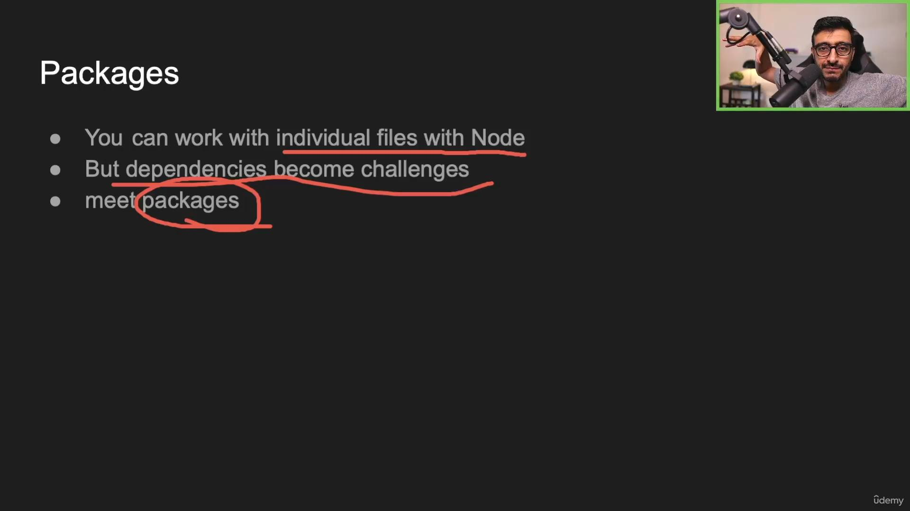

---

## 2. 讲师原话（带「—— pNNN [MM:SS]」）

下面按主题摘出讲师的关键原话，中文为意译，时间点对应逐字稿：

- “`package.json` 是一个 manifest，是描述当前包的元数据；它告诉你这个包叫什么、入口在哪里、需要哪些依赖。”  
  —— p019 [01:25]

- “`package.json` 只有直接依赖，它不关心依赖的依赖；依赖的依赖是另一个文件的事情。”  
  —— p019 [05:19]

- “`package-lock.json` 是安装那一刻的快照，它包含每个依赖的精确版本，不再使用语义化版本范围。”  
  —— p019 [11:03]

- “没有 `node_modules` 就不能运行，Node 会去 `node_modules` 里找模块；找不到就报错。”  
  —— p019 [15:54]

- “Node 终止于完全没有事情可做的时候；很多情况下是 socket 和网络还在工作，只是你看不到。”  
  —— p020 [00:29]

- “一个连接需要源端口、源 IP、目的 IP、目的端口四样东西才能唯一标识。”  
  —— p020 [04:20]

- “Node 会在 `epoll_wait` 上阻塞，直到有数据或新连接；有事件时它被唤醒，然后去 `accept` 或 `read`。”  
  —— p020 [07:31]

- “`server.close()` 和 `socket.destroy()` 不是同一个东西；一个是 server 对象，一个是连接对象。”  
  —— p020 [09:57]

---

## 3. 从零复现

### 3.1 环境准备

课里演示环境是 Ubuntu，使用 Node、npm、`strace`、`telnet`。课里**没有固定 Node 和 npm 的具体版本**，所以下面不写死版本号；你只要保证 `node`、`npm` 可用即可。`strace` 和 `telnet` 是 Linux 工具，macOS 默认没有 `strace`，Windows 建议用 WSL2 或 Linux 虚拟机。

先检查：

```bash
node -v
npm -v
strace -V
telnet
```

如果 `strace` 或 `telnet` 不存在，按你的系统安装；课里没有展开安装命令，这里也不编造包管理器细节。

目录结构如下：

```text
node-package-demo/
  package.json
  index.js
  package-lock.json   # 由 npm install 生成，不要手写
  node_modules/       # 由 npm install 生成，不要提交

node-socket-demo/
  client.js
  server.js
```

创建目录：

```bash
mkdir -p node-package-demo node-socket-demo
```

---

### 3.2 第一部分：复现 package.json / package-lock.json / node_modules

#### 步骤 1：进入目录并创建 package.json

```bash
cd node-package-demo
```

把下面“完整代码”里的 `package.json` 保存进去。注意：课里讲师用 `npm init` 交互式创建，并且演示了 **package name 不能有空格**；这里直接写文件，效果一样。

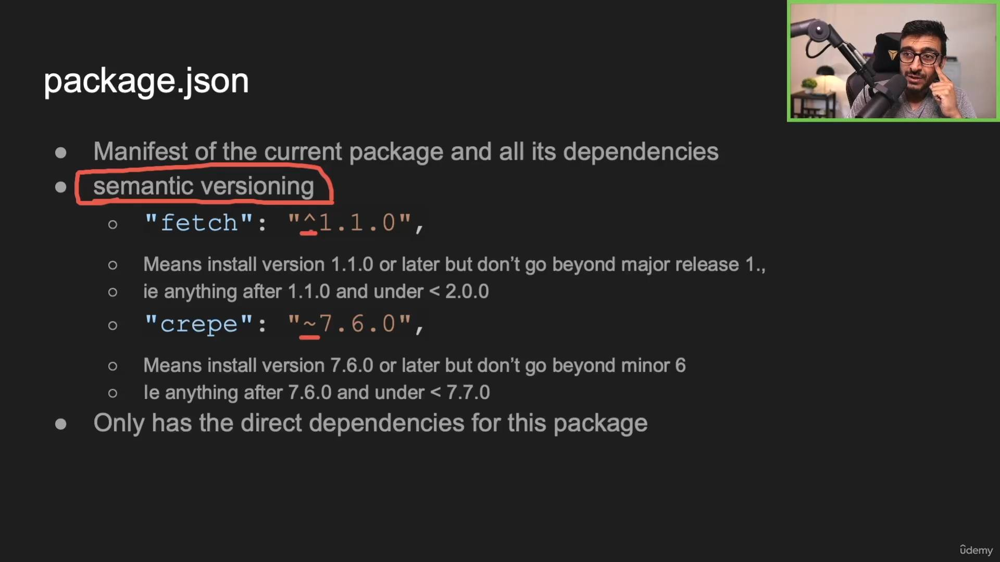

#### 步骤 2：先不安装依赖，运行 index.js

```bash
node index.js
```

因为 `index.js` 里会动态导入 `node-fetch`，此时还没有 `node_modules`，你应该看到“找不到 `node-fetch`”一类错误。课里演示的是 `Cannot find module` 一类报错；实际错误文本会随 Node 版本变化，**以你终端实际输出为准**。

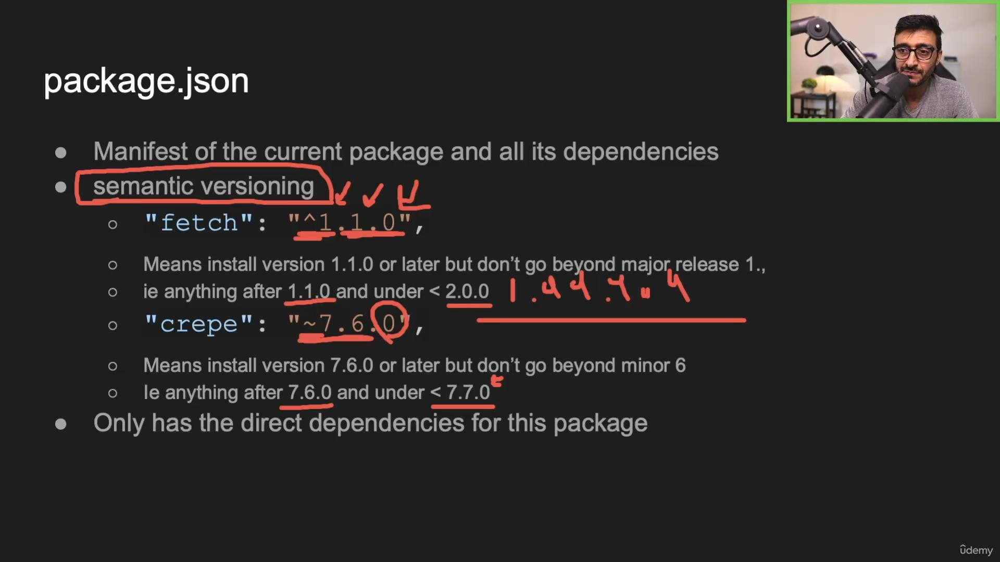

#### 步骤 3：查看 npm 上的最新版本

```bash
npm view node-fetch version
```

课里说最新是 `3.3.2`，但讲师故意安装 `3.3.1`，用来演示“指定版本安装”和“语义化版本范围”。你实际看到的版本可能已经变化，**以 `npm view` 输出为准**。

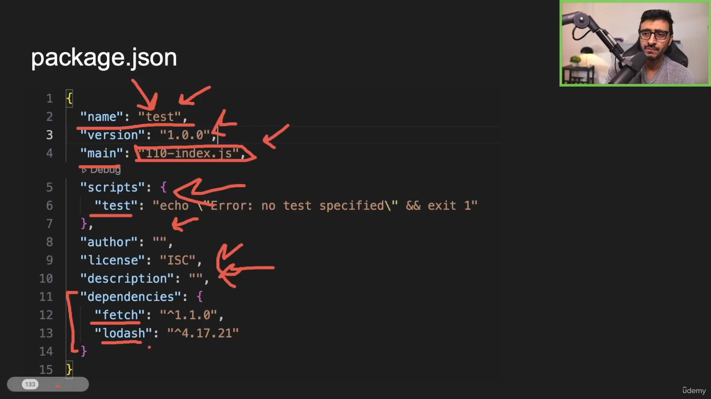

#### 步骤 4：安装指定版本

```bash
npm install node-fetch@3.3.1
```

安装完成后会发生三件事：

1. 下载 `node-fetch` 及其依赖到 `node_modules/`；
2. 更新 `package.json` 的 `dependencies`，通常写成 `^3.3.1`；
3. 生成或更新 `package-lock.json`，把实际安装的精确版本锁住。

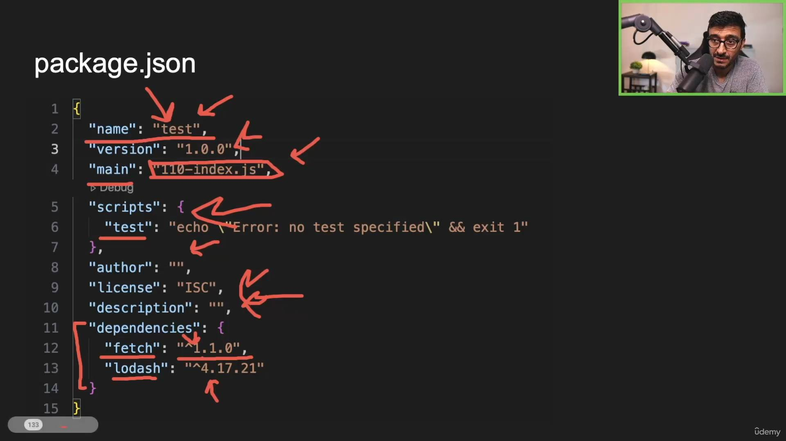

#### 步骤 5：再次运行

```bash
node index.js
```

这次应该能成功加载 `node-fetch`。课里还演示了删除 `node_modules` 后再次运行会失败，然后执行 `npm install` 恢复：

```bash
rm -rf node_modules
node index.js        # 预期失败
npm install          # 按 package.json + package-lock.json 恢复
node index.js        # 预期成功
```

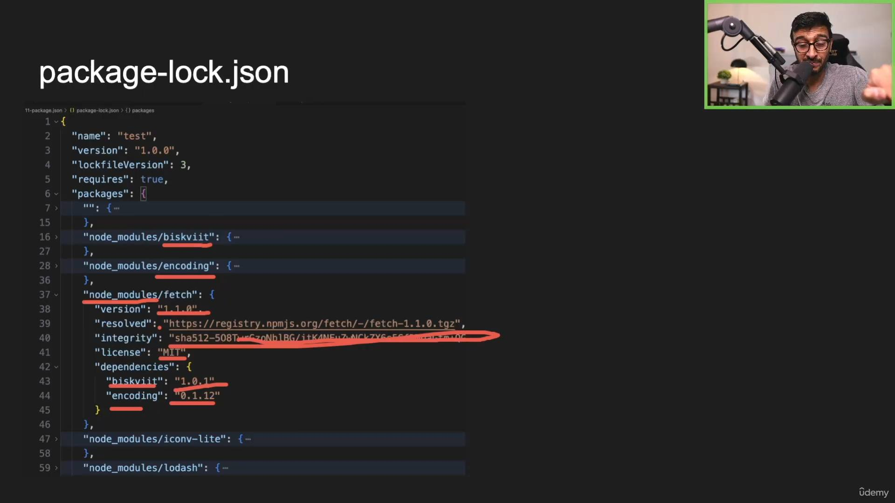

#### 步骤 6：观察 package-lock.json

不要手写 `package-lock.json`。打开它，重点看：

- `lockfileVersion`：锁文件格式版本；
- `packages` 或 `dependencies` 下 `node-fetch` 的 `version` 是否为 `3.3.1`；
- `resolved`：包从哪个 URL 下载；
- `integrity`：完整性哈希。

课里还提到 `package.json` 和 `package-lock.json` 应该一起提交，这样别人 `npm install` 时才能得到一致结果。`node_modules` 不提交，因为它可以由锁文件重新生成。

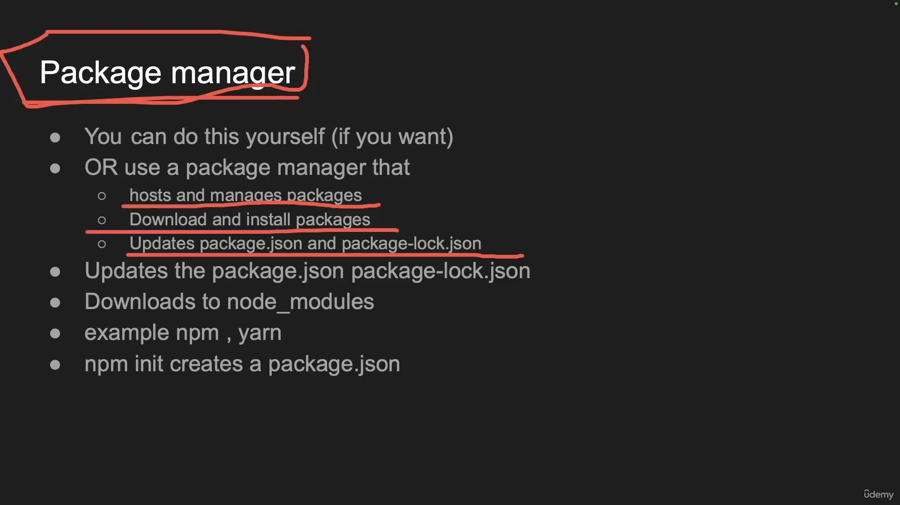

---

### 3.3 第二部分：复现 Node 进程为什么不退出

这一部分用 Node 内置 `net` 模块，不安装第三方依赖。

#### 步骤 1：写 server.js

把下面“完整代码”里的 `server.js` 保存到 `node-socket-demo/server.js`。它监听 `0.0.0.0:8080`，每来一个连接就打印 remote 地址和端口，收到数据就回显。

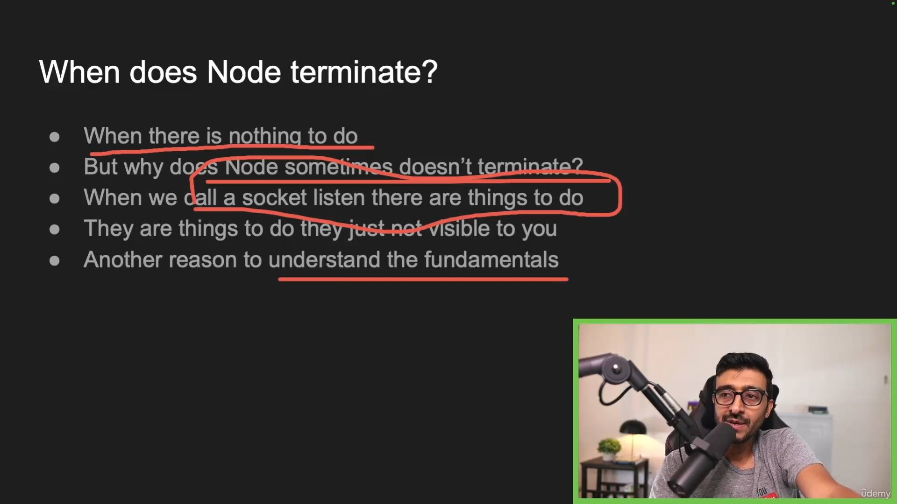

#### 步骤 2：用 strace 启动 server

```bash
cd node-socket-demo
strace -f -t node server.js
```

`-f` 表示跟踪子进程/线程，`-t` 表示给每行加时间戳。你会看到 Node 启动后进入 `epoll_wait` 一类系统调用并阻塞。课里讲师正是用这种方式看到 Node 在 `epoll_wait` 上停住。

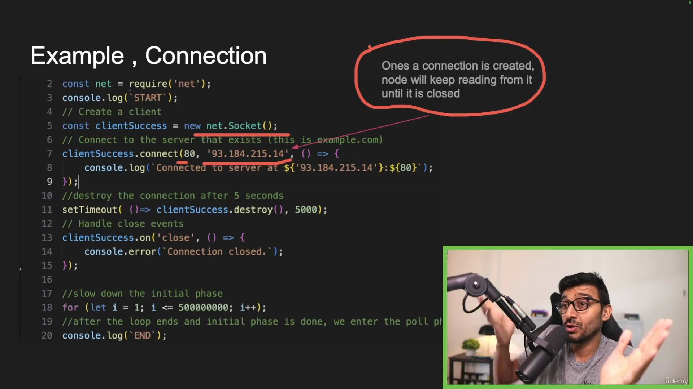

#### 步骤 3：另开一个终端连接 8080

```bash
telnet 127.0.0.1 8080
```

连接成功后，server 终端会打印“新连接”。你在 telnet 里输入一些字符并回车，server 会打印“收到数据”，并回显 `echo: ...`。此时 `strace` 里应该能看到 `accept`、`read`、`write` 一类系统调用。

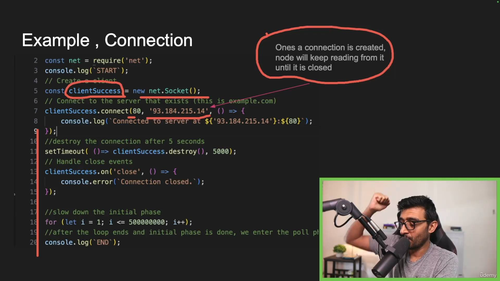

#### 步骤 4：关闭连接

在 telnet 里按 `Ctrl+]` 再输入 `quit`，或者直接关掉终端。server 会打印连接关闭。server 进程本身不会退出，因为 listener 还在监听 `8080`。按 `Ctrl+C` 才会结束。

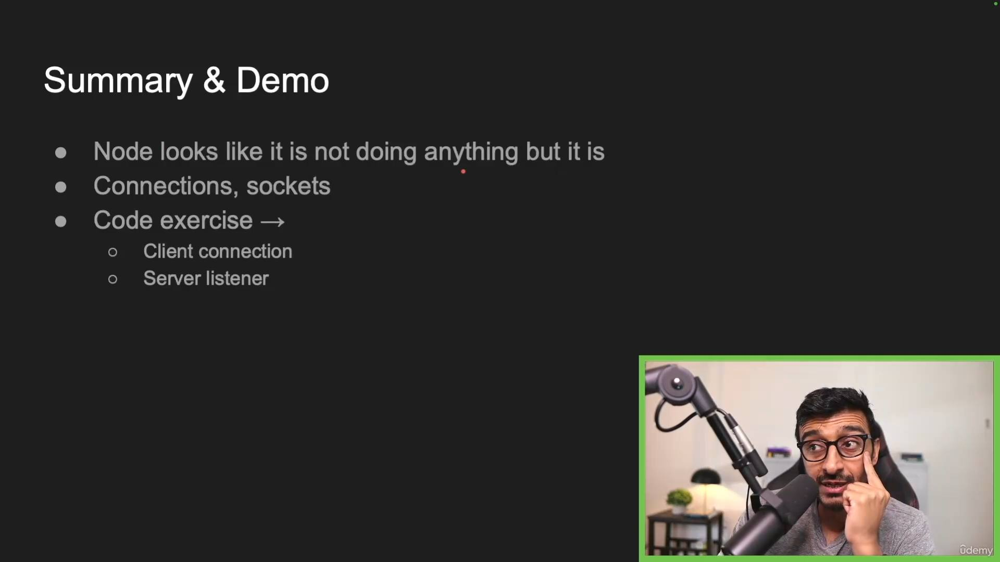

#### 步骤 5：复现 client 的 5 秒退出

另开终端：

```bash
cd node-socket-demo
strace -f -t node client.js
```

`client.js` 会连接课里出现的 `example.com` IP `93.184.215.14:80`，发送一个 HTTP 请求，并在 5 秒后 `socket.destroy()`。你会看到 `connect`、`write`、`read`、`epoll_wait` 等调用。课里还演示了用 `telnet` 连到本机 server 后，server 端 `accept` 被唤醒的过程。

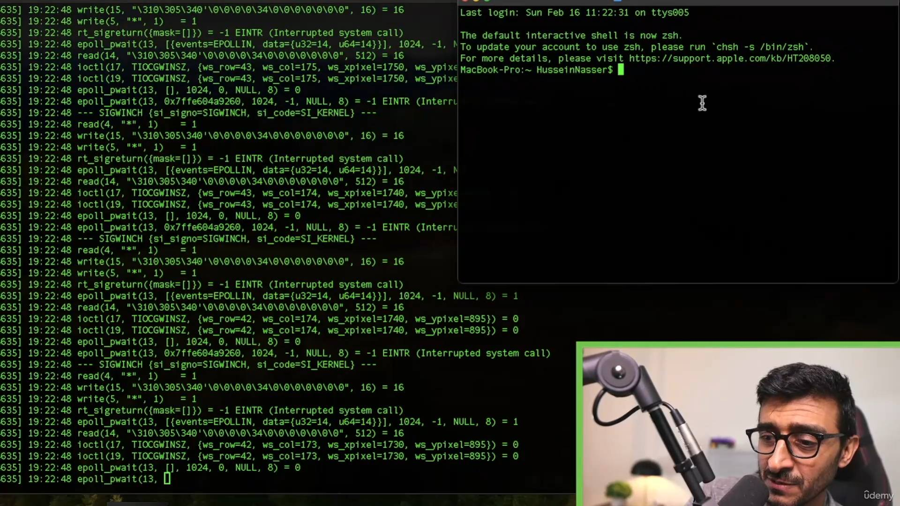

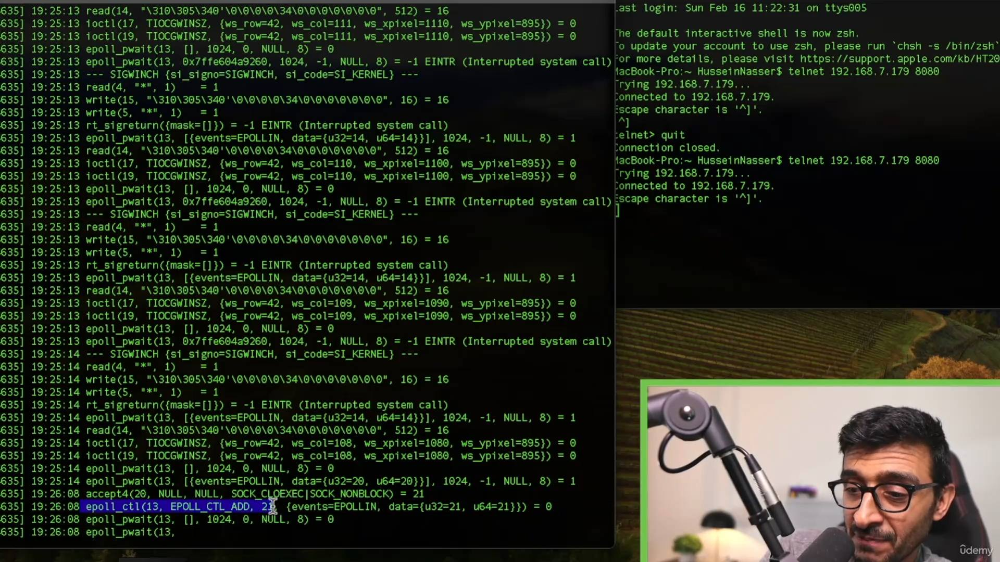

---

## 4. 完整代码

### 4.1 `node-package-demo/package.json`

```json
{
  "name": "test-package",
  "version": "7.0.1",
  "description": "This is a test package",
  "main": "index.js",
  "scripts": {
    "start": "node index.js",
    "test": "echo \"Error: no test specified\" && exit 1"
  },
  "author": "",
  "license": "MIT",
  "dependencies": {
    "node-fetch": "^3.3.1"
  }
}
```

> 说明：课里提到可以加 `engines` 声明支持的 Node 版本，但没有给具体值，所以这里不写死。`package-lock.json` 由 `npm install` 生成，不要手写。

### 4.2 `node-package-demo/index.js`

```js
// index.js
// 课里演示的是“安装 node-fetch 前后，Node 能否找到模块”。
// 这里用动态 import，避免 CommonJS 直接 require node-fetch@3 时的 ESM 兼容问题。
import('node-fetch')
  .then(({ default: fetch }) => {
    console.log('node-fetch 已加载，类型：', typeof fetch);
  })
  .catch((err) => {
    console.error('加载 node-fetch 失败：', err.message);
    process.exitCode = 1;
  });
```

### 4.3 `node-socket-demo/server.js`

```js
// server.js
const net = require('net');

const server = net.createServer((socket) => {
  const id = `${socket.remoteAddress}:${socket.remotePort}`;
  console.log('[server] 新连接', id);

  socket.on('data', (buf) => {
    const text = buf.toString();
    console.log('[server] 收到数据', id, JSON.stringify(text));
    socket.write(`echo: ${text}\n`);
  });

  socket.on('close', () => {
    console.log('[server] 连接关闭', id);
  });

  socket.on('error', (err) => {
    console.log('[server] socket 错误', id, err.message);
  });
});

server.listen(8080, '0.0.0.0', () => {
  console.log('[server] 监听 0.0.0.0:8080');
});

// 课里还演示了“4 秒后销毁 server”的版本。
// 为了先观察 accept，这里默认保持运行；需要复现时取消下面注释。
// setTimeout(() => {
//   console.log('[server] 4 秒到，关闭 server');
//   server.close(() => {
//     console.log('[server] server.close 回调');
//   });
// }, 4000);
```

### 4.4 `node-socket-demo/client.js`

```js
// client.js
const net = require('net');

// 课里出现的 example.com IP 和 80 端口。
// 注意：这个 IP 可能随时间变化，生产代码不要硬编码。
const HOST = '93.184.215.14';
const PORT = 80;

const socket = net.createConnection({ host: HOST, port: PORT }, () => {
  console.log('[client] 已连接', HOST, PORT);
  socket.write('GET / HTTP/1.1\r\nHost: example.com\r\nConnection: close\r\n\r\n');
});

socket.on('data', (buf) => {
  console.log('[client] 收到数据长度', buf.length);
  console.log(buf.toString().slice(0, 200));
});

socket.on('close', () => {
  console.log('[client] 连接关闭');
});

socket.on('error', (err) => {
  console.log('[client] 错误', err.message);
});

setTimeout(() => {
  console.log('[client] 5 秒到，销毁 socket');
  socket.destroy();
}, 5000);
```

---

## 5. 逐行解释

### 5.1 `package.json` 每一段在做什么

- `"name": "test-package"`：包名。课里讲师输入带空格的包名被拒绝，说明包名有命名约束。这里用短横线。
- `"version": "7.0.1"`：包版本。课里讲师故意输入 `7.0.1`，用来演示版本号不是随便写的。
- `"description"`：描述，可以带空格。课里讲师专门对比了“包名不能有空格，但 description 可以”。
- `"main": "index.js"`：包入口。别人 `require` 或 `import` 这个包时，默认从 `index.js` 开始。
- `"scripts"`：脚本命令。`npm start` 会执行 `node index.js`。
- `"dependencies"`：直接依赖。课里反复强调：**这里只有直接依赖，不包含依赖的依赖**。依赖的依赖由 `package-lock.json` 记录。
- `"node-fetch": "^3.3.1"`：caret 范围。按课里的语义化版本解释，`^3.3.1` 表示允许 `3.x.x` 中不低于 `3.3.1` 的版本，但不允许 `4.0.0`。课里还讲了 `~7.6.0` 这种 tilde 范围：只允许 patch 升级，不允许 minor 升级到 `7.7.0`。

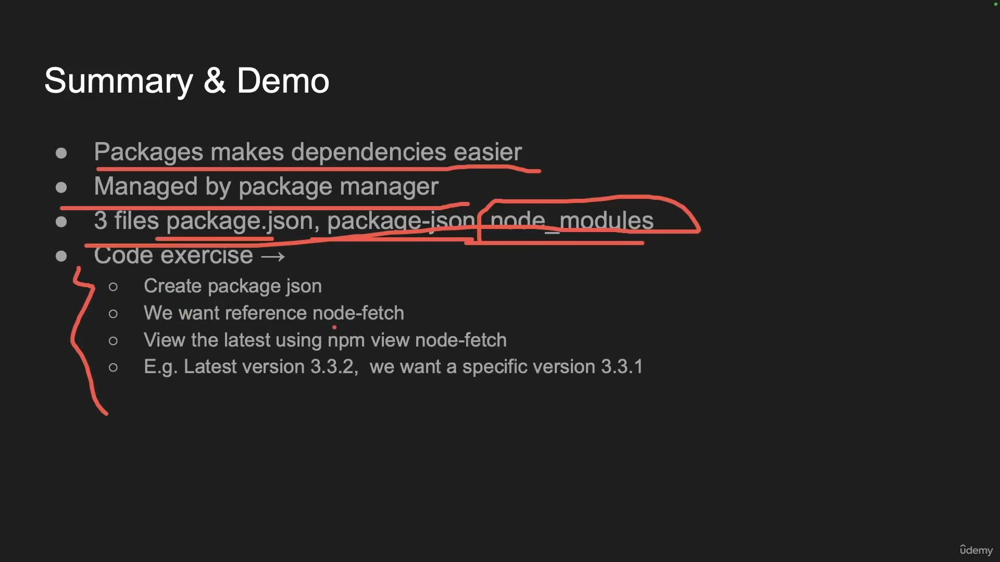

### 5.2 `index.js` 为什么用动态 `import`

`node-fetch@3` 是 ESM 包。如果你在 CommonJS 文件里直接写：

```js
const fetch = require('node-fetch');
```

在部分 Node 版本下会报 `ERR_REQUIRE_ESM`。课里没有展开这个兼容细节，但这是你复现时很容易撞上的点。这里用动态 `import('node-fetch')`，在 CommonJS 里也能运行；安装前会报找不到包，安装后能加载成功。

### 5.3 `server.js` 为什么会让 Node 不退出

- `net.createServer(...)` 创建一个 TCP server 对象。
- `server.listen(8080, '0.0.0.0', ...)` 让 server 开始监听。只要 listener 还活着，Node 就有事情可做，所以进程不会退出。
- 每来一个连接，回调里的 `socket` 就是一条连接。`socket.on('data')` 对应底层 `read`；`socket.write()` 对应底层 `write`。
- `socket.on('close')` 在连接关闭时触发。课里提到 `server.close()` 和 `socket.destroy()` 不是同一个东西：`server.close()` 是停止 server 接受新连接，`socket.destroy()` 是销毁某条连接。两者对象不同，不要混用。
- 课里还演示了 4 秒后 `destroy` server 的版本；如果你取消注释，4 秒后 server 会关闭，进程才可能退出。

### 5.4 `client.js` 里的四元组和 `epoll_wait`

课里讲：一个 TCP 连接要唯一标识，需要源 IP、源端口、目的 IP、目的端口四样东西。`client.js` 里你只写了目的 IP 和目的端口，源 IP 和源端口由内核分配。`net.createConnection` 触发 `connect`，连接建立后 `socket.write` 发 HTTP 请求，`socket.on('data')` 收数据。`setTimeout` 让进程至少活 5 秒，5 秒后 `socket.destroy()` 关闭连接。

`strace` 里看到的 `epoll_wait` 是 Node/libuv 在 Linux 上等待 I/O 事件的方式。课里说 Node 会在 `epoll_wait` 上阻塞，直到有数据或新连接；有事件时被唤醒，然后去 `accept` 或 `read`。这不是“Node 卡死”，而是事件循环在等事情发生。

在 JS/Node 里对应的是：**单线程事件循环 + 非阻塞 I/O**。不是每个连接开一个线程。Java 的 NIO `Selector` 概念类似，但语法知道即可，不需要在这里写 Java。

### 5.5 `strace` 命令解释

```bash
strace -f -t node server.js
```

- `strace`：跟踪系统调用。
- `-f`：跟踪子进程/线程。
- `-t`：每行加时间戳。
- `node server.js`：被跟踪的命令。

你不需要背系统调用名；只要能看到 `epoll_wait` 阻塞、`accept` 被调用、`read` 读到数据，就说明你复现了课里的观察过程。具体输出行号和地址以你机器为准。

---

## 6. 复现检查清单

- [ ] `node -v`、`npm -v` 能正常输出。
- [ ] `node-package-demo/package.json` 是合法 JSON，`name` 没有空格。
- [ ] `dependencies` 里有 `node-fetch`，版本范围是 `^3.3.1`。
- [ ] 未安装依赖时，`node index.js` 报找不到 `node-fetch` 一类错误。
- [ ] 执行 `npm install node-fetch@3.3.1` 后，`node_modules/node-fetch` 存在。
- [ ] `package-lock.json` 中 `node-fetch` 的精确版本是 `3.3.1`。
- [ ] `node index.js` 输出“node-fetch 已加载”。
- [ ] 删除 `node_modules` 后运行失败，执行 `npm install` 后恢复成功。
- [ ] `node-socket-demo/server.js` 启动后打印“监听 0.0.0.0:8080”。
- [ ] `telnet 127.0.0.1 8080` 能连上，server 打印“新连接”。
- [ ] 在 telnet 输入字符后，server 打印“收到数据”并回显。
- [ ] `strace -f -t node server.js` 中能看到 `epoll_wait`、`accept`、`read` 一类调用。
- [ ] `client.js` 运行后 5 秒左右退出，并打印连接关闭。
- [ ] 不提交 `node_modules`，提交 `package.json` 和 `package-lock.json`。

---

## 7. 课里没讲但你会撞上的

1. **`node-fetch@3` 是 ESM-only**  
   课里没有展开 `require` 与 `import` 的兼容问题。你如果直接 `require('node-fetch')`，可能遇到 `ERR_REQUIRE_ESM`。本文用动态 `import()` 规避。

2. **`example.com` 的 IP 可能变化**  
   课里用了 `93.184.215.14:80` 做演示。生产代码不要硬编码 IP，应该用域名让 DNS 解析；本文保留课里 IP 只是为了复现。

3. **`strace` 不是所有系统都有**  
   macOS 默认没有 `strace`，Windows 原生也没有。建议用 Ubuntu、WSL2 或 Linux 虚拟机。课里演示环境就是 Ubuntu。

4. **`telnet` 可能没安装**  
   课里用 `telnet` 连 `8080`。如果你的系统没有 `telnet`，需要自行安装或用其他 TCP 客户端；课里没有展开替代工具。

5. **`8080` 端口可能被占用**  
   如果启动 server 报 `EADDRINUSE`，先检查端口占用，或者改 `server.js` 和 `client.js` 里的端口。课里没有讲端口冲突处理。

6. **`npm init` 后莫名出现 lock 文件**  
   课里讲师遇到一次 `npm init` 后出现 `package-lock.json` 的怪事，他判断是缓存并删除重来。复现时如果遇到，先检查当前目录是否已有 lock 文件，或是否在已有项目的子目录里执行。

7. **`engines` 只是声明，不强制**  
   课里提到可以写 `engines` 声明支持的 Node 版本，但没给具体值。默认情况下 `engines` 不会阻止安装；除非你配置了更严格的策略。本文没有写死 Node 版本。

8. **`server.close()` 不等于关闭已有连接**  
   课里明确区分了 server 对象和 socket 对象。`server.close()` 停止接受新连接，已有连接可能还在；`socket.destroy()` 才是强制销毁某条连接。复现时不要以为调了 `close()` 所有连接就立刻消失。

9. **`SIGWINCH` 不是网络事件**  
   课里 `strace` 输出里出现 `SIGWINCH` 时讲师说不知道。它通常是终端窗口尺寸变化信号，不是连接事件。你看到它不用紧张。

10. **Node 版本不同，错误文本不同**  
    课里说“找不到模块”，你实际可能看到 `Cannot find package`、`ERR_MODULE_NOT_FOUND` 等。以你终端输出为准，不要死背错误字符串。

到这里，你已经能独立复现：`package.json` 如何描述直接依赖，`package-lock.json` 如何锁定精确版本，`node_modules` 如何被重新生成，以及 Node 进程为什么会在 `epoll_wait` 上保持运行。下一步就是把这些观察带进你自己的 Node 服务里，遇到“进程不退出”时先问：**是哪个 listener、哪个 socket、哪个 timer 还在工作？**