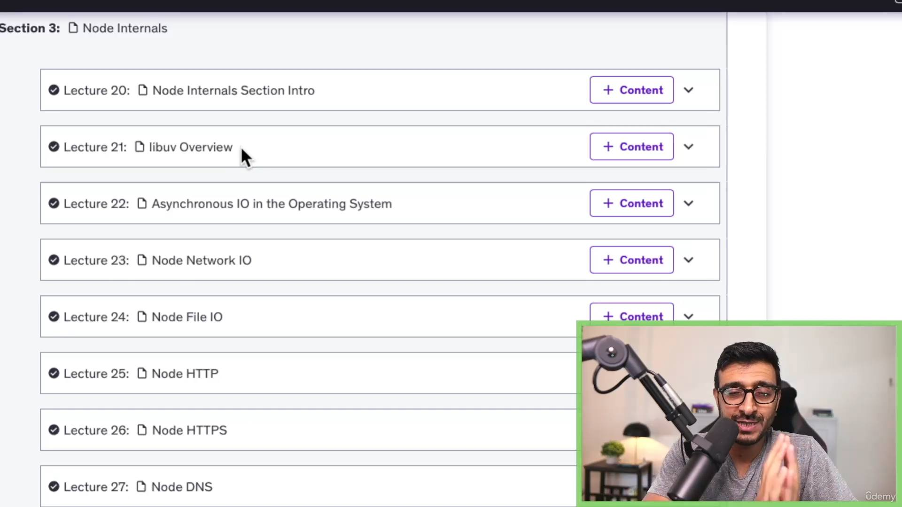
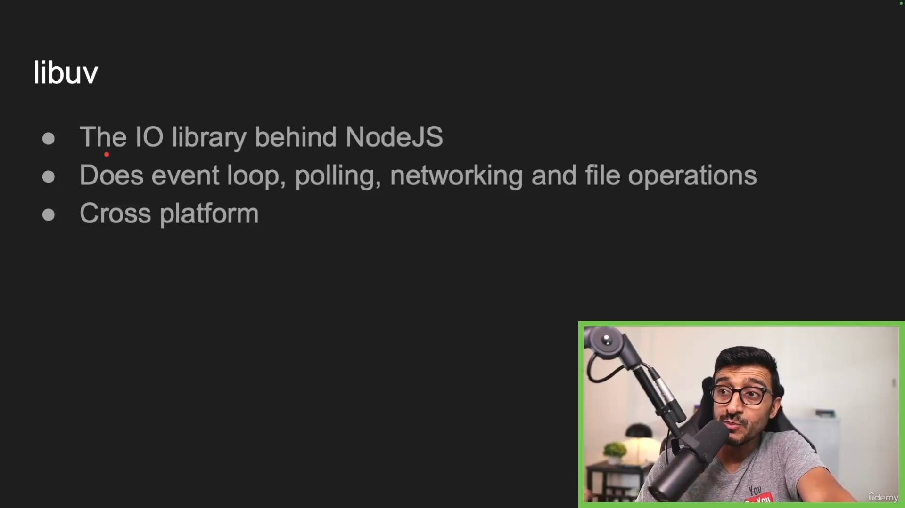
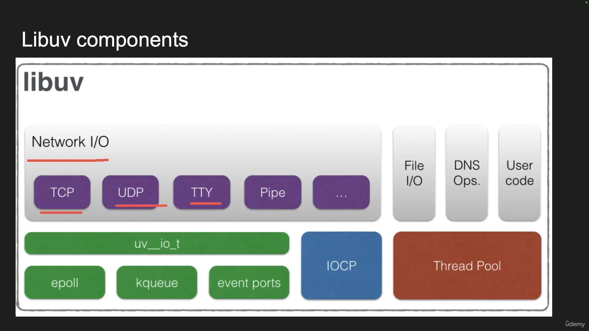
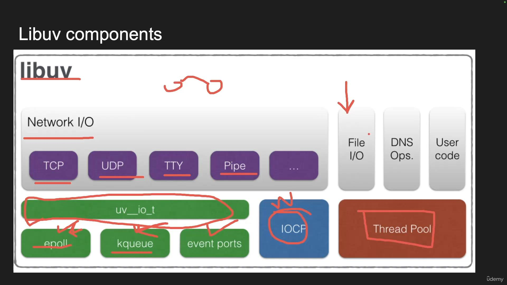
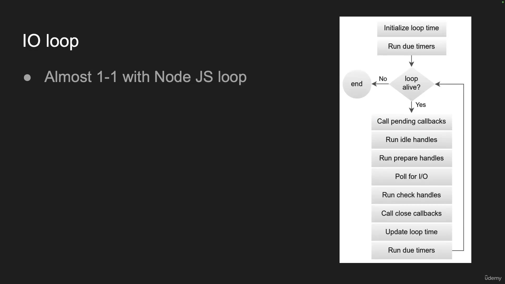
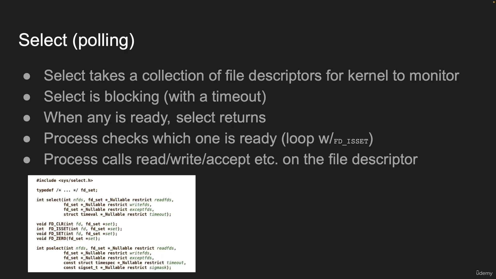
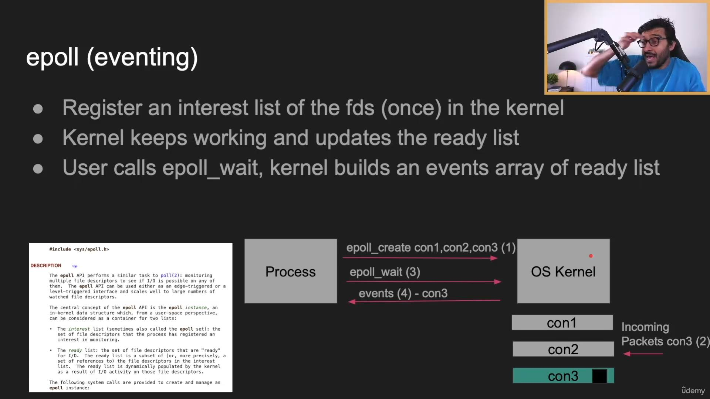
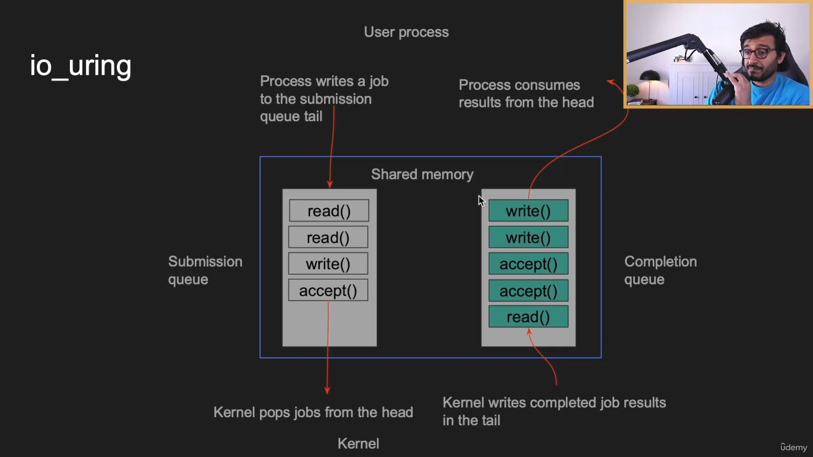

## 1. 这一节做什么

这一节覆盖 P21–P23，主题是 **Node Internals 的总览、LibUV 概览、异步 IO / 非阻塞 IO**。逐字稿里没有给出一个可以 `npm install && npm start` 的业务项目，也没有完整工程代码；它是一门偏底层讲解课。因此本文的“复现”不是复刻一个业务系统，而是把讲师从“Node 单线程但需要非阻塞 IO”推导到“LibUV + 线程池 + epoll/select/IO U-ring”的过程还原出来，并给一个**课里没有代码、以下为示意**的 Node 验证脚本，让你能亲手观察文件 IO、DNS、crypto 在 Node 进程里的异步表现。

你需要最终能回答四个问题：  
1. Node 为什么说自己单线程，又说自己多线程？  
2. LibUV 到底替 Node 做了哪些事？  
3. 文件 IO、DNS、crypto 为什么需要线程池？  
4. Linux 上为什么用 epoll，select 的问题是什么，IO U-ring 又为什么带来安全争议？



---

## 2. 讲师原话（带「—— pNNN [MM:SS]」）

讲师在 P22 开头给 LibUV 下了一个很直接的定义：

> "LibUV 是 Node.js 底层的输入输出库，它负责事件循环、轮询、网络操作、文件操作和 DNS 操作……"
> —— p022 [00:00]

这句话是整节的骨架：LibUV 不是 Node 的一个普通 npm 包，而是 Node 背后做事件循环、轮询、网络、文件、DNS 的 IO 库。

P21 里讲师把“Node 单线程 / LibUV 多线程”的关系讲得很清楚：

> "当我们说 Node 是多线程的，其实是指 LibUV 是多线程的。Node 是单线程的，运行的就只有那一个线程。如果 Node 要使用另一个线程，它会从 LibUV 那里借一个。"
> —— p021 [02:25]

也就是说，你写的 JS 回调仍然跑在 Node 的主线程上；所谓“Node 多线程”，指的是 LibUV 在底下借线程去做文件、DNS、crypto 等事情。

讲到文件 IO 时，讲师说：

> "文件输入输出默认不是异步的，但 LibUV 把它做成了异步。怎么做到？它用线程池来实现这一点。"
> —— p022 [02:56]

这句话非常关键：文件 IO 不是“文件系统天然支持 epoll 那种就绪通知”，而是 LibUV 用线程池把它包装成异步。逐字稿里还提到线程池默认值：

> "默认值是 4，你可以修改……合适的数值就是与你拥有的核心数、逻辑核心数保持一致。但如果你主要是输入输出驱动，也可以调高。"
> —— p022 [05:51]

这里的 “for” 是逐字稿转写，语义是 **four / 4**。讲师说默认 4，可以改；好一点的数值是匹配逻辑核心数，如果是 IO 密集型而不是 CPU 密集型，可以适当增加。注意：**逐字稿没有写出那个环境变量的具体名字**，所以本文不替你编一个名字，后文会写“课里没讲”。

P23 讲内核阻塞：

> "内核中的大多数输入输出操作都是阻塞的。"
> —— p023 [01:23]

然后讲 epoll 的注册兴趣列表：

> "epoll 的工作方式是……你先注册一次关注列表……epoll_create……epoll_wait。"
> —— p023 [13:12] / [13:40] / [15:07]

讲 IO U-ring 时：

> "io_uring……基于共享内存……其中有提交队列，也有完成队列。"
> —— p023 [21:41] / [23:08] / [23:36]

以及 Google 对 IO U-ring 的安全限制：

> "Google 因安全漏洞限制 io_uring。"
> —— p023 [25:00]

---

## 3. 从零复现

这一节按“需求 → 约束 → 估算 → 方案 → 取舍”的顺序复现讲师的推导。你不需要先会 C 或内核，只要跟着把每一步写下来。



### 3.1 需求：主线程不能被 IO 卡死

Node 的 JS 执行是单线程的。你写 `readFileSync`、同步 DNS、同步 crypto，主线程就会被系统调用卡住。讲师在 P23 说，`read`、`write`、`accept` 这些 syscall 很多是阻塞的；一旦阻塞，程序计数器不能往下走，进程可能被上下文切换出去。  
所以需求不是“让 JS 变成多线程”，而是：**当主线程遇到网络、文件、DNS、crypto 等耗时操作时，不要原地等，而是把等待交给底层，完成后通过回调/事件通知主线程。**

### 3.2 约束：内核行为不统一，文件还没有“就绪”概念

约束有四条：

1. **内核 syscall 可能是阻塞的**：`read` 在没有数据时阻塞，`accept` 在没有新连接时阻塞。
2. **不同系统用不同机制**：Linux 用 epoll，BSD/macOS 用 kqueue，Solaris 用 event ports，Windows 用 IOCP。讲师在 P23 明确说这些由 LibUV 抽象掉。
3. **文件 IO 不适合 ready-based 模型**：讲师说文件“总是 ready 的，只是读起来要时间”，所以 epoll 这种“等就绪再读”的模型不适用于文件；文件要靠线程池模拟异步。
4. **线程池线程数有限**：默认按讲师说法是 4，文件 IO、DNS、user code/crypto 共享这些线程。文件 IO 太多会饿死 DNS，DNS 太多也会饿死文件 IO。

### 3.3 估算：默认 4 个线程意味着什么

按课里说法，线程池默认 4。我们可以写一个示意算式，注意这不是讲师给出的公式，只是帮助你理解：

```text
线程池大小 P = 4（课里说的默认值）
同时提交的阻塞型任务数 N
需要排队的任务数 ≈ max(0, N - P)
```

如果同时发起 5 个 crypto 任务，按这个示意模型，最多 4 个先占线程，第 5 个要等前面某个完成。如果同时有文件读、DNS、crypto，它们会争抢同一批线程。讲师原话是：

> "如果你做大量文件输入输出，可能会让 DNS 操作得不到足够资源；而如果你做大量 DNS 操作，可能会让文件输入输出得不到足够资源。"
> —— p022 [03:25]

所以估算结论不是“线程池越大越好”，而是：**线程池要匹配逻辑核心数；IO 密集型可以增加，但不要无限加；文件、DNS、crypto 要意识到它们共享池子。**



### 3.4 方案：LibUV 分层抽象

讲师在 P22 把 LibUV 的组件拆成几块，你可以按下面复现：

| 层/组件 | 课里说法 | 你复现时怎么写 |
|---|---|---|
| 事件循环 | LibUV 做 event loop、polling | 画出 timers、poll IO、check、close 等阶段；注意 LibUV 的阶段比 Node 暴露出来的更细 |
| 网络 | TCP、UDP、TTY、pipes | 网络 IO 用系统提供的多路复用：Linux epoll，BSD/macOS kqueue，Windows IOCP |
| UVIO 抽象 | 用统一接口包住 epoll/kqueue/event ports/IOCP | 你不需要在 JS 里直接调 epoll；Node 通过 LibUV 间接使用 |
| FileIO | 文件默认不是异步的，LibUV 用线程池包装 | 文件读写在 JS 里表现为异步回调/Promise，但底层可能是线程池里的阻塞读 |
| DNS | 用线程池执行 | 不要以为 DNS 是“网络 IO 就自动非阻塞”，课里说它也吃线程池 |
| user code/crypto | 某些用户代码、加密操作也走线程池 | `crypto.pbkdf2` 这类操作可用来观察线程池排队 |



### 3.5 方案：异步 IO 的两大流派

P23 把异步 IO 分成 ready-based 和 completion-based：

| 流派 | 核心问题 | 代表 | 课里评价 |
|---|---|---|---|
| ready-based | 问内核“哪个 fd 准备好了”，准备好了再读 | select、epoll、kqueue | epoll 是 Linux 标准；但仍有 syscall 开销，且不适用于文件 |
| completion-based | 把任务提交给内核，内核做完通知你 | Windows IOCP、Linux IO U-ring | IO U-ring 用共享内存、submission/completion queue，性能好但有安全争议 |

select 的复现重点：你把一组 fd 传给 select，select 返回后你还得用 `FD_ISSET` 循环检查“到底哪个 ready”。讲师说这是 O(N) 的循环，而且每次都要把集合从用户态拷到内核态再拷回来，很“chattiness”。  
epoll 的复现重点：`epoll_create` 建结构，`epoll_ctl` 增删兴趣列表，`epoll_wait` 只取回已经 ready 的事件。它不再每次遍历全部 fd，但仍然有系统调用开销。  
IO U-ring 的复现重点：用户态和内核态共享内存，里面有 submission queue 和 completion queue；进程把任务写到提交队列尾部，内核从头部取；内核完成后把结果写到完成队列尾部，进程从头部消费。讲师说这带来零拷贝/少拷贝，但也带来共享内存安全问题。



### 3.6 取舍：为什么 Node 不自己写一套

取舍表如下：

| 选择 | 好处 | 代价 | 课里对应 |
|---|---|---|---|
| JS 主线程保持单线程 | 没有 JS 共享内存锁问题，模型简单 | 不能靠 JS 多线程直接跑 CPU 密集任务 | p021 说 Node 单线程，需要时借 LibUV 线程或用户自己起线程 |
| 网络 IO 用 epoll/kqueue/IOCP | 高并发连接不需要每连接一个线程 | 跨平台差异大，syscall 有开销 | p022 说 LibUV 做跨平台抽象 |
| 文件 IO 用线程池 | 避免主线程阻塞，接口统一 | 线程池有限，可能排队/饥饿 | p022 说 FileIO 用 thread pool |
| select 简单方案 | 第一个可用的多路复用思路，容易理解 | O(N) 检查、复制多、fd 数量受限 | p023 讲 select 的 pros/cons |
| epoll | 兴趣列表只注册一次，返回 ready 列表 | 仍要 `epoll_wait`，Linux 限定，文件不适用 | p023 讲 epoll 标准 |
| IO U-ring | 共享内存、提交/完成队列、性能潜力大 | 安全漏洞，Google 曾限制/禁用 | p023 讲 Google 安全博客 |



---

## 4. 完整代码

先说明：**P21–P23 逐字稿里没有给出可运行项目代码，也没有给出完整 C 版 LibUV 示例。** 下面不是讲师原代码，而是为了让你亲手观察“文件 IO、DNS、crypto 在 Node 里表现为异步、但它们可能共享底层线程池”而写的完整验证脚本。它不设置线程池大小，因为逐字稿没有写出环境变量名。

### 4.1 目录结构

```text
node-internals-demo/
└── async-io-demo.js
```

运行后脚本会自动生成 `sample.txt`，不需要手动创建。

### 4.2 完整文件：`node-internals-demo/async-io-demo.js`

```js
'use strict';

const fs = require('node:fs/promises');
const dns = require('node:dns/promises');
const crypto = require('node:crypto');
const path = require('node:path');

const filePath = path.join(__dirname, 'sample.txt');

async function timed(label, fn) {
  const start = process.hrtime.bigint();
  try {
    const value = await fn();
    const ms = Number(process.hrtime.bigint() - start) / 1e6;
    console.log(`[done] ${label} ${ms.toFixed(2)}ms`, value ?? '');
  } catch (err) {
    const ms = Number(process.hrtime.bigint() - start) / 1e6;
    console.error(`[fail] ${label} ${ms.toFixed(2)}ms`, err.message);
  }
}

function pbkdf2Async(password, salt, iterations = 120000) {
  return new Promise((resolve, reject) => {
    crypto.pbkdf2(password, salt, iterations, 32, 'sha256', (err, key) => {
      if (err) reject(err);
      else resolve(key.toString('hex').slice(0, 16));
    });
  });
}

async function main() {
  await fs.writeFile(filePath, 'hello libuv\n'.repeat(1000), 'utf8');
  console.log('start');

  await Promise.all([
    timed('file-read', async () => {
      const text = await fs.readFile(filePath, 'utf8');
      return `${text.length} chars`;
    }),
    timed('dns-lookup', () => dns.lookup('example.com')),
    timed('crypto-pbkdf2-1', () => pbkdf2Async('password', 'salt-1')),
    timed('crypto-pbkdf2-2', () => pbkdf2Async('password', 'salt-2')),
    timed('crypto-pbkdf2-3', () => pbkdf2Async('password', 'salt-3')),
    timed('crypto-pbkdf2-4', () => pbkdf2Async('password', 'salt-4')),
    timed('crypto-pbkdf2-5', () => pbkdf2Async('password', 'salt-5')),
  ]);

  console.log('all done');
}

main().catch((err) => {
  console.error(err);
  process.exitCode = 1;
});
```

### 4.3 启动命令

```bash
mkdir -p node-internals-demo
cd node-internals-demo
# 把上面的 async-io-demo.js 保存进来
node async-io-demo.js
```

依赖：**无 npm 依赖**，只用 Node 内置模块。Node 版本课里没讲；用你本机 Node LTS 即可。运行后你会看到类似下面这种自定义输出，顺序不保证：

```text
start
[done] file-read 12.34ms 11000 chars
[done] dns-lookup 20.11ms { address: '...', family: 4 }
[done] crypto-pbkdf2-1 88.00ms xxxxxxxx
...
all done
```

注意：上面的字段和数字只是脚本自己的 `console.log` 输出，不是系统调用字段；实际地址、耗时、完成顺序以你机器为准。

### 4.4 设计决策表

| 决策 | 课里依据 | 不这样做会怎样 |
|---|---|---|
| JS 主线程只负责调度和回调 | p021 说 Node 单线程，借 LibUV 线程 | 把耗时操作塞主线程，事件循环被卡住 |
| 网络 IO 交给 epoll/kqueue/IOCP | p022 说 LibUV 做跨平台网络 IO | 每个平台写一套，跨平台成本高 |
| 文件 IO 用线程池包装 | p022 说 FileIO 不是默认异步，用 thread pool | 同步读文件会阻塞主线程 |
| DNS 也意识到线程池竞争 | p022 说文件多可能饿死 DNS | 大量文件 IO 时 DNS 排队，接口变慢 |
| crypto 可能吃线程池 | p022 说 user code/crypto 也用线程池 | 大量加密任务和 DNS/文件抢线程 |
| 不把线程池无限调大 | p022 说匹配逻辑核心，IO 密集可增加 | 线程切换、内存开销上升，不一定更快 |



### 4.5 接口/数据模型草案

| 机制 | 课里出现的关键动作 | 数据模型心智 |
|---|---|---|
| select | 传 fd 集合，返回后用 `FD_ISSET` 循环检查 | 每次调用都要带集合，返回后自己找谁 ready |
| epoll | `epoll_create`、`epoll_ctl`、`epoll_wait` | 内核维护兴趣列表，wait 返回 ready 事件列表 |
| IO U-ring | submission queue、completion queue | 用户写提交队列，内核写完成队列，共享内存 |

### 4.6 容量估算表（示意）

| 项目 | 数值/规则 | 说明 |
|---|---|---|
| 线程池默认 | 4（按 p022 [05:51] 讲师说法） | 逐字稿转写为 “for”，语义是 four |
| 共享任务 | 文件 IO、DNS、user code/crypto | 讲师说它们共享线程池 |
| 排队估算 | `max(0, N - 4)` | 本文示意公式，不是讲师原公式 |
| 调大依据 | 匹配逻辑核心；IO 密集可增加 | 课里说不要随便填任意数 |
| 风险 | 文件多饿死 DNS，DNS 多饿死文件 | p022 [03:25] 原话 |

---

## 5. 逐行解释

这一节逐条解释上一节的决策、估算和示意脚本。注意：脚本是本文补的验证工具，不是讲师原代码。

1. **`const fs = require('node:fs/promises')`**：用 Promise 版文件 API，避免 `readFileSync` 直接阻塞主线程。讲师在 P22 说文件 IO 默认不是异步的，LibUV 用线程池包装；你在 JS 里看到的是异步接口，但底层可能是线程池里的阻塞读。

2. **`const dns = require('node:dns/promises')`**：把 DNS 查询也放进来，是为了对应讲师说的“DNS 也用线程池”。课里没有区分 `dns.lookup` 和 `dns.resolve` 的差异，所以脚本只做一个普通查询，不拿它的输出反推内核细节。

3. **`const crypto = require('node:crypto')`**：对应讲师说的 user code/crypto 也可能用线程池。`crypto.pbkdf2` 是计算型任务，放进并发里可以观察“不是所有任务同时完成”。

4. **`timed(label, fn)`**：自己记录每个任务的开始/结束耗时。课里没有给性能测试代码，这里只是为了让你看到完成顺序。`process.hrtime.bigint()` 是 Node 内置高精度计时，不是课程知识点。

5. **`crypto.pbkdf2(...)` 包成 Promise**：因为 `crypto.pbkdf2` 是回调风格。包成 Promise 只是为了和 `await Promise.all` 搭配，不代表 Promise 创建了新线程。P21 讲师说过 Promise / async await 本质还是回调，不要误解成多线程。

6. **`await fs.writeFile(...)`**：先生成一个测试文件。这里用 await 是为了确保文件存在再读；它仍然走异步接口，不阻塞主线程。

7. **`await Promise.all([...])`**：同时提交多个任务。JS 主线程不会同时执行多个回调，但底层 LibUV 可能把文件、DNS、crypto 分派到线程池。默认 4 个线程时，5 个 crypto 任务可能出现“前 4 个先完成、第 5 个后完成”的现象；具体顺序以实际为准。

8. **`file-read` 返回字符数而不是整段文本**：避免把大字符串打印到终端，干扰你观察时序。这个选择是实验设计，不是课程规定。

9. **不设置线程池大小**：逐字稿只说“可以设置、默认 4”，没有写出环境变量名。所以脚本不写具体变量名，避免把课里没讲的东西安到讲师头上。你需要调整时，请查你所使用 Node 版本的官方文档。

10. **设计决策表里“网络 IO 用 epoll/kqueue/IOCP”**：这是 P22/P23 的原话。epoll 用 `epoll_create` 建结构、`epoll_ctl` 管兴趣列表、`epoll_wait` 等事件；select 则每次传集合、返回后 `FD_ISSET` 循环。两者不是“谁绝对好”，而是讲师说的取舍：select 简单但 O(N) 且复制多，epoll 更高效但仍有 syscall 开销且 Linux 限定。

11. **IO U-ring 的 submission/completion queue**：讲师说进程把任务写到提交队列尾部，内核从头部取；内核完成后写到完成队列尾部，进程从头部消费。共享内存减少拷贝，但也带来安全漏洞，Google 曾限制/禁用。这个取舍要能复述。



---

## 6. 复现检查清单

- [ ] 我能用自己的话解释：Node 单线程指的是 JS 主线程；LibUV 多线程指的是底层线程池/IO 线程。
- [ ] 我能说出 LibUV 至少五个职责：event loop、polling、network、file、DNS。
- [ ] 我能说出文件 IO 为什么不是“天然异步”，而是 LibUV 用线程池包装。
- [ ] 我能复述课里说的线程池默认值 4，以及“匹配逻辑核心、IO 密集可增加”的取舍。
- [ ] 我能解释“文件 IO 太多会饿死 DNS，DNS 太多会饿死文件 IO”。
- [ ] 我能画出 select 的流程：传 fd 集合 → 返回 → `FD_ISSET` 循环 → 对 ready 的 fd 调 read/write/accept。
- [ ] 我能说出 select 的三个问题：O(N) 检查、用户态/内核态复制多、fd 数量受限。
- [ ] 我能说出 epoll 的三个关键动作：`epoll_create`、`epoll_ctl`、`epoll_wait`。
- [ ] 我能说出 IO U-ring 的两个队列：submission queue、completion queue。
- [ ] 我能说出 IO U-ring 的优势是共享内存/少拷贝，风险是安全漏洞，Google 曾限制。
- [ ] 我已创建 `node-internals-demo/async-io-demo.js`，并成功运行 `node async-io-demo.js`。
- [ ] 我知道脚本输出顺序不保证，不能用它断言“Node 一定先跑哪个任务”。
- [ ] 我知道逐字稿没有写出线程池环境变量名，所以文档没有编造具体变量名。

---

## 7. 课里没讲但你会撞上的

1. **线程池环境变量的具体名字课里没讲。** 逐字稿只说“可以设置、默认 4”，没有写出变量名。你实际想调时，请以你所使用 Node 版本的官方文档为准，不要照搬本文。

2. **Node 版本课里没讲。** 本文脚本用 Node 内置模块，不依赖第三方包；但不同 Node 版本对 `dns/promises`、`fs/promises` 的行为可能有差异。跑之前先 `node --version` 记录环境。

3. **`dns.lookup` 和 `dns.resolve` 的底层路径不完全一样，课里没展开。** 你实验时可能看到 DNS 任务完成得很快或很慢，不要用一次输出反推“DNS 一定走线程池”或“一定不走”。课里只给了总体结论：DNS 会使用线程池，并且会和文件 IO 竞争。

4. **文件 IO 的“异步”不等于内核文件 AIO。** 讲师明确说文件没有 ready 概念，epoll 不适用于文件；LibUV 是用线程池把阻塞读包装成异步。你看到 `await fs.readFile` 不阻塞主线程，不代表内核在文件层面做了 epoll。

5. **epoll 的 level-triggered / edge-triggered 课里讲得比较口语。** 讲师说 level-triggered 会反复通知，edge-triggered 只在变化时通知，用户要自己跟踪状态。实际写 C 代码时细节更多；你只要先记住取舍：level 更容易，edge 更高效但客户端复杂。

6. **IO U-ring 的安全问题课里只讲了 Google 博客的结论。** 具体漏洞编号、sandbox 细节、Android 的 seccomp 细节，逐字稿没有展开。你如果去查资料，不要把本文没写的 CVE 说成讲师讲的。

7. **Promise / async await 不会创建线程。** P21 讲师说它们本质还是回调。你在脚本里写 `Promise.all` 只是并发提交任务，不是 JS 多线程并行执行回调。

8. **线程池不是越大越好。** 课里说匹配逻辑核心，IO 密集型可以增加；但没说可以无限加。实际会遇到内存、线程切换、系统限制等问题，这些课里没讲，需要你按机器情况测。

9. **不同操作系统的网络 IO 机制不同。** Linux 用 epoll，BSD/macOS 用 kqueue，Windows 用 IOCP，Solaris 用 event ports。课里说 LibUV 把这些抽象掉，但你在 Mac/Windows 上跑实验时，底层系统调用名字和 Linux 不一样，不要拿 Linux 的 `epoll` 去套所有平台。

10. **“课里没讲”不等于“不能用”。** 本文的验证脚本是为了让你观察异步表现，不是课程项目原码；你可以改任务数量、改文件大小、改 crypto 迭代次数，但结论要回到讲师的原话：主线程别阻塞、文件/DNS/crypto 共享线程池、网络靠多路复用、跨平台靠 LibUV。