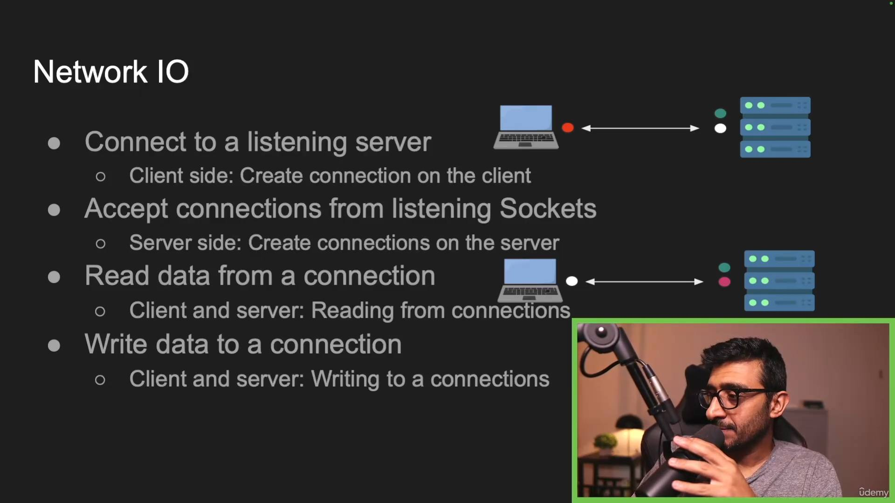
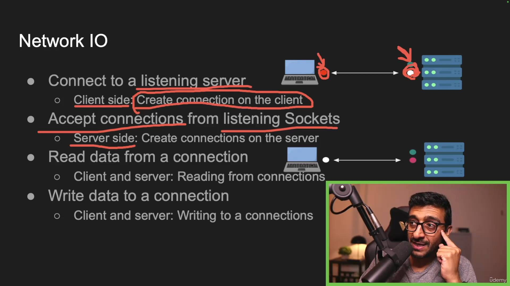
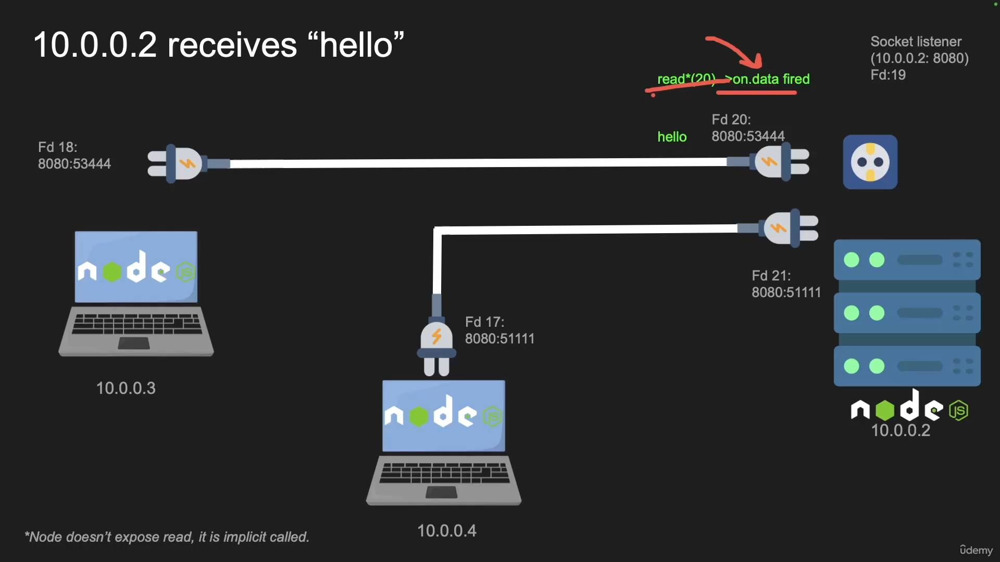
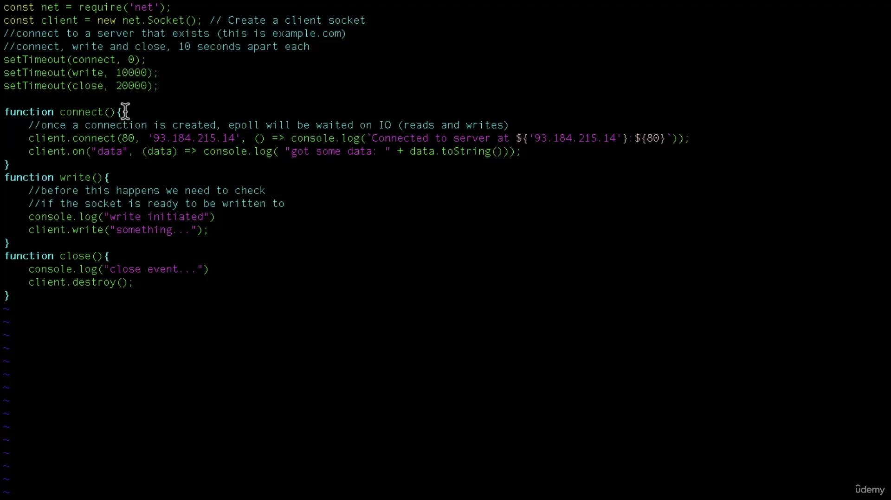
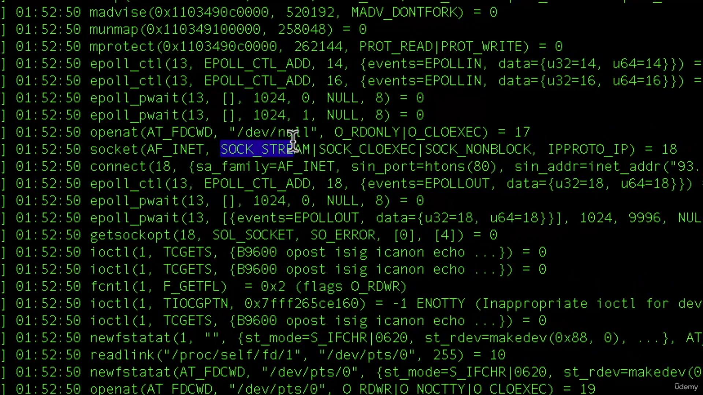
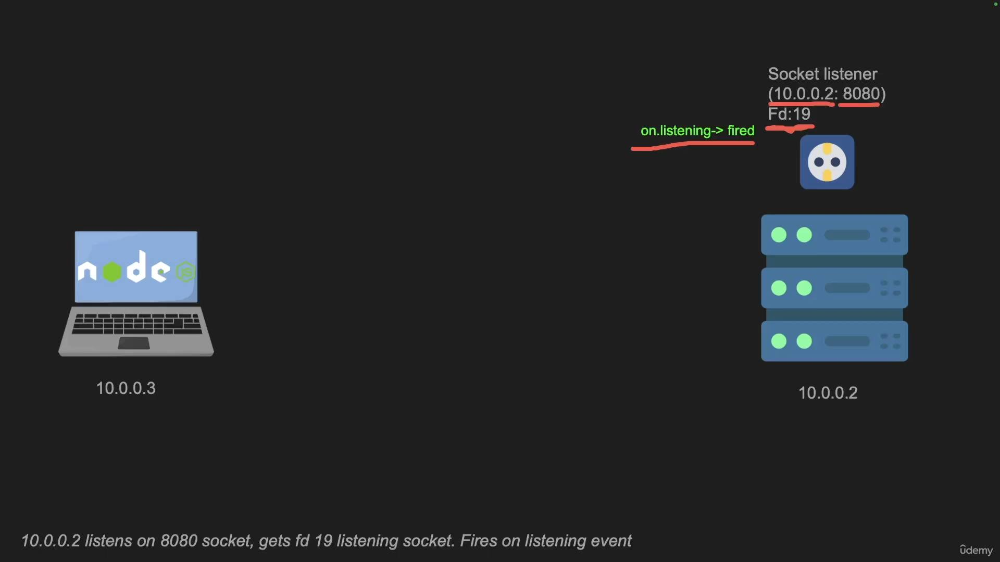
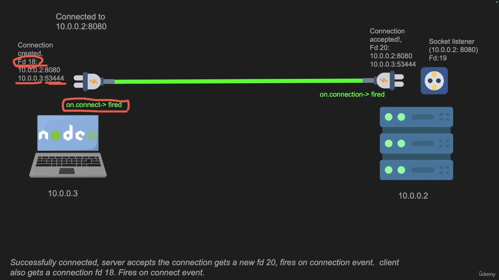
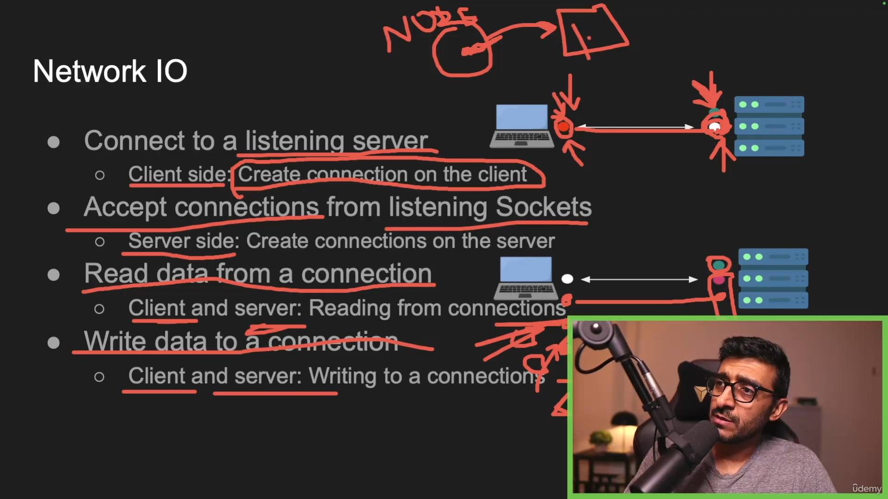

## 1. 这一节做什么

这一节做的是一个**可运行的 Node.js 网络最小实验**：用 Node 内置的 `net` 模块分别写出一个 TCP 客户端和一个 TCP 服务端，观察 `connect`、`listen`、`accept`、`read`、`write`、`close` 在 Node 事件层和 Linux 系统调用层分别长什么样。讲师的核心不是让你背 API，而是让你把 Node 的 socket 对象和内核里的文件描述符、监听 socket、连接 socket、`epoll_wait` 对应起来。



这一节的最终产物不是框架，而是两个文件：

```text
~/nodejs-internals-p24/
├── client.js
└── server.js
```

其中 `client.js` 连接 `example.com:80`，10 秒后发送一个原始 HTTP 请求，20 秒后结束；`server.js` 监听 `127.0.0.1:8080`，10 秒后让同一个进程再作为客户端连接自己，20 秒后向自己写数据，30 秒后关闭。`server.js` 故意做成“自己连自己”，因为讲师在 P24 里就是用这种方式让你同时看到客户端连接和服务端 accept 出来的连接。

需要先说明：逐字稿没有给出完整源码，下面的 `client.js` 和 `server.js` 是按讲师在 P24 演示的时序、事件和命令重建的可运行文件，不是逐字照抄课堂文件。逐字稿没讲的细节，我会明确写“课里没讲”。

本示例不需要 npm 依赖，不需要环境变量。Node 版本课里没讲；示例只使用 Node 内置 `net` 和定时器，本文建议用本机可用的 Node 运行即可。`strace` 部分需要 Linux 环境；Windows 原生终端没有 `strace`，这一点课里没讲。

---

## 2. 讲师原话（带「—— pNNN [MM:SS]」）

讲师先把 Node 网络角色压缩成两个方向：客户端和服务端。

> "Node 既可以作为客户端，也可以作为服务端。"
> —— p024 [01:27]

然后他反复强调：监听 socket 不是连接 socket，`accept` 会创建新的连接 socket，并且每个连接 socket 有自己的文件描述符。

> "每个被接受的连接都会创建一个新的套接字，同时也会获得自己唯一的文件描述符。"
> —— p024 [04:21]



他还专门区分了“监听 socket 不能读写”这件事：

> "不能从处于监听状态的服务端套接字中读取或写入任何内容……"
> —— p024 [05:20]

在讲 Node 的读写事件时，讲师说 Node 不会把裸 `read` 直接暴露给你，而是通过 `data` 事件把数据交给你：

> "我们只在真正绑定 data 事件时才调用 read。"
> —— p024 [26:23]



他还强调不能直接乱写，写之前要先通过 epoll 知道连接可写：

> "不要直接调用 write……要先执行一次 epoll。"
> —— p024 [20:12]

服务端 accept 的连接事件，对应 Node 的 `connection` 事件：

> "connection 事件是在我们接受一个连接时触发的事件。"
> —— p024 [28:18]

讲师在演示服务端示例时明确说，这个例子会自己连自己：

> "我们将连接到自身。"
> —— p024 [29:45]

最后进入终端演示时，他使用 `strace -f -t` 跟踪 Node 进程：

> "我们将用 -f -t 跑一次 strace。"
> —— p024 [31:41]



跟踪客户端时，讲师指出能看到 socket、connect、epoll_wait、write、read、close 这些动作，并且 `epoll_wait` 的超时和 10 秒定时器有关：

> "9999 是定时器……这正是我们当时设置的超时时间。"
> —— p024 [34:53]



---

## 3. 从零复现

这一节按“先跑客户端，再跑服务端，再用 strace 对照”的顺序复现。不要一上来就同时开两个脚本，否则输出会混在一起。先让客户端单独跑通，再让服务端自己连自己。

### 3.1 准备目录和运行环境

在 Linux 或 macOS 终端执行：

```bash
mkdir -p ~/nodejs-internals-p24
cd ~/nodejs-internals-p24
node -v
```

目录结构最终是：

```text
~/nodejs-internals-p24/
├── client.js
└── server.js
```

依赖说明：

- npm 依赖：无。
- 环境变量：无。代码里用常量 `HOST`、`PORT`，不是环境变量。
- Node 版本：课里没讲具体版本；本示例只用内置 `net`，不需要安装包。
- `strace`：课里在 Linux 上使用；如果你的系统没有 `strace`，代码仍可运行，只是不能看系统调用。

### 3.2 先写并运行客户端

把第 4 节的 `client.js` 原样保存到 `~/nodejs-internals-p24/client.js`。运行：

```bash
node client.js
```

预期你会看到类似信息：客户端创建后连接 `example.com:80`，打印本地地址和远端地址；10 秒后写入原始 HTTP 请求；收到数据后打印字节数和响应开头；20 秒后结束。具体 IP、端口、收到的网页内容以你的网络环境为准。

注意：讲师在课里提醒不要反复刷 `example.com`，不要写循环去 spam 对方服务器。这里只发一次普通 HTTP 请求。

如果你在 Linux 上想看系统调用，另开终端或直接在命令前加：

```bash
strace -f -t node client.js
```

`-f` 表示跟随子进程/线程，`-t` 表示打印时间。讲师在 P24 用的就是这个组合。

### 3.3 再写并运行服务端

把第 4 节的 `server.js` 保存到同一目录。运行：

```bash
node server.js
```

这个脚本会：

1. 监听 `127.0.0.1:8080`。
2. 触发 `listening` 事件后，等 10 秒。
3. 用同一个 Node 进程创建客户端连接 `127.0.0.1:8080`。
4. 服务端 accept 这个连接，打印远端端口。
5. 20 秒时，自客户端向服务端写 `hello from self-client`。
6. 服务端连接 socket 的 `data` 事件打印收到的数据。
7. 30 秒时关闭自客户端连接。

讲师在服务端例子里用的是“自己连自己”，所以你会同时看到两个连接对象：一个是服务端 accept 出来的连接 socket，另一个是同一个进程里作为客户端创建的连接 socket。它们不是同一个对象，也不是同一个文件描述符。



### 3.4 用 strace 对照事件

运行客户端跟踪：

```bash
strace -f -t node client.js
```

运行服务端跟踪：

```bash
strace -f -t node server.js
```

你不需要读懂每一行。按下面的关键词找：

- `socket(...)`：创建 socket，返回一个文件描述符，例如讲师示例里的 18。你的编号不会固定。
- `connect(...)`：客户端向目标地址和端口发起连接。
- `bind(...)`：服务端绑定监听地址和端口；客户端侧通常由 Node/内核帮你处理。
- `listen(...)`：服务端进入监听状态。
- `accept(...)`：服务端接受新连接，返回新的连接文件描述符。
- `epoll_ctl(...)`：把文件描述符加入 epoll 关注列表。
- `epoll_wait(...)`：等待事件；讲师示例里出现过接近 10 秒的超时值 9999。具体数值以你的输出为准。
- `write(...)`：写 socket 或写标准输出。讲师示例里 19 可能是终端输出，18 是 socket；你的编号可能不同。
- `read(...)`：从连接读数据。
- `close(...)`：关闭文件描述符。

具体系统调用名、参数格式、文件描述符编号会随内核和运行环境变化。不要拿本文的编号硬套你的机器。

### 3.5 理解“为什么自己连自己能看到两个 socket”

讲师在 P24 里解释得很清楚：监听 socket 只负责接收连接，不负责读写数据；`accept` 之后产生新的连接 socket，这个连接 socket 才和客户端连接 socket 构成一对通信通道。即使是同一个进程自己连自己，也需要两个连接对象：一个客户端侧，一个服务端侧。服务端 accept 出来的连接和客户端创建出来的连接，用四元组关联：源 IP、源端口、目标 IP、目标端口。讲师口语里说“two tuples 或 four tuples”，重点不是命名，而是这四个信息唯一标识一条连接。



---

## 4. 完整代码

下面两个文件都是完整文件，可以分别保存后直接运行。再次说明：逐字稿没有给出完整源码，以下按讲师 P24 的演示时序重建；为了本机复现稳定，`server.js` 绑定 `127.0.0.1`，而讲师在 strace 里展示过“只给端口、绑定所有 IP”的情况，这个差异只影响监听地址，不影响 accept/连接 socket 的核心结论。

### 4.1 `client.js`

```js
'use strict';

const net = require('net');

const HOST = 'example.com';
const PORT = 80;

console.log('[client] creating client');

const client = net.createConnection({ host: HOST, port: PORT }, () => {
  console.log('[client] connected');
  console.log('  localAddress =', client.localAddress);
  console.log('  localPort    =', client.localPort);
  console.log('  remoteAddress=', client.remoteAddress);
  console.log('  remotePort   =', client.remotePort);
});

client.on('data', (chunk) => {
  console.log('[client] data bytes =', chunk.length);
  console.log(chunk.toString('utf8').slice(0, 300));
});

client.on('error', (err) => {
  console.error('[client] error:', err.message);
});

client.on('close', () => {
  console.log('[client] closed');
});

setTimeout(() => {
  if (client.destroyed) {
    return;
  }

  console.log('[client] write HTTP request');
  client.write(
    'GET / HTTP/1.1\r\n' +
      'Host: example.com\r\n' +
      'Connection: close\r\n' +
      '\r\n'
  );
}, 10000);

setTimeout(() => {
  if (client.destroyed) {
    return;
  }

  console.log('[client] end');
  client.end();
}, 20000);
```

### 4.2 `server.js`

```js
'use strict';

const net = require('net');

const LISTEN_HOST = '127.0.0.1';
const LISTEN_PORT = 8080;
const SELF_CONNECT_HOST = '127.0.0.1';
const SELF_CONNECT_PORT = 8080;

let selfClient = null;

const server = net.createServer((socket) => {
  console.log('[server] connection accepted');
  console.log('  remoteAddress =', socket.remoteAddress);
  console.log('  remotePort    =', socket.remotePort);
  console.log('  localAddress  =', socket.localAddress);
  console.log('  localPort     =', socket.localPort);

  socket.on('data', (chunk) => {
    console.log('[server] onData bytes =', chunk.length);
    console.log('[server] onData text  =', JSON.stringify(chunk.toString('utf8')));
  });

  socket.on('error', (err) => {
    console.error('[server] socket error:', err.message);
  });

  socket.on('close', () => {
    console.log('[server] connection closed');
  });
});

server.on('listening', () => {
  console.log('[server] listening');
  console.log('  address =', server.address());

  setTimeout(() => {
    console.log('[server] self-client connecting');

    selfClient = net.createConnection(
      { host: SELF_CONNECT_HOST, port: SELF_CONNECT_PORT },
      () => {
        console.log('[server:self-client] connected');
        console.log('  localAddress =', selfClient.localAddress);
        console.log('  localPort    =', selfClient.localPort);
        console.log('  remoteAddress=', selfClient.remoteAddress);
        console.log('  remotePort   =', selfClient.remotePort);
      }
    );

    selfClient.on('data', (chunk) => {
      console.log('[server:self-client] data bytes =', chunk.length);
      console.log('[server:self-client] data text  =', JSON.stringify(chunk.toString('utf8')));
    });

    selfClient.on('error', (err) => {
      console.error('[server:self-client] error:', err.message);
    });

    selfClient.on('close', () => {
      console.log('[server:self-client] closed');
    });
  }, 10000);

  setTimeout(() => {
    if (!selfClient || selfClient.destroyed) {
      return;
    }

    console.log('[server:self-client] write hello');
    selfClient.write('hello from self-client\n');
  }, 20000);

  setTimeout(() => {
    if (!selfClient || selfClient.destroyed) {
      return;
    }

    console.log('[server:self-client] end');
    selfClient.end();
  }, 30000);
});

server.on('error', (err) => {
  console.error('[server] error:', err.message);
});

server.listen(LISTEN_PORT, LISTEN_HOST);
```

---

## 5. 逐行解释

### 5.1 `client.js` 的解释

`const net = require('net');` 引入 Node 内置网络模块。讲师在 P24 里说 `net` 是 built in，不需要安装，安装 Node 后它就在全局模块位置里，随 Node 一起来。

`const HOST = 'example.com'; const PORT = 80;` 指定目标。讲师示例里用的就是 `example.com` 和端口 80。这里没有用 DNS 手动解析；连接时 Node 会配合内核完成域名解析、源地址选择和 TCP 连接。讲师在 P24 里专门讲了源 IP 选择不是魔法：本机可能有 Wi-Fi、以太网、Docker 接口、`127.0.0.1`、IPv6 loopback 等，Node 和内核会根据目标地址挑选合适的源地址。



`net.createConnection({ host, port }, callback)` 创建客户端 socket 并发起连接。讲师说 Node 里你可以把它理解成“创建 socket 并 connect”，底层会创建文件描述符，默认绑定目标地址，同时绑定一个随机的源地址和源端口。回调是在连接建立后触发的；讲师说如果三次握手没有完成、没有收到 ACK，这个连接成功事件不会触发。

`client.on('data', ...)` 是 Node 对 `read` 的封装。讲师说 Node 不把裸 `read` 暴露给你；只有你挂了 `data` 事件，Node 才会在底层帮你读。数据从内核空间拷贝到用户空间后，Node 调用你的回调。如果数据在你挂 `data` 之前就到了，也不会丢，它会待在连接的 receive queue 里，等你开始读。课里没讲 receive queue 满了以后的具体行为；实际生产要处理背压。

`client.on('error', ...)` 是错误兜底。课里没有展开错误分类；你复现时如果 DNS 失败、网络不通、被目标服务器重置，都会走到这里。

`client.on('close', ...)` 在连接关闭时触发。讲师说 `socket.end()` 会发起关闭流程，但关闭是异步完成的，不要以为调用 `end()` 的下一行就已经彻底关闭。

`setTimeout(..., 10000)` 对应讲师示例里的“10 秒后写”。讲师用定时器是为了让 `strace` 里能看到一段等待：`epoll_wait` 可能先等 10 秒左右，然后执行写操作。你在 `strace` 里看到的超时值可能接近 9999 毫秒，也可能因为已有其他工作而不同；以实际输出为准。

`client.write(...)` 写入原始 HTTP 请求。讲师在终端里提醒过：不要随便向真实服务器循环发送奇怪内容，可能被限流或封禁。这里发送的是标准 `GET / HTTP/1.1`，并带 `Host` 和 `Connection: close`。课里没有完整展开 HTTP 协议；HTTP 细节属于后面的 HTTP 部分。

`client.end()` 结束写方向并推动连接关闭。讲师在 strace 里观察到 `shutdown`、`close` 等动作。具体系统调用顺序以你的机器为准。

### 5.2 `server.js` 的解释

`const server = net.createServer((socket) => { ... })` 创建服务端。回调就是讲师说的 `connection` 事件：当监听 socket accept 出一个新连接时，Node 把新的连接 socket 交给你。注意回调参数 `socket` 是连接 socket，不是监听 socket。监听 socket 不能读写，只有连接 socket 能读写。

`socket.remoteAddress`、`socket.remotePort`、`socket.localAddress`、`socket.localPort` 是连接对象上的地址信息。讲师在 P24 里特别说 `remotePort` 是“从客户端视角看的本地端口”，也就是客户端连接时使用的源端口。要唯一标识一条连接，需要源 IP、源端口、目标 IP、目标端口这组信息；讲师口语里说 two tuples 或 four tuples，核心是这四个值。

`socket.on('data', ...)` 是服务端连接 socket 上的读事件。对应底层是 `epoll_wait` 通知有数据可读，Node 调 `read`，再把数据通过 `data` 事件交给你。讲师说如果自己写 C 程序，没有这么方便的 `onData`，你要先问内核“有没有数据”，再调 `read` 拿数据；Node 帮你把这个循环封装了。

`server.on('listening', ...)` 在 `listen` 成功后触发。讲师说 `listen` 会创建监听文件描述符，并触发 listening 事件；这个事件有时在初始阶段触发，有时可能在 poll 阶段触发，取决于你绑定的方式。课里没有要求你精确控制这个阶段；你只要知道“监听成功后才会 accept 连接”。

`server.listen(LISTEN_PORT, LISTEN_HOST)` 绑定并监听。讲师在 strace 演示里说过服务端 `bind` 到 8080，并讨论过“所有 IP”的情况。本文为了复现稳定绑定 `127.0.0.1`；如果你改成 `server.listen(LISTEN_PORT)`，就是只给端口、绑定所有可用地址，具体 IPv4/IPv6 行为以你的系统为准。

`setTimeout(..., 10000)` 里的 `net.createConnection(...)` 是“同一个进程作为客户端连自己”。讲师在 P24 里就是这样演示的：服务端和客户端在同一个 Node 进程里，但仍然是两个连接对象。服务端 accept 出来一个连接 socket，自客户端创建一个连接 socket；它们通过四元组配对。

`selfClient.write('hello from self-client\n')` 是 20 秒后从自客户端写数据。服务端连接 socket 的 `data` 事件会收到它。讲师说这个过程像管道，但比 UNIX pipe 更贵，因为它走了 TCP/IP 协议栈和网络接口/回环路径。

`selfClient.end()` 是 30 秒后关闭自客户端。你会看到客户端侧 close 和服务端侧 close。课里没有讲半关闭状态的全部细节；你复现时只要看到连接关闭事件即可。

### 5.3 并发和 JS/Node 对应关系

这一讲没有讲锁、事务或数据库并发。这里所谓的“并发”是多个 socket 同时存在：一个监听 socket 加多个连接 socket。Node 不要求你为每个连接开一个线程；它把这些文件描述符注册到 epoll，事件循环等待事件，然后依次调用 JS 回调。对应到前端转 Node 的理解：不要在 `data` 回调里做长时间同步计算，否则会阻塞同一个进程里的其他连接。课里没讲背压和事件循环阻塞的完整处理，但你在真实项目里一定会遇到。

---

## 6. 复现检查清单

- [ ] 已创建目录 `~/nodejs-internals-p24`。
- [ ] `node -v` 能正常输出版本。
- [ ] `client.js` 已保存，`node client.js` 能启动。
- [ ] 客户端能打印 `localAddress`、`localPort`、`remoteAddress`、`remotePort`。
- [ ] 客户端 10 秒后打印写入 HTTP 请求，并能收到 `data` 事件。
- [ ] 客户端 20 秒后调用 `end`，并触发 `close`。
- [ ] `server.js` 已保存，`node server.js` 能监听 `127.0.0.1:8080`。
- [ ] 服务端 10 秒后出现 self-client 连接。
- [ ] 服务端出现 `connection accepted`，并打印 accept 出来的连接地址。
- [ ] 20 秒后服务端连接 socket 收到 `hello from self-client`。
- [ ] 30 秒后自客户端关闭，服务端连接也关闭。
- [ ] Linux 下执行 `strace -f -t node client.js`，能找到 `socket`、`connect`、`epoll_wait`、`write`、`read`、`close` 等相关行。
- [ ] Linux 下执行 `strace -f -t node server.js`，能找到 `bind`、`listen`、`accept`、`epoll_ctl`、`epoll_wait` 等相关行。
- [ ] 已理解：监听 socket 不读写，accept 出来的连接 socket 才读写。
- [ ] 已理解：同一个进程自己连自己，也会有两个连接 socket。

---

## 7. 课里没讲但你会撞上的

1. **Node 版本和模块系统**  
   课里没讲具体 Node 版本。本文使用 CommonJS 的 `require`。如果你的项目 `package.json` 设置了 `"type": "module"`，直接复制会报错，需要改成 `import net from 'node:net'`。这属于工程配置，不是 P24 的内容。

2. **`strace` 不是所有系统都有**  
   课里在 Linux 上演示 `strace -f -t`。Windows 原生终端没有 `strace`；macOS 默认也没有。课里没讲安装和替代方案。没有 `strace` 时，两个 JS 文件仍可运行，只是看不到系统调用。

3. **端口占用**  
   如果 `8080` 已被别的程序占用，`server.listen` 会触发 `error`，常见错误是 `EADDRINUSE`。课里没有展开端口冲突处理；改 `LISTEN_PORT` 即可。

4. **`example.com` 的网络和限流**  
   课里提醒不要 spam。实际运行时可能遇到 DNS 失败、公司网络代理、目标服务器返回 301/400 等情况。原始 HTTP 请求必须使用 `\r\n` 分隔；少写空行会导致服务器认为请求不完整。

5. **`data` 事件不是“一条消息”**  
   Node 的 `data` 事件给的是字节流片段。一次 `data` 可能是一部分 HTTP 响应，也可能是多个片段。课里没有讲应用层拆包/粘包；真实协议要自己做 framing。

6. **`end()` 不等于立刻 `close`**  
   课里展示了关闭流程，但没有展开半关闭、`destroy()`、错误关闭的区别。实际项目要同时监听 `error` 和 `close`，不要只依赖 `end()` 的下一行。

7. **IPv4/IPv6 和绑定地址**  
   讲师提到本机可能有 IPv4、IPv6、loopback、Docker 接口等多个地址。本文为了稳定绑定 `127.0.0.1`；如果你改成监听所有地址，连接时用 `127.0.0.1` 还是 `::1` 可能表现不同。课里没有给跨平台绑定矩阵。

8. **背压和写入返回值**  
   `socket.write()` 的返回值、`drain` 事件、写缓冲区满时怎么办，P24 没有展开。你做聊天室或文件传输时会撞上。本文示例数据很小，所以没有处理背压。

9. **没有锁和事务**  
   这一讲没有数据库事务，也没有多线程共享内存锁。Node 侧你要注意的是事件循环不要被长任务阻塞；多个 socket 的回调是事件循环调度的。若你自己用全局 `Map` 保存连接，记得在 `close` 时删除，否则会泄漏。课里没讲这个清理模式，但真实服务必须做。