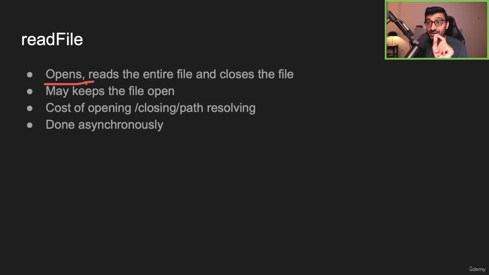
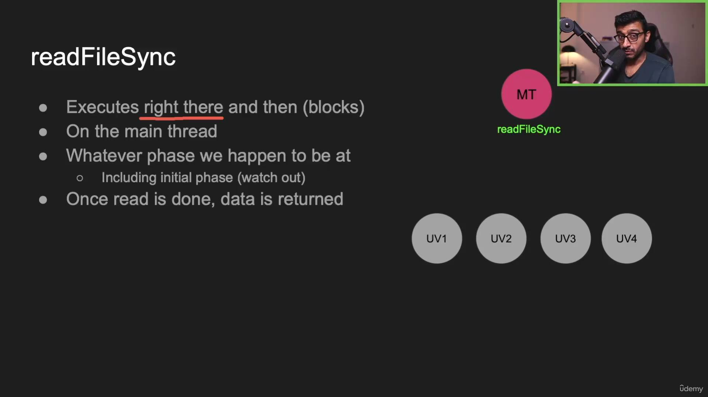
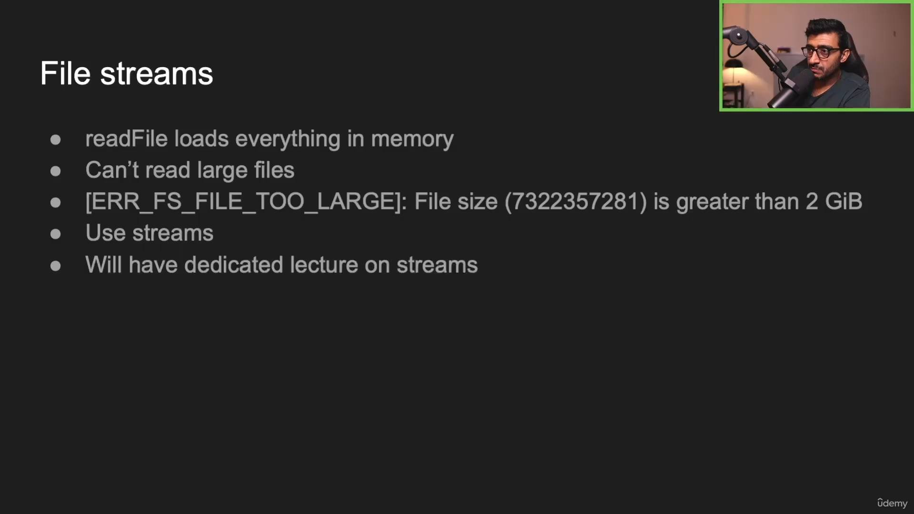
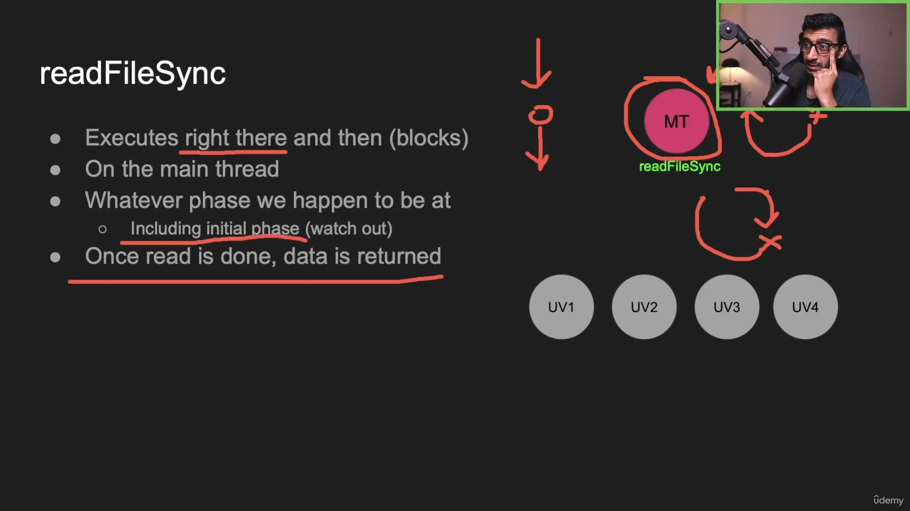
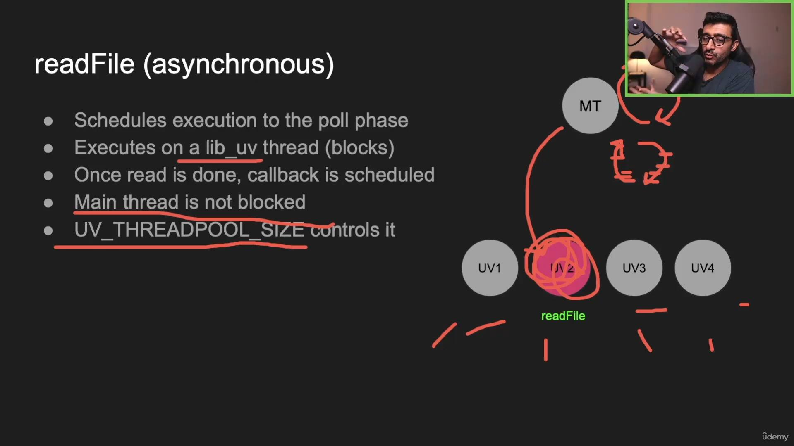
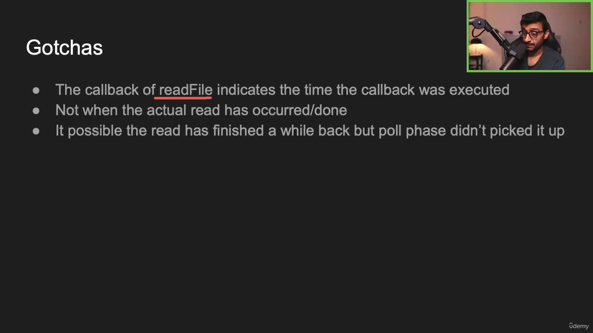
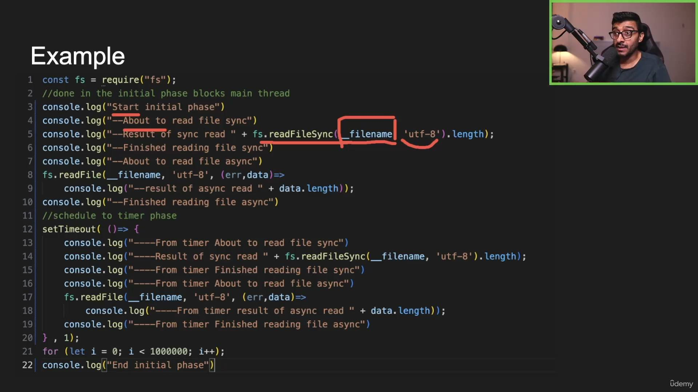
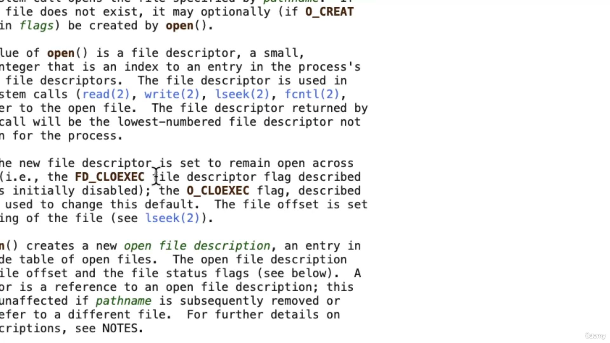
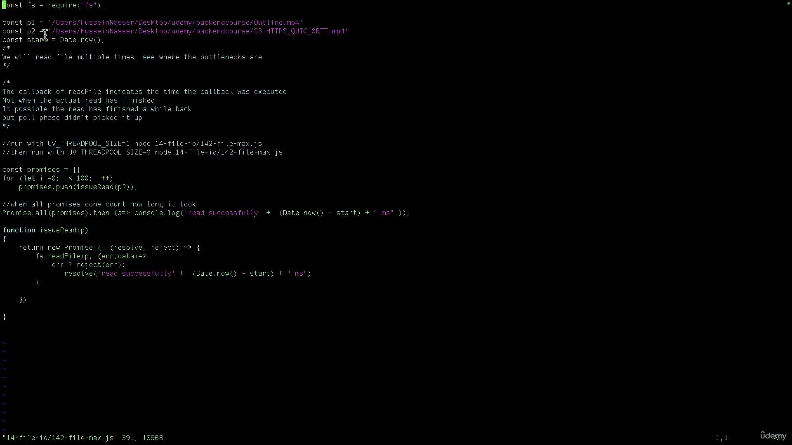

# NodeJS Internals：Node.js 文件 IO 同步、异步、文件描述符与线程池复现

本文覆盖课程 **BV1jGRyBsEBa 的 P025**。这一节不是泛泛讲 API，而是围绕一个可运行的小项目，把 Node.js 文件读写里的几条主线跑出来：`readFileSync` 如何阻塞主线程、`readFile` 如何把阻塞转移到 libuv 线程池、文件描述符如何避免反复路径解析、`O_SYNC` 这类 flags 意味着什么、`UV_THREADPOOL_SIZE` 如何影响并发读文件，以及为什么大文件要用 stream。

本文的代码只使用 Node 内置 `fs`，不依赖 npm 包。课里没有指定 Node 版本；下面的复现建议使用当前 LTS 或 Node 18 以上版本。若你的输出顺序、线程号、fd 数值与本文不同，是正常现象，以实际运行结果为准。

---

## 1. 这一节做什么

这一节要做一个“文件 IO 观察实验”。最终产物不是业务系统，而是一组可以直接运行的小脚本：

1. `01-sync-async.js`：在脚本启动阶段、定时器阶段分别做同步读和异步读，观察事件循环里谁先谁后、谁阻塞谁不阻塞。
2. `02-fd-open-read-close.js`：用 `openSync` 拿到文件描述符，再用 fd 读取，最后 `closeSync`，观察文件描述符和打开 flags。
3. `03-stress-read.js`：用 `Promise.all` 并发读同一个大文件多次，配合 `UV_THREADPOOL_SIZE` 观察 libuv 线程池对文件读的影响。
4. `04-stream-read.js`：用 `createReadStream` 分块读大文件，避免把整个文件一次性读进内存。
5. `create-large-file.sh`：生成一个用于压力测试的大文件。

读者照着本文做完，应该能回答这些问题：为什么 `readFileSync` 会卡住事件循环；为什么 `readFile` 不卡主线程但也不是“免费”；为什么文件描述符能减少路径解析成本；`UV_THREADPOOL_SIZE=1` 和 `=4` 的耗时为什么不同；strace 里为什么会看到不同线程；大文件为什么不能直接 `readFile`。

课里反复强调一个观点：文件操作是昂贵的，因为它在和操作系统外部的硬件打交道。Linux/Windows 一般没有像网络 IO 那样的文件异步机制，逐字稿里讲师明确说“没有 epoll for files”。Node 能做到的，是把阻塞放到别的线程里，而不是让磁盘读本身变成无成本。


---

## 2. 讲师原话

下面按主题摘录讲师原话，并标注时间点。引用保留英文原句的关键部分，后面用中文说明它在项目里的含义。

> “file operations are expensive because you're talking to an external entity... there is a communication cost.”
>
> —— p025 [00:00]

文件 IO 的成本来自硬件和操作系统，不是 JS 函数调用本身。所以后面所有实验都在观察“成本被放在哪个线程、哪个阶段”。

> “The Linux and Windows and operating systems in general don't have a asynchronous approach to reading files, unlike network. There's no EPOL for files.”
>
> —— p025 [01:28]

网络 IO 可以用 epoll/kqueue 这类事件通知机制，文件读通常没有等价的通用异步接口。Node 的异步文件读，本质是把阻塞读交给线程池。

> “The OS makes our life easier and has a file cache on top. It's called a page cache, disk cache sometimes.”
>
> —— p025 [02:25]

操作系统有页缓存。读文件可能直接命中缓存；写文件可能是 write-through cache。这个缓存不是 Node 的，课里也没有展开如何调优，只提醒“有成本、有缓存”。

> “Read file is an abstraction created by node where that doesn't exist in reality.”
>
> —— p025 [03:52]

`fs.readFile` 是 Node 封装出来的便利 API：打开文件、读取整个文件、关闭文件。它不是操作系统里的一个原子系统调用。

> “read file Cannot read like more than two gigs. I think.”
>
> —— p025 [05:19]

讲师提醒 `readFile` 会把整个文件放进内存，超大文件可能失败。这里他说的是“I think”，所以具体上限和错误信息要以你实际 Node 版本输出为准。

> “read file in itself is asynchronous. There is a version of it that's called read file sync that is, you guessed it, synchronous.”
>
> —— p025 [08:03]

`fs.readFile` 是异步版本，`fs.readFileSync` 是同步版本。同步版本会在调用它的地方直接执行，阻塞当前线程。

> “the asynchronous approach... moves the burden of the blocking to one of the UV threads.”
>
> —— p025 [10:55]

异步文件读不是没有阻塞，而是把阻塞转移到 libuv 线程池。主线程可以继续跑事件循环。

> “the UV thread pool by default it's four threads and you can increase it.”
>
> —— p025 [14:40]

libuv 线程池默认 4 个线程，可以通过环境变量调整。课里演示时用了 `UV_THREADPOOL_SIZE`。文件读和 DNS 等操作会共用这个线程池。

> “UTF-8 is the encoding that changes it scans the bytes... This is not free.”
>
> —— p025 [17:33] 到 [19:30]

不传编码时 `readFile` 返回 Buffer；传 `'utf8'` 会把字节解码成字符串。解码不是免费的，逐字稿里反复说“Nothing is free”。

> “To avoid opening and closing the file, you can open the file and get a number. Yes, Node.js exposes this for you.”
>
> —— p025 [23:17]

这个“number”就是文件描述符。用 fd 可以避免反复传路径、反复做路径解析。

> “O-Sync... write operations on this file will complete according to the requirement of synchronized file IO integrity completion.”
>
> —— p025 [37:33]

`O_SYNC` 关注的是写入要不要同步落到硬件，不等同于“Node 的同步 API”。课里还提到它和 `fsync` 的语义相近。

> “the callback only executes when the time of that execution of the callback. It does not indicate the time of the actual read.”
>
> —— p025 [29:04]

`readFile` 的回调时间不等于真正读完成的时间。读可能早就完成了，回调只是被安排到某个阶段执行。



---

## 3. 从零复现

### 3.1 准备目录

在 Linux/macOS 终端里执行：

```bash
mkdir -p nodejs-file-io-demo
cd nodejs-file-io-demo
```

最终目录结构如下：

```text
nodejs-file-io-demo/
├── 01-sync-async.js
├── 02-fd-open-read-close.js
├── 03-stress-read.js
├── 04-stream-read.js
├── create-large-file.sh
└── large.file            # 由脚本生成
```

本 demo 不需要 `npm install`，没有第三方依赖。

### 3.2 生成大文件

先创建 `create-large-file.sh`，内容见第 4 节。然后执行：

```bash
chmod +x create-large-file.sh
./create-large-file.sh large.file 64
```

这会生成一个 64MB 的 `large.file`。逐字稿里提到讲师用了一个很大的文件来演示 stream 和压力测试；课里没有逐字给出完整的生成命令，这里用 `dd` 生成一个本地可承受的大文件。想复现 `readFile` 的超大文件失败，可以把大小调大，但不要把默认值设得太大，避免占满磁盘。

### 3.3 运行同步/异步对照

```bash
node 01-sync-async.js
```

观察输出。你会看到脚本先打印启动阶段的同步读，再打印异步读的调度信息，然后进入定时器回调。注意：异步回调的具体出现顺序会受机器、Node 版本、文件是否命中页缓存影响，不要死记某一行一定在另一行之前。关键检查点是：`readFileSync` 的“finished”一定在它后面的同步打印之前；`readFile` 调用处不会立刻拿到结果。



### 3.4 运行文件描述符示例

```bash
node 02-fd-open-read-close.js
```

它会读自身文件，打印 `fd=` 一个整数，读取前 4096 字节，打印 `bytesRead`，最后关闭 fd。你还可以试：

```bash
node 02-fd-open-read-close.js 02-fd-open-read-close.js r
node 02-fd-open-read-close.js 02-fd-open-read-close.js rs+
```

第二个命令用 `rs+` 打开。脚本会打印 `fs.constants.O_SYNC` 的值，方便你观察这个 flags 对应的常量。课里用 strace 观察实际系统调用；如果你没有 strace，至少可以通过脚本打印出的常量值理解“`rs+` 会带同步打开语义”。



### 3.5 运行线程池压力测试

先确认大文件存在：

```bash
ls -lh large.file
```

然后分别用 1 个线程和 4 个线程跑：

```bash
UV_THREADPOOL_SIZE=1 node 03-stress-read.js large.file 10
UV_THREADPOOL_SIZE=4 node 03-stress-read.js large.file 10
```

这两个命令必须在启动 Node 时带上环境变量。逐字稿里讲师演示时还用了 `export UV_THREADPOOL_SIZE=4`，再运行程序；两种写法都可以。注意：如果你在程序内部读 `process.env.UV_THREADPOOL_SIZE`，它只反映启动时的值，运行中再改不会重新配置已经初始化的线程池。



### 3.6 用 strace 看线程

在 Ubuntu/Linux 上，如果已经安装 `strace`，可以执行：

```bash
strace -f -o trace-1.txt env UV_THREADPOOL_SIZE=1 node 03-stress-read.js large.file 10
strace -f -o trace-4.txt env UV_THREADPOOL_SIZE=4 node 03-stress-read.js large.file 10
```

`-f` 很关键，它会跟踪子线程。逐字稿里讲师就是用 `-f` 观察文件读发生在哪些线程上。然后可以粗略查看：

```bash
grep large.file trace-1.txt | head
grep large.file trace-4.txt | head
```

你会看到线程号。具体线程号每次运行都不同，不要拿本文的数值对照。课里演示时 1 个线程时多次读集中在同一个线程，4 个线程时能看到多个不同线程参与。strace 输出格式和系统调用细节以你的机器实际输出为准。



### 3.7 运行 stream 读大文件

```bash
node 04-stream-read.js large.file 65536
```

第二个参数是 `highWaterMark`，也就是每次读的块大小。课里说 chunk size 可以控制，但没有展开具体 API 名称；这里用 `createReadStream` 的 `highWaterMark` 演示。你会看到多个 `chunk` 日志，最后一个 chunk 可能小于前面的 chunk。总字节数应该等于文件大小。



---

## 4. 完整代码

### 4.1 `01-sync-async.js`

```js
'use strict';

const fs = require('fs');

console.log('start initial phase');

console.log('about to read file sync');
const syncStarted = Date.now();
const syncContent = fs.readFileSync(__filename, 'utf8');
console.log(
  'finished read file sync, length=',
  syncContent.length,
  'elapsedMs=',
  Date.now() - syncStarted
);
console.log('end initial phase');

console.log('about to read file async');
fs.readFile(__filename, 'utf8', (err, asyncContent) => {
  if (err) {
    console.error('async read error', err);
    return;
  }
  console.log('result of the async read, length=', asyncContent.length);
  console.log('finished read file async callback');
});

setTimeout(() => {
  console.log('timer phase: about to read file sync');
  const timerSyncStarted = Date.now();
  const timerSyncContent = fs.readFileSync(__filename, 'utf8');
  console.log(
    'timer phase: finished read file sync, length=',
    timerSyncContent.length,
    'elapsedMs=',
    Date.now() - timerSyncStarted
  );

  console.log('timer phase: about to read file async');
  fs.readFile(__filename, 'utf8', (err, timerAsyncContent) => {
    if (err) {
      console.error('timer phase async read error', err);
      return;
    }
    console.log(
      'timer phase: result of the async read, length=',
      timerAsyncContent.length
    );
  });
}, 1);

console.log('end of initial phase scheduling');
```

### 4.2 `02-fd-open-read-close.js`

```js
'use strict';

const fs = require('fs');

const file = process.argv[2] || __filename;
const flags = process.argv[3] || 'r';

console.log('file=', file);
console.log('flags=', flags);
console.log('fs.constants.O_RDONLY=', fs.constants.O_RDONLY);
console.log('fs.constants.O_SYNC=', fs.constants.O_SYNC);

if (fs.constants.O_CLOEXEC !== undefined) {
  console.log('fs.constants.O_CLOEXEC=', fs.constants.O_CLOEXEC);
}

const fd = fs.openSync(file, flags);
console.log('fd=', fd);

try {
  const stat = fs.fstatSync(fd);
  const maxPreview = Math.min(4096, stat.size);
  const buffer = Buffer.alloc(maxPreview);

  const bytesRead = fs.readSync(fd, buffer, 0, buffer.length, 0);
  console.log('bytesRead=', bytesRead);
  console.log(
    'first bytes preview=',
    buffer.subarray(0, Math.min(bytesRead, 80)).toString('utf8')
  );
} finally {
  fs.closeSync(fd);
  console.log('closed fd=', fd);
}
```

### 4.3 `03-stress-read.js`

```js
'use strict';

const fs = require('fs');

const file = process.argv[2] || 'large.file';
const count = Number(process.argv[3] || 10);
const poolSize = process.env.UV_THREADPOOL_SIZE || '(default)';

console.log('start reading', {
  file,
  count,
  UV_THREADPOOL_SIZE: poolSize
});

const started = Date.now();

const jobs = Array.from({ length: count }, () => {
  return new Promise((resolve, reject) => {
    fs.readFile(file, (err, data) => {
      if (err) {
        reject(err);
        return;
      }
      resolve(data.length);
    });
  });
});

Promise.all(jobs)
  .then((lengths) => {
    const elapsedMs = Date.now() - started;
    const totalBytes = lengths.reduce((sum, length) => sum + length, 0);

    console.log('read all files successfully');
    console.log({
      count,
      totalBytes,
      elapsedMs
    });
  })
  .catch((err) => {
    console.error('read failed', err);
    process.exitCode = 1;
  });
```

### 4.4 `04-stream-read.js`

```js
'use strict';

const fs = require('fs');

const file = process.argv[2] || 'large.file';
const highWaterMark = Number(process.argv[3] || 64 * 1024);

console.log('stream read start', {
  file,
  highWaterMark
});

const readStream = fs.createReadStream(file, { highWaterMark });

let chunkCount = 0;
let totalBytes = 0;

readStream.on('data', (chunk) => {
  chunkCount += 1;
  totalBytes += chunk.length;

  console.log('chunk', chunkCount, 'bytes=', chunk.length, 'total=', totalBytes);
});

readStream.on('end', () => {
  console.log('stream read end', {
    chunkCount,
    totalBytes
  });
});

readStream.on('error', (err) => {
  console.error('stream read error', err);
  process.exitCode = 1;
});
```

### 4.5 `create-large-file.sh`

```sh
#!/usr/bin/env sh
set -eu

FILE="${1:-large.file}"
SIZE_MB="${2:-64}"

dd if=/dev/zero of="$FILE" bs=1M count="$SIZE_MB"
ls -lh "$FILE"
```

---

## 5. 逐行解释

### 5.1 `01-sync-async.js`：同步读和异步读到底差在哪

`fs.readFileSync(__filename, 'utf8')` 这一行会立刻在“调用它的线程”上执行。脚本刚启动时，调用它的就是主线程。所以在它返回之前，后面的 `console.log('end initial phase')` 不会执行。逐字稿里讲师说 `readFileSync` 可以在任何阶段执行，包括初始阶段、poll 阶段、定时器阶段；它不挑阶段，因为它根本不交给事件循环排队，它直接做。

`__filename` 是 CommonJS 模块里的当前文件路径。讲师在课里说读取“正在运行的同一个文件名”很方便，并提到如果只传文件名，有些 API 不会自动帮你解析当前文件路径。这里用 `__filename` 是 CommonJS 的写法；如果你把文件改成 ESM，`__filename` 不存在，需要换写法。课里没有讲 ESM，本文也不展开。

`'utf8'` 是编码参数。不传它时，`readFileSync` 返回 Buffer，也就是字节数组；传了 `'utf8'`，Node 会把字节扫描并解码成字符串。逐字稿里讲 UTF-8 时强调“这不是免费的”，因为解码要扫描字节、判断多字节字符。对于 ASCII 文件，解码通常更简单；但你不能在不知道文件编码时随便假设。

`fs.readFile(__filename, 'utf8', callback)` 是异步版本。调用它时，Node 做两件事：安排真正的读操作，以及安排一个回调。真正的读操作被交给 libuv 的线程池，回调在读取完成后被标记为可执行。讲师说它默认会被安排到 poll 阶段执行；你也可以把它理解成“主线程继续跑，等线程池读完再回来执行回调”。

`setTimeout(..., 1)` 里的同步读会阻塞定时器阶段。也就是说，如果定时器回调里写了 `readFileSync`，那么整个事件循环在定时器阶段会被卡住，后面的 poll、check 等阶段都要等它读完。讲师在课里专门画过这个对比：同步读会阻塞当前阶段，异步读把阻塞转移到线程池，主线程可以继续转。

在 JS/Node 里，“阻塞主线程”的后果和浏览器里“阻塞 UI 线程”很像：定时器不能按时跑，网络回调不能及时处理，已经排队的 Promise 回调也会被推迟。所以文件读不大时用同步 API 可能“看起来没事”，但在服务器启动后频繁使用就会拖慢事件循环。



### 5.2 `02-fd-open-read-close.js`：fd 是进程内打开文件的编号

`fs.openSync(file, flags)` 返回一个整数，这个整数就是文件描述符。讲师说 Linux 里“everything is a file”，打开文件、打开 socket、监听 socket、接受连接，最后都会得到类似的描述符。描述符是进程内有效的编号，不是全局文件名。

`fs.fstatSync(fd)` 通过 fd 拿元数据。逐字稿里提到打开文件时会拿到元数据：文件多大、什么时候创建、什么时候修改、在磁盘上从哪里开始。这里只取 `stat.size` 用来决定读多少字节，避免把整个文件读进来。

`fs.readSync(fd, buffer, 0, buffer.length, 0)` 的参数依次是：fd、目标 Buffer、写入 Buffer 的起始偏移、读取长度、文件内位置。最后一个 `0` 表示从文件开头读。讲师说可以用 fd 反复读，不需要每次都传路径；这样就避免了路径字符串复制、路径解析、文件系统查找、打开关闭等成本。

`fs.closeSync(fd)` 必须执行。代码里放在 `finally` 里，保证即使读失败也会关闭。fd 是有限资源，泄漏会导致后续打开文件失败。课里没有展开 fd 泄漏排查，但这是实际项目里会撞上的问题。

运行 `node 02-fd-open-read-close.js 02-fd-open-read-close.js rs+` 时，`flags` 是 `'rs+'`。Node 会把这种 flags 映射到系统打开标志，其中包含同步打开语义。脚本打印 `fs.constants.O_SYNC` 是为了让你看到这个常量存在。讲师用 strace 观察到 `O_SYNC` 被发送给 open 操作，并解释：普通写入可能先写页缓存就返回；带 `O_SYNC` 时，写入要满足同步完整性要求，和 `fsync` 的语义接近。注意，`O_SYNC` 不是“Node 同步 API”的同义词，它说的是底层写入的持久化语义。



### 5.3 `03-stress-read.js`：`UV_THREADPOOL_SIZE` 控制的是 libuv 线程池

`Array.from({ length: count }, () => new Promise(...))` 创建 10 个 Promise，每个 Promise 里调用一次 `fs.readFile`。这些读操作不是主线程自己做的，而是交给 libuv 线程池。讲师说默认线程池是 4 个线程，可以用 `UV_THREADPOOL_SIZE` 增加。文件读、DNS 查询等操作会共用这个池子，所以如果你同时发很多文件读和 DNS 请求，它们会排队。

`process.env.UV_THREADPOOL_SIZE` 打印的是启动时的环境变量。运行：

```bash
UV_THREADPOOL_SIZE=1 node 03-stress-read.js large.file 10
```

和：

```bash
UV_THREADPOOL_SIZE=4 node 03-stress-read.js large.file 10
```

通常会看到 4 个线程时更快，但不是线性加速。逐字稿里讲师演示 1 个线程大约 2 秒，4 个线程大约 700 毫秒，后来又出现 600 毫秒。这个数字受文件大小、磁盘缓存、机器核心数、当前负载影响。不要把它当成基准测试结论；它只说明线程池确实在起作用。

`Promise.all(jobs)` 等所有读完成。注意，`Promise.all` 不会限制并发数；你一次创建 10 个 `readFile`，它们都会进入 libuv 队列。如果创建 1000 个，线程池只有 4 个线程，剩下的会排队。课里讲师说 100 个太多，改成 10 个，就是因为机器和线程池都有限。

`strace -f` 里的 `-f` 是跟踪线程。1 个线程时，你会看到多次读集中在同一个线程号；4 个线程时，可能看到多个不同线程号。讲师在课里就是通过这个现象说明“异步读把阻塞分散到了 UV 线程”。具体线程号每次不同，不要复制本文的数字。



### 5.4 `04-stream-read.js`：stream 用固定内存分块消费

`fs.createReadStream(file, { highWaterMark })` 创建一个可读流。`highWaterMark` 是每次从文件读出的块大小。课里说 chunk size 可以控制，但没有展开 API 名称；这里用它来演示。流内部会异步调用读操作，读到一块就触发 `data` 事件。讲师说“I have a chunk, I have a chunk”，就是 `data` 事件在不断交付块。

`chunkCount` 和 `totalBytes` 用来验证读完了整个文件。`end` 事件表示流结束。`error` 事件必须监听，否则文件不存在时会变成未处理错误。

为什么大文件要用 stream？因为 `readFile` 会把整个文件放进内存。逐字稿里提到 `readFile` 读超大文件会报类似“file too large”的错误，并说大约 2GB；这个上限和错误信息以实际 Node 版本为准。stream 只保留固定大小的块，消费完一块再读下一块，内存占用可控。课里还提到 stream 可以链到写流、压缩流、加密流，但这一节只演示读，不展开管道。


---

## 6. 复现检查清单

按下面顺序检查，基本就能判断复现是否成功。

- [ ] `node -v` 能输出版本号。课里没有指定版本；Node 18+ 一般可跑本文代码。
- [ ] 目录里有 `01-sync-async.js`、`02-fd-open-read-close.js`、`03-stress-read.js`、`04-stream-read.js`、`create-large-file.sh`。
- [ ] `./create-large-file.sh large.file 64` 成功生成 `large.file`，`ls -lh large.file` 能看到文件大小。
- [ ] `node 01-sync-async.js` 能跑完。能看到 `start initial phase`、`about to read file sync`、`finished read file sync`、`end initial phase`，并且 `readFile` 的回调不是紧跟在调用处执行。
- [ ] 定时器里的同步读会先打印“about to read file sync”，再打印“finished”，中间没有其他异步回调插进来。这说明它阻塞了当前阶段。
- [ ] `node 02-fd-open-read-close.js` 能打印一个整数 `fd=`，能打印 `bytesRead=`，最后打印 `closed fd=`。
- [ ] `node 02-fd-open-read-close.js 02-fd-open-read-close.js rs+` 能打印 `fs.constants.O_SYNC=` 的值；没有报权限错误。若报错，检查文件是否可读写。
- [ ] `UV_THREADPOOL_SIZE=1 node 03-stress-read.js large.file 10` 能打印 `read all files successfully` 和耗时。
- [ ] `UV_THREADPOOL_SIZE=4 node 03-stress-read.js large.file 10` 也能成功；通常比 1 个线程快，但不保证每次都快。
- [ ] 如果使用 strace：`strace -f -o trace-1.txt env UV_THREADPOOL_SIZE=1 node 03-stress-read.js large.file 10` 能生成文件；`grep large.file trace-1.txt | head` 能看到读调用。线程号以实际为准。
- [ ] `node 04-stream-read.js large.file 65536` 能打印多个 `chunk`，最后打印 `stream read end`，`totalBytes` 应等于 `large.file` 的字节数。
- [ ] 把 `highWaterMark` 改小，例如 `node 04-stream-read.js large.file 8192`，`chunk` 数量会变多，说明块大小可控。
- [ ] 如果出现 `ENOENT`，先检查当前目录和 `large.file` 是否存在；如果出现 `EACCES`，检查文件权限；如果 strace 报权限不足，检查系统是否允许 ptrace。

---

## 7. 课里没讲但你会撞上的

下面这些是实际复现时容易遇到的问题，逐字稿没有展开，本文只做提醒，不把解决方案说成讲师原话。

1. **Node 版本差异**：课里没有指定 Node 版本。不同版本对 `fs.constants`、错误信息、事件循环细节可能有差异。本文代码只用常见 API，但错误文本请以实际输出为准。
2. **strace 不是所有系统都有**：逐字稿演示环境是 Ubuntu/Linux。macOS 默认没有 `strace`，Windows 也没有。课里没有讲这些平台的替代工具；没有 strace 就跳过线程观察，代码本身仍可运行。
3. **`dd` 生成大文件是复现辅助**：逐字稿提到需要一个大文件，但没有完整逐字给出生成命令。本文用 `dd if=/dev/zero` 生成零填充文件，适合读测试；不要拿它测试真实数据压缩率。
4. **`readFile` 的超大文件上限**：讲师说“I think”大约 2GB。不同 Node 版本、内存、文件系统可能表现不同。不要在生产里用 `readFile` 读未知大小的大文件，这正是 stream 的用途。
5. **`UV_THREADPOOL_SIZE` 必须在启动前设置**：在程序运行中修改 `process.env.UV_THREADPOOL_SIZE` 不会重新配置已经初始化的线程池。要么命令行前置，要么 `export` 后再启动。
6. **文件读和 DNS 共用线程池**：讲师提到 DNS 和文件读都会用 libuv 线程池。实际项目里如果同时发大量 DNS 查询和文件读，可能互相排队。课里没有展开 DNS，只提醒共享池子。
7. **fd 泄漏**：`openSync` 后必须 `closeSync`。本文用 `finally` 保证关闭。实际项目里如果忘记关闭，时间长了会耗尽 fd。
8. **文件在读取过程中被修改**：讲师提到共享读时别人可以改文件，除非你加排他锁。课里没有讲 Node 里如何加文件锁；本文 demo 只读自身文件或静态大文件，不涉及并发写。
9. **`rs+` 的写权限**：`rs+` 是读写同步打开。用它打开文件时，进程需要有写权限。讲师演示时也提醒“祈祷不要损坏文件”。本文示例只读前 4096 字节，不写入，但仍建议在临时文件上实验。
10. **ESM 与 CommonJS**：本文用 `require` 和 `__filename`，属于 CommonJS。若你把 `package.json` 的 `type` 设为 `module`，`__filename` 不可用，需要改写法。课里没有讲模块系统差异。
11. **输出顺序不是固定契约**：`readFile` 回调、定时器、Promise 回调的相对顺序会受文件缓存、机器负载影响。逐字稿里讲师也说“it depends who wins”。复现时看“机制”而不是死记某一行。
12. **`O_SYNC` 不等于所有写入都立刻持久化到所有层级**：讲师用“写到硬件才返回”解释它，并把它类比 `fsync`。实际存储设备、文件系统、挂载选项都会影响持久化语义；课里没有展开这些细节，生产环境需要按文件系统和业务要求确认。