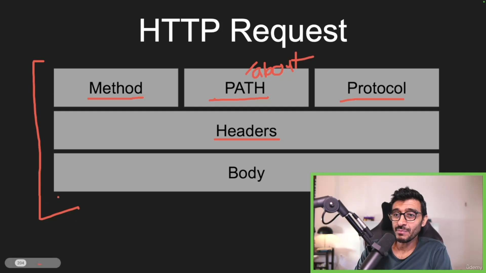
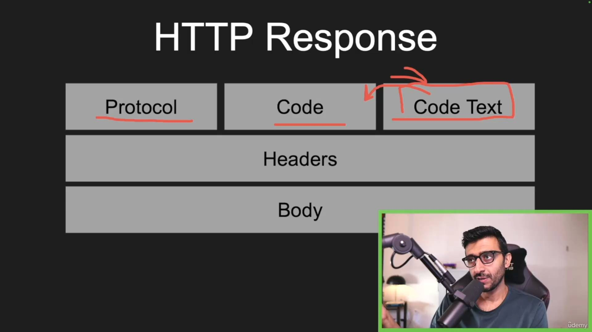
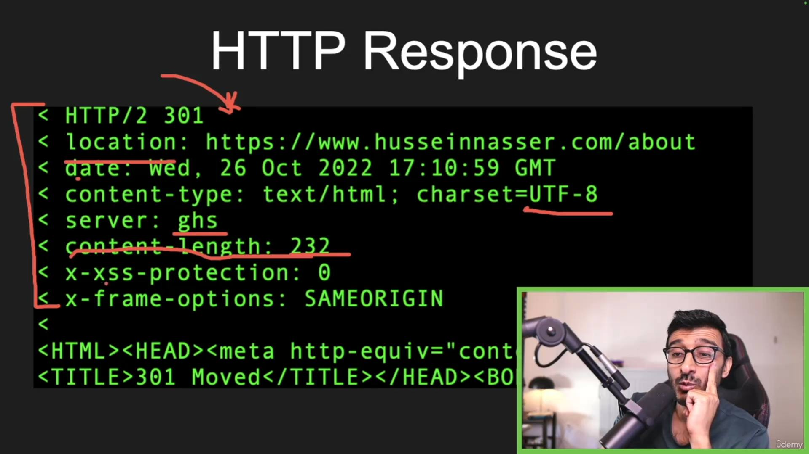
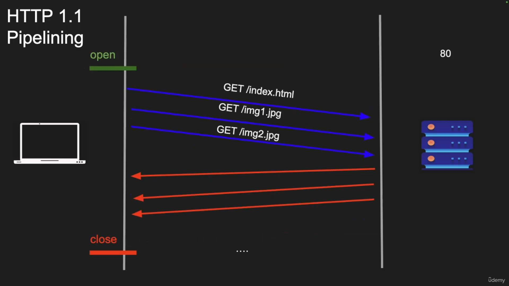
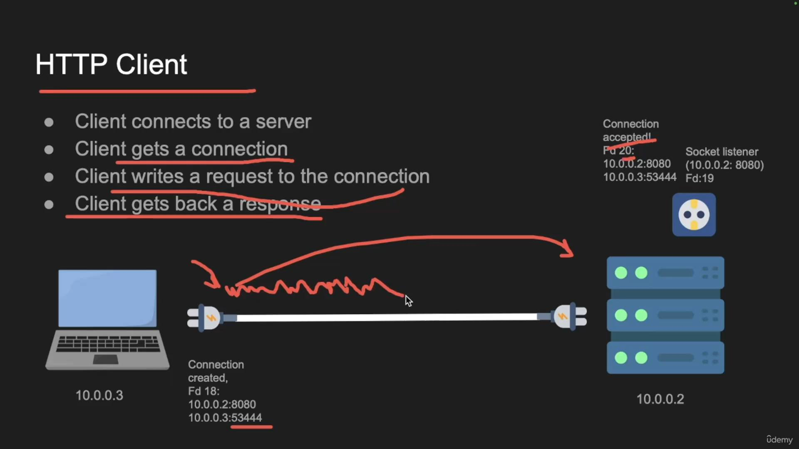
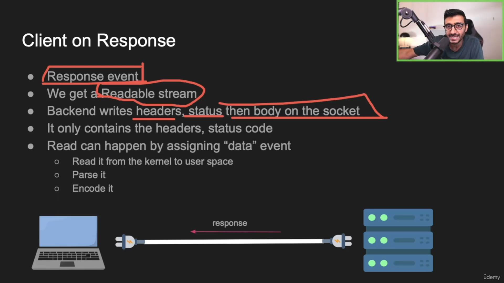
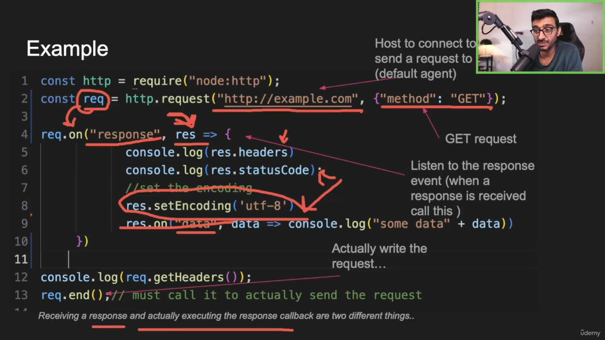
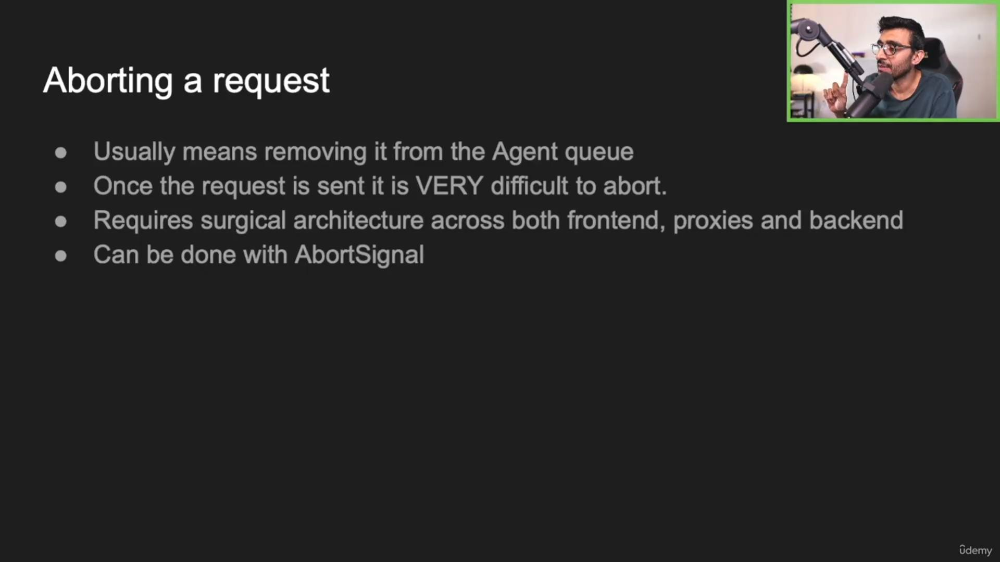

# Node.js HTTP 模块：从客户端、服务端到 Agent 连接池

## 1. 这一节做什么

这一节（P026，全长约 74 分钟）是 Node.js HTTP 模块的第一课，讲师从 HTTP 协议语义一路讲到 Node 里怎么真正写出能跑的 HTTP 客户端和 HTTP 服务器。

具体要做完的事：

1. 搞清 HTTP 在 TCP 之上是**怎么被"拼"出来的**：每一份请求有起点和终点，每一份响应有起点和终点，中间靠 `content-length`、空行、`Transfer-Encoding: chunked` 等机制切分。
2. 用 `http.get` / `http.request` 写一个 Node HTTP **客户端**，理解 `response` 事件、`data` 事件、`end` 事件的含义，以及为什么"写了请求但没 `end()`"会让整个程序挂住。
3. 用 `new URL(...)` 一次性解析 URL 对象，避免在循环里反复解析字符串。
4. 用自定义 `http.Agent({ keepAlive: true, maxSockets: N })` 控制**每主机连接池大小**，直观感受到 1 个 socket vs 6 个 socket 发 100 个请求时延的巨大差异。
5. 用 `http.createServer` 写一个 Node HTTP **服务端**，观察不带 `Content-Length` 时的 `Transfer-Encoding: chunked` 响应。
6. 理解 `AbortController` / abort signal 的**能力边界**：它能断你这一侧到 immediate backend 的连接，但**不能**保证远端真的停止执行（数据库里那条 query 还在跑）。

课里**没有**涉及：HTTPS 模块（讲师明确说"不是 HTTPS 模块。"）、HTTP/2 的 Node API（只提了 h2 语义）、CORS、POST body 解析、Express 内部实现，这些都属于后续课程或你自行扩展。下文凡遇到此类内容会明确写"课里没讲"。

---

## 2. 讲师原话

> "Let's talk about node HTTP, the HTTP module, not the HTTPS module. We're just gonna focus on unencrypted HTTP first..." —— p026 [00:00]

> "The most important piece in my opinion is the fact that it's a request response system. It's a request and response protocol." —— p026 [01:22]

> "Every request has a response, every request has a start and an end. The response has a start and an end. And then the challenge for clients become, how do I know if I send a request that the response that comes back from the server actually belong to the request that I just sent?" —— p026 [04:42]

> "Nobody sends multiple requests on the same connections concurrently anymore. You don't do that because it's very difficult to parse back the responses that come back..." —— p026 [06:06]

> "Node implements HTTP as a protocol on both the client and server... And it supports both HTTP1.1 and HTTP2. HTTP3 is not supported in Node as of making this video February 2025." —— p026 [06:34]

> "We're just going to talk about TCP. That's the only vehicle we have to build HTTP on top of. HTTP is built on TCP." —— p026 [07:03]

请求的解剖（method / path / headers / body）——p026 [10:25 – 12:49]：



响应的解剖与状态码家族（2xx / 3xx / 4xx / 5xx；HTTP/2 移除了 reason phrase）——p026 [16:06 – 17:29]：



> "If it starts with a 4, it's often that a request has a problem. It's your fault as a client. 5xx, it's my fault as a server. And 2x is basically success." —— p026 [16:32]

TCP 层面与 HTTP 层的分工（内核只看到字节流、应用层负责解析单元）——p026 [22:47 – 25:06]：



> "TCP is just a stream of bytes in both directions... The concept of a request response is something that is created at the application layer." —— p026 [01:51]

HTTP/1.1 pipelining 的困境（无法保证顺序、中间的 proxy 不可控）——p026 [32:06 – 34:38]：



> "How do I know that this response belong to this, and this belong to this? ... you cannot guarantee this order because sometimes there are people in the middle, there are proxies." —— p026 [32:15 – 33:12]

Node 的 Agent / 连接池——p026 [37:02 – 41:49]：



> "By default, Node supports that using an agent... it essentially supports a pool of connection per host. ... If there is the max sockets is reached on the agent for that particular host... the request just gets queued. And you feel it. That's where you feel the slowdown of your request." —— p026 [37:31 – 41:20]

> "We're still in the client side. After I see the response, I'm going to get a beautiful response event. And we're going to get something called the readable stream." —— p026 [45:36]

用 `http.request` 发请求时的选项：`agent`、`port`、`headers`——p026 [48:30 – 49:25]：


URL 对象被解析一次、循环里反复复用的性能差别——p026 [42:18 – 45:07]：



> "It's a string. And what do we know about strings? They're slow. You need to extract these valuable information from the URL string to generate the path, to generate the host, to generate the scheme..." —— p026 [42:47 – 43:15]

客户端示例：`http.get`、`res.setEncoding('utf8')`、`res.on('data')`、`res.on('end')`——p026 [49:25 – 52:16]：



Abort 请求的能力边界（讲师反复强调"abort 只是表面功夫。"）——p026 [52:45 – 58:35]：



> "Aborting a request is a very difficult thing to do. You can give up on waiting on a request... but understand that... it's on the other side. It is received by the back end." —— p026 [52:45 – 53:15]

---

## 3. 从零复现

本节不需要任何第三方依赖，只用 Node 内置的 `http` 模块。整个项目是一个空目录 + 5 个 `.js` 文件。

### 3.1 环境准备

```bash
# 任意一个新目录
mkdir node-http-lab
cd node-http-lab

# 初始化（用 commonjs，和讲师演示一致）
npm init -y

# 确认 Node 版本（课里未指明具体版本，但用到了 http.get(url) 与 new URL，Node 10+ 均可）
node -v
```

> 讲师在演示里用的是 `require(...)`（原文 p026 [49:25]："我们引入的是 Node 的 HTTP 模块。"），所以我们的文件默认用 CommonJS，且 `package.json` 里**不要**加 `"type": "module"`。

### 3.2 目录结构

```
node-http-lab/
├── package.json
├── server.js                 # 3.10 的本地 HTTP 服务器
├── client-basic.js           # http.get 发请求，读头 + 读体
├── client-request-end.js     # 演示「不调 req.end() 会怎样」
├── client-preparsed-url.js   # URL 只解析一次，循环里复用
└── client-agent.js           # 自定义 agent 控制并发 socket 数
```

### 3.3 复现步骤

**Step 1 — 先起本地服务器，给自己一个可控的对端**

`example.com` 有时会拒绝批量请求（讲师自己也说"example.com 有时会封禁我的 IP。"，p026 [72:23]）。为了不受网络影响，最好先把 `server.js` 跑起来，其余客户端脚本全部指向 `http://localhost:8080/`。

```bash
node server.js
# 输出：Listening on http://localhost:8080
```

另开一个终端：

```bash
curl -v http://localhost:8080/
```

你会看到类似 `HTTP/1.1 200 OK` 以及 `Transfer-Encoding: chunked`（因为我们没设 `Content-Length`，见下面 `server.js` 里 `res.write` + `res.end` 的写法），最后是 `Hello World`。

**Step 2 — 最简单的客户端**

```bash
node client-basic.js
# 依次打印：status、headers、body、--- end of response ---
```

要点：如果**不**挂 `res.on('data')`，`res.on('end')` 永远不会触发，因为 Node 是懒解析 body 的（讲师原话 p026 [47:32]："Node 只会在你明确要求时才解析请求体。"）。

**Step 3 — 感受「没调 `req.end()`」后果**

把 `client-request-end.js` 里的 `req.end();` 注释掉再跑：

```bash
node client-request-end.js
```

进程会挂住 —— 因为请求的结尾（HTTP/1.1 里是空行 `\r\n\r\n`）永远发不出去，服务器一直等、Node 一直在 poll 阶段等，`response` 事件永远不来。这是 HTTP "每个请求有 start 和 end" 语义的一个直接后果。

**Step 4 — URL 解析代价**

```bash
node client-preparsed-url.js
# #0 status: 200
# #1 status: 200
# ...
```

把循环外那句 `const target = new URL(...)` 挪进循环里（每次重新解析），同样 5 次请求差异不明显；把次数提到 1000，同时把循环体里故意打得简单，就会看到差距。讲师的原则：**URL 解析是字符串操作，能挪到循环外就别放循环里**。

**Step 5 — 自定义 Agent 控制连接池大小**

先跑 `maxSockets: 1`：

```bash
# 编辑 client-agent.js，agent = new http.Agent({ keepAlive: true, maxSockets: 1 })
node client-agent.js
```

100 个请求会串行跑，肉眼可见地慢。

改成 `maxSockets: 6`：

```bash
node client-agent.js
```

同样的 100 个请求，明显快很多。这就是"每主机连接池"在起作用。

**Step 6 — 观察 chunked 响应**

`curl -v http://localhost:8080/` 的输出里，响应头一行你会看到 `Transfer-Encoding: chunked`。原因见 `server.js`：我们先 `writeHead`、再 `res.write`、最后 `res.end`，没有提交 `Content-Length`，因此 HTTP/1.1 用 chunked 编码。这与讲师 p026 [66:08] 的原话对应：*"我遇到分块传输编码（transfer-encoding: chunked），是因为我的代码里没有指定内容长度。"*

**Step 7 — 关于 abort 的观察（可选）**

`AbortController` 在 `http.request` 上的用法是 `req.destroy(new Error('aborted'))` 或使用 `signal` 选项。你可以在客户端把这步打开，然后在 `server.js` 里 `res.on('close')` 打印一行日志，你会发现 **server 端的 `res` 被 close，但 server 里已经开始的 `setTimeout`/查库不会自动停**——这正是讲师反复强调的"abort 只是表面功夫。"。

---

## 4. 完整代码

以下 5 个文件保存到 `node-http-lab/` 下即可直接运行。

### 4.1 `server.js`

```js
// server.js
// 本地可控的 HTTP 服务器：不设 Content-Length，观察 chunked 响应
const http = require('http');

const server = http.createServer((req, res) => {
  console.log(`${new Date().toISOString()} ${req.method} ${req.url}`);

  // 不设置 Content-Length：让 HTTP/1.1 用 Transfer-Encoding: chunked
  res.writeHead(200, { 'Content-Type': 'text/plain; charset=utf-8' });
  res.write('Hello ');
  res.end('World');
});

server.listen(8080, () => {
  console.log('Listening on http://localhost:8080');
});
```

### 4.2 `client-basic.js`

```js
// client-basic.js
// 最基础的 GET：先拿 headers（便宜），再挂 data 事件 drain body（贵）
const http = require('http');

const target = 'http://localhost:8080/';

http.get(target, (res) => {
  console.log('status:', res.statusCode);
  console.log('headers:', res.headers);

  res.setEncoding('utf8');
  res.on('data', (chunk) => {
    process.stdout.write(chunk); // 逐块输出 body
  });
  res.on('end', () => {
    console.log('\n--- end of response ---');
  });
});
```

### 4.3 `client-request-end.js`

```js
// client-request-end.js
// 演示「HTTP 请求必须有 end」：不调 req.end() 会永远挂起
const http = require('http');

const req = http.request(
  {
    host: 'localhost',
    port: 8080,
    path: '/',
    method: 'GET',
  },
  (res) => {
    console.log('status:', res.statusCode);
    res.setEncoding('utf8');
    res.on('data', (chunk) => process.stdout.write(chunk));
    res.on('end', () => console.log('\n--- end of response ---'));
  }
);

req.on('error', (err) => {
  console.error('request error:', err.message);
});

// 关键一步：不调它，请求永远不完整
req.end();
```

### 4.4 `client-preparsed-url.js`

```js
// client-preparsed-url.js
// URL 解析一次、复用多次
const http = require('http');

const target = new URL('http://localhost:8080/'); // 循环外解析一次
const TOTAL = 5;

for (let i = 0; i < TOTAL; i++) {
  http.get(target, (res) => {
    console.log(`#${i} status: ${res.statusCode}`);
    res.resume(); // 必须 drain，否则 socket 会挂着
  }).on('error', (err) => {
    console.error(`#${i} error:`, err.message);
  });
}
```

### 4.5 `client-agent.js`

```js
// client-agent.js
// 用自定义 agent 控制每主机并发 socket 数，直观对比时延
const http = require('http');

const target = new URL('http://localhost:8080/');

// 把 maxSockets 从 1 改成 6 再跑一遍，观察差别
const agent = new http.Agent({ keepAlive: true, maxSockets: 6 });

const TOTAL = 100;
let completed = 0;

console.time('total');

for (let i = 0; i < TOTAL; i++) {
  http
    .get(target, { agent }, (res) => {
      res.resume();
      res.on('end', () => {
        completed += 1;
        if (completed === TOTAL) {
          console.timeEnd('total');
          agent.destroy();
        }
      });
    })
    .on('error', (err) => {
      console.error(`#${i} error:`, err.message);
    });
}
```

---

## 5. 逐行解释

### 5.1 `server.js`

- `const http = require('http');` —— 引入 Node 内置的 `http` 模块。HTTP/1.1 和 HTTP/2 都属于**协议实现**这一层，讲师原话 p026 [06:34]："Node 在客户端和服务端都把 HTTP 实现为一种协议。"。
- `http.createServer((req, res) => { ... })` —— `req` 是 Node 把 TCP 字节流解析后给你的**请求对象**（讲师 p026 [59:58]：*"我来给你构造一个请求对象，再把它交给服务器。"*）；`res` 是你用来写响应的对象。
- `console.log(...req.method, req.url...)` —— `req.method`、`req.url` 都是解析完请求行后填空出来的字段，可以安全读。**body 不在这里出**，需要你自己挂 `req.on('data')` 才拿得到。
- `res.writeHead(200, { 'Content-Type': ... })` —— 写响应行 + 第一批 headers。注意这里**没有 `Content-Length`**。这是刻意为之。
- `res.write('Hello '); res.end('World');` —— 分两次写。`res.write` 会触发一次 chunked 分段；`res.end` 发送最后 0 长度块并关闭该响应。讲师 p026 [65:10] 特别强调："End 实际上会结束响应，也就是说，它会发送响应所需的全部内容。"。
- `server.listen(8080, cb)` —— 相当于让内核在 8080 端口上 listen，回调触发时说明监听成功，可以开始 accept 连接了（讲师 p026 [22:47] 讲的监听 socket 就是这一层）。

### 5.2 `client-basic.js`

- `http.get(target, (res) => { ... })` —— `http.get` 是 `http.request` 的语法糖，等价于 `http.request(...).end()`，帮你把 `end()` 这一步省掉了。这就是它不会挂住的原因。
- `res.statusCode` / `res.headers` —— 这两份信息是**从字节流里解析出来、不需要读 body**，所以便宜。讲师 p026 [50:52]："默认情况下，你拿不到响应体……只能拿到对象、响应头和状态码这些获取成本很低的内容。"。
- `res.setEncoding('utf8')` —— body 在网络上是字节流，必须先决定用什么字符集解码才能 `process.stdout.write(chunk)` 出人类可读文本。讲师 p026 [18:56] 讲的 `Content-Type` 就是告诉你该用哪种解码方式（这里我们自己在服务端设了 `text/plain; charset=utf-8`）。
- `res.on('data', ...)` —— 这一步才**真正开始 drain stream**。在此之前，body 还停在 Node 的 socket 缓冲区里没被消费。讲师 p026 [51:19]："通过挂接 data 事件，你只是在把数据排空。"。
- `res.on('end', ...)` —— body 读完了。会触发 `end` 说明 `data` 事件按完整流程走完了。
- **如果注释掉 `res.on('data')` 整块**：`end` 不会触发。这是初学者常见的坑——以为 `res` 一到手 body 就已经在内存里了。

### 5.3 `client-request-end.js`

- `http.request(options, cb)` —— 不会自动 `end()`，这是它跟 `http.get` 的核心区别。所有"必须自己写完"的场景（POST 上传、流式请求）都得用 `http.request`。
- `options.host / port / path / method` —— 拆分后的 URL 各部分。`host` 和 `path` 对应讲师 p026 [10:54] 讲的 host 头 + path。课里没讲 `protocol` 如何影响 port 默认值，但讲师提到过：`https` 默认 443、`http` 默认 80。
- `req.on('error', ...)` —— 网络层错误（连接不上、连接被对端关闭）会走这里，**不会**抛到 `res` 上，所以要分开挂。
- `req.end();` —— 发送结尾（HTTP/1.1 是 `\r\n\r\n` 空行）。讲师 p026 [70:27]："请求的结尾看起来像一个换行……如果想结束请求，我认为是两个换行。"。
- **不调 `req.end()`**：`req` 对象被 Node 挂住，事件循环认为还有 pending 工作，进程不退出；服务端一直等请求的结尾，`response` 事件永远不变。这是理解 HTTP "request 有 start 和 end。" 的最直接体感。

### 5.4 `client-preparsed-url.js`

- `new URL('http://localhost:8080/')` —— 一次性解析出协议、host、port、path。讲师 p026 [43:15]："它是字符串。那我们对字符串了解什么？它们很慢。"——**把耗时字符串操作移到循环外**是这条示例的全部意义。
- `http.get(target, cb)` —— Node 的 `http.get` / `http.request` 接受 `URL` 实例作为第一个参数，会自动从里面读 host/port/path/protocol。所以你不必手动拆。
- `res.resume()` —— 这是 `stream` 的 drain 快捷方式：不消费内容，但会让数据流走完释放 socket。用它替代 `res.on('data')` 是"我不关心 body 但我得让这条请求跑完"的写法。
- **不 `resume()` 也不挂 `data`**：`res` 一直在 waiting 状态，如果多几个这样的请求，agent 的 socket 池很快被占满，后续请求排队——对应讲师 p026 [41:20] 的"request 会被排队。"。

### 5.5 `client-agent.js`

- `new http.Agent({ keepAlive: true, maxSockets: 6 })` —— `keepAlive` 让连接在响应结束后**不立刻关闭**，回到池子里复用；`maxSockets` 限制每个 host 的最大并发 socket 数，超出的请求排队。讲师 p026 [38:00] 把这两点讲得很细：*"你连接到的每一个主机都会为它创建一个类似房间的东西……这些实心的表示已使用，空心的表示未使用。"*。
- `http.get(target, { agent }, cb)` —— 通过 `options.agent` 指定使用我们自己的 agent，否则走全局 agent（默认 `http.globalAgent`，`maxSockets` 是 `Infinity`，但受每个请求单独处理）。
- `console.time / console.timeEnd` —— 观察 1 vs 6 差异的简易计时。
- `completed === TOTAL` 收尾 —— 所有请求跑完后 `agent.destroy()` 主动关闭 agent 持有的空闲 socket，让进程可以退出。**不 destroy 的话**因为 `keepAlive: true` 会把 socket 保留一段 idle time，进程会多呆一会才退出。

### 5.6 关于 abort 的一段

讲师在 p026 [52:45 – 58:35] 花了整整六分钟讲 abort，核心是几句判断：

- `AbortController` / `signal` 在 `http.request` 里的实际行为 ≈ `req.destroy(new Error('aborted'))` —— **只是你这一侧断开连接**。
- 一旦 `req.write` 把请求字节写进 socket，请求就在对端了（可能已经进队列、已经反代、已经进数据库）。讲师原话 p026 [53:15]："你把它写入套接字的那一刻，它就已经到了对端。"。
- 如果中间有 API gateway / 反向代理，你压根不知道将来真正执行那个请求的是哪一台后端。
- 数据库层面：即使你 close 掉到 Postgres 的连接，**正在跑的那条 query 通常不会立刻被 kill**，只是事务会在回滚时处理。讲师 p026 [56:10 – 56:39] 讲得非常明确。
- **合法做法**：在后端设计层面加 timeout、加"interest 字段"、加异步队列。讲师提到这属于**后端架构**的事，不是前端 abort 一下就能解决的。

前端熟悉 `fetch(url, { signal })`，那个 API 语义在这里**完全一样**——`fetch` 走的也是 `http` 模块的路子，signal 触发后本地断开，不代表远端停下。

---

## 6. 复现检查清单

做完上面所有步骤，逐项对照：

- [ ] `node -v` 输出正常，`npm init -y` 生成的 `package.json` 里**没有** `"type": "module"`。
- [ ] `node server.js` 能起在 8080，`curl -v http://localhost:8080/` 能看到响应头里有 `Transfer-Encoding: chunked`，body 是 `Hello World`。
- [ ] `node client-basic.js` 依次打印 `status`、`headers`、`Hello World`、`--- end of response ---`，进程正常退出。
- [ ] 把 `client-basic.js` 里的 `res.on('data', ...)` 整段删掉再跑，**`end` 不再触发**，且进程挂住不退出（需要 Ctrl+C）。这是正常的，验证了讲师讲过的"懒解析 body"。
- [ ] `client-request-end.js` 里把 `req.end()` 注释掉，进程挂住；恢复后正常退出。
- [ ] `client-preparsed-url.js` 打印 5 行 status，进程自动退出。
- [ ] `client-agent.js` 在 `maxSockets: 1` 下整体耗时明显 > `maxSockets: 6`；`console.timeEnd` 有输出；进程自动退出（说明 `agent.destroy()` 生效）。
- [ ] 本地 `server.js` 的终端里能看到 100 行 `GET /` 日志，时间戳密度反映并发度。
- [ ] 你**亲眼**看到 `Transfer-Encoding: chunked` 这个响应头（这是 echo 讲师现场 curl 结果的最直接证据）。
- [ ] 你能用自己的话讲清"为什么 abort signal 不能停掉数据库里正在跑的 query"，且不需要"课里说了"作为答案（讲师原话，自己能复述即可）。

---

## 7. 课里没讲但你会撞上的

以下内容 **p026 这一节没有涉及**，但你照这份文档跑起来一定会撞上，提前说明：

1. **EADDRINUSE**
   `server.js` 跑过一次没杀干净，第二次 `node server.js` 会抛 `EADDRINUSE: address already in use :::8080`。这是 8080 被上一次进程占着。处理：`lsof -i :8080` 找到 PID 然后 `kill`；或换端口。课里没讲这个，因为讲师一直在容器里干净启动。

2. **HTTPS 模块**
   讲师明确说本节"**not the HTTPS module**"，只在 p026 [26:04 – 30:47] 泛泛讲了对称/非对称加密和握手成本，说"HTTPS 值得单独讲一节课。"。所以本节所有代码都是 `http://`。如果你的目标端点是 `https://`（真实线上服务几乎都是），把 `require('http')` 换成 `require('https')` 即可，接口几乎一模一样。

3. **HTTP/2**
   讲师在音频里多次提到 HTTP/2 的二进制编码、去掉了 reason phrase（p026 [17:02]）、h2 的兼容层设计，但**从没演示过** Node 的 `http2` 模块 API（`http2.createSecureServer`、`session.request`）。课里没讲，不要以为这一节后你能直接用 h2。

4. **POST 的 body**
   讲师在 p026 [12:21 – 13:46] 花了篇幅讲"GET 该不该带请求体属于语义问题。"，但没有写任何"客户端发 POST"或"服务端读 POST"的代码。要发 body，你需要在客户端调 `req.write(body)` 再 `req.end()`；服务端要挂 `req.on('data')` 累积再 `JSON.parse`。**这两段都是课里没讲、但真正做 API 时天天用的。**

5. **`res.resume()` vs 挂 `data` 的关系**
   讲师没专门解释 `res.resume()` 作为一个独立的 API，只讲了"挂接 data 事件就是在排空数据。"。但在 agent 复用场景下，如果你既不想读 body 又不 resume，socket 会被挂住，连接池被占满——这是容易踩的坑。上面 `client-preparsed-url.js` / `client-agent.js` 里用的 `res.resume()` 就是权衡后的写法。

6. **全局 agent 污染**
   如果你不显式传 `{ agent }`，Node 用 `http.globalAgent`，那个全局对象整个进程共享。讲师 p026 [39:55] 提到："即使你不给请求指定一个，也存在一个全局的。" 但没展开讲"为什么生产里通常建议自己 new 一个"——一是全局的 `maxSockets` / `keepAlive` 你未必想改，二是测试时容易互相干扰。

7. **Express 那一层**
   讲师在 p026 [67:08 – 68:32] 专门说："Express 不过是一堆包装器。"。所以本节**没有任何 Express 代码**。读写这 5 个文件的过程中你会反复体会到这句话——`app.get('/api', handler)` 干的事情，本质就是"用 `req.method` + `req.url` 匹配一下然后 `res.end()`"。

8. **课里没讲 timeout 的具体配置写法**
   讲师在 p026 [62:46 – 64:12] 提到 `requestTimeout`（默认 300000ms）和 `headersTimeout`（默认 60000ms），也说了慢速攻击（slow loris）的原理，但**没有演示**怎么改这些值，也没演示怎么用 `http.request({ timeout })` 或 `req.setTimeout()`。这些要在后续课程里才会有。

9. **DNS 解析代价**
   讲师 p026 [44:11] 提到 URL 里 port 的默认值逻辑（"如果是 HTTPS 就用 443，如果是 HTTP 就用 80。"），但 DNS 解析本身完全没讲——那是另一个模块（`dns` / `dns.promises`）的事。你在 `client-agent.js` 里如果对 `example.com` 发请求会先过一次 DNS，那个耗时不在 `console.time` 反映的 in-process 时间之外，但会体现在端到端时延里。

10. **Windows / macOS / Linux 端口差异**
    课里演示都在类 Unix 环境（讲师在容器里 curl localhost 8080）。Windows 上 `localhost` 有可能解析成 `::1`，Node 默认监听 `0.0.0.0` 不监听 IPv6 时会出现"curl 能连上，但 Node 服务连不上。"的怪现象。**课里没讲**，遇到的话把 `server.listen(8080, '0.0.0.0')` 或客户端 URL 改成 `http://127.0.0.1:8080/` 即可。

---

**最后一句话总结这一节**：讲师花了 74 分钟，其实只在反复讲三件事——(1) HTTP 是 TCP 字节流上**人为堆出来**的请求/响应单元；(2) Node 让你在客户端和服务端都能拼/拆这个单元，而 **Agent 是这颗心脏里最重要的部分**；(3) `abort` 是个骗人的小按钮，真正要"取消"是后端架构问题不是前端 API 问题。把上面 5 个文件跑通、把检查清单全打勾，这三件事你就都摸到手了。