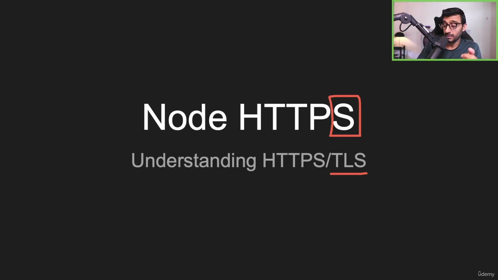
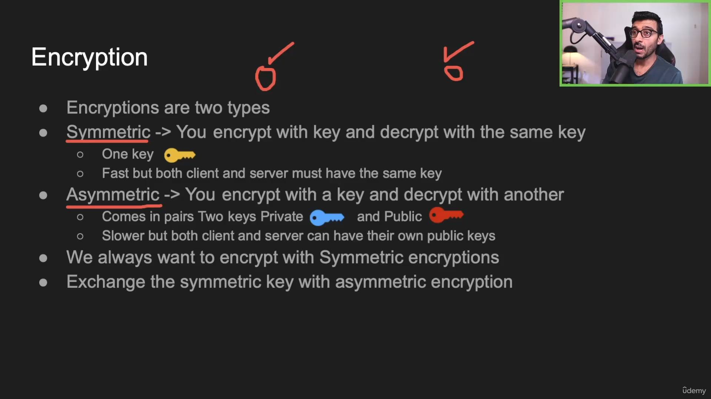
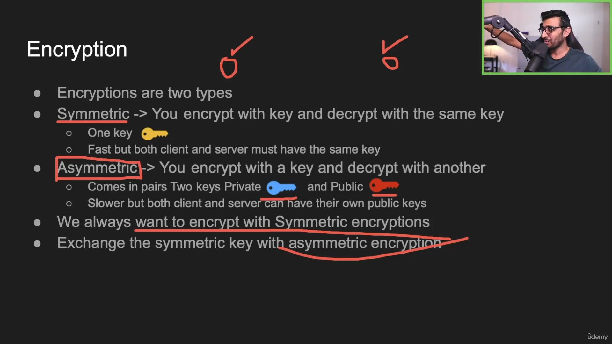
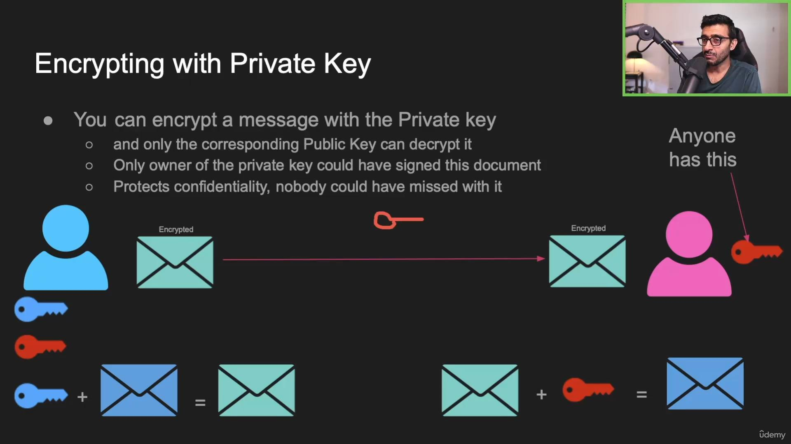
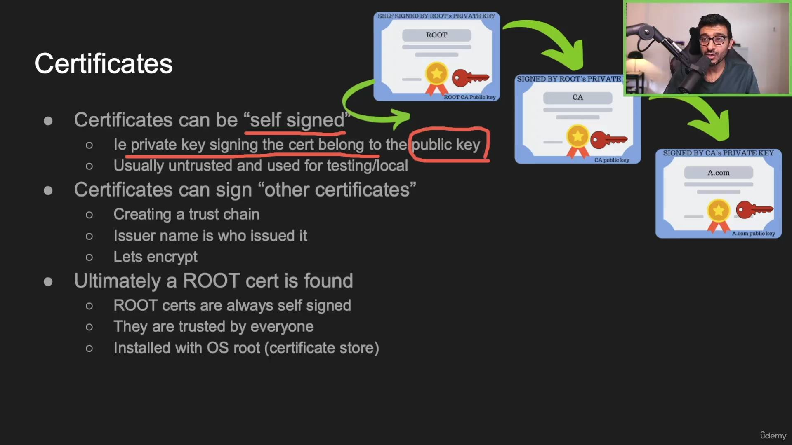
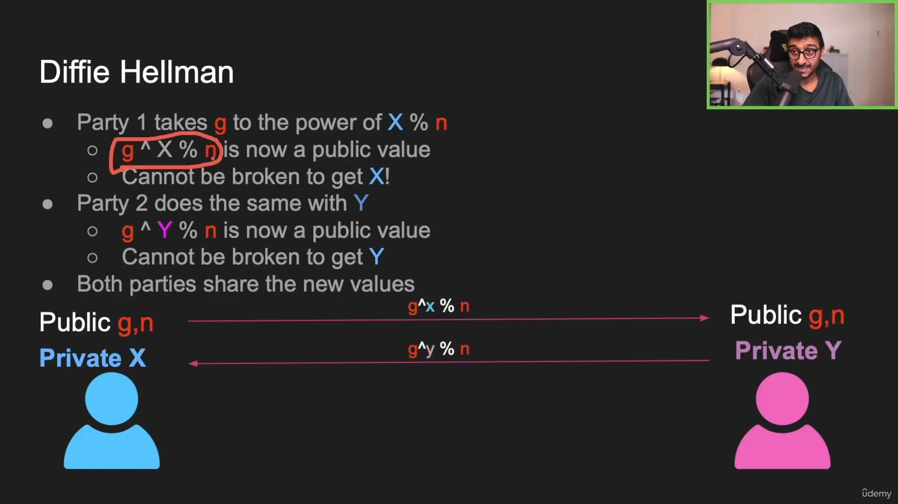
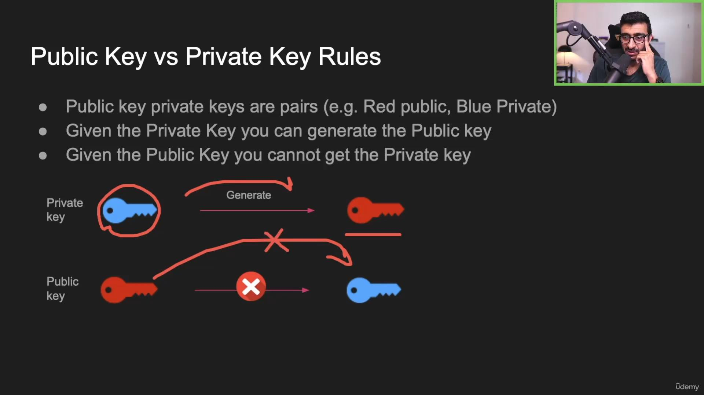
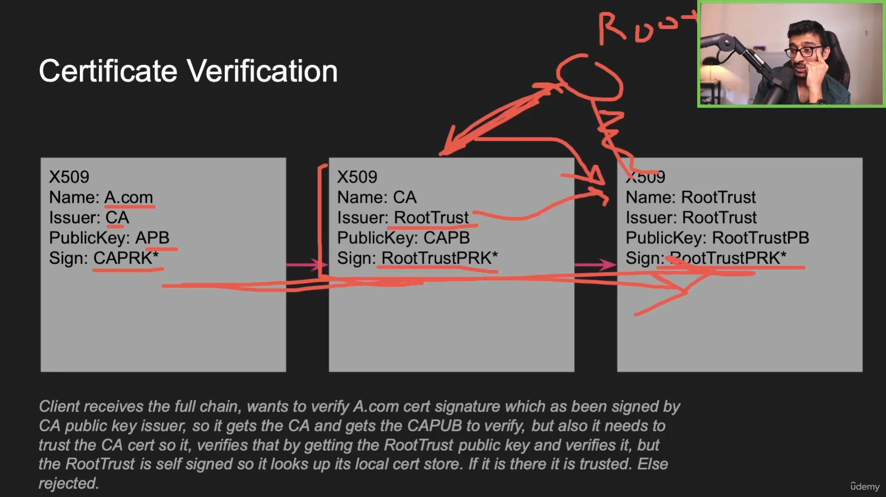
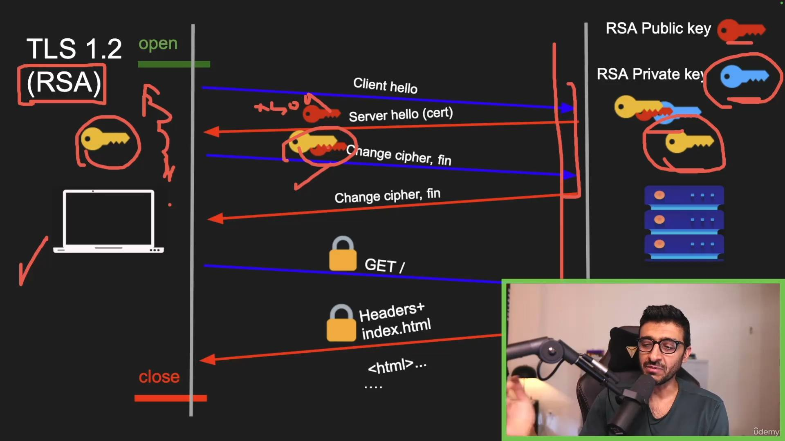
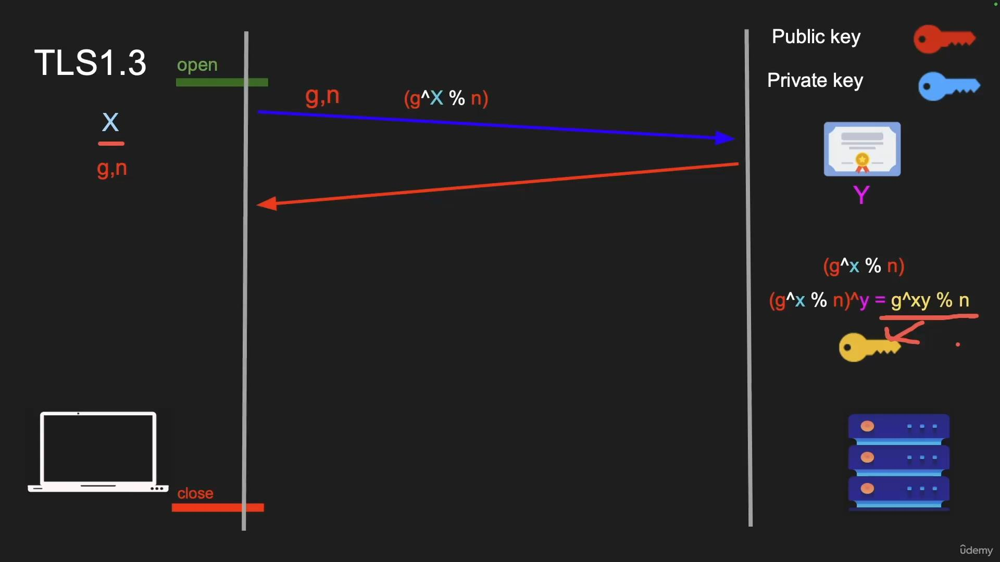

# NodeJS Internals P027：HTTPS、TLS、证书与 Node HTTPS Server 复现

> 课程：NodeJS Internals（BV1jGRyBsEBa）  
> 覆盖：P027  
> 本节产物：一个本地可运行的 HTTPS 服务、一个 HTTPS 客户端、一套自签证书，以及用 `curl` 观察 TLS 握手的方法。  
> 读者假设：前端转 AI 应用工程师，会写 JS，但不熟悉后端/TLS。涉及并发时本文会补一句 Node/JS 对应关系；本节没有数据库锁和事务。

---

## 1. 这一节做什么

这一节不是泛泛讲“HTTPS 就是 HTTP 加 S”，而是把 HTTPS 拆成可以动手复现的三件事：

1. **理解加密边界**：HTTPS 加密的是“客户端到它实际连接到的那个服务端”之间。如果中间有 CDN、反向代理、API Gateway，它们必须解密再转发，也就是所谓“终止 TLS”。所以 HTTPS 不等于端到端加密，具体要看链路怎么部署。
2. **理解两类加密和证书**：对称加密快，但双方要先有同一把钥匙；非对称加密解决“怎么安全交换钥匙/怎么证明身份”，但计算贵；证书本质上是“带元数据的公钥”，再通过证书链让你信任它。
3. **在 Node 里跑起来**：用 OpenSSL 生成私钥和自签证书，用 `https.createServer({ key, cert })` 起服务，用 `https.request` 发请求，用 `curl --insecure` 验证本地自签服务。课里还讲了 TLS 1.2 的 RSA 密钥交换、Diffie-Hellman、前向保密、TLS 1.3 更快的原因，这些是理解“为什么代码这样写”的背景。



这一节最后跑出来的东西不复杂：一个监听 `8443` 的 HTTPS 服务，返回 `hello HTTPS`；一个 Node 客户端信任本地证书并请求它；以及用 `curl` 观察握手。复杂的是背后 TLS 做的事，但代码入口很少。

---

## 2. 讲师原话（带「—— pNNN [MM:SS]」）

下面摘录的是这一节里对“为什么这样做”最关键的原话。英文保留原话，后面用中文解释，不按页码流水账排列。

> "我们需要对它加密，因为不想让任何中间人嗅探我们发出的请求和响应，尤其是互联网服务提供商……"
> —— p027 [00:29]

讲师先把动机说清楚：HTTP 是明文请求/响应，中间网络设备可以看。HTTPS 是在 HTTP 和 TCP 之间加一层 TLS，让字节在传输前被加密。注意讲师说的是“不要中间人嗅探”，不是“HTTPS 保证任何链路都端到端”。

> "内核只知道 IP 和端口，然后就把字节发出去。这些字节恰好是加密的。内核并不关心……"
> —— p027 [01:26]

这句话很重要：加密不是内核 TCP 层做的。内核只管 IP、端口、发字节；TLS 在用户态/应用侧完成。到了 Node 里，TLS 握手和加解密由 Node 底层的 OpenSSL 处理，JS 层拿到的是已经解密后的请求对象。所以后面写 `https.createServer` 时，处理函数里看到的 `req` 已经是解密后的内容。

> "对称加密……你用一把密钥加密内容，再用同一把密钥解密内容。"
> —— p027 [05:13]

对称加密一把钥匙，加密解密都用它。优点是快，适合大量数据；难点是“怎么让双方安全地拿到同一把钥匙”。这就是后面 TLS 要解决的问题。



> "非对称加密……有两把密钥，一把负责加密，一把负责解密，而且可以互换。"
> —— p027 [09:00]

非对称加密有一对钥匙：公钥和私钥。公钥加密只能私钥解，私钥加密只能公钥解。前者用来保护“只有对方能看”的内容，后者用来做数字签名、证明“确实是我发的”。讲师也强调非对称计算贵，不适合直接加密大文件。



> "证书不过是用来承载公钥的元数据。"
> —— p027 [20:00]

证书不是神秘东西，核心就是“公钥 + 元数据 + 签名”。元数据里包括版本、签名算法、签发者、主题、Subject Alternative Name 等。讲师特别强调 Subject Alternative Name 是“网站名”所在的位置。你连接 `example.com`，服务端返回的证书里必须能匹配这个域名，否则客户端不认。



> "TLS 的安全性在于使用同一个密钥加密，客户端和服务端都是如此。TLS 就是这么工作的。TLS 使用的是对称密钥……也就是会话密钥。"
> —— p027 [31:01]

真正加密 HTTP 报文用的是对称密钥，也就是会话密钥。TLS 握手的目的就是：认证服务端身份，并让双方安全地得到同一把会话密钥。非对称加密和证书是为这个目标服务的，不是拿来直接加密整个网页的。



> "Diffie Hellman 解决了这个问题……我们根本不在通信中发送对称密钥。"
> —— p027 [40:27]

TLS 1.2 的 RSA 密钥交换有一个问题：客户端把会话密钥用服务端公钥加密后发过去。攻击者可以先记录密文，等某天服务端私钥泄漏，再回头解密历史流量。这叫不具备完美前向保密。Diffie-Hellman 不传输会话密钥本身，而是双方交换参数，各自算出同一个数，所以攻击者即使后来拿到私钥，也不能直接解出过去记录的会话密钥。



> "请求还没到我们这里，就已经被解密了。"
> —— p027 [51:31]

这是 Node HTTPS server 代码最关键的一句。你在 `https.createServer` 的回调里写业务逻辑时，TLS 已经完成，`req` 是解密后的 HTTP 请求。你不需要在业务代码里手动解密。

> "curl 不信任我，老兄。……用 --insecure。"
> —— p027 [57:24]

本地自签证书不会被系统证书库信任，所以 `curl https://localhost:8443` 会报证书错误。课里给的两个方向是：用 `--insecure` 跳过校验快速测试，或者把证书导入系统/Node 的信任库。注意 `--insecure` 只适合本地测试。

---

## 3. 从零复现

### 3.1 前置环境

课里在 Unix 风格终端演示，使用 Node 16 一系。逐字稿里写了一个类似 `16.1.6.0` 的版本号，这不是标准版本号格式，实际以你本机 `node -v` 为准。本复现不依赖 npm 包，只用 Node 内置模块和系统 OpenSSL。

你需要：

- Node.js：课里用 Node 16 一系；实际用当前 LTS 也可以，代码兼容。
- OpenSSL：系统自带，用来生成私钥和自签证书。
- curl：用来验证 HTTPS 服务。
- 一个终端；如果要同时跑服务端和客户端，最好两个终端。

检查命令：

```bash
node -v
openssl version
curl --version
```

本项目**不需要环境变量**，端口在代码里固定为 `8443`。课里没有讲环境变量配置，这里也不额外引入。

### 3.2 创建项目目录

```bash
mkdir nodejs-internals-https
cd nodejs-internals-https
```

最终目录结构：

```text
nodejs-internals-https/
├── .gitignore
├── package.json
├── gen-cert.sh
├── server.js
├── client.js
├── private-key.pem   # 生成，不要提交
└── certificate.pem   # 生成，不要提交
```

`private-key.pem` 和 `certificate.pem` 是运行 `gen-cert.sh` 后生成的。课里明确说私钥不能推到 GitHub，所以 `.gitignore` 要忽略 PEM 文件。

### 3.3 生成私钥和自签证书

课里原话是先生成私钥，再用私钥生成证书：

```bash
openssl genrsa -out private-key.pem 4096
```

讲师在演示时把密钥长度提高到 4096。课里也提到 2048、4096 这些位数，位数越大越难破，但计算也更贵。

然后生成自签证书：

```bash
openssl req -new -x509 \
  -key private-key.pem \
  -out certificate.pem \
  -days 365
```

执行后会交互式询问 Country Name、State、Locality、Common Name、Email 等。课里填的是示例值：`US`、`CA`、`Manama`，Common Name 填 `localhost`。Common Name 是最重要的字段之一，因为你本地访问的是 `localhost`。

课里还提到 `--verify false`，但后面实测时用的是 `--insecure`。curl 实际可用的是 `--insecure` 或 `-k`；`--verify false` 不是这里要照抄的命令。



为了自动化复现，本文提供一个 `gen-cert.sh`，它用 `-subj` 免交互，并额外加了 `subjectAltName`。**注意：`-subj` 和 `-addext` 是复现补全，不是讲师逐字讲过的命令。** 课里是交互式输入；现代浏览器和 Node 对 SAN 更严格，所以脚本里补了 `DNS:localhost,IP:127.0.0.1`。如果你用的是很老的 OpenSSL，可能不支持 `-addext`，届时删掉这一行并手动处理 SAN，或者用 `--insecure`/`rejectUnauthorized: false` 做本地测试。

### 3.4 启动 HTTPS 服务

先写 `server.js`（完整代码在第 4 节）。启动：

```bash
node server.js
```

预期终端打印：

```text
HTTPS server running on https://localhost:8443
```

服务端会读取项目根目录的 `private-key.pem` 和 `certificate.pem`，然后监听 8443。课里说“the rest is identical”，确实：除了把 `http` 换成 `https`、多传 `{ key, cert }`，请求处理函数和普通 HTTP server 一样。

### 3.5 用 curl 验证

另开一个终端，在项目根目录执行：

```bash
curl --insecure https://localhost:8443/
```

应该看到：

```text
hello HTTPS
```

如果你不加 `--insecure`：

```bash
curl https://localhost:8443/
```

会因为自签证书不被信任而失败。这是预期行为，不是服务没起来。课里演示时也遇到这个错误，然后给出两个方向：`--insecure` 跳过校验，或把证书加入信任库。

想看 TLS 握手细节，用：

```bash
curl -v --insecure https://localhost:8443/
```

`-v` 会输出连接、TLS 握手、证书等信息。具体字段名和行数以你的 curl/OpenSSL 版本为准，不要死记输出格式。课里还用 `curl -v https://example.com` 观察真实站点的证书链、TLS 版本、ALPN 等信息。

### 3.6 运行 Node HTTPS 客户端

```bash
node client.js
```

预期输出包含：

```text
statusCode: 200
headers: { ... }
hello HTTPS
response ended
```

`client.js` 通过 `ca` 选项把本地 `certificate.pem` 当作受信任的 CA，从而完成自签证书校验。课里没有展开这个具体选项的写法，只说了“可以让 Node 信任这个证书”。这里是为了让复现闭环而补的代码；如果你想快速跑通，也可以把 `ca` 换成 `rejectUnauthorized: false`，但那只适合本地测试。

### 3.7 可选：观察真实站点

课里用：

```bash
curl -v https://example.com
```

观察真实 HTTPS 握手。你的网络环境可能受代理影响，输出以实际为准。重点不是背字段，而是建立直观：TCP 连接之后还要做 TLS 握手，证书验证、密钥交换、加密算法协商都在这里发生。

---

## 4. 完整代码

下面每个文件都可以直接保存。代码没有省略号。

### 4.1 `package.json`

```json
{
  "name": "nodejs-internals-https",
  "version": "1.0.0",
  "private": true,
  "description": "Local HTTPS server/client reproduction for NodeJS Internals P027",
  "scripts": {
    "gen-cert": "bash gen-cert.sh",
    "server": "node server.js",
    "client": "node client.js"
  },
  "engines": {
    "node": ">=16"
  }
}
```

本项目没有 npm 依赖，所以不需要 `npm install`。`engines` 只是提示；课里用 Node 16 一系，实际建议用仍然维护的 LTS。

### 4.2 `.gitignore`

```gitignore
private-key.pem
certificate.pem
node_modules/
```

私钥绝对不能提交。课里专门提到不要 push PEM。

### 4.3 `gen-cert.sh`

```bash
#!/usr/bin/env bash
set -euo pipefail

# 生成 4096 位 RSA 私钥。
# 课里用的就是 openssl genrsa，演示时把长度提高到 4096。
openssl genrsa -out private-key.pem 4096

# 生成自签 X.509 证书。
# 课里是交互式输入 Country/State/Locality/Common Name/Email；
# 下面用 -subj 免交互，字段是示例值，可自行修改。
#
# -addext 是复现补全：现代浏览器/Node 对 Subject Alternative Name 更严格。
# 如果你的 OpenSSL 不支持 -addext，删掉这一行，并在本地测试时使用
# curl --insecure 或 Node 的 rejectUnauthorized: false。
openssl req -new -x509 \
  -key private-key.pem \
  -out certificate.pem \
  -days 365 \
  -subj "/C=US/ST=CA/L=Manama/O=Local Dev/CN=localhost" \
  -addext "subjectAltName=DNS:localhost,IP:127.0.0.1"

echo "generated: private-key.pem, certificate.pem"
```

运行：

```bash
bash gen-cert.sh
```

如果你希望完全按课里的交互式流程，可以不用脚本，直接执行 3.3 里的两条命令，然后按提示输入。

### 4.4 `server.js`

```js
'use strict';

const https = require('https');
const fs = require('fs');
const path = require('path');

const PORT = 8443;

// 课里强调：HTTPS server 需要私钥和证书。
// 私钥不能发给客户端；证书会发给客户端。
const key = fs.readFileSync(path.join(__dirname, 'private-key.pem'));
const cert = fs.readFileSync(path.join(__dirname, 'certificate.pem'));

const server = https.createServer({ key, cert }, (req, res) => {
  // 课里说：request is decrypted before we even get here.
  // 这里拿到的 req 已经是解密后的 HTTP 请求。
  console.log(`${req.method} ${req.url}`);

  res.writeHead(200, {
    'Content-Type': 'text/plain; charset=utf-8'
  });
  res.end('hello HTTPS\n');
});

server.listen(PORT, () => {
  console.log(`HTTPS server running on https://localhost:${PORT}`);
});
```

### 4.5 `client.js`

```js
'use strict';

const https = require('https');
const fs = require('fs');
const path = require('path');

const options = {
  hostname: 'localhost',
  port: 8443,
  path: '/',
  method: 'GET',

  // 让 Node 信任本地自签证书。
  // 课里只讲了“可以让 Node 信任该证书”，没有展开这个选项；
  // 这是为了让复现闭环补的代码。
  ca: fs.readFileSync(path.join(__dirname, 'certificate.pem')),

  // 用于 SNI 和主机名校验。
  servername: 'localhost'
};

const req = https.request(options, (res) => {
  console.log('statusCode:', res.statusCode);
  console.log('headers:', res.headers);

  res.setEncoding('utf8');
  res.on('data', (chunk) => {
    process.stdout.write(chunk);
  });
  res.on('end', () => {
    console.log('response ended');
  });
});

req.on('error', (err) => {
  console.error('request error:', err);
  process.exitCode = 1;
});

req.end();
```

### 4.6 运行顺序汇总

终端 A：

```bash
cd nodejs-internals-https
bash gen-cert.sh
node server.js
```

终端 B：

```bash
cd nodejs-internals-https
curl --insecure https://localhost:8443/
node client.js
```

如果你在 Windows 上，`gen-cert.sh` 用 Git Bash/WSL 运行；或者手动执行两条 `openssl` 命令。课里是在 Unix 风格终端演示的，没有讲 Windows 路径差异。

---

## 5. 逐行解释

### 5.1 为什么先生成私钥，再生成证书

```bash
openssl genrsa -out private-key.pem 4096
```

`genrsa` 生成 RSA 私钥，`-out` 指定输出文件，`4096` 是密钥长度。课里说密钥本质上是很大的数字，位数越大越难破，但非对称运算越贵。演示用 4096 是为了更安全；本地测试用 2048 也能跑，但既然课里演示了 4096，复现就保持一致。

```bash
openssl req -new -x509 \
  -key private-key.pem \
  -out certificate.pem \
  -days 365
```

`req` 是证书请求工具，`-new` 表示新建请求，`-x509` 表示直接输出自签 X.509 证书，`-key` 指定用哪把私钥签名，`-out` 指定证书输出文件，`-days 365` 是有效期。课里说证书是 X.509 标准；自签的意思是“这张证书的签发者就是它自己”，所以通常不被系统信任。

`-subj` 和 `-addext` 是复现补全：`-subj` 把交互式字段一次性写死；`-addext "subjectAltName=DNS:localhost,IP:127.0.0.1"` 把 localhost 写进 SAN。讲师在讲证书时强调过 Subject Alternative Name 是“网站名”所在的位置；但生成自签证书的命令里没有逐字给出 SAN 参数，所以这里明确标注是补全。

### 5.2 `server.js` 逐行

```js
const https = require('https');
```

Node 内置的 `https` 模块。课里区分了 HTTP client/server 和 HTTPS client/server：`https` 不是简单改个名字，它要在 `http` 之上做 TLS。讲师说 Fetch/Axios 之类高层库和底层 `http`/`https` 不是一回事；在 Node 里，`http` 和 `https` 是两个模块，HTTPS 多了 TLS 逻辑。

```js
const fs = require('fs');
const path = require('path');
```

读证书文件用 `fs`，拼路径用 `path`。`path.join(__dirname, ...)` 保证从脚本所在目录找文件，不依赖你从哪个目录启动。

```js
const key = fs.readFileSync(path.join(__dirname, 'private-key.pem'));
const cert = fs.readFileSync(path.join(__dirname, 'certificate.pem'));
```

课里就是用 `readFileSync` 读私钥和证书。私钥只在启动时读一次，不要放到每个请求处理函数里；这相当于“临界资源只初始化一次”。在 JS/Node 里没有数据库锁/事务的概念，这里只是一次同步文件读取，启动阶段做没问题。

`cert` 在课里被称为“full chain”位置：生产环境有时要把中间 CA 一起发给客户端，客户端没有中间 CA 时才不会断链。课里说“你可以发 full chain，它会更大，但支持更多客户端”。本地自签只有一个证书文件，不涉及中间链。

```js
const server = https.createServer({ key, cert }, (req, res) => {
```

`https.createServer` 的第一个参数是 TLS 选项，`{ key, cert }` 是课里明确讲的两个必需项；第二个参数是请求处理函数。讲师说“HTTPS server 需要 certificate、public key、private key，你需要两者；其余都一样”。公钥在证书里，私钥单独给服务端。

```js
console.log(`${req.method} ${req.url}`);
```

业务日志。注意这里拿到的 `req` 已经是解密后的 HTTP 请求对象。课里原话：“The request is decrypted before we even get here.” TLS 解密发生在你进入回调之前。

```js
res.writeHead(200, { 'Content-Type': 'text/plain; charset=utf-8' });
res.end('hello HTTPS\n');
```

普通 HTTP 响应写法，和 HTTP server 没区别。HTTPS 的“S”不改变业务处理方式。

```js
server.listen(PORT, () => {
  console.log(`HTTPS server running on https://localhost:${PORT}`);
});
```

监听 8443。课里演示端口就是 8443。端口可以换，但换了之后 `curl` 和 `client.js` 也要同步改。课里没有讲环境变量，所以这里写死。

### 5.3 `client.js` 逐行

```js
const req = https.request(options, (res) => {
```

`https.request` 发起 HTTPS 请求。课里演示 raw HTTPS request 时就是引用 `https` 库，然后 `https.request`。它和 `http.request` 的 API 形状类似，但底层多 TLS。

```js
hostname: 'localhost',
port: 8443,
path: '/',
method: 'GET',
```

这些是 HTTP 请求目标。课里说 HTTPS client 不需要自己准备证书，因为证书是服务端的事；客户端要做的是验证服务端证书。本地自签场景下，客户端默认不信任，所以要额外给信任链。

```js
ca: fs.readFileSync(path.join(__dirname, 'certificate.pem')),
```

把本地自签证书作为受信任的 CA 传给 Node。课里没有逐字讲 `ca` 这个选项，只说了“可以让 Node 信任这个证书”。这是复现补全。生产环境不应该把某个自签证书硬编码成信任根，除非你明确知道自己在做什么。

```js
servername: 'localhost'
```

用于 SNI 和主机名校验。证书 SAN 里有 `localhost`，所以能匹配。如果没有 SAN，现代 Node 可能报主机名不匹配；这也是为什么 `gen-cert.sh` 补了 SAN。

```js
console.log('statusCode:', res.statusCode);
console.log('headers:', res.headers);
```

输出响应状态码和响应头。这两个字段名来自本代码块，不是从讲师输出里抄的。你实际运行看到的值以本地服务为准。

```js
res.setEncoding('utf8');
res.on('data', (chunk) => {
  process.stdout.write(chunk);
});
res.on('end', () => {
  console.log('response ended');
});
```

以流的方式读响应体。Node 的响应是流，数据可能分块到达；不要假设一次 `data` 就能拿到全部内容。课里在讲 HTTP 时提过请求/响应是流式协议，这里正好对应。

```js
req.on('error', (err) => {
  console.error('request error:', err);
  process.exitCode = 1;
});
req.end();
```

错误处理和结束请求。如果服务端没启动、端口不对、证书校验失败，会走 `error`。`process.exitCode = 1` 让脚本以失败状态退出，方便脚本化检查。

### 5.4 关于证书链和“为什么 curl 不信任我”

课里用很长一段讲证书链：叶子证书由中间 CA 签，中间 CA 由根 CA 签，根证书在系统证书库里，所以信任可以一路传下来。自签证书是自己签自己，链的顶端不在你的系统证书库里，所以 curl 默认拒绝。



这也解释了为什么 `curl --insecure` 能跑：它跳过证书校验，不管链是否可信。课里同时给了另一条路：把证书导入系统证书库，或者让 Node 显式信任它。前者影响面更大，后者更适合本地项目。

课里还提到 CDN/代理会“终止 TLS”：客户端和 CDN 之间是 HTTPS，CDN 解密后看到内容，再重新加密发给后端。所以“浏览器地址栏有锁”不等于“从浏览器到最终后端全程只有后端能解密”。这一点在部署 AI 应用、调用第三方 API 时同样要留意。

### 5.5 TLS 1.2、Diffie-Hellman 和 TLS 1.3 的关系

课里用 TLS 1.2 的 RSA 密钥交换做教学示例：客户端用服务端公钥加密会话密钥，服务端用私钥解。这个流程能工作，但没有完美前向保密：攻击者可以先录流量，等私钥泄漏再解密历史会话。Heartbleed 就是讲师举的例子：内存泄漏导致私钥可能被读走。



Diffie-Hellman 不传输会话密钥本身，而是交换参数，双方各自算出同一个数。讲师用 `g`、`n`、`x`、`y` 和模运算解释：公开 `g`、`n`、`g^x mod n`、`g^y mod n`，攻击者很难从这些值推出 `x`、`y` 或最终密钥。这样即使私钥后来泄漏，过去记录的会话密钥也不直接暴露。



TLS 1.3 在这个方向上更进一步：减少往返，参数一次性发，服务端用自己的私钥对握手消息签名，客户端先用证书链验证公钥可信，再验证签名。课里说“TLS 1.3 is much faster because we just send something everything we need right there right in one shot”。这些是理解 HTTPS 性能成本的基础，但落到 Node 代码，仍然只是 `https.createServer` 和 `https.request`。

---

## 6. 复现检查清单

按顺序打勾：

- [ ] `node -v` 有输出；课里用 Node 16 一系，你的版本不低于 16 即可。
- [ ] `openssl version` 有输出。
- [ ] 项目目录中有 `server.js`、`client.js`、`gen-cert.sh`、`package.json`、`.gitignore`。
- [ ] 执行 `bash gen-cert.sh` 后生成 `private-key.pem` 和 `certificate.pem`。
- [ ] `private-key.pem` 没有被提交到 Git；`.gitignore` 已包含它。
- [ ] 终端 A 执行 `node server.js`，看到 `HTTPS server running on https://localhost:8443`。
- [ ] 终端 B 执行 `curl --insecure https://localhost:8443/`，看到 `hello HTTPS`。
- [ ] 终端 B 执行 `curl https://localhost:8443/`（不加 `--insecure`）会失败，这是自签证书不被信任的预期结果。
- [ ] 终端 B 执行 `curl -v --insecure https://localhost:8443/`，能看到 TLS 握手/证书相关信息；具体字段以实际输出为准。
- [ ] 终端 B 执行 `node client.js`，看到 `statusCode: 200`、响应头、`hello HTTPS`、`response ended`。
- [ ] 停掉服务端后再执行 `node client.js`，能看到 `request error:` 开头的错误，说明错误处理生效。
- [ ] 如果端口 8443 被占用，换一个端口，并同步修改 `server.js`、`client.js` 和 curl 命令。

这张清单的目标不是“看过”，而是“你真的把本地 HTTPS 服务跑起来，并且亲眼看到自签证书被拒绝、再用 `--insecure` 或显式信任跑通”。

---

## 7. 课里没讲但你会撞上的

这一节是复现补全，不是讲师原话。课里重点讲原理和最小示例，下面这些是实际动手时容易卡住的地方。

1. **现代浏览器/Node 对 SAN 更严格**  
   课里生成自签证书时主要提 Common Name，但现代 TLS 客户端更看重 Subject Alternative Name。如果证书只有 CN 没有 SAN，Chrome 或 Node 可能报主机名不匹配。本文的 `gen-cert.sh` 用 `-addext` 补了 SAN；课里没有逐字给这个参数，所以这是复现补全。旧版 OpenSSL 可能不支持 `-addext`，需要换方式或本地用 `--insecure`。

2. **`curl --insecure` 和 `rejectUnauthorized: false` 只适合本地**  
   课里用 `--insecure` 快速绕过自签证书错误，但生产环境不能这么做。Node 客户端里如果图省事写 `rejectUnauthorized: false`，等于关闭证书校验，会暴露在中间人攻击下。本文 `client.js` 用 `ca` 显式信任本地证书，相对更接近“信任指定证书”的做法，但生产环境仍然应该用正规 CA 签发的证书。

3. **私钥权限和 Git 忽略**  
   课里说私钥不能 push。实际还要注意文件权限，Unix 下可以 `chmod 600 private-key.pem`。不要把私钥打进 Docker 镜像、前端 bundle 或日志。私钥泄漏后，证书链和加密都白搭。

4. **Node 16 已经停止维护**  
   课里用 Node 16 一系演示，但 Node 16 已 EOL。实际项目建议用当前 LTS。本文代码只用 `https`、`fs`、`path`，在新版本 Node 上也能跑。如果遇到 OpenSSL 3 的警告或命令差异，以你本机 `openssl version` 和 `node -v` 为准。

5. **`curl` 可能受代理环境影响**  
   如果你的终端设置了 `HTTPS_PROXY` 之类的代理，`curl https://localhost:8443` 可能不走本地直连，导致连接失败或证书行为异常。可以临时检查代理环境变量，或给 localhost 加 `--noproxy`。课里没有讲代理，这是实际环境差异。

6. **端口 8443 可能被占用**  
   如果启动时报端口占用，换一个端口，并同步改 `server.js`、`client.js` 和 curl 命令。课里固定用 8443，没有讲端口冲突处理。

7. **full chain 和中间证书**  
   课里提到生产环境有时要发送 full chain，因为客户端证书库可能没有中间 CA。本地自签只有一个证书文件，不涉及中间链；但部署到真实域名时，证书文件通常要包含叶子证书和中间 CA。这个具体配置课里没有展开，遇到时看证书颁发机构给的说明。

8. **HTTP/2 和 HTTPS 的关系**  
   课里提到 `curl -v https://example.com` 时看到 ALPN 和 HTTP/2 的信息，也提到“要上 HTTP/2 通常要有 HTTPS”。但 Node 里怎么起 HTTP/2 server、怎么协商 ALPN，这一节没有讲。本文只复现 HTTPS/1.1 的最小闭环，不把 HTTP/2 代码硬塞进来。

9. **mTLS（双向 TLS）只提了一句**  
   课里说客户端也可以带证书，服务端可以验证客户端，这叫 mutual TLS。但具体怎么生成客户端证书、怎么在 Node 里配置 `requestCert` 等，课里没有展开。本文不编造这部分实现。

10. **CDN/网关会终止 TLS**  
    课里专门讲了：你看到的 HTTPS 可能只加密到 CDN 或 API Gateway，后面那一段是重新加密或明文。部署 AI 应用时，如果前面挂 Cloudflare、Nginx、云厂商网关，要搞清楚 TLS 在哪终止、私钥放在哪、后端链路是否也加密。这不是代码问题，是部署拓扑问题。

---

### 最后一句

这一节的信息量很大，但落到可运行产物其实很小：**一把私钥、一张证书、一个 `https.createServer`、一个 `https.request`、一条 `curl --insecure`**。先把这套跑通，再回头看证书链、TLS 1.2/1.3、Diffie-Hellman，就不会觉得它们是悬在空中的名词。课里说“你不可能跳过这些直接传个证书就完事”，复现一遍之后，这句话会具体很多。