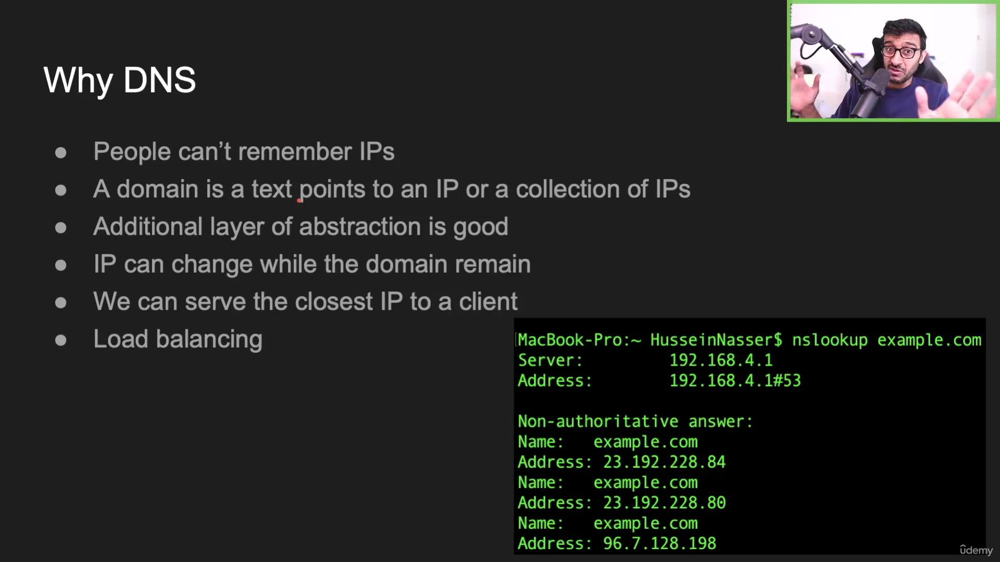
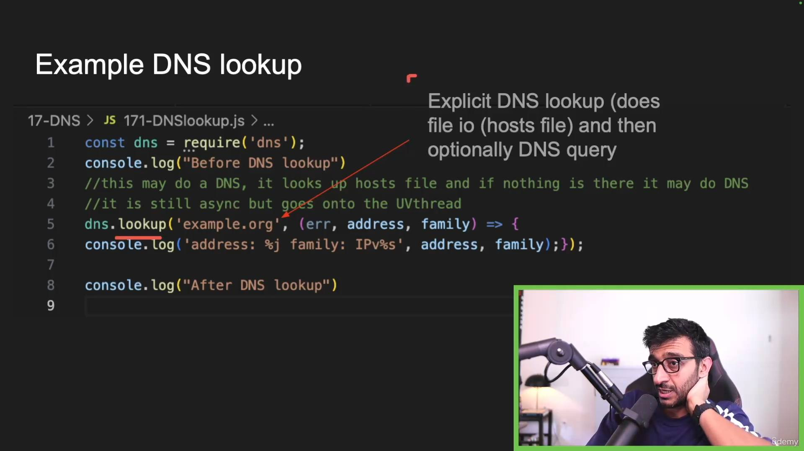
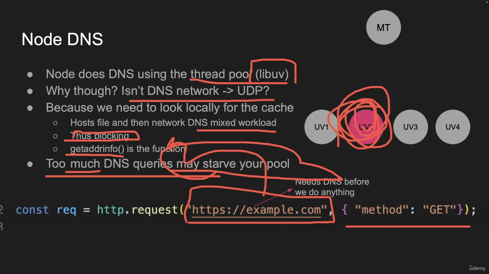
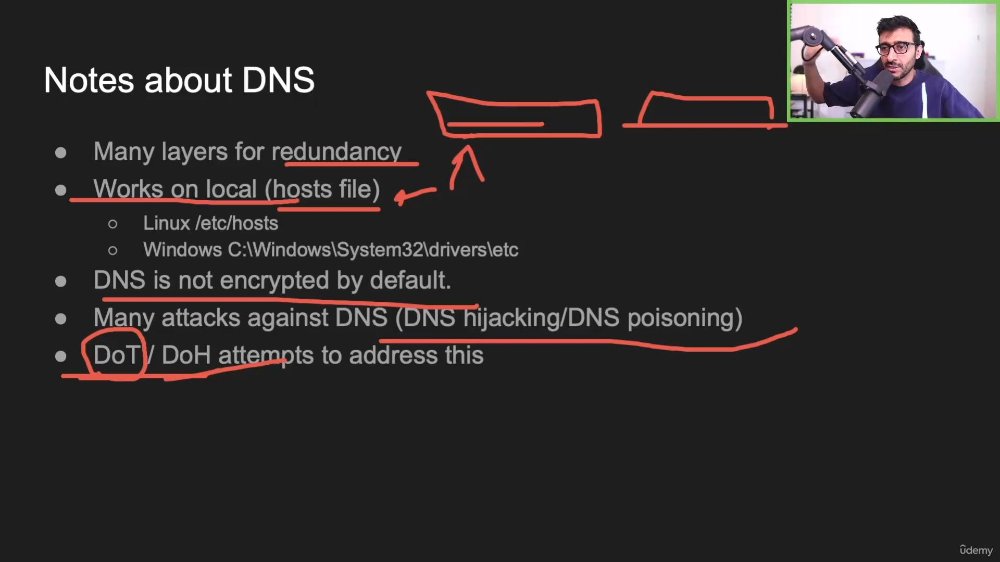
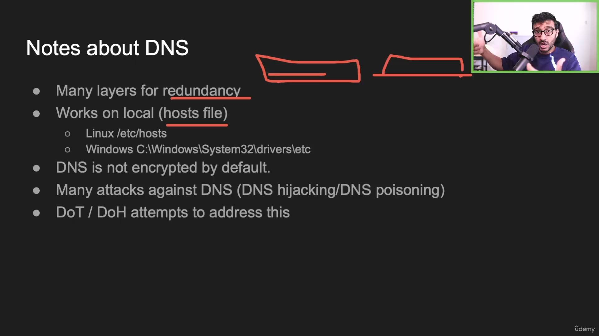
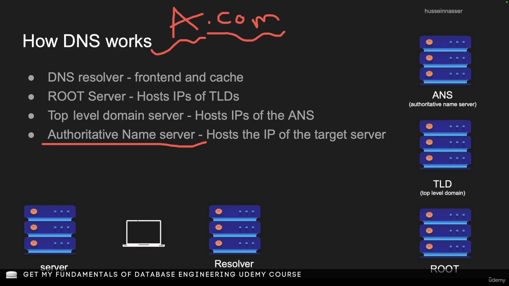
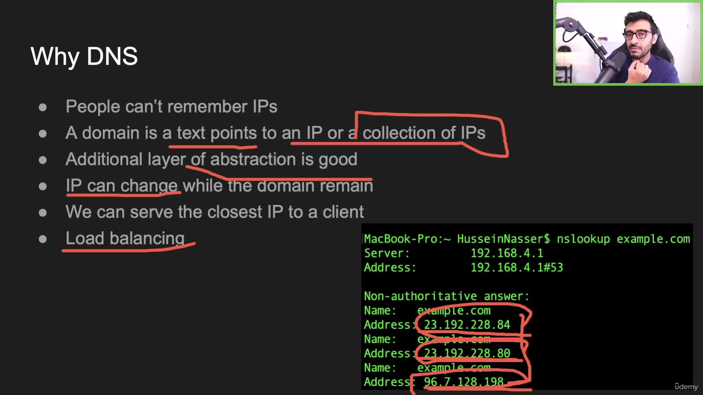
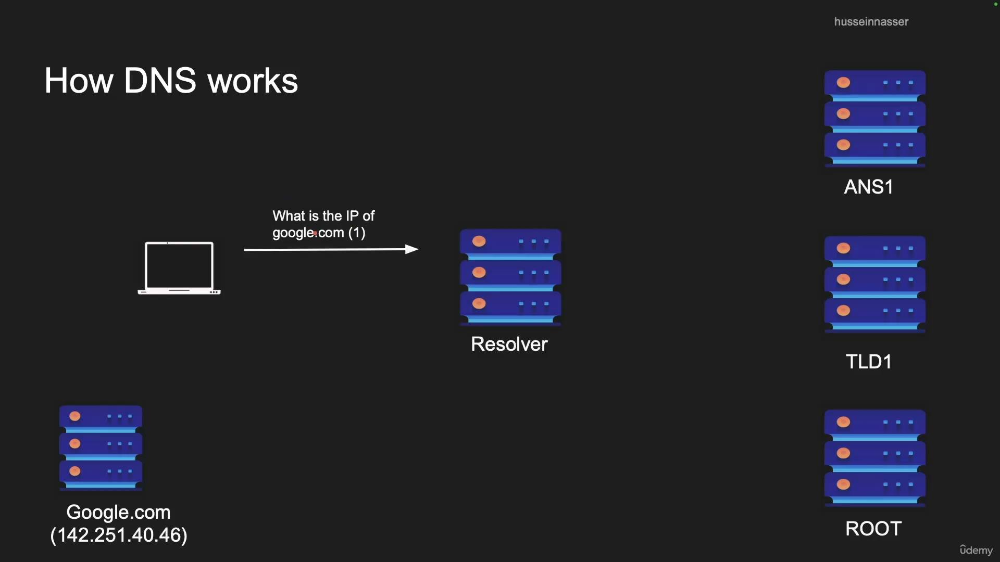
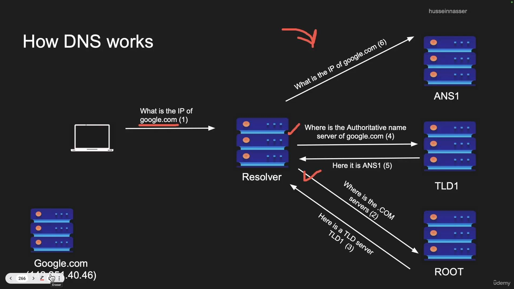

# NodeJS 第 28 节：DNS 与 Node 中的 DNS 解析复现

## 1. 这一节做什么

这一节不做一个完整业务项目，而是做一个**可观察的 DNS 实验项目**：在 Node 里分别触发隐式 DNS、显式 `dns.lookup`、显式 `dns.resolve4`，再用两个 `server.listen` 变体复现「绑定 8080」和「绑定 localhost:8080」的行为差异。

读者完成后应该能回答四个问题：

1. 为什么 `http.get('http://example.com')` 在建立 TCP 连接前，背后已经发生了一次 DNS 查询？
2. `dns.lookup` 和 `dns.resolve4` 在 Node 里到底差在哪，为什么一个会走线程池、一个走网络异步 IO？
3. 为什么 `server.listen(8080)` 和 `server.listen(8080, 'localhost')` 的可用性不一样？
4. 为什么讲师反复说「it's always DNS」——DNS 的分层、缓存、权威名称服务器到底在整条链路里承担什么角色？

课里没有讲 Node 版本、没有讲安装步骤、也没有给出完整可保存的工程文件；下面第 3、4 节会把逐字稿里的示例整理成可直接运行的 `node-dns-demo` 项目。

---

## 2. 讲师原话（带「—— p028 [MM:SS]」）

讲师先解释 DNS 的本质：

> “We come to a piece of technology that is called DNS and it's being used implicitly even if we don't explicitly call it from the code.”
>
> —— p028 [00:00]

> “We created this concept to essentially create an additional layer of abstraction... now I can simply provide a name and that name is all what I need to remember example.com that then points to the IP address.”
>
> —— p028 [00:55]

讲师强调 DNS 不只是「名字换 IP」，还免费带来负载均衡和冗余：

> “Not only I can provide one machine, but I can provide 10. Why not? And I can do load balancing between them. I can do redundancy.”
>
> —— p028 [01:24]

> “And these are called a records, which is the one the IPv4.”
>
> —— p028 [01:52]

讲师把 DNS 和 ARP 做类比，说明「引入新地址体系就必须有映射」：

> “When you want to send a frame to an IP address... you need to know the destination MAC address... So we have ARP for that address resolution protocol.”
>
> —— p028 [07:06]

> “You cannot establish a TCP connection without knowing the IP address. And so then the lack of knowledge of the IP address... we need a mapping system. And that's why we need DNS.”
>
> —— p028 [07:35]

讲师解释 DNS 为什么必须分区，而不是一台机器存所有域名：

> “The internet is massive... that database might be petabytes... The best way to work with a billion raw records is to avoid working with that billion raw records... And that's what DNS did. They partitioned it.”
>
> —— p028 [11:29]

> “We're gonna put all the hosts for .com in one bucket. The TLD, the top level domains, tells us the IP addresses of these .com domains.”
>
> —— p028 [12:52]

讲师说明 TLD 之后还要再查权威名称服务器：

> “If you go to the top lever domain and ask for example.com, you're not gonna get the answer... Added something called authoritative name server. This is an IP address of the name server that knows the actual IP address.”
>
> —— p028 [13:49]

讲师解释 DNS 查询的逐层过程：

> “Root tells us the top-level domains... then you query that and .com says okay what are you interested in... it will tell you the authoritative name server... And it will tell you the IP address of example.com and you can connect to it.”
>
> —— p028 [14:18]

讲师用 Microsoft 和 Facebook 的故障说明权威名称服务器是单点：

> “The authoritative name server of all of Microsoft just went down... this step failed because it couldn't get the Google IP... That's why people say it's always DNS.”
>
> —— p028 [19:32]

讲师解释 DNS 报文为什么需要 transaction ID：

> “The transaction ID is an identifier that you create as a client... when someone responds back to you with the answer they put the transaction ID in the same in their message.”
>
> —— p028 [22:51]

讲师解释 host 文件优先级：

> “A host file is a hard-coded instance on your operating system that tells you, hey, I want you to ignore the DNS and always map this entry to this IP.”
>
> —— p028 [26:11]

讲师说明 Node 的 DNS 为什么走线程池：

> “In node, we're using the thread pool. And this is done by with lab UV... The DNS is being done on the thread pool. And the reason we're doing it because you're using this function, that's called a get address info, which reads both locations to read our host file. If it's not there, then it does the resolving right on the network.”
>
> —— p028 [31:19]

讲师区分钟 lookup 和 resolve：

> “The lookup, the DNS lookup, which is the default, reads the file, the host file. If it's not there, it does a network. But then there is something called resolve. DNS resolve only goes to the network. It never checks the host file.”
>
> —— p028 [34:14]

讲师给出服务器绑定坑：

> “There is a difference between doing server.listen with just a port and doing server.listen with an actual name... if you specify what IP address, what host to actually do the lockup, sometimes we need to do DNS, especially for local hosts.”
>
> —— p028 [37:35]

> “Because localhost does not mean 1 2 7 0 0 1 it means whatever localhost happened to resolve to right.”
>
> —— p028 [47:17]

---

## 3. 从零复现

### 3.1 环境准备

课里没有讲 Node 版本。下面示例只用 Node 内置模块 `http`、`dns`、`net`，不安装任何第三方依赖。推荐 Node 18 及以上；如果你的 Node 版本更老，`dns.lookup`、`dns.resolve4`、`server.listen` 这些 API 依然可用。课里没有要求环境变量，也没有要求 Docker。

```bash
# 检查 Node 和 npm
node -v
npm -v
```

### 3.2 创建项目目录

```bash
mkdir node-dns-demo
cd node-dns-demo
npm init -y
```

最终目录结构如下（全部文件在第 4 节给出）：

```text
node-dns-demo/
├── package.json
├── 01-implicit-http.js
├── 02-dns-lookup.js
├── 03-dns-resolve.js
├── 04-bind-8080.js
├── 05-bind-localhost.js
└── 06-connect-test.js
```

### 3.3 先理解 DNS 分层，再跑代码

讲师在 [11:12] 左右用 PPT 讲 DNS 的分区设计：根服务器 → TLD 服务器 → 权威名称服务器。这里先复述成一张文字流程图，方便后面看代码输出时知道自己在哪一层：

```text
客户端 / Node
   │  1. 查 host 文件（lookup 才会查）
   │  2. 问 DNS Resolver（例如 1.1.1.1、8.8.8.8、路由器、ISP）
   ▼
Resolver
   │  3. 问 Root Server：.com 的 TLD 服务器在哪？
   │  4. 问 .com TLD Server：example.com 的权威名称服务器在哪？
   │  5. 问 Authoritative Name Server：example.com 的 A 记录是什么？
   ▼
拿到 IP → 建立 TCP 连接
```



讲师还提到 A 记录、AAAA 记录、MX 记录、TXT 记录、CNAME 记录。课里没有逐个演示查询这些记录类型，下面只复现逐字稿里实际出现的 `dns.lookup` 和 `dns.resolve4`，不额外编造 CNAME 查询代码。

### 3.4 运行隐式 DNS 示例

```bash
node 01-implicit-http.js
```

这个脚本用 `http.get('http://example.com')` 发起请求。逐字稿 [40:28] 之后讲师用 `strace -f -t` 看到 `getaddrinfo` 被调用，然后才看到 UDP 的 DNS 请求。我们不需要 `strace` 也能在回调里看到请求完成；如果你想看 DNS 调用，可以在 Linux/macOS 上用：

```bash
strace -f -t -e trace=network node 01-implicit-http.js
```

课里没有要求必须用 `strace`；它只是讲师用来观察系统调用的工具。



### 3.5 运行显式 `dns.lookup`

```bash
node 02-dns-lookup.js
```

预期会打印类似：

```text
lookup example.com => address=93.184.216.34 family=4
```

具体 IP 以你本机 DNS 解析结果为准。讲师在 [36:37] 说 `lookup` 会返回 “the address the family which is IPv4 or whatever”，所以代码里打印 `address` 和 `family`。

### 3.6 运行显式 `dns.resolve4`

```bash
node 03-dns-resolve.js
```

预期会打印一个 IPv4 地址数组：

```text
resolve4 example.com => [ '93.184.216.34' ]
```

同样，IP 以实际输出为准。讲师在 [37:06] 说 `resolve4` “always going network”，不走 host 文件。

### 3.7 复现 `server.listen` 绑定差异

先运行：

```bash
node 04-bind-8080.js
```

这个脚本会在 8080 端口监听，然后进入一个很大的同步循环，模拟「事件循环还没开始跑，但绑定已经完成」。另开一个终端：

```bash
node 06-connect-test.js
```

或者用系统命令：

```bash
telnet 127.0.0.1 8080
```

逐字稿 [45:49] 说：虽然初始阶段没结束，server 已经 ready，所以能连上。

再运行：

```bash
node 05-bind-localhost.js
```

它使用 `server.listen(8080, 'localhost')`。因为 `localhost` 需要先做 DNS 解析，可能解析到 `::1` 或 `127.0.0.1`，所以另一个终端连接 `127.0.0.1:8080` 可能失败，连接 `localhost:8080` 可能成功。逐字稿 [47:17] 的原话是：

> “localhost does not mean 1 2 7 0 0 1 it means whatever localhost happened to resolve to right.”



---

## 4. 完整代码

下面每个文件都可以直接保存运行。没有省略号。

### 4.1 `package.json`

```json
{
  "name": "node-dns-demo",
  "version": "1.0.0",
  "private": true,
  "description": "Reproduce DNS lookup/resolve and server.listen binding behavior from the NodeJS course",
  "scripts": {
    "implicit": "node 01-implicit-http.js",
    "lookup": "node 02-dns-lookup.js",
    "resolve": "node 03-dns-resolve.js",
    "bind8080": "node 04-bind-8080.js",
    "bind-localhost": "node 05-bind-localhost.js",
    "connect-test": "node 06-connect-test.js"
  }
}
```

### 4.2 `01-implicit-http.js`

```js
const http = require('http');

const target = 'http://example.com';

console.log(`[01] before http.get: ${target}`);

const req = http.get(target, (res) => {
  console.log(`[01] response statusCode=${res.statusCode}`);
  console.log(`[01] response headers.host=${res.headers.host}`);

  res.setEncoding('utf8');
  let body = '';

  res.on('data', (chunk) => {
    body += chunk;
  });

  res.on('end', () => {
    console.log(`[01] response body length=${body.length}`);
    console.log('[01] implicit DNS lookup finished before TCP connection');
  });
});

req.on('error', (err) => {
  console.error('[01] request error:', err.message);
});

req.setTimeout(10000, () => {
  console.error('[01] request timeout after 10s');
  req.destroy();
});
```

### 4.3 `02-dns-lookup.js`

```js
const dns = require('dns');

const hostname = 'example.com';

console.log(`[02] dns.lookup start: ${hostname}`);

dns.lookup(hostname, (err, address, family) => {
  if (err) {
    console.error('[02] dns.lookup error:', err.message);
    return;
  }

  console.log(`[02] dns.lookup result: address=${address} family=${family}`);
  console.log('[02] lookup 会先查 host 文件，再走 DNS；底层使用 getaddrinfo');
});
```

### 4.4 `03-dns-resolve.js`

```js
const dns = require('dns');

const hostname = 'example.com';

console.log(`[03] dns.resolve4 start: ${hostname}`);

dns.resolve4(hostname, (err, addresses) => {
  if (err) {
    console.error('[03] dns.resolve4 error:', err.message);
    return;
  }

  console.log('[03] dns.resolve4 result:', addresses);
  console.log('[03] resolve4 只走网络 DNS，不查 host 文件');
});
```

### 4.5 `04-bind-8080.js`

```js
const http = require('http');

const server = http.createServer((req, res) => {
  res.writeHead(200, { 'Content-Type': 'text/plain; charset=utf-8' });
  res.end('hello from listen(8080)\n');
});

server.listen(8080, () => {
  console.log('[04] server.listen(8080) callback: server is ready');
});

console.log('[04] server.listen(8080) called; now blocking the main thread with a long loop');

// 故意用同步长循环阻塞主线程，模拟事件循环还没开始跑。
// 逐字稿里讲师说：虽然初始阶段没结束，绑定已经发生了，所以外部仍然能连上。
let sum = 0;
for (let i = 0; i < 1e10; i++) {
  sum += i;
}

console.log('[04] long loop finished, sum=', sum);
```

### 4.6 `05-bind-localhost.js`

```js
const http = require('http');

const server = http.createServer((req, res) => {
  res.writeHead(200, { 'Content-Type': 'text/plain; charset=utf-8' });
  res.end('hello from listen(8080, "localhost")\n');
});

server.listen(8080, 'localhost', () => {
  console.log('[05] server.listen(8080, "localhost") callback: server is ready');
});

console.log('[05] server.listen(8080, "localhost") called; now blocking the main thread with a long loop');

// 同样用同步长循环阻塞主线程。
// 注意：localhost 要先做 DNS 解析，可能解析到 ::1 或 127.0.0.1。
let sum = 0;
for (let i = 0; i < 1e10; i++) {
  sum += i;
}

console.log('[05] long loop finished, sum=', sum);
```

### 4.7 `06-connect-test.js`

```js
const net = require('net');

function tryConnect(host, port) {
  return new Promise((resolve) => {
    const socket = net.connect({ host, port }, () => {
      console.log(`[06] connected to ${host}:${port}`);
      socket.end();
      resolve(true);
    });

    socket.setTimeout(1500);

    socket.on('timeout', () => {
      console.log(`[06] timeout connecting to ${host}:${port}`);
      socket.destroy();
      resolve(false);
    });

    socket.on('error', (err) => {
      console.log(`[06] failed to connect to ${host}:${port} => ${err.message}`);
      resolve(false);
    });
  });
}

(async () => {
  await tryConnect('127.0.0.1', 8080);
  await tryConnect('localhost', 8080);
})();
```

---

## 5. 逐行解释

### 5.1 `01-implicit-http.js`：隐式 DNS 在哪里发生

- `const http = require('http');`  
  使用 Node 内置 HTTP 模块。讲师在 [35:12] 说：“I'm requesting a Node.js here, an HTTP. I'm sending a request and I'm doing an HTTP example.com.” 这里就是复现这个隐式请求。

- `const target = 'http://example.com';`  
  这里故意写域名而不是 IP。只要写域名，Node 在建立 TCP 连接前就必须先解析出 IP。讲师在 [08:04] 说：“You cannot establish a TCP connection without knowing the IP address.” 这句话是整段代码的前提。

- `const req = http.get(target, (res) => { ... });`  
  这一行表面是发 HTTP GET，实际上 Node 内部会先调用 `getaddrinfo`。讲师在 [31:19] 说 Node 的 DNS 走 `get address info`，并且因为要读 host 文件，所以走 libuv 线程池。你在 `strace` 里会先看到文件读取/`getaddrinfo`，再看到 UDP 的 DNS 报文，最后才看到 TCP 连接。

- `console.log(\`[01] response statusCode=${res.statusCode}\`);`  
  这里只打印 `statusCode`，不打印未验证字段。逐字稿里没有逐字段讲 HTTP 响应结构，所以不额外编造。

- `res.on('data')` / `res.on('end')`  
  标准流式读取响应体。课里没有展开流（stream）细节，这里只是为了确认请求真正完成。

- `req.setTimeout(10000, ...)`  
  防止网络环境不通时脚本一直挂着。课里没讲超时设置，这是复现时需要的保护。



### 5.2 `02-dns-lookup.js`：lookup 为什么可能阻塞线程池

- `const dns = require('dns');`  
  引入 Node 内置 DNS 模块。

- `dns.lookup(hostname, (err, address, family) => { ... })`  
  这是逐字稿 [34:14] 说的 “DNS lookup, which is the default, reads the file, the host file. If it's not there, it does a network.” 也就是说 `lookup` 的路径是：先查 host 文件 → 没有再走网络 DNS。它底层对应 `getaddrinfo`，而 `getaddrinfo` 会做文件 IO，所以 Node 把它放到 libuv 线程池里。

- `address` 和 `family`  
  讲师在 [36:37] 明确说 lookup 会给出 “the address the family which is IPv4 or whatever”。`family=4` 表示 IPv4，`family=6` 表示 IPv6。这里只打印这两个字段，不打印 `hints` 等课里没讲的字段。

- 为什么说它可能“阻塞线程池”？  
  在 JS/Node 里，主线程仍然是异步的；但 libuv 线程池默认只有 4 个线程（课里没讲默认值，这里只提醒概念）。如果同时发起大量 `dns.lookup`，这些任务会排队占满线程池，导致文件 IO 等其他线程池任务也被拖慢。讲师在 [33:15] 说：“too many dns queries may starve your thread pool.” 这就是对应点。

### 5.3 `03-dns-resolve.js`：resolve 为什么不查 host 文件

- `dns.resolve4(hostname, (err, addresses) => { ... })`  
  逐字稿 [34:42] 说：“DNS resolve only goes to the network. It never checks the host file.” `resolve4` 只查 A 记录（IPv4）。它不走 `getaddrinfo`，而是直接发 DNS 查询，所以走的是网络异步 IO，不占 libuv 线程池的文件 IO 路径。

- `addresses` 是数组  
  因为一个域名可以有多条 A 记录。讲师在 [01:24] 说 DNS 可以返回 10 台机器、可以做负载均衡和冗余。`resolve4` 返回数组正好体现这一点。

- 和 `lookup` 的取舍  
  如果你要“尊重操作系统 host 文件”，用 `lookup`；如果你要“绕过 host 文件，直接问 DNS”，用 `resolve4`。讲师在 [34:14] 把这条差异讲得很清楚。课里没有讲 `dns.resolveMx`、`dns.resolveTxt` 的具体代码，所以这里不展开。



### 5.4 `04-bind-8080.js`：为什么长循环时还能连上

- `server.listen(8080, callback)`  
  只传端口，不传 host。Node 会创建 socket 并绑定到所有可用 IP。逐字稿 [38:04] 说：“This binds immediately because it tells node to listen and subsequently the kernel to listen, to create a socket and bind it to all IP addresses that you can find.”

- 后面的 `for (let i = 0; i < 1e10; i++)`  
  这是故意阻塞主线程，模拟事件循环还没开始跑。讲师在 [45:49] 说：“Although the initial phase didn't finish, this server is ready.” 也就是说，`listen` 的绑定动作在事件循环之前已经完成，所以外部 `telnet 127.0.0.1 8080` 能连上。

- 注意：这个循环会让脚本看起来“卡住”，这是预期行为。按 `Ctrl+C` 结束。

### 5.5 `05-bind-localhost.js`：localhost 不是 127.0.0.1 的同义词

- `server.listen(8080, 'localhost', callback)`  
  这里多传了 `'localhost'`。Node 需要先把 `localhost` 解析成 IP，再绑定。逐字稿 [38:32] 说：“even look local host is a DNS look out... it could be calling one.” 也就是说 `localhost` 可能解析到 `::1`（IPv6）或 `127.0.0.1`（IPv4），取决于系统 host 文件。

- 为什么连接 `127.0.0.1:8080` 可能失败  
  如果 `localhost` 被解析成 `::1`，服务器只监听 IPv6 回环地址，那么 `127.0.0.1` 就连不上。逐字稿 [47:17] 的原话是：“localhost does not mean 1 2 7 0 0 1 it means whatever localhost happened to resolve to right.”

- 这也是「DNS 不只影响浏览器，还影响服务器绑定」的典型例子。课里没有讲如何强制 IPv4，只提醒了这个 gotcha。

### 5.6 `06-connect-test.js`：用代码替代 telnet

- `net.connect({ host, port }, ...)`  
  逐字稿里讲师用 `telnet 127.0.0.1 8080` 测试。这里用 Node 的 `net` 模块做同样的事，方便跨平台。

- `socket.setTimeout(1500)`  
  防止连接一直挂着。课里没讲超时值，这里只是复现用的保护。

- 先测 `127.0.0.1` 再测 `localhost`  
  这样能直接看出两个绑定脚本的差异。

### 5.7 回到 DNS 原理：分区、缓存、transaction ID

讲师在 [11:29] 说 DNS 必须分区，因为「a billion raw records」不能塞进一台机器。对应到代码里，`dns.resolve4` 之所以能工作，是因为它背后有 Resolver 逐层问 Root → TLD → Authoritative Name Server。课里没有让我们手写 DNS 报文，所以第 4 节没有构造原始 UDP 包；但你在 `strace` 里看到的 UDP 53 端口请求，就是 Resolver 链路的一部分。

讲师在 [22:51] 讲 transaction ID：因为 DNS 基于 UDP，不是天然的一问一答，所以客户端要生成 query ID，响应回来时带同一个 ID，才能把响应和请求对上。这个机制在 Node 的 `dns.resolve4` 里由底层实现，应用层看不到。课里没有讲 Node 如何暴露 transaction ID，所以代码里不打印它。

讲师在 [24:45] 说 DNS 有很多层、很多权威名称服务器，是为了冗余和负载分散。这也是为什么 `resolve4` 可能返回多个 IP：一个域名可以有多条 A 记录。



---

## 6. 复现检查清单

运行完上面脚本后，逐项检查：

- [ ] `node -v` 能正常输出，`npm init -y` 成功生成 `package.json`。
- [ ] `01-implicit-http.js` 能打印 `response statusCode=...`，说明隐式 DNS + TCP + HTTP 全链路走通。
- [ ] 在 Linux/macOS 上执行 `strace -f -t -e trace=network node 01-implicit-http.js`，能看到 DNS 相关的 UDP 请求（课里用 `strace` 观察，不是必须）。
- [ ] `02-dns-lookup.js` 能打印 `address=... family=4` 或 `family=6`；具体值以你机器实际解析为准。
- [ ] `03-dns-resolve.js` 能打印一个数组，数组里是 IPv4 地址；具体 IP 以实际输出为准。
- [ ] 运行 `04-bind-8080.js` 后，另开终端执行 `node 06-connect-test.js`，`127.0.0.1:8080` 能连接成功。
- [ ] 运行 `05-bind-localhost.js` 后，`06-connect-test.js` 中 `127.0.0.1:8080` 可能失败、`localhost:8080` 可能成功；具体取决于你的 `localhost` 解析到 `::1` 还是 `127.0.0.1`。
- [ ] 检查系统 host 文件：Linux/macOS 是 `/etc/hosts`，Windows 是 `C:\Windows\System32\drivers\etc\hosts`。课里没有讲 Windows 路径，这里只作为复现提示。
- [ ] 如果你修改了 host 文件，再跑 `02-dns-lookup.js` 和 `03-dns-resolve.js`，观察 `lookup` 是否受影响、`resolve4` 是否不受影响。课里明确说 `resolve` 不查 host 文件。



---

## 7. 课里没讲但你会撞上的

1. **Node 版本差异**  
   课里没讲 Node 版本。`dns.lookup`、`dns.resolve4`、`server.listen` 在 Node 18+ 都可用；如果你用更老的版本，API 形态基本一致，但错误信息可能不同。

2. **`localhost` 解析到 IPv6**  
   课里只提醒「localhost 不一定等于 127.0.0.1」，但没有讲怎么改。你可能会遇到服务器只监听 `::1`，而客户端连 `127.0.0.1` 失败。可以用 `server.listen(8080, '127.0.0.1')` 强制 IPv4，但课里没有这样写。

3. **DNS 缓存**  
   课里提到 Resolver 有缓存、DNS 记录有 TTL，但没有讲 Node 进程内是否缓存。实测 `dns.lookup` 和 `dns.resolve4` 的行为可能受操作系统 Resolver 缓存影响；如果你反复运行脚本看到同一个 IP，不一定是 Node 缓存。

4. **线程池饿死**  
   课里说「too many dns queries may starve your thread pool」，但没有给具体阈值。libuv 线程池默认大小不是本节内容；如果你在高并发服务里大量使用 `dns.lookup`，要留意这一点。`dns.resolve4` 不走 `getaddrinfo` 的文件 IO 路径，但它仍然走网络，不代表可以无限并发。

5. **host 文件权限**  
   课里说 host 文件可以用来把 `DB1` 指到新 IP，但没有讲修改权限。Linux/macOS 修改 `/etc/hosts` 通常需要 `sudo`；Windows 需要管理员权限。这是复现时会撞上的操作问题。

6. **`server.listen` 的长循环不是生产写法**  
   第 4 节的 `for (let i = 0; i < 1e10; i++)` 只是为了复现「绑定已完成、事件循环未开始」的现象。生产代码不要这样阻塞主线程；在 JS/Node 里，主线程阻塞会让所有回调、定时器、IO 事件都停摆。

7. **DNS over HTTPS / DNS over TLS**  
   讲师在 [29:04] 之后提到 DOH 和 DOT，但明确说这块“it's a mess”，没有展开代码。本节不实现 DOH/DOT，也不把这两者安到 Node 内置 `dns` 模块上；课里没有讲 Node 如何配置 DOH。

8. **`strace` 不是所有系统都有**  
   讲师用 `strace` 观察 `getaddrinfo` 和 UDP 请求。macOS 默认没有 `strace`，可以用 `dtruss` 或 Instruments；Windows 更没有。课里没有讲跨平台抓取方式，所以第 3 节只把它标为可选观察手段，不放进必做步骤。





---

**复现结论**：这一节的核心不是写一个业务系统，而是用最小 Node 脚本把 DNS 的「隐式查询」「lookup vs resolve」「server.listen 绑定坑」三件事跑出来。跑完 `01` 到 `06` 六个文件，再对照第 6 节检查清单，就能把讲师在 p028 里讲的 DNS 行为从「听懂」变成「亲眼看到」。