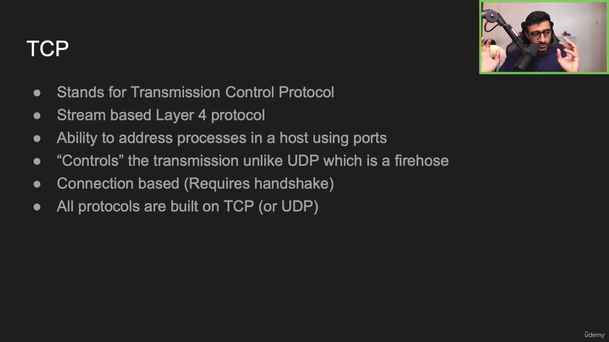
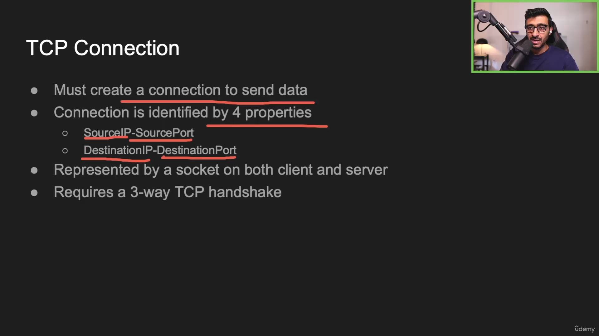
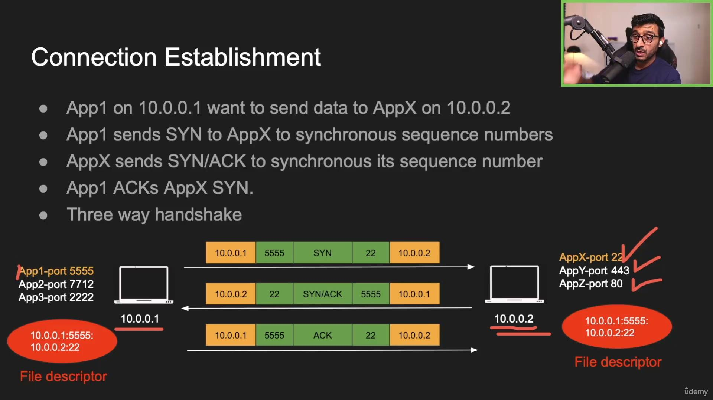
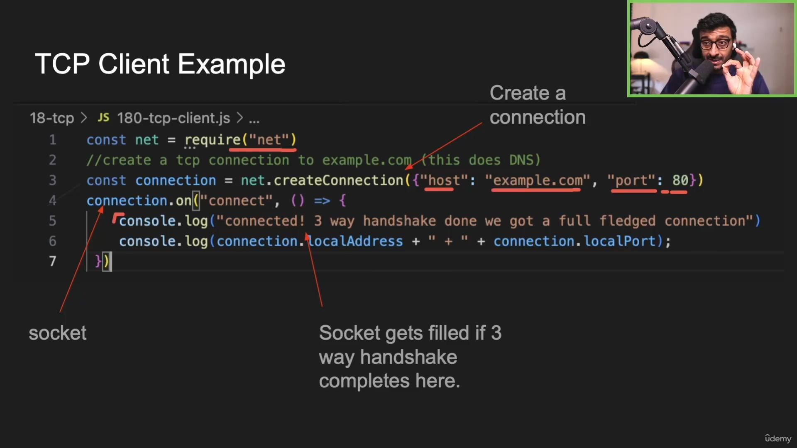
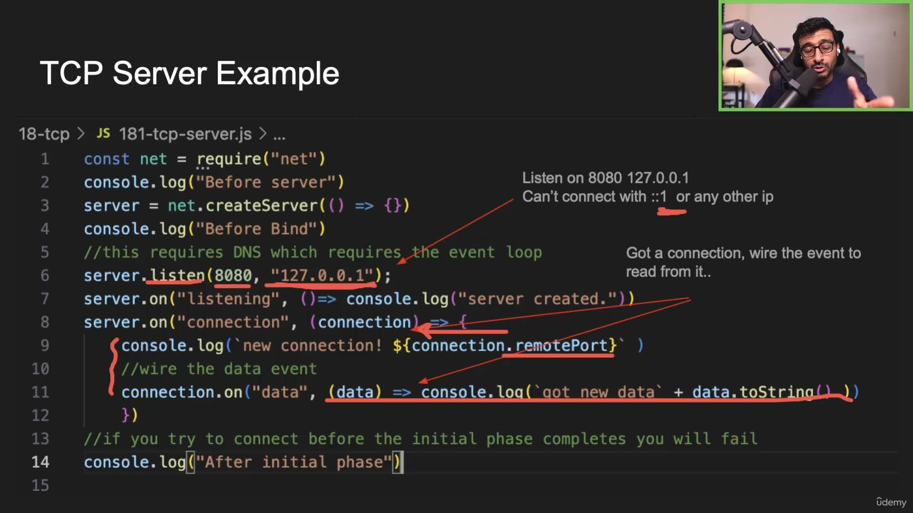
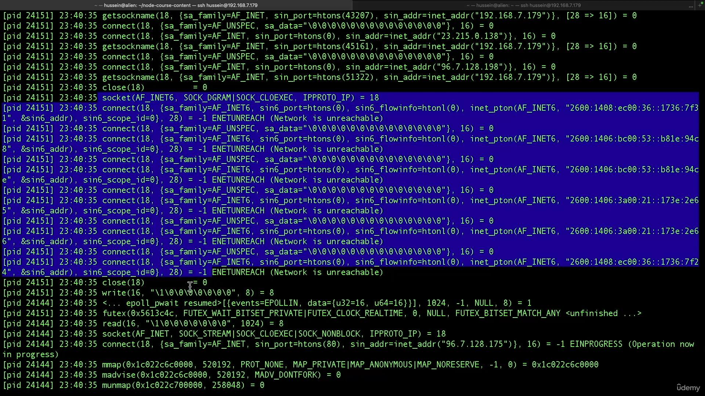

## 1. 这一节做什么

这一节（p029）做的是一个可以亲手验证的 **Node.js TCP 实验**：先用 `net` 模块写一个 TCP 客户端和一个 TCP 服务端，再用 `tcpdump` 抓包，亲眼看到三次握手、数据发送、ACK、FIN 关闭，以及“监听地址”到底如何决定谁能连进来。

学完并照着做完，你应该得到三个可运行文件：

```text
node-tcp-lab/
├── package.json
├── tcp-client.js
├── tcp-server.js
└── tcp-server-all.js
```

以及两组可复现的实验现象：

1. `tcp-client.js` 连接 `example.com:80`，手写一个 HTTP/1.1 请求，终端能打印响应；`tcpdump` 能看到 `Flags [S]`、`Flags [S.]`、`Flags [.]`、`Flags [P.]` 等过程。
2. `tcp-server.js` 只监听 `127.0.0.1:8080`，所以只有本机 loopback 能连；改成不传 host 的 `tcp-server-all.js` 后，局域网 IP 也能连。讲师用这个对比解释“bind 到哪个 IP”就是“只允许谁连”。

这一节不是泛泛介绍 TCP 协议，而是把 TCP 放回 Node 的 `net` 模块里：**服务端创建 listening socket，客户端创建 connection socket，内核负责握手、排序、ACK、重传，Node 只负责在 event loop 里接收“连接已建立”“有数据可读”这些事件**。讲师反复强调“everything is just packets at the end of the day”，以及理解这些是有成本的：“there is a cost to everything”。



---

## 2. 讲师原话（带「—— pNNN [MM:SS]」）

下面只摘关键句，英文保留原话，后面用中文说明它在项目里的落点。

> "TCP 是一种非常优雅的协议，几乎所有与网络相关的东西都构建在它之上，比例大概有 99%。"
> —— p029 [00:55]

讲师先把 TCP 定位成绝大多数应用协议的底座：HTTP、TLS、HTTPS、SSH 等都在 TCP 之上；DNS 常规走 UDP，但 DOH 走 TCP。这个定位决定了后面实验的重点不是“写业务”，而是看字节如何从本机文件描述符流到网络另一侧。

> "使用源 IP、源端口、目的 IP、目的端口这四个参数，就能唯一标识进入该特定应用程序的数据包。"
> —— p029 [01:23]

四元组是整节的骨架。客户端有源 IP/源端口，服务端有目的 IP/目的端口；两边各有一个 socket。你在 Node 里写 `host` 和 `port`，本质上是在补全目的半边；源半边通常由内核自动选一个临时端口。



> "TCP 的实现内置于操作系统内核中。"
> —— p029 [06:08]

这句话非常重要：三次握手、ACK、重传、排序不是 Node 写的，是内核 TCP/IP 栈做的。Node 的 `net` 只是把 socket 文件描述符包成 JS 事件。所以你在 JS 里看不到“发 SYN”的 API，只能看到 `connect` 回调和 `data` 事件。

> "TCP 段不是消息，不能当作工作单元来处理。"
> —— p029 [12:23]

一个 HTTP 请求可能被拆成多个 TCP segment；一个 `data` 回调也不保证等于一条完整消息。后面写 server 时，`socket.on('data')` 收到的只是“当前读到的一段字节”，不是“一条请求”。

> "Node 的 TCP 通过 net 模块对外暴露。"
> —— p029 [28:29]

Node 的 TCP 入口是 `require('node:net')`。HTTP 等模块底层也会用到它；本节直接用它写 client/server，是为了把“协议头”剥掉，只观察 TCP 本身。

> "绑定本质上就是在特定 IP 和特定端口上监听。"
> —— p029 [31:20]

`server.listen(port, host)` 的 `host` 不是“客户端要连的地址”，而是“服务端只在这个地址上接受连接”。讲师的例子是只绑定 `127.0.0.1`，于是用局域网 IP 连会失败；去掉 host 后，所有地址都能连。

> "我们会使用 tcpdump 命令……sudo tcpdump -i ... -n。"
> —— p029 [34:39]

实验部分用 `tcpdump` 抓包，`-i` 指定网卡，`-n` 表示不把地址解析成域名。讲师特别踩了一个坑：监听 loopback 时如果抓的是以太网卡，就抓不到，要抓 `lo`。



---

## 3. 从零复现

### 3.1 环境与目录

课里使用的是 Node 18 这一代环境，命令行是 Linux 风格（讲师用了 `ip address show` 找网卡）。你本地需要：

- Node.js 18 或更高版本（`node -v` 确认）。
- 一个终端工具；服务端实验课里用的是 `telnet`。
- `tcpdump`（Linux/macOS）。Windows 原生没有 `tcpdump`，课里没讲 Windows 方案；你可以用 Wireshark 代替抓包，但本文命令按 Linux/macOS 写。
- 抓包需要管理员权限，所以命令前有 `sudo`。

创建目录：

```bash
mkdir -p ~/node-tcp-lab
cd ~/node-tcp-lab
npm init -y
```

`npm init -y` 会生成 `package.json`。本节不需要安装任何第三方依赖，`net` 是 Node 内置模块。

目录最终如下：

```text
~/node-tcp-lab/
├── package.json
├── tcp-client.js
├── tcp-server.js
└── tcp-server-all.js
```

### 3.2 先写 TCP 客户端

新建 `tcp-client.js`。它的目标是连接 `example.com:80`，连接建立后写一个合法的 HTTP/1.1 请求，然后把收到的数据打印出来。完整代码见第 4 节，这里先给运行顺序。

启动客户端：

```bash
node tcp-client.js
```

预期终端先打印类似：

```text
[client] connected 192.168.x.x 54321 -> 93.184.x.x 80
[client] response chunk:
HTTP/1.1 200 OK
...
[client] server ended connection
[client] socket closed
```

实际 IP、端口、响应状态以你网络环境为准。`example.com` 可能返回 `200`、`301` 或 `403`，但只要 TCP 连接建立并收到字节，这个实验就成功了。



### 3.3 再写只监听 loopback 的 TCP 服务端

新建 `tcp-server.js`，固定监听 `127.0.0.1:8080`。运行：

```bash
node tcp-server.js
```

预期：

```text
[server] listening on 127.0.0.1:8080
```

另开一个终端，用 `telnet` 连：

```bash
telnet 127.0.0.1 8080
```

连上后输入一行文字并回车，例如：

```text
hello
```

服务端终端会打印：

```text
[server] accepted connection from 127.0.0.1:xxxxx
[server] local=127.0.0.1:8080
[server] data from 127.0.0.1:xxxxx: "hello\r\n"
```

客户端会收到 `echo: hello`。`telnet` 退出方式因系统而异，通常是 `Ctrl+]` 然后输入 `quit`；也可以直接 `Ctrl+C` 结束。

然后做“连不上”的对照实验：先查本机局域网 IP：

```bash
ip address show
```

找到类似 `192.168.7.179` 的地址，尝试：

```bash
telnet 192.168.7.179 8080
```

如果服务端只绑定 `127.0.0.1`，这个连接会失败。这不是防火墙问题，而是服务端根本没有在那个 IP 上 listen。讲师原话就是“binding is essentially the idea of listening on a specific IP and a specific port”。



### 3.4 再写监听所有地址的变体

新建 `tcp-server-all.js`，调用 `server.listen(PORT)`，不传 host。运行：

```bash
node tcp-server-all.js
```

终端会打印实际绑定地址，可能是 `::`、`0.0.0.0` 或同时支持 IPv6/IPv4 的地址，具体以 `server.address()` 输出为准。此时再用本机局域网 IP 连：

```bash
telnet 192.168.7.179 8080
```

就能连上。课里还试了 IPv6 loopback，但讲师的网络环境里 IPv6 行为并不完全符合预期；这一点在第 7 节展开。

### 3.5 用 tcpdump 抓客户端的三次握手

先找网卡。Linux：

```bash
ip address show
```

看默认出口网卡名，常见是 `eth0`、`ens33`、`wlan0`。然后开一个终端跑：

```bash
sudo tcpdump -i eth0 -n 'tcp port 80'
```

如果你只想抓和 `example.com` 相关的流量，可以先解析 IP：

```bash
getent ahosts example.com
```

再用 `host <IP>` 过滤：

```bash
sudo tcpdump -i eth0 -n 'tcp port 80 and host 93.184.216.34'
```

注意：`example.com` 的 IP 会变，以上只是示例；以你 `getent` 的结果为准。

保持 `tcpdump` 运行，另开终端执行：

```bash
node tcp-client.js
```

你应看到类似：

```text
IP <client-ip>.<port> > <server-ip>.80: Flags [S], seq ..., win ..., options [mss 1460,...], length 0
IP <server-ip>.80 > <client-ip>.<port>: Flags [S.], seq ..., ack ..., win ..., options [mss 1460,...], length 0
IP <client-ip>.<port> > <server-ip>.80: Flags [.], ack ..., win ..., length 0
```

`S` 是 SYN，`S.` 是 SYN+ACK，`.` 是 ACK。后面的 `P.` 表示 push + ACK，说明客户端把 HTTP 请求字节写进去了。讲师在课里也提到 `mss 1460`、window size、sequence number 这些字段；你实际看到的数字会不同，`mss` 也可能不是 1460，以你的网卡和网络为准。



### 3.6 用 tcpdump 抓服务端的 loopback 流量

服务端实验容易踩的坑是抓错网卡。`127.0.0.1` 走的是 loopback，不走 `eth0`。所以抓包命令要改成：

```bash
sudo tcpdump -i lo -n 'tcp port 8080'
```

然后：

```bash
telnet 127.0.0.1 8080
```

这样才看得到 `127.0.0.1` 到 `127.0.0.1` 的握手和数据。讲师在课里也遇到“监听 loopback 但抓以太网卡抓不到”的情况，并明确说这是因为接口不对。

### 3.7 观察关闭连接

在 `telnet` 里退出，或者对客户端 `Ctrl+C`，`tcpdump` 里会看到 `F.`（FIN+ACK）相关包。课里说关闭是四次挥手：FIN、ACK、FIN、ACK；有时中间两步可以合并。你不需要在 Node 里手写 FIN，`socket.end()` 或进程退出会让内核走关闭流程。

---

## 4. 完整代码

下面代码是“按讲师口播骨架补全成可运行文件”。讲师在课里展示了 client/server 的核心写法，但没有逐字给出完整文件；补全部分包括错误处理、`Connection: close`、`package.json` 脚本。你可以直接保存运行。

### 4.1 `package.json`

```json
{
  "name": "node-tcp-lab",
  "version": "1.0.0",
  "private": true,
  "description": "Node TCP client/server lab for p029",
  "scripts": {
    "client": "node tcp-client.js",
    "server": "node tcp-server.js",
    "server:all": "node tcp-server-all.js"
  }
}
```

注意：本文代码使用 CommonJS 的 `require`。如果你的 `package.json` 里被加了 `"type": "module"`，`require` 会报错；删掉 `"type": "module"`，或者把文件改成 `.cjs`。课里没讲 ESM/CJS 差异，这里按最常见的 CommonJS 写。

### 4.2 `tcp-client.js`

```js
'use strict';

const net = require('node:net');

const HOST = 'example.com';
const PORT = 80;

const socket = net.createConnection(
  {
    host: HOST,
    port: PORT
  },
  () => {
    console.log(
      '[client] connected',
      socket.localAddress,
      socket.localPort,
      '->',
      socket.remoteAddress,
      socket.remotePort
    );

    const request = [
      'GET / HTTP/1.1',
      'Host: example.com',
      'Connection: close',
      'User-Agent: node-tcp-lab',
      '',
      ''
    ].join('\r\n');

    console.log('[client] writing request:');
    console.log(request);
    socket.write(request);
  }
);

socket.setEncoding('utf8');

socket.on('data', (chunk) => {
  console.log('[client] response chunk:');
  console.log(chunk);
});

socket.on('end', () => {
  console.log('[client] server ended connection');
});

socket.on('close', () => {
  console.log('[client] socket closed');
});

socket.on('error', (err) => {
  console.error('[client] error:', err.message);
});
```

### 4.3 `tcp-server.js`

```js
'use strict';

const net = require('node:net');

const PORT = 8080;
const HOST = '127.0.0.1';

const server = net.createServer((socket) => {
  const peer = `${socket.remoteAddress}:${socket.remotePort}`;

  console.log(`[server] accepted connection from ${peer}`);
  console.log(`[server] local=${socket.localAddress}:${socket.localPort}`);

  socket.setEncoding('utf8');

  socket.on('data', (chunk) => {
    console.log(`[server] data from ${peer}: ${JSON.stringify(chunk)}`);
    socket.write(`echo: ${chunk}`);
  });

  socket.on('end', () => {
    console.log(`[server] ${peer} ended`);
  });

  socket.on('close', () => {
    console.log(`[server] ${peer} closed`);
  });

  socket.on('error', (err) => {
    console.error(`[server] socket error from ${peer}:`, err.message);
  });
});

server.on('error', (err) => {
  console.error('[server] error:', err.message);
});

server.listen(PORT, HOST, () => {
  const addr = server.address();
  console.log(`[server] listening on ${addr.address}:${addr.port}`);
});
```

### 4.4 `tcp-server-all.js`

```js
'use strict';

const net = require('node:net');

const PORT = Number(process.env.PORT || 8080);

const server = net.createServer((socket) => {
  const peer = `${socket.remoteAddress}:${socket.remotePort}`;

  console.log(`[server:all] accepted connection from ${peer}`);
  console.log(`[server:all] local=${socket.localAddress}:${socket.localPort}`);

  socket.setEncoding('utf8');

  socket.on('data', (chunk) => {
    console.log(`[server:all] data from ${peer}: ${JSON.stringify(chunk)}`);
    socket.write(`echo: ${chunk}`);
  });

  socket.on('end', () => {
    console.log(`[server:all] ${peer} ended`);
  });

  socket.on('close', () => {
    console.log(`[server:all] ${peer} closed`);
  });

  socket.on('error', (err) => {
    console.error(`[server:all] socket error from ${peer}:`, err.message);
  });
});

server.on('error', (err) => {
  console.error('[server:all] error:', err.message);
});

server.listen(PORT, () => {
  const addr = server.address();
  console.log(
    `[server:all] listening on ${addr.address}:${addr.port} family=${addr.family}`
  );
});
```

### 4.5 运行命令汇总

```bash
cd ~/node-tcp-lab
node tcp-server.js
# 另一个终端
telnet 127.0.0.1 8080

# 抓 loopback
sudo tcpdump -i lo -n 'tcp port 8080'

# 客户端实验
node tcp-client.js

# 抓客户端出口流量（网卡名按 ip address show 替换）
sudo tcpdump -i eth0 -n 'tcp port 80'

# 监听所有地址的变体
node tcp-server-all.js
telnet 192.168.7.179 8080
```

---

## 5. 逐行解释

### 5.1 `tcp-client.js` 为什么这样写

`const net = require('node:net');`

Node 的 TCP 能力在 `net` 模块里。课里明确说 “node TCP is exposed via this net module”。HTTP 模块底层也依赖它，但我们这里直接用它，避免 HTTP 解析干扰对 TCP 的观察。

`net.createConnection({ host: 'example.com', port: 80 }, callback)`

这一行做了几件事：字符串 `example.com` 不是 IP，Node 会先走 DNS 解析；拿到 IP 后，内核发起非阻塞 `connect`，也就是发 SYN。`callback` 不是立刻执行，而是等三次握手完成、连接进入已建立状态后，在 event loop 的 poll 阶段被调用。讲师在课里说“the receiving of acknowledgement... tells we mark this callback as ready”，对应这个行为。

在 JS/Node 里，这意味着：**你不需要手写 SYN、SYN+ACK、ACK，也不需要处理重传**。这些都在内核。你只拿到一个“连接好了”的 socket 对象。

`socket.localAddress` / `socket.localPort` / `socket.remoteAddress` / `socket.remotePort`

这四个值就是四元组的 Node 视图。客户端侧 `local` 是自己，`remote` 是服务器；服务端侧反过来，`remote` 是客户端。课里讲 server 时特别说“remote 是 client，因为我们是 server”。

`const request = [ ... ].join('\r\n');`

HTTP/1.1 的请求行和头部必须以 CRLF 分隔，最后要有一个空行。`Connection: close` 是我们补的：让服务器在响应后关闭连接，客户端能自然收到 `end`，实验不会一直挂着。课里讲的是“写一个合法的 HTTP 请求”，没有逐字给出这个 header；你如果去掉它，连接可能保持 keep-alive，需要手动结束。

`socket.write(request)`

`write` 把字节写进内核发送缓冲区，不保证“一次 write 对应一个 TCP segment”。讲师强调“segments are not messages”：请求可能被拆成多个 segment，也可能和其他写合并。抓包时你看到的是 segment，不是“一条 HTTP 请求”。

`socket.setEncoding('utf8')`

把收到的 `Buffer` 转成字符串，方便终端打印。真实 HTTP 响应可能有二进制、压缩、分块编码；这个实验只看文本响应，所以够用。生产代码不要假设所有响应都是 UTF-8。

`socket.on('data', chunk => ...)`

`data` 事件触发时，Node 已经从内核读到了“当前可读的一段字节”。一次 `data` 不等于一条完整消息；你可能收到半个响应，也可能一次收到多个响应片段。要做 HTTP 客户端，需要自己缓冲并按 `Content-Length` 或 chunked 解析。课里没有展开 HTTP 解析，但“segments are not messages”就是提醒这一点。

`socket.on('end')` 和 `socket.on('close')`

`end` 表示对端发了 FIN，读方向结束；`close` 表示 socket 完全关闭。两者可能先后发生。抓包里对应 `F.` 和最后的 ACK。

`socket.on('error')`

连接被拒绝、DNS 失败、网络重置都会走这里。不加会抛未处理错误。实际你会遇到 `ECONNREFUSED`、`ENOTFOUND` 等错误码；具体错误码以 Node 实际输出为准。

### 5.2 `tcp-server.js` 为什么这样写

`const server = net.createServer((socket) => { ... })`

`createServer` 创建 listening socket。回调不是“有数据时”触发，而是“三次握手完成、内核 accept 出一个新连接”时触发。讲师说 Node 调 `accept`，拿到文件描述符，然后把回调标记为 ready。服务端每来一个客户端，就会有一个新的 `socket` 对象。

`server.listen(PORT, HOST, callback)`

这就是 bind。`HOST = '127.0.0.1'` 表示只监听 IPv4 loopback。用局域网 IP `192.168.7.179:8080` 连会失败，因为服务端没有在那个地址上 listen。讲师用这个例子讲安全：管理 API、数据库不应该随便监听公网 IP；他把 Mongo 暴露公网端口当作常见事故。

`server.address()`

返回实际绑定信息，常见字段是 `address`、`family`、`port`。不同 Node 版本和平台输出可能略有差异，以你终端为准。`tcp-server-all.js` 里还打印了 `family`，用来观察是 IPv4 还是 IPv6。

`socket.remoteAddress` / `socket.remotePort`

服务端侧 `remote` 是客户端。你 `telnet 127.0.0.1 8080` 时，可能看到 `127.0.0.1:xxxxx`，也可能看到 `::ffff:127.0.0.1:xxxxx`，这取决于双栈和系统行为。课里没讲这个映射细节，遇到时不要慌，它仍然是同一个 loopback 客户端。

`socket.on('data')` + `socket.write('echo: ...')`

这是最简单的 echo 协议：收到什么就回什么。它验证了“服务端能读能写”。注意 `write` 也可能返回 `false`，表示内核缓冲区满了；生产环境要监听 `drain` 再继续写。课里没有讲背压，但这是 Node TCP 编程必须知道的点。

`server.on('error')`

端口被占用会触发 `EADDRINUSE`；权限不足可能触发 `EACCES`。不加这个监听，进程会直接崩。

### 5.3 `tcp-server-all.js` 的差别

`server.listen(PORT, callback)` 不传 host，表示监听所有可用地址。实际绑定可能是 `::`（IPv6 通配，常常双栈）或 `0.0.0.0`（IPv4 通配），以 `server.address()` 为准。讲师在课里说“remove that host... everyone can connect”，对应的就是这个行为。

但“所有地址”不等于“外网一定能连”：云服务器还有安全组，本机还有防火墙，容器还有端口映射。这些课里没讲，第 7 节列出。

### 5.4 抓包字段怎么读

`tcpdump` 输出里的 `Flags [S]`、`Flags [S.]`、`Flags [.]`、`Flags [P.]`、`Flags [F.]` 是 TCP 标志位。课里解释了 `S` 是 SYN，`S.` 是 SYN+ACK，`.` 是 ACK，`P` 是 push，`F` 是 FIN，`R` 是 reset。`seq`、`ack`、`win`、`options [mss ...]` 是序列号、确认号、窗口、最大段大小。数字每次不同，不要背具体值；你要看的是“谁先发 S，谁回 S.，谁最后发 .”。

`length 0` 表示这个包没有应用层数据，纯控制包。后面客户端发 HTTP 请求时会出现 `length` 非 0 的 `P.` 包。服务端返回响应时也会有数据包。课里说“it took two milliseconds to respond”之类，是抓包时间戳的观察；你的网络延迟会不同。

---

## 6. 复现检查清单

按顺序打勾，任何一项失败都先回到对应步骤。

- [ ] `node -v` 输出为 18 或更高。
- [ ] `~/node-tcp-lab` 目录存在，`package.json`、`tcp-client.js`、`tcp-server.js`、`tcp-server-all.js` 四个文件都在。
- [ ] `node tcp-client.js` 能打印 `[client] connected ...`。
- [ ] 客户端能打印至少一段 `[client] response chunk:`，并最终打印 `[client] server ended connection`。
- [ ] `node tcp-server.js` 打印 `[server] listening on 127.0.0.1:8080`。
- [ ] `telnet 127.0.0.1 8080` 能连上，输入文字后服务端打印 `[server] data from ...`。
- [ ] `telnet <本机局域网IP> 8080` 在只监听 `127.0.0.1` 时失败。
- [ ] `node tcp-server-all.js` 启动后，`telnet <本机局域网IP> 8080` 成功。
- [ ] `sudo tcpdump -i lo -n 'tcp port 8080'` 能看到 loopback 握手。
- [ ] `sudo tcpdump -i <出口网卡> -n 'tcp port 80'` 能看到客户端到 `example.com` 的 `S`、`S.`、`.`。
- [ ] 抓包中能看到 `Flags [P.]`，说明 HTTP 请求字节已发出。
- [ ] 退出 `telnet` 或结束客户端后，能看到 `F.` 相关包。
- [ ] 端口被占用时，服务端会打印 `EADDRINUSE` 而不是静默失败。
- [ ] 知道 `127.0.0.1` 只代表本机 loopback，不代表局域网 IP。
- [ ] 知道 `server.listen(PORT)` 不传 host 时，实际绑定地址要看 `server.address()`。
- [ ] 知道 `data` 回调是字节流片段，不是“一条完整消息”。
- [ ] 知道抓 loopback 要用 `lo`，抓出口流量要用 `eth0`/`ens33`/`wlan0` 等实际网卡。
- [ ] 知道 `tcpdump` 需要 `sudo`，且不同系统网卡名不同。

---

## 7. 课里没讲但你会撞上的

**1）平台差异。** 课里用的是 Linux 风格命令：`ip address show`、`tcpdump -i eth0`、`telnet`。macOS 没有 `ip address show`，要用 `ifconfig` 看 `en0`；Windows 原生没有 `tcpdump`，课里没讲 Windows 方案，你可以用 Wireshark 抓包，但过滤表达式和接口名不同。不要因为命令不存在就以为代码错了。

**2）`tcpdump` 的接口和权限。** 抓包需要 root 权限；容器、WSL2、虚拟机里看到的网卡和宿主机不一样。`127.0.0.1` 走 loopback，必须抓 `lo`；抓 `eth0` 看不到。讲师在课里就踩了这个坑。云服务器上还可能抓到的是 NAT 后的地址，不是你以为的公网 IP。

**3）代理和 DNS。** 公司网络或本机代理会让 `example.com:80` 实际连到代理，而不是直接连到 example.com。这样 `tcpdump` 看到的目的 IP 就不是你 `getent` 出来的那个。课里没讲代理；如果握手目标对不上，先检查 `HTTP_PROXY` / `HTTPS_PROXY` 和系统代理。

**4）`example.com` 的响应不一定是 200。** 它可能返回 301、403，或者被网络中间件拦截。这个实验的目标是“建立 TCP、发出字节、收到字节”，不是“拿到 200”。只要 `tcpdump` 看到三次握手和 `P.` 数据包，就算成功。

**5）HTTP 响应是字节流，不是消息。** 课里强调“segments are not messages”，但没展开 HTTP 解析。你自己写 `data` 打印时，可能一次只收到半行 header，也可能一次收到 header+body。生产代码要缓冲，并按 `Content-Length` 或 `Transfer-Encoding: chunked` 解析；不要用“一次 data 就是一条响应”的假设。

**6）`socket.write()` 的背压。** 课里没讲。`write` 返回 `false` 表示内核发送缓冲区满了，继续写会占内存。Node 里要监听 `drain` 再继续写。小实验无所谓，传大文件或高并发时必须处理。这相当于应用层的“流控”，和 TCP 内核的窗口控制不是一回事。

**7）端口占用和防火墙。** `EADDRINUSE` 表示 8080 已被占用，换端口或杀掉旧进程。局域网 IP 连不上时，除了 bind 地址，还要看本机防火墙、云安全组、Docker 端口映射。课里只讲了 bind 地址这一层，没有讲防火墙。

**8）IPv6 双栈。** `tcp-server-all.js` 可能绑定到 `::`，这时 IPv4 连接可能以 `::ffff:127.0.0.1` 形式出现。讲师在课里试 IPv6 loopback 时也遇到“明明监听了所有 IP，但某些地址就是不通”的疑惑；实际行为取决于系统 `bindv6only`、网卡配置和地址是否存在。判断依据是 `server.address()` 和 `ip address show`，不要靠猜。

**9）`telnet` 不是唯一客户端。** 课里用 `telnet` 做裸 TCP 客户端。很多新系统默认没装 `telnet`；你可以用 `nc 127.0.0.1 8080` 替代。`nc` 课里没讲，但它是裸 TCP 测试的常用工具。注意 `telnet` 会发送一些协商字节，服务端可能看到非文本数据；用 `nc` 更干净。

**10）Node 单线程与并发。** TCP 的排序、ACK、重传在内核，Node 主线程不参与；但 `data` 回调、`write` 调用都在主线程执行。如果你在回调里做同步重计算，会阻塞所有连接。JS/Node 里没有数据库那种“锁/事务”概念，但事件循环就是并发边界：不要把 CPU 密集任务直接塞进 TCP 回调。

**11）TCP 拥塞控制的细节。** 讲师只提了 slow start、congestion avoidance、window size 这些名字，没有展开算法。课里也没讲 QUIC 的完整实现，只讲了“TCP 单连接单流导致队头阻塞，QUIC 在 UDP 上做多流”这个方向。要深入需要看专门网络课程，本节不编造算法细节。

**12）关闭连接不是“立刻断”。** `socket.end()` 只是发 FIN，内核还要等 ACK；`destroy()` 更暴力。抓包里看到 `F.` 和最后的 ACK 才是正常关闭；看到 `R` 表示 reset，通常是异常。课里提到 `R` 是“something bad happened”，但没展开所有 reset 场景。