# NodeJS Internals · P030：UDP —— 报文边界、bind / send / connect 与「开放的水管」

> 本节目标（一句话）：用 Node 内置的 `dgram` 模块，亲手做出**一个能回包的 UDP 服务端** + **一个能被任何人插话的 UDP 客户端** + **一个被 `connect()` 锁死的 UDP 客户端**，并用 `nc`（netcat）从第三方端口去验证「锁没锁住」这件事到底有什么区别。
>
> 说明：本节逐字稿是英文自动字幕，个别文件名、数字被转写坏了（例如讲师口头说的文件名被转写成「19 UDP 19, 190」「node 19 node 19 UDP 92」）。凡此类转写不清之处，本文档一律标注「课里没讲清楚」，并用**功能等价**的文件名与端口复现，不假装那是讲师的原文件名。

---

## 1. 这一节做什么

这一节只讲一件事：**UDP 是「报文（message / datagram）」协议，TCP 是「字节流（stream of bytes）」协议**。这一个差别，往下推，会推出本节全部的代码行为。

先把结论摆出来，后面所有步骤都是在验证它：

1. **TCP 没有消息边界。** 你 `send` 2000 字节的 HTTP 请求，TCP 会把它切成多个 segment，segment 怎么切由 MSS（maximum segment size）决定，而且「one router might break it to one segment, the other router might break it into three segments」——你完全无法控制。到对端，Node 应用拿到的不是「一个请求」，是「一串字节」，你得自己读、读、读，自己判断哪儿是结尾（`\r\n\r\n`、`Content-Length`……）。
2. **UDP 有消息边界。** 「When you get a message, that is what you get at the other end」——你发一个报文，对端收到的就是这个报文，协议不拆也不并。代价是：报文太大就会碎（IP fragmentation），所以你得自己盯着 MTU。
3. 因为 UDP 没有连接建立过程（no handshake），所以它**又快又野**：适合视频流、VPN 隧道、DNS 查询、WebRTC；代价是**没有确认、没有重传、没有排序、没有流控/拥塞控制**，而且**极易被伪造源地址**。
4. 落到 Node 上，只有三个 API 需要记住：**`bind`（声明我是谁 / 我从哪个源端口收）、`send`（发一个报文）、`connect`（把目的端硬编码进 socket，从此只跟这一家说话）**。
5. 最关键的一条实操结论：**UDP 客户端只要 `send` 过一次，内核就替你隐式 bind 了一个随机端口，于是你就成了一个对全世界开放的水管**——「It's just an open hose that anybody can connect to」。想堵住，就 `bind` 固定端口 + `connect` 锁定对端。

本节最终交付三个可直接运行的文件：

```
nodejs-internals/p030-udp/
├── server.js          # UDP ping 服务端，bind 3333，收到什么就回什么
├── client.js          # 不 bind、不 connect，直接 send —— 演示「开放的水管」
└── client-connect.js  # bind 5555 + connect(3333) —— 演示「锁死对端」
```

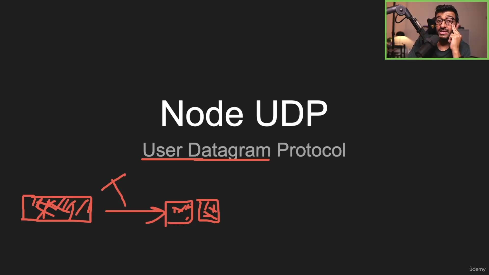

---

## 2. 讲师原话（带时间点）

按「读懂本节」的顺序重排，不按播放顺序。

**关于「报文 vs 字节流」这个根差别：**

> "当你收到一条消息时，另一端拿到的就是这条消息。协议会尽量保持这条消息的完整性。所以如果你把数据放进一条消息里，你就会得到一个 UDP 首部和整条消息。它绝不会被拆分成更小的块。这就是为什么我们必须小心 UDP 消息的大小。"
> —— p030 [02:19]

> "发送出去的内容绝不会作为一个整体到达，而是以字节流的形式到达，应用程序需要不断读取、再读取。"
> —— p030 [01:24]

> "在 TCP 中，它会被拆成多个段，而你对这些段完全没有控制权……一个路由器可能把它拆成一个段，另一个路由器可能把它拆成三个段。"
> —— p030 [00:28]

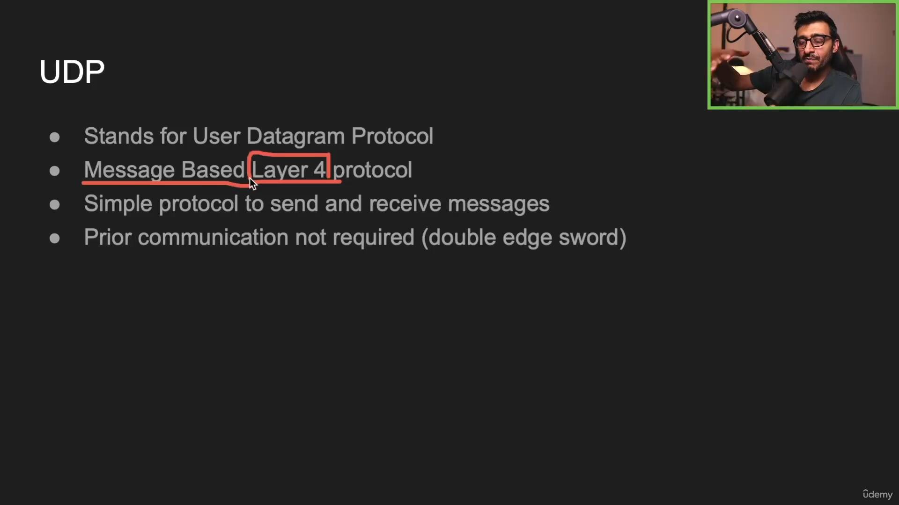

**关于为什么视频流、VPN、DNS、WebRTC 选 UDP：**

> "我不能承受这份数据丢失哪怕一个字节。这意味着，只要丢失一个字节，我就必须重传那个字节。也就是说，重传是有代价的。这意味着这一端必须等待该字节到达，才能把它交付给应用。因此 TCP 会带来延迟。"
> —— p030 [05:12]

> "如果你选择 TCP 作为隧道协议，就会有两种算法相互对抗……所以一次延迟可能引发层层叠加的效应，进而拖慢所有环节。"
> —— p030 [07:37]

> "VPN 这类东西往往把 UDP 作为底层协议，以便拥有更多控制权。这就是 UDP 给你的：更多控制权。"
> —— p030 [08:34]

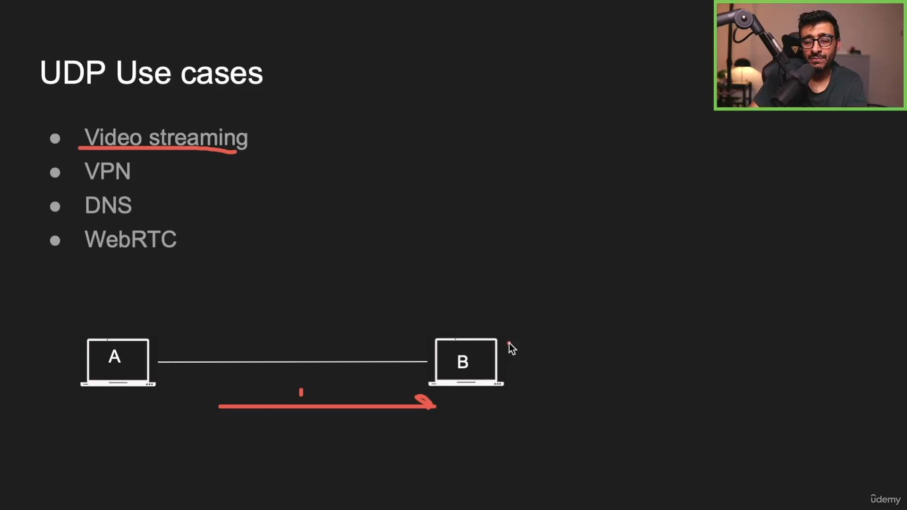

> "没有保证送达。因此，你能获得极低的延迟；而你要付出的代价就是丢包。"
> —— p030 [13:15]

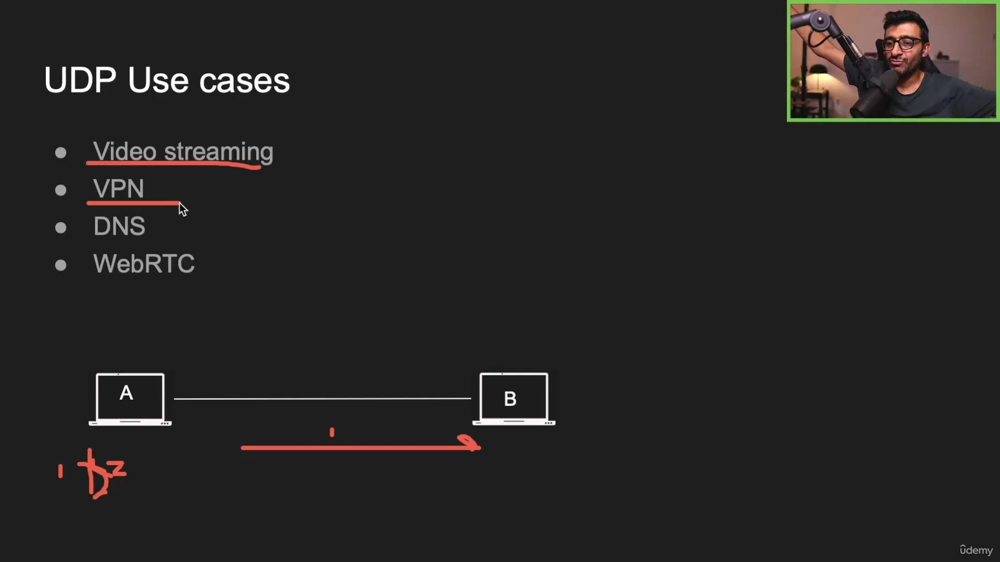

**关于数据报长什么样（源/目的 IP + 端口 + 数据）：**

> "我们设置目的端口和目的 IP，再设置源端口和源 IP，然后发出一个数据报。整个这一整套连同数据，就叫作数据报。"
> —— p030 [09:59]

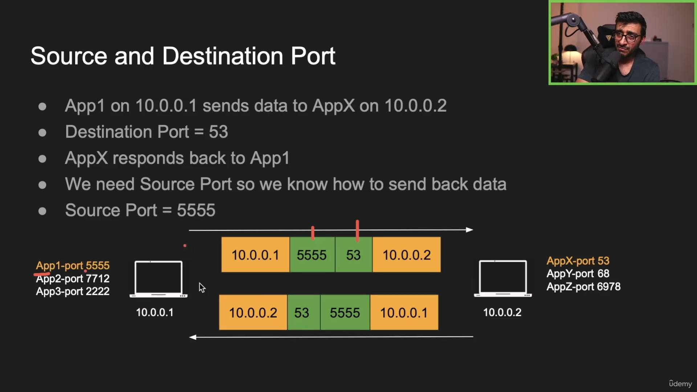

**关于「UDP 不要求对方回」：**

> "你可以把它当成黑洞。无论你发送什么，都不必回复。它不是请求-响应系统，不是的。它是消息协议。你发一条消息，仅此而已。"
> —— p030 [10:57]

（顺带一句讲师的原话玩笑："我跟你说，我试着给你讲个 UDP 笑话，但恐怕你收不到。" —— p030 [11:27]）

**关于 pros/cons 与「控制权」的取舍：**

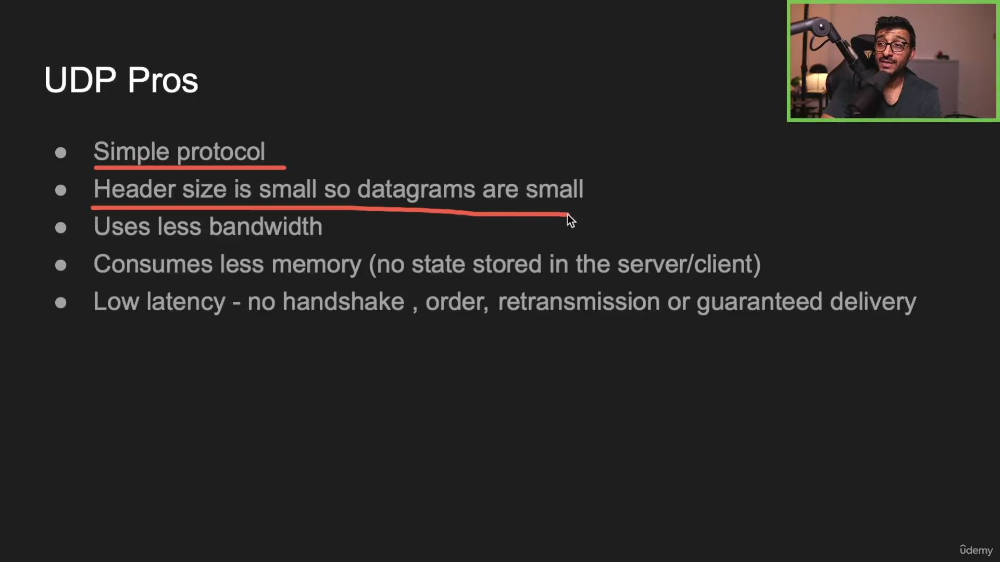

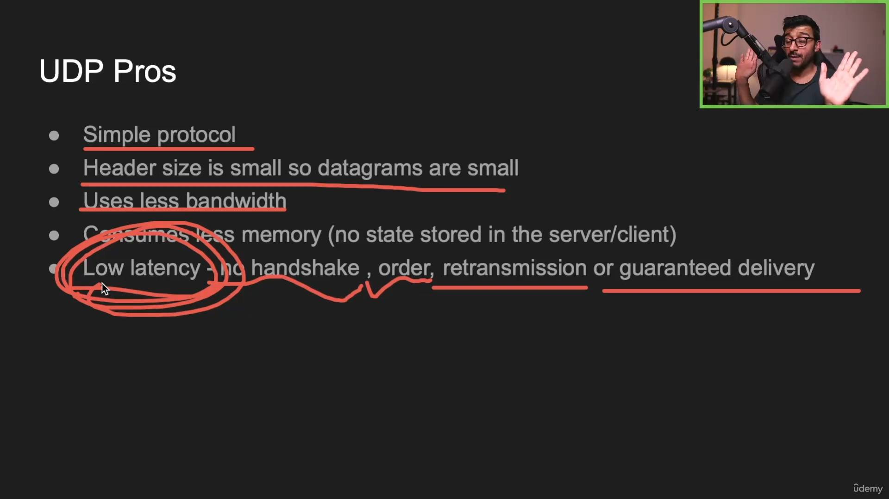

**关于 Node 的三个 API：**

> "如果在源端绑定，本质上就是在告诉内核：你已经准备好在这个源端口和这个源 IP 上接收数据报。"
> —— p030 [17:08]

> "你可以设置另一个名为 connect 的函数……用来设置目的地址和目的端口。但这样会把你锁定到那一个目的地。"
> —— p030 [17:38]

> "注意它叫 send 而不是 write。对，因为它的名字字面上就是 send。我有一条消息，我想把一条消息发送到……你是在向套接字发送一个工作单元。"
> —— p030 [18:06]

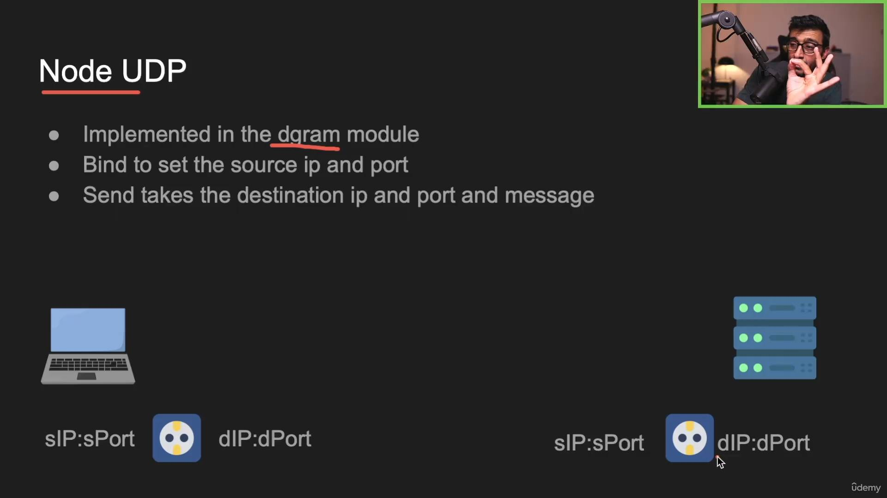

> "一个套接字就能服务所有人。你只需把它留成开放的，像一个通配符。"
> —— p030 [20:00]

> "要发送消息，你必须已经绑定，因为别人可能会回复你，而我们需要知道你是谁。所以直接发送消息时，它会自动选择一个随机端口，并把你绑定到所有地址。"
> —— p030 [20:29]

> "connect 实际上会把 IP 地址和端口硬编码到其中。这意味着，当你调用 send 时，不必再设置 IP 地址和端口，因为它们已经在套接字里设置好了。"
> —— p030 [23:54]

**关于 demo 里最震撼的那一幕（客户端被第三方插话，以及 connect 后内核直接丢包）：**

> "它就像一根敞开的水管，任何人都能连进来。它是一个开放的套接字，对吧？就像在说：嘿，进来吧，大家都进来。危险就在这里。"
> —— p030 [30:38]

> "什么都不会发生。内核直接丢弃了这条消息，因为它会想：等一下，你想访问这个客户端……可它虽然开放，并不是对你开放，不管你是谁。"
> —— p030 [32:27]

**关于事件循环（一句话带过，但很重要）：**

> "这一切都发生在轮询阶段。初始阶段什么都不会发生。所有这一切都会延迟到轮询阶段。这取决于具体情况，以及我们是否需要 DNS。"
> —— p030 [27:13]

---

## 3. 从零复现

### 3.0 环境与前置

- **Node**：`dgram` 是 Node 内置模块，**不需要 `npm install` 任何东西**。课里没有给出具体 Node 版本号，用你机器上的 LTS 即可（能跑 `node -v` 就行）。
- **终端**：两个以上终端窗口（一个跑服务端、一个跑客户端、一个充当「攻击者」）。
- **netcat**：讲师用的是 `nc`（"NC，字面意思就是 netcat。"）。macOS 自带；Linux 装 `netcat-openbsd` 或 `nmap-ncat`。Windows 用户如果 `nc` 不存在，可以先用 `client.js` 代替「攻击者」角色——**这不影响任何结论**。
- **不需要**：数据库、框架、任何依赖。这一节是纯 Node 标准库。

### 3.1 建目录

```bash
mkdir -p nodejs-internals/p030-udp
cd nodejs-internals/p030-udp
node -v
```

（不需要 `npm init`。三个文件都是单文件脚本，没有 `package.json` 也能跑。你要加 `"type": "module"` 就得改 `require`，本文档统一用 CommonJS `require`，与讲师一致。）

### 3.2 写服务端 `server.js`，跑起来

把第 4.1 节的完整代码保存为 `server.js`，然后：

```bash
node server.js
```

你应该看到类似输出（具体字符串以你代码里的 `console.log` 为准）：

```
[server] listening on 0.0.0.0:3333
```

这一行能打出来，说明 `bind(3333)` 成功了、`listening` 事件触发了。**如果这行没出来而是报错，先去看第 7 节第 3 条（端口被占用）。**

> 这里绑定 `3333` 且不指定地址，等于绑定到**所有网卡的所有地址**——讲师的说法是：「If someone is connecting, send it to your Wi-Fi IP address, or your Ethernet IP address, or your loopback IP address, or your IPv6 IP address, it works.」

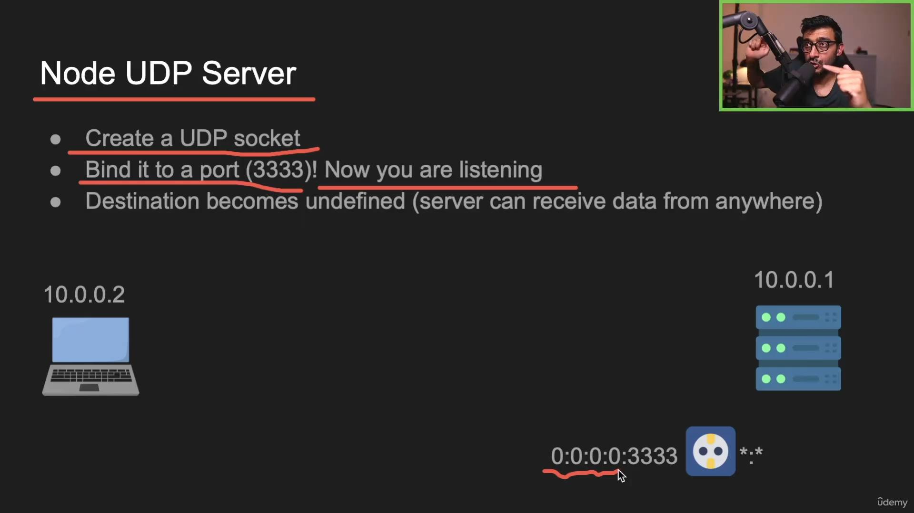

### 3.3 不写客户端，先用 `nc` 打一发

讲师的原话：「you can test it right here without even a node client. What you can do is do NC, netcat literally.」

另开一个终端：

```bash
printf 'hello UDP\n' | nc -u 127.0.0.1 3333
```

- 服务端终端应该打印出「收到来自 `127.0.0.1:<某个高位端口>` 的 N 字节：hello UDP」。
- 发命令的终端应该打印出服务端回给你的那句话。

这一步同时验证了两件事：**报文收得到**、**`rinfo` 里的 `address` / `port` 是真实可用的**——因为你正是靠 `rinfo.port` + `rinfo.address` 才能把包回给对方。讲师强调过这一点：「will have the address and the port and tell me who sent it, which is very critical because guess what? What I'm building here is a simple ping server which will literally send it back」。

> 每次关掉 `nc` 重开，服务端打印的客户端端口都会变（讲师 demo 里就是「I got a message. 62756... now if I turn around and kill it, then send something else, I get another IP」）。这不是 bug，是 `nc` 每次开了新的源端口。

### 3.4 写 `client.js`：不 bind、不 connect，直接 send

保存第 4.2 节代码，另开终端：

```bash
node client.js
```

你会看到两类日志：

1. 客户端**自己被分配的本地端口**（这一步是隐式 bind 完成的）；
2. 收到服务端回包。

这一步要观察到的关键事实是：**我们从头到尾没写过 `socket.bind(...)`，但客户端确实有了一个可用端口，而且能收包。** 原因见第 5 节对 `send` 的解释。

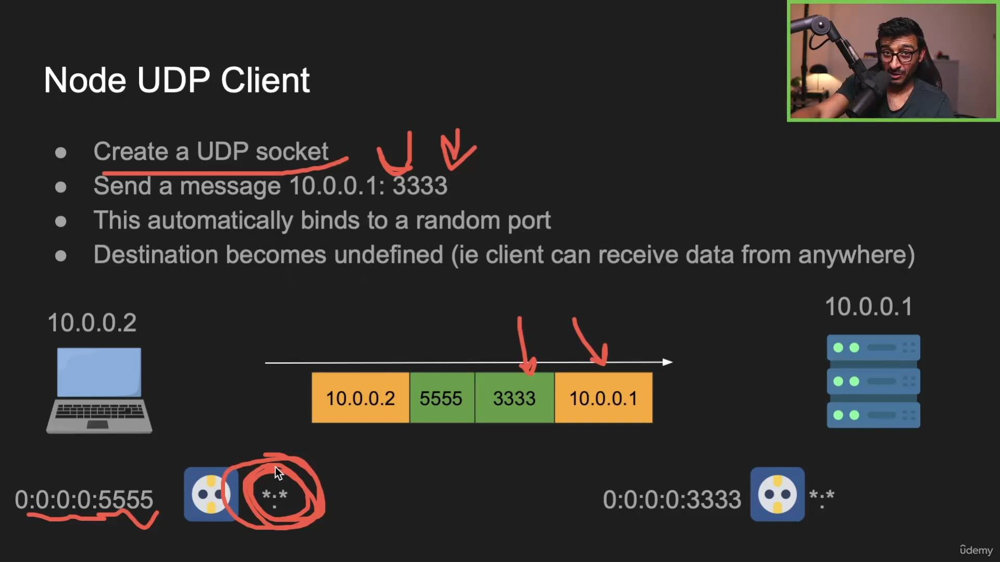

### 3.5 复现「开放的水管」：从第三方端口插话

**不要关掉 `client.js` 那个终端**，记下它打印的本地端口号（假设是 `53412`）。然后开第三个终端：

```bash
printf 'I am not the server\n' | nc -u 127.0.0.1 53412
```

现象：**`client.js` 的终端里会把这句陌生人的话打印出来。**

这就是讲师 demo 里那一段：

> "我再用一次 netcat。然后我要往这个端口写数据，按理说它对应的是一个客户端。看看这个。它刚返回了点东西。所以这个客户端，这就是 UDP 的危险之处。"

为什么？因为 `client.js` 的 socket 只知道「我绑在 `0.0.0.0:53412`」，**它从来不知道、也不关心谁是它的对端**。`send()` 只是把目的地址写进那**一个数据报**里，socket 本身对全世界敞开。

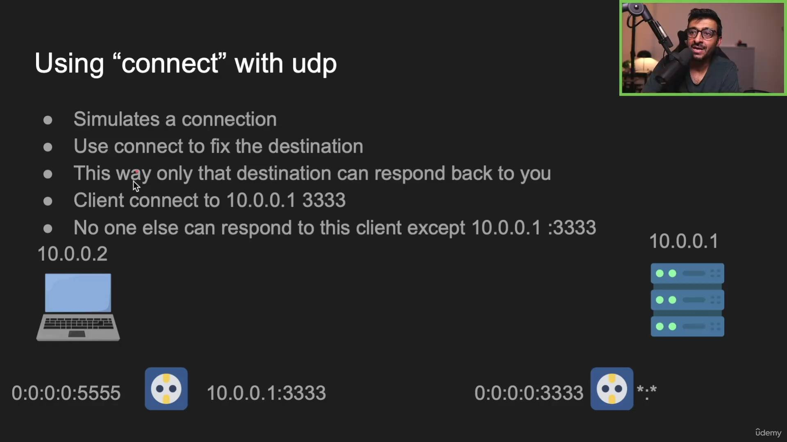

### 3.6 写 `client-connect.js`：bind 固定端口 + connect 锁死对端

先确保 `server.js` 还在跑（还占着 3333）。然后：

```bash
node client-connect.js
```

输出应显示它**绑定在 5555**、**connect 到 127.0.0.1:3333 成功**、并且**成功收到了服务端的回包**。注意这份代码在 `send` 时**没有传地址和端口**——因为 `connect()` 已经把目的端写进 socket 了。

### 3.7 复现「内核直接丢包」

保持 `client-connect.js` 在跑，回到第三个终端：

```bash
printf 'let me in\n' | nc -u 127.0.0.1 5555
```

现象：**什么都不会发生。** `nc` 那边没有回显，`client-connect.js` 的终端也不会打印任何东西。

不是你的网卡坏了，也不是被防火墙拦了——讲师的原话是「**The kernel literally discarded the message**」：这个 socket 已经 `connect` 到了 `127.0.0.1:3333`，而 `nc` 冒充的是 `127.0.0.1:另一个随机端口`，四元组对不上，内核在把数据交给 Node 之前就扔了。

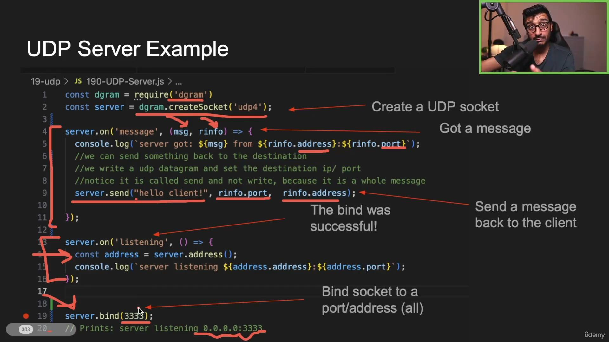

### 3.8 收尾

三个终端各自 `Ctrl+C`。检查一下：`server.js` 被杀掉之后，`client-connect.js` 再发消息不会报错（UDP 没有「连接断了」这种事件），只是永远收不到回包——这本身就是 UDP 语义的一部分。

### 3.9 讲师留的练习题

课的最后讲师说：「any time you receive a message from the server, that's a potential client. You add it to an array. And then every time you receive a message, you just loop and then send it to all of them. You can do a chatting group chat system.」

**课里没有给出这段代码**，只给了算法。第 4.4 节我按他的口述补了一份最小实现，并明确标注「讲师未提供代码，以下为按口述补的示意」。

---

## 4. 完整代码

> 三个文件全部是**完整文件**，复制保存即可运行；`require('dgram')` 无需安装。
> 关于回包内容：讲师 demo 里服务端回的是「Hello, client」。我这份代码把回包写成「带上对方地址端口」的形式，纯粹是为了排查方便——你想改成 `Hello, client` 直接改那一行字符串即可，行为上没有区别。

### 4.1 `server.js`

```js
// nodejs-internals/p030-udp/server.js
// UDP ping 服务端：绑定 3333，收到任何报文就把内容回给对方
const dgram = require('dgram');

// 'udp4' = IPv4 的 UDP socket；想要 IPv6 就写 'udp6'（课里用的是 IPv4）
const socket = dgram.createSocket('udp4');

// 收到报文：msg 是 Buffer，rinfo 是 { address, family, port, size }
socket.on('message', (msg, rinfo) => {
  console.log(
    `[server] 收到来自 ${rinfo.address}:${rinfo.port} 的 ${msg.length} 字节：${msg.toString()}`
  );

  const reply = Buffer.from(`Hello, client. (from ${rinfo.address}:${rinfo.port})`);

  // 注意参数顺序：先 port，再 address —— 和 http/tcp 的直觉是反的
  socket.send(reply, rinfo.port, rinfo.address, (err) => {
    if (err) {
      console.error('[server] 回包失败:', err);
      return;
    }
    console.log(`[server] 已回包给 ${rinfo.address}:${rinfo.port}`);
  });
});

// listening 在 bind 成功之后触发
socket.on('listening', () => {
  const addr = socket.address(); // { address, family, port }（dgram 自带方法，课里没讲）
  console.log(`[server] listening on ${addr.address}:${addr.port}`);
});

// 绑定失败（典型：端口被占用）会走到 error
socket.on('error', (err) => {
  console.error('[server] socket error:', err);
  socket.close();
});

// 绑定 3333，不指定地址 = 监听所有网卡的所有地址
socket.bind(3333);
```

### 4.2 `client.js`（演示「开放的水管」）

```js
// nodejs-internals/p030-udp/client.js
// 不 bind、不 connect，直接 send：内核会隐式 bind 一个随机端口给这个 socket
const dgram = require('dgram');

const socket = dgram.createSocket('udp4');

// 客户端照样能收到消息 —— 因为它已经被隐式 bind 了，且对全世界开放
socket.on('message', (msg, rinfo) => {
  console.log(`[client] 收到来自 ${rinfo.address}:${rinfo.port} 的消息：${msg.toString()}`);
});

// bind 发生时触发（对客户端来说，是 send 触发的隐式 bind）
socket.on('listening', () => {
  const addr = socket.address();
  console.log(`[client] 本地已绑定 ${addr.address}:${addr.port}（这个端口任何人都能发消息进来）`);
});

socket.on('error', (err) => {
  console.error('[client] socket error:', err);
  socket.close();
});

const message = Buffer.from('hello UDP');

// send 会做两件事：1) 若还没 bind，先隐式 bind；2) 把目的地址写进这个数据报发出去
socket.send(message, 3333, '127.0.0.1', (err) => {
  if (err) {
    console.error('[client] 发送失败:', err);
    return;
  }
  console.log('[client] 已发出 "hello UDP" -> 127.0.0.1:3333');
});
```

### 4.3 `client-connect.js`（bind 固定端口 + connect 锁死对端）

```js
// nodejs-internals/p030-udp/client-connect.js
// 显式 bind 到 5555，然后 connect 到 127.0.0.1:3333
// connect 之后，只有 127.0.0.1:3333 能跟这个 socket 说话
const dgram = require('dgram');

const socket = dgram.createSocket('udp4');

socket.on('message', (msg, rinfo) => {
  console.log(`[client-connect] 收到来自 ${rinfo.address}:${rinfo.port} 的消息：${msg.toString()}`);
});

socket.on('error', (err) => {
  console.error('[client-connect] socket error:', err);
  socket.close();
});

// 1) 显式绑定源端口（课里演示用的 5555）
socket.bind(5555, () => {
  const addr = socket.address();
  console.log(`[client-connect] 已绑定 ${addr.address}:${addr.port}`);

  // 2) 锁定目的端：把 IP 和端口硬编码进 socket
  socket.connect(3333, '127.0.0.1', (err) => {
    if (err) {
      console.error('[client-connect] connect 失败:', err);
      socket.close();
      return;
    }
    console.log('[client-connect] connect 成功，目的端已锁定为 127.0.0.1:3333');

    // 3) 因为目的端已锁定，send 时不需要再传 address 和 port
    const message = Buffer.from('hello UDP from a connected socket');
    socket.send(message, (err2) => {
      if (err2) {
        console.error('[client-connect] 发送失败:', err2);
        return;
      }
      console.log('[client-connect] 已发出消息（未指定地址和端口）');
    });
  });
});
```

### 4.4 `chat-server.js`（讲师只给了口述算法，课里没有代码）

> **注意：以下代码讲师没有写过，是按他 p030 [33:25] 的口述补出来的示意实现**，仅用于把「群聊」这个练习落地，不代表课程原文。

```js
// nodejs-internals/p030-udp/chat-server.js
// 课里没有这个文件；这是按讲师口述「把每个发过消息的人加进数组，收到消息就广播给所有人」补的
const dgram = require('dgram');

const socket = dgram.createSocket('udp4');

// 讲师说的是「add it to an array」；这里用 Map 以 "ip:port" 去重，避免重复广播
const peers = new Map();

socket.on('message', (msg, rinfo) => {
  const key = `${rinfo.address}:${rinfo.port}`;
  peers.set(key, { address: rinfo.address, port: rinfo.port });

  const line = `[${key}] ${msg.toString()}`;
  console.log(`[chat] 收到 ${key}：${msg.toString()}；当前成员 ${peers.size} 个`);

  for (const peer of peers.values()) {
    // 不回给自己
    if (peer.address === rinfo.address && peer.port === rinfo.port) continue;
    socket.send(Buffer.from(line), peer.port, peer.address, (err) => {
      if (err) console.error(`[chat] 广播给 ${peer.address}:${peer.port} 失败:`, err);
    });
  }
});

socket.on('error', (err) => {
  console.error('[chat] socket error:', err);
  socket.close();
});

socket.bind(3333, () => {
  console.log('[chat] listening on 0.0.0.0:3333');
});
```

配套的「聊天客户端」可以直接复用 4.3 的 `client-connect.js` 改端口运行多份——但**每个客户端必须 `bind` 到不同端口**，否则第二个会 `EADDRINUSE`（见第 7 节第 3 条）。

---

## 5. 逐行解释

### 5.1 `dgram.createSocket('udp4')` —— 服务端和客户端用的是同一个东西

这是本节最反直觉、也最省事的一点：讲师的 demo 里服务端和客户端**代码结构几乎完全一样**。原话是：「No, there's no difference between a server and client at all. It's the same thing, because it doesn't have the `accept` like TCP, and that's why it's so simple.」

在 TCP 里，「服务端」意味着 `listen()` + `accept()` 会为每条连接 fork 出**新 socket**；UDP 没有这一套。**一个 UDP socket 就服务所有人**（「One socket just serves everyone」）。所以：

- `server.js` 和 `client.js` 的差别，只有「要不要先 `bind` 一个固定端口」和「`send` 时传不传地址」；
- 你完全可以把 `client.js` 当成服务端用，只要它 `bind` 一个众所周知的端口。

**给前端同学的一句话对照**：TCP 的 `accept` 有点像「每次请求 new 一个 handler 实例」；UDP 则是「一个全局的 EventEmitter，所有报文都从这个口进来」。在 Node 里，这两者的回调**都跑在同一个事件循环线程上**，不存在多线程并发问题——所以你在这里**不需要考虑锁**。这也是为什么讲师说 UDP 只是「a delivering mule」：它不做业务，业务你自己在应用层排队。

### 5.2 `socket.bind(3333)` —— 声明「我在这个源端口上准备收」

讲师的定义很准：「you're telling the kernel essentially that you are ready to receive datagrams on this source port and on this source IP」。

几个要点：

- **`bind` 绑定的是「源」**（本地侧），不是「目的」。目的地址在 `send` 时才出现，而且是**写在每个数据报里**，不是写在 socket 上（除非你 `connect`）。
- 只写端口不写地址 = 绑到 `0.0.0.0`，即所有网卡。这就是讲师说的「the destination becomes anyone... it's a star」。
- `bind` 成功后才触发 `listening` 事件。所以 `server.js` 里那句 `[server] listening on ...` 打不出来，就说明 bind 没成。
- **`bind` 可能失败**：「this may fail because someone else is bound in the same port, just like TCP」。失败会走 `error` 事件，典型错误是端口占用。

### 5.3 `socket.send(buf, port, address, cb)` —— 发「一条消息」，不是「写一段字节」

讲师专门强调过这个命名：「notice that's called `send` and not `write`. Right, because it's literally called `send`. I have a message. I want to send a message to... you're sending one unit of work to the socket.」

- TCP 的 `write`：往字节流里灌字节，灌多少次、被切成多少段，你管不着。
- UDP 的 `send`：**一调 = 一个数据报 = 对端的一次 `message` 事件**。一次对一次，中途不合并、不拆分（超出 MTU 的情况在 IP 层分片，那是另一回事，见第 7 节第 5 条）。

**参数顺序是坑**：`send(msg, port, address, callback)` —— **先端口后地址**，和 `http.request({host, port})`、`net.connect(port, host)` 的直觉顺序虽然一致，但和 `fetch('http://host:port')` 这种字符串顺序相反。写反了不会报错，只会发到一个没人监听的端口，然后**静默失败**——因为 UDP 没有「对方不在」这种反馈（讲师：「you can treat it as a black hole」）。

**`send` 会顺手给你 bind**：这是本节最重要的一行行为。讲师原话：「to send a message, you need to be binded already because someone might reply back to you and we need to know who you are. So just send a message automatically picks a random port and binds you to all addresses.」

所以 `client.js` 里你没写过 `bind`，但 `listening` 依然会触发、`socket.address().port` 依然有值、你依然能收到回包——**同时你也对全世界敞开了**。这不是 bug，是设计。

### 5.4 `rinfo` —— 回包的唯一依据

`message` 事件的第二个参数 `rinfo` 携带了「谁发给我的」。讲师说得很直白：「will have the address and the port and tell me who sent it, which is very critical because guess what? What I'm building here is a simple ping server which will literally send it back」。

`server.js` 里 `socket.send(reply, rinfo.port, rinfo.address, ...)` 就是**把源当成目的回过去**。注意：这只是「把地址抄一遍再发一个包」，和 TCP 里「在同一条连接上写回去」完全不是一回事——UDP 服务端没有任何「连接」可以写回，它只是又发了一个新数据报。

> `rinfo` 具体还有哪些字段（`family`、`size` 等），**以你实际 `console.log(rinfo)` 的输出为准**；讲师 demo 里只用到了 `address` 和 `port`。

### 5.5 `socket.connect(port, address)` —— 不是握手，是「内核级白名单」

这是最容易被误解的一个 API。讲师的定义：「connect literally hard codes, if you will, the IP address and the port to this.」

它**不发任何包**、**没有三次握手**、**对端完全不知道你 connect 了**。它做的事只有一件：在这个 socket 的内核数据结构里记下「对端 = `IP:port`」，然后：

1. `send(msg)` 时不用再传地址端口——已经记着了；
2. **收到的数据报，四元组对不上就直接在内核里丢掉，Node 层根本收不到**（这就是 3.7 节那一幕）。

讲师说这叫「a simulated connection」——模拟出来的连接。它的价值在第 3.5 / 3.7 节的对比里：**没有 `connect` 的 UDP 客户端是一个开放的水管；有了 `connect`，它才是一个只跟一家说话的水管。**

**注意**：这不是锁，也不是事务。它只是内核里的一个过滤条件。在 Node 里你依然不需要考虑锁竞争——所有回调都在同一个线程；`connect` 只是改变了「哪些包会被投递到你的 `message` 回调」。

### 5.6 `socket.on('error')` 与 `socket.close()`

UDP 的错误**绝大多数不会在 `send` 的 callback 里出现**（因为没有 ACK，内核不知道对端死没死）。能走到 `error` 事件的主要是本地问题：端口被占用、地址不可用、权限不足等。

`close()` 用来释放端口——`client-connect.js` 固定绑了 5555，如果你不关进程就再跑一次，会直接撞上端口占用。

### 5.7 关于「poll phase」那句话

讲师在讲 `client.js` 时插了一句：「all of this happens in the poll phase. Nothing happens in the initial phase. All of this is delayed until the poll phase. It depends like where, whether we need DNS or not.」

这句话的实操含义是：**`createSocket()` 那一刻什么都没发生**。真正的 bind、真正的发送、真正的收包，都发生在事件循环进入 poll 阶段之后。所以：

- 你在 `createSocket()` 后面紧接着 `console.log(socket.address())`，大概率会抛错或拿到空值——因为还没 bind；
- 想拿本地端口，就放到 `listening` 回调或 `send` 的 callback 里（本文档的代码就是这么写的）；
- 他提到的「whether we need DNS or not」，指的是 `send` 时如果你传的是**域名**而不是 IP，就得先做一次 DNS 解析，那会多绕几圈。`client.js` 里我们直接写 `127.0.0.1`，就绕开了这一步。

---

## 6. 复现检查清单

按顺序打勾，任何一项不符合，先别往下走。

- [ ] `node -v` 有输出；`nodejs-internals/p030-udp/` 下有三个 `.js` 文件，**没有 `node_modules`**。
- [ ] `node server.js` 打印出 `listening on 0.0.0.0:3333`（或等价内容），进程不退出。
- [ ] `printf 'hello UDP\n' | nc -u 127.0.0.1 3333` 能收到服务端回包；服务端终端打印出「收到来自 `127.0.0.1:<高位端口>`」。
- [ ] 关掉 `nc` 重开再发一次，**服务端打印的客户端端口变了**（说明源端口每次都是新的）。
- [ ] `node client.js` 打印出「本地已绑定 `0.0.0.0:<某端口>`」——注意：**代码里没有 `bind`**，端口是 `send` 隐式分配的。
- [ ] `client.js` 收到了服务端回包。
- [ ] **保持 `client.js` 运行**，用 `nc -u 127.0.0.1 <client.js的端口>` 发一句话，`client.js` 终端把这句话打印了出来 → 复现了「开放的水管」。
- [ ] `node client-connect.js` 打印出「已绑定 `0.0.0.0:5555`」「connect 成功」「已发出消息」。
- [ ] `client-connect.js` 收到了服务端回包（服务端日志里显示的来源端口是 **5555**）。
- [ ] 用 `nc -u 127.0.0.1 5555` 发一句话，**`client-connect.js` 毫无反应**（内核丢包）→ 复现了「连接锁定」。
- [ ] 关掉 `client-connect.js` 再立刻重跑，能正常再绑上 5555（上一次进程已释放端口）。
- [ ] 同时跑两个 `client-connect.js`，第二个报端口占用错误（`EADDRINUSE` 一类）→ 与讲师说的「this may fail because someone else is bound in the same port」一致。
- [ ] 全部进程 `Ctrl+C` 结束，用 `lsof -iUDP:3333`（macOS/Linux）确认端口已释放。

---

## 7. 课里没讲但你会撞上的

**1）文件名和目录结构：课里没讲清楚。**
逐字稿里讲师说的文件名被字幕转写成了「19 UDP 19, 190」「node 19 node 19 UDP 92」这类形式，无法确定原文。本文档用 `server.js` / `client.js` / `client-connect.js` 命名，**功能等价即可**，不要纠结文件名。

**2）Node 版本：课里没讲。**
`dgram` 是很老的稳定模块，LTS 版本都能跑。本文档的代码没有用到任何新语法糖（没有可选链、没有顶层 await），CommonJS 直接跑。

**3）`EADDRINUSE`：端口被占用。**
最常发生在「上一个 `node server.js` 还挂在后台」。`Ctrl+C` 之后如果还报，说明进程没死透（编辑器里的 Run 按钮经常这样）。处理办法：`lsof -iUDP:3333` 找到 PID 杀掉，或者换个端口。**注意 UDP 端口的占用检测和 TCP 不完全一样，UDP 允许某些情况下的端口复用，所以「明明报占用但 `lsof` 看不到」也是可能的——具体行为以你的系统和实际输出为准。**

**4）`nc` 的版本差异会让你以为「收不到回包」。**
`printf | nc -u host port` 在某些实现里，stdin 一结束 `nc` 立刻退出，回包还没来得及打印就关了。如果你在 3.3 节看不到回包但服务端日志已经打印了「已回包」，加个等待参数再试（不同发行版的 `nc` 参数名不同，`-