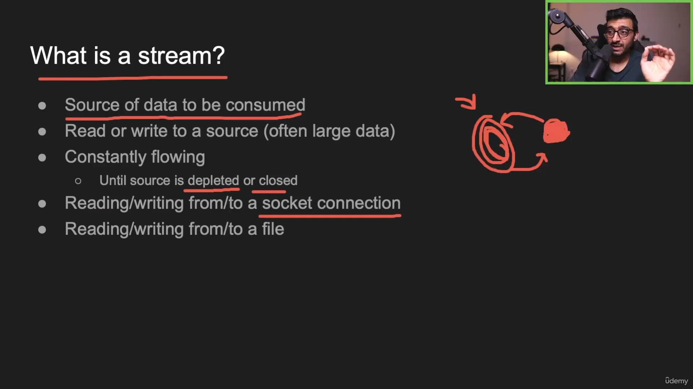
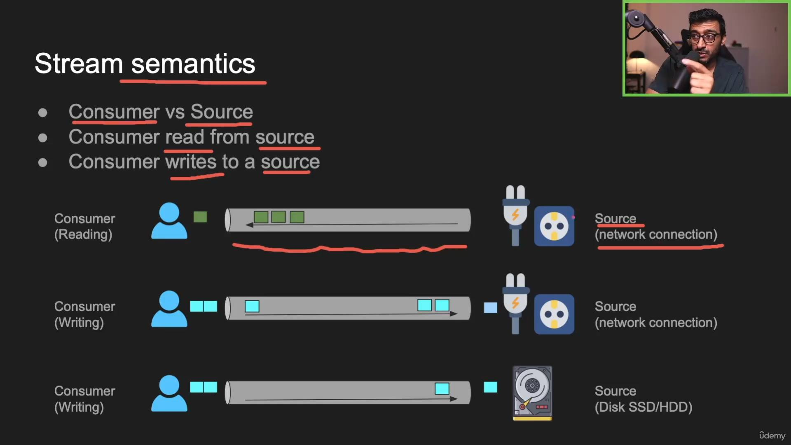
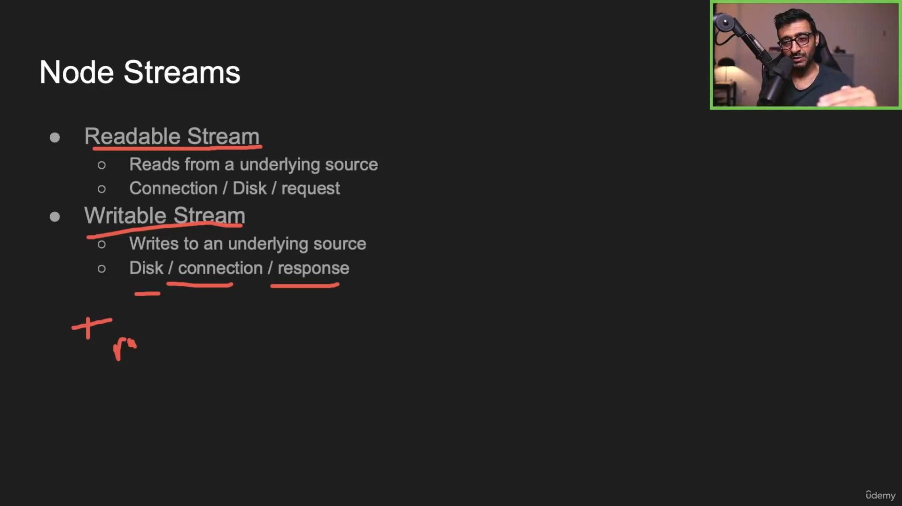
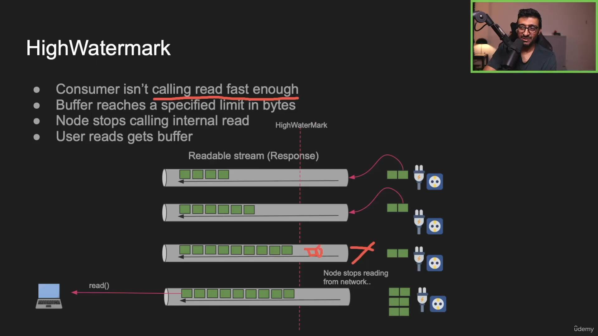
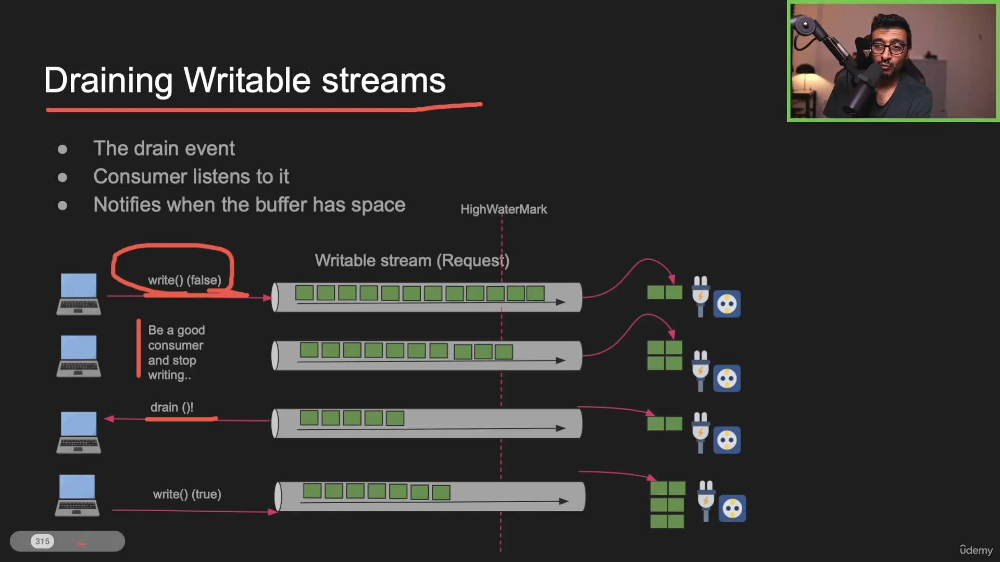
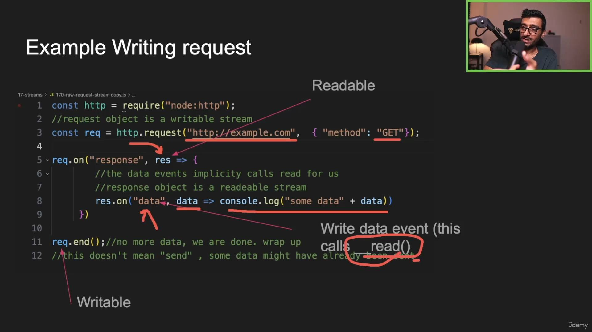
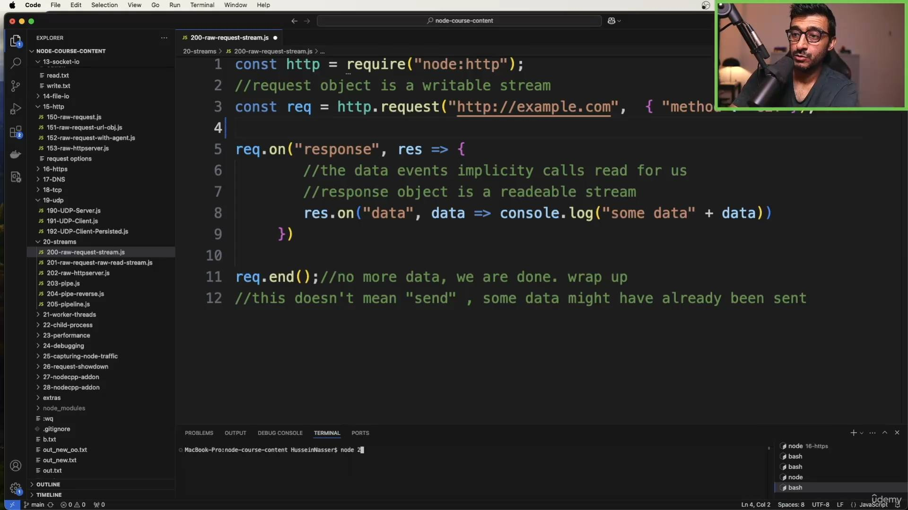
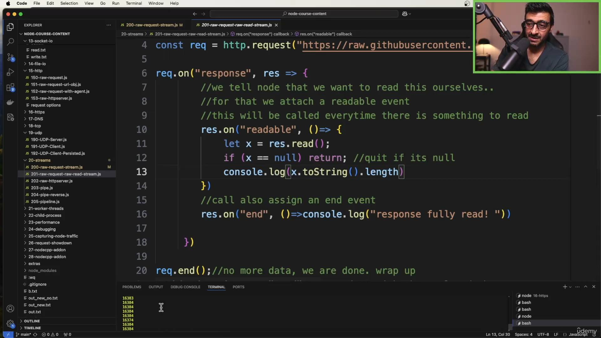
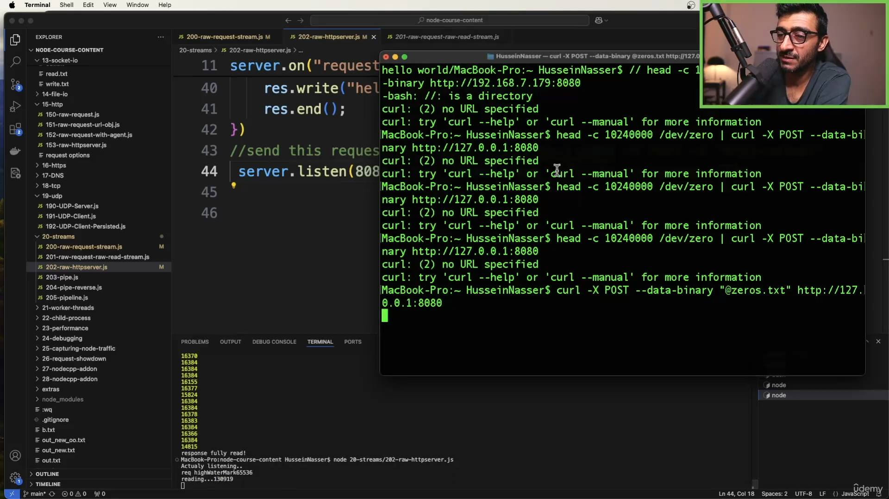

## 1. 这一节做什么

这一节（`BV1jGRyBsEBa` P31）讲 Node.js 的 **Streams（流）**。逐字稿里讲师反复强调：流不是一个“新 API 玩具”，而是 Node 对“可能很大、持续流动的数据”做的应用层抽象。文件、HTTP 请求、HTTP 响应、TCP 连接，在 Node 里都可以表现为可读流、可写流或两者兼具的转换流。核心要解决的问题是：**消费者读得慢、写入方写得太快时，如何控制流量，避免把内存、连接或磁盘压垮**。

这节不是单纯讲概念，讲师口述并演示了几类可复现实验：

1. 客户端用 HTTP 发请求，监听响应的 `data` 事件读取 body；
2. 用 `readable` 事件和 `read()` 手动拉取响应；
3. 在服务端创建 HTTP server，并用 `highWaterMark` 控制请求流的内部缓冲区阈值；
4. 用 `fs` + `crypto` + `zlib` 做“读文件 → 加密 → gzip 压缩 → 写文件”的 pipe 链；
5. 说明 `pipe` 的错误处理不够好，推荐 `pipeline`。

逐字稿没有逐行贴出完整源码，只出现了少量代码片段和终端演示；下面我会按讲师口述重建一套**可保存、可运行**的复现工程。文件名、环境变量名是本复现文档自定义的，不是讲师原文件名；凡是逐字稿没给的（例如大 JSON 的 URL、Node 具体版本），我都会明确标注“课里没讲”。

理解这一节时，建议不要把“流”只当成某个对象名，而要抓住三个角色：数据源、流对象、消费者。数据源可以是文件、HTTP 响应、HTTP 请求 body、TCP 连接；流对象是 Node 在用户态包出来的一层缓冲和事件接口；消费者则是你写的 `data` 回调、`read()` 调用、`pipe` 下游或 `pipeline` 下游。讲师反复强调“控制流出来多少、流进去多少”，本质上就是在讲消费者和源之间要有一个节奏控制。如果消费者慢，而源很快，没有背压就会把数据堆在内存里；如果消费者快，而源慢，流对象就等待数据到达。本节所有示例都围绕这个节奏控制展开。

对前端同学来说，可以先做一个对照：浏览器里 `fetch()` 返回的 `response.body` 在支持 Web Streams 的环境里也是可读流，可以 `getReader()` 逐块读取；Node 这里的 `res.on('data')`、`res.read()` 也是在逐块消费响应体。两者 API 不同，但“不要假设一次拿到完整 body，而要按 chunk 处理”的思维方式是一样的。这个对照只是帮助理解，不是讲师原话；本节仍然以 Node 原生 Streams 为准。



## 2. 讲师原话（带「—— pNNN [MM:SS]」）

下面引用的是逐字稿里的关键原话或紧贴原意的短句，后面接中文解释。

> "流是 Node 特有的一种抽象，建立在任何看起来像大量流动数据的事物之上。"
> —— p031 [00:29]

讲师把流定义成 Node 特有的抽象，架在“感觉像大块流动数据”的东西之上。也就是说，流不是数据源本身，而是数据源和消费者之间的中间层。

读这句话时要抓住“sits on top of”这个说法：流不是文件，也不是 TCP 连接本身，而是 Node 给这些底层对象套的一层可编程接口。你面对的是“可读”“可写”“可以 pipe”的对象，底层可能是磁盘、socket 或 HTTP 报文。正因为有这层抽象，同一套消费方式才可以套到不同数据源上。

> "总会有某个数据源需要被消费……我们控制从流中流出多少数据，以及向该数据源流入多少数据。"
> —— p031 [01:28]

无论读还是写，都有“源”和“消费者”；流让我们控制流出/流入的节奏，而不是一次性把全部数据读进内存。

这句话对应到代码里，就是不要写“把整个文件读成一个大 Buffer 再处理”的默认思路，而要写“一块一块读、一块一块写”。当消费者处理不过来时，流对象应该让上游暂停或减速；当消费者处理得过来时，再继续放行。这个“放行/暂停”的机制就是后面反复出现的背压。

> "由于请求或 HTTP 协议构建在 TCP 之上，请求不会以一条完整消息的形式到达，而是以一组字节的形式一点一点地传来。"
> —— p031 [02:24]

HTTP 请求底层是 TCP，body 不是一次性到达，而是一串字节慢慢流入；所以 Node 把请求、响应建模成流。

这也解释了为什么服务端不能假设 `req` 已经完整躺在内存里。请求 body 可能分很多次到达，尤其上传大文件时更明显。客户端读响应也一样，`res` 的 body 可能分多个 chunk 到达，`data` 事件可能触发多次，`end` 才表示结束。

> "流有自己的内部内存缓冲区……消费者调用 read，就会从流中获得一份副本。"
> —— p031 [06:12]

流内部有用户态缓冲区；消费者调用 `read()` 时，是从这个流缓冲区里拿数据。底层连接/内核缓冲区是另一层。

这句话把“流缓冲区”和“底层缓冲区”区分开了。你调用 `read()` 拿到的是 Node 流对象已经缓冲的数据；如果流缓冲区里暂时没有数据，`read()` 可能返回 `null`。这不等于连接断了，也不等于永远没有数据，只是当前这一刻没有可读 chunk。正确写法是等 `readable` 事件再次触发，或用 `data` 事件让 Node 推送。

> "高水位线是流中的一个概念，它告诉消费者要退让。"
> —— p031 [21:23]

`highWaterMark` 是背压的“警戒线”，不是硬性内存上限。讲师后面也演示了：它只是指导线，可能被轻微超过。

所以不要把 `highWaterMark` 理解成“超过这个数就一定报错”或“绝对不会多一字节”。它是流内部用来判断“该不该继续从上游读/该不该让下游等一等”的阈值。实际读取量会受 chunk 大小、底层实现、Node 版本和调度影响。

> "你会监听一个名为 drain 的事件……drain 会直接接管这个管道，并把它排空。"
> —— p031 [26:15]

可写流 `write()` 返回 `false` 时，不应该继续硬写；应当等 `drain` 事件再继续。`pipe` / `pipeline` 会替你处理这套逻辑。

自己手写写入循环时，最容易犯的错就是忽略 `write()` 的返回值，继续往可写流里塞数据。短时间小数据可能看不出问题，但大文件或慢连接下就可能堆积内存。`drain` 的意思是“下游缓冲区已经排空到可以继续写了”，这时再恢复写入。

> "pipe 的问题在于它不能很好地处理错误……于是他们在 pipe 之上又发明了另一种抽象，叫作 pipeline。"
> —— p031 [59:50]

`pipe` 链式写法简洁，但错误传播和清理不够好；`pipeline` 是更推荐的链式流方式。

这里的重点不是 `pipe` 完全不能用，而是当链路变长、错误可能来自任意一段时，`pipeline` 能统一把错误送到一个地方，并负责清理其余流。复现时可以先跑 `pipe` 版理解数据怎么流动，再跑 `pipeline` 版理解工程上更稳的写法。



## 3. 从零复现

### 3.1 环境准备

课里没讲具体 Node 版本。下面示例按 **Node 18+** 编写，使用 `node:` 前缀模块和 `node:stream/promises`。不引入任何第三方依赖。

```bash
node -v
# 建议 Node >= 18；如果版本不同，字段名和输出以实际为准

curl --version
# 课里用 curl 发送大请求；没有 curl 可用 PowerShell 的 curl.exe 或自写客户端
```

这两条命令的作用是“先确认工具存在，再开始复现”。`node -v` 输出当前 Node 版本；如果版本太低，`node:stream/promises` 或 `node:` 前缀可能不可用，或者流对象上的某些字段名不同。`curl --version` 用来确认系统里是否有 `curl`，以及它支持哪些协议。Windows 上如果普通终端里没有 `curl`，可以试 `curl.exe --version`；如果仍然没有，可以改用 PowerShell 的 `Invoke-WebRequest`，或者用第 4 节的客户端脚本自己发请求。课里演示用了 `curl` 上传大文件，但复现时只要能把请求 body 发到服务端即可，不强制同一个工具。

常见错误与排查：如果 `node -v` 报“命令未找到”，说明 Node 没安装或 PATH 没配置；如果版本低于 18，先不要改代码硬跑，优先升级 Node，或者把 `node:` 前缀改成旧写法并自行确认 API 是否存在。如果 `curl --version` 报错，不影响 `00`、`01`、`03`、`04`、`05` 这些不依赖 `curl` 的示例，只影响第 3.4 节的服务端上传实验。

目录结构如下：

```text
nodejs-streams-p31/
├── package.json
├── generate-large-file.js
├── 00-http-data-event.js
├── 01-read-response-readable.js
├── 02-server-watermark.js
├── 03-encrypt-gzip-pipe.js
├── 04-decrypt-gunzip-pipe.js
└── 05-pipeline-encrypt-gzip.js
```

创建目录：

```bash
mkdir nodejs-streams-p31
cd nodejs-streams-p31
```

`mkdir` 创建复现目录，`cd` 进入目录。后面所有 `node xxx.js` 都默认在这个目录里执行；如果忘记 `cd`，Node 会报“找不到模块”或“找不到文件”。如果目录已经存在，`mkdir` 可能提示已存在，这时直接 `cd` 进去即可，不必删除已有文件。然后把第 4 节的 8 个文件原样保存进去。

### 3.2 环境变量约定

课里没有定义这些环境变量名，以下是本复现文档为了方便运行而起的名字：

| 变量名 | 默认值 | 用途 |
|---|---|---|
| `TARGET_URL` | `https://example.com` | `00`/`01` 请求的 URL；要复现“大 JSON 分块读取”，请指向你自备的大文件 URL |
| `WATERMARK` | `65536` | `02-server-watermark.js` 的 `highWaterMark` |
| `INPUT` | `large.bin` | 加密示例的输入文件 |
| `ENCRYPTED` | `large.bin.enc.gz` | 加密+gzip 输出文件 |
| `DECRYPTED` | `large.bin.dec` | 解密还原输出文件 |
| `HWM` | `65536` | 文件流/转换流的 `highWaterMark` |
| `SIZE` | `10485760` | `generate-large-file.js` 生成文件大小，默认 10MB |
| `OUT` | `large.bin` | 生成大文件的路径 |

这些变量的写法依赖 shell。macOS/Linux 常见写法是 `TARGET_URL="..." node 01-read-response-readable.js`，变量只对当前命令生效。Windows PowerShell 常见写法是先 `$env:TARGET_URL="..."`，再执行 `node 01-read-response-readable.js`；如果想只对一条命令生效，可以查当前 PowerShell 版本支持的环境变量写法。无论哪种 shell，核心原则都是：变量名必须和代码里 `process.env.XXX` 的名字完全一致，大小写也不能错。常见错误是把 `HWM` 写成 `hwm`、把 `WATERMARK` 拼错，结果代码走了默认值，终端看起来“没变化”，其实不是流没生效，而是环境变量没传进去。

### 3.3 运行 HTTP 响应读取示例

生成一个 10MB 本地文件，后面给服务端做上传测试：

```bash
node generate-large-file.js
# created: large.bin bytes: 10485760
```

这条命令执行 `generate-large-file.js`。脚本读取 `SIZE` 和 `OUT` 环境变量，默认生成 10MB 的 `large.bin`。输出里的 `bytes: 10485760` 表示文件大小。如果终端没有输出，先检查是否在正确目录、文件名是否拼错；如果报权限错误，检查当前目录是否可写。生成文件只是为后面的上传和加解密实验准备输入，不参与 HTTP 客户端示例。

运行客户端 `data` 事件示例：

```bash
node 00-http-data-event.js
```

它会请求 `https://example.com`，监听响应 `data` 事件，打印每次拿到的 chunk 长度和累计字节数。不同网络、不同站点、不同 Node 版本下 chunk 次数会不同。

这条命令的完整过程是：`https.request()` 向 `TARGET_URL` 发 GET 请求；响应到达后，`res.on('data')` 每收到一块 body 就打印长度；`res.on('end')` 打印总字节数。常见错误是看到 `statusCode: 200` 但没有任何 `data`，这通常是因为目标站点 body 很小、或者响应被重定向、或者网络环境拦截；`example.com` 的页面本来就不大，所以 chunk 次数少是正常的。要看明显的分块效果，可以把 `TARGET_URL` 指向一个较大的、可公开访问的文件 URL，但课里没有提供那个大 JSON 的 URL，不要凭空假设某个地址一定可用。

运行 `readable` + `read()` 示例：

```bash
node 01-read-response-readable.js
```

默认请求 `example.com`，可以跑通。要复现讲师说的“大 JSON 一次读 16K 左右”的行为，需要设置一个较大的远程文件 URL。课里没有给出那个大 JSON 的 URL，所以这里只能由你自备：

```bash
TARGET_URL="https://你的域名/大文件.json" node 01-read-response-readable.js
```

终端里会打印类似：

```text
read chunk length: 16384 total: 16384
read chunk length: 16384 total: 32768
...
```

具体每次读多少、总共几次，以你的实际输出为准。

这个示例和 `00` 的差别在于“谁掌握读取节奏”。`00` 监听 `data` 后，Node 会持续把数据推给你；`01` 监听 `readable`，然后在回调里用 `while` 循环调用 `res.read()`，把当前能读的 chunk 尽量读完。`read()` 返回 `null` 表示当前缓冲区没有更多可读数据，不是错误，也不是结束；结束要看 `end` 事件。常见错误是只在 `readable` 回调里调用一次 `read()`，结果大文件读得很慢或看起来“卡住”；应按示例用 `while` 循环读到 `null`。另一个常见错误是把 `chunk.length` 当成总长度，实际上它是当前块长度，必须像示例一样累加 `total`。



### 3.4 运行服务端 highWaterMark 实验

先启动服务端，默认 `highWaterMark = 65536`：

```bash
node 02-server-watermark.js
# listening on http://127.0.0.1:8080
```

另开一个终端，用 `curl` 上传刚才的 10MB 文件：

```bash
curl -X POST --data-binary @large.bin http://127.0.0.1:8080/upload
```

服务端每秒调用一次 `req.read()`，故意读得很慢，因此你会看到请求缓冲区被填到 `highWaterMark` 附近后停止继续从底层读取。讲师在终端里看到默认阈值下大约每次读到 65K 左右。

这里逐项解释命令：`node 02-server-watermark.js` 启动 HTTP 服务并监听 `127.0.0.1:8080`；`-X POST` 指定 HTTP 方法为 POST；`--data-binary @large.bin` 表示把 `large.bin` 的内容按二进制原样作为请求 body 发送，`@` 后面是文件名；最后的 URL 是服务端地址。服务端每秒才 `req.read()` 一次，是故意模拟慢消费者。常见错误：如果终端提示端口被占用，说明 8080 已被别的进程使用，可以关掉旧进程或改代码里的端口；如果 `curl` 报“could not resolve host”或连接失败，检查服务端是否还在运行、地址是否写错；如果上传后客户端很快结束但服务端还在慢慢打印，这是正常的，因为服务端在按自己的节奏消费请求流。

再把服务端阈值改成 200000：

```bash
WATERMARK=200000 node 02-server-watermark.js
```

另开终端再次上传：

```bash
curl -X POST --data-binary @large.bin http://127.0.0.1:8080/upload
```

你会看到打印出的流阈值变化，单次读取量也可能变大。注意：`highWaterMark` 是指导线，不是硬上限；讲师演示中也出现过轻微超过阈值的情况。

如果是在 PowerShell 里，不要直接照抄 `WATERMARK=200000 node ...` 这种 Unix shell 写法；可以先设置环境变量再启动 Node，或者使用当前 shell 支持的单命令环境变量语法。验证是否真的传进去，可以看服务端第一行打印的 `highWaterMark option:` 是否变成 200000。常见误判是：只改了客户端命令，没改服务端环境变量；或者启动了两个服务端，访问到的仍是旧进程。排查时先停掉旧服务端，再重新启动，并确认终端打印的端口和阈值。



### 3.5 运行加密 + gzip 链

先确保 `large.bin` 存在：

```bash
node generate-large-file.js
```

执行“读 → 加密 → gzip → 写”：

```bash
node 03-encrypt-gzip-pipe.js
# done: large.bin.enc.gz
```

再执行反向“读 → gunzip → 解密 → 写”：

```bash
node 04-decrypt-gunzip-pipe.js
# done: large.bin.dec
```

校验还原文件是否一致（macOS/Linux）：

```bash
cmp large.bin large.bin.dec && echo "OK: 文件一致"
```

Windows PowerShell 可以用：

```powershell
fc.exe /b large.bin large.bin.dec
```

这里的关键是顺序：`03` 先加密再 gzip，所以 `04` 必须先 gunzip 再解密。`cmp` 逐字节比较两个文件，没有输出且命令成功就表示一致；`&& echo` 只是成功后再打印提示。`fc.exe /b` 是 Windows 的二进制比较方式。常见错误：如果 `04` 报解密失败或 gunzip 失败，先检查 `03` 是否完整跑完、输出文件是否存在、key/iv 是否和 `03` 完全一致；如果两个文件大小不同，先不要怀疑流，先确认是否误用了上一次实验的旧输出文件。每次实验前可以记录文件时间或先删除旧输出，避免把旧结果当成新结果。

再做 `highWaterMark` 对比实验：

```bash
time HWM=65536 node 03-encrypt-gzip-pipe.js
time HWM=200000 node 03-encrypt-gzip-pipe.js
time HWM=1024 node 03-encrypt-gzip-pipe.js
time HWM=100 node 03-encrypt-gzip-pipe.js
```

讲师演示中，默认阈值下整套加解密压缩大约几秒；把阈值降到 100 字节后明显变慢，终端里甚至到了约 20 秒。你的机器、磁盘、CPU、Node 版本不同，绝对时间不会一样，但趋势可以参考。

`time` 是 shell 用来统计命令耗时的前缀，不是 Node 参数；`HWM=...` 是给本次命令传入环境变量。阈值变小后，每次读写的块更小，系统调用和事件调度次数变多，通常会变慢；阈值变大后，单次块更大，但不代表无限大就最好，还要看内存和具体负载。常见错误：在 Windows 默认 PowerShell 里 `time` 和 `HWM=...` 的写法可能不可用，这时可以改用 PowerShell 的计时方式或先设置环境变量。另一个常见错误是只改 `HWM` 但没有重新生成输入文件，结果对比的是不同输入；复现趋势时尽量保持输入文件、机器状态和输出路径一致，避免把缓存、磁盘抖动误判成阈值效果。



### 3.6 运行推荐的 pipeline 写法

```bash
node 05-pipeline-encrypt-gzip.js
# pipeline done: large.bin.pipeline.enc.gz
```

这个示例和 `03` 做同样的链，但用 `pipeline` 统一处理错误和清理。

运行后先看终端是否打印 `pipeline done:`，再看输出文件是否生成。`pipeline` 是异步的，代码里用 `await` 等整条链结束；如果任意一段报错，会进入 `catch` 并打印 `pipeline failed:`。常见错误：把 `05` 的输出文件和 `03` 的输出文件混在一起比较；它们的默认输出名不同，`05` 是 `large.bin.pipeline.enc.gz`。如果只想验证链路是否成功，看到 `pipeline done` 且文件存在即可；如果要验证内容，需要用对应的反向流程或自行解压解密，但本节重点是展示 `pipeline` 的错误与清理方式，不额外扩展新的加解密脚本。



## 4. 完整代码

> 说明：逐字稿没有给出完整源码，以下代码是按讲师口述的示例重建的可运行版本。加密 key/iv 仅用于本地演示，不要用于生产。

### 4.1 `package.json`

```json
{
  "name": "nodejs-streams-p31",
  "version": "1.0.0",
  "private": true,
  "description": "BV1jGRyBsEBa P31 Node.js Streams 复现示例",
  "engines": {
    "node": ">=18"
  },
  "scripts": {
    "gen": "node generate-large-file.js",
    "ex00": "node 00-http-data-event.js",
    "ex01": "node 01-read-response-readable.js",
    "ex02": "node 02-server-watermark.js",
    "ex03": "node 03-encrypt-gzip-pipe.js",
    "ex04": "node 04-decrypt-gunzip-pipe.js",
    "ex05": "node 05-pipeline-encrypt-gzip.js"
  }
}
```

### 4.2 `generate-large-file.js`

```js
const fs = require('node:fs');

const size = Number(process.env.SIZE || 10 * 1024 * 1024);
const file = process.env.OUT || 'large.bin';

const fd = fs.openSync(file, 'w');
const buffer = Buffer.alloc(1024 * 1024);
let left = size;

while (left > 0) {
  const n = Math.min(left, buffer.length);
  fs.writeSync(fd, buffer, 0, n);
  left -= n;
}

fs.closeSync(fd);
console.log('created:', file, 'bytes:', size);
```

### 4.3 `00-http-data-event.js`

```js
const https = require('node:https');

const target = process.env.TARGET_URL || 'https://example.com';

const req = https.request(target, { method: 'GET' }, (res) => {
  console.log('statusCode:', res.statusCode);

  let total = 0;

  res.on('data', (chunk) => {
    total += chunk.length;
    console.log('data chunk length:', chunk.length, 'total:', total);
  });

  res.on('end', () => {
    console.log('response ended, body bytes:', total);
  });

  res.on('error', (err) => {
    console.error('response error:', err);
  });
});

req.on('error', (err) => {
  console.error('request error:', err);
});

req.end();
```

### 4.4 `01-read-response-readable.js`

```js
const https = require('node:https');

const target = process.env.TARGET_URL || 'https://example.com';

const req = https.request(target, { method: 'GET' }, (res) => {
  console.log('statusCode:', res.statusCode);

  let total = 0;

  res.on('readable', () => {
    let chunk;

    while ((chunk = res.read()) !== null) {
      total += chunk.length;
      console.log('read chunk length:', chunk.length, 'total:', total);
    }
  });

  res.on('end', () => {
    console.log('response ended, body bytes:', total);
  });

  res.on('error', (err) => {
    console.error('response error:', err);
  });
});

req.on('error', (err) => {
  console.error('request error:', err);
});

req.end();
```

### 4.5 `02-server-watermark.js`

```js
const http = require('node:http');

const highWaterMark = Number(process.env.WATERMARK || 65536);

const server = http.createServer({ highWaterMark }, (req, res) => {
  console.log('highWaterMark option:', highWaterMark);
  console.log('req.readableHighWaterMark:', req.readableHighWaterMark);
  console.log('req.writableHighWaterMark:', req.writableHighWaterMark);
  console.log('res.writableHighWaterMark:', res.writableHighWaterMark);

  let total = 0;

  const timer = setInterval(() => {
    let chunk;

    while ((chunk = req.read()) !== null) {
      total += chunk.length;
      console.log('slow read chunk length:', chunk.length, 'total:', total);
    }
  }, 1000);

  req.on('end', () => {
    clearInterval(timer);
    console.log('request ended, total bytes:', total);
    res.end('ok\n');
  });

  req.on('error', (err) => {
    clearInterval(timer);
    console.error('request error:', err);
    res.destroy();
  });
});

server.listen(8080, '127.0.0.1', () => {
  console.log('listening on http://127.0.0.1:8080');
});
```

### 4.6 `03-encrypt-gzip-pipe.js`

```js
const fs = require('node:fs');
const zlib = require('node:zlib');
const crypto = require('node:crypto');

const input = process.env.INPUT || 'large.bin';
const output = process.env.ENCRYPTED || 'large.bin.enc.gz';
const hwm = Number(process.env.HWM || 65536);

const key = Buffer.from(
  '0123456789abcdef0123456789abcdef0123456789abcdef0123456789abcdef',
  'hex'
);
const iv = Buffer.from('00112233445566778899aabbccddeeff', 'hex');

const readStream = fs.createReadStream(input, { highWaterMark: hwm });
const cipher = crypto.createCipheriv('aes-256-cbc', key, iv);
const gzip = zlib.createGzip({ highWaterMark: hwm });
const writeStream = fs.createWriteStream(output, { highWaterMark: hwm });

readStream.on('error', (err) => console.error('read error:', err));
cipher.on('error', (err) => console.error('cipher error:', err));
gzip.on('error', (err) => console.error('gzip error:', err));
writeStream.on('error', (err) => console.error('write error:', err));

writeStream.on('finish', () => {
  console.log('done:', output);
});

readStream.pipe(cipher).pipe(gzip).pipe(writeStream);
```

### 4.7 `04-decrypt-gunzip-pipe.js`

```js
const fs = require('node:fs');
const zlib = require('node:zlib');
const crypto = require('node:crypto');

const input = process.env.ENCRYPTED || 'large.bin.enc.gz';
const output = process.env.DECRYPTED || 'large.bin.dec';
const hwm = Number(process.env.HWM || 65536);

const key = Buffer.from(
  '0123456789abcdef0123456789abcdef0123456789abcdef0123456789abcdef',
  'hex'
);
const iv = Buffer.from('00112233445566778899aabbccddeeff', 'hex');

const readStream = fs.createReadStream(input, { highWaterMark: hwm });
const gunzip = zlib.createGunzip({ highWaterMark: hwm });
const decipher = crypto.createDecipheriv('aes-256-cbc', key, iv);
const writeStream = fs.createWriteStream(output, { highWaterMark: hwm });

readStream.on('error', (err) => console.error('read error:', err));
gunzip.on('error', (err) => console.error('gunzip error:', err));
decipher.on('error', (err) => console.error('decipher error:', err));
writeStream.on('error', (err) => console.error('write error:', err));

writeStream.on('finish', () => {
  console.log('done:', output);
});

readStream.pipe(gunzip).pipe(decipher).pipe(writeStream);
```

### 4.8 `05-pipeline-encrypt-gzip.js`

```js
const fs = require('node:fs');
const zlib = require('node:zlib');
const crypto = require('node:crypto');
const { pipeline } = require('node:stream/promises');

async function main() {
  const input = process.env.INPUT || 'large.bin';
  const output = process.env.ENCRYPTED || 'large.bin.pipeline.enc.gz';
  const hwm = Number(process.env.HWM || 65536);

  const key = Buffer.from(
    '0123456789abcdef0123456789abcdef0123456789abcdef0123456789abcdef',
    'hex'
  );
  const iv = Buffer.from('00112233445566778899aabbccddeeff', 'hex');

  try {
    await pipeline(
      fs.createReadStream(input, { highWaterMark: hwm }),
      crypto.createCipheriv('aes-256-cbc', key, iv),
      zlib.createGzip({ highWaterMark: hwm }),
      fs.createWriteStream(output, { highWaterMark: hwm })
    );

    console.log('pipeline done:', output);
  } catch (err) {
    console.error('pipeline failed:', err);
    process.exitCode = 1;
  }
}

main();
```



## 5. 逐行解释

先讲整体模型。讲师把流描述成“源”和“消费者”之间的中间层：底层可能是 TCP socket、文件、HTTP 请求/响应；Node 在用户态给它们包一层流对象，流内部有缓冲区。底层数据先进入流缓冲区，消费者通过 `read()`、`data` 事件、`readable` 事件或 `pipe` 把数据取走。写的时候反过来：你写入流缓冲区，Node 再以合适节奏写到文件或连接。这个中间层的价值就是**控制流量**。

`00-http-data-event.js` 里，`https.request()` 返回的是可写流 `ClientRequest`，所以最后必须 `req.end()`，表示“请求头发完了、没有更多请求 body 了”。这正是讲师说的“request 本身是 writable stream，所以要 end”。响应回调里的 `res` 是可读流。监听 `res.on('data')` 相当于把阀门打开，Node 会不断把响应 body 的 chunk 交给你。`chunk.length` 只是当前块长度，**不能假设一次 `data` 就是完整 body**。讲师也强调 body 默认不会被自动读完，必须由你消费。

这里还可以补一个排查点：如果你只创建请求但忘了 `req.end()`，服务端可能一直等请求结束，客户端也拿不到完整响应；如果你监听了 `data` 但不做任何处理，至少数据会被消费掉，不会因为没人读而一直堆着；但如果你完全没监听 `data`，某些情况下响应不会自动流走，复现时不要误以为“Node 会自动把 body 读完并释放”。本节示例之所以监听 `data`，就是为了显式消费。

`01-read-response-readable.js` 改用 `readable` 事件。`readable` 不是“数据已经全到了”，而是“现在可以读了”。`res.read()` 每次从流内部缓冲区取出一块；如果当前没有可读数据就返回 `null`。所以代码用 `while ((chunk = res.read()) !== null)` 把当前缓冲区里能拿的都拿完。讲师在终端里看到每次大约 16K，这个数字不是协议保证，而是 Node/底层读取和缓冲区策略共同决定的；你本机可能不同。`end` 事件表示响应已经全部读完。注意：`data` 事件更像“自动帮你调用 `read()` 并持续推送”，`readable` 事件则把读取节奏交给你。

如果复现时 `readable` 示例没有输出，先确认请求是否成功、`statusCode` 是否打印；再确认 `res.read()` 是否总返回 `null`。`readable` 事件只在“可读状态变化”时触发，写法必须像示例一样在回调里循环读，直到 `null`。不要把 `readable` 当成 `data` 的替代品然后只读一次，否则会漏数据或人为变慢。与前端对照，`response.body.getReader().read()` 也经常需要循环调用，直到 `done` 为真；Node 这里则是用 `read()` 返回 `null` 配合 `end` 判断结束。

`02-server-watermark.js` 里，`http.createServer({ highWaterMark }, handler)` 把阈值传给 server。服务端拿到的 `req` 是可读流，`res` 是可写流。代码用 `setInterval` 每秒才调用一次 `req.read()`，故意模拟“消费者很慢”。这样底层数据会先填进请求流缓冲区，接近 `highWaterMark` 后 Node 就倾向停止继续从连接读，形成背压。讲师演示默认 65536 时，读取量大约围绕 65K；把阈值调到 200000 后，单次读取量变大。注意 `highWaterMark` 是指导线，不是绝对上限；讲师也看到过超过阈值的情况。代码里打印的 `req.readableHighWaterMark`、`req.writableHighWaterMark`、`res.writableHighWaterMark` 是 Node 流对象上的字段，**具体字段名和数值以你的 Node 实际输出为准**。

这个服务端示例还适合观察“慢消费者”的另一个后果：如果你在 `req.on('end')` 之前就 `res.end()`，客户端可能收不到完整确认；示例把 `res.end('ok\n')` 放在 `end` 里，表示服务端读完了请求 body 才回复。常见错误是服务端一直不回复、客户端 `curl` 挂住，这时先看服务端是否收到了 `end`，再看 `setInterval` 是否被清理。如果端口占用，先换端口或结束旧进程；如果上传的是空文件，`end` 可能很快触发，打印的 total 为 0 也正常。

`03-encrypt-gzip-pipe.js` 是讲师重点演示的链式流：`readStream.pipe(cipher).pipe(gzip).pipe(writeStream)`。`fs.createReadStream` 是可读流；`crypto.createCipheriv` 返回的 cipher 是转换流，既可写又可读；`zlib.createGzip` 也是转换流；`fs.createWriteStream` 是可写流。数据从文件读出后写入 cipher，cipher 输出密文再写入 gzip，gzip 输出压缩数据再写入目标文件。`pipe` 会自动处理背压：下游写不动时，上游会暂停；可写流 `write()` 返回 `false` 时，`pipe` 内部会等 `drain`。但讲师也提醒：`pipe` 的错误处理不够好，出错时不一定能清楚知道是哪一段失败，所以代码里虽然给每个流加了 `error` 监听，生产里更推荐 `pipeline`。

这里的前端对照可以这样理解：如果你在浏览器里把多个 `TransformStream` 串起来，也希望“上游 produce 太快时下游能施加压力”，而不是无限制缓存。Node 的 `pipe` 就是帮你把可读流和可写流接起来，并处理暂停/恢复；`highWaterMark` 和 `drain` 就是这套暂停/恢复的阈值与通知。注意这只是概念对照，浏览器 Web Streams 的具体 API 和 Node 原生 Streams 并不相同。

`04-decrypt-gunzip-pipe.js` 是反方向：先 `gunzip` 解压，再 `decipher` 解密，最后写回文件。顺序不能反：`03` 是先加密再 gzip，所以 `04` 必须先 gunzip 再解密。这里的 key/iv 是讲师口述里“硬编码的对称加密密钥”的复现；实际项目绝不能把 key 写进源码。

复现时最常见的错误就是顺序写反。比如先 `decipher` 再 `gunzip`，数据在还没解压时就被当成密文解密，通常会报错或得到乱码。另一个错误是 `03` 和 `04` 用了不同的 key/iv，或者 `03` 的输出文件不完整。排查时先确认 `03` 是否打印 `done:`，再用 `ls -l` 或文件管理器看输出文件大小是否非零；如果 `04` 的 `gunzip` 报错，优先怀疑输入不是完整的 gzip 数据，而不是先去改解密代码。

`05-pipeline-encrypt-gzip.js` 用 `node:stream/promises` 的 `pipeline`。它把多个流按顺序串起来，任意一段报错都会进入 `catch`，并负责销毁/清理其余流。讲师的原话是 `pipe` 容易出错误问题，`pipeline` 是“更未来式、更推荐”的链式机制。前端同学可以把它类比成：不要手写一堆 `try/catch` 去串联异步步骤，而是用一个统一的管道 API 管理整条链。

比较 `03` 和 `05` 时，不要把 `pipeline` 理解成“性能更高”的魔法；本节强调的是错误处理和清理更省心。`03` 里每个流都挂了 `error` 监听，但多个错误源分散；`05` 把整条链交给 `pipeline`，出错统一进 `catch`。如果 `05` 报 `pipeline failed:`，先读错误栈里提到的流或文件路径，再检查输入是否存在、输出目录是否可写、key/iv 是否合法。若错误发生在写入阶段，还要检查磁盘空间和输出文件权限。

关于“锁/事务/并发”：本节没有讲锁和事务。这里真正对应的是 **背压（backpressure）**。在 Node 里就是：`write()` 返回 `false` 时别继续硬写，等 `drain`；或者直接用 `pipe` / `pipeline` 让它替你等。它不是数据库锁，而是流量控制。



## 6. 复现检查清单

- [ ] `node -v` 能输出版本，建议 Node 18+；课里没讲具体版本。验证方法：在项目目录打开终端执行 `node -v`，确认命令成功且主版本满足示例要求；如果版本偏低，记录实际版本，不要直接假设字段名和输出完全一致。
- [ ] 项目目录下有 `package.json` 和第 4 节全部 8 个文件。验证方法：用文件管理器或 `ls` 查看目录，确认文件名大小写、扩展名和后缀没有写错；Node 对文件名大小写敏感，`00-http-data-event.js` 写成别的名字会找不到。
- [ ] `node generate-large-file.js` 能生成 `large.bin`，默认 10MB。验证方法：执行后看终端是否打印 `created: large.bin bytes: 10485760`，再确认当前目录出现 `large.bin`；如果文件已存在，脚本会覆盖写入，注意不要误覆盖重要文件。
- [ ] `node 00-http-data-event.js` 能打印 `statusCode`、`data chunk length`、`response ended`。验证方法：运行后观察是否有 `statusCode:` 和最终 `response ended`；`data chunk length` 的次数取决于目标站点和网络，不要求固定次数。若完全没有 `data`，先用浏览器或 `curl` 确认目标 URL 可访问。
- [ ] `node 01-read-response-readable.js` 默认能请求 `example.com`；设置 `TARGET_URL` 指向大文件后能看到多次 `read chunk length`。验证方法：先跑默认 URL 确认不报错，再用自备大文件 URL 跑一次；观察每次 `read chunk length` 和累计 `total` 是否递增，最后是否打印 `response ended`。不要用课里没给出的 URL 当作固定事实。
- [ ] `node 02-server-watermark.js` 启动后监听 `127.0.0.1:8080`。验证方法：看终端是否打印 `listening on http://127.0.0.1:8080`；如果端口被占用，换端口或关闭旧进程后再启动。
- [ ] 另开终端执行 `curl -X POST --data-binary @large.bin http://127.0.0.1:8080/upload`，服务端能逐步打印 `slow read chunk length`。验证方法：保持服务端终端可见，在另一个终端执行上传命令；确认服务端每秒左右打印一次读取信息，并且最终打印 `request ended`。如果客户端立刻失败，先检查服务端是否还在监听。
- [ ] `WATERMARK=200000 node 02-server-watermark.js` 后重新上传，能看到阈值相关输出变化；字段值以实际输出为准。验证方法：先停掉旧服务端，再用新阈值启动，确认第一行 `highWaterMark option:` 变成 200000；然后重新执行上传命令。若终端仍显示 65536，说明环境变量没传进去或访问到了旧进程。
- [ ] `node 03-encrypt-gzip-pipe.js` 生成 `large.bin.enc.gz`。验证方法：执行后看是否打印 `done: large.bin.enc.gz`，并确认输出文件存在且大小非零；如果报 `read error`，先检查 `large.bin` 是否存在。
- [ ] `node 04-decrypt-gunzip-pipe.js` 生成 `large.bin.dec`。验证方法：执行后看是否打印 `done: large.bin.dec`，并确认输出文件存在；如果报 `gunzip error`，优先检查 `large.bin.enc.gz` 是否由 `03` 完整生成。
- [ ] `cmp large.bin large.bin.dec` 返回成功，说明还原一致。验证方法：在 macOS/Linux 执行 `cmp large.bin large.bin.dec && echo "OK: 文件一致"`，看到 `OK: 文件一致` 即成功；Windows 用 `fc.exe /b large.bin large.bin.dec`，按输出判断是否一致。
- [ ] `HWM=1024 node 03-encrypt-gzip-pipe.js`、`HWM=100 node 03-encrypt-gzip-pipe.js` 能跑通，并观察到耗时变化。验证方法：每次执行后确认 `done:` 输出和输出文件生成；用 shell 的 `time` 或自己计时对比多次运行。趋势可参考，绝对时间不要和讲师终端逐秒对齐。
- [ ] `node 05-pipeline-encrypt-gzip.js` 生成 `large.bin.pipeline.enc.gz` 并打印 `pipeline done`。验证方法：运行后确认终端出现 `pipeline done: large.bin.pipeline.enc.gz`，并检查文件存在且非零。若打印 `pipeline failed:`，根据错误栈检查输入、输出权限和 key/iv。
- [ ] 出错时能看到 `pipeline failed`，而不是静默卡死。验证方法：可以临时把 `INPUT` 指向一个不存在的文件，观察是否进入 `catch` 并打印错误；验证完记得改回正常输入，避免把故意制造的失败当成真实结果。



## 7. 课里没讲但你会撞上的

下面把原稿里提到的“Node 具体版本课里没讲”并入表格，并补充复现时常见但课里没有展开的排查项。以下都是复现建议和常见现象，不是讲师原话，也不改变前面已经复现的事实。

| 现象 | 原因 | 怎么办 |
|---|---|---|
| Node 具体版本课里没讲，换机器后字段或模块行为不一致 | 本文按 Node 18+ 写；`node:stream/promises`、`node:` 前缀、某些流字段在不同版本上可能有差异 | 先用 `node -v` 记录版本；优先使用 Node 18+；如果字段名或输出不同，以你当前 Node 的实际输出为准，必要时升级或调整代码，不要把旧版本输出当成固定结论 |
| `example.com` 上几乎看不到明显的多次 `data` 或 `readable` 分块 | 目标页面 body 很小，chunk 次数自然少 | 先用默认 URL 验证请求链路能通；要观察大文件分块，使用你自备的、可访问的大文件 URL；课里没有给出那个大 JSON 的 URL，不要假设某个地址一定可用 |
| HTTPS 请求报证书、代理或连接错误 | 本机网络环境、代理、证书链或目标站点限制 | 先确认浏览器或 `curl` 能否访问同一 URL；检查代理和环境变量；不要把网络错误误判成流 API 错误 |
| 服务端启动时报端口被占用 | 8080 已被其他进程占用，或上一次服务端没关 | 关闭旧进程，或改 `02-server-watermark.js` 里的端口并同步改 `curl` URL；启动前确认终端打印的是新监听地址 |
| `WATERMARK=200000 node ...` 后输出仍是 65536 | 环境变量没传到 Node，或访问到了旧服务端进程 | 确认 shell 写法正确；先停旧服务端再启动；看服务端第一行 `highWaterMark option:` 是否变化 |
| `curl` 上传后客户端很快结束，但服务端还在慢慢打印 | 服务端每 1 秒才 `req.read()` 一次，消费者被故意放慢 | 这是实验预期；等待服务端打印 `request ended` 即可；不要因为客户端先结束就认为服务端卡死 |
| `04` 解密或 gunzip 报错 | `03` 没完整跑完、输入文件不是 `03` 的输出、key/iv 不一致，或顺序写反 | 先确认 `03` 打印 `done:` 且输出文件非零；确认 `04` 先 gunzip 再 decipher；确认 key/iv 与 `03` 完全一致 |
| `cmp` 或 `fc.exe` 显示文件不一致 | 输出文件来自不同实验、`03`/`04` 的 key/iv 不匹配、输入文件被中途覆盖 | 清理旧输出后按顺序重跑 `03`、`04`；记录每次使用的 `INPUT`、`ENCRYPTED`、`DECRYPTED`；再比较文件 |
| `HWM=100` 后明显变慢 | 每次读写块更小，系统调用和事件调度次数增加 | 这是阈值对比实验的正常趋势；用同一输入、同一机器多跑几次看趋势，不要用绝对耗时和讲师终端逐秒对齐 |
| `pipeline` 报错后只看到一段错误信息 | `pipeline` 会把链路错误统一抛到 `catch`，具体原因仍在错误栈里 | 读错误栈里的文件路径和流类型；检查输入是否存在、输出目录是否可写、key/iv 是否合法；不要只看到 `pipeline failed` 就停止排查 |
| 手写 `write()` 时内存上涨或进程像卡住 | 忽略了 `write()` 返回 `false`，没有等 `drain`，持续硬写 | 改用 `pipe` / `pipeline`，或在 `write()` 返回 `false` 时等 `drain` 再继续；本节示例用 `pipe` 和 `pipeline` 就是为了避免手写这套逻辑 |
| 把 `highWaterMark` 当成硬性内存上限 | 它是背压指导线，不是绝对上限，实际可能轻微超过 | 观察趋势而不是追求精确等于阈值；需要严格控制内存时，还要结合数据块大小、并发量和下游消费速度综合评估 |