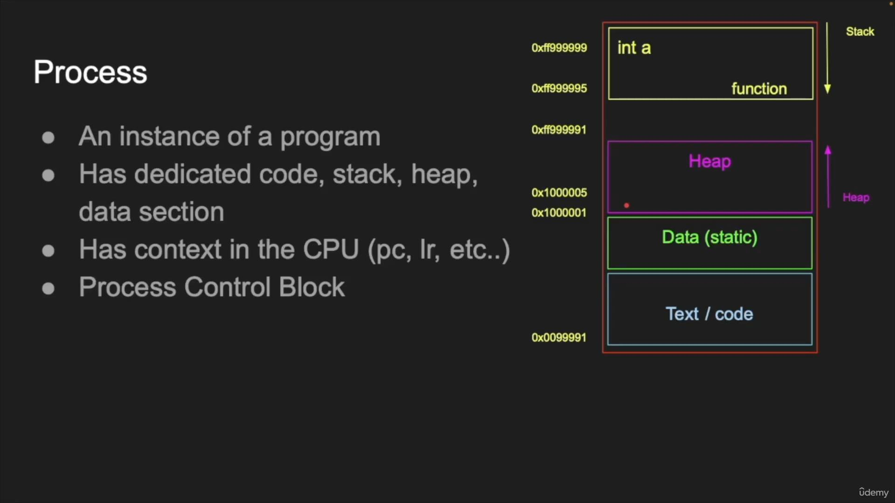
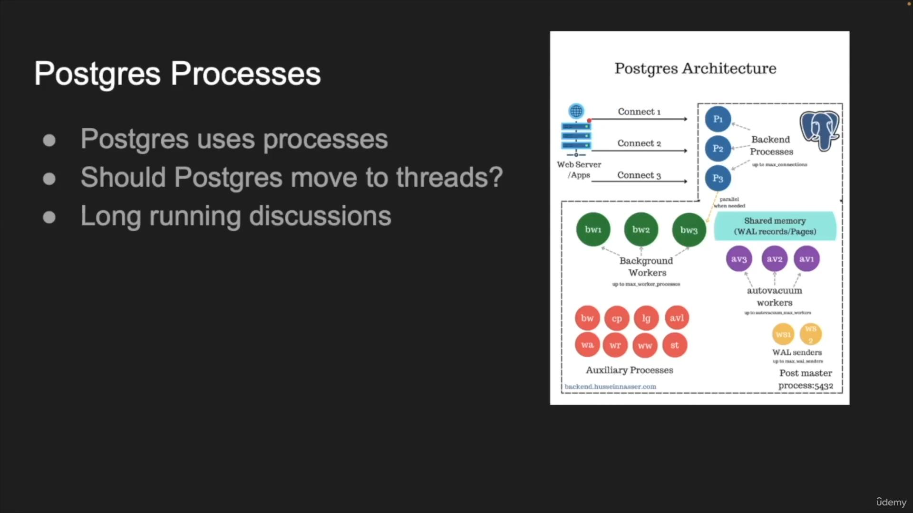
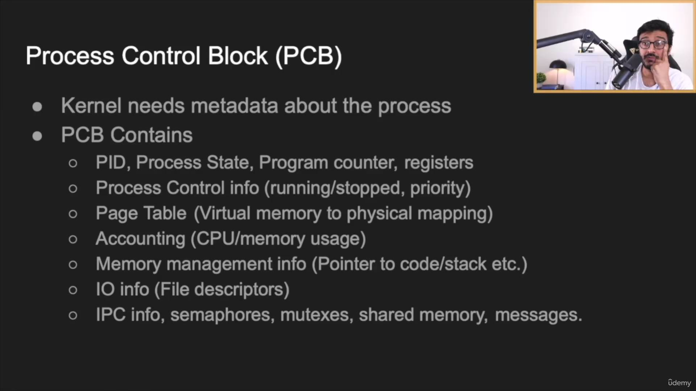
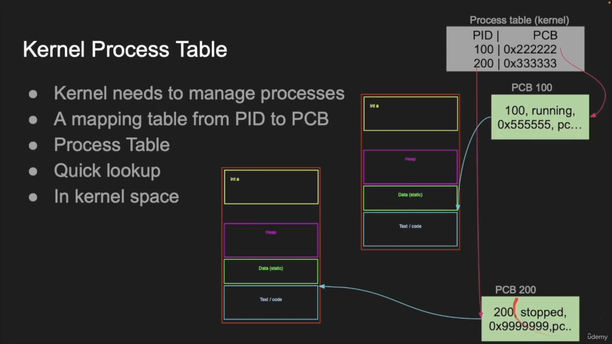
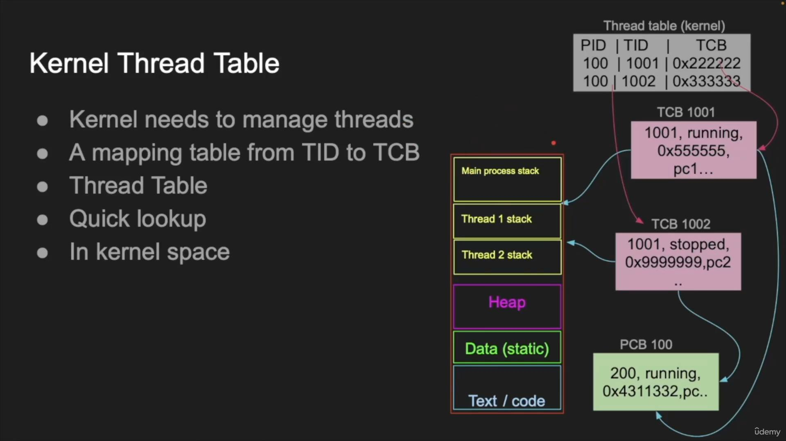
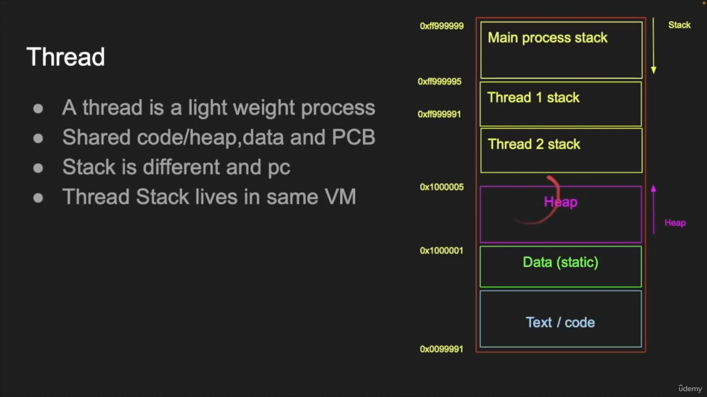
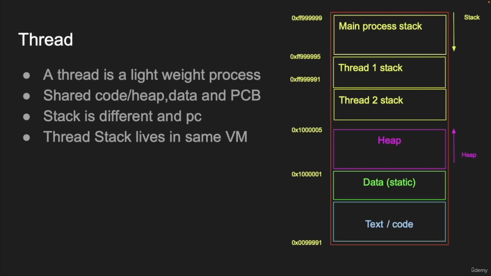

# NodeJS Internals · P032 进程与线程（可复现课程文档）

> 说明：P032 是讲师从操作系统课里切出来的一节概念课，**逐字稿里没有一行代码、没有一个命令行**。因此本文的「复现」不是复现一个项目，而是复现讲师那条推导链：需求 → 约束 → 估算 → 方案 → 取舍，并把它落成可直接使用的数据模型表、决策表、容量估算表，外加三段用于亲手验证「隔离 vs 共享」的最小示例（示例代码课里没有，均已标注）。

---

## 1. 这一节做什么

这一节解决一个问题：**为什么会有「线程」这个东西，它和「进程」到底差在哪，差出来的这部分差异在工程上怎么用。**

讲师开场先给了动机——这不是一节孤立的理论课，它是后面 Node threads、Node child processes 的地基：

> "the next topics are node threads in details and node trial processes. So we can't really dive into node threads and processes without understanding these two things" —— p032 [00:00]

所以本节的全部内容，都是为了让读者在之后看 Node 的多线程 / 多进程 API 时，能自己回答三个问题：

1. 起一个执行流，内核到底给它分配了什么、让它共享了什么？
2. 分配/共享的边界画在哪里，直接决定了切换成本、内存成本和安全边界。
3. 一条连接一个执行流（进程或线程）为什么撑不住，工程上用什么兜底。

按本文照做，你会得到四样可直接使用的产物：

| 产物 | 位置 | 用途 |
|---|---|---|
| 推导链（需求→约束→估算→方案→取舍） | 第 3 节 | 换任何语言/运行时都能重跑一遍 |
| PCB / TCB 字段表、进程表 / 线程表记录格式 | 第 4.3 节 | 读内核文档、读 `ps`/`top` 输出、读 Node 文档时的对照表 |
| 设计决策表（进程 vs 线程 vs 池化） | 第 4.1 节 | 架构评审时直接引用 |
| 容量估算表 + 三个验证示例 | 第 4.4 / 4.5 节 | 估算连接数上限、亲手验证共享与隔离 |



---

## 2. 讲师原话（关键论断）

**进程是什么**

> "It's an instance of a program. Program is a process at rest, right? It doesn't have a heap, it doesn't have a stack because these two guys describe the runtime aspect of a process." —— p032 [00:58]

> "So it has dedicated code stack heap and data section. It has all of this dedicated... So in your memory is all yours." —— p032 [01:55]

**虚拟内存让「专用」看起来很便宜**

> "to the process it will look like as if it's dedicated. But... if you're reading from the heap, we're gonna give you the same data. You didn't change it. But if you actually changed it, then I'm gonna actually copy it and I'm gonna map your virtual memory address frame to the new frame" —— p032 [02:53]

**PCB 在核心里，你自己碰不到**

> "this is called the process control block... The process control block lives in the kernel... but you can't really access your own process control block" —— p032 [04:42]

**Linux 里一切都是文件**

> "at least in Linux, everything is a file. So any file you open as a process will be a file descriptive number. And those are stored in the process control block. So each process will have a list of open files." —— p032 [08:02]

**进程表**

> "the kernel has a process table. And it maps the process ID to a pointer to the PCB" —— p032 [09:27]

**为什么要发明线程**

> "a process execution has a cost." —— p032 [11:21]

> "Can we share the data, the text, even the heap, but only change things that absolutely needs changing just for the execution path?... Give me a new program counter and a new stack. And I'll be happy. That's what a lighter process looks like." —— p032 [19:41] – [20:10]

> "we called it a thread. So a thread is really nothing but a lighter weight process." —— p032 [20:39]

**线程共享什么**

> "We share the code, we share the data, those we know, we also share the heap. Even this little sucker is being shared." —— p032 [22:07]

> "All the threads share the PCB, the parent process control block, with all the file descriptors, with all the page table... the virtual memory is identical." —— p032 [26:55]

> "if I switch a thread to a different thread in the same CPU core, I can share this information. I don't need to flush it back to memory... So we don't need to flush the TLB." —— p032 [27:20]

**线程自己的部分**

> "another thing that the thread absolutely needs is a program counter" —— p032 [25:58]

> "The stack, of course, because I'm calling functions in my thread... there is a limited stack space for each thread" —— p032 [28:17]

**用线程接连接**

> "I can listen on port 8080 on my parent... That's called a socket... this is not a connection. That's just a listening socket." —— p032 [32:07]

> "why? Because the thread has access to that socket because it is the parent file descriptor. So you get everything for free from the parent... So you have like 10 threads or 4 threads or 5 threads, all calling accept on the same socket." —— p032 [34:01]

**线程表**

> "just like it maintains a process table, it needs to maintain a thread table... One implementation is this could be a hash table" —— p032 [37:22]

**Postgres 全用进程**

> "Postgres uses actually processes for everything, no threads at all." —— p032 [42:12]

> "for each connection, what Postgres does is it forks a brand new process... So for every connection, you get a process and dude, that is so much waste." —— p032 [43:06]

> "So what Postgres did is immediately limit the stuff. 100 is your maximum." —— p032 [44:06]

**fork 与 copy-on-write**

> "If fork returns zero, that means you're the child... If I'm greater than zero, then I'm the parent. If I'm minus one, that means I'm failed." —— p032 [49:20]

> "fork will immediately be boom, very quick. I will create a new PCB and all that stuff. But then when you do the first call to a function that will allocate a new memory... the virtual memory mapping maps to a completely different thing." —— p032 [50:17]

> "fork immediate. Everything is shared. Read, read, read, continue reading. But meanwhile, the parent is changing... as the parent makes change into its memory, that child is getting a brand new page with all the stuff, the original content of the memory." —— p032 [52:11]（Redis 快照）

**收尾**

> "processes have dedicated virtual machines. Threads share belong to the same process. Threads share the parent process memory. And based on that, we have the idea of copy on write." —— p032 [58:50]

---

## 3. 从零复现：把讲师的推导按步骤走一遍

这一节不写代码，写的是**推导**。你要做的是按顺序走完 6 步，每步做完都在纸上留下一条结论。全部走完后，第 4 节的四张表就是你的产出。

### 步骤 0 · 需求：一台机器上同时推进多条执行流

起点很朴素：一个 CPU 核心同一时刻只能执行一条指令流。要让「接连接」「跑查询」「写日志」同时进行，就必须有多条可被内核调度的执行流。讲师的说法是，一个进程"一次只能做一件事"，因为它"只有一个程序计数器" —— p032 [12:20]。

### 步骤 1 · 拆需求：一条执行流**最少**需要什么

这是整节最关键的一刀。讲师把它切得非常干脆：**只需要新的程序计数器 + 新的栈**。

> "Give me a new program counter and a new stack. And I'll be happy." —— p032 [20:10]

为什么是这两个？因为：

- **程序计数器**决定「我执行到代码的哪个位置」。两条流的进度天然不同，不能共用。
- **栈**决定「我的函数调用链、局部变量、返回地址」。讲师说 "如果我运行一个函数，我需要自己的栈，因为栈决定了执行" —— p032 [20:39]。
- 剩下的一切——代码段（text）、数据段、**堆**、页表、打开的文件描述符表、IPC 对象——**都可以共用**，因为它们是「资源」而不是「进度」。

于是你得到定义：**线程 = 共享父进程资源的执行流**。讲师原话 "线程其实不过是一个更轻量的进程" —— p032 [20:39]。


### 步骤 2 · 约束：进程的「专用」是定义，不是实现细节

反过来，进程为什么贵？不是因为它分配得多，而是因为**「专用」是它的定义**：

- 独立虚拟内存空间 → 必须有自己的页表（讲师："你会得到一个全新的栈、全新的堆、全新的数据……一个完全新的虚拟内存映射" —— p032 [17:22]）。
- 独立的栈与堆 → 每次创建都要真实准备这两块。
- 独立的 PCB → 内核要维护一整套元数据（见 4.3）。
- 切换进程必须换页表 → 讲师点名 TLB 那一笔开销（"我们不需要刷新 TLB" 是线程的福利，反过来说进程要付）。

而且这部分成本**优化不掉**：

> "even with all these optimizations there is still the overhead of the virtual memory mapping which you cannot do anything about" —— p032 [14:14]


### 步骤 3 · 估算（算式）

> ⚠️ 讲师**没有给任何具体字节数**。下面的字母是讲师口述的变量，数字代入是我给的**示意值**，用来演示算式怎么用；真实值请用你自己机器上实测的数字替换。

设同时在线的执行流数为 `N`。

**内存下界（进程模式）**

```
Mem_process ≈ N × (私有栈 S + 私有堆 H + 页表 PT + PCB 元数据)
            + 1 份 text + 1 份 data（同程序可共享）
```

**内存下界（线程模式）**

```
Mem_thread  ≈ N × (私有栈 S' + TCB + 保存的 PC/寄存器区)
            + 1 份 (页表 PT + 堆 H + text + data + 打开文件表)
```

差值（省下来的东西）：

```
Saving ≈ N × (H + PT + PCB 元数据) - N × TCB
```

也就是说，**每多一个线程，你省下的正是「一份堆 + 一份页表 + 一份 PCB 元数据」**，付出去的只是一份 TCB 加一个私有栈。

**切换成本**

```
Switch_process = 保存/恢复寄存器 + 保存/恢复 PC + 换页表 + TLB 相关处理
Switch_thread  = 保存/恢复寄存器 + 保存/恢复 PC + 换栈指针   （页表不动）
```

讲师的原话是：同进程内换线程，"我不需要把它刷回内存……我们不需要刷新 TLB" —— p032 [27:48]。

**代入 Postgres 场景（讲师给的变量：每连接一进程，上限 100）**

```
若 N = 20000 条连接（讲师举的数字），进程模式 → 20000 个进程
若每进程私有部分示意取 10 MiB → 20000 × 10 MiB = 200000 MiB ≈ 195 GiB
```

课里没说 10 MiB 这个数，这个算式只是说明「为什么 20000 连接 + 每连接一进程 = 死路」，讲师的原话是 "光是上下文切换就会要了我的命" —— p032 [44:06]。

### 步骤 4 · 方案：三层结构

讲师实际给了三层可选架构，按成本从高到低：

**方案 A · 每执行流一进程**（Postgres 模式）
每个连接 fork 一个后端进程，进程之间只有共享内存（`mmap` 标了 shared 的区域）是共享的。

**方案 B · 每执行流一线程**（演讲里演示的 web server 模式）
父进程先 `listen`，拿到一个**监听 socket 文件描述符**；然后起 N 个线程，每个线程拿**同一个** listen fd 去 `accept`。讲师强调这是「白捡」的：

> "because the thread has access to that socket because it is the parent file descriptor. So you get everything for free from the parent." —— p032 [34:01]

每次 `accept` 返回一个新的 fd —— 那是**一条具体连接**，不是监听 socket。讲师把这两个概念分得很清楚："这不是一个连接。那只是一个监听套接字" —— p032 [32:36]。


**方案 C · 池化 + 硬上限**（工程兜底）
既然执行流贵，就别一条用户连接配一条执行流。讲师给的做法是：连接池 + 上限。

> "You share, you pool. So there is a connection pool here. You get 10, 15, 50, and you can share those connections safely between multiple users." —— p032 [45:02]

取连接时必须「标记为已用」，不能两条请求同连接并发跑（讲师："你不会想在同一条连接上并行发送两个请求" —— p032 [45:31]）。真要并发同连接，那叫 pipelining，需要客户端自己给查询打 ID 来对答案（p032 [46:29]–[47:26]）。



### 步骤 5 · 取舍

| 方案 | 隔离性 | 单执行流成本 | 切换成本 | 适合 |
|---|---|---|---|---|
| A 每连接一进程 | 最强（页表独立，讲师：进程间只有共享内存能共享） | 最高 | 最高（换页表 / TLB） | 连接数可控、崩溃要隔离（Postgres 后端进程） |
| B 每连接一线程 | 弱（共享堆，讲师："线程是不安全的" —— p032 [24:31]） | 低 | 低（不换页表） | 单机高并发 IO |
| C 池化 + 上限 | 取决于池内是进程还是线程 | 由池大小决定 | 摊薄 | 有大量短连接用户时的默认解 |

### 步骤 6 · 补丁：copy-on-write 让「进程」没那么贵

fork 不是立刻拷贝。讲师的说法是 "fork 会立刻“砰”地一下完成，非常快。我会创建一个新的 PCB"，父子**先共享全部物理页**，只在**第一次写**某一页时才复制那一页。判返回值：`0` = 子进程，`>0` = 父进程，`-1` = 失败（p032 [49:20]）。

这个机制有两个经典用法和一个经典坑：

- 用法 1（Redis 快照）：fork 后子进程只读，父进程继续改；父进程每改一页，子进程就"拿到一份原始内容的拷贝"，于是子进程眼里永远是 fork 那一刻的快照 —— p032 [52:11]。
- 用法 2（进程池预热）：fork 后大量只读访问几乎零成本。
- 坑（Python 的 `None/True/False` 引用计数）：讲师讲了这段——每次"读"这几个常量都要更新引用计数，而**更新计数就是写**，于是每次 fork 后的读都触发一次 COW，白白复制整页（p032 [55:27]–[57:51]）。结论："在 Python 里，读操作就是写操作"（p032 [56:53] 附近）。

---

## 4. 完整代码 / 完整产物

> **课里没有代码，以下为示意。** 4.1–4.4 是从讲师口述内容整理出的可直接使用的表与数据模型；4.5 是我补的三段最小验证脚本，用来亲手看到「进程隔离」和「线程共享」。

### 4.1 设计决策表

| 决策 | 选它 | 不选它的后果 |
|---|---|---|
| 执行流的私有物只给「程序计数器 + 栈」 | 切换不换页表、共享堆和 fd 表，创建便宜 | 若连堆也私有，就退化回进程，成本回到方案 A |
| 页表、PCB、fd 表由同进程内所有线程共享 | 起线程时"for free"拿到父进程所有监听 socket | 每个线程各建一套 fd 表 → 无法共享监听 socket，`accept` 架构不成立 |
| 每线程仍分配独立栈 | 函数调用链互不干扰 | 共用栈 → 一调用就互相踩返回地址，直接崩 |
| 线程栈仍落在父进程同一虚拟内存里 | 不需要额外映射，只是地址区间切分 | 若另开映射，就丢了「不换页表」这个最大收益 |
| fork 后延迟复制（COW） | fork 立即返回，只读场景近乎免费 | 立刻全量拷贝 → fork 慢到无法用于快照/进程池 |
| 高并发连接走池化 + 上限 | 执行流数量与用户数解耦 | 一连接一执行流 → 上下文切换和内存双双爆掉 |

### 4.2 组件职责表

| 组件 | 在哪 | 归谁 | 职责 |
|---|---|---|---|
| 代码段 / 数据段 | 进程虚拟内存 | 同程序的多个进程可共享 | 放指令与静态数据；程序"静止"时只有这两块（p032 [00:58]） |
| 堆 | 进程虚拟内存 | 同进程内所有线程共享 | 动态分配；线程间可互相读写（p032 [22:35]） |
| 栈 | 进程虚拟内存中的一段 | **每线程私有**，区间由父进程切分 | 函数调用链；容量有限（p032 [28:45]） |
| PCB | 内核空间 | 每进程一份 | 进程 ID、页表、状态、PC、寄存器、调度信息、记账、内存信息、打开文件表、IPC（p032 [05:40]–[08:58]） |
| TCB | 内核空间（讲师：'probably living in the kernel area' —— p032 [37:51] 附近） | 每线程一份 | TID、状态、PC、寄存器、指向父 PCB 的指针、栈指针、CPU/内存用量 |
| 进程表 | 内核空间 | 全局 | PID → PCB 指针 |
| 线程表 | 内核空间 | 全局 | (PID, TID) → TCB 指针；讲师建议用 hash 表做快查（p032 [37:22]） |

### 4.3 数据模型草案（字段全部来自讲师口述）

**PCB（Process Control Block）**

| 字段 | 讲师出处 | 说明 |
|---|---|---|
| `pid` | p032 [05:40] | 进程 ID |
| `state` | p032 [05:40] | running / stopped 等 |
| `program_counter` | p032 [04:14] | 被换出 CPU 时保存的 PC |
| `registers` | p032 [04:14] | 链接寄存器、指令寄存器等 |
| `page_table` | p032 [05:11] | 虚拟→物理映射，讲师称"very critical" |
| `sched_info` | p032 [06:38] | 优先级等调度信息 |
| `accounting` | p032 [07:07] | 用了多少 CPU、多少内存 |
| `mem_info` | p032 [07:07] | 代码起始、栈起始（用于建基址指针） |
| `open_files` | p032 [08:02] | 打开文件描述符列表；socket/连接/磁盘文件都在这 |
| `ipc` | p032 [08:58] | 信号量、互斥量、共享内存、消息 |
| `parent` | p032 [31:10] | 父进程关系（讲师在 TCB 里点名"指向父 PCB"） |

**TCB（Thread Control Block）**

| 字段 | 讲师出处 |
|---|---|
| `tid` | p032 [35:00] |
| `state`（ready / stopped） | p032 [35:00] |
| `program_counter` | p032 [35:00] |
| `registers` | p032 [35:00] |
| `sched_info`（进程控制信息） | p032 [35:29] |
| `mem_info`（指向自己那份栈） | p032 [36:54] |
| `cpu_mem_usage`（记账） | p032 [36:54] |
| `parent_pcb`（用于拿页表 / 虚拟内存信息） | p032 [37:22] |
| `open_files`（"maybe other information like the file descriptor"） | p032 [37:22] |

**线程表记录格式**

```
{ pid: 200, tid: 1001, tcb_ptr: 0x..., state: "running",
  stack_ptr: 0x..., program_counter: 0x... }
```

讲师特别指出一种正常现象：线程在跑而父进程在睡（"奇怪的是父进程没在运行而线程却在运行……虽然也不一定非得如此" —— p032 [39:19]）。







### 4.4 容量估算表

输入变量全部来自讲师口述，**数值为示意，课里没有给数字**：

| 变量 | 含义 | 讲师依据 | 示意取值 |
|---|---|---|---|
| `N` | 并发执行流数 | Postgres 场景讲师举 20000 连接 | 20000 |
| `S` | 每线程私有栈 | "每个线程的栈空间有限" p032 [28:45] | 1 MiB |
| `M_priv` | 每进程私有部分（堆+页表+PCB 元数据） | p032 [17:22] | 10 MiB |
| `T` | 每 TCB 元数据 | p032 [35:00]–[37:22] | 2 KiB |
| `MAX_CONN` | 硬上限 | "100 is your maximum" p032 [44:06] | 100 |

| 场景 | 算式 | 结果 |
|---|---|---|
| 进程模式，N=20000 | `20000 × 10 MiB` | ≈ 195 GiB |
| 线程模式，N=20000 | `20000 × (1 MiB + 2 KiB)` | ≈ 19.5 GiB |
| 池化后，N=20000 用户 / 池=100 | 常驻执行流 = 100 | `100 × 10 MiB` ≈ 1 GiB（进程型池） |

> 结论只用来对照量级：执行流数量必须与用户数量**解耦**，否则量级差 10 倍以上。真实数字用你自己环境实测替换。

### 4.5 验证脚本（课里没有代码，以下为示意）

目录结构：

```
demo/
├── process-isolation.js   # 父进程 fork 两个子进程，验证进程间内存不共享
├── counter-child.js       # 子进程逻辑
└── thread-share.js        # 两个 worker 线程共享一块内存，验证线程共享堆
```

**demo/process-isolation.js**

```js
// 课里没有代码，以下为示意
// 运行：node demo/process-isolation.js
// 需要 Node >= 16（使用了 node: 前缀）
const { fork } = require('node:child_process');
const path = require('node:path');

const childFile = path.join(__dirname, 'counter-child.js');

const a = fork(childFile, ['A']);
const b = fork(childFile, ['B']);

a.on('message', (msg) => console.log('[parent] 收到 A:', msg));
b.on('message', (msg) => console.log('[parent] 收到 B:', msg));

a.on('exit', (code) => console.log('[parent] A 退出 code =', code));
b.on('exit', (code) => console.log('[parent] B 退出 code =', code));

setTimeout(() => {
  a.kill();
  b.kill();
}, 2000);
```

**demo/counter-child.js**

```js
// 课里没有代码，以下为示意
// 每个子进程都有自己的计数器 n，父子之间、兄弟之间都不共享
const name = process.argv[2] || 'unknown';
let n = 0;

const timer = setInterval(() => {
  n += 1;
  if (n % 3 === 0) {
    process.send({ name, n });
  }
}, 200);

process.on('SIGTERM', () => {
  clearInterval(timer);
  process.exit(0);
});
```

**demo/thread-share.js**

```js
// 课里没有代码，以下为示意
// 运行：node demo/thread-share.js
// 两个 worker 线程写同一块内存：对应讲师说的「线程共享堆」
const { Worker, isMainThread, workerData } = require('node:worker_threads');

if (isMainThread) {
  const sab = new SharedArrayBuffer(4);      // 4 字节，放一个 Int32
  const view = new Int32Array(sab);

  new Worker(__filename, { workerData: sab });
  new Worker(__filename, { workerData: sab });

  setTimeout(() => {
    console.log('[main] view[0] =', view[0]);  // 期望 14（两个线程各 +7）
  }, 300);
} else {
  const view = new Int32Array(workerData);
  Atomics.add(view, 0, 7);                     // 共享内存上的原子加
}
```

运行与预期：

```bash
node demo/process-isolation.js
# [parent] 收到 A: { name: 'A', n: 3 }
# [parent] 收到 B: { name: 'B', n: 3 }
# ↑ 两个子进程各自从 0 数到 3，互不影响 = 进程隔离

node demo/thread-share.js
# [main] view[0] = 14
# ↑ 两个线程写的是同一块内存 = 线程共享
```



---

## 5. 逐行解释

### 5.1 PCB 字段为什么必须有这些

- **`program_counter` / `registers` 必须存**：讲师的说法是进程"它有一部分驻留在 CPU 里"，一旦被换出，CPU 里那点状态就丢了；只有把它们写回内存（PCB）才能恢复（p032 [04:14]–[06:09]）。**不存 = 换回来就接不上原来的执行位置。**
- **`state` 必须存**：running/stopped 是调度器唯一能判断"这个能不能上 CPU"的依据，没有它调度器就是在盲选。
- **`page_table` 最关键**：进程的定义就是「独立虚拟内存」，独立虚拟内存的载体就是独立页表。**没有这一项，「进程」就不成立** —— 讲师的原话是 "页表非常关键"（p032 [31:10]）。
- **`accounting` 为什么也要存**：调度要"公平/高效"就必须知道谁用了多少 CPU、多少内存（p032 [07:07]）。没有记账，调度策略退化成轮转。
- **`mem_info`（代码起始 / 栈起始）为什么也要存**：内核要能构造基址指针、要在崩溃时能 dump、要能在 fork 时复制区间。讲师说"这些只有你真去写内核才会想到"（p032 [07:35]）。
- **`open_files` 为什么和 PCB 绑**：Linux 里 socket、连接、磁盘文件统一都是 fd（p032 [08:02]–[08:30]）。把它挂在 PCB 上，就自然得到「线程白捡父进程的监听 socket」这一收益——**这是 34:01 那段 accept 架构能成立的唯一原因**。在 JS/Node 里，对应的是同一进程内多个 `worker_threads` 能共享父进程持有的资源句柄，而 `child_process` 出来的子进程拿不到父进程的 fd 表。
- **`ipc` 为什么在 PCB 而不是 TCB**：信号量/互斥量/共享内存是**进程级**资源，线程之间本来就共享地址空间，用不到内核再帮你建一套。

### 5.2 TCB 字段为什么只要这些

- **`tid`**：进程表用 PID 索引，线程表必须用 TID（讲师："一个专门给线程用的特殊 ID" —— p032 [35:00]）。
- **`program_counter` 单独存**：这是线程存在的**理由本身**。讲师明说线程"可能在代码中完全不同的区域执行……你绝对需要自己的程序计数器"（p032 [26:28]）。
- **`mem_info` 指向自己的栈**：栈是执行路径的载体，私有栈必须私有到"指针级别"（p032 [36:54]）。
- **`parent_pcb` 指针**：省掉整张页表和 fd 表，靠一个指针回去拿。**没有这个指针，TCB 就得自带页表，线程立刻退化成进程。**
- **`state` + 记账**：讲师把调度单独拎出来说"有人靠这个东西拿博士学位"（p032 [07:07] / [35:29]），因为"内核是通用的，它并不了解你的工作负载"（p032 [36:26]）。这一条在工程上的落点是：**如果你的负载有明确优先级，就不要指望通用调度器猜对**。

### 5.3 线程表为什么建议 hash

讲师给的理由只有一句：需要"一种快速查找的方式"（p032 [37:51]）。挨个遍历链表找 TID 是 O(N)，在每次调度、每次系统调用都要查一次的场景下不可接受。用 `(pid, tid)` 做 key 的 hash 表把查找压到 O(1)。在线程数固定（比如 4/10/50 个工作线程）时链表也够用——**这就是为什么讲师说"你想怎么做都行，只要高效就行"（p032 [09:56]）**。

### 5.4 估算表每一行为什么这么算

- **进程模式 `N × M_priv`**：因为进程"一切都是专用的"（p032 [17:22]），私有部分随 N 线性增长，且**优化不掉**（p032 [14:14]）。代入 20000 得出的 ~195 GiB 就是"每连接一进程"在 20000 连接下必死的量级原因。
- **线程模式 `N × (S + T)`**：因为堆、页表、fd 表被移出了 N 的乘数（p032 [26:55]）。**注意主导项从 M_priv 掉到了 S** —— 所以线程模式真正的天花板是**栈总量**，不是堆。
- **池化后的常驻数**：池的意义是"把 N（用户数）从公式里删掉"，只保留池大小。这也是讲师说 Postgres "100 is your maximum" 之后必须配连接池的原因（p032 [44:06] / [45:02]）。
- **切换成本那两行**：进程切换多了「换页表 + TLB 处理」，线程切换少了这一项（p032 [27:48]）。所以**线程模式的收益有两份：内存少一份、切换便宜一截**。

### 5.5 4.5 三个脚本逐条说明

- `fork(childFile, ['A'])`：这里用的是 Node 的 `child_process.fork`，**它启动的是一个全新的 Node 进程**，不是讲师讲的那个 OS `fork` 系统调用（讲师讲的 `fork` 是返回 0 / >0 / -1 的那个，p032 [49:20]）。Node 这个 API 不在课里，属我补充。
- `let n = 0` 放在子进程文件里：每个子进程加载一次该模块，`n` 是各自的。所以两个子进程都数到 3 —— 这就是讲师说的"进程里所有东西都是你自己的"（p032 [01:55]）的最小可见证据。
- `SharedArrayBuffer(4)` + `Atomics.add`：两个 worker 写同一块内存。讲师说的是线程"共用同一个堆"（p032 [22:35]），这里用共享内存把同一语义显式化；`Atomics` 对应讲师提到的互斥量/信号量那一类同步原语（p032 [08:58]）。**在 JS/Node 里，线程间共享可变内存的唯一正规手段就是这类共享缓冲区 + 原子操作**，普通对象在 worker 之间是拷贝传递，不是共享。
- 期望值 14 的原因：两个 worker 各执行一次 `Atomics.add(view, 0, 7)`，`0 + 7 + 7 = 14`。如果换成一个非原子的读-改-写，就有丢失更新的风险——这正是讲师说"线程不安全"（p032 [24:31]）的具体形态。

### 5.6 决策表逐条反证

- **「私有物只给 PC+栈」不这么定会怎样**：如果给线程也配私有堆，那么 `Saving ≈ N × (H + PT + PCB)` 里的 `H` 和 `PT` 全部回到乘数里，线程的内存曲线就和进程一样陡——那线程就没有存在意义了。
- **「共享 fd 表」不这么定会怎样**：34:01 那个"多线程 accept 同一个监听 socket"的架构直接不成立，因为线程拿不到父进程的 listen fd。
- **「fork 延迟复制」不这么定会怎样**：Redis 用 fork 拍快照会退化成"fork 时全量拷贝一遍内存"，讲师的说法是 "那要花我好几个小时才能做完"（p032 [52:11] 附近）。
- **「池化 + 上限」不这么定会怎样**：回到 4.4 第一行，20000 连接 ≈ 195 GiB，还没算上下文切换。

---

## 6. 复现检查清单

走完本文，逐项打勾：

- [ ] 能不看文档复述：一条执行流**最少**需要哪两样私有物（PC + 栈），并说出其余为什么可共享。
- [ ] 能列出 PCB 至少 8 个字段，并说出每个字段「不存会怎样」。
- [ ] 能说出 TCB 相比 PCB **少了哪几大块**（页表、完整 fd 表、IPC 对象），以及它是靠哪个字段补回来的（指向父 PCB 的指针）。
- [ ] 能画出 进程表（PID→PCB）与 线程表（PID+TID→TCB）两张表的关系。
- [ ] 能写出 4.4 的三个算式，并解释线程模式里主导项为什么从「私有堆」变成「私有栈」。
- [ ] 能解释 Postgres 的 100 上限和连接池之间的关系。
- [ ] 能解释 accept 架构里监听 socket 与连接 fd 的区别（p032 [32:36] / [33:32]）。
- [ ] 能说出 fork 的返回值约定：0 / >0 / -1 分别代表什么。
- [ ] 能讲出 COW 的两个用法（Redis 快照、进程池预热）和一个坑（引用计数把读变成写）。
- [ ] `node demo/process-isolation.js` 跑通，看到两个子进程各自计数、互不影响。
- [ ] `node demo/thread-share.js` 跑通，看到 `view[0] = 14`。
- [ ] 用自己机器上的实测值替换 4.4 的示意数字，重算一遍三种场景，写下结论。


---

## 7. 课里没讲但你会撞上的

1. **Node 的 `child_process.fork` 不是 OS 的 `fork`。** 课里讲的 `fork` 是系统调用（返回值 0/>0/-1，配合 COW，p032 [49:20]）；Node 的 `fork` 是"起一个新的 Node 进程 + 建一条 IPC 通道"，你会拿到一个独立的 V8 堆和独立的事件循环。**别拿课里的 COW 去解释 Node `fork` 的内存行为**，它们不在同一层。

2. **Node 主线程只有一个 JS 执行栈，但"线程"在 Node 里不止一种。** 课里讲的线程是内核线程（共享堆、私有栈、私有 PC）。Node 里你能摸到的是 `worker_threads`（真线程，各有独立事件循环和独立 V8 isolate，默认**不共享** JS 对象，只能用 `SharedArrayBuffer` 那类显式共享内存），以及 libuv 的线程池（课里完全没提，它主要给文件 IO / DNS 之类的活儿用）。**"共享堆"在 Node 的 worker 里默认不成立**——这是你和讲师那套通用模型对不上号的第一个地方。

3. **`cluster` 的取舍就是这个 P032 的取舍。** `cluster` 起的是子进程（隔离强、成本高）还是 worker 线程（成本低、共享多），取决于你用哪个模式。课里给的框架可以直接套：要隔离就用进程模式，要省内存就上线程/池化，要都占就两者混用。

4. **Postgres 的 100 是讲师给的示意值，不是固定值。** 课里原话是 "100 is your maximum"（p032 [44:06]），但实际能不能超过 100 取决于你的配置项和你机器的内存。**具体参数名与默认值请以你所装版本的实际配置项为准**，课里没讲。

5. **池化之后会撞上"同一连接上的并发响应错配"。** 讲师点名了这个问题（p032 [46:29]–[47:26]）：同一连接上并发发 query1/query2，返回顺序可能反了，客户端必须靠**查询 ID** 对齐。所以「连接池」不是无脑安全的，池 + 单连接串行 才是默认安全姿势。

6. **COW 在容器里看 `RSS` 会骗你。** fork 之后父子的内存占用在统计上常常看起来"加起来远超容器 limit"，但实际共享页只算一次。课里讲的是机制（p032 [52:11]），没讲怎么在容器里读这个数字，遇到时别慌。

7. **线程栈是有硬上限的，"递归太深"会先炸栈再炸堆。** 讲师明确说 "每个线程的栈空间是有限的"（p032 [28:45]）。课里没给数值；你在 Node 里调深递归时会撞到的是运行时自己的栈上限，**具体数值请以你所在运行时版本为准**。

8. **"堆不可执行"这条保护是有开关的。** 讲师提到现代内核默认不让堆上的内容被执行（p032 [30:14] 附近），但在某些环境下这个保护可以被关掉/绕过。这条属于安全边界，**做 AI 应用/服务端时不要依赖它作为唯一防线**。

9. **通用调度器不认识你的 workload。** 讲师那句话很重："通用性的东西无法扩展……它不了解你"（p032 [36:26]）。落到你的日常：别指望默认的调度策略自动帮你的推理请求排优先级——**该自己排队的地方就自己排队**。

