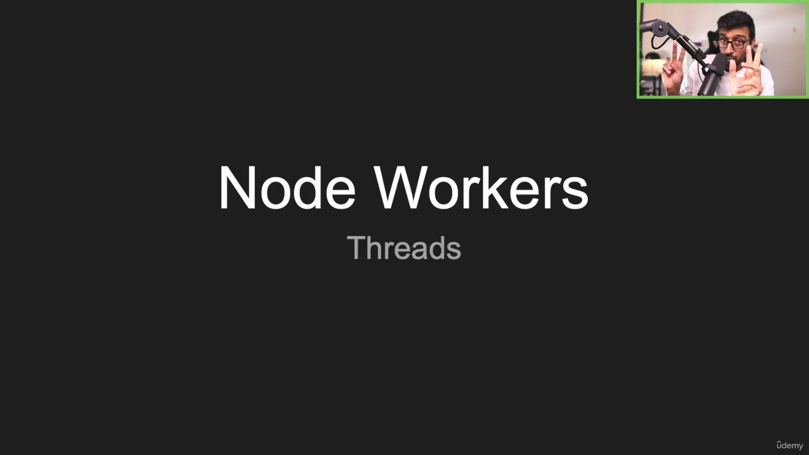
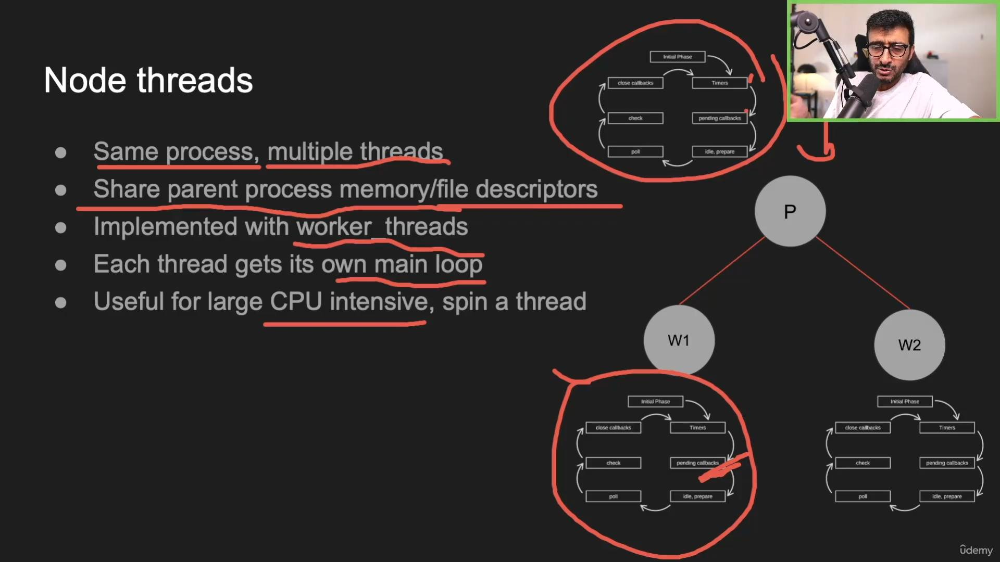
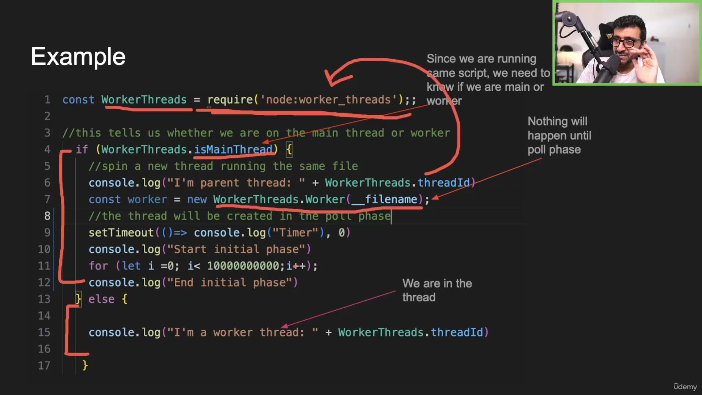
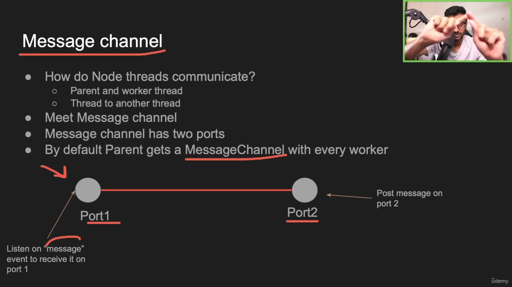
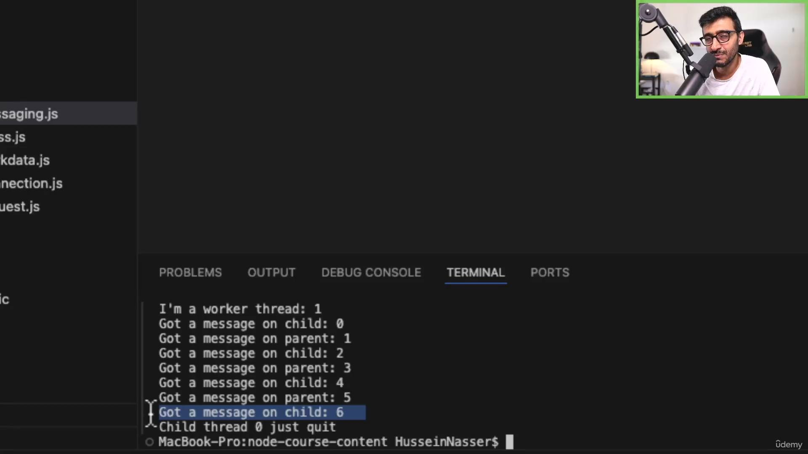
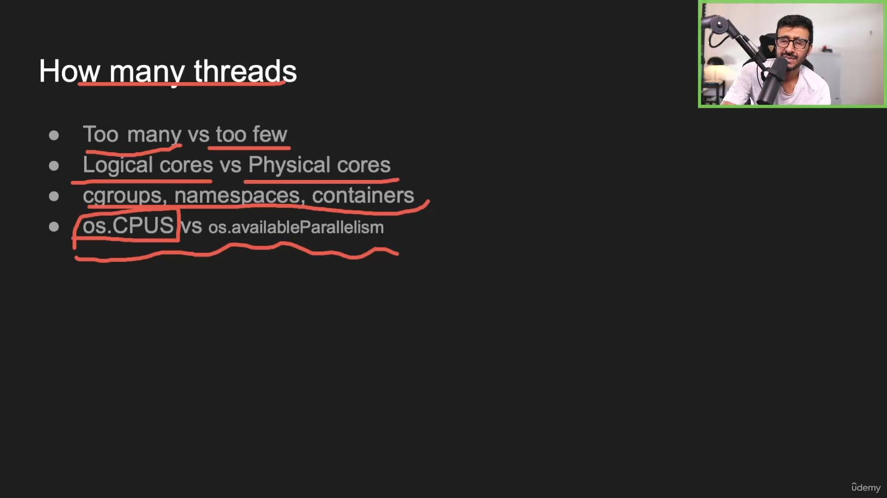
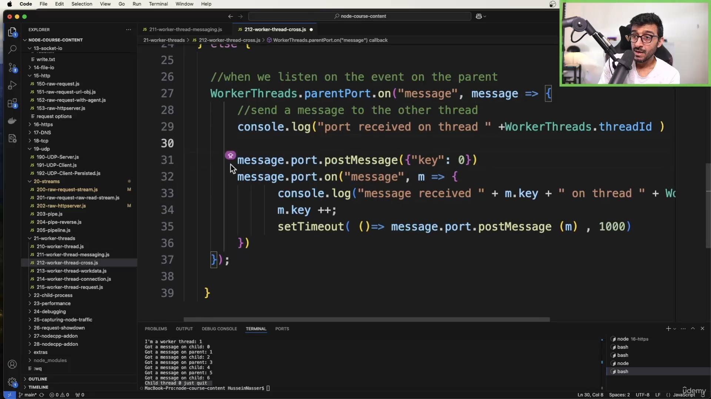
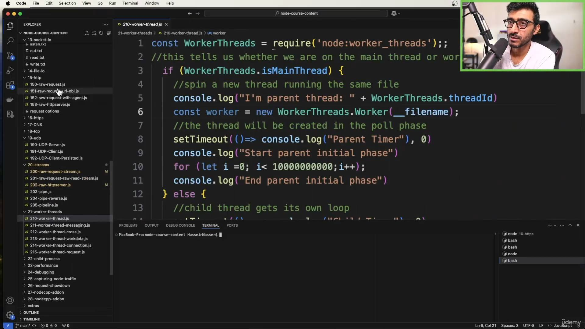
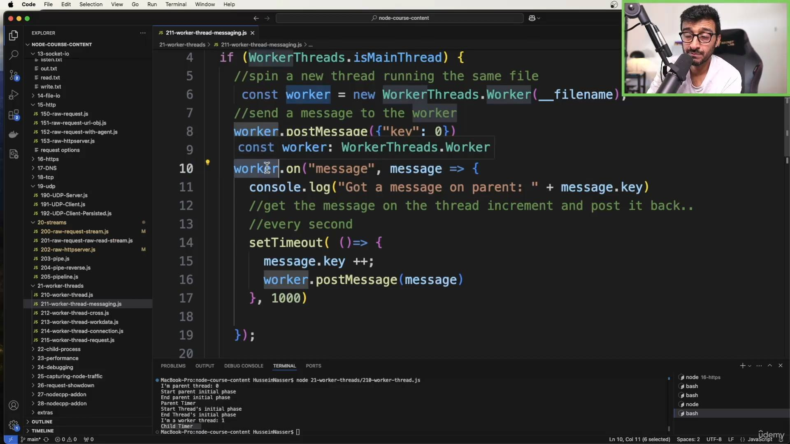
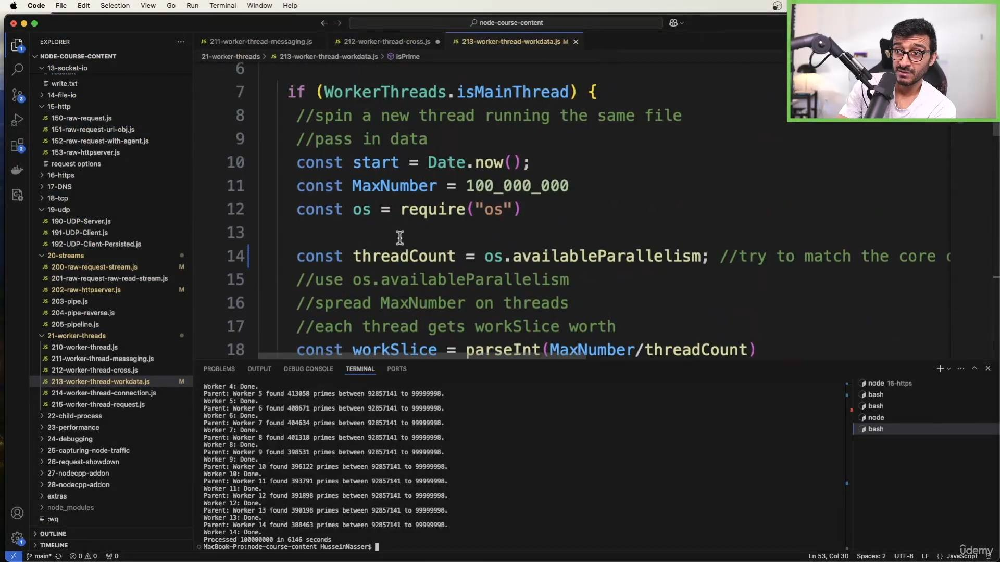

# Node.js Internals · P033：worker_threads —— 把 CPU 密集的活从主循环里挪出去

> 课程：BV1jGRyBsEBa ｜ 覆盖 P033 ｜ 本篇所有代码只用 Node 内置模块，无需 `npm install`

---

## 1. 这一节做什么

这一节把「Node 是单线程的」这件事从一句口号变成一个能跑起来的东西。前面几十讲已经把 event loop 的六个阶段（timer / pending callback / idle-prepare / poll / check / close callback）、stream、socket、HTTP 请求响应对象都拆过了；到这里讲师要解决的是这套模型唯一解决不了的问题：**如果一个回调里做的是 CPU 密集的工作（大循环、排序、素数判断、内部结构操作），主线程的 event loop 就会被整个卡住，所有正在服务的连接一起停摆。** I/O 密集不是问题，因为异步 I/O 会把活甩给 libuv 的线程池、主线程继续往下走；CPU 密集才是问题。

解法就是 `worker_threads`：起一个**能执行 Node 代码的线程**（不是子进程），它和父进程共享堆内存、共享已打开的文件描述符，但**拥有一个完全独立的 event loop**。主线程继续 accept 连接、读写响应，被阻塞的是 worker 自己的循环，「我们不在乎 worker 被阻塞，我们在乎主进程不被阻塞」。

按讲师列出的顺序，这一节要做六个可以逐个跑起来的小项目，最终得到一个目录结构：

```
nodejs-internals-p033/
├── package.json
├── 01-basic/
│   └── index.js          # 最小 worker：理解 isMainThread 与独立 event loop
├── 02-parent-child-messaging/
│   └── index.js          # 父 ↔ 子线程 ping-pong，理解 parentPort 与线程何时退出
├── 03-worker-to-worker/
│   └── index.js          # 两个 worker 直接对话，理解 MessageChannel + transferList
├── 04-worker-data-primes/
│   └── index.js          # workerData 分发任务：100M 内素数计数，14 线程 vs 2 线程
├── 05-distribute-connection/
│   └── index.js          # 把连接的文件描述符分发给线程（讲师明确说不推荐）
└── 06-distribute-request/
    └── index.js          # 线程池分发 HTTP 请求（讲师说「这个我署名」的那个）
```

运行环境：任意装了 Node 的机器，不需要第三方依赖，也不需要环境变量。05 用 3000 端口、06 用 8080 端口，跑之前确认没被占用。

---

## 2. 讲师原话

关于「为什么需要线程」，讲师的切入点不是「多核」，而是「阻塞」：

> "当任务是 I/O 时，这不是匹配问题，因为我们可以做异步 I/O，主线程可以继续处理其他阶段……但如果它是 CPU 密集型回调……那主循环就会达到极限。我们会因为那段昂贵的 CPU 计算把它阻塞住。"
> —— p033 [00:59]

关于线程到底是什么，他强调的不是「并发」，而是**共享**：

> "线程处在同一个进程里，但有多条执行线程。因此每个线程都有自己的栈，但它们会共享堆，总体上会共享内存。"
> —— p033 [01:55]

> "当你启动一个线程，说“我要一个新线程”时，最重要的一点是要理解：每个线程都会有自己的主循环，而且不同于父线程的主循环。"
> —— p033 [02:53]

他还讲了一个（他说是前一天读到的）真实事故，用来解释为什么「加内存」不能救 Node 的 CPU 瓶颈：某团队把 serverless 函数的内存从 1GB 加到 10GB，账单涨了大约 400%（「like four thousand dollars a month」），因为该平台的定价模型是内存和 vCPU 按比例给——加内存等于白买了五个用不上的 CPU，而 Node 是单线程的，那些 CPU 根本没被用到，I/O 线程池「barely touches any of the CPUs」。

> "它们根本没有用上这些 CPU，因为 Node.js 是单线程应用……所以他们花 4000 美元买的这些东西实际上毫无用处。"
> —— p033 [05:44]

关于线程间通信，他给了一个非常具体的实现层描述——这段话是理解 `MessageChannel` 的关键：

> "这不过是内存层面的事。实际上就是对内存加排他锁，因为本质上只是把消息从一个地方复制到另一个地方，尤其是线程会与父进程共享内存。"
> —— p033 [08:39]

> "每个消息通道都会有两个端口，实际上就叫端口1和端口2。所以你在端口2上发送消息，在另一个端口上监听事件，就能收到消息。"
> —— p033 [07:41]

关于线程数量，他先讲代价再讲怎么选：

> "如果你创建一千个线程，而只有四个核，那就会在这些线程之间不断进行上下文切换……如果线程太少，又会浪费资源……假设你有 16 个核，但只有四个线程，你就没有充分利用 CPU 的全部能力。"
> —— p033 [12:28]

> "这就是为什么你要用另一个选项，也就是 `os.availableParallelism()`。它相当于说：没错，我知道这个操作系统有四个 CPU……但受虚拟机或容器限制后，当前真正可用给你的是这个数。"
> —— p033 [15:50]

关于两个 worker 互相通信，他说得很直白，就是「玩把戏」：

> "我们会耍个花招。具体做法是创建一个消息通道，把这个消息通道本身发给两个不同的线程。然后告诉它们：你拿一个端口，你拿另一个端口，你们互相通信，但由你作为父线程来协调。"
> —— p033 [09:35]

关于最后一个例子（请求分发），他主动「署名」了：

> "这里，这个，我敢为它担保。你可以这样做。现在这就说得通了，因为我们转移的不是连接，连接仍然留在父线程上。但我要做的是，把所有连接收到的请求发送出去。我要把请求分发到各个线程上。"
> —— p033 [47:13]–[47:42]

以及那个反例的自我否定：

> "这太不靠谱了，对吧？这段代码是我写的，我确实让它跑通了，但我不建议你使用。它只是为了演示。"
> —— p033 [41:07]





---

## 3. 从零复现

### 步骤 0：确认 Node 版本

```bash
node -v
```

这套代码用到的 `os.availableParallelism()` 是一个相对新的 API（课里没讲版本要求）。如果你运行 04 时看到 `TypeError: os.availableParallelism is not a function`，把那一行换成 `os.cpus().length` 即可——讲师自己留了这个后门：「You can also use OS.CPUs, right?」

### 步骤 1：建目录、装一个空的 package.json

```bash
mkdir -p nodejs-internals-p033/{01-basic,02-parent-child-messaging,03-worker-to-worker,04-worker-data-primes,05-distribute-connection,06-distribute-request}
cd nodejs-internals-p033
```

把第 4 节给出的 `package.json` 存进去。**这个项目没有任何 `dependencies`**，所以不用 `npm install`。

### 步骤 2：先跑 01-basic，建立对「独立 event loop」的直觉

```bash
node 01-basic/index.js
```

你会看到两个线程各自维护自己的循环：主线程先把 CPU 循环跑完、打出 `parent initial phase done`，然后才在 poll 阶段真正把这个 worker 启动起来；worker 进程内 `isMainThread` 为 `false`，走 else 分支，在**它自己的** initial phase 里又做了一次循环，最后才是它自己的 timer。讲师当时念出来的大致顺序是：`I'm a parent thread 0` → `starting parent initial phase done` → `we did a parent timer` → `worker thread ...` → 子线程的 initial phase → 子线程的 timer。



### 步骤 3：跑 02-parent-child-messaging，看线程什么时候才会退出

```bash
node 02-parent-child-messaging/index.js
```

预期会看到一条从 0 开始、每次 +1 的 ping-pong，大约每秒一轮，到 6 之后子线程 `parentPort.close()`，父线程收到 exit 事件打出「the child thread just quit」。**这一步最重要的观察不是消息内容，而是「子线程为什么没有立刻退出」**：因为它在 `parentPort` 上注册了监听器，有活要干就不能走，直到 port 被关掉。讲师专门强调过这一点（[27:50]）。

### 步骤 4：跑 03-worker-to-worker，看 transferList

```bash
node 03-worker-to-worker/index.js
```

两个 worker 之间开始互相 +1。**讲师这个例子故意没有退出条件**，所以它会一直跑，用 `Ctrl+C` 停。观察重点：`postMessage({ port }, [port])` 的第二个参数必须带上传入的那个 port 本身，否则会报错——这是本节最容易踩的坑。





### 步骤 5：跑 04-worker-data-primes，感受线程数量的实际收益

```bash
node 04-worker-data-primes/index.js
```

脚本会打印可用的并行度和线程数，然后 100M 内的素数被切成 N 片并发计算。讲师那台 Mac 上 `os.availableParallelism()` 给出 **14**（他本来以为是 16，说明里提到有两个核被图形性能核占了，用不了），14 线程跑完是 **6 秒**；他把线程数改成 2 之后是 **32 秒**（[38:16]、[40:12]）。

> 如果觉得 100M 太慢（讲课机器性能差异很大），把文件里的 `MAX_NUMBER` 改成 `10_000_000` 即可，逻辑完全不变。






### 步骤 6：跑 05-distribute-connection（演示用，不要上生产）

```bash
node 05-distribute-connection/index.js
# 另开一个终端：
telnet 127.0.0.1 3000
```

每次连接会新建一个 worker，主线程把 socket 的文件描述符（`socket._handle.fd`）当 `workerData` 传过去，worker 用 `new net.Socket({ fd })` 把同一个 fd 包成一个 socket，往里面写一行「handled by thread N」，然后 `process.exit(0)`，主线程在 worker 的 exit 事件里 `socket.destroy()` 收尾。讲师原话：「don't recommend you using it. This is just for demonstration purposes.」



### 步骤 7：跑 06-distribute-request（这一节真正可用的那个模式）

```bash
node 06-distribute-request/index.js
# 另开终端：
curl http://127.0.0.1:8080/test
```

每个请求会新建一个 worker，`workerData` 里只带 `{ url }`（请求对象本身不可 transfer，讲师试过并失败），worker 故意延迟 20 秒模拟慢处理，然后 `parentPort.postMessage` 把结果发回，**真正写响应的是主线程**，因为 `res` 对象只能通过闭包在主线程里拿到。20 秒后 curl 会打印 `handled by thread N for /test`。

> 讲师在演示最后尝试用 `&` 并发发两个请求时只收到了一个响应（[51:01]：「uh-oh we didn't receive a2 did we i have no idea what happened」），**课里没有解释原因**，这一条放进第 7 节。





---

## 4. 完整代码

> 说明：逐字稿是口语讲解，讲师口头描述了每段代码的结构与关键 API，但没有逐字给出源码。下面的六个文件是**严格按逐字稿描述重建**的（包括他念出来的 `isPrime`、`workerData: { from, to }`、`100 million`、`close parentPort`、`socket._handle.fd`、`parentPort.postMessage` 回传响应等细节），保证可直接保存运行。

### package.json

```json
{
  "name": "nodejs-internals-p033-worker-threads",
  "version": "1.0.0",
  "private": true,
  "description": "BV1jGRyBsEBa P033 worker_threads 复现代码",
  "main": "01-basic/index.js",
  "engines": {
    "node": ">=18.14.0"
  },
  "scripts": {
    "01": "node 01-basic/index.js",
    "02": "node 02-parent-child-messaging/index.js",
    "03": "node 03-worker-to-worker/index.js",
    "04": "node 04-worker-data-primes/index.js",
    "05": "node 05-distribute-connection/index.js",
    "06": "node 06-distribute-request/index.js"
  },
  "dependencies": {}
}
```

### 01-basic/index.js

```js
'use strict';

const { Worker, isMainThread, threadId } = require('node:worker_threads');

function busyLoop(iterations) {
  let acc = 0;
  for (let i = 0; i < iterations; i += 1) {
    acc += i;
  }
  return acc;
}

if (isMainThread) {
  console.log(`[main] I am a parent thread, threadId=${threadId}`);

  // 用一个纯 CPU 循环把主线程的 initial phase 拖慢一点，
  // 这样下面的 timer 一定会排在它后面执行。
  busyLoop(5e7);
  console.log('[main] parent initial phase done');

  setTimeout(() => {
    console.log('[main] parent timer fired');
  }, 0);

  // 在 poll 阶段才真正把 worker 创建出来
  const worker = new Worker(__filename);

  worker.on('exit', (code) => {
    console.log(`[main] worker exited, code=${code}`);
  });
} else {
  // 走到这里说明这段代码是被 Worker 拉起来的，
  // 这是一个全新的线程，有自己独立的 event loop。
  console.log(`[worker] I am a worker thread, threadId=${threadId}`);

  setTimeout(() => {
    console.log('[worker] child timer fired');
  }, 0);

  busyLoop(5e7);
  console.log('[worker] worker initial phase done');
}
```

### 02-parent-child-messaging/index.js

```js
'use strict';

const { Worker, isMainThread, parentPort } = require('node:worker_threads');

const MAX_KEY = 5;

if (isMainThread) {
  const worker = new Worker(__filename);

  worker.on('message', (message) => {
    console.log(`[main] got message from worker: key=${message.key}`);

    if (message.key >= MAX_KEY) {
      return;
    }

    setTimeout(() => {
      worker.postMessage({ key: message.key + 1 });
    }, 1000);
  });

  worker.on('exit', () => {
    console.log('[main] the child thread just quit');
  });

  // 主线程先发第一枪
  worker.postMessage({ key: 0 });
} else {
  parentPort.on('message', (message) => {
    console.log(`[worker] got message from parent: key=${message.key}`);

    const next = message.key + 1;
    parentPort.postMessage({ key: next });

    if (next > MAX_KEY) {
      // 只有关掉 parentPort，这个线程才没有「还没干完的活」，
      // Node 才会让它退出。
      parentPort.close();
    }
  });
}
```

### 03-worker-to-worker/index.js

```js
'use strict';

const {
  Worker,
  MessageChannel,
  isMainThread,
  parentPort,
  threadId,
} = require('node:worker_threads');

if (isMainThread) {
  // 父线程只做「接线员」：造一个通道，把一个端口给 A，另一个给 B
  const { port1, port2 } = new MessageChannel();

  const worker1 = new Worker(__filename);
  const worker2 = new Worker(__filename);

  // 第二个参数是 transferList，必须把要转交的 port 本身放进去
  worker1.postMessage({ port: port1 }, [port1]);
  worker2.postMessage({ port: port2 }, [port2]);

  worker1.on('exit', () => console.log('[main] worker 1 exited'));
  worker2.on('exit', () => console.log('[main] worker 2 exited'));
} else {
  parentPort.on('message', (message) => {
    const { port } = message;

    port.on('message', (value) => {
      setTimeout(() => {
        port.postMessage(value + 1);
      }, 1000);
    });

    // 这个例子故意不设退出条件，会一直跑，Ctrl+C 停
    port.postMessage(0);
  });
}
```

### 04-worker-data-primes/index.js

```js
'use strict';

const os = require('node:os');
const {
  Worker,
  isMainThread,
  parentPort,
  workerData,
} = require('node:worker_threads');

const MAX_NUMBER = 100_000_000;
const HARD_CAP = 16; // 讲师把上限写死成自己机器的核数

function isPrime(n) {
  if (n < 2) {
    return false;
  }
  for (let i = 2; i * i <= n; i += 1) {
    if (n % i === 0) {
      return false;
    }
  }
  return true;
}

if (isMainThread) {
  const startedAt = Date.now();

  const available = os.availableParallelism();
  const threadCount = Math.min(available, HARD_CAP);
  const sliceSize = Math.ceil(MAX_NUMBER / threadCount);

  console.log(`[main] available parallelism = ${available}`);
  console.log(`[main] using ${threadCount} threads, slice size = ${sliceSize}`);

  let remaining = threadCount;
  let total = 0;

  for (let i = 0; i < threadCount; i += 1) {
    const from = i * sliceSize + 1;
    const to = Math.min((i + 1) * sliceSize, MAX_NUMBER);

    const worker = new Worker(__filename, {
      workerData: { from, to },
    });

    worker.on('message', (message) => {
      total += message.count;
      console.log(
        `[worker ${worker.threadId}] found ${message.count} primes between ${message.from} and ${message.to}`,
      );
    });

    worker.on('exit', () => {
      remaining -= 1;
      if (remaining === 0) {
        const seconds = (Date.now() - startedAt) / 1000;
        console.log(`[main] done in ${seconds}s, total primes = ${total}`);
      }
    });
  }
} else {
  const { from, to } = workerData;

  let count = 0;
  for (let n = from; n <= to; n += 1) {
    if (isPrime(n)) {
      count += 1;
    }
  }

  parentPort.postMessage({ count, from, to });
}
```

### 05-distribute-connection/index.js

```js
'use strict';

const net = require('node:net');
const {
  Worker,
  isMainThread,
  workerData,
  threadId,
} = require('node:worker_threads');

const PORT = 3000;

if (isMainThread) {
  const server = net.createServer((socket) => {
    // _handle 是 Node 的内部句柄，这里只为演示「把连接交给线程」
    const fd = socket._handle.fd;
    console.log(`[main] accepted a connection, fd=${fd}`);

    const worker = new Worker(__filename, {
      workerData: { fd },
    });

    worker.on('message', (message) => {
      console.log(`[main] ${message}`);
      socket.destroy();
    });

    worker.on('exit', () => {
      socket.destroy();
    });
  });

  server.listen(PORT, () => {
    console.log(`[main] listening on ${PORT}`);
  });
} else {
  const { fd } = workerData;
  console.log(`[worker ${threadId}] received fd=${fd}`);

  const socket = new net.Socket({ fd, readable: true, writable: true });

  socket.write(`handled by thread ${threadId}\n`, () => {
    socket.end(() => {
      process.exit(0);
    });
  });
}
```

### 06-distribute-request/index.js

```js
'use strict';

const http = require('node:http');
const {
  Worker,
  isMainThread,
  parentPort,
  workerData,
  threadId,
} = require('node:worker_threads');

const PORT = 8080;
const FAKE_WORK_MS = 20_000;

if (isMainThread) {
  const server = http.createServer((req, res) => {
    // 请求对象本身不可 transfer，只把需要的信息摘出来
    const worker = new Worker(__filename, {
      workerData: { url: req.url },
    });

    worker.on('message', (message) => {
      res.writeHead(200, { 'Content-Type': 'text/plain; charset=utf-8' });
      res.end(message);
      worker.terminate();
    });

    worker.on('error', (error) => {
      res.writeHead(500, { 'Content-Type': 'text/plain; charset=utf-8' });
      res.end(`worker error: ${error.message}\n`);
    });
  });

  server.listen(PORT, () => {
    console.log(`[main] listening on ${PORT}`);
  });
} else {
  const { url } = workerData;

  setTimeout(() => {
    parentPort.postMessage(`handled by thread ${threadId} for ${url}\n`);
  }, FAKE_WORK_MS);
}
```

---

## 5. 逐行解释

**`const { Worker, isMainThread, threadId } = require('node:worker_threads');`**
整套机制只有一个入口模块。`isMainThread` 区分当前这份代码是被 `node index.js` 跑起来的，还是被 `new Worker(__filename)` 拉起来的——**同一份文件会被执行两次**，靠这个布尔值分流。`threadId` 是 Node 给的编号，讲师特意提醒「this ID has nothing to do with the process ID. It's just a numbering system」，它可以用来标识线程，但不是操作系统的 TID。

**`if (isMainThread) { ... } else { ... }`**
这是讲师说的「main boilerplate of your world」：主线程走一段，worker 走另一段。他也提到另一种写法是把 worker 代码放到**另一个完全独立的文件**里，`new Worker('./worker.js')`，那样就不需要 if/else；但他本人更喜欢同一文件：「It's cleaner, one place where you can see everything.」

**`busyLoop(5e7)`**
这不是业务代码，是故意制造的 CPU 密集负载，用来让你在终端里肉眼看出「主线程的 initial phase 先跑完，timer 才来」这个 event loop 阶段顺序。这是全节唯一能观察到「阶段」的窗口，建议保留。

**`new Worker(__filename)`**
在 main 分支的任何位置调用它，都会**立刻返回一个 Worker 对象**，但真正开始执行是异步的。讲师把它描述成「在 poll 阶段发生的事」——他在 [20:10] 说过「spinning the worker thread is in itself an act that happened in the pole phase」。也就是说：线程不是瞬间开始跑的，它要等主线程把当前阶段让出来。

**`parentPort.on('message', ...)` / `parentPort.close()`**
`parentPort` 是**每个 worker 天生就有**的东西（对应讲师说的「that parent port, which is port two in this particular case」），父线程通过 `worker.postMessage()` 发过来的消息会在这里出现。关键在 `close()`：Node 判断「这个线程还有没有活要干」的依据是**有没有还挂着的监听器 / 还开着的句柄**，不关 `parentPort` 它就不会退出。这就是 02 号例子里子线程没有秒退的原因。

**`new MessageChannel()` 与 `postMessage({ port: port1 }, [port1])`**
`MessageChannel` 创建后自带两个端口 `port1` / `port2`，在其中一个端口上 post、另一个端口上收。要让两个 worker 直接对话，主线程必须**把 port 送出去**。而端口属于「转移」而不是「拷贝」，所以第二个参数 `transferList` 必须显式列出要转交的端口——讲师对此的解释是：「this tells, well, both the thread and the parent how to clone this port thing」，并顺带吐槽了结构化克隆的复杂度（嵌套对象、指针、循环引用）。

> 讲到「It's just exclusive lock on memory」时，请注意：JS 里你没有 mutex 可以拿。Node 把「独占锁 + 内存拷贝」这层藏在 `MessageChannel` 内部，你在 JS 侧只看到 `postMessage` / `on('message')` 的异步事件。所以这段课你不需要写锁，但需要知道它是一个**拷贝语义**——你发出去的是副本，改原对象不会影响对方。

**`workerData`**
`new Worker(file, { workerData: { from, to } })` 里的这个字段，在 worker 内用 `workerData` 直接取。讲师的说法是「the thread can immediately, at the start, it will be available」——不需要等任何消息，脚本第一行就能拿到。所以「分发任务」这个场景用它比用消息干净得多：不需要握手，不需要监听。

**`os.availableParallelism()` vs `os.cpus()`**
讲师明确讲了区别：`os.cpus()` 报的是宿主机上的逻辑核，不管你有没有被容器限制；`availableParallelism` 报的是**当前进程实际能用到的**并行度。他举的例子是「一台 16 核的宿主机，容器可能只被允许用 3 核」。所以他也说了「I've seen so many pull requests that changes this to this」——因为用错会导致线程数远超可用核数，引发大量上下文切换。

**`socket._handle.fd`**
`_handle` 是 Node 内部句柄（下划线前缀就是这个意思），`.fd` 是操作系统分配的文件描述符编号。讲师挑明了他为什么绕这一圈：「I tried to send a socket to the worker, but that is not transferable. So I cannot send it. So what I did is I sent the file descriptor instead, which is a number.」数字可以跨线程传，socket 对象不行。

**worker 端的 `new net.Socket({ fd })`**
这一步之所以能成立，是因为**线程共享父进程的文件描述符表**——同一个 fd 号在 worker 里也是有效的。讲师由此推论出线程模型的代价：「that's the limitation of threads... everything's visible. So that's not great for security.」如果需要真正的隔离，就该用进程。

**06 里的 `res.end(message)` 为什么在主线程**
因为 `res`（HTTP 响应对象）不可 transfer，worker 也拿不到 socket。所以模式是：worker 算完 → `parentPort.postMessage(结果)` → 父线程在闭包里拿着 `res` 写回去。讲师在这里的原话是「Thank God for closures, man. JavaScript closure is the best thing ever」。

**`worker.terminate()`**
06 的 worker 里注册了 `parentPort.postMessage` 之后，它自己不会退出（和 02 里讲的原因相同），所以父线程发完响应后主动 terminate。注意 terminate 是**强制**的，不会等 worker 做完事——这里安全是因为消息已经收到了。

---

## 6. 复现检查清单

- [ ] `node -v` 能跑，`os.availableParallelism` 存在（不存在就把 04 换成 `os.cpus().length`）
- [ ] 六个目录建好，`package.json` 放好，`npm run 01` 到 `npm run 06` 的脚本能直接跑起来
- [ ] 01：能看到主线程的 `parent initial phase done` 出现在 `parent timer fired` **之前**；worker 的 `threadId` 与主线程不同
- [ ] 02：ping-pong 从 `key=0` 一路到 `key=6`，最后打出 `the child thread just quit`；**如果进程不退出**，检查 `parentPort.close()` 是不是漏了
- [ ] 03：两个 worker 互相 +1 无限跑；如果 `postMessage` 报错，检查 `transferList` 里是不是漏了那个 port
- [ ] 04：控制台打出 `available parallelism` 和 `using N threads`；把 `HARD_CAP` 或线程数改成 2 再跑一次，能明显看到耗时变长（讲师机器上是 14 线程 6 秒 vs 2 线程 32 秒）
- [ ] 05：`telnet 127.0.0.1 3000` 能收到 `handled by thread N`；如果报 `Cannot read properties of undefined (reading 'fd')`，说明你的 Node 版本里 `socket._handle` 结构变了
- [ ] 06：`curl http://127.0.0.1:8080/test` 在约 20 秒后返回 `handled by thread N for /test`
- [ ] 06：`curl` 期间**另一个终端**再发一个请求，两个请求的 `threadId` 不同，说明确实是每个请求一个线程

---

## 7. 课里没讲但你会撞上的

1. **`os.availableParallelism` 的版本门槛**。课里只说「用这个更准」，没说它需要较新的 Node。老版本上会直接抛 `TypeError`，回退方案就是 `os.cpus().length`。

2. **`__filename` 在 ESM 里不存在**。这套代码全是 CommonJS。如果你把文件改成 `.mjs` 或者项目里 `"type": "module"`，`import.meta.url` 才是对的，`new Worker(__filename)` 会直接 ReferenceError。课里没讲 ESM 下的写法。如果你用 TypeScript，还得额外处理编译产物路径——讲师自己说了「I'm not into the TypeScript thing」，这块他直接跳过了。

3. **`workerData` 必须可结构化克隆**。讲师讲了 socket 不能传、request 不能传（「I tried sending it, I got an error」），但没系统列出哪些能传。经验上：普通对象/数组/数字/字符串/`ArrayBuffer`/`MessagePort` 可以，函数、Symbol、class 实例、流、socket 都不行。

4. **`MessagePort` 需要真正的「活着」**。用 `port.on('message')` 注册监听会自动 start；如果你用 `addListener` 之外的某些写法，可能会遇到「消息收不到」的情况，需要显式 `port.start()`。课里没提。

5. **`_handle` 是私有 API**。05 这个例子讲师自己都说了三次「don't do this at home」。不同 Node 大版本之间 `socket._handle` 的结构可能变化，写生产代码请不要碰它。

6. **讲师并发 curl 只收到一个响应**。他在 [51:01] 演示用 `&` 同时发两个请求，结果只看到一个响应，说了句「i have no idea what happened」。课里没有解释。可能的方向包括 shell 里 `&` 的写法导致两个 curl 复用了同一个连接（curl 默认会复用 keep-alive 连接），或者终端输出被覆盖；**这一条课里没讲，需要你自己验证**。

7. **每请求一线程不 scale**。讲师在 05 里主动承认「I'm spinning a new thread for every connection. That just doesn't scale」，但 06 的「线程池」严格说也不是池，还是每个请求 new 一个 Worker。真正的线程池（固定 N 个 worker + 任务队列）课里没有写，留给你自己补。

8. **worker 崩溃不会自动重启**。`worker.on('error')` 这个事件课里没提，但 06 的代码里我加了，因为 worker 抛异常时如果不处理，父进程会收到一个未捕获的 error。生产环境上这一层必须有。

9. **`process.exit(0)` 在 worker 里只结束这个线程**，不影响父进程。这与主线程里调用 `process.exit()` 会杀掉整个进程完全不同——讲师在 05 里用了这个差异，但没显式说明。

10. **消息传递是有成本的**。讲师讲 MessageChannel 时说「it's just copying messages from one place to another」，但没说拷贝大对象会抢占主线程时间。14 个 worker 各回一条小消息没事；如果每个 worker 回几 MB，主线程光做反序列化就会被拖慢，反而回到本节开头那个问题。