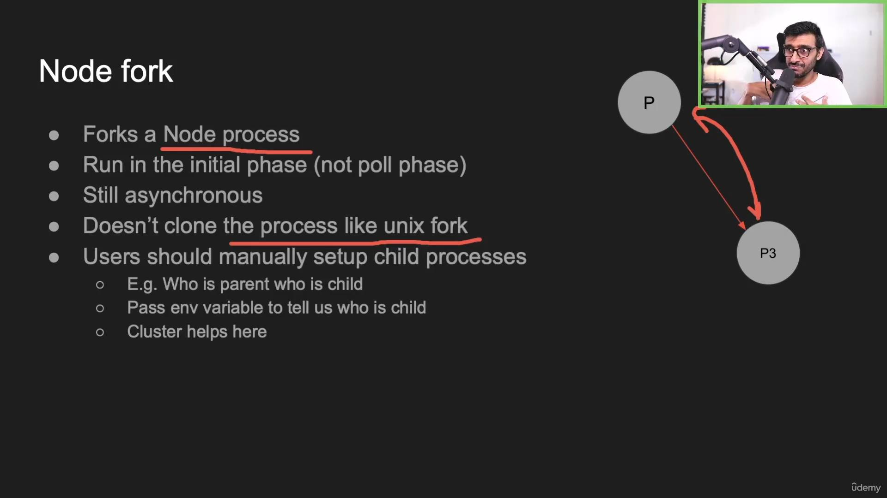
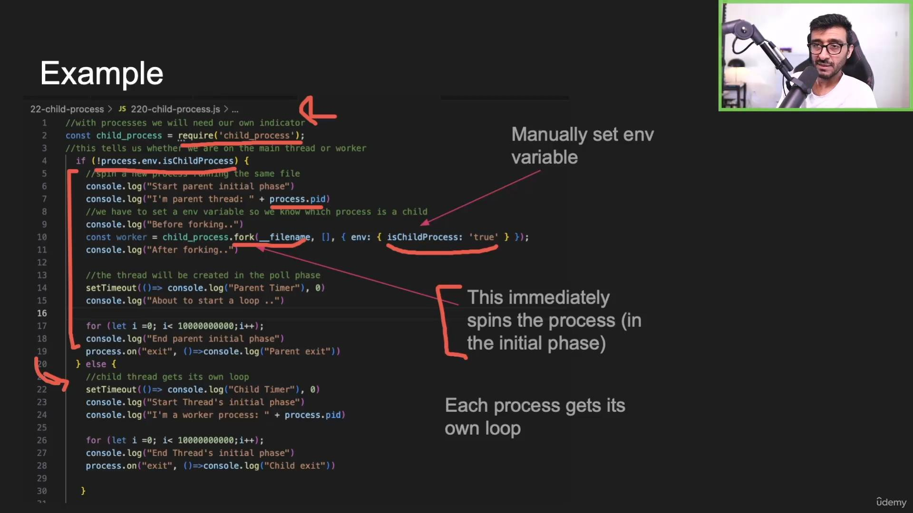
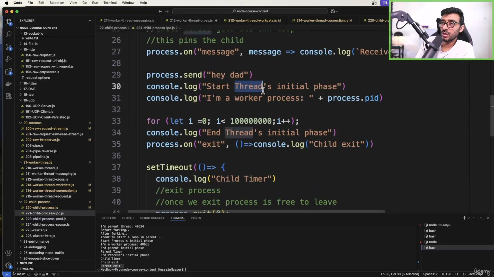
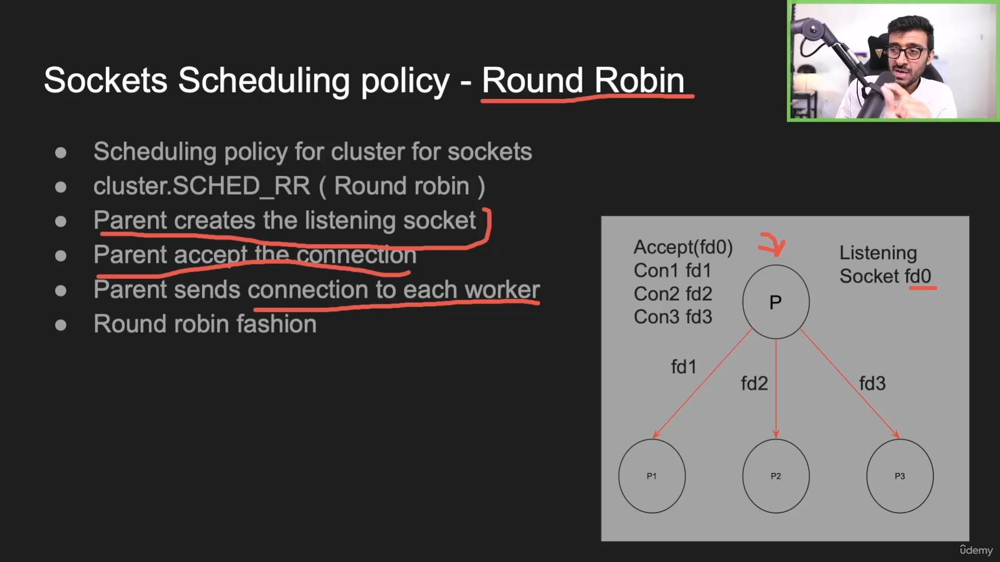
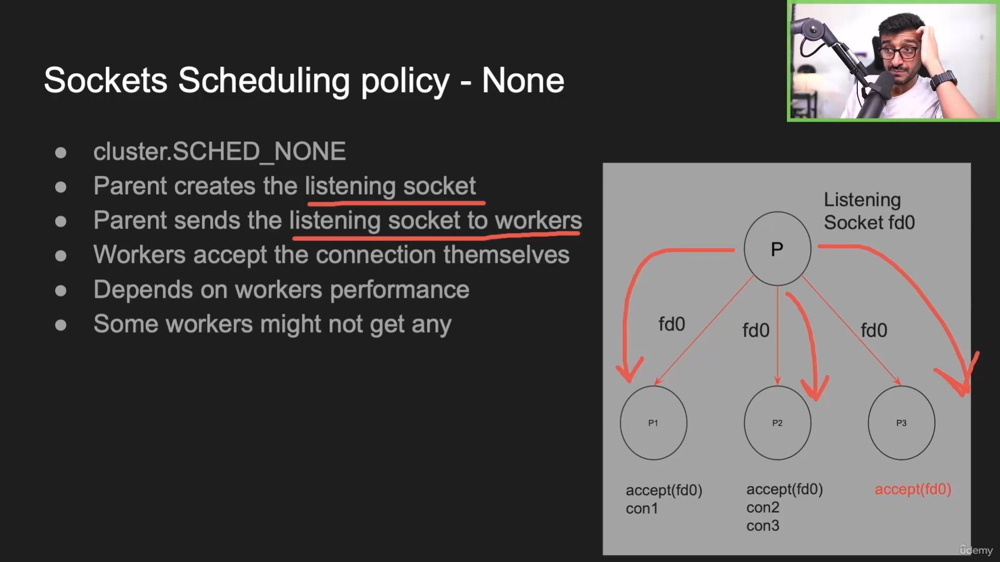
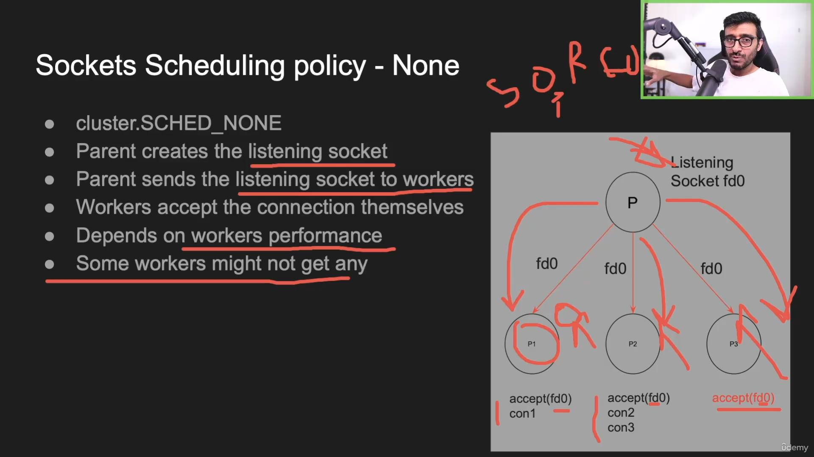
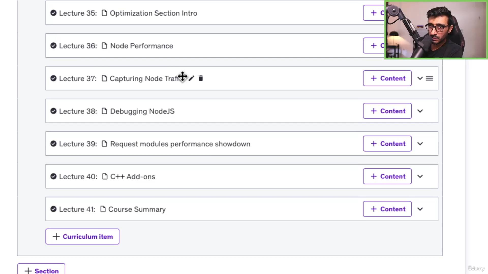

# NodeJS Internals：child_process、IPC 与 cluster 调度复现（P34–P35）

## 1. 这一节做什么

这一节要解决一个很具体的问题：**当 `worker_threads` 不够用时，Node 里怎样创建进程、怎样让进程通信、怎样把外部命令接进 Node，以及 `cluster` 到底怎样把连接分给多个 worker。**

P34 的主线不是“背 API”，而是按下面的实现逻辑走：

1. 先说明线程与进程的取舍：线程共享内存、隔离弱；进程有独立内存、隔离强，但内存开销更大。
2. 用 `child_process.fork()` fork 一个 Node 进程，并说明 fork 默认给一个 IPC 通道。
3. 用环境变量区分“我是父进程”还是“我是子进程”，因为 fork 不像 worker 那样直接给 `isMainThread` 之类的变量。
4. 用 `worker.send()` 与 `process.send()` / `process.on('message')` 做一次父子 IPC。
5. 用 `exec()` 跑一次性的外部命令，例如 `ifconfig`；用 `spawn()` 跑持续输出命令，例如 `top`。
6. 用 `cluster` 简化多进程管理，并对比 `SCHED_RR` 与 `SCHED_NONE` 两种连接分配方式。
7. 说明第三种思路 `reuse port` / socket sharding：每个进程在同一个端口上各自监听、各自有 accept queue，由内核分配连接；逐字稿说这是他认为更好的方式，但 Node 当时没有直接支持。

P35 基本是回顾与过渡：它总结 P34 的进程/线程/cluster，并预告下一节要讲性能优化、抓包、请求模块对比、C++ add-ons 等。**P35 没有给本讲新增的可运行代码**，所以下面的完整代码集中在 P34 的六个示例文件。

复现时可以把这一节理解成三条线：第一条是“创建进程”，重点是 `fork()` 会重新执行入口文件，因此必须用环境变量或参数分流；第二条是“进程通信”，重点是父进程通过返回的 `child`/`worker` 对象发消息，子进程通过 `process` 收消息；第三条是“连接分配”，重点是 `cluster` 只是把多进程监听同一端口的常见模式封装起来，RR 和 none 的差异在于谁 accept、谁持有 listening socket。前端的类比可以这样看：`postMessage` 是两个执行上下文之间传消息的接口，IPC 也有类似“发消息、监听消息”的形态，但 IPC 是跨进程、由 Node 和内核封装复制与同步；cluster 的连接分配则可以类比成反向代理或负载均衡，但这里不是 HTTP 层代理，而是更靠近 socket accept 的分配。类比只帮助理解，不能把两者当成同一机制。


## 2. 讲师原话

下面只摘与实现直接相关的原话，保留英文原句，后面给中文解释。

> “What if I want to spin up some other process from node... I want my own memory... Meet processes.”
>
> —— p034 [00:54]

意思是：如果你不只是想在另一个线程里跑同一份 JS 代码，而是想启动别的进程、要独立内存、要更强隔离，就进入 process 的世界。

> “we fork a process by default, you get a free IPC channel... IPC stands for inter process communication.”
>
> —— p034 [03:15]

`child_process.fork()` 默认给你一条 IPC 通道，这是 fork 和普通 `spawn()` 的一个重要差别。

> “processes can communicate with each other using this IPC mechanism, which is literally just nothing but a memory buffer, but that buffer is in the kernel... we're just using mutexes for protection.”
>
> —— p034 [04:09]

逐字稿把 IPC 讲成内核里的内存缓冲区，并用互斥保护。落到 Node API 上，你看到的是 `worker.send()`、`process.send()`、`'message'` 事件；底层复制与互斥由 Node/内核处理，不需要你在 JS 里手写锁。

> “Execute will execute a program. You get a process and it will wait until the entire output has been printed... if you want a program that is continually running, like top... you can use spawn to stream those with an event.”
>
> —— p034 [07:01]

`exec()` 适合一次性、输出有限并退出的命令；`spawn()` 适合持续输出、需要监听 `data` 事件的命令。

> “Scheduling policy is the idea of distributing sockets as they are accepted by the parent process... The round robin approach.”
>
> —— p034 [12:15]

`cluster` 的 RR 策略是父进程持有 listening socket、父进程 accept，然后按轮询把连接分给 worker。

> “The other approach is none... the listening socket is being sent to each of the processes... workers accept the connection themselves.”
>
> —— p034 [15:08]

`SCHED_NONE` 是把 listening socket 发给各个 worker，让 worker 自己 accept。它可能更快，但分配不一定均匀。

> “The best approach is to do the reuse port option... all of these guys listen on the same port... each one will have its own accept queue.”
>
> —— p034 [19:25]

逐字稿认为 `reuse port` 最好：每个进程各自监听同一端口、各自有 accept queue，由内核分配连接。但他说 Node 当时没有直接支持这个调度策略。

> “Here's an example of a cluster using the non-policy. We're gonna use the RR policy... If I'm the primary, execute this, loop through all the CPUs...”
>
> —— p034 [30:23]

cluster 示例里，primary 分支负责 fork，worker 分支负责创建 server；RR 下父进程 accept 后再把连接对象发给 worker。

P35 的定位：

> “That was the Node internal section... now the next time you write code in Node you will appreciate what it does...”
>
> —— p035 [00:00]

P35 是在收束：理解底层后，下一节才进入性能优化。它提到的抓包、代理、Axios/Fetch 对比、C++ add-ons 都是**下一节预告**，本讲没有展开实现。

复现时读这些原话，重点不是把英文逐字背下来，而是抓住每个 API 的“角色关系”：`fork()` 的返回值在父进程侧代表子进程句柄，所以父进程用 `worker.send()`；子进程自己的 `process` 才代表自己，所以子进程用 `process.send()` 和 `process.on('message')`。`exec()` 与 `spawn()` 的区别也不是谁高级，而是输出模式和生命周期不同：一次性命令等结束拿整块输出，持续命令用流式事件边跑边读。`cluster` 的 RR 与 none 也不是两个完全不同的世界，示例结构几乎一样，差异集中在调度策略和谁 accept。

## 3. 从零复现

### 3.1 环境与目录

课里没有指定 Node 版本。为了减少版本差异，建议使用 Node 18 以上；代码里对 `os.availableParallelism()` 做了存在性判断，不存在就退回 `os.cpus().length`。本节不需要 npm 依赖，全部用 Node 内置模块。

创建目录：

```bash
mkdir nodejs-internals-p34
cd nodejs-internals-p34
node -v
```

目录结构如下：

```text
nodejs-internals-p34/
├── package.json
├── 01-child-process-fork.js
├── 02-ipc.js
├── 03-exec-ifconfig.js
├── 04-spawn-top.js
├── 05-cluster-round-robin.js
└── 06-cluster-none.js
```

`03` 与 `04` 依赖系统命令。逐字稿里讲师在 Mac 上演示 `ifconfig` 和 `top`。如果你在 Windows：

- `ifconfig` 通常换成 `ipconfig`；代码里已做平台判断。
- `top` 在 Windows 不一定有，代码里换成 `tasklist`。这属于“课里没讲但你会撞上”的跨平台差异，后面第 7 节会展开。

这里把命令拆开解释一下：`mkdir nodejs-internals-p34` 创建目录；`cd nodejs-internals-p34` 进入目录；`node -v` 用来确认当前 shell 能找到 Node，并显示版本。若 `node -v` 报 `command not found`，先检查 Node 是否安装、PATH 是否配置正确，而不是继续复制代码。若目录已经存在，`mkdir` 会报错，可以直接 `cd` 进去，或换一个目录名。所有示例都假定你在包含这六个 `.js` 文件的目录下执行命令，因为 `fork(__filename)` 会 fork 当前文件本身，文件名写错或路径不对会直接报 `Cannot find module`。常见错误还有：把代码保存成 `.mjs` 却仍使用 `require`，或者 `package.json` 的 `type` 与文件写法不一致；本示例统一使用 CommonJS，减少这类干扰。

### 3.2 运行顺序

先跑 fork 示例，观察“父进程循环还没结束，子进程已经启动”：

```bash
node 01-child-process-fork.js
```

再跑 IPC 示例：

```bash
node 02-ipc.js
```

然后跑一次性命令：

```bash
node 03-exec-ifconfig.js
```

再跑持续输出命令。示例里为了不让 `top` 一直占住终端，加了 5 秒后 `kill`；课里只演示持续监听 `data`，没有讲停止逻辑：

```bash
node 04-spawn-top.js
```

最后跑两个 cluster。先开一个终端跑 RR：

```bash
node 05-cluster-round-robin.js
```

另开一个终端，连续请求 10 次：

```bash
for i in $(seq 1 10); do curl -s http://127.0.0.1:3000; done
```

观察返回的 `pid` 是否比较均匀。然后停掉 RR，跑 none：

```bash
node 06-cluster-none.js
```

再连续请求，观察是否出现“总是同一个 worker 接连接”的情况。逐字稿里讲师用 `telnet 127.0.0.1 3000` 看谁接受连接；这里用 `curl` 只是为了自动化重复请求，方便看响应里的 worker pid。

这些命令的完整含义可以这样理解：`node 01-child-process-fork.js` 是让 Node 执行指定入口文件；`curl -s http://127.0.0.1:3000` 中 `-s` 表示安静模式，减少进度条等噪声，方便连续输出响应体；`for i in $(seq 1 10); do ...; done` 是 shell 循环，连续发十次请求。若你的环境没有 `seq`，可以改用其他循环写法，核心是连续发多次请求观察 pid。常见错误是 cluster 示例启动后立即 curl 却连接失败，通常是因为 worker 还没完成 `listen`，可以看终端里是否已经打印 `[worker] ... listening on 3000`；另一个常见错误是 RR 还没停就启动 none，导致 `EADDRINUSE`，应先 `Ctrl+C` 停掉前一个进程再跑下一个。

### 3.3 复现时重点看什么

- fork 示例：父进程的 `before fork`、`after fork`、`loop` 与子进程的启动日志是否交错。
- IPC 示例：父进程 `worker.send('hey child')` 后，子进程是否收到；子进程 `process.send('hey dad')` 后，父进程是否收到。
- `exec`：回调是否在命令结束后一次性拿到完整 stdout。
- `spawn`：`stdout.on('data')` 是否持续触发。
- cluster RR：多个 worker 是否轮流拿到请求。
- cluster none：是否出现某个 worker 拿到更多连接，甚至连续拿连接。

排查时建议先看“进程有没有起来”，再看“消息有没有通”，最后看“连接有没有分出去”。fork 示例若只看到父进程日志，检查 `DEMO_CHILD` 是否传入、`fork(__filename)` 的路径是否正确；IPC 示例若子进程收不到消息，检查父进程是否真的调用了 `worker.send()`，以及子进程是否注册了 `process.on('message')`；`exec` 若没有任何输出，先单独在终端执行同一命令，确认系统命令存在；`spawn` 若只触发一次 `data` 就结束，说明命令本身不是持续输出，或者已经退出；cluster 若 curl 返回 `Connection refused`，先确认端口是否被占用、worker 是否 listen 成功、两个 cluster 是否同时运行。



## 4. 完整代码

### 4.1 `package.json`

```json
{
  "name": "nodejs-internals-p34-child-cluster",
  "version": "1.0.0",
  "private": true,
  "type": "commonjs",
  "scripts": {
    "fork": "node 01-child-process-fork.js",
    "ipc": "node 02-ipc.js",
    "exec": "node 03-exec-ifconfig.js",
    "spawn": "node 04-spawn-top.js",
    "cluster:rr": "node 05-cluster-round-robin.js",
    "cluster:none": "node 06-cluster-none.js"
  }
}
```

无第三方依赖。`type` 写 `commonjs` 是为了让 `require` 写法与逐字稿里的示例一致。

### 4.2 `01-child-process-fork.js`

```js
'use strict';

const { fork } = require('node:child_process');

const IS_CHILD = process.env.DEMO_CHILD === 'true';

if (IS_CHILD) {
  console.log(`[child] start process initial phase pid=${process.pid}`);

  setImmediate(() => {
    console.log('[child] child immediate');
  });

  setTimeout(() => {
    console.log('[child] child timer');
    console.log('[child] child exit');
  }, 50);
} else {
  console.log(`[parent] start process initial phase pid=${process.pid}`);
  console.log('[parent] before fork');

  const child = fork(__filename, [], {
    env: {
      ...process.env,
      DEMO_CHILD: 'true'
    }
  });

  console.log(`[parent] after fork child pid=${child.pid}`);
  console.log('[parent] about to start a loop in parent');

  for (let i = 0; i < 2; i += 1) {
    console.log(`[parent] loop ${i}`);
  }

  child.on('exit', (code, signal) => {
    console.log(`[parent] child exit code=${code} signal=${signal}`);
  });

  setTimeout(() => {
    console.log('[parent] parent timer');
    console.log('[parent] parent exit');
  }, 100);
}
```

### 4.3 `02-ipc.js`

```js
'use strict';

const { fork } = require('node:child_process');

const IS_CHILD = process.env.DEMO_IPC_CHILD === 'true';

if (IS_CHILD) {
  console.log(`[child] start pid=${process.pid}`);

  process.on('message', (message) => {
    console.log(`[child] received message from parent: ${message}`);
    process.send('hey dad');
  });

  process.on('disconnect', () => {
    console.log('[child] disconnected from parent');
  });

  setTimeout(() => {
    console.log('[child] child timer');
    console.log('[child] child exit');
    process.exit(0);
  }, 150);
} else {
  console.log(`[parent] start pid=${process.pid}`);

  const worker = fork(__filename, [], {
    env: {
      ...process.env,
      DEMO_IPC_CHILD: 'true'
    }
  });

  worker.on('message', (message) => {
    console.log(`[parent] received message from child: ${message}`);
  });

  worker.on('exit', (code, signal) => {
    console.log(`[parent] child exit code=${code} signal=${signal}`);
    console.log('[parent] parent exit');
  });

  worker.send('hey child');
}
```

### 4.4 `03-exec-ifconfig.js`

```js
'use strict';

const { exec } = require('node:child_process');

const command = process.platform === 'win32' ? 'ipconfig' : 'ifconfig';

exec(command, (error, stdout, stderr) => {
  if (error) {
    console.error(`[exec] error: ${error.message}`);
    return;
  }

  if (stderr) {
    console.error(`[exec] stderr: ${stderr}`);
  }

  console.log(`[exec] stdout for ${command}:`);
  console.log(stdout);
});
```

### 4.5 `04-spawn-top.js`

```js
'use strict';

const { spawn } = require('node:child_process');

const command = process.platform === 'win32' ? 'tasklist' : 'top';

const child = spawn(command, [], {
  stdio: ['ignore', 'pipe', 'pipe']
});

child.stdout.on('data', (chunk) => {
  console.log('[spawn] stdout chunk:');
  process.stdout.write(chunk.toString());
});

child.stderr.on('data', (chunk) => {
  console.error('[spawn] stderr chunk:');
  process.stderr.write(chunk.toString());
});

child.on('error', (error) => {
  console.error(`[spawn] error: ${error.message}`);
});

child.on('close', (code, signal) => {
  console.log(`[spawn] close code=${code} signal=${signal}`);
});

// 课里演示的是持续监听；这里加一个 5 秒后停止，避免 top 占住终端。
setTimeout(() => {
  console.log('[spawn] kill child for demo');
  child.kill('SIGTERM');
}, 5000);
```

### 4.6 `05-cluster-round-robin.js`

```js
'use strict';

const cluster = require('node:cluster');
const http = require('node:http');
const os = require('node:os');

const PORT = 3000;

const workerCount = typeof os.availableParallelism === 'function'
  ? os.availableParallelism()
  : os.cpus().length;

if (cluster.isPrimary) {
  cluster.schedulingPolicy = cluster.SCHED_RR;

  console.log(
    `[primary] pid=${process.pid} scheduling=SCHED_RR workers=${workerCount}`
  );

  for (let i = 0; i < workerCount; i += 1) {
    cluster.fork();
  }

  cluster.on('exit', (worker, code, signal) => {
    console.log(
      `[primary] worker pid=${worker.process.pid} exit code=${code} signal=${signal}`
    );
  });
} else {
  console.log(`[worker] start pid=${process.pid}`);

  http.createServer((request, response) => {
    response.writeHead(200, {
      'content-type': 'text/plain; charset=utf-8'
    });
    response.end(`hello from worker pid=${process.pid}\n`);
  }).listen(PORT, () => {
    console.log(`[worker] pid=${process.pid} listening on ${PORT}`);
  });
}
```

### 4.7 `06-cluster-none.js`

```js
'use strict';

const cluster = require('node:cluster');
const http = require('node:http');
const os = require('node:os');

const PORT = 3000;

const workerCount = typeof os.availableParallelism === 'function'
  ? os.availableParallelism()
  : os.cpus().length;

if (cluster.isPrimary) {
  cluster.schedulingPolicy = cluster.SCHED_NONE;

  console.log(
    `[primary] pid=${process.pid} scheduling=SCHED_NONE workers=${workerCount}`
  );

  for (let i = 0; i < workerCount; i += 1) {
    cluster.fork();
  }

  cluster.on('exit', (worker, code, signal) => {
    console.log(
      `[primary] worker pid=${worker.process.pid} exit code=${code} signal=${signal}`
    );
  });
} else {
  console.log(`[worker] start pid=${process.pid}`);

  http.createServer((request, response) => {
    response.writeHead(200, {
      'content-type': 'text/plain; charset=utf-8'
    });
    response.end(`hello from worker pid=${process.pid}\n`);
  }).listen(PORT, () => {
    console.log(`[worker] pid=${process.pid} listening on ${PORT}`);
  });
}
```

注意：`cluster.SCHED_RR` 与 `cluster.SCHED_NONE` 是 Node API 里的常量名；逐字稿口述为 “RR policy” 与 “none policy”。如果你安装的 Node 版本文档里常量名不同，以实际版本文档为准。

## 5. 逐行解释

### 5.1 fork 示例：为什么用环境变量区分父子

`01-child-process-fork.js` 里最关键的是这一行：

```js
const IS_CHILD = process.env.DEMO_CHILD === 'true';
```

逐字稿说 fork 出来的 Node 进程不会像 worker 那样自动给你一个“我是子进程”的漂亮变量；fork 是重新执行同一份入口文件。所以如果不做标记，子进程也会执行父进程分支，然后再次 fork，形成递归。这里用环境变量 `DEMO_CHILD` 作为开关：父进程 fork 时传入 `DEMO_CHILD: 'true'`，子进程启动后读到这个变量，进入子进程分支。

`fork(__filename, [], { env: ... })` 里的 `__filename` 表示 fork 当前文件本身。逐字稿说“我 fork 我自己”，原因是一个示例文件既要能当父进程又要能当子进程，最方便就是 fork 同一文件再靠环境变量分流。第二个参数 `[]` 是传给子进程的命令行参数，本示例没有使用；第三个参数里合并 `...process.env` 是为了不丢掉原环境变量，例如 PATH 等。若只写 `{ DEMO_CHILD: 'true' }` 而不合并原环境，某些环境下子进程可能缺少必要变量，排查时可以从这里找原因。

`child.on('exit', ...)` 监听子进程退出。逐字稿的终端输出里能看到父进程和子进程日志交错，这是因为 fork 在 initial phase 就启动，不会等父进程的循环跑完。你在本机运行时输出顺序可能略有不同，**只要看到子进程启动日志出现在父进程循环前后，就说明复现成功**。如果只看到父进程反复打印、系统进程数不断增长，通常说明 `DEMO_CHILD` 判断没有生效，子进程又走了父进程分支；先检查环境变量名是否写错、fork 时是否真的传入、脚本是否保存到了正确目录。



### 5.2 IPC 示例：`worker.send` 与 `process.send` 分别站在谁的角度

`02-ipc.js` 里父进程拿到 fork 返回的 `worker` 对象：

```js
worker.send('hey child');
```

这是父进程向子进程发消息。子进程里监听：

```js
process.on('message', (message) => {
  console.log(`[child] received message from parent: ${message}`);
  process.send('hey dad');
});
```

`process.on('message', ...)` 是子进程接收父进程消息；`process.send('hey dad')` 是子进程向父进程回复。父进程再通过：

```js
worker.on('message', (message) => {
  console.log(`[parent] received message from child: ${message}`);
});
```

接收回复。

逐字稿强调：父进程里如果直接用 `process.send()`，是发给“我的父进程”，但父进程没有父进程，所以父进程侧要用 `worker.send()`。这个角度关系是 IPC 示例最容易写错的地方。另一个常见错误是子进程没有 IPC 通道却调用 `process.send()`，例如用普通 `spawn()` 启动而非 `fork()`，此时应检查是否真的用了 `fork()`，以及是否在支持 IPC 的启动方式下运行。若父进程收不到 `hey dad`，先确认子进程是否收到 `hey child`，再确认子进程是否真的执行了 `process.send()`，最后确认父进程是否在 fork 后、消息到达前注册了 `'message'` 监听。

逐字稿说 IPC 本质是内核里的内存缓冲区并用 mutex 保护。落到 Node 里，你不需要在 JS 里写锁；`worker.send()` 和 `'message'` 事件已经把复制和同步封装掉了。前端可以类比成两个 Worker 之间的 `postMessage`，但这里是跨进程，不是跨线程。**在 JS/Node 里对应什么：** Node 主线程仍是单线程，但多个进程是真并行；共享 socket 的竞争由内核处理，不是 JS 锁。实际传大对象时还要意识到消息不是零成本共享内存，复制/序列化会有开销，因此不要把 IPC 当成随便传大块数据的免费通道。



### 5.3 `exec` 示例：为什么回调拿到的是“一整块输出”

`03-exec-ifconfig.js` 用：

```js
exec(command, (error, stdout, stderr) => { ... });
```

`exec` 会启动一个进程，等命令结束，把完整 stdout/stderr 一次性交给回调。逐字稿说它适合“跑一下、输出有限、然后退出”的程序。`ifconfig` 正是这种：打印网络接口信息后退出。

代码里先判断 `process.platform === 'win32'`，Windows 用 `ipconfig`。这是为了可复现；逐字稿只演示了 Mac 上的 `ifconfig`，没有讲 Windows 分支。若回调里 `error` 非空，先看错误信息里是命令不存在、权限不足还是退出码非零；不要把 `stderr` 有内容等同于一定失败，有些命令会向 stderr 打提示但退出码仍为 0。常见排查是先在同一个终端手动执行 `ifconfig` 或 `ipconfig`，确认系统命令本身可用，再回到 Node 里看回调参数。

### 5.4 `spawn` 示例：为什么用 `data` 事件

`04-spawn-top.js` 用：

```js
const child = spawn(command, [], {
  stdio: ['ignore', 'pipe', 'pipe']
});
```

然后：

```js
child.stdout.on('data', (chunk) => { ... });
```

`spawn` 不等待进程结束，而是把 stdout 当流来读。`top` 是持续刷新的程序，所以你会不断收到 `data` 事件。逐字稿说“identical，唯一区别是你监听 data 事件”，指的就是这个。`stdio` 数组的三项分别对应子进程的 stdin、stdout、stderr；这里 stdin 设为 `ignore`，stdout 和 stderr 设为 `pipe`，所以后面能通过 `child.stdout` 和 `child.stderr` 读流。若你把 stdout 设成 `inherit`，就不会有 `child.stdout` 可监听，现象是终端能直接看到输出但代码里的 `data` 事件不触发，这是复现时容易混淆的点。

示例末尾加了 5 秒 `kill`，目的是演示时能停下来；课里只演示了持续监听，没有讲停止策略。`child.kill('SIGTERM')` 在不同平台上的信号支持不完全一样，复现时若发现停不下来，先确认命令是否真的持续运行，再检查平台对信号的处理；这属于演示控制的细节，不影响 `spawn` 流式读取这一核心结论。

### 5.5 cluster 示例：RR 与 none 的代码差异只有一行

`05` 与 `06` 的结构完全一致：

- `cluster.isPrimary` 为真：设置调度策略、按 CPU 数量 `cluster.fork()`。
- 否则：worker 分支创建 HTTP server 并 `listen(3000)`。

RR 文件里只多这一行：

```js
cluster.schedulingPolicy = cluster.SCHED_RR;
```

none 文件里是：

```js
cluster.schedulingPolicy = cluster.SCHED_NONE;
```

逐字稿解释：RR 是父进程持有 listening socket，父进程 accept 后轮询把连接对象发给 worker；none 是把 listening socket 发给每个 worker，让 worker 自己 accept。所以 RR 下请求分布更均匀，但父进程 accept 可能成为瓶颈；none 下多个 worker 抢 accept，可能更快，但会出现某个 worker 拿到更多连接，甚至连续拿到连接。复现时要注意调度策略应在 fork worker 之前设置，示例里把它放在 primary 分支开头就是为了先定策略再 `cluster.fork()`；若你把它放到 fork 之后，实际行为可能和预期不一致。另一个常见错误是两个 cluster 同时占用 3000 端口，先停掉一个再跑另一个。





逐字稿还提到 none 策略的第二个问题：多个 worker 监听同一个 socket 对象时，内核 accept queue 需要锁来保证正确性，因此会有序列化成本。**在 JS/Node 里对应什么：** 你不需要写这把锁；它是内核在 accept queue 上的互斥。你观察到的现象是“谁先抢到谁接连接”，而不是 JS 层面的锁竞争。前端对照可以把 RR 想成入口处统一排队再轮流分配，把 none 想成多个窗口同时抢同一个队列；前者分配更整齐但入口有单点，后者抢得更直接但可能不均。

### 5.6 reuse port：为什么课里说它更好但没作为示例

逐字稿说：

> “The best approach is to do the reuse port option... all of these guys listen on the same port... each one will have its own accept queue.”

意思是每个进程各自监听同一端口，但因为有 reuse port 选项，内核允许它们各自拥有 accept queue，连接由内核分配到不同队列。这样既避免父进程单点 accept，又避免多个 worker 抢同一个 accept queue 的锁。但讲师说 Node 当时没有直接支持这个调度策略，所以本讲没有给出可运行的 Node 示例。这里不要把它写成已经实现。复现时如果把这段误读成“在 Node 里设置一个开关就能打开 reuse port”，就会和逐字稿事实不符；本讲能落地验证的是 fork、IPC、exec、spawn、cluster RR/none，reuse port 只作为第三种思路的说明保留。



## 6. 复现检查清单

- [ ] `node -v` 能正常输出，目录下没有额外依赖也能运行。验证：在示例目录执行 `node -v`，再执行 `node -e "console.log(process.version)"`；若命令找不到，先修 Node/PATH，不要继续判断代码问题。
- [ ] `node 01-child-process-fork.js` 输出里同时有 `[parent]` 与 `[child]` 日志，且子进程 pid 与父进程 pid 不同。验证：看两组日志里的 `pid=`，确认不相等；若只有 `[parent]`，检查 `DEMO_CHILD` 是否传入。
- [ ] fork 示例没有无限递归：`DEMO_CHILD` 只在子进程里为 `'true'`。验证：观察终端是否持续出现新的 `[parent] before fork` 或系统进程是否异常增长；也可以临时在子进程分支打印环境变量确认。
- [ ] `node 02-ipc.js` 里父进程收到 `hey dad`，子进程收到 `hey child`。验证：搜索输出中的两句话；若只收到一半，检查对应侧的 `send` 和 `on('message')` 是否都写了。
- [ ] `node 03-exec-ifconfig.js` 能打印命令 stdout；Windows 下命令自动变成 `ipconfig`。验证：看输出里是否出现 `[exec] stdout for ...`，并先手动执行同命令确认系统可用。
- [ ] `node 04-spawn-top.js` 能看到持续的 `[spawn] stdout chunk`，5 秒后进程被终止。验证：观察是否多次出现 `[spawn] stdout chunk`，最后是否出现 `[spawn] close` 或 `[spawn] kill child for demo`。
- [ ] `node 05-cluster-round-robin.js` 启动后，连续 `curl` 返回的 worker pid 比较均匀。验证：连续请求十次，记录每次返回的 pid，看是否在多个 worker 之间轮换，而不是全是一个 pid。
- [ ] `node 06-cluster-none.js` 启动后，连续 `curl` 能观察到某个 worker 更频繁地接连接。验证：同样记录十次 pid，和 RR 的结果对比；若环境差异导致不明显，以实际输出为准，不要强行断言。
- [ ] 两个 cluster 示例不要同时占用 3000 端口；切换前先停掉前一个。验证：切到另一个文件前先 `Ctrl+C`，再启动；若报 `EADDRINUSE`，说明端口仍被占用。
- [ ] 若出现 `EADDRINUSE`，先检查 3000 端口是否被占用。验证：停掉所有相关 Node 进程，或换一个空闲端口后再试；不要在两个 cluster 同时运行时比较调度结果。
- [ ] 如果你在 Windows，`top`/`ifconfig` 的替代命令是否按代码里的平台判断执行。验证：看 `process.platform` 分支是否命中 `win32`，并手动执行 `ipconfig`、`tasklist` 确认系统命令存在。


## 7. 课里没讲但你会撞上的

下表按“现象 / 原因 / 怎么办”整理，保留原文中课里没讲但复现时容易遇到的问题：

| 现象 | 原因 | 怎么办 |
| --- | --- | --- |
| 进程数量不断增长、日志重复、系统变卡。 | fork 自身没有递归保护；忘记用环境变量区分父子时，子进程会继续执行父进程分支并再次 fork。 | 保留 `DEMO_CHILD` / `DEMO_IPC_CHILD` 判断；先打印 pid 和分支确认；发现异常立即停止进程，再检查环境变量名和 fork 参数。 |
| Windows 上 `ifconfig` 或 `top` 直接报错。 | 课里在 Mac 上演示 `ifconfig` 和 `top`；Windows 通常没有这两个命令。 | 按代码里的平台判断使用 `ipconfig` / `tasklist`；先手动执行确认命令存在，再跑示例。 |
| `spawn` 示例终端被持续输出占住。 | `top` 是持续进程，课里只演示监听 `data`，没有讲怎么停。 | 示例里用 5 秒 `kill` 做演示；实际使用要处理 `close`、`error`、`kill`，避免终端一直被占住。 |
| `exec` 在输出特别大时失败或报错。 | `exec` 的输出有缓冲上限；课里没讲 `maxBuffer` 一类参数。 | 先确认是否真的需要一次性拿完整输出；遇到限制时查你所用 Node 版本的 `exec` 文档，不要凭记忆猜默认值。 |
| cluster 启动时报 `EADDRINUSE`。 | 两个示例都用 3000；同时运行或前一个没停干净会冲突。 | 切换示例前先停掉前一个；检查端口占用，或临时换端口复现。 |
| `SCHED_NONE` 下请求分布和预期不一样。 | 课里说 none 是让 worker 自己 accept；不同平台/版本对调度策略支持不同。 | 以你环境实际输出为准；记录 pid 分布，不要只凭一次请求下结论。 |
| 想把 `reuse port` 直接跑成 Node 示例却找不到对应开关。 | 逐字稿说它“最好”，但也说 Node 当时没有直接支持这个调度策略。 | 不要把 `reuse port` 写成已经跑通的代码；本讲只用它解释第三种思路。 |
| cluster 示例能跑，但不能直接当生产模板。 | 生产 cluster 还需要优雅退出、日志聚合、进程守护等；课里没有展开这些。 | 把示例当调度行为验证代码；生产化时另行补退出、日志、监控和守护策略。 |
| IPC 传大对象时性能不如预期。 | 课里说 IPC 是内核缓冲区；实际传大对象时会有复制/序列化开销。 | 不要把它当零成本共享内存；先测数据大小和传输频率，再决定是否改用其他方案。 |
| 以为 P35 会给出抓包、代理、Axios/Fetch 对比、C++ add-ons 的代码。 | P35 提到的这些是下一节预告；P35 没有给这些内容的实现代码。 | 本讲文档只复现 P34 的六个示例；不要把下一节预告误写成已实现内容。 |

