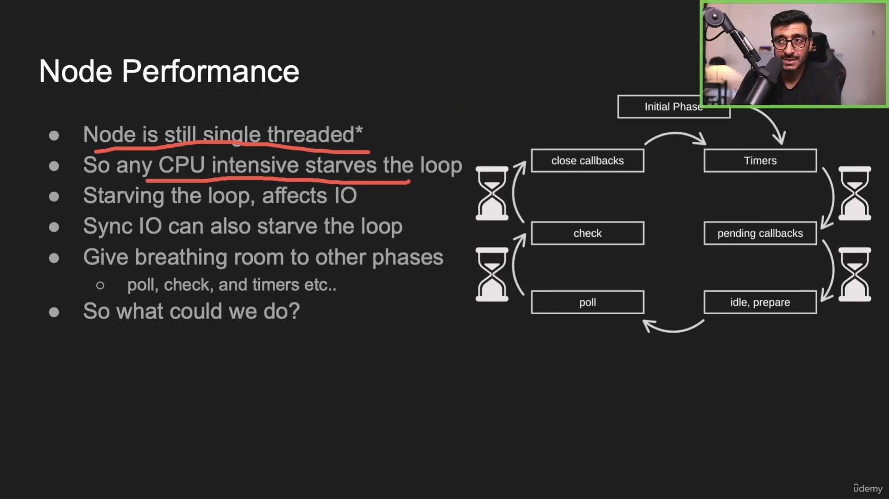
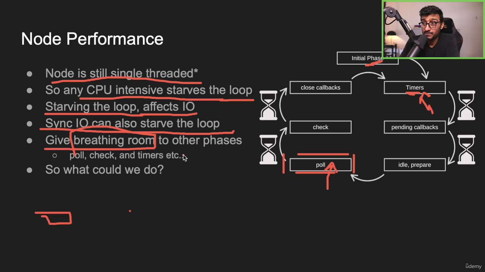
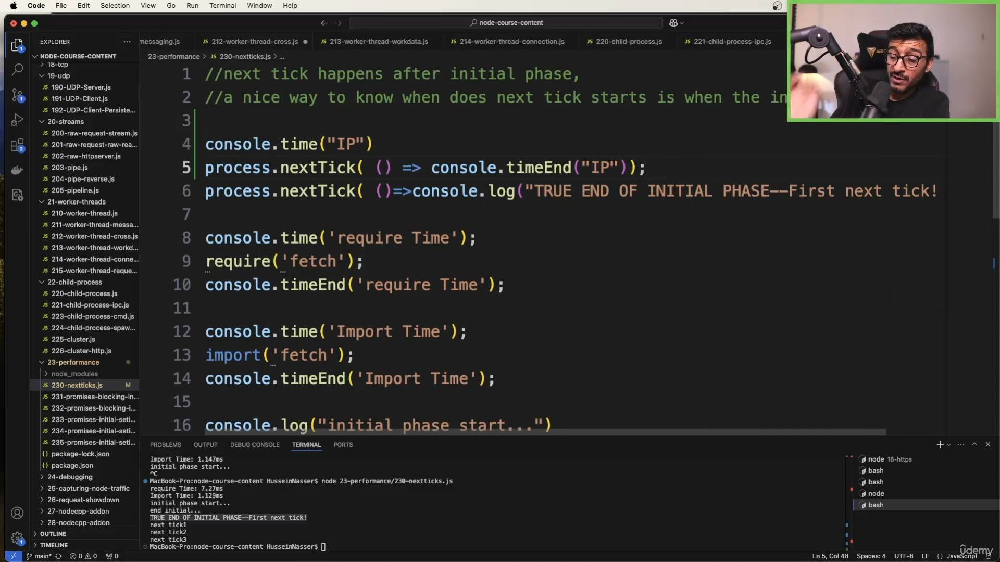
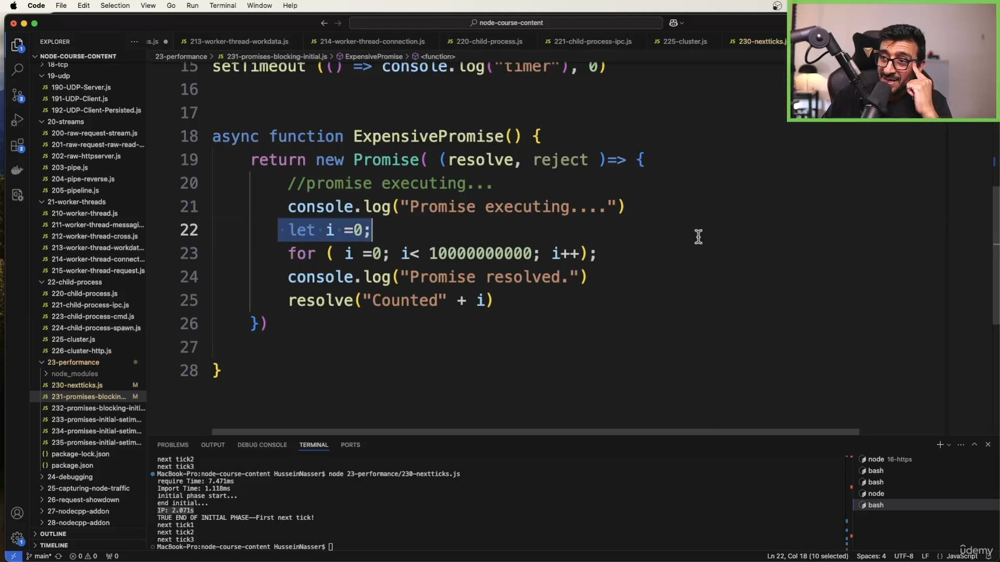
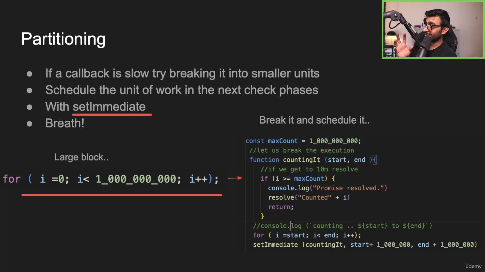
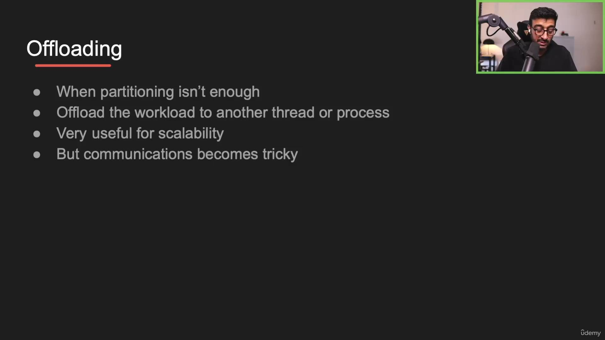
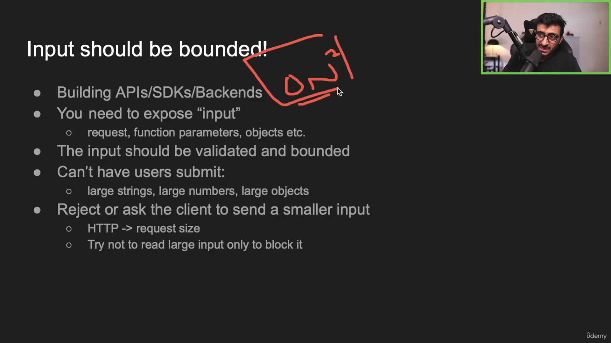

# Node.js 性能调优：把「事件循环别被饿死」落成可跑的脚本

> 课程：NodeJS（BV1jGRyBsEBa），覆盖 P36（本章只有这一集）。
> 本集不是「从零搭一个项目」，而是**一套诊断 + 优化的实验脚本**。文档按「先能测 → 再造病 → 再开药」的顺序重组，读者照着往下敲，最后会得到一组能直接 `node xxx.js` 跑的脚本。

---

## 1. 这一节做什么

这一节解决一个非常具体的问题：**你的 Node 服务为什么明明「没报错、CPU 也不高」，但客户端就是觉得慢、请求排队、超时？**

讲师的答案只有一个根因：Node 是单线程执行所有回调的，任何一个 CPU 密集的回调都会把事件循环（event loop）卡住；卡住期间，`poll` 阶段读不了 socket，内核的接收队列被填满，TCP 窗口越收越小直到归零，客户端被反压（backpressure）卡死——整条链路是级联的。

所以这一节的产出物不是知识点，是**六个能跑出数字的脚本**：

| 编号 | 脚本 | 作用 |
|---|---|---|
| 01 | `01-block-initial-phase.cjs` | 制造阻塞，看 initial phase 的数字变大 |
| 02 | `02-require-vs-import.cjs` / `.mjs` | 对比 `require` 与动态 `import()` 的加载耗时 |
| 03 | `03-promise-in-initial-phase.cjs` | 证明 promise 的 executor 是同步的、会阻塞 |
| 04 | `04-promise-deferred.cjs` | 把 executor 推理到 `process.nextTick` |
| 05 | `05-partition-setimmediate.cjs` | 用 `setImmediate` 把大循环切成分区 |
| 06 | `06-worker-offload.cjs` | 把重活扔到 worker 线程，主线程 initial phase 归零 |

核心心法只有一句：**给别的阶段留呼吸的余地（give a breathing room to other phases）**——poll、check、timers 都要能喘气。



---

## 2. 讲师原话

下面这些是从逐字稿里摘的关键判断，后面所有代码都是为了验证它们：

> 「不管别人怎么说，Node 依然是单线程应用。原因就是那一个线程负责执行每一个阶段的每一个回调。有时候 IO 被 libuv 甩到别的线程去了，但那些是 IO，不是 CPU 密集。真正的计算、真正的执行发生在主线程。」
> —— p036 [00:28]

> 「任何 CPU 密集任务都会饿死循环（starve the loop）。」
> —— p036 [01:19]

> 「目标就是给其他阶段留出呼吸的余地。poll、check、timers，用任何必要的手段给它们呼吸。」
> —— p036 [06:35]

> 「第一件你能做的事：让回调保持小且恒定（keep callbacks small and constant）。别让它变成 O(n)；如果做不到，就把输入框住（keep those input bounded），别让用户提交十亿条数据。」
> —— p036 [06:36] / [07:03]

> 「尽量用异步 IO，把 IO 卸载掉。用 `readFile`，不要用 `readFileSync`，不管它看起来多方便。」
> —— p036 [11:16]

> 「模块在被 require 的时候是会执行代码的，而且是同步执行的。用 `import` 加载它们，并用 `console.time` 量一下。」
> —— p036 [13:40]

> 「`setImmediate` 是你最好的朋友，因为它告诉你：我要给 poll 阶段留呼吸的空间，这段代码放到 poll 之后执行。」
> —— p036 [16:58]

> 「实在分区也不行，就把它甩到另一个线程。你只要保住主线程——主线程上有 IO、有连接、有 socket、有请求、有响应，让它继续呼吸。」
> —— p036 [19:49]

> 「只要加上这两行代码，你立刻就知道你的 initial phase 花了多久。加到任何一个模块里都行。」
> —— p036 [25:05]

> 「promise 的执行发生在你调用它的那一刻，但 resolve 永远发生在下一个 tick。」
> —— p036 [26:30]



---

## 3. 从零复现

### 3.0 前置条件（课里没讲的，这里补齐）

- **Node 版本**：课里没讲具体版本号。本套脚本只用到 `node:fs`、`node:path`、`node:worker_threads`、`setImmediate`、`console.time`，这些都是长期稳定 API。建议 **Node 18 LTS 及以上**（`node:` 前缀、ESM 与顶层 await 都齐全）。
- **第三方依赖**：**没有**。全部用内置模块，所以没有 `package.json` 的 `dependencies`。
- **环境变量**：本课没有用到任何环境变量。
- **操作系统**：macOS / Linux 均可；Windows 下命令换成对应写法即可，脚本本身不分平台。

### 3.1 建目录

```bash
mkdir node-perf-lab && cd node-perf-lab
npm init -y
mkdir fixtures
```

最终目录结构（跑完之后你应该长这样）：

```
node-perf-lab/
├── package.json
├── ip-timer.cjs                     # 可复用的「两行体检」
├── ip-timer.mjs                     # 同上，ESM 版
├── fixtures/
│   └── heavy-module.cjs             # 模拟一个初始化很重的模块
├── 01-block-initial-phase.cjs
├── 02-require-vs-import.cjs
├── 02-require-vs-import.mjs
├── 03-promise-in-initial-phase.cjs
├── 04-promise-deferred.cjs
├── 05-partition-setimmediate.cjs
├── counting-worker.cjs
└── 06-worker-offload.cjs
```

> 文件名里的 `01/02/…` 是本文件为了方便复现编排的顺序，**不是讲师用的名字**。逐字稿里他运行脚本时的口播听感像 `node 23-3`、`node 23-4` 这类编号，课里没有明确说明文件命名规则。

### 3.2 第一步：先装一个「体检仪」

在做任何优化之前，你得先知道 initial phase 到底花了多久。讲师给的办法是「我最爱的两行」：在模块顶部开一个 `console.time`，再用 `process.nextTick` 在 initial phase 结束的那一刻关掉它。

`process.nextTick` 的队列是在 initial phase 执行完之后、事件循环真正开始之前清空的，所以它天然就是一个「initial phase 结束探针」。

写 `ip-timer.cjs`：

```js
'use strict';
const path = require('node:path');

const label = `IP(${path.basename(process.argv[1] || 'unknown')})`;

console.time(label);
process.nextTick(() => {
  console.timeEnd(label);
});
```

然后在任何脚本的第一行 `require('./ip-timer.cjs')`，就能看到该脚本的 initial phase 耗时。



### 3.3 第二步：制造一次阻塞，看数字变大

写 `01-block-initial-phase.cjs`，里面放一个同步大循环和一次 `readFileSync`，然后跑：

```bash
node 01-block-initial-phase.cjs
```

你会看到 `IP(01-block-initial-phase.cjs): xxx ms`——这个数字就是主线程被卡住、事件循环一动不动的时长。把循环次数调大，数字跟着变大，你就亲眼看到了「饿死循环」。

### 3.4 第三步：对比 `require` 与动态 `import()`

```bash
node 02-require-vs-import.cjs
node 02-require-vs-import.mjs
```

`require` 版本里，模块顶层那段初始化代码是**在 require 那一行同步跑完的**，会计入 initial phase；`import()` 版本里，`import()` 本身立刻返回一个 promise，耗时只有调度开销，真正的模块初始化被推迟了。

这里要提醒一句：**两者测出来的毫秒数不能直接对比**，因为 `import()` 那一行测的几乎只是「发起加载」，不包含模块真正初始化完的时间。讲师自己也说了这一点——「1 毫秒只是调度 callback 的开销」。所以**要测真正的加载完成时间，得 `await` 那个 promise**，脚本里我两种都打了。

### 3.5 第四步：证明 promise 的 executor 是同步的

```bash
node 03-promise-in-initial-phase.cjs
```

观察输出顺序：`new Promise(...)` 里的 executor 函数**在构造那一刻就同步执行完了**，而 `.then` 的回调要等到下一个 tick 才跑。所以如果你的 executor 里塞了重计算，它照样阻塞 initial phase——「我用了 promise 所以是异步的」是错觉。



### 3.6 第五步：把重活推到 `process.nextTick`

```bash
node 04-promise-deferred.cjs
```

和上一步唯一的区别是把 executor 里的计算包进 `process.nextTick`。结果：initial phase 明显变短，但重活仍然发生在**事件循环开始之前**——只是从「同步」变成了「下一个 tick 再同步」。对「让 initial phase 尽快结束」有帮助，对「让 IO 先跑起来」没帮助。

### 3.7 第六步：推到 `setImmediate`（check 阶段）

```bash
node 05-partition-setimmediate.cjs
```

把重活推到 `setImmediate`，它会落到 check 阶段执行，此时 timers 和 poll 都已经有机会跑了。更进一步，把大循环切成固定大小的小块，每块结束后再 `setImmediate` 一次，让出一次事件循环——这就是讲师说的**分区（partitioning）**。



### 3.8 第七步：甩到 worker 线程

```bash
node 06-worker-offload.cjs
```

主线程只负责 `new Worker(...)` 和监听消息，重计算发生在 `counting-worker.cjs` 里。跑完你会看到 `IP(06-worker-offload.cjs)` 的数字非常小——因为主线程从头到尾没被计算占用过。



---

## 4. 完整代码

> ⚠️ 说明：**逐字稿只有口播，课里没有给出可以整段复制的完整文件。** 下面这些文件是按讲师演示的顺序与意图补全的**等价可运行实现**，测法和结论与课里一致；凡是讲师逐字稿没讲到的细节（比如具体循环次数、worker 文件名），都在第 7 节里单列说明。所有代码复制到对应路径即可直接 `node` 运行。

### 4.1 `package.json`

```json
{
  "name": "node-perf-lab",
  "version": "1.0.0",
  "private": true,
  "description": "Node event-loop performance experiments (BV1jGRyBsEBa P36)",
  "scripts": {
    "block": "node 01-block-initial-phase.cjs",
    "require": "node 02-require-vs-import.cjs",
    "import": "node 02-require-vs-import.mjs",
    "promise": "node 03-promise-in-initial-phase.cjs",
    "nexttick": "node 04-promise-deferred.cjs",
    "partition": "node 05-partition-setimmediate.cjs",
    "worker": "node 06-worker-offload.cjs"
  }
}
```

### 4.2 `ip-timer.cjs`（CommonJS 版「两行体检」）

```js
'use strict';
const path = require('node:path');

const label = `IP(${path.basename(process.argv[1] || 'unknown')})`;

console.time(label);
process.nextTick(() => {
  console.timeEnd(label);
});

module.exports = label;
```

### 4.3 `ip-timer.mjs`（ESM 版，内容等价）

```js
import path from 'node:path';

const label = `IP(${path.basename(process.argv[1] || 'unknown')})`;

console.time(label);
process.nextTick(() => {
  console.timeEnd(label);
});

export default label;
```

### 4.4 `fixtures/heavy-module.cjs`（模拟一个「加载即耗时」的模块）

```js
'use strict';

// 模块顶层代码在 require 时会同步执行，这就是讲师说的
// "modules execute code ... the way modules execute code is synchronous"
const table = [];
for (let i = 0; i < 50000; i++) {
  table.push({ id: i, label: `row-${i}` });
}

module.exports = { table };
```

### 4.5 `01-block-initial-phase.cjs`

```js
'use strict';
require('./ip-timer.cjs');

const fs = require('node:fs');

console.log('--- initial phase 开始 ---');

// 1) 同步 CPU 密集：主线程被独占，事件循环根本还没开始
let sum = 0;
const LOOP = 500_000_000;          // 想看得更明显就把这个数字调大
for (let i = 0; i < LOOP; i++) {
  sum += i % 3;
}
console.log('同步循环 sum =', sum);

// 2) 同步 IO：同样发生在 initial phase
const source = fs.readFileSync(__filename, 'utf8');
console.log('readFileSync 读到字节数 =', source.length);

// 3) 注册几个回调，它们只会在事件循环开始之后才有机会跑
setTimeout(() => console.log('timer 回调（timers 阶段）'), 0);
setImmediate(() => console.log('setImmediate 回调（check 阶段）'));
process.nextTick(() => console.log('nextTick 回调（initial phase 结束后立即）'));
```

### 4.6 `02-require-vs-import.cjs`

```js
'use strict';
require('./ip-timer.cjs');

console.time('require heavy-module');
const heavy = require('./fixtures/heavy-module.cjs');
console.timeEnd('require heavy-module');

console.log('require 之后立刻可用，table.length =', heavy.table.length);
```

### 4.7 `02-require-vs-import.mjs`

```js
import './ip-timer.mjs';

// 只测「发起 import」这件事本身的开销
console.time('发起 import() 的耗时');
const loading = import('./fixtures/heavy-module.cjs');
console.timeEnd('发起 import() 的耗时');

// 等它真正加载完，才是模块真实的初始化成本
const t0 = Date.now();
const mod = await loading;
console.log('import() 解析完成后 table.length =', mod.default.table.length);
console.log('从开始到模块真正可用，共约', Date.now() - t0, 'ms');
```

### 4.8 `03-promise-in-initial-phase.cjs`

```js
'use strict';
require('./ip-timer.cjs');

const fs = require('node:fs');

function counting(maxCount) {
  // 纯 CPU 同步计算
  let count = 0;
  for (let i = 0; i < maxCount; i++) {
    count += i % 7;
  }
  return count;
}

function expensivePromise() {
  return new Promise((resolve) => {
    // executor 在 new Promise 的同一瞬间同步执行
    console.log('  [executor] 开始执行（此刻仍在 initial phase）');
    const result = counting(300_000_000);
    console.log('  [executor] 执行完毕');
    resolve(result);
  });
}

console.log('主线程：即将调用 expensivePromise()');
const p = expensivePromise();
console.log('主线程：expensivePromise() 已经返回，拿到 promise');

p.then((result) => {
  console.log('then 回调拿到结果 =', result);
});

setTimeout(() => console.log('timer 回调（timers 阶段）'), 0);

fs.readFile(__filename, 'utf8', () => {
  console.log('readFile 回调（poll 阶段的 IO 回调）');
});
```

### 4.9 `04-promise-deferred.cjs`

```js
'use strict';
require('./ip-timer.cjs');

const fs = require('node:fs');

function counting(maxCount) {
  let count = 0;
  for (let i = 0; i < maxCount; i++) {
    count += i % 7;
  }
  return count;
}

function expenseDeferredPromise() {
  return new Promise((resolve) => {
    // 把重活推到 initial phase 结束之后、事件循环开始之前
    process.nextTick(() => {
      console.log('  [nextTick] 开始执行重计算');
      const result = counting(300_000_000);
      console.log('  [nextTick] 重计算结束');
      resolve(result);
    });
  });
}

console.log('主线程：即将调用 expenseDeferredPromise()');
const p = expenseDeferredPromise();
console.log('主线程：已返回，initial phase 可以尽快结束');

p.then((result) => console.log('then 回调拿到结果 =', result));

setTimeout(() => console.log('timer 回调（timers 阶段）'), 0);

fs.readFile(__filename, 'utf8', () => {
  console.log('readFile 回调（poll 阶段的 IO 回调）');
});
```

### 4.10 `05-partition-setimmediate.cjs`

```js
'use strict';
require('./ip-timer.cjs');

const fs = require('node:fs');

const TOTAL = 1_000_000_000;   // 十亿级计算
const CHUNK = 1_000_000;       // 每块一百万，切完歇一次

function countingInChunks(start, end, chunk) {
  return new Promise((resolve) => {
    let count = 0;
    let i = start;

    const step = () => {
      const limit = Math.min(i + chunk, end);
      for (; i < limit; i++) {
        count += i % 7;
      }
      if (i < end) {
        // 停下来，把控制权交回事件循环，下一个 check 阶段继续
        setImmediate(step);
      } else {
        resolve(count);
      }
    };

    setImmediate(step);
  });
}

console.log('主线程：开始分区计算，主线程不会一直被占住');

countingInChunks(0, TOTAL, CHUNK).then((count) => {
  console.log('分区计算完成，count =', count);
});

setTimeout(() => console.log('timer 回调（timers 阶段）'), 0);

fs.readFile(__filename, 'utf8', () => {
  console.log('readFile 回调（poll 阶段）—— 注意它能插进计算中间执行');
});
```

### 4.11 `counting-worker.cjs`

```js
'use strict';
const { parentPort, workerData } = require('node:worker_threads');

let count = 0;
for (let i = 0; i < workerData.maxCount; i++) {
  count += i % 7;
}

parentPort.postMessage(count);
```

### 4.12 `06-worker-offload.cjs`

```js
'use strict';
require('./ip-timer.cjs');

const path = require('node:path');
const { Worker } = require('node:worker_threads');

console.log('主线程：准备 spin 一个 worker');

const worker = new Worker(path.join(__dirname, 'counting-worker.cjs'), {
  workerData: { maxCount: 300_000_000 },
});

worker.on('message', (result) => {
  console.log('主线程：收到 worker 的结果 =', result);
});

worker.on('error', (err) => {
  console.error('worker 报错：', err);
});

worker.on('exit', (code) => {
  console.log('worker 已退出，退出码 =', code);
});
```

---

## 5. 逐行解释

### 5.1 为什么 `process.nextTick` 能当 initial phase 探针

`ip-timer.cjs` 里最关键的不是 `console.time`，是那行 `process.nextTick`。模块顶层的所有代码（包括你 `require` 进来的整个依赖树）都属于 initial phase；讲师的原话是「the next tick executes right after the initial phase」。所以当 `console.timeEnd` 打印出来的时候，**initial phase 刚好走完**。这个数字就是「你的进程从启动到准备好接第一个请求」的真实成本。

讲师还给了两个现实用法：`console.time` 的字符串是你自己起的标签，`timeEnd` 用同一个字符串就能算出差值（他描述成「literally doing `Date.now()` minus `Date.now()`」）。所以哪怕你不想留这套代码，也建议在排查期临时加两行到任意模块顶部。

### 5.2 `01-block-initial-phase.cjs` 里三个动作的差别

- **同步大循环**：纯 CPU，主线程一个 tick 都不让出来。事件循环压根没启动。
- **`readFileSync`**：讲师反复强调要换成 `readFile`，理由是 `Sync` 版本阻塞主线程。注意他说得很务实——「读个证书文件，那就无所谓」——判断标准是这段阻塞会不会影响到「同时有 socket 在等着你读」。
- **`setTimeout` / `setImmediate` / `process.nextTick` 三个回调**：它们只是被登记，真正执行要等 initial phase 结束后。你那 500 次循环没跑完，它们一个都跑不了。

### 5.3 `require` 与 `import()` 的差别到底在哪

`require('./fixtures/heavy-module.cjs')` 这一行**同步**把 fixture 顶层那个 5 万次循环跑完，才把 `module.exports` 返回给你。所以耗时会被算进 initial phase。

`import('./fixtures/heavy-module.cjs')` 立刻返回一个 promise，`console.timeEnd` 打出来的数字只是「发起加载」的成本。讲师把这一点说得非常直白：「it didn't really import it. It deferred this to the poll phase」。所以真要看真实成本，就得 `await` 它——脚本里我两个数字都打了，你可以自己对比。

讲师同时提醒别走极端：**为了这 7 毫秒去改一批老模块的兼容性，不一定值**。他是这么说自己的判断的：「大多数人会说，那就多花 7 毫秒吧，没关系。务实一点。」

### 5.4 `03` vs `04`：promise 为什么「看起来异步，其实同步」

`new Promise(executor)` 里，executor 是**同步调用**的。所以 `03` 的输出顺序是：

```
主线程：即将调用 expensivePromise()
  [executor] 开始执行（此刻仍在 initial phase）
  [executor] 执行完毕
主线程：expensivePromise() 已经返回，拿到 promise
IP(...): <一段很长的耗时>
then 回调拿到结果 = ...
```

看到没有：`then` 回调被推到了后面，但**重计算本身没被推迟**，它老老实实占着 initial phase。这就是讲师反复纠正的误区：「oh I'm having a promise, everything is IO and everything is asynchronous. Yay. Not really.」

`04` 把 executor 里那段计算塞进 `process.nextTick`，于是 initial phase 只负责「登记一个待办」，数字明显变小。但要注意：nextTick 队列里的任务仍然在**事件循环开始前**执行，所以 poll 阶段依然排在它后面。讲师对这种程度的优化给的评价是「still happened before the IO, which is not good enough」。

### 5.5 `05` 为什么要用 `setImmediate` 而不是 `nextTick`

`setImmediate` 的回调落在 **check 阶段**，也就是 poll 之后。讲师的原话是「`setImmediate` 是你最好的朋友，因为它告诉你：我要给 poll 阶段留呼吸的空间，这段代码放到 poll 之后执行」。

`countingInChunks` 的逻辑很朴素：每处理 `CHUNK` 次就 `setImmediate(step)` 把自己重新排进 check 阶段。这样主线程在每块之间会回到事件循环走一圈，poll 阶段就有机会读取 socket、把读到的数据交给回调。注意这不代表「总耗时变短」——切成一千块反而会变长——变短的是**单次阻塞时长**，这才是客户端感知到的延迟。

还有一点讲师专门提过：同一个 check 阶段里如果有多个 `setImmediate`，它们可能被合并到同一轮执行。所以如果你希望更细粒度地让步，可以在每块之间塞一个 `setTimeout(..., 0)` 之类的定时器来错开。

### 5.6 `06` 为什么 initial phase 能小到接近 0

主线程只做了三件事：`new Worker(...)`、挂三个监听器、然后就返回了。真正那 3 亿次循环在 worker 线程里跑，跑完通过 `parentPort.postMessage(count)` 把结果发回来。讲师说的「no absolutely nothing got blocked」就是这个效果。

代价他也讲清楚了：**线程间通信会变复杂**——「it's amazing for scalability, but man, communication becomes tricky」。`postMessage` 走的是结构化克隆，你不能直接传一个函数过去。这部分课里没展开，我在第 7 节补了一句。

> 对前端转过来的同学：Node 主线程里你**不需要考虑加锁**，因为同一时刻只有一个回调在跑，天然串行。真正需要操心同步的是 worker 共享内存场景（`SharedArrayBuffer` + `Atomics`），这套东西课里没讲，先别用。

### 5.7 四种手段的取舍顺序

讲师在 20:47 给了一段总结，我把他的意思整理成决策顺序：

1. **能不能不做**（避免昂贵的 CPU 计算）→ 能不做就不做
2. **能不能框住**（bound 输入 / 回调规模）→ 给出上限，超限直接拒绝
3. **能不能拆**（partition，`setImmediate` 分区）→ 降低单次阻塞时长
4. **能不能挪**（offload 到 worker / 进程）→ 主线程彻底解放

每一层都比上一层贵：框住输入要多写校验，拆分要多写调度代码，卸载要多处理通信。所以从便宜的往下试。



---

## 6. 复现检查清单

- [ ] `node -v` 输出 ≥ 18（课里未指定版本，本脚本按此验证路径编写）
- [ ] 目录结构与 3.1 一致，`fixtures/` 子目录存在
- [ ] `node 01-block-initial-phase.cjs` 能跑完，并打印 `IP(...): ...ms`
- [ ] 把 `01` 里的 `LOOP` 从 5e8 改成 1e9，`IP(...)` 的毫秒数明显变大
- [ ] `node 02-require-vs-import.cjs` 与 `node 02-require-vs-import.mjs` 都能跑，后者能看到「发起 import() 的耗时」和「模块真正可用」两个数字
- [ ] `node 03-promise-in-initial-phase.cjs` 的输出顺序为：executor 开始 → executor 结束 → promise 已返回 → `IP(...)` → then 回调
- [ ] `node 04-promise-deferred.cjs` 的 `IP(...)` 数字明显小于 `03`
- [ ] `node 05-partition-setimmediate.cjs` 的 `readFile 回调` 能插在 `分区计算完成` 之前打印
- [ ] `node 06-worker-offload.cjs` 的 `IP(...)` 接近 0，且最终打印 `收到 worker 的结果`
- [ ] 所有脚本结束时进程能自行退出（不会挂住）
- [ ] `npm run block` / `npm run worker` 等快捷命令都能用

---

## 7. 课里没讲但你会撞上的

1. **Node 版本与依赖**：课里没给版本号，也没给 `package.json`。本套脚本刻意不引第三方包，就是为了让它复制即可跑。如果你要严格复现讲师那个「require fetch 花 7–10ms」的演示，得自己装一个 fetch 实现（内置 `fetch` 是 Node 18+ 的全局对象，没有 require 步骤，测不出他想演示的效果）。

2. **具体循环次数**：讲师演示时口播过「max count 是十亿，每块一百万」这种量级，但也说过「five million 是允许的」。本套脚本用的 `5e8`、`3e8`、`1e9`/`1e6` 是为了在普通机器上几秒内跑完。**换机器请自己调数字**，否则你会以为脚本卡死了。

3. **`setImmediate` 与 `setTimeout(0)` 谁先谁后**：课里提到过「timer 先执行取决于谁先跑赢，这是个 finesse 的游戏」——在这台机器上顺序可能和你的机器不一样。别拿这个顺序当断言。

4. **worker 的消息传递限制**：`postMessage` 用的是结构化克隆算法，函数、类实例、`Symbol` 都传不过去。课里只说了「通信会变复杂」，没展开具体限制。

5. **讲师提到的那个「stress」工具**：逐字稿里有一句「Do an stress. You will believe me. Run a stress on this guy as an exercise」，意思是「用某个系统级跟踪工具去证明 readFile 的 syscall 确实发生在 promise 回调之前」。**这个工具叫什么、命令怎么写，课里没有明确给出**，本文件不替你编。观察目标本身是清楚的：读文件那次系统调用会先于 `then` 的回调发生。

6. **多线程共享内存**：`worker_threads` 这套课里只讲到「扔过去、消息回来」。如果你真的要在两个线程之间共享一个计数器或大 buffer，得用 `SharedArrayBuffer` + `Atomics`——课里完全没提，从零上手会踩坑。

7. **输入校验本身可能是性能陷阱**：讲师提醒过一句「validation 的过程也可能把你的性能拖垮」，意思是别为了防大对象而写一个同样 O(n) 的深度校验，遇到超限请求应该**直接拒绝**，甚至可以在 Web 服务器层就把请求体大小上限卡死，让 Node 根本读不到那个大 body。这一层课里只给了方向，没给具体配置。

8. **诊断代码别留在生产**：`ip-timer.cjs` 这种 `console.time` + `process.nextTick` 的探针成本极低，但每加一个就多一次 nextTick 队列操作。讲师建议排查期加、查完删。他在讲「just add these two lines to any module」时说的语境是排查，不是让你永久留着。