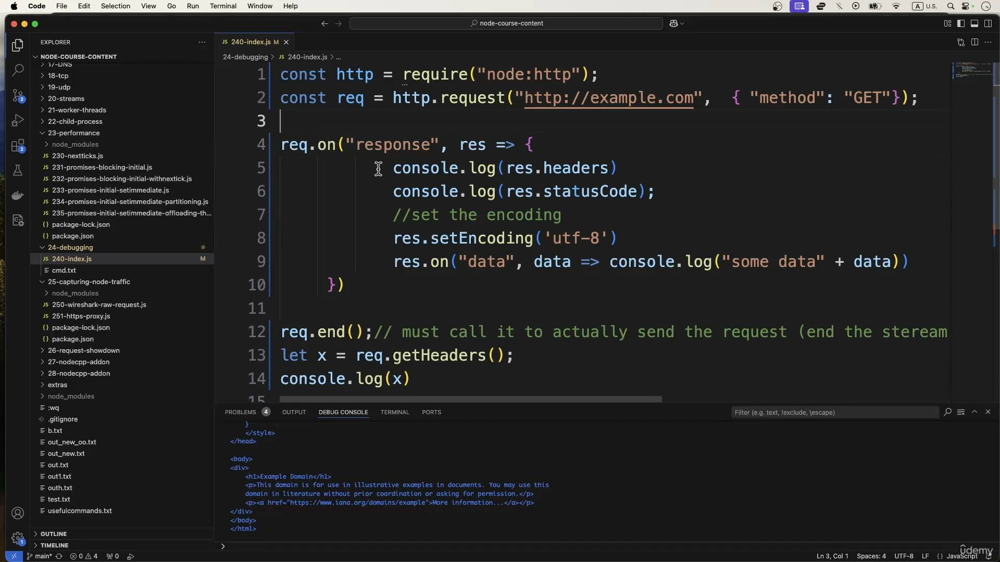
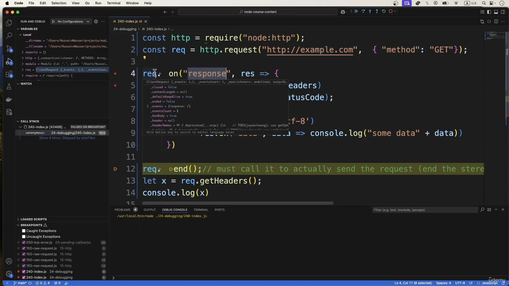
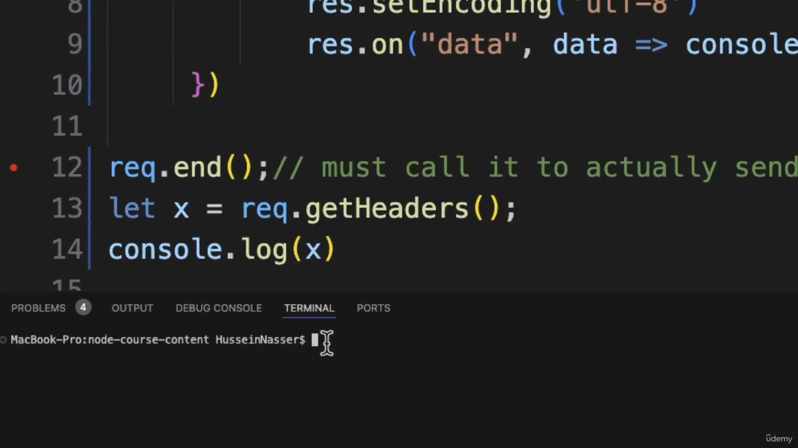
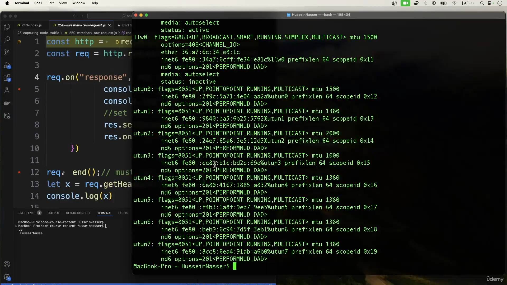
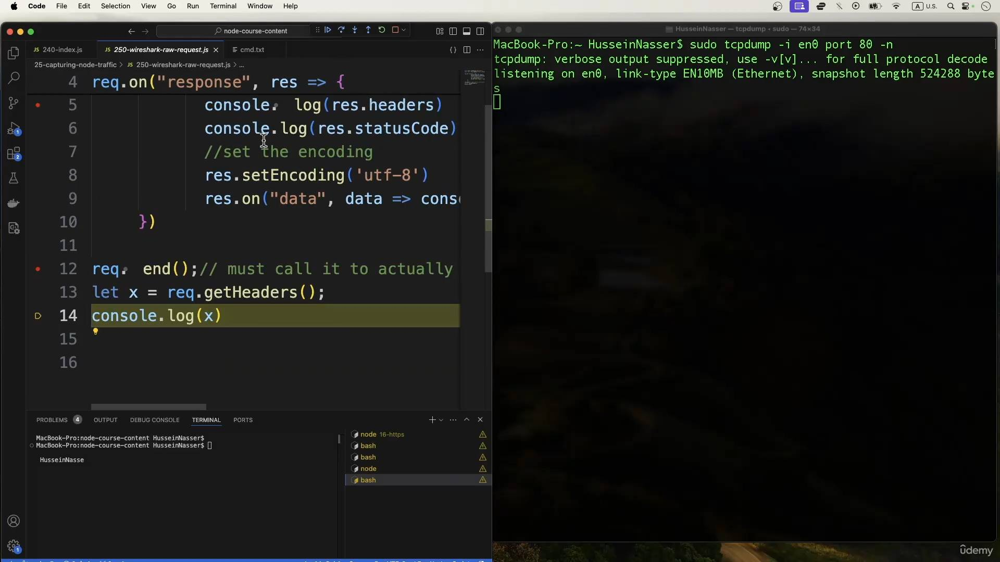
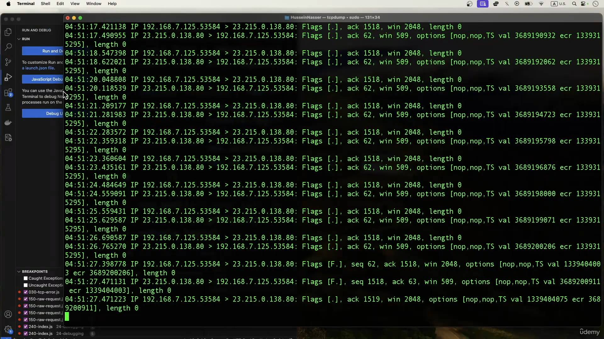
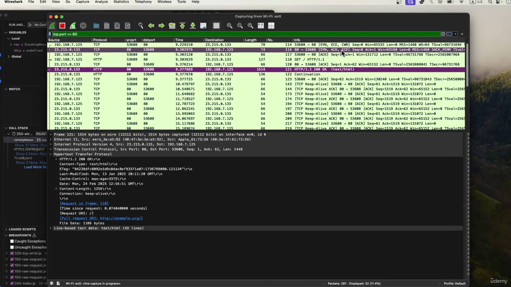
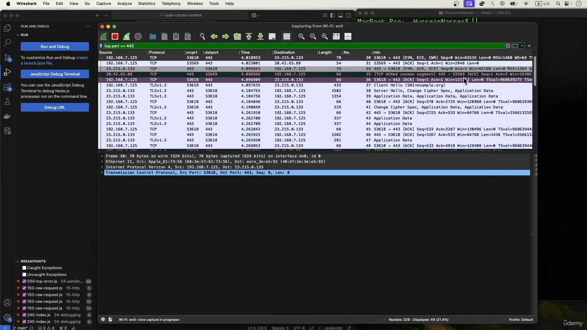

# Node.js 调试与网络流量抓包（P37–P38）复现文档

> 适用读者：前端转 AI 应用工程师。本文档覆盖两节课：P37 用 VS Code / Chrome DevTools 调试 Node.js；P38 用 tcpdump、Wireshark、mitmproxy 抓取 Node 应用发出的原始网络流量（含 HTTPS 解密）。
>
> 说明：课程为英文讲授，本文档把讲师原话要点译出并标注时间戳。逐字稿里没有出现的工具名、字段名一律不编造；不确定处写「以实际输出为准」。

---

## 1. 这一节做什么

这两节课解决同一个问题的两个层面：**「我的 Node 程序到底在干什么？」**

- **P37（调试）**：用调试器把 Node 进程暂停在断点上，逐行执行、检查变量。讲师演示两条路径：
  1. 在 VS Code 里直接对当前文件 `index.js` 下断点、Run and Debug（不需要 `launch.json`）；
  2. 在远程 Linux 机器上用 `node --inspect-brk` 启动，暴露一个调试端口，再用 Chrome 的 `chrome://inspect` 远程 attach，在 Chrome DevTools 里断点调试。

  调试器的价值不只是「看变量」，而是让你能在请求真正发出之前停下来。对 Node.js 来说，`http.request()` 创建一个请求对象并不等于已经发了网络包；只有调用 `req.end()` 才真正把请求写出去。P37 的断点演示就是为了让你亲眼看到这个中间态。前端同学容易把浏览器里 `fetch()` 一调用就当成「请求已经发出」，但在 Node 的 ClientRequest 模型里，构造和发送是分开的；后面 P38 会用 tcpdump 验证这一点。

- **P38（抓包）**：调试会「把执行慢到几乎停住」，因此感受不到真实生产环境的性能问题；于是改为**抓取应用真正发到网线上的原始流量**。讲师演示三种工具：
  1. **tcpdump**（命令行抓包，按网卡 + 端口过滤）；
  2. **Wireshark**（图形化抓包，按 `tcp.port == 80` 过滤）；
  3. **mitmproxy**（中间人代理，专门解 HTTPS：伪造目标站点证书、用自己的 CA 签名，让 Node 信任后即可看到明文）。

  这三种工具观察的是不同层次：调试器看的是 JavaScript 执行状态；tcpdump / Wireshark 看的是 IP/TCP 包；mitmproxy 看的是 HTTP 语义。讲师反复强调，Node 做的 UDP、DNS、HTTP、HTTPS、WebSockets，最终都会落到 IP 包上；所以抓包是理解运行时行为、排查「请求到底发没发、发给了谁、有没有被加密」的底层手段。

最终产物：一个能断点调试的 `index.js`，以及一套能复现「HTTP 明文可见 / HTTPS 加密不可见 / 经代理后 HTTPS 明文可见」三种现象的抓包环境。

建议的复现顺序是：先在 VS Code 里对 `index.js` 下断点，确认「停在 `req.end()` 之前时网络没有包」；再做远程 `--inspect-brk` + Chrome attach；然后用 tcpdump 和 Wireshark 抓 HTTP；最后安装 mitmproxy、导出 CA、运行 `index-https.js`，对比「没有 CA 时报错 / 有 CA 时成功并看到明文」。每一步都要保留终端输出或截图，方便回看自己是卡在调试端口、网卡选择、过滤器语法，还是证书信任上。

---

## 2. 讲师原话（带时间戳）

**P37 调试**

- 「to debug Node.js, there are only two methods here... Node.js provides this interesting WebSockets protocol that allows you to debug it. So Node.js VS code is one very nice way」—— p037 [00:26]
- 「once you install the Visual Studio Code add-in for Node.js, that immediately enables code debugging if you set up the launcher」—— p037 [00:54]
- 「you can actually expose Node.js... if you enable a WebSocket protocol... and you can essentially do remote debug through Chrome」—— p037 [01:21]
- 「If you go to your .vscode, you might have a launch.json file here... if you don't have that launch.json, then whatever the current file is, and you do run.start debugging, what node will do is will run your current program」—— p037 [02:47]
- 「I'm gonna place a breaking point over here and I'm gonna place a breaking point when I get a response back because I want to check the response」—— p037 [03:12]
- 「Here's the agent that we talked about is a global agent. You can see the maximum, the default port 80, all the maximum Freak sockets」—— p037 [04:11]
- 「if I do end, that actually submits the request. That actually writes the request」—— p037 [04:38]
- 「to do remote inspection, we have to run node with dash dash inspect break... we want to immediately break on the first code such that we can listen to that break event」—— p037 [06:05]
- 「Now there's a debugger listening on this unique UUID. And that's the port. It's beautiful WebSocket.」—— p037 [06:34]
- 「Chrome detects it. The reason it's detected is because there's a configuration that looks for these two ports. And these ports by default are the Node.js ports.」—— p037 [07:02]

这些原话对应的操作含义是：VS Code 侧重点是「当前文件 + 断点 + Run and Debug」；远程侧重点是「`--inspect-brk` 先停在第一行，给出 WebSocket 调试地址，Chrome 通过默认端口扫描发现它」。因此复现时不要一上来就纠结 `launch.json`，先确认断点能不能命中；也不要只记 `--inspect-brk` 这个名字，要看清终端打印的 `ws://...` 地址和端口。

**P38 抓包**

- 「debugging technically slows down execution to a halt that you're not going to feel the performance problems that are happening on the real production environment」—— p038 [00:57]
- 「Anything Node does, whether it's UDP, whether it's DNS, whether it's HTTP, whether it's HTTPS, whether it's WebSockets, eventually all boils down to... IP packets」—— p038 [02:24]
- 「if it's encrypted, we cannot know that as a capturing tool」—— p038 [03:48]
- 「what the proxy does is it asks the client, hey, client, send me your HTTP traffic and I'll take care of it and I'll send it to the actual backend」—— p038 [04:45]
- 「it will generate a fake... example.com certificate... and then it signs it with its own certificate authority」—— p038 [06:42]
- 「So what we tell node is it ain't not dies you just accept it... Or you tell NodeJS, hey, NodeJS, if you ever receive the certificate, trust me, bro, just accept it」—— p038 [07:10]
- 「TCP dump -i... and then E and zero... the second thing you can do port your unfiltered... you're interested on anything that has the port 80」—— p038 [12:01]
- 「I'll do dash in to only show the numbers because... TCB them try to be smart and show you the DNS names of things, which is I don't like」—— p038 [12:57]
- 「when we step through things it doesn't mean... requests are being sent... nothing left the network」—— p038 [13:25]
- 「once the initial phase completed, the packets has been sent and we got a response actually」—— p038 [14:22]
- 「This is the keep alive packages... node will continue saying, I'm alive, I'm alive, keep this connection alive」—— p038 [15:21]
- 「you need to go to the TCP TCP dot port equal... equal equal 80」—— p038 [17:42]
- 「we're going to install man in the middle proxy... brew... or npm install」—— p038 [22:00]
- 「we have an HTTPS traffic and we're going to require this HTTPS proxy agent, which is just another agent that we send on top of our request」—— p038 [23:17]
- 「we'll capture the HTTPS traffic... run man in the middle proxy dash P, which is the port, and I'm gonna just spin it on port 8888」—— p038 [25:39]
- 「we got unable to verify the first certificate」—— p038 [27:35]
- 「process... anything that says no tls reject authorized... just ignore this ignore any tls certificates don't verify anything」—— p038 [28:05]
- 「This is called certificate pinning. If you ever heard this term certificate pinning, that means, hey, I only trust the certificate」—— p038 [31:27]

这些原话串起来就是 P38 的实验逻辑：先用调试器证明「单步不等于发包」；再用 tcpdump/Wireshark 看明文 HTTP；然后面对 HTTPS 发现抓包工具只能看到加密流量；最后用 mitmproxy 做中间人，让 Node 信任代理 CA，从而在代理窗口里看到明文。讲师也明确区分了两种让 Node 放行的方式：粗暴地全局忽略 TLS 校验，或者用 `ca` 固定证书。前者只适合本地实验，后者才是他所说的 certificate pinning。

---

## 3. 从零复现

### 3.0 环境与目录

```bash
# 建议 Node 18+（课程未指定版本，以实际输出为准）
node -v
npm -v

mkdir node-debug-capture && cd node-debug-capture
npm init -y
```

命令解释与排查：

- `node -v` 打印当前 Node 版本，`npm -v` 打印 npm 版本。若命令不存在，先检查 Node 是否安装、`PATH` 是否生效，而不是继续往下跑。
- `mkdir node-debug-capture && cd node-debug-capture` 创建并进入项目目录。若目录已存在，`mkdir` 会报错；可以改成先 `cd` 到已有目录，或删掉旧目录重来。
- `npm init -y` 用默认值生成 `package.json`，不进入交互问答。它不会自动安装依赖，也不会自动生成 `.vscode`。第 4.1 节的 `package.json` 是本文最终形态；如果 `npm init -y` 生成的字段与第 4.1 节不同，以第 4.1 节为准补齐即可。`"private": true` 只是防止误发布，不属于课程演示必需。
- 后续还需要 `npm install https-proxy-agent`。安装完成后，`node_modules` 和 `package-lock.json` 会出现；若安装失败，先看网络/registry 配置，不要直接怀疑代码。

目录结构（最终）：

```
node-debug-capture/
├── package.json
├── index.js              # 主程序：发一个 HTTP 请求
├── index-https.js        # HTTPS 版本（抓包用）
├── mtmca.pem             # mitmproxy 导出的 CA 证书（第 3.4 步生成）
└── .vscode/
    └── launch.json       # 可选，P37 演示了「没有它也能调试」
```

注意：`mtmca.pem` 在复现 HTTPS 成功之前可能不存在，这是正常的；第 3.5 节会先生成失败现场，再导出证书。`.vscode/launch.json` 也是可选的，不要因为它不存在就以为不能调试。

### 3.1 P37-A：VS Code 本地断点调试（无需 launch.json）

1. 打开 `index.js`（代码见第 4 节）。
2. 在 `const req = http.request(...)` 这一行左侧点红点下断点；在 `res.on('end', ...)` 回调里再下一个断点。
3. 左侧 Run and Debug 面板 → 点「Run and Debug」（讲师强调：**没有 `launch.json` 时，VS Code 会直接运行当前打开的文件**）。
4. 程序停在第一个断点。此时在 Debug 侧栏的 Variables 里展开 `req`，可以看到 `agent`（global agent）、`maxSockets`、`defaultPort: 80` 等字段（讲师在 [04:11] 逐项展示，字段名以你实际看到的为准）。
5. 单步 Step Over 到 `req.end()` 之前——**注意：此时网络上一包都没发**（这是 P38 会用 tcpdump 验证的关键点）。
6. 执行 `req.end()` 后继续，停在响应回调断点，检查 `res.statusCode`、`res.headers`。

验证与排查：

- 「没有 `launch.json` 也能调试」的前提是 VS Code 运行的是当前活动文件。若你当前编辑器停在别的文件，Run and Debug 可能运行的不是 `index.js`；先确认编辑器标签页。
- 断点必须是实心红点；空心圆通常表示路径不匹配、文件未保存或调试器没有加载该文件。先保存文件再重试。
- 如果停在第一个断点但 Variables 里没有 `req`，确认你停在了 `const req = ...` 之后，而不是之前。`req` 在赋值完成后才可见。
- 这里看到的是 `http` 的 global agent 相关字段，和你前端浏览器里的连接池不是同一套实现，但概念类似：请求会复用连接、有并发上限。你不需要在断点里修改这些字段，只要观察「对象已创建」和「请求未发出」的中间态。





### 3.2 P37-B：远程调试（node --inspect-brk + Chrome）

模拟「应用跑在 Linux 机器上，从本地 Chrome 调试」：

```bash
# 在目标机器（或本机）启动，--inspect-brk 会在第一行代码前就停住
node --inspect-brk index.js
```

终端会打印类似：

```
Debugger listening on ws://127.0.0.1:9229/<一段 UUID>
For help, see: https://nodejs.org/en/docs/inspector
```

（讲师 [06:34] 原话：「debugger listening on this unique UUID. And that's the port.」——端口默认 9229，UUID 以实际输出为准。）

然后：

1. 打开 Chrome，地址栏输入 `chrome://inspect`。
2. 页面里会列出可 attach 的 target（Chrome 默认扫描 Node 的调试端口，讲师 [07:02] 说明了这一点）。
3. 点「inspect」，弹出 DevTools，代码停在第一行。
4. 在 DevTools 的 Sources 面板里下断点、单步、看 Scope 变量——效果与 VS Code 一致。

命令解释与排查：

- `--inspect-brk` 与 `--inspect` 的差别是：前者在第一行代码前就停住，方便你在程序还没跑飞之前 attach；后者通常让程序先跑起来。讲师这里选 `--inspect-brk`，正是为了「immediately break on the first code」。
- 终端打印 `ws://127.0.0.1:9229/...` 说明调试 WebSocket 已监听。若端口被占用，进程可能启动失败或监听不到预期端口；先杀掉旧的 Node 调试进程，或换一个端口（例如 `--inspect-brk=9230`，以实际可用为准）。
- `chrome://inspect` 列表为空时，先确认 Node 进程还在运行、端口没有被防火墙拦截、Chrome 扫描的是本机端口。若目标机与浏览器不在同一台机器，需要 `node --inspect-brk=0.0.0.0:9229` 并自行处理端口转发/防火墙——**课里没讲**具体转发方式。
- 远程 attach 成功但代码没停，检查是不是只用了 `--inspect` 而不是 `--inspect-brk`，或者断点下在了不会执行的路径。



### 3.3 P38-A：tcpdump 抓 HTTP 明文

先确认要监听哪块网卡（讲师 [11:03]：「look for the interface that has your IP address」）：

```bash
# macOS
ifconfig | grep "inet "
# Linux
ip addr
```

找到你本机 IPv4 所在网卡（讲师机器上是 `en0`，你的可能是 `eth0` / `wlan0`）。然后开一个终端抓包：

```bash
# -i 指定网卡；-n 只显示数字不解析域名（讲师 [12:57] 特意强调）
sudo tcpdump -i en0 -n port 80
```

再开另一个终端运行 `node index.js`。你会依次看到（讲师 [14:52] 起逐段讲解）：

- TCP 三次握手（SYN / SYN-ACK / ACK）——**发生在 `req.end()` 之后**，不是创建 request 对象时；
- `GET / HTTP/1.1` 请求行与 Host 头；
- 响应包；
- 一串 keep-alive 包（讲师 [15:21]：「I'm alive, I'm alive」），因为连接没关；
- 最后 FIN/ACK 关闭连接。

命令解释与排查：

- `-i en0` 指定网卡。选错网卡是最常见的「tcpdump 一条包都不出」原因；用 `ifconfig | grep "inet "` 或 `ip addr` 找到有本机 IPv4 的那块，不要选 `127.0.0.1` 回环地址对应的接口。
- `-n` 让 tcpdump 不反解 DNS 名称，直接显示 IP 和端口。讲师不喜欢 tcpdump 自作聪明显示域名，所以特意加了 `-n`；你如果去掉它，输出可能变慢且混入域名。
- `port 80` 是 BPF 过滤表达式，只保留源端口或目的端口为 80 的包。若目标 URL 实际走 HTTPS 443，这个过滤器当然抓不到 HTTP 明文；若流量走代理 8888，也要相应调整端口。
- `sudo` 是因为抓包需要权限。若没有权限，tcpdump 会报权限相关错误；先解决权限，不要反复改过滤器。
- 抓包终端要先开，再运行 Node。若你先跑完 Node 再开 tcpdump，请求已经结束，自然看不到握手。

**关键验证**：在 VS Code 里单步走到 `req.end()` 之前，tcpdump 窗口**一个包都不出**——证明「创建对象 ≠ 发请求」。等执行 `req.end()` 后，才应出现 SYN 和后续 GET。如果你在断点处已经看到 SYN，说明你停的位置不对，或者请求在别处已经被触发。

前端对照：浏览器 DevTools 的 Network 面板看到的是「已经发出的请求」及其高层信息；tcpdump 看到的是网线上的 TCP/IP 包。前端同学熟悉的「请求 pending」在 Node 调试器里可以进一步拆成「对象已建、尚未 `end()`」和「已 `end()`、等待响应」两个阶段。





### 3.4 P38-B：Wireshark 抓 HTTP

1. 从 wireshark.org 下载安装（全平台，安装时需授予抓包权限，讲师 [16:47] 提到）。
2. 启动后选择有流量的网卡（界面会显示每块网卡是否有流量）。
3. 在过滤栏输入：`tcp.port == 80`（讲师 [17:42] 原话：「TCP dot port equal equal 80」）。
4. 运行 `node index.js`，观察 SYN、GET、响应、keep-alive、FIN。

解释与排查：

- `tcp.port == 80` 是 Wireshark 的显示过滤器语法，不是 tcpdump 的 BPF。它的意思是「显示 TCP 源端口或目的端口等于 80 的包」。`==` 在 Wireshark 里也可以写成 `eq`。
- 如果过滤栏变红，说明语法写错；如果过滤后空白，检查是否选错网卡、目标是否不是 80 端口、请求是否已经跑完。
- 安装时授予抓包权限很重要；没有权限时 Wireshark 可能能看到网卡列表但抓不到包。
- 与 tcpdump 一样，先启动抓包/确认网卡，再运行 Node；否则你会错过握手。

> 讲师在演示时 example.com 一度返回 **Bad Request**，他判断是自己的 IP 请求太频繁被 CDN 临时限流（[19:37]「I bet they blocked us」），换成 example.org 后恢复正常。你复现时若遇到同样现象，换域名即可，不是代码问题。

前端对照：Wireshark 比浏览器 Network 面板「更底层」。Network 面板告诉你请求 URL、状态码、响应头；Wireshark 告诉你这些信息是被拆成哪些 TCP 包、握手是否完成、连接是否复用。排查「请求有没有真的离开本机」时，后者更可信。



### 3.5 P38-C：mitmproxy 解 HTTPS

**第一步：安装并启动代理**

```bash
# macOS
brew install mitmproxy
# 或跨平台
npm install -g mitmproxy   # 讲师 [22:00] 提到 npm 方式，以实际可用为准

# 在 8888 端口起代理（讲师 [25:39]）
mitmproxy -p 8888
```

解释：`mitmproxy -p 8888` 中的 `-p` 指定代理监听端口，讲师选择 8888。启动后不要关这个终端，它就是中间人代理。若 `brew` 或 `npm` 方式在你的环境不可用，以实际可用为准；本文不额外编造安装渠道。

**第二步：让 Node 走代理**——用 `https-proxy-agent`（讲师 [23:17]：「just another agent that we send on top of our request」）：

```bash
npm install https-proxy-agent
```

解释：`https-proxy-agent` 是请求层面的 agent，把它传给 `https.request` 后，Node 会先连到代理，而不是直连目标站点。注意：虽然连接先到代理，TLS 的 SNI/Host 仍然指向最终目标站点——这正是正向代理转发 HTTPS 的工作方式，以实际实现为准。

**第三步：先故意失败**。运行 `index-https.js`（第 4 节代码），会得到：

```
Error: unable to verify the first certificate
```

原因（讲师 [27:35] 起）：mitmproxy 冒充 example.com 返回了自签证书，Node 不信任。这个错误是预期中的「失败现场」，不是代码写错。若你没有看到这个错误，反而直接成功，检查是不是已经设置了 `NODE_TLS_REJECT_UNAUTHORIZED=0`，或者 `mtmca.pem` 已经存在并被代码读取。

**第四步：导出 mitmproxy 的 CA 证书**

1. 把系统/浏览器代理设为 `127.0.0.1:8888`（讲师 [29:34] 在系统设置 → 网络 → 代理里改）。
2. 浏览器访问 `http://mitm.it`，下载对应平台的证书（macOS 得到 `mitmproxy-ca-cert.pem`，重命名为 `mtmca.pem` 放进项目根目录）。

解释与排查：`http://mitm.it` 只有在浏览器/系统代理指向 mitmproxy 时才能打开。如果打不开，先回到代理设置，而不是怀疑证书下载页。下载后必须放到项目根目录并命名为 `mtmca.pem`，因为 `index-https.js` 按这个路径读取。文件名或路径不一致，`fs.existsSync` 会返回 false，请求仍会走默认校验并报错。

**第五步：两种让 Node 信任的方式**

- **方式 A（不推荐，仅本地）**：设 `process.env.NODE_TLS_REJECT_UNAUTHORIZED = '0'`，忽略所有证书校验。讲师 [28:05] 明确说这是「unrecommended approach」，**千万别提交到仓库**。
- **方式 B（推荐，即证书固定 certificate pinning）**：把 `mtmca.pem` 作为 `ca` 传给请求（讲师 [31:27]：「I only trust the certificate」）。

解释：方式 A 是进程级关闭 TLS 校验，任何证书都收，所以 mitmproxy 的伪造证书也能通过；它只适合本地临时抓包。方式 B 是把信任范围收缩到 mitmproxy 的 CA：Node 收到伪造证书后，用它和 `mtmca.pem` 校验，匹配才放行。讲师把这种方式称作 certificate pinning，即「我只信这一张证书」。生产环境若固定 CA，目标站点换证书后你的请求会失败，需要更新对应证书文件；这点课里只讲了原理，没讲运维轮换。

跑通后，mitmproxy 窗口里就能看到 example.com 的**明文**请求与响应。若 mitmproxy 窗口没有流量，检查 Node 是否真的用了 `HttpsProxyAgent`、代理端口是否 8888、系统代理是否影响到了 Node（Node 不一定自动读系统代理，代码里的 agent 才是关键）。





---

## 4. 完整代码

### 4.1 `package.json`

```json
{
  "name": "node-debug-capture",
  "version": "1.0.0",
  "private": true,
  "type": "commonjs",
  "scripts": {
    "start": "node index.js",
    "start:https": "node index-https.js",
    "inspect": "node --inspect-brk index.js"
  },
  "dependencies": {
    "https-proxy-agent": "^7.0.5"
  }
}
```

### 4.2 `index.js`（HTTP，P37 调试 + P38 tcpdump/Wireshark 用）

```js
// index.js
const http = require('http');

// 目标站点：讲师演示时 example.com 曾被限流，可换成 example.org
const TARGET = 'http://example.org/';

console.log('1) 准备发起请求，目标：', TARGET);

const req = http.request(TARGET, (res) => {
  // 断点 2：拿到响应对象后检查 statusCode / headers
  console.log('3) 收到响应，statusCode =', res.statusCode);
  console.log('   headers =', res.headers);

  res.setEncoding('utf8');

  let body = '';
  res.on('data', (chunk) => {
    body += chunk;
  });

  res.on('end', () => {
    console.log('4) 响应体长度 =', body.length);
    console.log('   前 200 字符：', body.slice(0, 200));
  });
});

req.on('error', (err) => {
  console.error('请求出错：', err.message);
});

// 断点 1：停在这里时，网络上一包都没发
console.log('2) request 对象已创建，但还没调用 end()，此时不会发出任何数据');

// 这一行才真正把请求写出去（讲师 [04:38]：「end actually submits the request」）
req.end();
```

### 4.3 `index-https.js`（HTTPS + mitmproxy，P38 用）

```js
// index-https.js
const https = require('https');
const fs = require('fs');
const path = require('path');
const { HttpsProxyAgent } = require('https-proxy-agent');

const TARGET = 'https://example.org/';

// 代理地址：mitmproxy 默认监听 8888
const PROXY_URL = 'http://127.0.0.1:8888';

// 方式 B：证书固定。把 mitmproxy 导出的 CA 放在项目根目录，命名 mtmca.pem
const CA_PATH = path.join(__dirname, 'mtmca.pem');
const ca = fs.existsSync(CA_PATH) ? fs.readFileSync(CA_PATH) : undefined;

// 方式 A（不推荐，仅本地调试）：忽略所有证书校验
// 取消下面这行注释即可复现「先失败再放行」的对比实验
// process.env.NODE_TLS_REJECT_UNAUTHORIZED = '0';

const agent = new HttpsProxyAgent(PROXY_URL);

const options = {
  agent,
  // 若提供了 CA，则用它做证书固定；否则走系统默认校验（会报 unable to verify the first certificate）
  ...(ca ? { ca } : {}),
};

console.log('发起 HTTPS 请求：', TARGET, '经代理', PROXY_URL);

const req = https.request(TARGET, options, (res) => {
  console.log('statusCode =', res.statusCode);
  console.log('headers =', res.headers);

  res.setEncoding('utf8');
  let body = '';
  res.on('data', (c) => (body += c));
  res.on('end', () => {
    console.log('响应体长度 =', body.length);
    console.log('前 200 字符：', body.slice(0, 200));
  });
});

req.on('error', (err) => {
  console.error('请求出错：', err.message);
});

req.end();
```

### 4.4 `.vscode/launch.json`（可选）

讲师 [02:47] 说没有它也能调试当前文件；若你想固定入口，可用：

```json
{
  "version": "0.2.0",
  "configurations": [
    {
      "type": "node",
      "request": "launch",
      "name": "Launch index.js",
      "program": "${workspaceFolder}/index.js",
      "skipFiles": ["<node_internals>/**"]
    }
  ]
}
```

---

## 5. 逐行解释

**`index.js`**

- `const http = require('http');`：加载 Node 内置 `http` 模块。这里不需要安装第三方依赖；HTTP 请求、Agent、响应流都来自核心模块。
- `const TARGET = 'http://example.org/';`：目标 URL 单独抽出来，方便在 example.com 被限流时换域名。注意这里是 `http://`，tcpdump 才能用 `port 80` 过滤到明文。
- `console.log('1) ...')`：调试标记。单步时看到它，说明代码已经执行到创建请求之前。
- `http.request(TARGET, cb)`：创建一个 ClientRequest 对象，但**不发送**。讲师在断点处展开它，看到 `agent`（global agent）、`defaultPort: 80`、`maxSockets` 等——这些正是 HTTP 课讲过的连接池参数。在 JS/Node 里，这就是「惰性构造」：对象在内存里，网线上什么都没有。第二个参数 `cb` 是响应回调，只有收到响应头后才会进入。
- `// 断点 2 ...`：响应回调里的断点。它验证的是「响应回来之后」的状态：`res.statusCode`、`res.headers` 已经可读，但响应体还不一定收完。
- `res.setEncoding('utf8')`：把响应流从 Buffer 转成字符串。不设置的话，`data` 事件里的 `chunk` 是 Buffer，拼接和打印的行为会不同；前端 `fetch().then(r => r.text())` 底层也做了类似的流拼接。
- `let body = ''; res.on('data', ...)`：响应体是流，分块到达。`data` 可能触发多次，不能假设一次就收完。这里手动把 chunk 拼起来，是为了在 `end` 时打印总长度和前 200 字符。
- `res.on('end', ...)`：响应体结束时触发。到这里才适合断言「响应收完了」。如果你在 `data` 里就打印长度，看到的可能只是第一块。
- `req.on('error', ...)`：必须挂错误监听。不挂的话，请求出错会抛未捕获异常导致进程退出；挂了之后至少能看到 `err.message`，便于判断是 DNS、连接、TLS 还是代理问题。
- `// 断点 1 ...`：这是 P37 与 P38 的衔接点。停在这里时，`req` 已创建，但 `req.end()`尚未执行；tcpdump 应该一个包都没有。
- `req.end()`：**唯一真正触发网络 I/O 的调用**。P38 用 tcpdump 验证：`end()` 之前零包，之后才出现 SYN。讲师 [04:38] 原话就是「end actually submits the request」。GET 请求没有请求体，所以 `end()` 不传参数；如果是 POST，通常会在这里写 body。

**`index-https.js`**

- `const https = require('https');`：HTTPS 是 HTTP over TLS，API 与 `http` 类似，但多了 TLS 校验和证书相关选项。
- `const fs = require('fs'); const path = require('path');`：用来读取 `mtmca.pem` 并拼接项目根目录路径。`__dirname` 是当前文件所在目录，避免从不同工作目录运行时找不到证书。
- `const { HttpsProxyAgent } = require('https-proxy-agent');`：新版包使用具名导出 `HttpsProxyAgent`。若你装的是老版本，导出形式可能不同，会报 `is not a constructor`；这时要核对版本，而不是改代理逻辑。
- `const TARGET = 'https://example.org/';`：HTTPS 目标。没有代理和信任设置时，抓包工具只能看到加密流量；有 mitmproxy 和 CA 后才能看到明文。
- `const PROXY_URL = 'http://127.0.0.1:8888';`：代理地址。注意协议是 `http://`，因为 mitmproxy 的代理入口是 HTTP 代理；它再通过 CONNECT 等方式处理 HTTPS，以实际实现为准。
- `const CA_PATH = path.join(__dirname, 'mtmca.pem');`：证书固定路径。必须和实际文件名一致；大小写、扩展名、目录错了都会导致 `fs.existsSync` 为 false。
- `const ca = fs.existsSync(CA_PATH) ? fs.readFileSync(CA_PATH) : undefined;`：这个分支让同一份代码既能复现「失败」又能复现「成功」。没有证书时 `ca` 为 `undefined`，`options` 里不会带 `ca`，请求走默认校验并报 `unable to verify the first certificate`；有证书时把 `ca` 传给 TLS。
- `// process.env.NODE_TLS_REJECT_UNAUTHORIZED = '0';`：方式 A，全局关闭校验。讲师 [28:05] 明确说这是不推荐的做法；它会影响整个进程的所有 TLS 请求，**绝不能进生产，也别忘了它是注释状态**。
- `const agent = new HttpsProxyAgent(PROXY_URL);`：把请求的 TCP 连接指向代理，但 TLS 的 SNI/Host 仍是 example.org——讲师 [23:47] 解释「the host is still remain the final destination」。这就是正向代理的工作方式：Node 连代理，代理再连目标；TLS 握手的目标名仍是最终站点。
- `const options = { agent, ...(ca ? { ca } : {}) };`：把 agent 和可选 CA 合并成请求选项。`ca` 存在时，Node 用它做证书固定；不存在时，走系统默认校验。这里的展开语法只是条件添加字段，不改变请求语义。
- `https.request(TARGET, options, (res) => ...)`：创建 HTTPS ClientRequest。和 `http.request` 一样，构造时不发包；`req.end()` 才发。响应回调里同样检查 `statusCode`、`headers`，再把流拼成 body。
- `req.on('error', ...)`：HTTPS 阶段出错会走这里，典型就是证书校验失败。看到 `unable to verify the first certificate` 时，先判断是「预期失败」还是「CA 路径没读到」，不要盲目关校验。
- `req.end()`：真正发出请求。此时如果代理配置正确、CA 信任正确，mitmproxy 窗口里就能看到明文请求与响应。

**tcpdump 参数**

- `-i en0`：只听一块网卡，避免被无关流量淹没（讲师 [11:32]：「so that you don't get overwhelmed」）。选错网卡时，你会以为程序没发包，其实是抓错了接口。
- `-n`：不反解域名，输出纯 IP/端口，读起来更快。讲师 [12:57] 特意强调，因为 tcpdump 默认会尝试显示 DNS 名称，反而干扰观察。
- `port 80`：BPF 过滤表达式，只留 80 端口。它不区分方向，源端口或目的端口为 80 都会显示；也正因如此，你能看到请求和响应两个方向。
- `sudo`：抓包权限。没有权限时先解决权限，不要改代码。

**Wireshark 过滤**

- `tcp.port == 80`：显示过滤器语法（不是 BPF），`==` 在 Wireshark 里也接受 `eq`。它的作用是「在已经抓到的包中筛选」，不是「只抓 80 端口」；真正的抓包过滤是另一套语法，本文不展开。
- 如果过滤栏语法错误会变红；如果过滤后没有包，先清空过滤器看是否有其他流量，再检查网卡和端口。

---

## 6. 复现检查清单

- [ ] `node -v` 正常，`npm install` 无报错。验证：终端能打印版本号；`npm install` 结束后 `node_modules` 存在，且没有权限/网络错误。
- [ ] VS Code 打开 `index.js`，下两个断点，Run and Debug 能停在第一个断点。验证：断点是实心红点，调试工具栏出现暂停按钮，Variables 面板能看到局部变量。
- [ ] 断点处展开 `req`，能看到 agent / 端口相关字段（字段名以实际为准）。验证：在 `const req = ...` 执行后展开对象，至少能看到 `agent`、`defaultPort` 一类字段；没有就检查停的位置。
- [ ] 单步到 `req.end()` 之前，tcpdump 窗口**无任何包**。验证：先开 tcpdump，再让 VS Code 停在 `req.end()` 前，观察 tcpdump 时间戳不新增 SYN；这一步证明「创建对象不等于发请求」。
- [ ] 执行 `req.end()` 后，tcpdump 出现 SYN → GET → 响应 → keep-alive → FIN。验证：继续单步/放行，tcpdump 里先出现握手，再出现 `GET / HTTP/1.1`，最后连接关闭或保持。
- [ ] `node --inspect-brk index.js` 打印 `Debugger listening on ws://...`，`chrome://inspect` 能 attach 并停在第一行。验证：终端有 ws 地址；Chrome 列表出现 target；点 inspect 后代码暂停在第一行。
- [ ] Wireshark 选对网卡，过滤 `tcp.port == 80` 能看到同样的握手与 GET。验证：过滤栏不变红；运行 `node index.js` 后出现 SYN、GET、响应；若空白，检查网卡和端口。
- [ ] `mitmproxy -p 8888` 启动成功。验证：终端显示代理已监听；窗口保持打开；系统/浏览器代理指向 `127.0.0.1:8888` 后能访问 `http://mitm.it`。
- [ ] 无 `mtmca.pem` 时运行 `index-https.js`，报 `unable to verify the first certificate`。验证：先确认根目录没有 `mtmca.pem`，再运行脚本，错误信息应包含证书校验失败；若没有报错，检查是否开了全局忽略校验。
- [ ] 访问 `http://mitm.it` 下载证书、改名 `mtmca.pem` 放根目录后重跑，请求成功且 mitmproxy 里看到明文。验证：`ls mtmca.pem` 能看到文件；脚本不再报证书错误；mitmproxy 窗口出现 example.org 的请求行和响应。
- [ ] 确认 `NODE_TLS_REJECT_UNAUTHORIZED` 那行是注释状态。验证：在 `index-https.js` 里搜索该变量，确认前面有 `//`；若没有注释，先注释掉再复现证书固定流程。

---

## 7. 课里没讲但你会撞上的

| 现象 | 原因 | 怎么办 |
|---|---|---|
| 用了 `--inspect` 但 Chrome 没有停在第一行 | `--inspect` 不会在第一行前强制暂停；课里用的是 `--inspect-brk` | 远程调试想先停住就用 `--inspect-brk`；若想先跑起来再 attach，再用 `--inspect`，并确认断点位置 |
| 9229 端口被占用 / 调试器连不上 | 上一次 Node 调试进程没退干净，或端口被