# NodeJS 课程文档：请求库性能对比 + C++ Addon 从零构建

> 覆盖 P039–P040。P039 是「请求库性能对比」的纯演示课，P040 是「Node C++ Addon」的完整构建课。两节都偏实操，本文按「先跑通、再理解」的顺序重组。

---

## 1. 这一节做什么

这两节课解决两个完全不同的问题，但都属于「Node 性能与底层」这条线：

**P039：请求库性能对比（Request Library Showdown）**
讲师用同一套骨架代码，分别用 `http`（原生）、`fetch`（Node 内置）、`undici`（讲师读作 "undici / UNDICI"）、`axios` 四个库，各发 100 个 HTTP 请求，测量三件事：
- 准备 100 个请求（构造请求对象、解析 URL、拼 header）花了多少时间、多少内存；
- 所有响应回来后，总耗时和总内存；
- 用 `process.memoryUsage()` 的 RSS（resident set size，物理内存）作为内存指标。

结论不是「谁最好」，而是让你亲眼看到：**任何库都有 overhead，选库之前先量一量**。

这一节的教学目标有三层。第一层是「能跑」：四个脚本都能在你自己机器上跑出结果，不报错。第二层是「能读」：看懂每个脚本里 `t0 / m0 / t1 / m1 / t2 / m2` 这六个采样点分别对应什么阶段，为什么必须这样切。第三层是「能迁移」：把这套「准备阶段 vs 发送阶段分开测」的方法论，套到你以后遇到的任何性能对比场景上——不管是数据库客户端、序列化库、还是模板引擎。讲师反复强调这不是「选库指南」，而是一套**可复用的测量方法**。所以你在复现时，重点不是记住哪个库快，而是记住「怎么测才公平」。

**P040：C++ Addon 从零构建**
从空目录开始，用 `node-addon-api`（NAPI）+ `node-gyp` 把一个 C++ 写的 `addNumbers(a, b)` 编译成 `.node` 二进制，在 `index.js` 里 `require` 它并调用，最后用 VS Code 的 `launch.json` 同时调试 JS 和 C++。

这一节的价值在于：**步骤多、任何一步错都跑不起来**。所以本文会把每一步的文件、命令、路径都写全。从建目录、装依赖、写 `sum.cpp`、写 `binding.gyp`、配 `package.json` 脚本、`npm install` 触发构建、检查产物、运行、切 Debug 构建、配 `launch.json`、打断点调试，一共十来个步骤，任何一步的路径、文件名、大小写错了，都会在下一步以「找不到模块」「链接错误」「断点不生效」的形式爆出来。所以这一节的核心不是「理解 C++」，而是「理解构建链路」——你要清楚每个文件在整条链路上扮演什么角色，出问题时才知道去哪一步查。

---

## 2. 讲师原话

P039 开场就定调了这节课的性质：

> "这节课纯粹是一个演示，主题是请求库对决。我们会比较多个请求库……对每个请求库发送大约 100 个请求，并测量消耗了多少内存。"
> —— p039 [00:00]

> "这并不是要帮你选出最好的请求库，而只是一种通用方法，用来衡量你手头任何东西的性能。"
> —— p039 [00:58]

关于为什么只测 HTTP 不测 HTTPS：

> "再说一次，这里不是 HTTPS，全部都是 HTTP。我只想比较 HTTP。如果切换到 HTTPS，成本会更高。"
> —— p039 [01:57]

关于连接池和 HTTP/1.1 的限制：

> "我会用一个带 10 个套接字的代理……由于 HTTP/1.1 的这个限制，一条连接一次只能发送一个请求。"
> —— p039 [02:25]

关于为什么「准备阶段」和「发送阶段」要分开测：

> "我们不知道请求会在什么时候发出。我们能做的只是在初始阶段开始前测量一次，并在初始阶段刚结束时再测量一次……轮询阶段就是做这件事的。"
> —— p039 [04:18]

P040 开场先打预防针：

> "用 C++ 插件和 Node 时，你必须非常小心地推进……其中涉及太多会变动的环节。任何一步做错，基本上都会得到错误结果，或者根本无法调试。"
> —— p040 [00:00]

关于为什么需要 C++：

> "有时只靠 JavaScript 还不够……当某个函数需要反复执行，而它本身又无法再精简时……你就会想把每次执行多花的 1 毫秒、2 毫秒或 500 微秒省回来。"
> —— p040 [01:28]

关于为什么用 NAPI 而不是直接写 V8 API：

> "V8 的问题在于，他们总是在做破坏性变更……Node 在 V8 之上有一套自己的接口，抽象程度更高，兼容性也更好。这就是我们要用的……NAPI。"
> —— p040 [05:15]

关于 `binding.gyp` 的地位：

> "这个 binding.gyp 是最重要的文件，因为没有它，我们什么都构建不了。"
> —— p040 [12:17]

关于调试的坑：

> "你需要一个特殊的 launch.json 文件，它支持插件调试，本质上就是 C++ 调试……通过它，你可以让 Visual Studio Code 同时查看两个文件夹：C++ 和 JavaScript。"
> —— p040 [35:42]

---

## 3. 从零复现

### 3.1 P039：请求库对比（复现步骤）

**前置条件**：Node 18+（讲师用的是 Node 26，内置 `fetch` 从 Node 18 开始可用）。一个可访问的 HTTP 端点（讲师用的是公开测试端点，你换成自己的即可）。确认 Node 版本用 `node -v`，如果低于 18，`fetch.js` 会直接报 `ReferenceError: fetch is not defined`，这是最常见的第一个坑。

**步骤 1：建目录、初始化**

```bash
mkdir request-showdown && cd request-showdown
npm init -y
```

`npm init -y` 会生成一个默认的 `package.json`，`main` 指向 `index.js`，`type` 默认是 `commonjs`。本文所有脚本都用 `require`，所以保持默认即可，不要改成 `"type": "module"`，否则 `require` 会报错。

**步骤 2：安装两个第三方库**

```bash
npm install axios undici
```

> `http` 和 `fetch` 是 Node 内置的，不用装。`undici` 是讲师口中 "undici / UNDICI" 的那个库，npm 包名就是 `undici`。

安装完成后，`package.json` 的 `dependencies` 里应该能看到 `axios` 和 `undici` 两项。如果看不到，说明安装失败，先解决网络或 registry 问题再往下走。

**步骤 3：写四个脚本**

四个脚本骨架完全一样，只有 `sendRequest` 里调用的库不同。文件分别是：
- `http.js`（原生 `http`）
- `fetch.js`（内置 `fetch`）
- `undici.js`（`undici`）
- `axios.js`（`axios`）

完整代码见第 4 节。四个文件放在同一个目录下，共用同一个 `URL_STRING` 常量。写的时候注意：`http.js` 和 `axios.js` 里都用了 `http.Agent`，但 `axios.js` 里需要额外 `require('http')`，别漏了。

**步骤 4：逐个运行，记录输出**

```bash
node http.js
node fetch.js
node undici.js
node axios.js
```

每个脚本会打印一张表：准备耗时、准备内存、响应耗时、响应后内存。**建议每个脚本至少跑 3 次**，把结果记在纸上或表格里，取中位数。单次结果波动极大，讲师自己在课里也反复说 "它会上下波动"。

**步骤 5：对比**

讲师在课里跑出来的大致量级（p039 全程口述，非精确值，仅供你对照自己机器上的结果）：

| 库 | 准备内存 | 响应后内存 | 响应耗时 |
|---|---|---|---|
| `http` | ~6 MB | ~16–17 MB | ~200–230 ms |
| `fetch` | ~60 MB | ~52 MB | ~200 ms |
| `undici` | ~2–2.5 MB | ~29 MB | ~9 ms 准备 + 快 |
| `axios` | ~7 MB | ~20 MB | ~180 ms（最快） |

> 注意：这些数字随机器、缓存、网络波动很大。讲师自己也反复说 "它会上下波动"。**你要看的是相对量级，不是绝对值。**

对比时重点看三件事：第一，`fetch` 的准备内存为什么比其他库高一个数量级（因为它内部封装了 `undici` 的完整请求对象）；第二，`undici` 的准备内存为什么最低（它把大量工作推迟到了实际发送阶段）；第三，`axios` 的响应耗时为什么最快（它底层复用 `http.Agent`，连接池效率高）。这三个「为什么」比数字本身重要。

### 3.2 P040：C++ Addon（复现步骤）

这一节步骤多，按顺序来，一步都不能跳。

**前置条件**：
- Node.js（讲师用 Node 26，你用 LTS 即可）
- C++ 编译器：macOS 装 Xcode Command Line Tools（`xcode-select --install`）；Linux 装 `build-essential`；Windows 装 Visual Studio Build Tools（含 C++ 工作负载）
- VS Code + C/C++ 扩展（调试 C++ 需要）

**步骤 1：建目录、初始化**

```bash
mkdir node-cpp-addon && cd node-cpp-addon
npm init -y
```

**步骤 2：安装两个依赖**

```bash
npm install node-addon-api
npm install node-gyp
```

- `node-addon-api`：提供 `napi.h` 头文件，C++ 代码 `#include` 它。
- `node-gyp`：构建工具，把 `.cpp` 编译成 `.node`。

安装完成后，`node_modules/node-addon-api/` 目录下应该有 `napi.h`、`napi-inl.h`、`node_api.gyp` 等文件。如果 `napi.h` 不在，说明装错了包（有人会误装 `node-api`，那是另一个包）。

**步骤 3：写 `sum.cpp`**（完整代码见第 4 节）

**步骤 4：写 `binding.gyp`**（完整代码见第 4 节）

**步骤 5：写 `index.js`**（完整代码见第 4 节）

**步骤 6：在 `package.json` 里加 rebuild 脚本**

```json
{
  "scripts": {
    "install": "node-gyp rebuild"
  }
}
```

> 讲师说：`npm install` 时如果 `package.json` 里有 `install` 脚本，会自动执行 `node-gyp rebuild`。默认产出 `build/Release/sum.node`。

**步骤 7：构建（Release）**

```bash
npm install
```

构建完成后检查：

```bash
ls build/Release/
# 应该看到 sum.node
```

如果 `build/Release/` 不存在，说明构建失败。往上翻 `npm install` 的输出，找 `gyp ERR!` 开头的行，那才是真正的错误。常见原因是编译器没装、`binding.gyp` 语法错、`sum.cpp` 里 `#include <napi.h>` 找不到。

**步骤 8：运行**

```bash
node index.js
# 输出：15
```

**步骤 9：改成 Debug 构建**

把 `package.json` 的 `install` 脚本改成：

```json
"install": "node-gyp rebuild --debug"
```

重新 `npm install`，产出变成 `build/Debug/sum.node`。**同时要把 `index.js` 里的 require 路径从 `Release` 改成 `Debug`**，否则会报找不到模块。

**步骤 10：配置 VS Code 调试**

在项目根目录建 `.vscode/launch.json`（完整内容见第 4 节），然后在 `sum.cpp` 里打断点，按 F5 启动调试。

**步骤 11（可选）：消除 VS Code 的 C++ 报错**

在 `.vscode/c_cpp_properties.json` 里加 `includePath`，把 `node_modules/node-addon-api` 和 Node 的头文件目录加进去。讲师说这一步是为了让 VS Code 的 IntelliSense 找到 `napi.h`，**不影响实际构建**。

---

## 4. 完整代码

### 4.1 P039 — `http.js`（原生 http 版）

```javascript
// http.js
const http = require('http');

const URL_STRING = 'http://jsonplaceholder.typicode.com/posts/1';
const TOTAL = 100;

// 10 个 socket 的连接池
const agent = new http.Agent({ keepAlive: true, maxSockets: 10 });

function sendRequest(url) {
  return new Promise((resolve, reject) => {
    const req = http.request(url, { agent, method: 'GET' }, (res) => {
      // 必须消费响应流，否则请求不会结束
      res.on('data', () => {});
      res.on('end', () => resolve(res.statusCode));
    });
    req.on('error', reject);
    req.end();
  });
}

async function main() {
  const url = new URL(URL_STRING);

  // 准备阶段前：记录时间和内存
  const t0 = process.hrtime.bigint();
  const m0 = process.memoryUsage().rss;

  const promises = [];
  for (let i = 0; i < TOTAL; i++) {
    promises.push(sendRequest(url));
  }

  // 准备阶段后
  const t1 = process.hrtime.bigint();
  const m1 = process.memoryUsage().rss;

  const prepareMs = Number(t1 - t0) / 1e6;
  const prepareMemMB = (m1 - m0) / 1024 / 1024;

  // 等待所有响应
  await Promise.all(promises);

  const t2 = process.hrtime.bigint();
  const m2 = process.memoryUsage().rss;

  const totalMs = Number(t2 - t0) / 1e6;
  const totalMemMB = (m2 - m0) / 1024 / 1024;

  console.table({
    library: 'http',
    prepareMs: prepareMs.toFixed(2),
    prepareMemMB: prepareMemMB.toFixed(2),
    totalMs: totalMs.toFixed(2),
    totalMemMB: totalMemMB.toFixed(2),
  });
}

main().catch(console.error);
```

### 4.2 P039 — `fetch.js`（内置 fetch 版）

```javascript
// fetch.js
const URL_STRING = 'http://jsonplaceholder.typicode.com/posts/1';
const TOTAL = 100;

function sendRequest(url) {
  return fetch(url).then((res) => res.status);
}

async function main() {
  const t0 = process.hrtime.bigint();
  const m0 = process.memoryUsage().rss;

  const promises = [];
  for (let i = 0; i < TOTAL; i++) {
    promises.push(sendRequest(URL_STRING));
  }

  const t1 = process.hrtime.bigint();
  const m1 = process.memoryUsage().rss;

  const prepareMs = Number(t1 - t0) / 1e6;
  const prepareMemMB = (m1 - m0) / 1024 / 1024;

  await Promise.all(promises);

  const t2 = process.hrtime.bigint();
  const m2 = process.memoryUsage().rss;

  const totalMs = Number(t2 - t0) / 1e6;
  const totalMemMB = (m2 - m0) / 1024 / 1024;

  console.table({
    library: 'fetch',
    prepareMs: prepareMs.toFixed(2),
    prepareMemMB: prepareMemMB.toFixed(2),
    totalMs: totalMs.toFixed(2),
    totalMemMB: totalMemMB.toFixed(2),
  });
}

main().catch(console.error);
```

### 4.3 P039 — `undici.js`

```javascript
// undici.js
const { request, Agent } = require('undici');

const URL_STRING = 'http://jsonplaceholder.typicode.com/posts/1';
const TOTAL = 100;

// undici 的 Agent 配置方式和 http.Agent 不同
const agent = new Agent({ connections: 10 });

function sendRequest(url) {
  return request(url, { dispatcher: agent, method: 'GET' })
    .then((res) => res.statusCode);
}

async function main() {
  const t0 = process.hrtime.bigint();
  const m0 = process.memoryUsage().rss;

  const promises = [];
  for (let i = 0; i < TOTAL; i++) {
    promises.push(sendRequest(URL_STRING));
  }

  const t1 = process.hrtime.bigint();
  const m1 = process.memoryUsage().rss;

  const prepareMs = Number(t1 - t0) / 1e6;
  const prepareMemMB = (m1 - m0) / 1024 / 1024;

  await Promise.all(promises);

  const t2 = process.hrtime.bigint();
  const m2 = process.memoryUsage().rss;

  const totalMs = Number(t2 - t0) / 1e6;
  const totalMemMB = (m2 - m0) / 1024 / 1024;

  console.table({
    library: 'undici',
    prepareMs: prepareMs.toFixed(2),
    prepareMemMB: prepareMemMB.toFixed(2),
    totalMs: totalMs.toFixed(2),
    totalMemMB: totalMemMB.toFixed(2),
  });
}

main().catch(console.error);
```

### 4.4 P039 — `axios.js`

```javascript
// axios.js
const axios = require('axios');
const http = require('http');

const URL_STRING = 'http://jsonplaceholder.typicode.com/posts/1';
const TOTAL = 100;

// axios 底层用原生 http.Agent
const agent = new http.Agent({ keepAlive: true, maxSockets: 10 });

function sendRequest(url) {
  return axios.get(url, { httpAgent: agent }).then((res) => res.status);
}

async function main() {
  const t0 = process.hrtime.bigint();
  const m0 = process.memoryUsage().rss;

  const promises = [];
  for (let i = 0; i < TOTAL; i++) {
    promises.push(sendRequest(URL_STRING));
  }

  const t1 = process.hrtime.bigint();
  const m1 = process.memoryUsage().rss;

  const prepareMs = Number(t1 - t0) / 1e6;
  const prepareMemMB = (m1 - m0) / 1024 / 1024;

  await Promise.all(promises);

  const t2 = process.hrtime.bigint();
  const m2 = process.memoryUsage().rss;

  const totalMs = Number(t2 - t0) / 1e6;
  const totalMemMB = (m2 - m0) / 1024 / 1024;

  console.table({
    library: 'axios',
    prepareMs: prepareMs.toFixed(2),
    prepareMemMB: prepareMemMB.toFixed(2),
    totalMs: totalMs.toFixed(2),
    totalMemMB: totalMemMB.toFixed(2),
  });
}

main().catch(console.error);
```

### 4.5 P040 — `sum.cpp`

```cpp
// sum.cpp
#include <napi.h>

// 实际的加法函数
Napi::Value AddNumbers(const Napi::CallbackInfo& info) {
  Napi::Env env = info.Env();

  // 校验参数：前两个是 number，第三个是 function
  if (info.Length() < 3 ||
      !info[0].IsNumber() ||
      !info[1].IsNumber() ||
      !info[2].IsFunction()) {
    Napi::TypeError::New(env, "Expected (number, number, function)")
        .ThrowAsJavaScriptException();
    return env.Null();
  }

  // 取两个数字
  double a = info[0].As<Napi::Number>().DoubleValue();
  double b = info[1].As<Napi::Number>().DoubleValue();

  // 这里是「昂贵计算」的位置，你可以换成任何 C++ 逻辑
  double sum = a + b;

  // 取回调函数
  Napi::Function cb = info[2].As<Napi::Function>();

  // 调用回调：第一个参数是 error（null 表示无错），第二个是结果
  cb.Call({ env.Null(), Napi::Number::New(env, sum) });

  return env.Undefined();
}

// 模块初始化：把 AddNumbers 导出为 "addNumbers"
Napi::Object Init(Napi::Env env, Napi::Object exports) {
  exports.Set(
      Napi::String::New(env, "addNumbers"),
      Napi::Function::New(env, AddNumbers));
  return exports;
}

NODE_API_MODULE(addon, Init)
```

### 4.6 P040 — `binding.gyp`

```python
{
  "targets": [
    {
      "target_name": "sum",
      "sources": ["sum.cpp"],
      "include_dirs": [
        "<!@(node -p \"require('node-addon-api').include\")"
      ],
      "dependencies": [
        "<!(node -p \"require('node-addon-api').gyp\")"
      ],
      "cflags!": ["-fno-exceptions"],
      "cflags_cc!": ["-fno-exceptions"],
      "defines": ["NAPI_DISABLE_CPP_EXCEPTIONS"]
    }
  ]
}
```

> 讲师在课里是**硬编码路径**（`./node_modules/node-addon-api`），他说 "我不喜欢加入魔法。我喜欢先向你展示硬编码的做法。"。上面用的是 `node -p` 动态取路径的写法，更通用。如果你要完全照讲师的做法，把 `include_dirs` 改成 `["./node_modules/node-addon-api"]`，`dependencies` 改成 `["./node_modules/node-addon-api/node_api.gyp"]` 即可。

### 4.7 P040 — `index.js`

```javascript
// index.js
const addon = require('./build/Release/sum.node');
// Debug 构建时改成：
// const addon = require('./build/Debug/sum.node');

addon.addNumbers(5, 10, (err, result) => {
  if (err) {
    console.error('error:', err);
    return;
  }
  console.log(result); // 15
});
```

### 4.8 P040 — `.vscode/launch.json`

```json
{
  "version": "0.2.0",
  "configurations": [
    {
      "name": "Debug C++ Addon",
      "type": "cppdbg",
      "request": "launch",
      "program": "node",
      "args": ["index.js"],
      "stopAtEntry": false,
      "cwd": "${workspaceFolder}",
      "environment": [],
      "externalConsole": false,
      "MIMode": "lldb",
      "setupCommands": [
        {
          "description": "Enable pretty-printing for lldb",
          "text": "-enable-pretty-printing",
          "ignoreFailures": true
        }
      ]
    }
  ]
}
```

> `MIMode` 在 macOS 上是 `lldb`，Linux 上是 `gdb`。讲师用的是 Mac，所以是 `lldb`。Windows 上需要改成 `cppvsdbg` 类型，课里没讲 Windows 的具体配置。

### 4.9 P040 — `.vscode/c_cpp_properties.json`（可选，消除 IntelliSense 报错）

```json
{
  "configurations": [
    {
      "name": "Mac",
      "includePath": [
        "${workspaceFolder}/node_modules/node-addon-api",
        "${workspaceFolder}/node_modules/node-addon-api/napi-inl.h"
      ],
      "macFrameworkPath": [],
      "compilerPath": "/usr/bin/clang++",
      "cStandard": "c17",
      "cppStandard": "c++17",
      "intelliSenseMode": "macos-clang-arm64"
    }
  ],
  "version": 4
}
```

> 讲师说这一步只是让 VS Code 的 C++ 扩展找到头文件，**不影响 `node-gyp` 的实际构建**。路径按你自己的机器调整。

---

## 5. 逐行解释

### 5.1 P039 的关键设计

**为什么用 `process.hrtime.bigint()` 而不是 `Date.now()`？**
`Date.now()` 精度是毫秒，而且受系统时钟调整影响。`hrtime.bigint()` 返回纳秒级单调时钟，适合测短时间间隔。这是 Node 里测性能的标准做法。

**为什么用 `process.memoryUsage().rss` 而不是 `heapUsed`？**
讲师原话："常驻集大小，也就是我的进程使用的物理内存，而不是虚拟内存。"（p039 [04:18]）。RSS 是进程实际占用的物理内存，包含堆、栈、C++ 侧分配的内存。`heapUsed` 只统计 V8 堆，会漏掉 native 内存——而请求库的 overhead 恰恰大量在 native 侧。

**为什么「准备阶段」和「发送阶段」要分开？**
这是这节课最核心的认知点。讲师说："我们不知道请求会在什么时候发出。我们能做的，就是在初始阶段开始前测一次，并在初始阶段一结束就立刻再测一次……轮询阶段做的就是这件事。"（p039 [04:18]）

翻译成前端能懂的话：`for` 循环里 `promises.push(sendRequest(...))` 只是**同步构造 Promise 对象**，真正的网络 I/O 要等事件循环进入 poll 阶段才发生。所以 `t1 - t0` 测的是「构造 100 个请求对象的成本」，不是「发送 100 个请求的成本」。后者只能通过 `Promise.all` 前后的时间差来测。

**为什么 `http.js` 里要 `res.on('data', () => {})`？**
讲师在 p039 [20:59] 提到："我没弄清楚怎么在用 HTTP 请求时不解析请求体。看起来必须先把返回的流消费掉，才能真正结束它。" 原生 `http` 的响应是流，不消费就不会触发 `end`，Promise 永远不 resolve。这是原生 `http` 比其他库「多做了一点事」的原因之一，也是讲师承认的对比不完全公平之处。

**`agent` 的 `maxSockets: 10` 是什么意思？**
HTTP/1.1 一个连接同一时刻只能跑一个请求（讲师 p039 [02:54] 强调过）。`maxSockets: 10` 意味着最多开 10 个 TCP 连接，100 个请求排队轮流用这 10 个连接。这就是「连接池」。

> **给前端的一句话**：这等价于浏览器对同一域名默认 6 个并发连接的限制。你在浏览器里 `Promise.all` 发 100 个 fetch，浏览器也是排队复用连接的。

**`Number(t1 - t0) / 1e6` 为什么这么写？**
`t1 - t0` 是 `BigInt` 类型的纳秒差。`Number()` 先转成普通数字（超过 2^53 会丢精度，但测几百毫秒的间隔完全够用），除以 `1e6` 转成毫秒。`1e6` 就是 100 万，因为 1 毫秒 = 100 万纳秒。内存那边除以 `1024 / 1024` 是字节转 MB。

**`console.table` 为什么比 `console.log` 好？**
`console.table` 会把对象按列对齐，四个脚本跑完你直接肉眼对比就行，不用自己排版。这是讲师在演示里的小技巧，实际工程里也值得学。

### 5.2 P040 的关键设计

**`NODE_API_MODULE(addon, Init)` 这一行在干什么？**
这是宏，展开后定义了一个 Node 加载 `.node` 文件时调用的入口函数。`addon` 是模块名（随便起），`Init` 是初始化函数。Node `require('./sum.node')` 时，会调用 `Init(env, exports)`，`Init` 返回的 `exports` 对象就是 `require` 的返回值。

**`exports.Set(Napi::String::New(env, "addNumbers"), Napi::Function::New(env, AddNumbers))` 在干什么？**
把 C++ 函数 `AddNumbers` 包装成 JS 函数，挂到 `exports.addNumbers` 上。所以 JS 侧 `addon.addNumbers(...)` 调的就是 C++ 的 `AddNumbers`。**名字必须完全一致**，讲师强调过："它必须匹配，否则我们会遇到“对象未找到”。"（p040 [23:47]）

**`info[0].As<Napi::Number>().DoubleValue()` 在干什么？**
`info` 是 `Napi::CallbackInfo`，装着 JS 调用时传的所有参数。`info[0]` 是第一个参数，`.As<Napi::Number>()` 断言它是 number 类型，`.DoubleValue()` 取出 C++ 的 `double`。这就是讲师说的「C 的 int 和 JS 的 number 不是一回事，需要 NAPI 做映射」（p040 [06:09]）。

**`cb.Call({ env.Null(), Napi::Number::New(env, sum) })` 在干什么？**
调用 JS 传进来的回调函数，传两个参数：`null`（表示无错误）和 `sum`（结果）。这就是 Node 经典的 error-first callback 风格。讲师说这「会触发 nextTick」（p040 [18:30]），因为从 C++ 调回 JS 是异步边界。

> **给前端的一句话**：这等价于你在 JS 里写 `callback(null, result)`。C++ 侧只是用 NAPI 的类型系统把这个调用「翻译」过去。

**`binding.gyp` 里 `NAPI_DISABLE_CPP_EXCEPTIONS` 是干嘛的？**
讲师原话："编译器很棒，有时会生成警告或异常，而你想忽略这些异常……我发现只要禁用 C++ 异常就能解决。"（p040 [14:44]）本质是告诉编译器「别用 C++ 异常」，改用 NAPI 自己的错误机制。跨平台构建时能少踩坑。

**`cflags!` 和 `cflags_cc!` 里的感叹号是什么意思？**
`binding.gyp` 是 Python 字典语法，`cflags!` 里的 `!` 是「移除」的意思——把默认的 `-fno-exceptions` 标志去掉。因为上面 `defines` 里已经定义了 `NAPI_DISABLE_CPP_EXCEPTIONS`，如果编译器还带 `-fno-exceptions`，会和 NAPI 的异常处理机制冲突。这一对配置是配套的，不能只改一个。

**为什么 Debug 构建后要改 `index.js` 的路径？**
`node-gyp rebuild` 默认产出 `build/Release/`，加 `--debug` 产出 `build/Debug/`。两个目录不互通，所以 `require` 路径必须跟着改。讲师在 p040 [34:50] 专门提醒了这一点。

**`launch.json` 里 `"type": "cppdbg"` 是什么意思？**
告诉 VS Code「用 C++ 调试器启动」，即使 `program` 是 `node`。这样 VS Code 会加载 C++ 调试符号，你才能在 `sum.cpp` 里打断点。讲师说："如果你要调试 C++，就必须使用这个特殊的 launch.json，它的类型是 C++ 调试器。"（p040 [38:37]）

---

## 6. 复现检查清单

### P039 检查清单

- [ ] `npm init -y` 成功，`package.json` 生成
- [ ] `npm install axios undici` 成功，`node_modules` 里有这两个包
- [ ] 四个 `.js` 文件都写好，`URL_STRING` 指向一个你能访问的 HTTP 端点
- [ ] `node http.js` 能跑通，打印出表格
- [ ] `node fetch.js` 能跑通（Node 18+）
- [ ] `node undici.js` 能跑通
- [ ] `node axios.js` 能跑通
- [ ] 四个结果都记录下来了，能看出内存量级差异

**每条怎么验证**：
- 前两条：`ls node_modules | grep -E 'axios|undici'` 有输出。
- 第三到第七条：每个脚本跑完终端里应该出现一张四行的表（`library / prepareMs / prepareMemMB / totalMs / totalMemMB`），`library` 字段的值和文件名对应。如果某条报 `ECONNREFUSED` 或 `ENOTFOUND`，是 `URL_STRING` 的问题，不是代码问题。
- 最后一条：把四次输出抄到一张纸上，看 `prepareMemMB` 那一列，`fetch` 应该明显高于其他三个（一个数量级），`undici` 应该明显低于其他三个。如果四个数字都差不多，说明你机器上 V8 的启动开销盖过了库本身的差异，多跑几次再看。

### P040 检查清单

- [ ] C++ 编译器可用：`clang++ --version` 或 `g++ --version` 有输出
- [ ] `npm install node-addon-api node-gyp` 成功
- [ ] `sum.cpp` 写好，`#include <napi.h>` 不报错（构建时）
- [ ] `binding.gyp` 写好，JSON 语法正确（注意它是 Python 字典语法，不是严格 JSON）
- [ ] `package.json` 里有 `"install": "node-gyp rebuild"`
- [ ] `npm install` 后 `build/Release/sum.node` 存在
- [ ] `node index.js` 输出 `15`
- [ ] 改成 `--debug` 后 `build/Debug/sum.node` 存在，`index.js` 路径已改
- [ ] `.vscode/launch.json` 写好，`MIMode` 匹配你的系统
- [ ] 在 `sum.cpp` 的 `double sum = a + b;` 那行打断点，F5 能停住
- [ ] 调试时能看到 `info`、`a`、`b`、`sum` 的值
- [ ] （可选）`.vscode/c_cpp_properties.json` 配好，VS Code 不再报 `napi.h` 找不到

**每条怎么验证**：
- 编译器：`clang++ --version` 输出里应该有 `Apple clang` 或 `LLVM` 字样；Linux 上 `g++ --version` 输出 `gcc` 版本号。
- `napi.h`：`ls node_modules/node-addon-api/napi.h` 文件存在。
- `binding.gyp` 语法：`node -e "require('fs').readFileSync('binding.gyp','utf8')"` 不报错，但真正的语法检查要靠 `node-gyp` 自己——如果语法错，`npm install` 会直接报 `gyp ERR!` 并指出行号。
- `sum.node` 存在：`ls -la build/Release/sum.node` 能看到文件，大小通常几十 KB 到几百 KB。
- `node index.js` 输出 15：如果输出 `undefined`，说明 `addNumbers` 没挂上 `exports`，回去检查 `Init` 里的字符串是不是 `"addNumbers"`。
- Debug 构建：`ls build/Debug/sum.node` 存在，且 `index.js` 里 `require` 路径已改。**这一步最容易忘**，忘了就报 `Cannot find module './build/Release/sum.node'`。
- 断点：F5 启动后，VS Code 左侧「运行和调试」面板应该显示 `Debug C++ Addon` 处于运行状态，代码行号左边出现红点，程序停住时变量面板能看到 `a=5, b=10`。
- `c_cpp_properties.json`：配好后 VS Code 里 `sum.cpp` 的 `#include <napi.h>` 下面不再有红色波浪线。

---

## 7. 课里没讲但你会撞上的

| 现象 | 原因 | 怎么办 |
|---|---|---|
| `undici` 的 `new Agent({ connections: 10 })` 报错 | 讲师演示时用的 `undici` 版本较老，新版配置项可能改名 | 查当前版本 README，或先 `new Agent()` 不传参跑通再调 |
| `fetch.js` 报 `ReferenceError: fetch is not defined` | Node 版本低于 18 | 升级到 Node 18+，或 `npm install node-fetch` 用第三方版（但对比就不公平了） |
| `node-gyp` 在 Windows 上构建失败 | 缺 Visual Studio Build Tools 或 Python 3 | 装 VS Build Tools（含 C++ 工作负载）+ Python 3，`launch.json` 的 `type` 改 `cppvsdbg` |
| `binding.gyp` 用 JSON 校验器报错 | 它是 Python 字面量语法，允许尾逗号、单引号、`<!@(...)` 命令替换 | 别用 JSON 校验器，直接交给 `node-gyp` 解析 |
| `NODE_API_MODULE` 改名后链接错误 | 第二个参数必须和 `Init` 函数名一致 | 两处一起改，别只改一处 |
| 调试时断点打在 JS 里不停 | `cppdbg` 类型的 `launch.json` 只调 C++ | 讲师原话："你要么调试 C++，要么调试 JavaScript。" 要调 JS 就换回普通 `node` 类型配置 |
| 同一份代码两次跑内存差 700ms | OS 缓存、CDN 缓存、V8 启动开销共同作用 | 至少跑 3 次取中位数，别拿单次结果下结论 |
| `http.js` 的准备内存偏高 | 原生 `http` 必须消费响应流才能结束，流处理开销混进了「准备」阶段 | 这是方法论局限，不是 bug；对比时心里有数即可 |
| `node-addon-api` 编译失败 | 版本和 Node 版本不兼容 | 在 `package.json` 里锁一个和你的 Node 匹配的版本 |
| Mac 上编译的 `sum.node` 拿到 Linux 跑不了 | `.node` 是平台相关的二进制 | CI/CD 里在目标平台重新 `node-gyp rebuild` |
| `npm install` 后 `build/Release/` 不存在 | 构建失败，但 `npm install` 的退出码可能被忽略 | 往上翻输出找 `gyp ERR!` 开头的行，那才是真正的错误 |
| `node index.js` 输出 `undefined` | `Init` 里 `exports.Set` 的字符串和 JS 侧调用的名字不一致 | 检查 `"addNumbers"` 大小写，必须完全一致 |

---

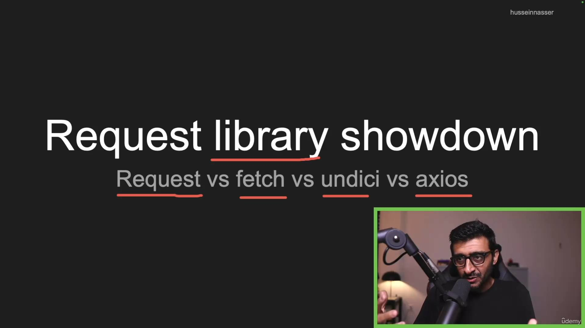

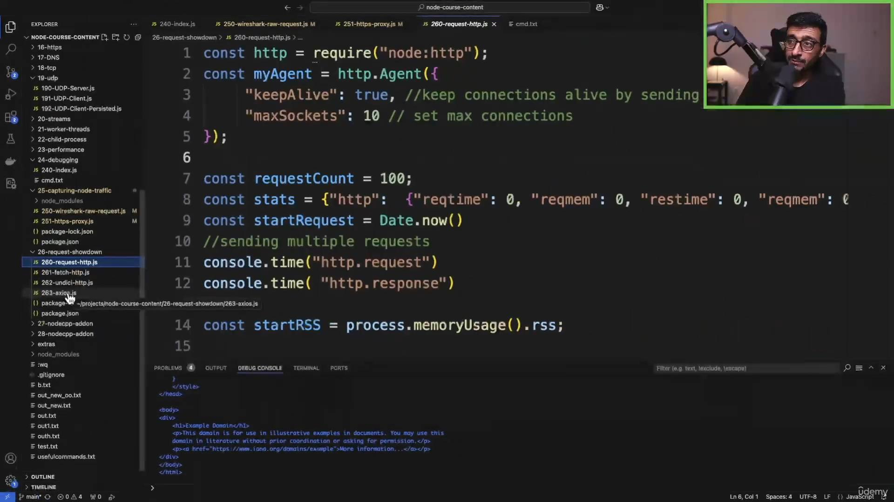

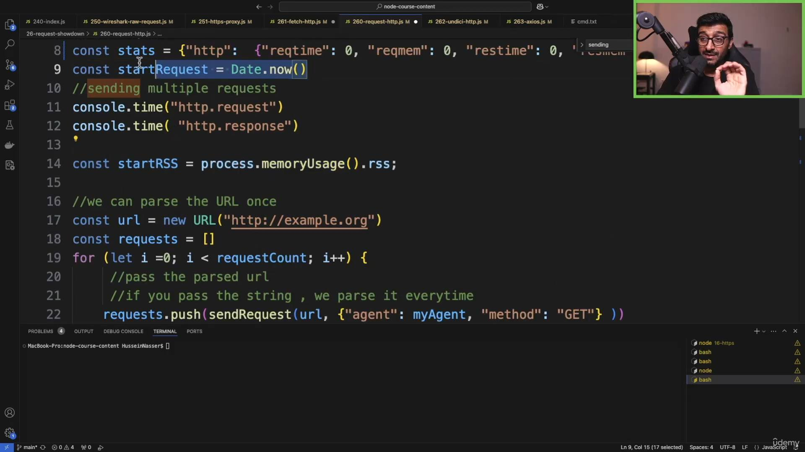

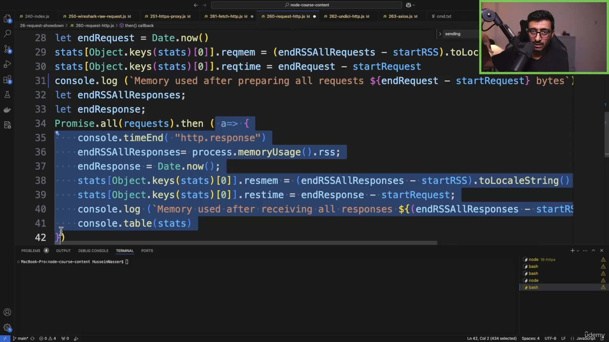

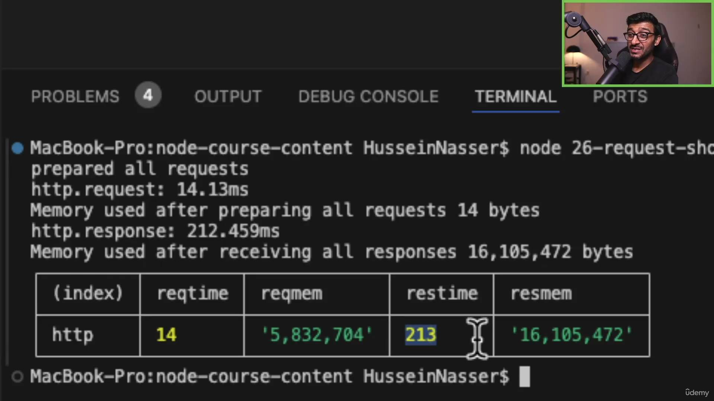

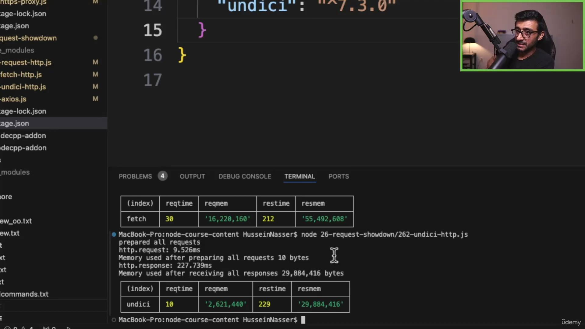

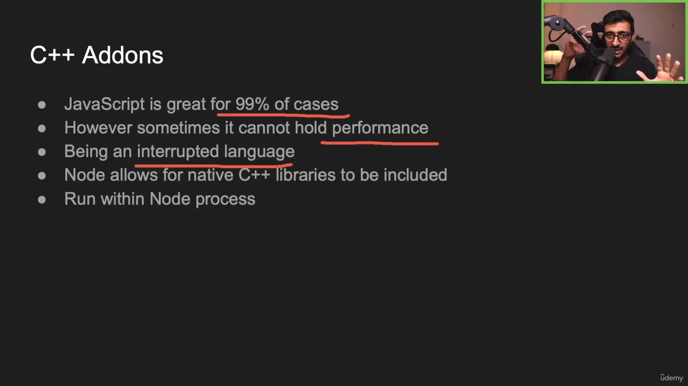

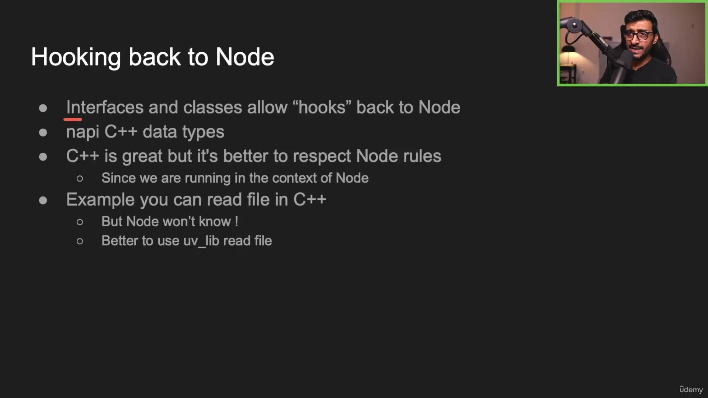

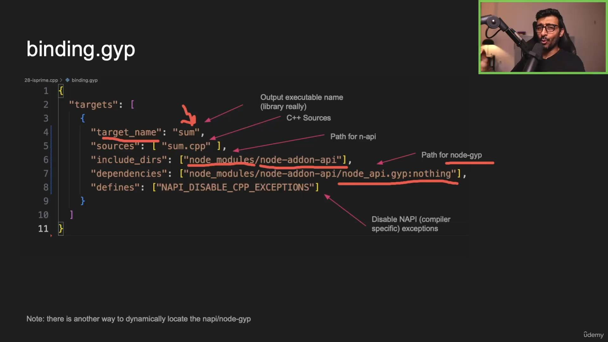

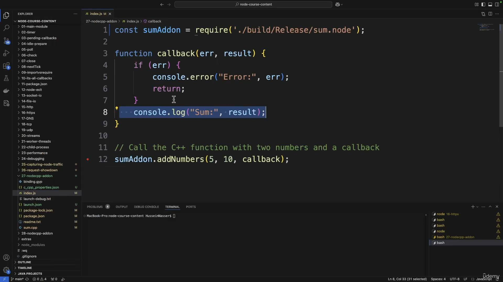

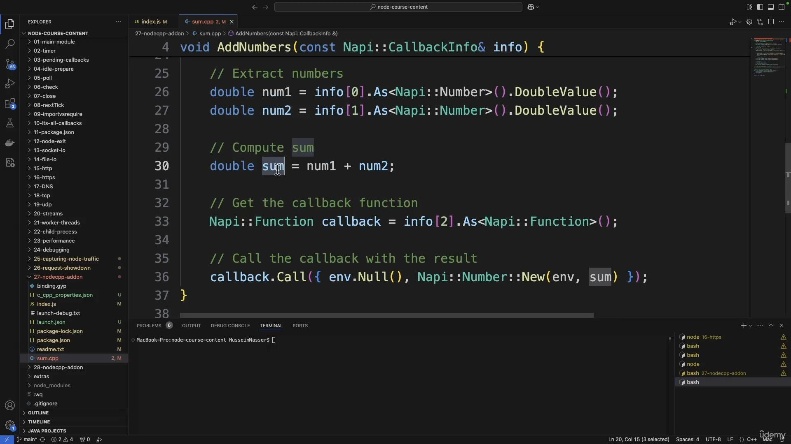

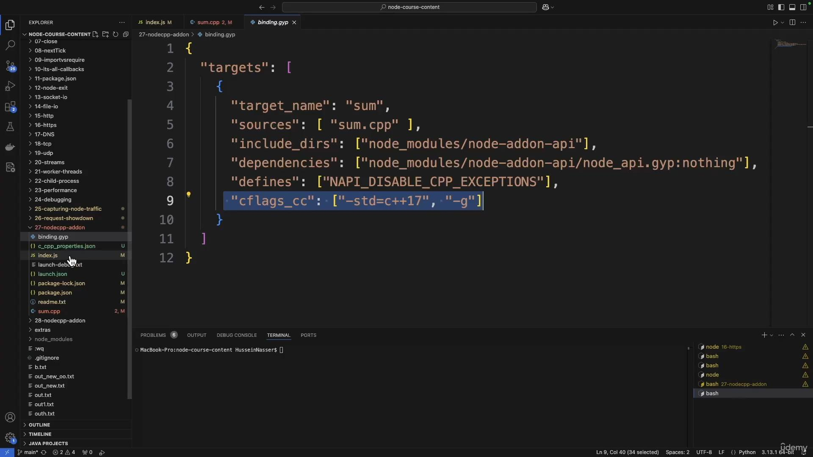