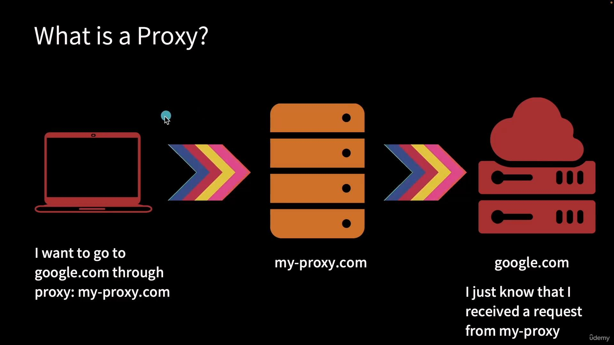
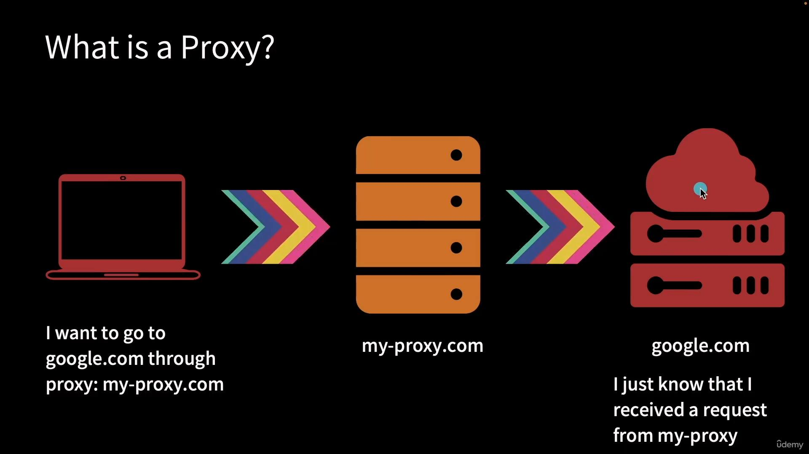
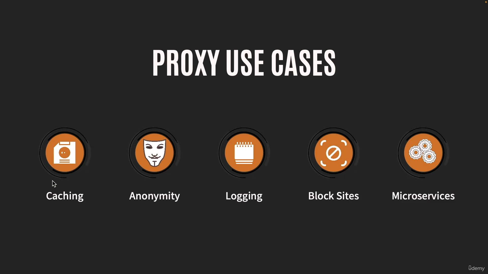
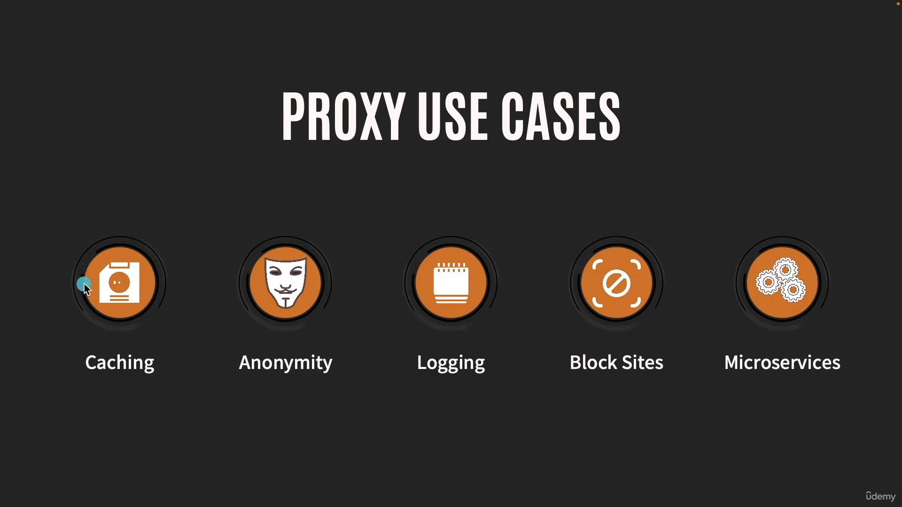
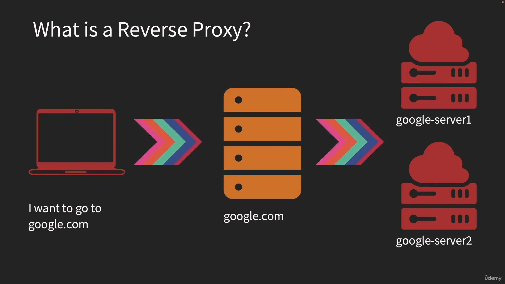
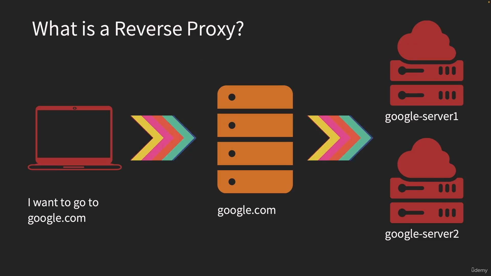

# NodeJS Internals（BV1jGRyBsEBa）P41–P42 课程文档：课程收束与 proxy / reverse proxy

> 说明：P41 是整门课的收尾总结，P42 是补充讲解「proxy 与 reverse proxy」的概念课。这两节**都没有讲师现场写的项目代码**，主体是讲师口述 + 幻灯片。因此本文的「复现」不是复刻某个课程仓库，而是把 P41 的知识地图做成检查表，把 P42 的代理/反向代理概念做成一个**零依赖、可直接运行的最小实验**。第 4 节会明确标注：课里没有代码，以下代码为示意。

## 1. 这一节做什么

P41 做的是「收束」。讲师把整门 NodeJS Internals 拆成三大块重新串了一遍：第一块是架构，核心是 libuv、event loop、v8；第二块是 Node internals，深入到异步 IO、文件 IO、网络、TCP/UDP/DNS/HTTP/HTTPS/TLS、streams、进程/线程/cluster；第三块是性能与工程实践，包括最佳实践、调试、以及在 JavaScript 成为 CPU 瓶颈时用 C++ 扩展并让 Node 调用原生函数。P41 的目标不是再教新知识点，而是让读者以后看自己写的 Node 代码时换一个视角：知道哪些东西是「设计取舍」，不是「绝对正确」。

换句话说，P41 不是让你背下「event loop 有哪几个阶段」就结束，而是让你能把一个线上问题放回课程地图里定位：如果请求卡住，是 JS 主线程被同步代码阻塞，还是 libuv 线程池被文件 IO 占满，还是网络连接没有正确建立，还是协议层 TLS 握手、代理超时、流式响应没有 flush。前端转 AI 应用工程师尤其容易只盯着「接口返回什么」，但一旦服务前面加了反向代理、API 网关、CDN 或 Ingress，问题就可能发生在「你以为是最终服务器，其实只是中间一跳」的位置。P41 给的是全局视角，P42 给的是这个视角在代理场景下的一个具体切口。

P42 做的是「补桥」。很多学员问 proxy 和 reverse proxy 有什么区别，讲师用一节课把这两个概念拆开：proxy 是**客户端知道最终服务器，但服务器不知道客户端**；reverse proxy 是**客户端不知道真正的最终服务器，反向代理替客户端去访问后端**。然后讲师把 API gateway、load balancer、CDN、sidecar、service mesh、Ingress、灰度发布这些常见词都归到这两个基本概念上。对前端转 AI 应用工程师来说，这一节尤其值得看：你以后把模型服务、推理 API、流式输出接口部署到线上，前面通常就会有一层反向代理或 API 网关；如果你不理解「TCP 连接落在谁身上」「HTTP 内容谁看得见」「TLS 在哪里终止」，排障会非常吃力。

本文要交付的产物是：

1. 一张 P41 知识地图检查表，帮你确认自己是否真的把课程主线串起来了；
2. 一张 proxy vs reverse proxy 的对比与决策表；
3. 一个可运行的 Node 最小实验，包含两个后端、一个正向代理、一个反向代理，能亲手看到「客户端→代理→目标」和「客户端→反向代理→后端」的差别；
4. 一份复现检查清单，以及课里没讲、但真实工程里一定会撞上的坑。

阅读时建议把本文分成两条线：第一条线是「概念线」，用 P41 的知识地图和 P42 的代理定义，回答每个请求在四层、七层、TLS、streams、进程模型中的位置；第二条线是「实验线」，用第 4 节的零依赖代码亲手发几个 `curl`，观察后端返回的 `host`、`remoteAddress`、`backend` 字段。概念线负责不迷路，实验线负责把「客户端不知道真正的最终服务器」这种话变成可观察事实。两条线合起来，才算真正复现了这两节「没有项目代码」的课。

## 2. 讲师原话

P41 开头，讲师明确说这门课被拆成三段：

> "在这门课里，我把 Node 大致分成了三个部分。第一部分是架构部分……其中有 libuv 这个东西，它负责异步 I/O。还有一个很重要的东西叫事件循环。然后第三个组件是 V8，它是 JavaScript 的执行引擎。"
> —— p041 [00:28]

这段话是 P41 的骨架：libuv 负责异步 IO，event loop 负责调度，v8 负责执行 JavaScript。后面所有文件 IO、网络、TCP/UDP、HTTP/HTTPS、streams、进程线程，都是在这三个东西之上展开的。理解这句话时不要把三者当成并列名词：v8 执行 JS 调用，libuv 提供异步 IO 能力，event loop 把「什么时候回调、什么时候继续执行」串起来；当 JS 里出现同步阻塞时，受影响的不是 libuv 的线程池本身，而是 event loop 无法继续调度回调，于是整个进程看起来「卡住了」。

P41 中段回顾 streams 时，讲师强调 streams 无处不在：

> "我们讨论过一个非常重要的抽象，叫作流；也讨论了流如何无处不在——尽管我们并不总是显式地创建它们，但它们始终存在。我们的请求是流，我们的响应也是流。"
> —— p041 [03:20]

这里的 “quest” 应是讲师口误，指 request。意思是：即使你没有手动 `new Stream()`，请求和响应本身就是 stream。这个视角对后面理解代理转发很重要：代理不是把请求「整体读进内存再发出去」，而是可以把请求体、响应体当流一样接起来。

P41 后段讲性能与最佳实践时，讲师提醒不要死记最佳实践：

> "对此要有所保留，因为今天的最佳实践，到了明天或者一年后可能就不再是最佳实践了……我们的目标是理解它为什么是最佳实践……因为我们不想阻塞事件循环。"
> —— p041 [04:16]

P42 进入 proxy 定义：

> "代理的定义是：它是一个代表你发起请求的服务器。"
> —— p042 [02:26]


P42 讲代理场景下 TCP 连接先落在代理：

> "从第四层的角度看，你的 TCP 连接并不是与 Google 建立的，而是先与代理建立……第七层的内容则会发往 Google.com。"
> —— p042 [03:21]



P42 给出最核心的那句区别：

> "在代理配置中，客户端知道服务器，但服务器不知道客户端。"
> —— p042 [04:51]



P42 列 proxy 用途时，讲师提到匿名、缓存、日志、拦截、调试，以及 sidecar/service mesh：

> "匿名性……缓存是另一种方式……日志记录……屏蔽网站……调试……Fiddler 实际上就是一个代理。"
> —— p042 [05:21]–[09:28]



P42 转到 reverse proxy：

> "在反向代理中，情况正好相反。客户端并不知道最终真正的目标服务器。它把 Google.com 当作最终目的地来通信。但 Google.com 可能是一个反向代理，它会转而与另一台 Google 服务器通信，而你根本不知道自己实际在跟那台服务器通信。"
> —— p042 [10:24]



P42 讲 API gateway 按路径分流：

> "例如，如果你访问 /post，这就是处理 /post 的服务器……如果你访问 /read messages，这就是读取服务器……你完全可以拥有完全不同的服务器和完全不同的数据库。"
> —— p042 [11:48]–[12:15]


> 注：清单里对应帧是 `p042_0623s.jpg` 吗？上面清单实际给出的是 `p042_0603s.jpg`（[10:03]）和 `p042_0683s.jpg`（[11:23]）。这里按清单原样使用 `p042_0683s.jpg`，不改成不存在的帧号。修正为：
>
> 

P42 讲负载均衡与反向代理的关系：

> "负载均衡器是一种反向代理，但并不是每个反向代理都是负载均衡器。"
> —— p042 [12:15]



P42 讲灰度发布：

> "10% 的请求会发往这台新服务器，而 90% 的请求会发往那台服务器。"
> —— p042 [16:30]


P42 回答「proxy 能不能代替 VPN 做匿名」时，讲师强调层数不同：

> "VPN 则不是这样。VPN 工作在 IP 层。因此，对于任何 IP 数据包，它们会将其加密，并且不知道也不关心该 IP 数据包里有什么。代理则工作在第四层及以上。"
> —— p042 [17:52]

P42 讲 HTTPS 代理的 tunnel mode：

> "HTTP 中的隧道模式……客户端可以请求代理：“嘿，帮我连接一下”……代理实际上会建立一条连接，而这条连接会是一条哑管道……在这种配置下，代理无法看到内容。"
> —— p042 [19:17]

这些原话基本覆盖了 P42 的全部论点：定义、层数、可见性、用途、反向代理、负载均衡、API 网关、CDN、灰度、VPN 对比、隧道模式。把这些原话与第 4 节实验对照时，要特别记住两个观察点：第一，普通 HTTP 正向代理能看见七层内容，因为它接收的是带绝对 URL 的 HTTP 请求；第二，反向代理在四层上先接住客户端连接，再作为新的客户端去连后端，所以后端看到的 `remoteAddress` 往往是反向代理所在机器的地址，而不是浏览器或 `curl` 的直接地址。课里没有展开代码，但这两个观察点足以把概念落地。

## 3. 从零复现

这一节按「纯讲解课」的复现方式写：需求 → 约束 → 估算 → 方案 → 取舍。P41 的复现产物是知识地图检查表；P42 的复现产物是一个可运行的最小代理实验。

### 3.1 需求：把 P41 的知识地图落成检查表

P41 没有新代码，它的需求是「确认整门课的主线能在你脑子里闭合」。可以按下面这张表自查：

| 层级 | 课程里覆盖的内容 | 你需要能回答的问题 |
|---|---|---|
| 架构 | libuv、event loop、v8 | 异步 IO 谁做？JS 谁执行？事件循环谁调度？ |
| internals | 异步文件读、同步文件读、创建连接、收请求、发请求 | 一次 `fs.read` 背后大概经过哪些阶段？ |
| 网络 | socket 创建、accept、read、write、connection | Node 里一个连接是什么？读写发生在哪？ |
| 协议 | TCP、UDP、DNS、HTTP、HTTPS/TLS | HTTP 和 HTTPS 的代价差在哪里？TLS 在哪里终止？ |
| streams | request/response 本身就是 stream | 为什么代理可以边收边转？ |
| 进程/线程 | 自建线程、自建进程、cluster、调度策略 | Node 单线程指的是哪部分？cluster 解决什么？ |
| 性能 | 不阻塞 event loop、调试、C++ addon | 什么时候 JS 够用？什么时候需要 native？ |

这张表不是让你背名词，而是让你在遇到线上问题时能定位到「这是 event loop 被阻塞，还是 IO 没走 libuv，还是协议层 TLS 开销」。P41 讲师最后说，不需要 memorizing，重要的是换一个视角看自己写的代码。实际自查时，可以拿一个你写过的接口逐项追问：这个接口有没有同步读文件？有没有大 JSON `JSON.parse` 阻塞主线程？有没有把整个上传文件读进内存？有没有在日志里打印超大对象？这些问题都能被放回上表定位。

如果再往工程实践走一步，可以把上表变成「排障入口」：请求慢，先看 event loop 是否被阻塞；文件相关慢，看是否误用了同步 API；网络相关慢，看 DNS、TCP 建连、TLS 握手、代理超时；内存高，看 streams 是否被整体读入内存；CPU 高，看是否需要 worker、cluster 或 native 扩展。P41 的收束价值就在这里：它不提供万能答案，但提供一张能反复使用的地图。

### 3.2 约束：P42 的代理问题本质是「层数 + 可见性」

P42 的约束可以拆成四条：

1. **TCP 连接落在谁身上**。proxy 场景下，客户端先和代理建 TCP；reverse proxy 场景下，客户端先和反向代理建 TCP。无论哪种，客户端以为的「最终目的地」在四层上可能只是中间一跳。
2. **HTTP 内容谁看得见**。普通 HTTP 代理能看到方法、路径、头；HTTPS 代理如果做 tunnel mode，代理只做管道，看不到内容；如果代理终止 TLS，它就能看到内容。
3. **谁不知道谁**。proxy：客户端知道服务器，服务器不知道客户端；reverse proxy：客户端不知道真正的最终服务器，反向代理知道后端。
4. **用途决定形态**。匿名、缓存、日志、拦截、调试偏 proxy；负载均衡、API 网关、CDN、灰度、Ingress 偏 reverse proxy。

这四条约束直接决定了我们实验里要观察什么：不能只观察「请求成功」，还要观察「请求打到了哪个后端」「后端看到的 host 是什么」「代理日志里记录了谁」。把「成功」拆成这三个观察点后，实验才不是单纯跑通代码，而是能回答 P42 的核心问题：客户端以为自己在和谁说话？服务器又以为自己在和谁说话？中间那一跳在四层和七层分别做了什么？

这里还要区分「正向代理的客户端配置」和「反向代理的服务端配置」。正向代理通常要求客户端主动设置代理，例如浏览器代理设置、系统代理环境变量、`curl -x`；反向代理对客户端是透明的，客户端只访问一个域名或 IP，不需要知道后面有几台后端。也就是说，正向代理的「知道」发生在客户端配置里，反向代理的「不知道」发生在客户端视角里。实验设计必须体现这一点：正向代理实验必须显式用 `-x` 指定代理；反向代理实验则直接访问反向代理端口，不告诉客户端后端端口。

### 3.3 估算：灰度 10% 的容量怎么算

P42 给了一个很具体的例子：每 100 个请求，10 个去新服务，90 个去旧服务。我们可以把它落成容量估算表。下面数字是**示例假设**，不是课程数据；课里没有给 QPS 和带宽数字。

| 假设 | 数值 | 计算 | 结论 |
|---|---:|---|---|
| 总入口 QPS | 1000 | — | 反向代理入口每秒 1000 个请求 |
| 灰度比例 | 10% | 1000 × 10% | 新服务约 100 QPS |
| 旧服务比例 | 90% | 1000 × 90% | 旧服务约 900 QPS |
| 平均请求体+响应体 | 2 KB | 1000 × 2 KB | 入口约 2 MB/s，出口再约 2 MB/s |
| 连接数 | 每请求 1 入口 + 1 出口 | 1000 × 2 | 反向代理要按「连接数翻倍」预留资源 |

这里的关键不是数字，而是**灰度比例会直接变成后端容量需求**。课里只说了 10%/90% 的分流思路，没有讲健康检查、会话保持、回滚策略；这些在第 7 节列为「课里没讲但你会撞上」。对前端转 AI 应用工程师而言，还要额外注意流式响应：如果模型接口用 SSE 或 chunked 流式返回，反向代理不仅要转发状态码和头，还要及时把每一段响应刷给客户端；如果代理层做了缓冲，客户端会感觉「模型很久不出字」，这并不一定是模型慢，而是代理把流攒住了。

估算时还要注意「入口连接」和「出口连接」不是同一件事。客户端到反向代理是一条连接，反向代理到后端是另一条连接；如果启用了 keep-alive，连接可以被复用，但峰值时仍要按并发连接数预留文件描述符和内存。课里没有给出具体容量公式，本文只把「连接数翻倍」这个结构性事实标出来，避免把反向代理当成零成本跳板。

### 3.4 方案：两个最小实验

方案 A：正向代理实验。客户端用 `curl -x http://127.0.0.1:8080 http://127.0.0.1:9001/hello`，请求先到 8080 的 forward proxy，再由代理向 9001 的 backend A 发请求。后端会看到请求来自代理，而不是客户端；但 HTTP 头里的 Host 仍然是目标地址。这个实验对应课里「客户端知道服务器，服务器不知道客户端」。

执行这个命令时要理解 `curl -x` 的语义：`-x` 指定的是代理地址，后面的 URL 才是目标地址。正向代理收到的是「绝对 URL」形式的请求行，例如 `GET http://127.0.0.1:9001/hello HTTP/1.1`，而不是普通源站收到的 `GET /hello HTTP/1.1`。实验代码会解析这个绝对 URL，再向目标发请求；如果解析失败，就返回 400。这是正向代理和反向代理在实现上的一个关键差别：正向代理必须从请求里知道目标，反向代理的目标通常来自自身配置或路由规则。

方案 B：反向代理实验。客户端访问 `http://127.0.0.1:8081/api/a` 或 `/api/b`，它以为 8081 就是最终目的地；8081 的 reverse proxy 再根据路径转到 9001 或 9002。再加一个 `/api/feature` 路径，每 100 个请求约 10 个去 B、90 个去 A，对应课里的灰度例子。这个实验对应课里「客户端不知道真正的最终服务器」。

验证方案 B 时不要只看浏览器里「页面出来了没有」，而要看后端返回的 `backend` 字段和代理日志。`/api/a` 应该稳定返回 `A`，`/api/b` 应该稳定返回 `B`，`/api/feature` 多次请求后应该同时出现 `A` 和 `B`，但比例只是近似 10%/90%，不是严格每 10 个一定 1 个。这个近似正好对应真实灰度的概率分流：课里讲的是思路，工程里还要考虑随机种子、会话保持、回滚和监控。

常见错误与排查可以先记三条：第一，`curl` 明明加了 `-x` 却感觉没走代理，优先检查 `NO_PROXY` / `no_proxy` 环境变量是否把 `127.0.0.1` 排除了；第二，正向代理返回 400，通常是请求行不是绝对 URL，检查是否误把反向代理的访问方式用到了正向代理上；第三，反向代理返回 502，通常是后端没启动、端口配错或后端主动断开，先看代理日志里的 `ECONNREFUSED` 或 `ECONNRESET`。这三条在真实 Nginx、Ingress、API Gateway 排障里同样常见。

### 3.5 取舍

课里反复说「anything I say can be wrong」「there's a cost for everything」。落到代理上：

- **日志越全，性能成本越高**。代理记录每个请求的方法、路径、耗时，能排障，但会增加 IO 和 CPU。
- **缓存越激进，新鲜度越差**。代理缓存静态内容能减少回源，但可能返回旧数据；课里提到 CDN 是「glorified reverse proxy」，但没讲缓存键和刷新策略。
- **TLS 终止让代理看得见内容，但也让代理成为信任点**。课里说 HTTPS 代理有时会解密流量用于调试；tunnel mode 下代理看不到内容。两者没有绝对好坏，取决于你是否需要观测。
- **反向代理隐藏后端，但多了一跳**。它带来负载均衡、API 网关、CDN、灰度等能力，也带来单点、连接数翻倍、超时传递等问题。
- **灰度要求应用无状态**。课里明确说：一个请求可能去新服务，下一个可能去旧服务，所以应用不能依赖本机内存里的会话状态。对应到 Node/前端：不要把用户状态只放在进程内存里；否则灰度时请求漂移会丢状态。

对前端开发者还有一个容易忽略的取舍：代理层会改变「头」和「路径」的语义。比如反向代理可能重写 `Host`，可能追加 `X-Forwarded-For`、`X-Forwarded-Proto`，可能去掉 `/api` 前缀，也可能终止 TLS 让后端看到的是 `http` 而不是 `https`。前端代码里用 `location.origin` 拼后端地址、后端代码里用 `req.protocol` 判断 HTTPS，都可能因为这一跳而判断错误。课里没有展开这些头，但第 7 节会把它们列为真实工程会撞上的问题。

## 4. 完整代码

> **课里没有代码，以下为示意。** 这段代码不是讲师在 P41/P42 里写的，也不是课程仓库的一部分；它是我为了复现 P42 的 proxy / reverse proxy 概念搭的零依赖 Node 实验。它只实现普通 `http://` 转发，不实现 HTTPS CONNECT 隧道；课里讲的 tunnel mode 只保留为概念说明。

### 4.1 目录结构

```text
node-proxy-lab/
├── package.json
├── backend-a.js
├── backend-b.js
├── forward-proxy.js
└── reverse-proxy.js
```

### 4.2 依赖与运行环境

- Node.js：`>=18`（本实验要求；课里没有规定 Node 版本）
- npm 依赖：无
- 端口：backend A `9001`，backend B `9002`，forward proxy `8080`，reverse proxy `8081`

环境变量如下，全部有默认值，不设置也能跑：

| 变量名 | 默认值 | 作用 |
|---|---:|---|
| `PORT` | `9001` / `9002` | backend-a.js / backend-b.js 的监听端口 |
| `NAME` | `A` / `B` | 后端返回 JSON 里的 `backend` 字段 |
| `PROXY_PORT` | `8080` | forward-proxy.js 监听端口 |
| `REVERSE_PORT` | `8081` | reverse-proxy.js 监听端口 |
| `BACKEND_A_PORT` | `9001` | reverse proxy 转发到 A 的端口 |
| `BACKEND_B_PORT` | `9002` | reverse proxy 转发到 B 的端口 |

### 4.3 设计决策表

| 决策 | 选择 | 理由 | 不这样会怎样 |
|---|---|---|---|
| 正向代理只实现 `http://` | 用绝对 URL 解析目标 | 课里说 HTTP proxy 最常见；实现简单 | 若实现 HTTPS，需要 CONNECT 隧道和 TLS，超出本实验 |
| 反向代理按路径分流 | `/api/a` → A，`/api/b` → B | 对应课里 API gateway 路径路由 | 若只做单后端，就观察不到 API gateway 的分流效果；若路径不固定，实验难以复现 |
| 灰度用随机近似 10% | `/api/feature` 随机选 A/B | 对应课里 10%/90% 的分流思路，代码最少 | 若写死顺序，看起来像轮询，不能体现概率分流；真实工程还要考虑会话保持和回滚 |
| 请求和响应都用 `pipe` | `clientReq.pipe(upstreamReq)`、`upstreamRes.pipe(clientRes)` | 请求/响应本身就是 stream，边收边转 | 若整体读入内存，大请求会占内存，也不符合 streams 视角 |
| 反向代理重写 `Host` | 把 Host 改成后端地址 | 让后端知道实际虚拟主机；便于观察差异 | 若保留原 Host，某些后端会按原域名路由；真实代理常用 `X-Forwarded-Host` 保留原值 |
| 只绑定 `127.0.0.1` | 实验本机访问 | 避免误暴露到局域网，降低安全风险 | 若绑定 `0.0.0.0`，又没有鉴权，可能被同网段访问 |

### 4.4 `package.json`

```json
{
  "name": "node-proxy-lab",
  "private": true,
  "version": "1.0.0",
  "description": "Zero-dependency proxy/reverse-proxy lab for P41-P42 notes",
  "scripts": {
    "start:a": "node backend-a.js",
    "start:b": "node backend-b.js",
    "start:forward": "node forward-proxy.js",
    "start:reverse": "node reverse-proxy.js"
  }
}
```

### 4.5 `backend-a.js`

```js
const http = require('http');

const port = Number(process.env.PORT || 9001);
const name = process.env.NAME || 'A';

const server = http.createServer((req, res) => {
  const body = {
    backend: name,
    method: req.method,
    url: req.url,
    host: req.headers.host,
    remoteAddress: req.socket.remoteAddress,
    remotePort: req.socket.remotePort,
    time: new Date().toISOString()
  };

  res.writeHead(200, {
    'content-type': 'application/json; charset=utf-8'
  });
  res.end(JSON.stringify(body, null, 2));
});

server.listen(port, '127.0.0.1', () => {
  console.log(`[backend ${name}] http://127.0.0.1:${port}`);
});
```

### 4.6 `backend-b.js`

```js
const http = require('http');

const port = Number(process.env.PORT || 9002);
const name = process.env.NAME || 'B';

const server = http.createServer((req, res) => {
  const body = {
    backend: name,
    method: req.method,
    url: req.url,
    host: req.headers.host,
    remoteAddress: req.socket.remoteAddress,
    remotePort: req.socket.remotePort,
    time: new Date().toISOString()
  };

  res.writeHead(200, {
    'content-type': 'application/json; charset=utf-8'
  });
  res.end(JSON.stringify(body, null, 2));
});

server.listen(port, '127.0.0.1', () => {
  console.log(`[backend ${name}] http://127.0.0.1:${port}`);
});
```

### 4.7 `forward-proxy.js`

```js
const http = require('http');
const { URL } = require('url');

const port = Number(process.env.PROXY_PORT || 8080);

const server = http.createServer((clientReq, clientRes) => {
  let target;

  try {
    target = new URL(clientReq.url);
  } catch (err) {
    clientRes.writeHead(400, {
      'content-type': 'text/plain; charset=utf-8'
    });
    clientRes.end(
      'forward-proxy expects an absolute URL, e.g. curl -x http://127.0.0.1:8080 http://127.0.0.1:9001/hello\n'
    );
    return;
  }

  console.log(
    `[forward-proxy] ${clientReq.method} ${clientReq.url} -> ${target.host}`
  );

  const options = {
    protocol: target.protocol,
    hostname: target.hostname,
    port: target.port || 80,
    method: clientReq.method,
    path: `${target.pathname}${target.search}`,
    headers: {
      ...clientReq.headers,
      host: target.host
    }
  };

  const upstreamReq = http.request(options, (upstreamRes) => {
    clientRes.writeHead(upstreamRes.statusCode || 502, upstreamRes.headers);
    upstreamRes.pipe(clientRes);
  });

  upstreamReq.on('error', (err) => {
    console.error('[forward-proxy] upstream error:', err.message);
    if (!clientRes.headersSent) {
      clientRes.writeHead(502, {
        'content-type': 'text/plain; charset=utf-8'
      });
    }
    clientRes.end(`forward-proxy upstream error: ${err.message}\n`);
  });

  clientReq.pipe(upstreamReq);
});

server.listen(port, '127.0.0.1', () => {
  console.log(`[forward-proxy] http://127.0.0.1:${port}`);
});
```

### 4.8 `reverse-proxy.js`

```js
const http = require('http');

const port = Number(process.env.REVERSE_PORT || 8081);
const BACKEND_A_PORT = Number(process.env.BACKEND_A_PORT || 9001);
const BACKEND_B_PORT = Number(process.env.BACKEND_B_PORT || 9002);

function pickBackend(req) {
  const url = new URL(req.url, `http://127.0.0.1:${port}`);

  if (url.pathname === '/api/b') {
    return { name: 'B', port: BACKEND_B_PORT };
  }

  if (url.pathname === '/api/feature') {
    const useB = Math.random() < 0.1;
    return useB
      ? { name: 'B', port: BACKEND_B_PORT }
      : { name: 'A', port: BACKEND_A_PORT };
  }

  return { name: 'A', port: BACKEND_A_PORT };
}

const server = http.createServer((clientReq, clientRes) => {
  const backend = pickBackend(clientReq);

  console.log(
    `[reverse-proxy] ${clientReq.method} ${clientReq.url} -> backend ${backend.name}:${backend.port}`
  );

  const options = {
    hostname: '127.0.0.1',
    port: backend.port,
    method: clientReq.method,
    path: clientReq.url,
    headers: {
      ...clientReq.headers,
      host: `127.0.0.1:${backend.port}`,
      'x-forwarded-for': clientReq.socket.remoteAddress || ''
    }
  };

  const upstreamReq = http.request(options, (upstreamRes) => {
    clientRes.writeHead(upstreamRes.statusCode || 502, upstreamRes.headers);
    upstreamRes.pipe(clientRes);
  });

  upstreamReq.on('error', (err) => {
    console.error('[reverse-proxy] upstream error:', err.message);
    if (!clientRes.headersSent) {
      clientRes.writeHead(502, {
        'content-type': 'text/plain; charset=utf-8'
      });
    }
    clientRes.end(`reverse-proxy upstream error: ${err.message}\n`);
  });

  clientReq.pipe(upstreamReq);
});

server.listen(port, '127.0.0.1', () => {
  console.log(`[reverse-proxy] http://127.0.0.1:${port}`);
});
```

### 4.9 运行与验证命令

开四个终端，分别启动：

```bash
npm run start:a
npm run start:b
npm run start:forward
npm run start:reverse
```

验证正向代理。注意 `--noproxy ""` 用来避免本机 `NO_PROXY` 环境变量让 `curl` 绕过代理；如果你的环境没有 `NO_PROXY`，也可以不加：

```bash
curl --noproxy "" -v -x http://127.0.0.1:8080 http://127.0.0.1:9001/hello
```

验证反向代理的路径分流：

```bash
curl -i http://127.0.0.1:8081/api/a
curl -i http://127.0.0.1:8081/api/b
```

验证灰度近似比例，可以连续请求 `/api/feature`，观察返回 JSON 里的 `backend` 字段：

```bash
for i in $(seq 1 100); do
  curl -s http://127.0.0.1:8081/api/feature | grep '"backend"'
done | sort | uniq -c
```

这只是演示命令，不保证每 100 次刚好 10 次 B、90 次 A；随机分流在小样本里会有波动。观察结果时重点看两件事：一是客户端始终只访问 8081，不知道 9001/9002 的存在；二是代理日志里能看到每次请求被分到了哪个后端。这两点就是 P42 反向代理概念的最小可观察形态。

## 5. 逐行解释

`backend-a.js` / `backend-b.js` 的核心不是业务逻辑，而是「让后端自报身份」。`const port = Number(process.env.PORT || 9001);` 允许用环境变量改端口，默认 A 是 9001、B 是 9002；`const name = process.env.NAME || 'A';` 让返回 JSON 里带一个可读的 `backend` 字段，便于 `grep` 和肉眼确认请求落到了哪个后端。`http.createServer((req, res) => { ... })` 创建一个 HTTP 服务；`req.method`、`req.url`、`req.headers.host` 是七层信息；`req.socket.remoteAddress`、`req.socket.remotePort` 是四层连接信息。把这两组信息同时返回，是为了让你看到「HTTP 头里的 Host」和「TCP 连接的对端地址」不是同一个概念：正向代理可能把 Host 保留为目标地址，但 TCP 对端已经是代理；反向代理可能把 TCP 对端变成反向代理地址，同时重写 Host。`res.writeHead(200, { 'content-type': 'application/json; charset=utf-8' });` 设置响应类型；`res.end(JSON.stringify(body, null, 2));` 一次性结束响应。这里没有用 stream 处理响应体，因为实验体很小；代理转发时仍然用 `pipe`，两者不矛盾。

`forward-proxy.js` 的关键是 `new URL(clientReq.url)`。正向代理收到的请求行通常是绝对 URL，例如 `GET http://127.0.0.1:9001/hello HTTP/1.1`，所以 `clientReq.url` 可以直接被 `new URL` 解析。解析失败时返回 400，并提示正确用法，这是为了让你在误用「直接访问代理端口」时得到明确错误，而不是一个莫名其妙的 404。`target.host` 是目标的主机和端口，`target.pathname + target.search` 是七层路径和查询串；`port: target.port || 80` 表示没有显式端口时按 HTTP 默认 80 端口处理，本实验的目标都带端口，所以会走显式端口。`headers: { ...clientReq.headers, host: target.host }` 把客户端头复制过去，并把 Host 改成目标地址；真实代理还要处理 `connection`、`proxy-connection` 等逐跳头，本实验为了简洁没有做完整清理。`http.request(options, (upstreamRes) => { ... })` 创建到目标的上游请求；`upstreamRes.pipe(clientRes)` 把上游响应流回客户端，这就是「代理不是等完整响应再返回」的体现。`clientReq.pipe(upstreamReq)` 把客户端请求体流给上游，支持 POST 等带 body 的请求。`upstreamReq.on('error', ...)` 处理上游连不上、被重置等错误，并在头未发送时返回 502。

`reverse-proxy.js` 的关键是 `pickBackend(req)`。客户端访问的是 `http://127.0.0.1:8081/api/a`，`req.url` 是 `/api/a`，反向代理根据路径决定后端端口；客户端完全不知道 9001/9002。`/api/b` 固定去 B，`/api/feature` 用 `Math.random() < 0.1` 近似 10% 去 B、90% 去 A，其余路径默认去 A。这里用随机而不是严格计数，是为了用最少代码对应课里「10% 请求去新服务」的思路；真实灰度还要考虑用户 ID 哈希、会话保持、回滚、监控和健康检查。`headers: { ...clientReq.headers, host: \`127.0.0.1:${backend.port}\`, 'x-forwarded-for': clientReq.socket.remoteAddress || '' }` 做了两件事：把 Host 改成后端地址，让后端看到实际虚拟主机；追加 `X-Forwarded-For` 记录直接连到反向代理的客户端地址。真实反向代理通常会追加而不是覆盖 `X-Forwarded-For`，并且还要设置 `X-Forwarded-Proto`、`X-Forwarded-Host` 等；本实验只保留最小字段。`path: clientReq.url` 表示把原始路径原样转给后端，所以后端返回的 `url` 仍然是 `/api/a` 或 `/api/b`；真实 API 网关可能会去掉 `/api` 前缀，这属于路径重写策略，课里没有展开。

与前端对照时，可以把正向代理理解为「浏览器/系统设置里的代理服务器」：前端代码里的 `fetch('http://target/...')` 不变，变化的是网络栈把请求先发给代理。把反向代理理解为「你部署的 Nginx / Ingress / API Gateway」：前端 `fetch('/api/a')` 看到的只是入口，它不知道后面是 A 还是 B；`location.origin` 是入口地址，不是后端地址。前端若用 `credentials: 'include'`，还要注意代理是否转发 Cookie、是否终止 TLS、`SameSite` 和 `Secure` 是否仍然成立。SSE 或流式响应经过反向代理时，前端看到的是 `text/event-stream`，代理必须及时转发 chunk；如果代理缓冲了响应，前端会延迟收到数据。本实验的 `pipe` 是流式转发的最小形态，但真实代理还要配置超时、缓冲、压缩和连接复用。

## 6. 复现检查清单

下面每条都要能「做出来」并「说出为什么」，不是只看一眼。

1. **能解释 P41 三大块的关系**。验证方式：不看笔记，用 1 分钟说清 v8、libuv、event loop 分别负责什么，并各举一个你写过的 Node 代码例子；再说出一个「阻塞 event loop」的常见写法。
2. **能解释 request/response 为什么本身就是 stream**。验证方式：指出本实验里 `clientReq.pipe(upstreamReq)` 和 `upstreamRes.pipe(clientRes)` 两行；说明如果改成「先把 body 读成字符串再转发」会多占什么资源、对大文件有什么影响。
3. **能区分 proxy 和 reverse proxy 的「谁不知道谁」**。验证方式：用一句话分别描述实验 A 和实验 B；指出实验 A 中客户端是否知道 9001，实验 B 中客户端是否知道 9001/9002。
4. **能看到 TCP 连接落在谁身上**。验证方式：正向代理请求后，看 backend A 返回的 `remoteAddress` 是否是代理进程所在机器的地址；反向代理请求后，看后端返回的 `remoteAddress` 是否是反向代理地址，而不是 `curl` 的直接地址。
5. **能观察到 Host 被改写**。验证方式：对比直接访问 `http://127.0.0.1:9001/hello` 和经反向代理访问 `/api/a` 时后端返回的 `host` 字段；说明为什么真实工程需要 `X-Forwarded-Host` 保留原始 Host。
6. **能验证路径分流**。验证方式：连续访问 `/api/a` 和 `/api/b`，确认 `backend` 字段稳定为 A 和 B；再故意访问 `/api/unknown`，说明当前代码为何落到 A，以及真实网关应该返回 404 还是默认路由。
7. **能验证灰度是近似比例**。验证方式：运行 100 次 `/api/feature` 的循环命令，统计 A/B 数量；解释小样本波动，说明真实灰度为什么需要按用户或请求 ID 做稳定分桶。
8. **能复现并解释 400 错误**。验证方式：直接 `curl http://127.0.0.1:8080/hello`，观察 forward-proxy 返回 400；说明正向代理需要绝对 URL，而反向代理不需要客户端知道目标。
9. **能复现并解释 502 错误**。验证方式：先停掉 backend A，再经反向代理访问 `/api/a`，看代理日志和客户端返回；说明 502 表示代理作为网关没有从上游拿到有效响应，和 404 不是一类问题。
10. **能说明 HTTPS tunnel mode 的边界**。验证方式：指出本实验没有监听 `connect` 事件，不支持 HTTPS CONNECT；说明 tunnel mode 下代理只做管道、看不到内容，而终止 TLS 的代理能看到内容但成为信任点。
11. **能说出正向代理的典型用途**。验证方式：各举一个匿名、缓存、日志、拦截、调试的例子；再说明为什么 Fiddler 这类调试工具可以归为代理。
12. **能说出反向代理的典型用途**。验证方式：把负载均衡、API 网关、CDN、Ingress、灰度发布各用一句话解释，并指出它们都符合「客户端不知道真正最终服务器」。
13. **能检查本机代理环境变量**。验证方式：运行 `env | grep -i proxy` 或对应系统命令，确认 `NO_PROXY` 是否包含 `127.0.0.1`；如果 `curl -x` 没走代理，优先排查这里。
14. **能检查端口占用**。验证方式：启动四个进程时若出现 `EADDRINUSE`，用 `lsof -i :8080` 或系统对应命令查看占用进程；说明为什么改 `PROXY_PORT` 可以绕开。
15. **能说出灰度的工程前提**。验证方式：说明为什么应用不能把用户状态只放在单机内存；如果请求一会儿去 A 一会儿去 B，会话、缓存、数据库迁移、回滚分别会出什么问题。

## 7. 课里没讲但你会撞上的

| 现象 | 原因 | 怎么办 |
|---|---|---|
| `curl -x` 设置了代理，但请求像没走代理 | `NO_PROXY` / `no_proxy` 包含 `127.0.0.1` 或目标域名，`curl` 自动绕过 | 临时用 `curl --noproxy "" -x ...`，或检查并调整环境变量；确认代理日志有没有收到请求 |
| 正向代理返回 400 `expects an absolute URL` | 客户端没有按正向代理方式发请求，请求行是 `/hello` 而不是 `http://host/hello` | 用 `curl -x http://代理地址 http://目标地址/路径`；不要把反向代理的访问方式套到正向代理上 |
| 反向代理返回 502 | 后端没启动、端口配错、后端主动断开或上游超时 | 先看代理日志的 `ECONNREFUSED` / `ECONNRESET`；确认 `BACKEND_A_PORT`、`BACKEND_B_PORT`；再查后端进程和防火墙 |
| 启动报 `EADDRINUSE` | 端口已被其他进程占用，或上一次实验进程没退出 | `lsof -i :端口` 找到进程；结束旧进程或改 `PORT` / `PROXY_PORT` / `REVERSE_PORT` |
| 后端看到的 `host` 不是用户访问的域名 | 反向代理重写了 Host，或没有转发原始 Host | 明确后端按哪个 Host 路由；需要原值时追加 `X-Forwarded-Host`，并让后端按约定读取 |
| 后端拿不到真实客户端 IP | 反向代理作为新的 TCP 客户端连后端，后端看到的是代理地址 | 由代理追加 `X-Forwarded-For`；后端只信任来自已知代理的该头，避免客户端伪造 |
| 灰度时用户状态丢失 | 请求随机落到 A/B，应用把会话放在本机内存 | 会话外置到 Redis/数据库；按用户 ID 做稳定分桶；准备回滚和兼容策略 |
| `/api/feature` 比例看起来不对 | 随机分流是小样本波动，或健康检查、重试也计入 | 用更大样本统计；真实灰度按用户/请求 ID 稳定分桶，并监控两端错误率和延迟 |
| HTTPS 请求经代理失败 | 本实验只处理普通 HTTP，没有实现 CONNECT 隧道 | 用支持 CONNECT 的代理或真实 Nginx/Envoy；理解 tunnel mode 下代理看不到内容 |
| SSE/流式响应经过代理后“卡住” | 代理缓冲了响应，或压缩/超时配置不合适 | 关闭响应缓冲、及时 flush、调整超时；确认 `Content-Type` 和 chunk 转发正常 |
| WebSocket 握手失败 | 代理没有处理 HTTP Upgrade，或没有转发 `Upgrade` / `Connection` 头 | 使用支持 WebSocket 的代理配置；在 Node 里监听 `upgrade` 事件并转发 socket |
| 代理日志里没有 trace id，排障困难 | 只记录了 URL，没有记录请求 ID、上游耗时、状态码 | 在入口生成/透传 `X-Request-Id`，记录上游开始/结束时间、状态码和错误原因 |
| 缓存返回旧内容 | 反向代理或 CDN 缓存键不合理，刷新策略缺失 | 明确哪些路径可缓存；设置 `Cache-Control`、`Vary`、过期和刷新策略；敏感接口禁用缓存 |
| TLS 终止后后端以为自己是 HTTP | 代理终止 TLS，后端连接是明文 HTTP | 转发 `X-Forwarded-Proto`；后端按可信代理头生成绝对 URL 和 Cookie 安全属性 |
| 反向代理成为单点 | 所有流量先到代理，代理挂了后端都不可达 | 多实例、健康检查、超时和重试策略；监控连接数、文件描述符和上游错误率 |
| 连接数比预期高很多 | 客户端到代理、代理到后端各一条连接，长连接和重试还会放大 | 估算入口/出口连接数；启用 keep-alive 并设置合理上限；监控 `EMFILE` 和连接排队 |
| 路径重写导致 404 | 代理去掉了 `/api` 前缀，后端路由仍按原路径匹配 | 明确代理重写规则；在代理日志打印原始路径和转发路径；前后端联调时核对路由表 |
| 代理转发大文件时内存上涨 | 实现里把请求/响应整体读入内存，而不是流式 pipe | 使用 stream/pipe；限制最大 body；对上传下载做背压和超时处理 |
| 只测了成功路径，没测后端故障 | 实验只看 200，没有停后端、断网、慢响应 | 主动制造 502、超时、半开连接；观察代理是否快速失败、是否泄漏连接、日志是否可定位 |