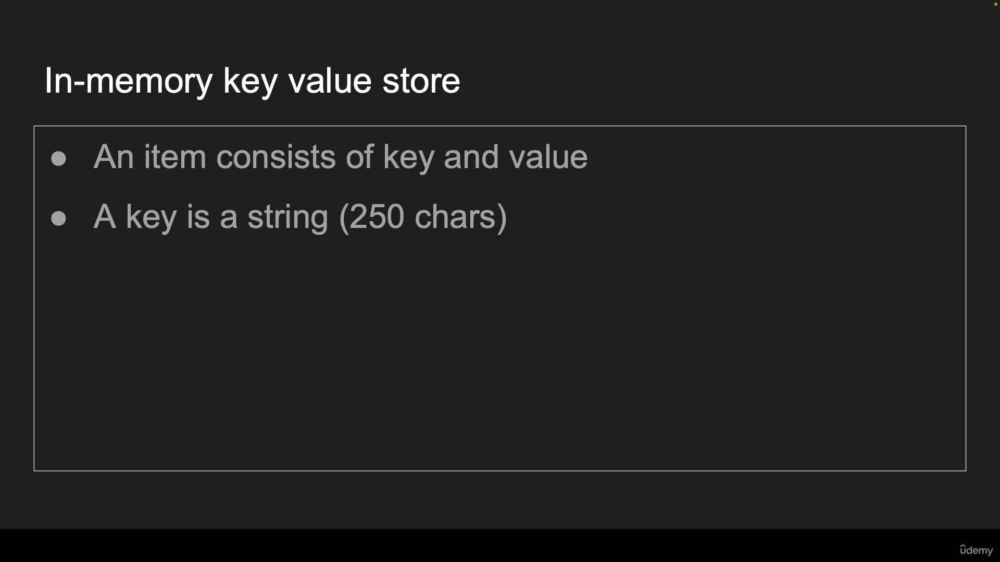
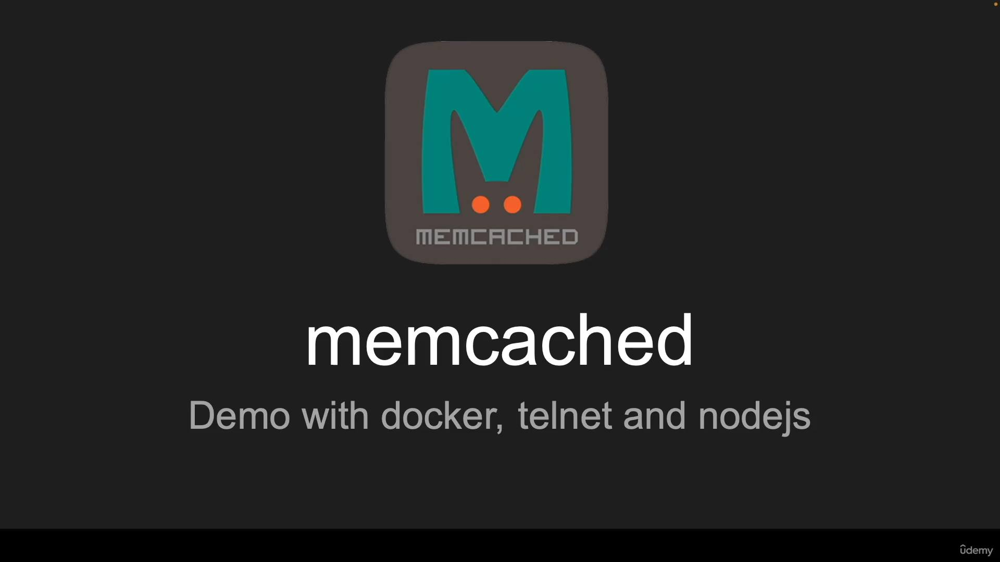
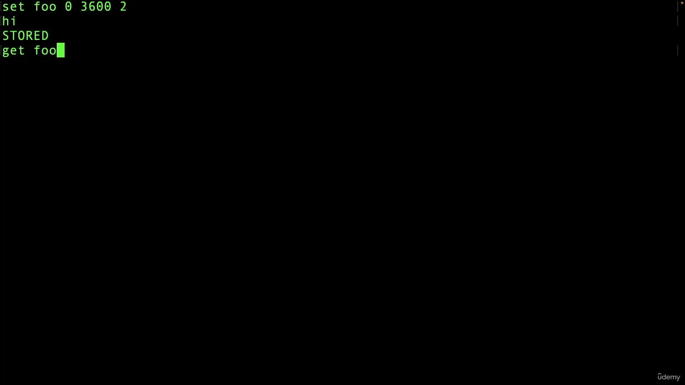
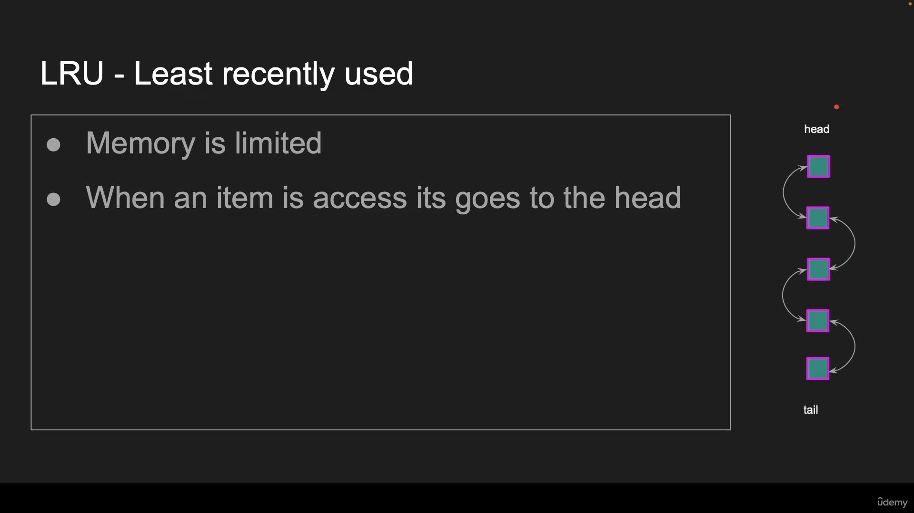
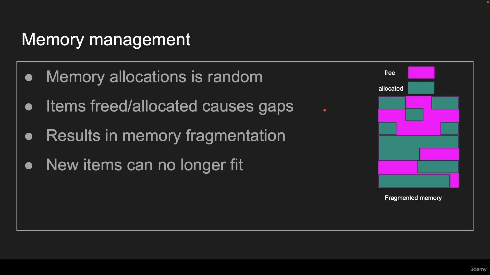
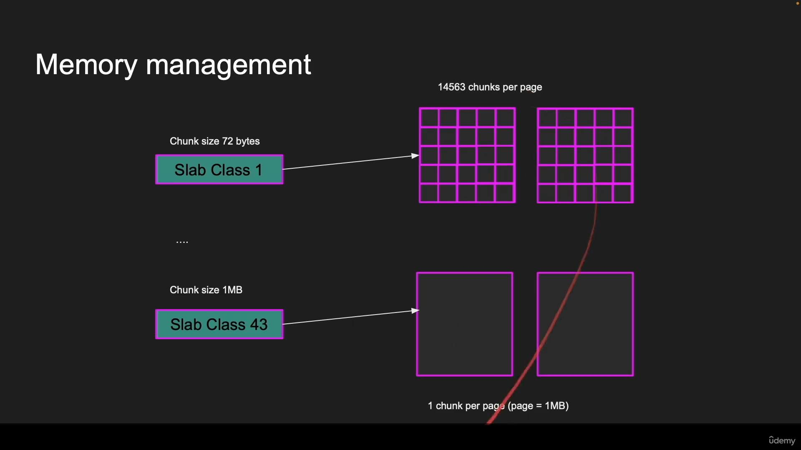
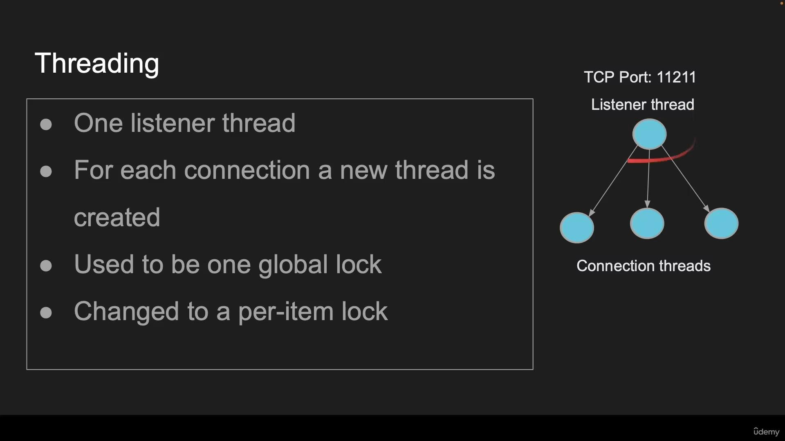
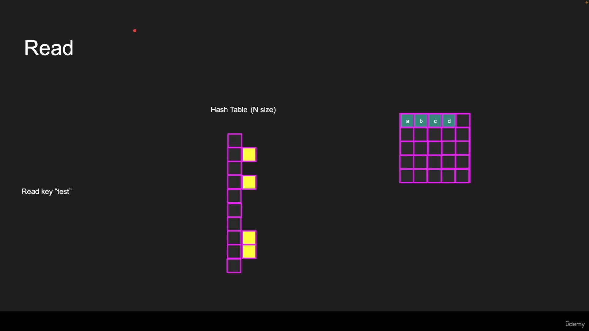
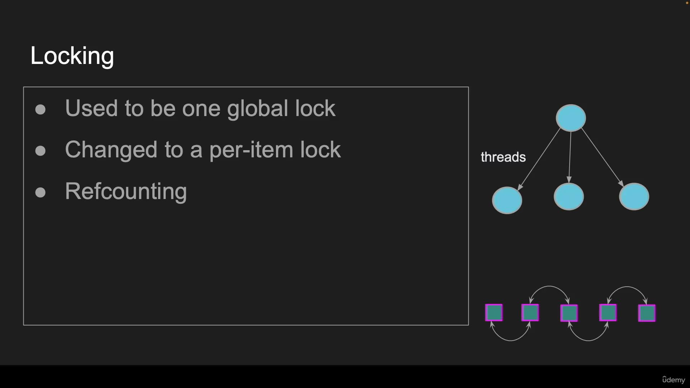

# NodeJS Internals · P43 Memcached 速成：内部机制 + Docker / telnet / Node.js 三路动手

> 说明：本篇逐字稿是英文自动转写，里面 `MIMCASHD` = Memcached，`ALARU` / `RU` = LRU，`link list` = linked list，`slap class` / `subclass` = slab class。下文一律用正确拼写。逐字稿里没有讲到的内容，我会明确标注「课里没讲」。

## 1. 这一节做什么

P43 是这门课里唯一一讲专门讲 Memcached 的内容（讲师自述这是他早年做的一期 Memcached crash course，直接搬进了 Node.js 课程）。它的定位不是教 Memcached 的 API 怎么调，而是**在把东西跑起来的前提下，拆开看一个 2003 年用 C 写的、极简的内存键值缓存内部是怎么运转的**：内存怎么按页分配、LRU 怎么淘汰、多线程怎么加锁、哈希表怎么把 key 变成一个下标、以及「分布式缓存」这件事为什么被推到了客户端。

这一节结束后，你手上应该有三个可以重复执行的产物：

1. **4 个跑在本机不同端口上的 Memcached 容器**（宿主端口 11211–11214，容器内始终是 11211）；
2. **一份 telnet 手敲的会话记录**，包含 `stats`、`stats slabs`，以及 `set` / `get` / `delete` 的完整往返，用来对上讲师讲的 chunk、page、slab class 这些概念；
3. **一个 Node.js 小项目 `node-mem`**，用 `memcached` 客户端库对一个「服务器池」批量写入 10 个 key，再用第二个脚本批量读回来，亲眼看到两件事：key 被客户端分散到了不同实例上；10 个 `get` 的回调打印顺序和发送顺序完全不一致。

对前端转 AI 应用工程师来说，这一讲的价值在于：你以后在 Node 里接 Redis / Memcached / 向量库缓存层时，会知道「key 不在」是这类缓存的设计前提而不是 bug，会知道为什么客户端要持有整个服务器列表，也会知道为什么有些缓存的 value 会有个硬上限。



## 2. 讲师原话

下面这些是讲师在这一讲里最关键的几句判断，后面的复现步骤都是在验证它们。

- 「Memcached is a simple in-memory key value store written in C… It was designed to be simple, solve the problems of the web back in 2003, which is we want to help alleviate the queries to the database.」—— p043 [01:23]～[01:52]
  也就是说：它解决的问题是「别让数据库被重复查询打死」，不是「当数据库用」。
- 「A key has to be a string and it maxed out at 250 character… the value can be any type, It's by default one megabyte.」—— p043 [05:59]～[06:55]
  key 必须是字符串、上限 250 字符；value 默认上限 1MB。讲师把这些上限称为「limitation，但我把它们看作 feature」，因为简单的东西必然有限制。
- 「当内存不够时… Memcached does not guarantee that.」—— p043 [03:44]
  即使你给某个 key 设了 TTL，也不要假设它在 TTL 到期前一定还在。
- 「when you start, allocate a whole page, one meg… So they say, hey, let's start with the one meg.」—— p043 [10:54]～[11:24]
  为了避免内存碎片，它一次就分配一整页（1MB），页内再切成等长的 chunk，chunk 大小由 slab class 决定。
- 「every slab class has its own LRU… if I access an item that happens to be in the tail, it will be popped and go back to the head.」—— p043 [19:14]～[19:44]
  每个 slab class 各有一条自己的 LRU 链表，命中就把节点挪到表头，长时间不用的自然沉到表尾被淘汰。
- 「TCP port 11211. And there is a listener thread… once it accepts a connection, it gets the file descriptor… spins up a new thread.」—— p043 [27:40]～[28:38]
  一个监听线程负责 accept，accept 到的连接交给工作线程，一个连接对一个线程。
- 「the original design had one global lock… Now it's a pair item lock.」—— p043 [31:00]～[31:30]
  老的锁模型是一把大锁把所有线程串起来；新模型只对同一个 item 串行化。讲师反复吐槽：所有这些锁存在的根因是「要维护 LRU」。
- 「Memcached is not a distributed cache… The client is responsible for the distribution.」—— p043 [05:03]、[41:28]
  多个 Memcached 实例之间互不知道对方存在，一致性哈希那一层在客户端。这正是后面 Node 代码里「传一个服务器数组」的意义。
- 「docker run --name … -p 11211:11211 -d memcached」—— p043 [46:57]
  容器内的 11211 映射到宿主端口，第二个实例用 11212，以此类推。
- 「set foo … flags zero … expiration … 3600 which is an hour … and then finally, we're gonna put that data length.」—— p043 [49:32]～[50:00]
  telnet 手敲 `set` 的五个参数：key、flags、过期时间（秒）、字节数，然后是数据本身。
- 「you can pass in an array of servers… If you pass an array, then the keys will be evenly distributed between all these instances.」—— p043 [54:17]～[54:44]
  `new Memcached([...])` 传数组，key 就会被客户端分摊到各个实例。
- 「it took the hash of the foo one, determined foo one should exist on this server, connected to the server, ask for the value.」—— p043 [62:14]
  一次 `get` 在客户端侧的完整动作：算哈希 → 选实例 → 建连 → 取值。

## 3. 从零复现

### 3.0 环境准备

- **Docker**：讲师在 macOS 上装的是 Docker Desktop，Windows / Linux 同理。讲师特别提到镜像有时需要登录才能拉，所以先 `docker login`（课里没讲要注册什么账号类型，按 Docker Hub 提示走即可）。
- **Node.js**：课里没讲具体版本，用你机器上现成的 LTS 即可，能跑 `node -v`、`npm -v` 就行。
- **telnet 客户端**：讲师全程用 telnet 跟 Memcached 对话。注意 macOS 新版系统自带没有 `telnet`（见第 7 节），需要 `brew install telnet`，或者用 `nc 127.0.0.1 11211` 代替。

最终目录结构：

```
node-mem/
├── package.json
├── index.js          # 批量写入 10 个 key
├── read.js           # 批量把这 10 个 key 读回来
└── scripts/
    ├── up.sh         # 起 4 个 memcached 容器
    ├── down.sh       # 清理容器
    └── telnet-session.txt   # 手敲的会话记录（照抄即可）
```

### 3.1 起 4 个 Memcached 容器

先只起一个，把单实例跑通（这也是讲师第一次演示的顺序）：

```bash
docker run --name mem1 -p 11211:11211 -d memcached
docker ps
```

`docker ps` 里应该能看到一个名为 `mem1`、状态 Up、端口 `0.0.0.0:11211->11211/tcp` 的容器。第一次执行会先拉镜像。

单实例验证通过后，一次补齐到 4 个（讲师原话是「servers are free, we can spin up as much as we want」）：

```bash
docker run --name mem2 -p 11212:11211 -d memcached
docker run --name mem3 -p 11213:11211 -d memcached
docker run --name mem4 -p 11214:11211 -d memcached
```

注意：**容器内的端口永远是 11211，变的只是宿主端口**。逐字稿里讲师念 `-p` 参数时被转写成了长串重复数字（`1121212121…`），按 `-p 11212:11211` 理解即可。



### 3.2 用 telnet 验证单实例并观察 stats

```bash
telnet 127.0.0.1 11211
```

连上后没有任何登录、没有账号、没有库表，直接可以敲命令（讲师对此的评价是「free for all」）。依次敲：

```
stats
```

讲师在这一步逐条念了输出里的几类信息：uptime、Memcached 版本、指针大小、**最大连接数 1024**、get 被调用了多少次、set 被调用了多少次、increment 被调用了多少次、线程数、以及 eviction（LRU 淘汰）发生的次数。**具体字段名请以你终端里的实际输出为准**，逐字稿里讲师是口述而不是逐字念字段名。

接着：

```
stats slabs
```

这一步对应讲师讲的 slab / chunk / page 模型。讲师念到的量有：某个 slab class 的 **chunk size**、每页能放多少个 chunk（他念的是 **10922**）、一共分配了几页（他这里只有 **1 页**）、已用了几个 chunk（**1 个**）、还剩多少空闲 chunk、以及**已分配内存约等于 1MB**——正好对上「一次分配一整页 1MB」的说法。

然后写读一个 key：

```
set foo 0 3600 2
hi
get foo
```

这里 `0` 是 flags，`3600` 是过期时间（一小时），`2` 是要写入的数据字节数，下一行的 `hi` 正好 2 个字节。**字节数必须和实际数据完全一致**，多了少了都会报错。写入成功后终端会回一行确认；`get foo` 应该原样把 `hi` 吐回来。逐字稿里讲师只说「存进去了」「读出来了」，没有逐字念出响应行，你终端上看到的响应文本以实际为准。

再试删除和自增（讲师提到 `increment`，但没有演示具体命令和输出）：

```
delete foo
get foo
```

删除后再 `get`，就取不到了——这和「值不在」的语义一致。

最后验证「连接断了值还在」（讲师专门做了这个对比）：`quit` 断开 telnet，重新 `telnet 127.0.0.1 11211`，再 `get foo`（前提是你没删）。值仍然在，因为它存在服务端进程的内存里，和 TCP 连接无关。



### 3.3 建 Node 项目

```bash
mkdir node-mem && cd node-mem
npm init -y
npm install memcached
touch index.js read.js
mkdir scripts
```

`memcached` 这个包名就是库名，`require('memcached')` 直接用。**逐字稿里没有点名版本号**，讲师只说 `npm install memcached`；装完把你 `package.json` 里实际生成的版本记下来锁定即可。

### 3.4 先对着单实例跑通写入

把 `index.js` 里服务器数组先只留一行 `127.0.0.1:11211`，跑：

```bash
node index.js
```

你应该看到 10 行 `set fooN = barN ok`。讲师第一次跑就报错了（他自己说「of course the moment I say that I have an error」），原因是他回调里写错了参数，加上打印 err 的语句后就正常了——所以**回调里那行 `if (err) console.error(...)` 不要省**。

### 3.5 扩到 4 个实例，观察分布

把服务器数组改成 4 个实例后重新 `node index.js`，然后再开 telnet **分别连到 11212、11213、11214**，一个个 `get foo1` … `get foo10`。

你会看到和讲师演示一模一样的现象：在 11212 上 `get foo1` 有值、`get foo2` 没有；换到 11213 上 `get foo1` 没值、`get foo5` 有值。讲师当时的原话是「Get it? Because now the distribution is up to the client. I have no idea how this will be distributed.」——**具体哪个 key 落在哪个实例，取决于客户端库内部的哈希算法，你不需要和讲师完全一样**，只要确认「每个 key 只在一个实例上、总体被摊开了」即可。

### 3.6 用 Node 从服务器池读回来，观察乱序

```bash
node read.js
```

讲师当时的输出是 `bar9 / bar2 / bar4 / bar3 / bar6 / bar7 / bar8 / bar1 / bar5` 这种顺序，完全不是 1→10。原因他讲得很清楚：Node 是单线程事件循环，10 个 `get` 是**同时发出去**的，谁先回来取决于哪台服务器、哪条连接先响应。「We looped and sent all the 10 requests at the same time… It depends on the server, how fast it's gonna respond.」

### 3.7 清理

```bash
docker rm -f mem1 mem2 mem3 mem4
```

## 4. 完整代码

### 4.1 `node-mem/package.json`

```json
{
  "name": "node-mem",
  "version": "1.0.0",
  "description": "Memcached + Node.js demo (course BV1jGRyBsEBa p043)",
  "main": "index.js",
  "scripts": {
    "set": "node index.js",
    "get": "node read.js"
  },
  "license": "MIT"
}
```

> `dependencies` 字段由 `npm install memcached` 自动写入。课里没给版本号，装完请把实际版本保留在 `package.json` 里，方便下次复现。

### 4.2 `node-mem/index.js`（批量写入）

```js
// node-mem/index.js
// 作用：向「服务器池」写入 10 个 key，观察客户端如何把它们分散到多台 Memcached 实例上。
// 对应逐字稿 p043 [53:47] ~ [56:38]

const Memcached = require('memcached');

// 只有一台实例时，先把下面这行打开、把数组那行注释掉，跑通再扩展。
// const serverPool = new Memcached('127.0.0.1:11211');

// 4 台实例：宿主端口 11211 ~ 11214，容器内端口都是 11211
const serverPool = new Memcached([
  '127.0.0.1:11211',
  '127.0.0.1:11212',
  '127.0.0.1:11213',
  '127.0.0.1:11214',
]);

// 讲师写的是 1~10 这 10 个 key，key 为 fooN，value 为 barN
const KEYS = [1, 2, 3, 4, 5, 6, 7, 8, 9, 10];

// 过期时间：3600 秒 = 一小时（对应 telnet 里的 exptime 参数）
const TTL_SECONDS = 3600;

function writeAll() {
  KEYS.forEach((n) => {
    const key = `foo${n}`;
    const value = `bar${n}`;

    // set(key, value, lifetime, callback)
    serverPool.set(key, value, TTL_SECONDS, (err) => {
      if (err) {
        console.error(`set ${key} failed:`, err);
        return;
      }
      console.log(`set ${key} = ${value} ok`);
    });
  });
}

writeAll();
```

### 4.3 `node-mem/read.js`（批量读取）

```js
// node-mem/read.js
// 作用：通过服务器池把这 10 个 key 读回来，观察回调顺序。
// 对应逐字稿 p043 [59:58] ~ [62:14]

const Memcached = require('memcached');

const serverPool = new Memcached([
  '127.0.0.1:11211',
  '127.0.0.1:11212',
  '127.0.0.1:11213',
  '127.0.0.1:11214',
]);

const KEYS = [1, 2, 3, 4, 5, 6, 7, 8, 9, 10];

function readAll() {
  KEYS.forEach((n) => {
    const key = `foo${n}`;

    // get(key, callback)，回调两个参数：error 和 data
    serverPool.get(key, (err, data) => {
      if (err) {
        console.error(`get ${key} failed:`, err);
        return;
      }
      // key 不存在时 data 为 undefined，这是 Memcached 的正常语义
      console.log(key, '=>', data);
    });
  });
}

readAll();
```

### 4.4 `node-mem/scripts/up.sh`

```bash
#!/usr/bin/env bash
# 拉起 4 个 Memcached 实例：宿主 11211~11214 -> 容器 11211
set -e

docker run --name mem1 -p 11211:11211 -d memcached
docker run --name mem2 -p 11212:11211 -d memcached
docker run --name mem3 -p 11213:11211 -d memcached
docker run --name mem4 -p 11214:11211 -d memcached

docker ps --filter "name=mem"
```

执行：

```bash
chmod +x scripts/up.sh
./scripts/up.sh
```

### 4.5 `node-mem/scripts/down.sh`

```bash
#!/usr/bin/env bash
# 清理本节创建的 4 个容器
docker rm -f mem1 mem2 mem3 mem4
```

### 4.6 `node-mem/scripts/telnet-session.txt`

这不是代码，是照着敲的会话脚本，用来复现讲师在 P43 里的终端演示：

```text
# 1) 连接（端口换成 11212 / 11213 / 11214 就能看其他实例）
telnet 127.0.0.1 11211

# 2) 看整体统计：uptime、版本、最大连接数、gets/sets 次数、evictions、threads
stats

# 3) 看 slab / chunk / page：chunk size、每页 chunk 数、页数、已用/空闲 chunk、已分配内存
stats slabs

# 4) 写入：set <key> <flags> <exptime秒> <字节数>，换行后紧跟数据本身
set foo 0 3600 2
hi

# 5) 读取
get foo

# 6) 删除后再读
delete foo
get foo

# 7) 断开再连，验证值不随连接消失（此处 foo 已被删，可先重设一次再看）
quit
telnet 127.0.0.1 11211
get foo
```

## 5. 逐行解释

**`docker run --name mem2 -p 11212:11211 -d memcached`**
`--name` 给容器起名，纯粹是为了后面一眼找到、方便 `docker rm -f mem2`（讲师明确说了之所以起名就是「so that we can find it and delete it later easily」）。`-p` 是 `宿主端口:容器端口`，冒号左边是你 `telnet`/Node 要连的端口，右边是 Memcached 进程在容器里监听的端口，永远是 11211。`-d` 是 detach，把容器扔到后台，否则终端会被占住（讲师说他第一次演示时也强调「我建议你加 `-d`，因为终端我还要用」）。最后的 `memcached` 是镜像名。

**`telnet 127.0.0.1 11211`**
Memcached 用的是纯文本协议，所以你能拿 telnet 直接对话。这也是讲师偏爱它的原因：「how many clients these days that you can actually just telnet and run commands to?」连上之后**没有任何认证**，没有库、没有表、没有 collection，直接一个扁平的自由空间。

**`set foo 0 3600 2` + 换行 + `hi`**
这行的五个 token 分别是：命令、key、flags、exptime（秒）、字节数。`flags` 是给客户端自己用的整数标记，Memcached 原样存着不解释，讲师这里直接给 0。`3600` 是一小时。`2` 是数据长度，**必须和下一行的实际字节数严格相等**——Memcached 会按这个长度去读后续字节，多一个少一个都会出协议错误。这就是讲师说的「You have to exactly match it, otherwise it's gonna be… not gonna fit nicely」。

**`get foo`**
协议会先回一行元信息（key、flags、字节数），再回数据本身，最后回一行结束标记。这三行的具体文本以你终端输出为准，逐字稿里讲师只描述了「读出来了」。

**`serverPool.set(key, value, TTL_SECONDS, cb)`**
签名是 `set(key, value, lifetime, callback)`。`lifetime` 单位是秒，对应 telnet 里的 exptime。回调第一个参数是 error——讲师第一次跑挂掉就是这里处理不干净，加上了错误打印之后才跑通，所以这行不能省。

**`if (err) { console.error(...); return; }`**
Memcached 客户端库不会 throw，错误全都塞进回调的第一个参数。Node 里这是老式 callback 风格；如果你习惯 `async/await`，得自己包一层 `new Promise`（**课里没讲**，见第 7 节）。

**`new Memcached(['127.0.0.1:11211', ...])`**
这是整节课最关键的一行。传数组 = 传一个「服务器池」，客户端会在内部对 key 做哈希、算出该去哪个实例，然后只跟那一台建连。讲师的原话是「If you pass an array, then the keys will be evenly distributed between all these instances」。也就是说：**Memcached 本身完全不知道有其他实例存在，分布式这件事 100% 发生在客户端**。讲师在讲「distributed cache」时反复强调这一点，甚至说他不太愿意把 Memcached 叫分布式缓存——「when you spin up a Memcached server, it doesn't talk to another server.」

**`KEYS.forEach(...)` 里 10 个 `set` 同时发出**
Node 是单线程事件循环，`forEach` 会在同一个 tick 里把 10 个 `set` 全部排出去，然后才轮到回调。这就是为什么 `read.js` 打印出来是乱序的：「we looped and sent all the 10 requests at the same time… these are asynchronous」。顺序取决于哪台服务器先回、哪条连接先就绪。这不是 bug。

**`serverPool.get(key, (err, data) => ...)`**
`get` 只需要 key，没有 value 和 TTL。回调两个参数：error 和 data。key 不存在时不会报错，`data` 直接是 `undefined`——这正好印证讲师那句「you cannot really rely on Memcached to have a value always there」。

**为什么一次 `get` 是这样的**
讲师在哈希表那一段画过完整路径：对 key 做哈希 → 对哈希表的长度取模 → 得到下标 → 顺着指针找到对应 slab class 里那个 page 上的那个 chunk → 读出 item → 顺便把这个 item 在 LRU 链表里挪到表头。所以严格说一次读是「一次哈希表定位 + 一次 item 读取」，讲师自己也说「you can argue that this is one read and this is a second read」。

**关于锁（给前端的一段翻译）**
讲师说老的线程模型是「一把全局锁」，新模型是「pair item lock」——只有两个线程碰同一个 item 时才串行。放到 JS/Node 里对照：Node 主线程不存在两个线程同时改同一块内存的问题（单线程），但**你依然会遇到等价的序列化问题**——两个 `async` 请求同时对同一个 key 做「读-改-写」、或者两个进程连同一个 Memcached 实例时，谁先谁后仍然由服务端排队决定。讲师说所有锁开销的根因是「要维护 LRU」，这也是他对 LRU 最大的意见：如果 LRU 默认关掉，模型会简单得多。

**关于 LRU 与「值可能不在」**
每个 slab class 一条独立 LRU 链表，命中就挪到表头，长期不用的沉到表尾，内存紧张时从表尾淘汰。所以**TTL 只是「最多活这么久」，不是「至少活这么久」**。讲师的原话：「Don't rely on that. Even if you put a key that has a one hour TTL, if your memory is filled, the LRU will kick in.」这条在设计缓存层时是硬约束，不是边角情况。













## 6. 复现检查清单

按顺序打勾，任何一项不符就先停下来排查：

- [ ] `docker ps` 能看到 `mem1`~`mem4` 四个容器，状态 Up，宿主端口分别是 11211/11212/11213/11214。
- [ ] `telnet 127.0.0.1 11211` 能连上，没有任何登录提示。
- [ ] `stats` 有输出，能从中找到 uptime、版本、最大连接数（讲师念的是 **1024**）、gets/sets 计数、threads 数、evictions 计数。
- [ ] `stats slabs` 有输出，能读到 chunk size、每页 chunk 数、页数、已用/空闲 chunk、已分配内存约 **1MB**（对应「一次分配一整页」）。
- [ ] `set foo 0 3600 2` 紧接一行 `hi` 能写入成功；`get foo` 能取回 `hi`。
- [ ] 把字节数写错（比如写 `3` 但只给 `hi`）会报协议错误——这条能让你真正记住「长度必须精确匹配」。
- [ ] `delete foo` 之后再 `get foo` 取不到。
- [ ] `quit` 断开重连后，未删除的 key 依然存在（值在服务端内存，不在连接上）。
- [ ] `node index.js` 对 4 台实例输出 10 行成功日志，没有 error。
- [ ] 分别 telnet 到 11212 / 11213 / 11214，`get foo1`…`get foo10`，确认每个 key 只在其中一台上存在，且 10 个 key 被摊到了多台实例上。
- [ ] `node read.js` 输出的顺序不是 1→10（乱序即正确）。
- [ ] 把服务器数组改回只剩一台、重新 `node index.js` 后，所有 key 都能在 11211 上找到——说明「分布」完全由客户端参数决定。
- [ ] `./scripts/down.sh` 能一次清掉 4 个容器，`docker ps` 干净。

## 7. 课里没讲但你会撞上的

1. **macOS 新版没有 `telnet`。** 讲师是在自己有 telnet 的环境里演示的。如果你的终端报 `command not found: telnet`，二选一：`brew install telnet`，或者用 `nc 127.0.0.1 11211` 代替（敲命令、看输出的体验基本一致）。
2. **容器名冲突。** 第二次执行 `up.sh` 会报名字已被占用。先 `./scripts/down.sh`，或者用 `docker rm -f mem1` 单独清。课里没讲这个错误，但第一次重跑就会遇到。
3. **端口被占。** 11211 是 Memcached 的默认端口，如果你本机已经装过 Memcached 或别的容器占着它，`docker run` 会失败。改宿主端口即可（比如 `-p 21211:11211`），同时记得同步改 Node 里的地址。
4. **`set` 的字节数必须精确。** 上面清单里那一条不是凑数的：写入中文、emoji 时字数 ≠ 字节数（一个汉字通常 3 字节），按「字符个数」填长度一定会报错。
5. **value 超过 1MB 会写失败。** 讲师讲了默认上限是 1MB，但没演示超限时的行为。实际会返回错误，具体错误文本以你的客户端库和终端输出为准，不要照抄任何记忆中的字符串。
6. **TTL 不要随手填特别大的数字。** 课里只用了 3600 秒。Memcached 协议对「特别大的 exptime」有特殊解释（会被当成绝对时间戳处理），**课里没讲这条**，但你若把 TTL 写成「十年」，行为会和你想的不一样。实践上缓存 TTL 就该是分钟到小时级。
7. **Node 进程可能不退出。** `memcached` 客户端库会保持到服务端的连接，脚本跑完进程未必自动结束。课里没讲，如果卡住，在最后加一行 `serverPool.end()`（或 `process.exit(0)`）。`serverPool.end()` 的确切签名请以你安装的库版本为准。
8. **`get` 取不到不是错误。** 回调里 `data` 为 `undefined` 时不要当异常处理，这正是讲师强调的「值随时可能不在」的语义。真正要处理的是 `err`（连不上、协议错）。
9. **加机器会让老 key「消失」。** 讲师明确说过：客户端按哈希选实例，服务器列表一变，同一个 key 就会被算到另一台上，原来那台上的值还在，但你通过池子已经取不到了。他也明确表示不值得为此做数据搬迁——「why would you distribute the keys for in a transient cache anyway?」这条**课里讲了**，但很容易在扩缩容时忘掉。
10. **没有认证、UDP 默认关闭。** 讲师讲了默认无认证（可上 SASL / TLS，但默认都没有），也讲了 UDP 因为 2018 年的反射攻击已被默认关闭。所以**千万不要把 11211 直接暴露到公网**——哪怕只是做实验，也用本机或内网。
11. **想用 `async/await` 得自己包。** 课里的代码全是 callback 风格。要改成 `await`，需要把 `set` / `get` 包成 `new Promise((resolve, reject) => ...)`（**课里没写这段**）。包的时候注意别在 `forEach` 里直接 `await`——`forEach` 不会等异步回调，10 个请求依然是并发发出的。