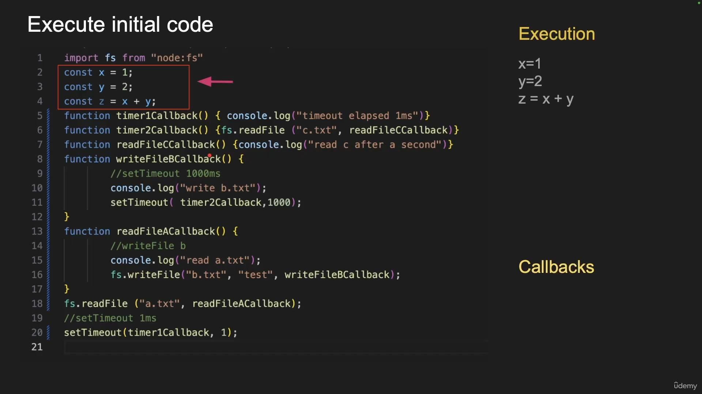
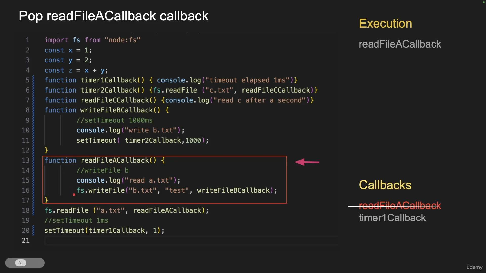
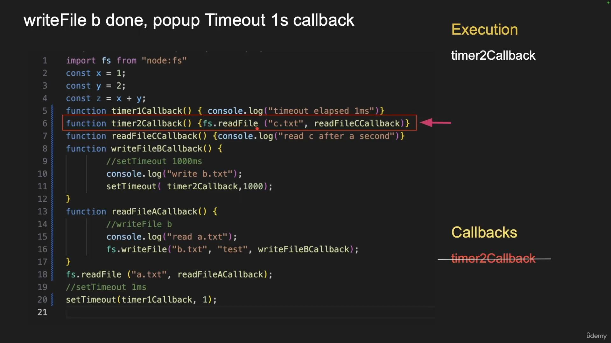
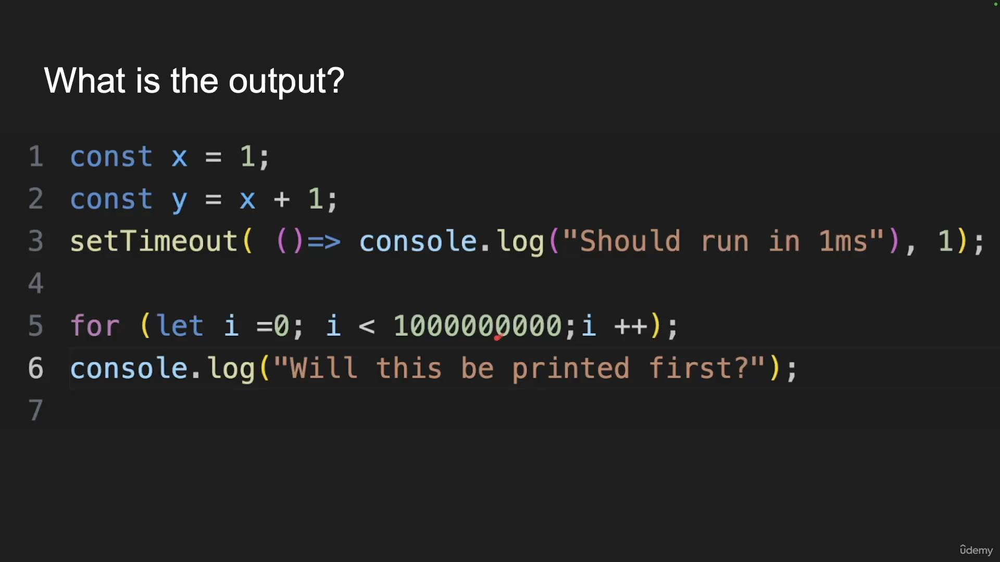
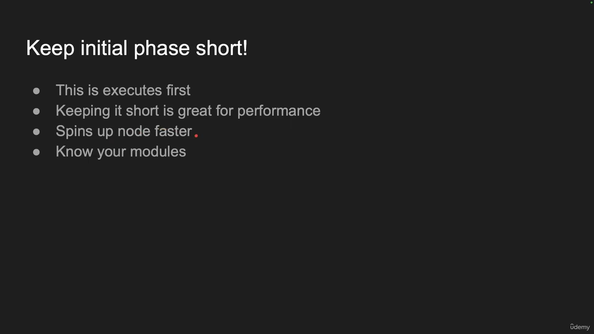
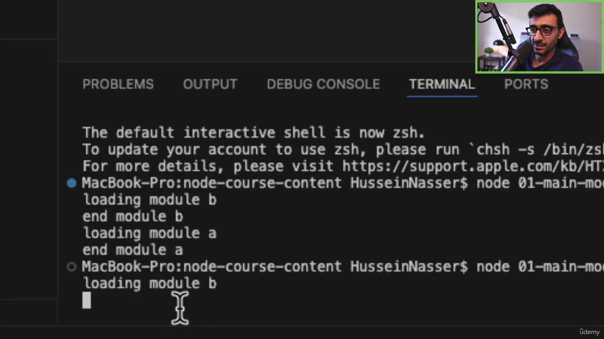
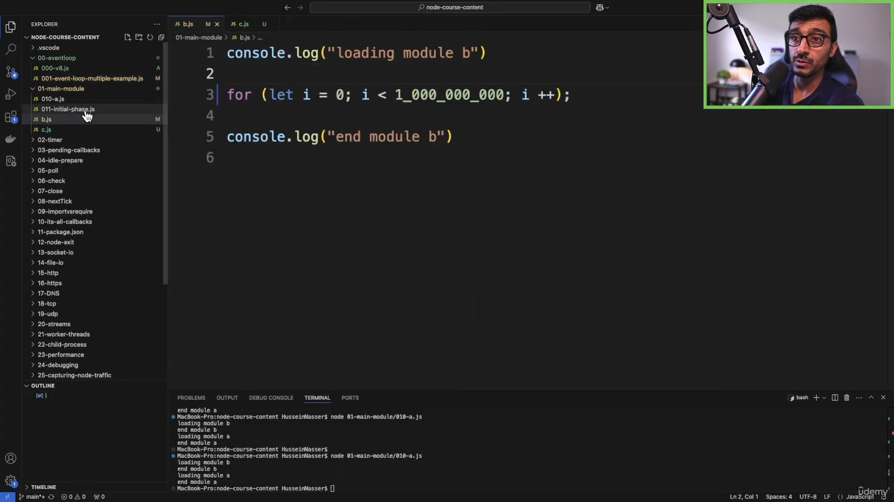

# NodeJS Internals P8–P9：事件循环总览与「初始阶段」

> 本节对应原课程 **BV1jGRyBsEBa** 的 P008、P009。P008 用一张「鸟瞰图」解释 Node 为什么需要事件循环、回调队列如何驱动程序退出；P009 把镜头拉近到循环开始之前的**主模块 / 初始阶段（main module / initial phase）**，用两个可运行实验证明：根模块里的同步代码会阻塞定时器和 IO，`require` 的加载顺序也会改变输出。
>
> 说明：逐字稿只给到了代码的「讲解版」，没有逐行贴出仓库源码。下面第 4 节的代码是**按讲师口述逻辑等价重建**的最小可运行版本；文件名、目录名尽量对齐讲师提到的 `001-event-loop-multiple-examples`、`010A`、`011`。原仓库链接在课程描述里，若你手上有原仓库，以原仓库为准。

---

## 1. 这一节做什么

这一节要让你亲手跑出两个现象：

1. **P008 实验：多回调 + 定时器 + 文件 IO 的竞态。**
   在一个 JS 文件里同时注册「读 A 文件」「1ms 定时器」「写 B 文件」「1 秒后读 C 文件」四类回调，观察事件循环如何从队列里逐个取出回调执行，以及 1ms 定时器和磁盘读到底谁先完成——讲师在课上反复强调：**这是竞态，跑两次结果可能不一样**。

2. **P009 实验：初始阶段是同步的，会阻塞一切。**
   在根模块里写一个 1 亿次的 `for` 循环，再注册一个 1ms 定时器。你会看到：定时器回调不会在 1ms 后执行，而是要等整个同步循环跑完。随后再用 `require` 演示模块的加载顺序：A 加载 B、B 加载 C 时，C 的代码先于 B、B 先于 A 执行。

这两节解决的是同一个问题的两面：

- **为什么需要循环**：Node 是 C++ 程序，读入 JS 文件交给 V8 逐行解释。如果只有同步代码，执行完就退出；但定时器、文件 IO、网络 IO 都需要「等」，所以必须有一个循环反复检查「有没有活干」。
- **循环开始之前发生了什么**：根模块的代码是**同步、一次性**执行的，这段代码跑完之前，循环根本还没启动。

### 环境准备

- Node.js：逐字稿没有指定版本，建议用当前 LTS（`node -v` 能跑即可）。本节的 API（`fs.readFile`、`fs.writeFile`、`setTimeout`）都是长期稳定 API。
- 编辑器：讲师用的是 Visual Studio Code，你可以用任意编辑器。
- 终端：macOS / Linux 的 bash、zsh，或 Windows 的 PowerShell 均可。
- Git（可选）：讲师提到可以从 GitHub clone 整个 `node-course-content` 仓库；不想 clone 就按下面手动建目录。

### 目录结构（照抄即可）

```text
node-internals-lab/
├── package.json
├── p008-event-loop/
│   ├── 001-event-loop-multiple-examples.js
│   ├── A.txt
│   └── C.txt
└── p009-initial-phase/
    ├── 010-main-module.js
    ├── 011-initial-phase-blocking.js
    ├── 010A.js
    ├── B.js
    └── C.js
```

两个关键点，先记住，第 6 节还会再提醒：

- **A.txt 和 C.txt 必须提前存在**，否则 `readFile` 会报 `ENOENT`。
- **运行时的工作目录（cwd）必须在脚本所在目录**，因为代码里用的是相对路径。讲师原话是「make sure you are at the root node course content, because the files that we're writing and reading to are actually here」。

---

## 2. 讲师原话（带出处）

> "Node.js 的执行过程中，Node 是一个 C++ 程序……它接收一个输入，而这个输入恰好是一个 JavaScript 文件，随后由 V8 引擎解释执行……逐行执行。"
> —— p008 [00:59]

> "有些情况下程序并不会真正结束……定时器……文件是另一个例子……网络……所以我们需要循环并等待。"
> —— p008 [01:56]–[03:52]

> "回调是一个函数，是 JavaScript 中的一段代码，会在特定事件满足后被触发。"
> —— p008 [06:13]

> "我们在开始时只是执行代码，然后才初始化循环。理解这一点非常重要。"
> —— p008 [09:30]

> "注册回调和执行回调是两回事。"
> —— p008 [09:58]

> "我们运气不错，读取在超时之前完成了……但看看读取之前的那个定时器。我们受操作系统摆布……这并不稳定，实际上就是竞态条件，谁先抢到谁赢。"
> —— p008 [22:52]–[23:48]

> "所有主代码都同步执行……在初始阶段调度并执行回调——不会。如果我们是在注册回调，那它会进入后续阶段。"
> —— p009 [01:51]–[02:20]

> "初始阶段按定义只运行一次，而且仅运行一次……此时主循环还没有初始化。"
> —— p009 [02:20]–[02:47]

> "模块通常会在主模块之前、在初始阶段之前加载……如果你使用 require，这些模块甚至会在你的代码执行之前就加载。"
> —— p009 [05:41]–[06:09]

> "这里的关键是，出于性能原因，我们确实需要让初始阶段尽可能短……这会让 Node 运转得更快。"
> —— p009 [06:39]–[07:07]

> "A 加载 B，B 加载 C，最后 A 才真正执行。"
> —— p009 [15:18]

> "在涉及 require 时，它会遵循 if 语句。"
> —— p009 [16:15]–[16:44]

---

## 3. 从零复现

下面每一步都对应一个你能立刻执行的动作。

### 步骤 1：建目录

```bash
mkdir -p node-internals-lab/p008-event-loop
mkdir -p node-internals-lab/p009-initial-phase
cd node-internals-lab
```

### 步骤 2：写 `package.json`

在 `node-internals-lab/` 下创建 `package.json`，内容见第 4 节。它没有依赖，只用来标记这是一个 Node 项目，并让你之后能加 `"type": "module"` 做对比实验。

### 步骤 3：写 P008 的三个文件

在 `p008-event-loop/` 下创建：

- `001-event-loop-multiple-examples.js`
- `A.txt`，内容写 `read a text`
- `C.txt`，内容写 `read c text`

`B.txt` **不要手动创建**，这个文件由脚本里的 `writeFile` 生成，正好用来观察「写」这个动作。

### 步骤 4：运行 P008

```bash
cd p008-event-loop
node 001-event-loop-multiple-examples.js
```

连续跑两三次，观察输出顺序。你会看到 `read file A` 和 `timer elapsed` 的先后偶尔会换位——这就是讲师说的竞态。

### 步骤 5：写 P009 的四个文件

在 `p009-initial-phase/` 下创建：

- `010-main-module.js`
- `011-initial-phase-blocking.js`
- `010A.js`
- `B.js`
- `C.js`

### 步骤 6：运行 P009 的初始阶段实验

```bash
cd ../p009-initial-phase
node 010-main-module.js
```

先看 `010A.js` 的 require 顺序；再跑：

```bash
node 011-initial-phase-blocking.js
```

你会看到 `done with the loop` 先打印，`timer callback` 在同步循环结束后才打印。

---

## 4. 完整代码

### 4.1 `node-internals-lab/package.json`

```json
{
  "name": "node-internals-lab",
  "version": "1.0.0",
  "private": true,
  "description": "NodeJS Internals P8-P9: event loop overview and initial phase",
  "scripts": {
    "p008": "node p008-event-loop/001-event-loop-multiple-examples.js",
    "p009:main": "node p009-initial-phase/010-main-module.js",
    "p009:blocking": "node p009-initial-phase/011-initial-phase-blocking.js"
  }
}
```

> 说明：脚本命令里用的是相对路径，所以 `npm run p008` 必须在 `node-internals-lab/` 根目录执行；如果你 `cd` 进了子目录，就用 `node xxx.js`。这一点和讲师强调的「cwd 要在文件所在目录」是同一个坑。

### 4.2 `p008-event-loop/001-event-loop-multiple-examples.js`

```js
// 001-event-loop-multiple-examples.js
// 对应讲师 P008 口述的示例：定时器 + 读文件 + 写文件 + 再读文件
// 运行前请确保同目录下存在 A.txt 和 C.txt

const fs = require('fs');

// 初始阶段：同步执行的普通变量
const x = 1;
const y = 2;
const z = x + y;
console.log('initial phase done, z =', z);

// ---------- 回调函数定义（只定义，不执行）----------

function timerOneCallback() {
  console.log('timer elapsed: one millisecond');
}

function readFileACallback(err, data) {
  if (err) {
    console.error('read A failed:', err.message);
    return;
  }
  console.log('read file A, content =', data.trim());

  // 读 A 成功后，注册「写 B」的 IO，回调是 writeFileBCallback
  fs.writeFile('B.txt', 'test to B', writeFileBCallback);
}

function writeFileBCallback(err) {
  if (err) {
    console.error('write B failed:', err.message);
    return;
  }
  console.log('write B done');

  // 写 B 成功后再注册一个 1 秒的定时器，回调里读 C
  setTimeout(timerTwoCallback, 1000);
}

function timerTwoCallback() {
  console.log('timer two fired after 1000ms, now reading C');
  fs.readFile('C.txt', 'utf8', readFileCCallback);
}

function readFileCCallback(err, data) {
  if (err) {
    console.error('read C failed:', err.message);
    return;
  }
  console.log('read C, content =', data.trim());
}

// ---------- 初始阶段：注册回调 ----------

// 注册「读 A」的 IO 回调
fs.readFile('A.txt', 'utf8', readFileACallback);

// 注册一个 1ms 的定时器回调
setTimeout(timerOneCallback, 1);

console.log('initial phase finished registering callbacks');
```

### 4.3 `p008-event-loop/A.txt`

```text
read a text
```

### 4.4 `p008-event-loop/C.txt`

```text
read c text
```

### 4.5 `p009-initial-phase/010-main-module.js`

```js
// 010-main-module.js
// 演示 require 的加载顺序：A -> B -> C，实际执行顺序是 C -> B -> A

console.log('loading module A');
require('./B.js');
console.log('end module A');
```

### 4.6 `p009-initial-phase/B.js`

```js
// B.js
// 注意：require 放在文件顶部，所以 C 会先于 B 的后续代码执行

console.log('loading module B');
require('./C.js');
console.log('end module B');
```

### 4.7 `p009-initial-phase/C.js`

```js
// C.js

console.log('loading module C');
console.log('end module C');
```

### 4.8 `p009-initial-phase/010A.js`

```js
// 010A.js
// 这是讲师在 P009 里提到的「010A 引用 B.js」的版本
// 运行：node 010A.js

console.log('loading module A');
require('./B.js');
console.log('end module A');
```

> 说明：`010-main-module.js` 和 `010A.js` 内容一致，只是命名对齐讲师口述的「010A」。保留两份是为了让你对照逐字稿里的文件名；实际跑一份就够。

### 4.9 `p009-initial-phase/011-initial-phase-blocking.js`

```js
// 011-initial-phase-blocking.js
// 演示：初始阶段的同步 CPU 循环会阻塞定时器回调

const x = 1;
const y = x + 1;
const z = y + 1;

console.log('initial phase start, z =', z);

// 注册一个 1ms 的定时器，但它在初始阶段不会执行
setTimeout(() => {
  console.log('timer callback: should run in one millisecond (but it will not)');
}, 1);

// 同步阻塞循环：讲师用的是 100_000_000
const start = Date.now();
for (let i = 0; i < 100_000_000; i++) {
  // 故意空转
}
const cost = Date.now() - start;

console.log(`done with the loop, cost = ${cost}ms`);
console.log('initial phase end');
```

> 讲师在 P009 演示时把这个循环改到过 5 亿、10 亿次，用来让你「感受到」阻塞。你可以改 `100_000_000` 这个数字做实验；改大以后，`timer callback` 会被推迟得更久。

---

## 5. 逐行解释

### 5.1 P008：事件循环如何把回调排进队列

先看初始阶段（`node 001-event-loop-multiple-examples.js` 开始到文件末尾）发生了什么：

1. `require('fs')` 同步加载 `fs` 模块。这一步是同步的，属于初始阶段。
2. `const x / y / z` 和第一句 `console.log` 同步执行。讲师原话是「x equal one, y equal two, z equal x plus y... put in the stack」——对应 p008 [13:14] 附近。
3. 定义 `timerOneCallback`、`readFileACallback` 等函数。**注意：函数定义不是执行**，只是把函数对象挂到作用域里。讲师反复强调「there is nothing to do here, just a function, I'm not gonna call it」。
4. `fs.readFile('A.txt', ...)`：这里只是**发起读请求并注册回调**。讲师在 p008 [15:07]–[15:36] 说「we're doing the read file here, and then we register the callback... Am I going to execute this? No, not yet」。真正的磁盘读发生在事件循环里（后面文件系统那一节才会拆开讲）。
5. `setTimeout(timerOneCallback, 1)`：注册一个 1ms 定时器，回调此刻**不会执行**。
6. 最后一句 `console.log('initial phase finished registering callbacks')` 同步打印。
7. 初始阶段结束，事件循环启动。

事件循环启动后的调度顺序（按讲师 P008 的讲解）：

- 取「读 A」完成事件对应的回调 `readFileACallback`：打印 `read file A`，同时注册 `writeFileBCallback`（写 B）。
- 取 1ms 定时器回调 `timerOneCallback`：打印 `timer elapsed`。
- 取「写 B」完成事件对应的回调 `writeFileBCallback`：打印 `write B done`，并注册 1 秒后的 `timerTwoCallback`。
- 1 秒后，取 `timerTwoCallback`：发起读 C，注册 `readFileCCallback`。
- 取「读 C」完成事件对应的回调 `readFileCCallback`：打印 `read C`。
- 所有队列为空，退出。

讲师在 p008 [16:05] 提醒：「what do we get pick up? Now depends really which came first. We're assuming that read happened before the timer here, okay? But it's not always the case.」——这就是为什么你跑两次可能看到 `timer elapsed` 先于 `read file A`。1ms 的定时器走的是 libuv 的 sleep，而读 A 走的是文件系统缓存 / 磁盘，两者谁先完成取决于操作系统，不是确定顺序。把 `setTimeout(..., 1)` 改成 `setTimeout(..., 100)`，顺序才会稳定下来，这也是讲师在 p008 [23:48] 演示的。







### 5.2 P009：为什么初始阶段会阻塞定时器

`011-initial-phase-blocking.js` 的执行顺序：

1. `x / y / z` 同步计算。
2. `console.log('initial phase start...')` 同步打印。
3. `setTimeout(..., 1)` 只是**注册**。讲师原话：「Timeout. Not in this stage. We're gonna register a callback and move on」——p009 [03:46] 附近。
4. `for (let i = 0; i < 100_000_000; i++)` 同步空转。这 100M 次循环期间，Node 的主线程被完全占用。
5. 循环结束，打印 `done with the loop, cost = ...ms`。
6. 打印 `initial phase end`。
7. 初始阶段结束，事件循环启动，才轮到 1ms 定时器回调执行——此时距离注册已经过去了「循环耗时」那么久。

讲师在 p009 [04:45]–[05:12] 的原话是：「the real output is this will be printed first, and then maybe three seconds later when this loop is finished, that will be printed... We never got there to actually execute it. We were just busy here.」

这就是为什么他说「keep the initial phase as short as possible」：**初始阶段越短，Node 启动后能越快进入事件循环，IO 和定时器才能越早被处理。**



### 5.3 P009：require 的加载顺序

`010A.js` 的执行：

1. 打印 `loading module A`。
2. 遇到 `require('./B.js')`：**同步加载并执行 B.js**，B 没执行完，A 后面的代码不会跑。
3. B.js 打印 `loading module B`，遇到 `require('./C.js')`：同步加载并执行 C.js。
4. C.js 打印 `loading module C`、`end module C`，返回 B。
5. B.js 继续打印 `end module B`，返回 A。
6. A.js 打印 `end module A`。

最终输出：

```text
loading module A
loading module B
loading module C
end module C
end module B
end module A
```

讲师在 p009 [15:18] 说「C loads first, B loads second, and then A comes later」——注意他说的「C loads first」指的是 **C 的模块体先执行完**，不是 C 先被 require。更准确地说：A 的打印先出现，但 C 的模块体最先执行完。你可以把 `require('./C.js')` 从 B 的顶部移到 B 的末尾，再跑一次，观察输出变化——这正是讲师在 p009 [15:48] 做的实验。`require` 是同步的，**写在哪一行，就在哪一行执行**，和普通函数调用没有区别；讲师在 p009 [16:15] 还演示了 `require` 放在 `if` 里也会遵守条件判断。







### 5.4 给前端同学的对照

你在浏览器里写 `setTimeout` / `fetch` / `Promise` 时，背后也是同一个模型：调用栈同步执行，异步任务进队列，事件循环轮询。区别在于：

- 浏览器里没有 `fs`，但有网络请求、DOM 事件、`requestAnimationFrame` 等任务源。
- Node 的事件循环有**明确的阶段划分**（timers、poll、check 等），浏览器没有对外暴露这些阶段名。
- 这一节涉及的「锁 / 事务 / 并发」概念：**Node 主线程是单线程的，没有锁**。同步代码就是独占执行，100M 次循环期间任何回调都插不进来。你在 JS 里不需要 `synchronized`，但需要理解「同步代码会阻塞整个事件循环」——这也是讲师反复说「keep the initial phase as short as possible」的原因。
- 如果你以后读 Java 代码看到 `synchronized` / `ReentrantLock`，那是多线程共享内存的互斥手段；Node 里对应的不是锁，而是「不要写长同步循环 / 用 `worker_threads` 或子进程分担 CPU 活」——后者课里没讲，属于本节的延伸。

---

## 6. 复现检查清单

跑之前对照一遍，能省掉 80% 的报错：

- [ ] `node -v` 有输出，Node 已安装。
- [ ] 当前终端在 `p008-event-loop/` 目录下执行 `node 001-event-loop-multiple-examples.js`（不是仓库根目录）。
- [ ] `p008-event-loop/A.txt` 存在，内容任意。
- [ ] `p008-event-loop/C.txt` 存在，内容任意。
- [ ] `B.txt` 不需要手动建；如果上一次跑残留了 `B.txt`，第二次跑会被 `writeFile` 覆盖，属正常。
- [ ] 至少跑两次 P008，确认 `read file A` 与 `timer elapsed` 的先后可能变化（如果两次都一样，说明你的机器磁盘缓存很快，可以试着把定时器改成 0 或 100 再对比）。
- [ ] `p009-initial-phase/` 下执行 `node 010-main-module.js`，看到 `loading module A → B → C → end C → end B → end A`。
- [ ] 执行 `node 011-initial-phase-blocking.js`，确认 `done with the loop` 出现在 `timer callback` 之前。
- [ ] 把 `100_000_000` 改成 `500_000_000` 再跑一次，确认 `timer callback` 被推迟得更久。
- [ ] 把 `B.js` 里的 `require('./C.js')` 移到文件末尾，再跑 `010A.js`，确认输出顺序改变（B 的 `end module B` 会先于 C 的打印）。

---

## 7. 课里没讲但你会撞上的

以下是逐字稿没有展开、但你照着做大概率会遇到的问题。逐条说明边界，不替讲师「补课」。

1. **`ENOENT: no such file or directory, open 'A.txt'`**
   原因：`A.txt` / `C.txt` 不存在，或者你不在脚本所在目录运行。逐字稿里讲师明确说了文件「live here」，但没讲报错长什么样。解决：`cd` 到 `p008-event-loop/` 再跑，或者把路径改成 `__dirname + '/A.txt'`。

2. **`B.txt` 的写入是覆盖而不是追加**
   `fs.writeFile` 默认覆盖。课里没讲 `appendFile` 或 `flag: 'a'`，本节也不需要；你只要知道重复跑不会让 `B.txt` 越写越长即可。

3. **1ms 定时器不是精确 1ms**
   讲师在 p008 [23:22] 说定时器走的是 libuv 的 sleep，实际触发时间受事件循环调度、系统负载影响。你把 `1` 改成 `0` 也不会得到「立即执行」，只会得到「尽可能早」。这是实验现象的一部分，不是 bug。

4. **`console.log` 的输出顺序不完全等于回调执行顺序（在极端情况下）**
   `console.log` 本身是同步写 stdout，一般能忠实反映顺序；但当 stdout 被重定向到管道、或输出量很大时，缓冲区行为可能让顺序看起来「跳」。本节的输出量很小，不会触发；如果你以后写日志量大，记得这一点。课里没讲这部分。

5. **Windows 下路径分隔符**
   代码里用的是 `'A.txt'` 这种同目录相对路径，Windows 也能跑。但如果你把路径写成 `'p008-event-loop/A.txt'` 再 `cd` 到别处跑，Windows 的 `\` 和 `/` 混用可能出问题。最稳的做法始终是：**在文件所在目录运行**。

6. **`require` 与 `import` 的差异，本节只覆盖 `require`**
   讲师在 P009 明确说「I don't want to get into the difference between import and require right now. It's too early in the course.」——所以本节不要用 `import` 改写这些文件。`import` 是异步加载语义，加载顺序和 `require` 不同，属于后续课程内容。

7. **`010-main-module.js` 与 `010A.js` 重复**
   这是为了对齐讲师口述的文件名，不是课程要求。你只保留一个也能跑通全部实验。

8. **事件循环的「阶段名」本节没有出现**
   讲师在 P008 开头说「in the coming six or seven lectures we're gonna dissect every phase」，但本节只给了「鸟瞰图」，没有展开 timers / poll / check 等阶段名。本文档也**不替讲师补阶段名**——如果你在别的资料里看到这些词，知道它们属于后续课程即可。

9. **单线程 ≠ 只能用一核**
   讲师在 p009 [19:09] 说「the whole thing is used in one core, because it's a single threaded execution here」。这是指 JS 主线程单核执行；Node 进程本身还有 libuv 线程池等后台线程，但那些不执行你的 JS 回调。课里没展开线程池，本节实验也不需要。

10. **退出码**
   讲师在 p008 [01:27] 提到「the program exit returns either zero or one」。本节的脚本正常结束时退出码是 `0`；如果 `readFile` 的 `err` 分支里你写 `process.exit(1)`，退出码才会变成 `1`。逐字稿没有给出具体字段名（如 `ExitCode`），如果你用其他工具查看进程状态，字段名请以实际输出为准。

---

**小结**：P008 给你「为什么要有循环」的直觉，P009 给你「循环开始之前，同步代码是老大」的直觉。把上面两个实验各跑三遍、把定时器从 1ms 改到 100ms、把 `require` 从文件头挪到文件尾，你就能把这两节课的核心现象亲手摸一遍。