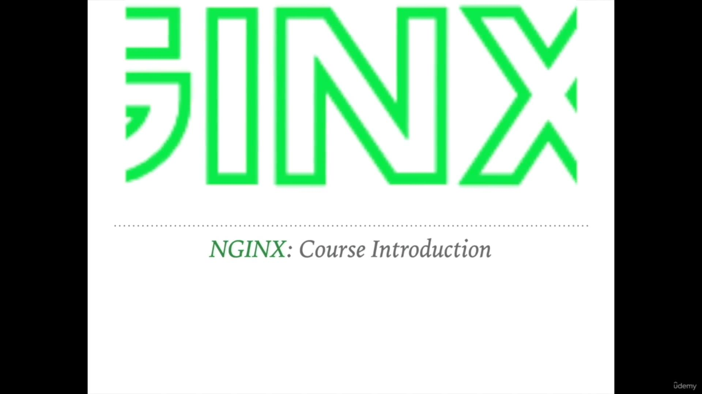
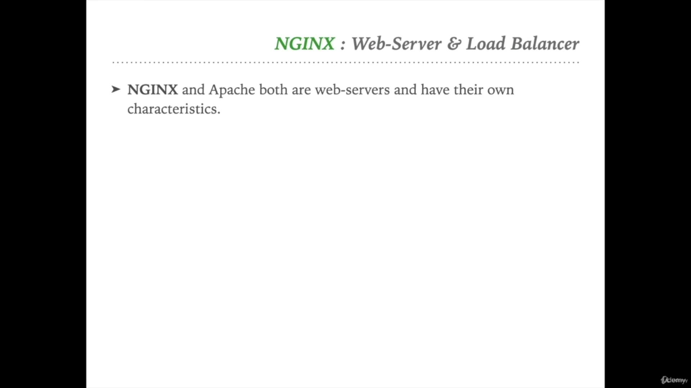
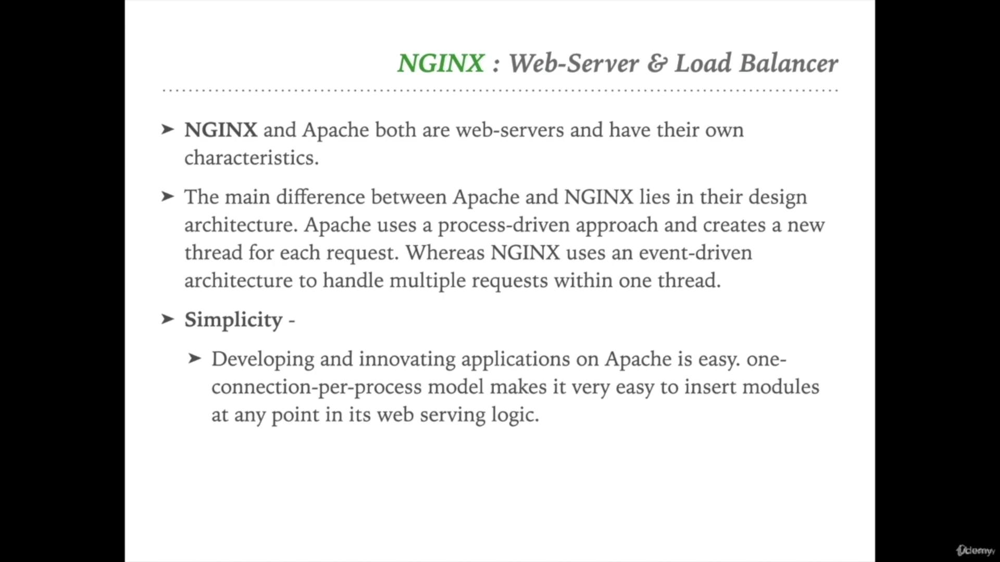
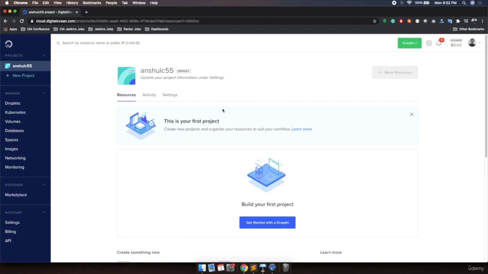
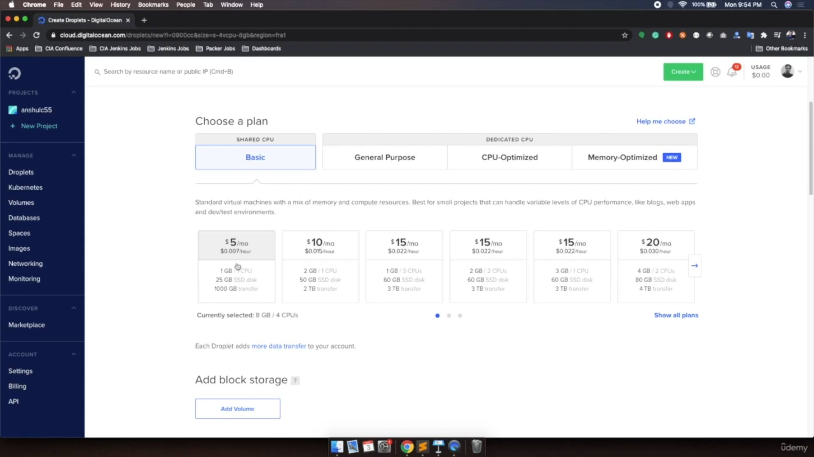
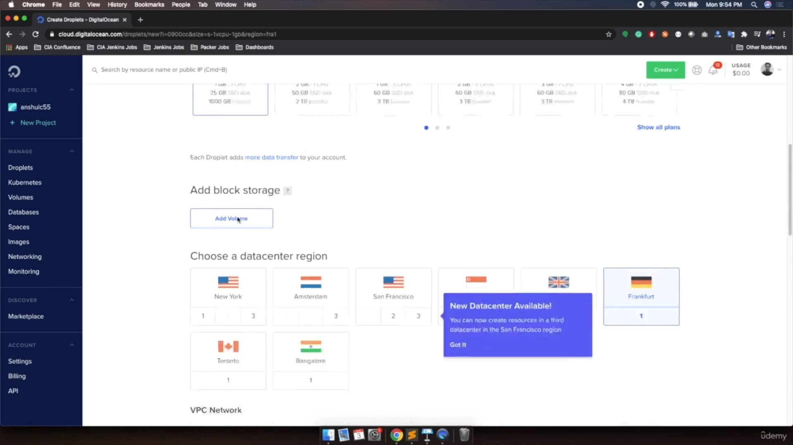
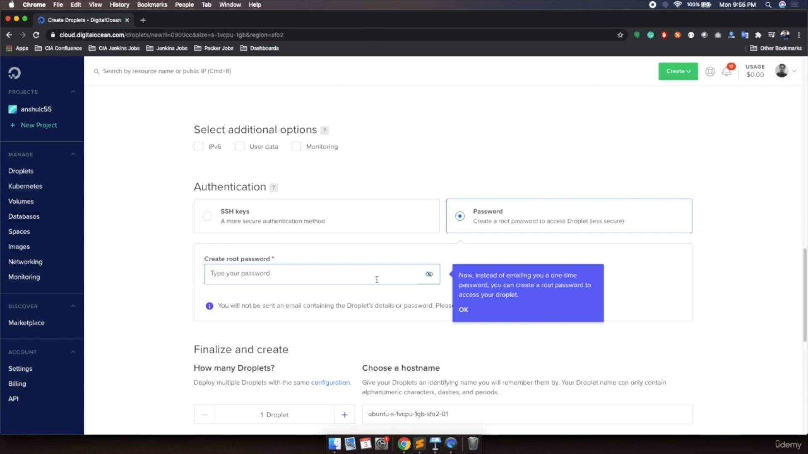
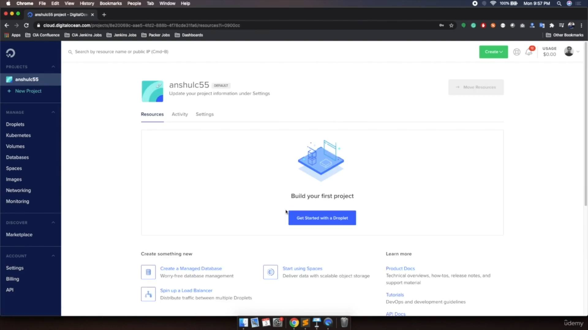

# NGINX MasterClass（P1–P4）实验环境搭建：从 DigitalOcean 创建 Ubuntu 主机到 SSH 登录

## 1. 这一节做什么

这一节的项目目标不是“马上安装并配置 Nginx”，而是**先把后续所有 Nginx 实验要用的 Linux 机器准备好**。

P1–P4 的实际交付物是：

1. 一个 DigitalOcean 账号；
2. 一台按讲师演示参数创建的 Ubuntu Droplet；
3. 能从本地终端用 `ssh root@<公网IP>` 登录；
4. 登录后能执行 `hostname` 并看到主机名；
5. 一个本地可复用的连接脚本 `connect.sh`；
6. 一个可选的远端环境记录脚本 `env-check.sh`，用于把机器信息留档。

需要特别说明：**P1–P4 没有实际执行 Nginx 安装命令**。P1 只是预告后续会讲“用包管理器安装”和“用二进制安装”；P4 只做到创建云主机、SSH 登录、执行 `hostname`。所以读者不要在本节结束时误以为机器里已经有 Nginx。Nginx 安装、配置、反向代理、负载均衡等内容在后续章节，课里在本节没有给出安装命令。

P1 把课程范围列得很清楚：

> “we will learn about the nginx fundamentals on Ubuntu machine nginx as a web server nginx as a reverse proxy and nginx load balancer.” —— p001 [00:26]



从这张大纲页可以看出，后续会覆盖 Ubuntu 上的 Nginx 基础、Web 服务器、反向代理、负载均衡、HTTP 协议与压缩、配置调优、性能与安全、缓存、静态资源、访问管理、日志、模块化架构等。P1–P4 只是整个 MasterClass 的起点：先把实验环境搭好。对于前端转 AI 应用工程师的读者，可以把它理解成“先把本地开发机换成一台可远程登录的 Linux 实验机”，后面所有 Nginx 配置都在这个环境里做。

本节完成标准很明确：你在本地终端执行连接脚本后，能进入远端 Ubuntu shell，并且 `hostname` 有输出。做到这一步，P1–P4 的环境准备就算完成。

---

## 2. 讲师原话（带「—— pNNN [MM:SS]」）

P2 解释了 Nginx 的起源。讲师说 Nginx 是俄罗斯开发者 Igor Sisso 开发的，目标是解决 10k 并发问题：

> “nginx is basically developed by the Russian developer called Igor Sisso... to solve the 10k concurrent problem.” —— p002 [00:00]

这里的“10k concurrent problem”不是精确指 10,000 个请求，而是指大量并发请求同时打到 Web 服务器时，传统服务器处理不过来。讲师说 Igor 当时使用 Apache，遇到大量并发请求时 Apache 无法很好处理，于是开始做新的应用，2004 年把 Nginx 作为开源工具发布。


P2 还强调 Nginx 不只是 Web 服务器，它还是反向代理、缓存、负载均衡、媒体流等工具：

> “engine X is open source software for the web serving reverse proxy caching load balancing media streaming and more.” —— p002 [01:53]

这也是后续课程要逐个展开的内容。但在 P1–P4 里，这些还只是范围预告，没有进入配置实操。

P3 对比 Apache 和 Nginx 时，讲师把架构差异讲得很直接：

> “Apache or STPD uses the process given approach and creates a new process or a new thread for each request. On the other hand, engine X use the event driven architecture to handle the multiple requests within the one thread.” —— p003 [00:56]



这段话是理解 Nginx 为什么适合做反向代理和负载均衡的背景。对前端/Node 读者可以这样类比：Nginx 的事件驱动更接近 Node.js 的 event loop——少量线程处理大量连接，靠非阻塞 I/O 切换；Apache 的每请求进程/线程模型更像传统阻塞式服务器。这个类比不是讲师原话，只是为了帮助前端背景读者建立直觉。

P3 还讨论了静态内容和动态内容的处理差异。讲师说静态内容方面 Nginx 比 Apache 快 2.5 倍，动态内容则通常交给外部进程处理：

> “in terms of the static content and Jinx perform 2.5 time faster as compared to the Apache” —— p003 [06:30]



讲师解释说，静态文件请求可以由 Nginx 直接返回；动态请求比如 PHP，会由 Nginx 转给 PHP-FPM 这类外部进程，处理完再返回给 Nginx，这就是反向代理的典型路径。这个解释对后面理解 `proxy_pass` 很重要，但 P1–P4 没有配置它。

P4 开始进入环境准备。讲师明确说后续实验在 Unix 系统上做：

> “we will install and follow all the labs in this particular tutorial on the unique system.” —— p004 [00:00]

逐字稿把 Unix 转写成了“unique”，这里按上下文理解为 Unix/Linux。也正因如此，P4 选择在 DigitalOcean 上创建 Ubuntu 机器，而不是在 Windows 本机直接做实验。

P4 还说明了免费额度的来源：

> “you don't need to pay a single send to the digital ocean... $100 referral... coupons... total credit 135” —— p004 [00:58]

逐字稿里“send”应是“cent”的转写。讲师说通过推荐链接注册可得 100 美元额度，再叠加优惠码最多 35 美元，总计 135 美元。**这是讲师当时的说法，具体额度和优惠码有效性以平台实际为准。本文不编造推荐链接和优惠码，因为逐字稿没有给出具体 URL 和码值。**

创建 Droplet 时，讲师选择了 5 美元/月的 Basic 方案：

> “basic machine is just $5 a month, which will be one GB one core CPU 25 GB SSD disk and 1000 GB transfer.” —— p004 [04:16]

最后，讲师演示连接方式：

> “I'm going to execute a command SSH root at the rate then define my IP.” —— p004 [06:09]

也就是 `ssh root@<IP>`。登录后执行：

> “Let's clear out the console and type hostname and we are getting my machine name.” —— p004 [06:39]

这就是本节的最终验证动作。

---

## 3. 从零复现

### 3.1 前置条件

你需要准备：

- 一个 DigitalOcean 账号；注册时按平台要求填写 billing/支付信息。课里说需要提供信用卡信息，以防额度用完后继续计费。
- 本地终端：
  - macOS/Linux：系统自带 Terminal 和 `ssh` 客户端；
  - Windows：课里提到可以用 MobaXterm 或 PuTTY 连接 Linux 机器。逐字稿中“mobile extreme tool”发音不标准，实际工具名请以你安装的为准。
- 一个强密码，用于 Droplet 的 root 用户。课里明确说如果创建按钮不亮，要检查密码强度。
- 本文使用一个可选环境变量 `SSH_USER`，默认值是 `root`。课里没有使用环境变量，这是脚本设计。

### 3.2 创建项目目录

在本地执行：

```bash
mkdir -p ~/nginx-masterclass
cd ~/nginx-masterclass
```

目录结构如下：

```text
nginx-masterclass/
├── connect.sh
└── env-check.sh
```

`connect.sh` 在本地运行，用来连接远端；`env-check.sh` 在远端 Ubuntu 上运行，用来记录主机信息。课里只演示了 `hostname`，`env-check.sh` 中的其他命令属于补充验证，后文会标注。

### 3.3 在 DigitalOcean 创建 Droplet

课里 P4 的创建流程如下。注意：课里展示的是旧版 DigitalOcean 界面，当前界面字段名和位置可能变化，**以你实际看到的控制台为准**。

1. 登录 DigitalOcean，点击 **Droplets**，再点击 **Create Droplet**。
2. **Image**：选择 Ubuntu。课里屏幕出现 16.04、16.04.6、18.04.3 等版本选项，讲师保留默认项。  
   注意：这些版本现在可能已经过生命周期，实际创建时请选择当前受支持的 Ubuntu 版本。课里没有讲版本生命周期。
3. **Plan**：讲师先把默认的 40 美元/月 8GB 方案切到 **Basic**，选择 **5 美元/月**：1GB 内存、1 core CPU、25GB SSD、1000GB transfer。
4. **Data center**：讲师示例选择 San Francisco。
5. **VPC**：不启用。
6. **IPv6**：不启用。
7. **User data**：不填。
8. **Monitoring**：不选。
9. **Authentication**：选择 **Password**，不是 SSH key。
10. 输入 root 密码。必须是强密码，否则创建按钮可能不可用。
11. 主机名可自定义，课里示例类似 `nginx-ubuntu`。逐字稿转写不清晰，实际以你填写的名称为准。
12. 点击 **Create Droplet**，等待创建完成。
13. 创建完成后复制公网 IP。











说明：截图清单里 P4 只到 05:50，逐字稿后面 06:09 的 `ssh` 命令和 06:39 的 `hostname` 输出没有对应帧，所以本文不插入不存在的截图，登录验证部分用文字和代码说明。

### 3.4 从本地连接

macOS/Linux 直接打开终端。Windows 用 MobaXterm 或 PuTTY。

课里原始命令是：

```bash
ssh root@<你的服务器公网IP>
```

例如：

```bash
ssh root@203.0.113.10
```

`203.0.113.10` 是文档示例地址，必须替换成你在控制台复制的公网 IP。

第一次连接会提示确认主机指纹，输入 `yes` 并回车。然后输入创建 Droplet 时设置的 root 密码。输入密码时终端不会显示字符，这是正常现象。

登录成功后执行：

```bash
hostname
```

应该输出你在控制台填写的主机名。逐字稿里讲师执行后说“we are getting my machine name”。

### 3.5 使用连接脚本

把 IP 作为参数传给脚本：

```bash
chmod +x connect.sh
./connect.sh 203.0.113.10
```

脚本内部会执行 `ssh root@203.0.113.10`。如果你以后想用非 root 用户，可以设置 `SSH_USER`：

```bash
SSH_USER=ubuntu ./connect.sh 203.0.113.10
```

但课里使用的是 root，且 P4 没有讲普通用户和 sudo 配置，所以默认保持 root 即可。

### 3.6 在远端记录环境

登录远端后，创建并运行 `env-check.sh`：

```bash
cat > env-check.sh <<'EOF'
#!/usr/bin/env bash
set -euo pipefail

echo "== hostname =="
hostname

echo "== os-release =="
if [ -r /etc/os-release ]; then
  cat /etc/os-release
else
  echo "/etc/os-release 不存在"
fi

echo "== kernel =="
uname -a
EOF

chmod +x env-check.sh
./env-check.sh
```

其中 `hostname` 是课里演示过的；`/etc/os-release` 和 `uname -a` 是补充验证，课里没讲。它们只用于记录系统信息，不影响 Nginx 学习。

---

## 4. 完整代码

### 4.1 `connect.sh`

保存为 `~/nginx-masterclass/connect.sh`：

```bash
#!/usr/bin/env bash
set -euo pipefail

if [ "$#" -ne 1 ]; then
  echo "用法: ./connect.sh <服务器公网IP>"
  echo "示例: ./connect.sh 203.0.113.10"
  exit 1
fi

SERVER_IP="$1"
SSH_USER="${SSH_USER:-root}"

echo "即将以 ${SSH_USER} 身份连接 ${SERVER_IP}"
echo "如果这是第一次连接，会提示确认主机指纹，输入 yes 并回车。"
ssh "${SSH_USER}@${SERVER_IP}"
```

赋予执行权限：

```bash
chmod +x connect.sh
```

运行：

```bash
./connect.sh 203.0.113.10
```

### 4.2 `env-check.sh`

在远端 Ubuntu 上保存为 `~/env-check.sh`：

```bash
#!/usr/bin/env bash
set -euo pipefail

echo "== hostname =="
hostname

echo "== os-release =="
if [ -r /etc/os-release ]; then
  cat /etc/os-release
else
  echo "/etc/os-release 不存在"
fi

echo "== kernel =="
uname -a
```

赋予执行权限并运行：

```bash
chmod +x env-check.sh
./env-check.sh
```

### 4.3 一次性创建两个文件的命令

在本地创建 `connect.sh`：

```bash
cd ~/nginx-masterclass

cat > connect.sh <<'EOF'
#!/usr/bin/env bash
set -euo pipefail

if [ "$#" -ne 1 ]; then
  echo "用法: ./connect.sh <服务器公网IP>"
  echo "示例: ./connect.sh 203.0.113.10"
  exit 1
fi

SERVER_IP="$1"
SSH_USER="${SSH_USER:-root}"

echo "即将以 ${SSH_USER} 身份连接 ${SERVER_IP}"
echo "如果这是第一次连接，会提示确认主机指纹，输入 yes 并回车。"
ssh "${SSH_USER}@${SERVER_IP}"
EOF

chmod +x connect.sh
```

登录远端后创建 `env-check.sh`：

```bash
cat > env-check.sh <<'EOF'
#!/usr/bin/env bash
set -euo pipefail

echo "== hostname =="
hostname

echo "== os-release =="
if [ -r /etc/os-release ]; then
  cat /etc/os-release
else
  echo "/etc/os-release 不存在"
fi

echo "== kernel =="
uname -a
EOF

chmod +x env-check.sh
./env-check.sh
```

---

## 5. 逐行解释

### 5.1 `connect.sh` 逐行解释

```bash
#!/usr/bin/env bash
```

指定用环境里的 `bash` 执行脚本。课里没有讲 shebang，这是脚本化补充。

```bash
set -euo pipefail
```

Bash 严格模式：`-e` 表示命令失败立即退出；`-u` 表示使用未定义变量时报错；`-o pipefail` 表示管道中任意一段失败都算失败。课里没有讲这一段，这是为了让脚本更稳。

```bash
if [ "$#" -ne 1 ]; then
```

`$#` 是传入参数个数。这里要求必须传 1 个参数，也就是服务器 IP。

```bash
  echo "用法: ./connect.sh <服务器公网IP>"
  echo "示例: ./connect.sh 203.0.113.10"
  exit 1
```

参数不对时打印用法并以状态码 1 退出。

```bash
SERVER_IP="$1"
```

把第一个参数保存到 `SERVER_IP`。运行 `./connect.sh 203.0.113.10` 时，`SERVER_IP` 就是 `203.0.113.10`。

```bash
SSH_USER="${SSH_USER:-root}"
```

如果环境变量 `SSH_USER` 存在且非空，就用它；否则默认 `root`。课里用的是 root，所以默认值保持 root。这是本文脚本引入的环境变量，不是课里讲的内容。

```bash
echo "即将以 ${SSH_USER} 身份连接 ${SERVER_IP}"
echo "如果这是第一次连接，会提示确认主机指纹，输入 yes 并回车。"
```

打印提示，避免读者第一次看到指纹确认时不知道输入什么。

```bash
ssh "${SSH_USER}@${SERVER_IP}"
```

真正执行连接。等价于课里的 `ssh root@<IP>`。如果 `SSH_USER=root`、IP 是 `203.0.113.10`，实际命令就是：

```bash
ssh root@203.0.113.10
```

### 5.2 `env-check.sh` 逐行解释

```bash
#!/usr/bin/env bash
set -euo pipefail
```

同上，指定 bash 并开启严格模式。

```bash
echo "== hostname =="
hostname
```

打印分隔标题并执行 `hostname`。这是课里唯一演示过的验证命令。P4 中讲师清屏后输入 `hostname`，然后看到机器名。

```bash
echo "== os-release =="
if [ -r /etc/os-release ]; then
  cat /etc/os-release
else
  echo "/etc/os-release 不存在"
fi
```

如果 `/etc/os-release` 可读，就打印系统版本信息；否则打印提示。这个文件在常见 Linux 上存在，但课里没有讲，属于补充记录。输出字段以你的系统实际输出为准。

```bash
echo "== kernel =="
uname -a
```

打印内核信息。课里没有讲 `uname`，这是补充验证。输出字段以实际系统为准。

---

## 6. 复现检查清单

- [ ] 已登录 DigitalOcean，能进入 Droplets 页面。
- [ ] 已创建 Droplet，状态为可用/active。
- [ ] Image 选择的是 Ubuntu；没有盲目照搬已经过期的 16.04/18.04 版本。
- [ ] Plan 选择的是 Basic 5 美元/月方案：1GB、1 core、25GB SSD、1000GB transfer。
- [ ] Data center 按需选择；课里示例是 San Francisco。
- [ ] VPC、IPv6、User data、Monitoring 按课里选择为不启用/不填/不选。
- [ ] Authentication 选择的是 Password，不是 SSH key。
- [ ] root 密码是强密码；如果创建按钮灰色，先检查密码强度。
- [ ] 已复制 Droplet 的公网 IP，而不是控制台里的其他内部地址。
- [ ] 本地执行 `ssh root@<IP>` 能进入远端 shell。
- [ ] 第一次连接时输入了 `yes` 确认主机指纹。
- [ ] 输入密码时终端没有回显，但没有报错，登录成功。
- [ ] 远端执行 `hostname` 有输出。
- [ ] `connect.sh` 已 `chmod +x`，能通过 `./connect.sh <IP>` 连接。
- [ ] 没有把 root 密码写进 `connect.sh`，也没有提交到 Git。
- [ ] 明确知道 P1–P4 没有安装 Nginx；本节结束没有 Nginx 命令是正常的。
- [ ] 已记录服务器 IP、区域、镜像、创建日期；密码只放在密码管理器里。

---

## 7. 课里没讲但你会撞上的

1. **DigitalOcean 界面已经变化。**  
   课里是旧版界面，当前创建 Droplet 的字段名称和布局可能不同。比如套餐、区域、认证方式的展示位置会变。不要死记按钮位置，按“Image / Plan / Data center / Authentication / Create Droplet”的逻辑找。

2. **推荐链接和优惠码不能从本文抄。**  
   讲师在 P4 说下一讲文字稿里有推荐链接和优惠码，但这份逐字稿没有给出具体 URL 和码值。本文不编造链接。100 美元 + 35 美元 = 135 美元是讲师当时的说法，实际额度、有效期、是否支持你的账号，以平台为准。

3. **不要照搬 16.04/18.04.3。**  
   课里屏幕出现这些版本，是当时的默认选项。现在创建机器应选择受支持的 Ubuntu 版本。课里没有讲 Ubuntu 版本生命周期和 EOL 风险。

4. **密码认证是为了教学简单，不是生产最佳实践。**  
   课里选 Password，是为了让初学者不用先配 SSH key。生产环境通常使用 SSH key、普通用户 + sudo、禁用 root 直接登录。课里没有讲这些配置，所以本文也不展开命令。

5. **第一次 SSH 的主机指纹提示不是报错。**  
   看到 `yes/no` 时输入 `yes` 回车。之后输入密码时屏幕不显示字符，不是键盘没反应。

6. **创建按钮灰色通常是密码强度不够。**  
   讲师在 P4 明确说，如果没看到绿色创建按钮，要确认密码足够强。除此之外也可能是必填项没填完，课里没有逐一列举。

7. **Windows 工具名以实际为准。**  
   逐字稿说“mobile extreme tool”，发音不标准；课里还提到 PuTTY。你可以用 MobaXterm 或 PuTTY，具体下载和安装课里没讲。

8. **Droplet 重建后 IP 会变。**  
   销毁再创建机器后，公网 IP 可能变化，`connect.sh` 的参数也要换。课里没有讲保留 IP/浮动 IP。

9. **连不上时先查四件事。**  
   机器是否创建完成、IP 是否复制正确、密码是否大小写正确、本地网络是否允许 SSH。课里没有讲防火墙、22 端口、云平台 Cloud Firewall 的具体配置，遇到问题按云平台文档排查。

10. **本节结束还没有 Nginx。**  
    P1 说后续会讲包管理器和二进制安装，但 P4 只创建机器并执行 `hostname`。所以此时不要期望机器里已经有 Nginx，也不要以为 `nginx -v` 一定可用。