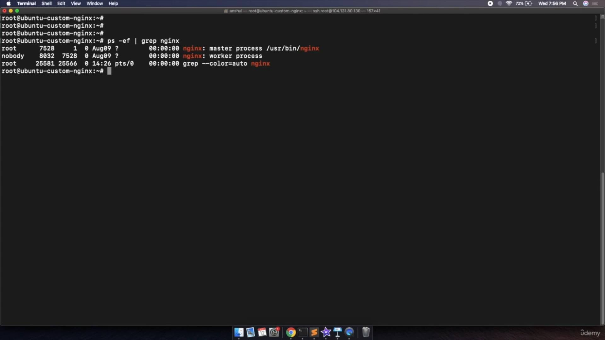
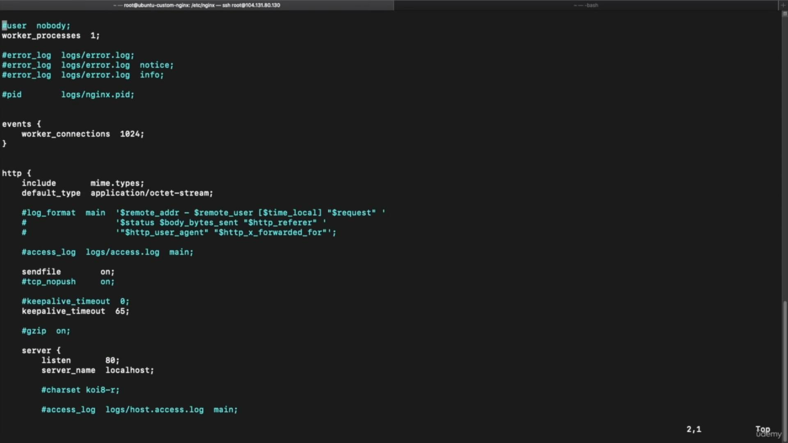
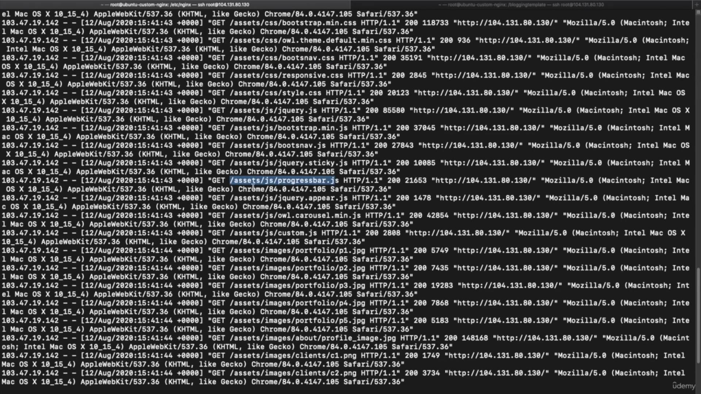
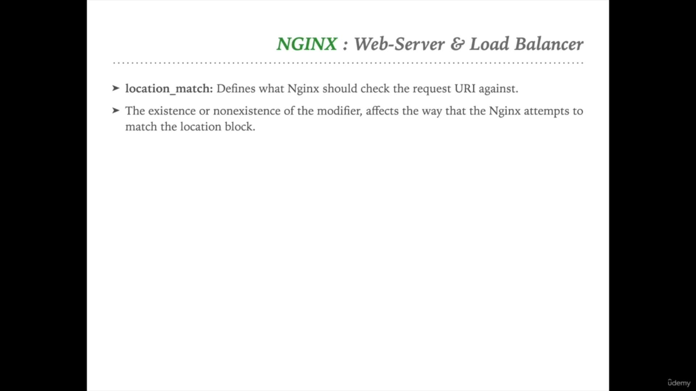
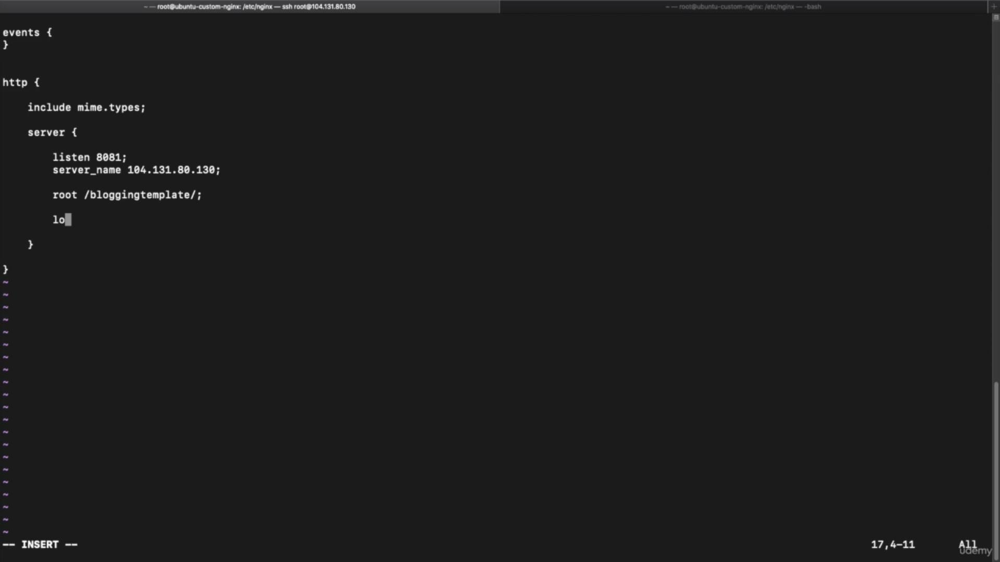
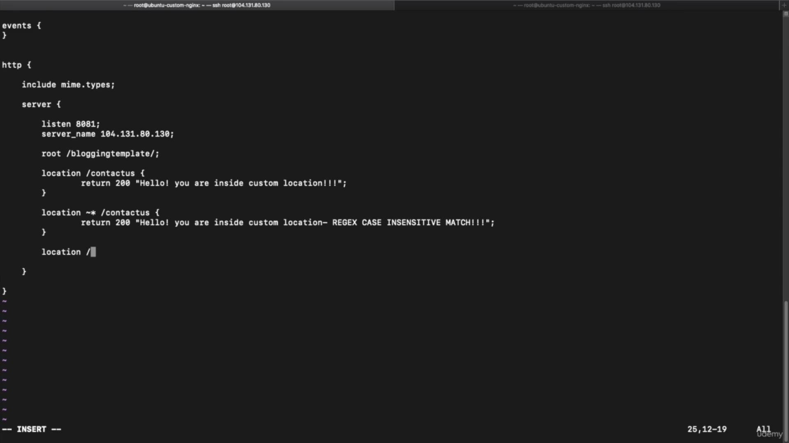
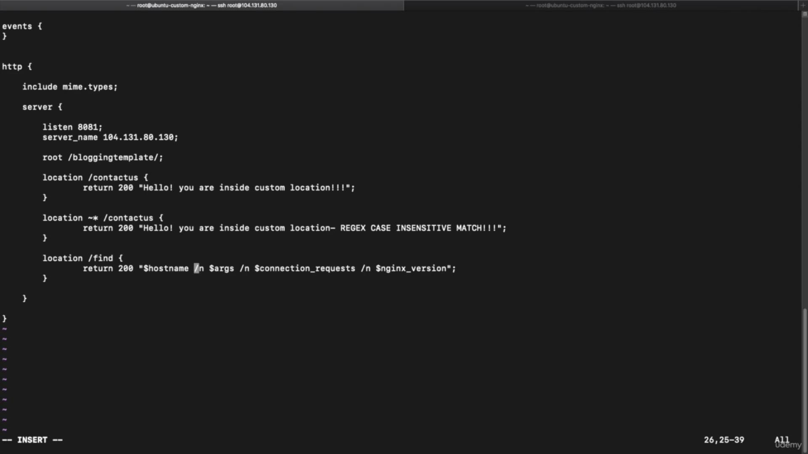

# NGINX MasterClass（BV1vkAczWEmr P13–P16）复现文档

> 覆盖范围：P13 nginx.conf 的 context/directive、P14 静态网站虚拟主机、P15 location 匹配、P16 变量与 if 判断。  
> 下面所有命令都按课程实际操作整理；把 `<server-ip>` 换成你自己的服务器 IP。课程里用的 IP 是 `104.131.80.130`，仅作示例。

---

## 1 这一节做什么

这四讲不是零散讲概念，而是完成一条完整的“从空配置到能跑静态网站，再到路由和变量”的实验链：

1. 认识 `/etc/nginx/nginx.conf` 的树形结构：`main`、`events`、`http`、`server`、`location`、`upstream`、`mail` 等 context。
2. 用 `scp` 把一个本地静态网站模板上传到服务器。
3. 清空默认 nginx 配置，手写一个最简 `server` block，让 nginx 伺服这个静态网站。
4. 处理 CSS/JS 变成 `text/plain` 的问题：引入 `mime.types`。
5. 用 `location` 的 `=`、`~`、`~*`、`none` 修饰符控制 URI 匹配。
6. 用 nginx 内置变量 `$hostname`、`$args`、`$connection_requests`、`$nginx_version` 和 `if` 做条件返回。

这一节的目标不是背指令，而是建立“配置文件是树、不同层级有不同 context、请求进入后按 URI 找 location”的基本模型。P13 先把 `nginx.conf` 的结构讲清楚，让你知道哪些指令能写在哪个花括号里；P14 用一个真实静态模板把 `server`、`listen`、`server_name`、`root` 串起来；P15 把 `location` 的匹配规则拆开；P16 用变量和 `if` 做最小条件判断。四讲合起来，就是你后面继续学反向代理、`upstream`、HTTPS、动静分离的基础。

课程中提到的 context 可以这样理解：

- `main`：不在任何花括号里的最外层配置区域，放全局指令。
- `events`：连接处理相关配置，例如课程提到的 `worker_connections` 属于这一类，但这四讲没有实际配置它。
- `http`：所有 HTTP/HTTPS 相关配置的父级，`server`、`location`、`upstream` 都在它下面。
- `server`：虚拟主机，负责监听端口、匹配 `Host`、指定站点根目录。
- `location`：`server` 的子 context，按 URI 决定返回哪个资源或执行哪个返回动作。
- `upstream`：反向代理后端池，这四讲只提到概念，没有做实验。
- `mail`：邮件代理相关 context，这四讲不涉及。

如果你是前端转 AI 应用工程师，可以把这些对应到 Node/Express：

- `server_name` ≈ 浏览器请求头里的 `Host`，用来选择虚拟主机。
- `root` ≈ `express.static('public')` 的静态文件根目录。
- `location` ≈ `app.get('/contactus', ...)` 之类的路由匹配。
- `worker_processes` / `worker_connections` ≈ Node cluster 的进程数和并发连接数概念。
- `return 200 "文本"` ≈ `res.status(200).send("文本")`。
- `$args` / `$arg_name` ≈ `req.url` 的 query string 和 `req.query.name`。
- `include mime.types` ≈ 给响应设置正确的 `Content-Type`，类似 `res.type('css')`。

需要特别说明的是：这四讲的实验最终只到“静态站点 + location + 变量 + if”，并没有真正配置 `upstream` 反向代理。文档里出现 `upstream` 只是因为 P13 讲 context 时提到它，不要误以为这四讲已经完成反向代理实验。

---

## 2 讲师原话

以下是课程里与实验直接相关的原话，便于你定位重点。

> "简单来说，你也可以把 nginx 配置文件看作 nginx Web 服务器的核心。"
> —— p013 [00:00]

这句话对应 P13 的主线：nginx 的行为几乎都由 `nginx.conf` 决定。你后面看到的静态站点、端口、Host 匹配、URI 匹配、变量返回，全部写在这个文件里。课程先让你打开 `/etc/nginx/nginx.conf`，再对照默认配置理解 context，就是为了建立“改 nginx 先改配置”的直觉。

> "用花括号定义出来的块或区域叫作上下文。"
> —— p013 [01:55]

这句话给出了 context 的最直观定义：花括号包起来的区域就是 context。课程用它解释 `events {}`、`http {}`、`server {}`、`location {}` 的层级关系。复现时你也要用这个标准检查配置：某个指令写错层级，`nginx -t` 可能直接报错，或者行为不符合预期。

> "不建议重启。我们需要始终确保，每当修改配置时，都要重新加载配置。"
> —— p014 [10:45]

这句话对应改完配置后的操作习惯：优先 `reload`，不要一上来 `restart`。课程里用 `nginx -s reload` 或 `systemctl reload nginx` 让 nginx 重新读取配置。复现时先 `nginx -t` 检查语法，再 reload；如果语法错误，reload 不应该被当成“失败后再试一次”的手段。

> "location 上下文是 server 上下文的子上下文，它决定请求 URI 的资源路径。"
> —— p015 [00:26]

这句话把 `location` 的定位说清楚了：它是 `server` 的子 context，决定请求 URI 对应哪个资源路径或哪个返回动作。P15 的 `= /contactus`、`~* /contactus`、`/contactus` 都是围绕这句话做实验。

> "nginx 还内置了变量，你可以根据应用需要使用它们；如果需要，也可以创建自己的变量。"
> —— p016 [00:29]

这句话对应 P16：nginx 有内置变量，例如 `$hostname`、`$args`、`$connection_requests`、`$nginx_version`；也可以创建自定义变量。课程这四讲实际演示的是内置变量和 `$arg_name` 条件判断，自定义变量的创建没有展开做完整实验。

---

## 3 从零复现

### 3.1 准备环境

你只需要：

- 一台已经装好 nginx 的 Ubuntu 服务器/云主机 droplet；
- 本地有一个静态网站目录；
- 能通过 SSH 登录服务器。

课程用的静态网站目录是 `blogging-template`，它的大小结构是：

```text
blogging-template/
├── index.html
└── assets/
    ├── css/
    ├── fonts/
    ├── images/
    ├── js/
    └── logo/
```

课程说这个模板会以 zip 形式放在 P014 的课程资源里。如果你没有这个模板，可以先在本地任意准备一个带 `index.html`、`assets/css/`、`assets/js/` 的最小静态页，后面验证 MIME 时也能用。

准备环境时建议先确认三件事，避免后面把“环境问题”误判成“配置问题”：

```bash
ssh root@<server-ip>
nginx -v
systemctl status nginx
```

`ssh root@<server-ip>` 是登录服务器；`nginx -v` 看 nginx 是否安装以及版本；`systemctl status nginx` 看服务是否处于运行状态。课程环境里 nginx 版本大约是 1.19.1，但你的环境版本不同不影响这四讲的主线实验。常见错误是：本地终端执行了服务器命令、服务器没装 nginx、SSH 用户不是 root 导致后面 `cp` 到 `/etc/nginx` 权限不足。遇到 `Permission denied` 时先看当前用户和 `sudo` 权限，不要直接怀疑 nginx 配置。

和前端的对照：这一步类似你拿到一个 Node 项目后先确认 `node -v`、依赖是否安装、服务是否能启动。环境没确认就直接改配置，后面所有报错都会混在一起。

### 3.2 第一步：登录服务器，确认 nginx 在运行

```bash
ssh root@<server-ip>
ps -ef | grep nginx
```

正常情况下会看到 `nginx: master process` 和 `nginx: worker process`。

```bash
cd /etc/nginx
ls
cat nginx.conf
```

`nginx.conf` 就是 nginx 的总配置文件。默认文件里会看到：

- `events { ... }`
- `http { ... }`
- `http` 里还有 `server { ... }`
- `server` 里通常还有 `location { ... }`

这些“用花括号包起来的区域”就是 context。



`ps -ef | grep nginx` 的作用是看进程。`master process` 负责管理 worker，`worker process` 负责实际处理请求。如果你只看到 grep 自己，通常说明 nginx 没启动或没安装。`cd /etc/nginx` 是进入 nginx 默认配置目录；`ls` 看目录内容；`cat nginx.conf` 直接输出主配置。课程在这里不是让你马上改，而是让你先“看见”默认配置里的层级。

常见错误与排查：

- `cd /etc/nginx: No such file or directory`：可能 nginx 没安装，或者你的发行版配置目录不同。先用 `nginx -t` 看 nginx 实际读哪个文件。
- `ps -ef | grep nginx` 没有 master/worker：先 `systemctl status nginx`，再看 `journalctl -u nginx`。
- `cat nginx.conf` 权限不足：用 `sudo cat /etc/nginx/nginx.conf`。
- 看到很多 `include`：默认配置可能把 `conf.d/*.conf`、`sites-enabled/*` 包含进来。课程后面会清空主配置做实验，你要知道自己清的是主文件，不是所有被 include 的文件。

和前端的对照：`/etc/nginx/nginx.conf` 类似 Node 项目的入口文件 `server.js` 或 `app.js`。你先读入口，知道路由和静态目录从哪里来，再动手改。

### 3.3 第二步：备份配置

改配置前先备份，这是课程里强调的操作。

```bash
cd /etc/nginx
sudo cp nginx.conf nginx.backup.conf
sudo cp nginx.backup.conf nginx.conf
```

第一条把原始配置备份成 `nginx.backup.conf`；第二条再复制一份回去当工作文件，这样你手边始终有一份可回滚的配置。

这里两条命令的方向要看清：`cp nginx.conf nginx.backup.conf` 是“原文件 -> 备份文件”；`cp nginx.backup.conf nginx.conf` 是“备份文件 -> 工作文件”。第二条在课程语境里是为了让你有一个干净的工作副本，同时备份仍然保留。实际排错时，如果配置改坏了，可以执行 `sudo cp nginx.backup.conf nginx.conf` 再 `sudo nginx -t` 和 reload 回滚。执行后用 `ls -l /etc/nginx/nginx*.conf` 确认两个文件都在。

常见错误：

- 忘记 `sudo`，`cp` 报权限不足。
- 备份文件名写错，后面回滚找不到文件。
- 直接在 `nginx.backup.conf` 上改，导致备份也失效。
- 只备份主配置，没有注意 `include` 的子配置文件。这四讲实验是清空主配置，影响范围主要在 `nginx.conf`，但生产环境要一起备份。

和前端的对照：这相当于改代码前先 `git commit` 或复制一份 `server.js.bak`。备份不是形式，后面 `nginx -t` 报错时你会需要它。

### 3.4 第三步：上传静态网站

在本地机器执行下面命令，不是在服务器上执行。

```bash
scp -r ~/Downloads/blogging-template root@<server-ip>:/root/
```

注意：

- `-r` 是因为你要上传的是一个目录，不是单个文件；
- 课程建议传到 `/root` 下，避免权限问题导致 403；
- 如果你的 SSH 用户不是 root，把 `root@` 换成你的用户名，并对应调整目标路径。

上传完成后，回服务器验证：

```bash
cd /root/blogging-template
pwd
ls
ls assets
```

应该能看到 `index.html` 和 `assets` 目录。

`scp -r` 的完整解释：`scp` 是 SSH 拷贝，`-r` 递归复制目录，`~/Downloads/blogging-template` 是本地源目录，`root@<server-ip>:/root/` 是远程用户、远程主机和目标目录。目标末尾的 `/root/` 表示把目录放到远程 `/root` 下。执行后远程通常会出现 `/root/blogging-template`。如果你把源路径写错，`scp` 会报 `No such file or directory`；如果远程目录不可写，会报 `Permission denied`；如果是第一次连接，可能提示 host key 确认。

回服务器验证时，`pwd` 确认当前路径，`ls` 看顶层文件，`ls assets` 看资源目录。常见错误是上传后目录层级多了一层，例如变成 `/root/blogging-template/blogging-template`，这时 `root` 指令就要相应调整，或者把内容移动一层。另一个常见错误是只上传了 `index.html`，没有上传 `assets`，页面能打开但 CSS/JS 404。

和前端的对照：这类似把 `dist/` 或 `public/` 部署到服务器目录。上传不是结束，必须验证目标路径和 `root` 指令一致。

### 3.5 第四步：清空配置，写最简 server block

打开配置：

```bash
sudo vi /etc/nginx/nginx.conf
```

课程演示时把默认内容全部删掉，只留下三个空 context：

```nginx
events {}

http {
    server {

    }
}
```

然后在 `server { }` 里写上三个指令：

```nginx
events {}

http {
    server {
        listen 80;
        server_name <server-ip>;
        root /root/blogging-template;
    }
}
```

说明：

- `listen 80;`：监听 80 端口；
- `server_name <server-ip>;`：当请求的 `Host` 是这个 IP 时，由这个 server 处理；
- `root /root/blogging-template;`：静态文件从哪个目录读。

保存后测试并重载：

```bash
sudo nginx -t
sudo systemctl reload nginx
```

课程里也用过 `nginx -s reload`，等效。



这一段是整个实验最关键的转折：从默认配置切到最小配置。清空默认内容后，`events {}` 保留事件 context，`http {}` 保留 HTTP context，`server {}` 是虚拟主机。`listen 80;` 指定端口；`server_name <server-ip>;` 指定 Host 匹配；`root /root/blogging-template;` 指定文件根目录。请求 `http://<server-ip>/` 时，nginx 会在 `root` 目录下找默认索引文件，通常就是 `index.html`。

`sudo nginx -t` 是配置语法测试，输出一般包含 `syntax is ok` 和 `test is successful`。`sudo systemctl reload nginx` 是平滑重载，不中断已有连接；`sudo nginx -s reload` 是向 master 发 reload 信号。两者在这四讲里等效，选一个固定使用即可。

常见错误与排查：

- `nginx -t` 报 `unexpected end of file`：多半是花括号没闭合。
- 报 `directive ... is not terminated by ";"`：漏了分号。
- 报 `unknown directive`：指令拼错，或者写在了不允许它的 context 里。
- `nginx -t` 成功但浏览器 403：目录权限问题，见第 7 节。
- `nginx -t` 成功但浏览器 404：`root` 路径不对，或者 `index.html` 不在该目录。
- `nginx -t` 成功但访问不到：云服务器防火墙/安全组没放行 80，或者 nginx 没 reload。
- 改完没 reload：配置文件改了但运行中的 nginx 还在用旧配置。

和前端的对照：`server` block 类似 `app.listen(80)` 加静态目录配置。Express 里你可能写 `app.use(express.static('public'))`，nginx 里写 `root /root/blogging-template;`。区别是 nginx 的 `server_name` 还要参与虚拟主机选择，不只是端口。

### 3.6 第五步：处理 MIME 类型，让 CSS/JS 正常加载

用 `curl -I` 检查 CSS 响应：

```bash
curl -I http://<server-ip>/assets/css/bootstrap.min.css
```

如果路径不对，换成你的真实 CSS 路径。

课程里看到的现象是：状态码是 `200`，但 `Content-Type` 是 `text/plain`，不是 `text/css`。所以浏览器不把它当 CSS 解析。

修复方法：在 `http` 块里引入 `mime.types`。

```nginx
events {}

http {
    include mime.types;

    server {
        listen 8081;
        server_name <server-ip>;
        root /root/blogging-template;
    }
}
```

课程在这里把端口从 `80` 改成了 `8081`，目的是演示同一个 server 换端口监听。你也可以继续用 `80`。

然后：

```bash
sudo nginx -t
sudo nginx -s reload
```

再次用 `curl -I` 检查 CSS，`Content-Type` 应该变成 `text/css`。浏览器里用无痕窗口访问 `http://<server-ip>:8081`，样式和 JS 就正常了。



`curl -I` 只发 HEAD 请求，只看响应头，不下载完整响应体，适合检查状态码和 `Content-Type`。如果看到 `HTTP/1.1 200 OK` 但 `Content-Type: text/plain`，说明文件找到了，但 nginx 不知道 `.css` 应该对应 `text/css`。`include mime.types;` 会把 `/etc/nginx/mime.types` 里的扩展名映射加载进来，常见内容包括 `text/html html htm;`、`text/css css;`、`image/jpeg jpg jpeg;` 等。课程也演示过手写 `types { text/html html; text/css css; }`，但最后用 `include mime.types;`，因为预置文件更全。

把端口改成 `8081` 后，访问地址要带端口：`http://<server-ip>:8081`。如果你继续用 80，就仍然访问 `http://<server-ip>`。课程用 8081 是为了让你明确看到 `listen` 和访问端口的关系。

常见错误与排查：

- 仍然 `text/plain`：`include mime.types;` 没放在 `http` 里，或者没 reload，或者你检查的是缓存。
- `include` 报文件不存在：确认 `/etc/nginx/mime.types` 存在；`include` 相对路径通常相对于 nginx 前缀目录。
- CSS 404：路径写错，或者 `root` 指向的目录不对。先 `ls /root/blogging-template/assets/css/` 确认文件。
- 浏览器没变化：开无痕窗口或强制刷新；`curl -I` 不受浏览器缓存影响，优先用 `curl` 判断服务器端。
- 8081 访问不到：云安全组/防火墙没放行 8081。课程没展开这部分，但真实服务器很常见。

和前端的对照：这类似 Node 里返回 CSS 时设置 `Content-Type: text/css`。如果类型错了，浏览器会把 CSS 当纯文本，页面结构还在但样式不生效；JS 也可能不执行。

### 3.7 第六步：location 匹配实验

在同一个 `server` 里加一个 location。

```nginx
location /contactus {
    return 200 "Hello, you are inside custom location\n";
}
```

这里的 `return 200 "字符串";` 意思是：命中这个 location 后，直接返回 HTTP 200 和一段文本，不读文件。

重载后测试：

```bash
sudo nginx -t
sudo nginx -s reload
curl http://<server-ip>:8081/contactus
curl http://<server-ip>:8081/contactus/about
```

你会发现：

- `/contactus` 返回自定义文本；
- `/contactus/about` 也返回同一段文本。

因为 `none` modifier 表示“前缀匹配”，只要 URI 以 `/contactus` 开头，就算匹配成功。

接下来改成精确匹配：

```nginx
location = /contactus {
    return 200 "Hello, you are inside custom location - exact match\n";
}
```

测试：

```bash
curl http://<server-ip>:8081/contactus
curl http://<server-ip>:8081/contactus/about
```

结果是：

- `/contactus` 返回文本；
- `/contactus/about` 返回 404。

因为 `=` 要求 URI 完整等于 `/contactus`。

再改成大小写不敏感正则：

```nginx
location ~* /contactus {
    return 200 "Hello, case insensitive regex\n";
}
```

测试：

```bash
curl http://<server-ip>:8081/contactus
curl http://<server-ip>:8081/CONTACTUS
```

两个都会命中。





课程给出的 modifier 查找优先级如下：

| 优先级 | modifier | 含义 |
|---|---|---|
| 1 | `=` | 精确匹配 |
| 2 | `^~` | 优先前缀匹配；命中后不再检查正则 |
| 3 | `~*` | 大小写不敏感正则 |
| 4 | `~` | 大小写敏感正则 |
| 5 | 无 | 普通前缀匹配 |

注意：课程里只实际演示了 `=`、`~`、`~*` 和“无 modifier”；`^~` 只讲了规则，没有做单独实验。

做 location 实验时，建议每次只改一种 modifier，改完先 `nginx -t` 再 reload，然后用 `curl` 对比两个 URI。这样你能清楚看到“前缀匹配会吃掉子路径”“精确匹配只认完整 URI”“正则匹配看大小写”。`return 200 "..."` 里的 `\n` 是给响应文本加换行，curl 输出会更清楚；不要漏掉引号和分号。

常见错误与排查：

- `/contactus` 返回 404：先确认 `location` 写在 `server` 里，URI 拼写和请求一致，`nginx -t` 和 reload 都执行了。
- `/contactus/about` 仍然返回文本：你用的可能还是无 modifier 的前缀匹配，不是 `=`。
- `/CONTACTUS` 没命中：你用的可能是 `~` 大小写敏感，而不是 `~*` 大小写不敏感。
- 精确匹配不认 `/contactus/`：`= /contactus` 要求完整等于，带尾斜杠的 URI 不是同一个字符串。
- 多个 location 同时存在时结果和预期不一致：先检查优先级，再检查正则的书写顺序。课程给的是简化优先级，生产环境复杂路由要结合官方文档确认。
- `return` 报错：检查字符串是否用双引号包住，指令是否以分号结尾。

和前端的对照：`location /contactus` 类似 Express 的前缀挂载或 `app.use('/contactus', ...)`；`location = /contactus` 更像严格精确的路由；`~*` 类似带大小写不敏感正则的路由匹配。区别是 nginx 的匹配优先级是配置规则决定的，不是简单按代码书写顺序从上到下。

### 3.8 第七步：变量和 if

在 server 里增加一个 `/find` location，返回几个内置变量：

```nginx
location /find {
    return 200 "host=$hostname\nargs=$args\nconnection_requests=$connection_requests\nnginx_version=$nginx_version\n";
}
```

重载后测试：

```bash
sudo nginx -t
sudo nginx -s reload
curl http://<server-ip>:8081/find
```

第一次输出大概是这样：

```text
host=ubuntu-custom-nginx
args=
connection_requests=6
nginx_version=1.19.1
```

字段名以你的实际输出为准；课程演示中能看到这四类值。

带 query string 再试：

```bash
curl "http://<server-ip>:8081/find?api_key=1234&name=anshul"
```

`args` 就会变成 `api_key=1234&name=anshul`。





然后课程在 `location /find` **前面**加了一个 server 级别的 `if`：

```nginx
if ($arg_name = "anshul") {
    return 200 "Yes I am Anshul\n";
}
```

注意课程原话是“before the find”，也就是放在 `location /find` 前面。这个 `if` 会判断 query string 里的 `name` 是不是 `anshul`。

完整验证：

```bash
curl "http://<server-ip>:8081/find?name=anshul"
curl "http://<server-ip>:8081/find?name=tom"
```

- `name=anshul` 时返回 `Yes I am Anshul`；
- `name=tom` 时不会命中 `if`，继续走 `location /find`，返回变量文本。

变量实验的关键是分清 `$args` 和 `$arg_name`：`$args` 是完整 query string，`$arg_name` 是 query string 里名为 `name` 的参数值。请求 `?api_key=1234&name=anshul` 时，`$args` 是 `api_key=1234&name=anshul`，`$arg_name` 是 `anshul`。课程把 `if ($arg_name = "anshul")` 放在 `server` 级别、`location /find` 前面，所以带 `?name=anshul` 的请求会先命中 `if` 并直接返回文本；带 `?name=tom` 的请求不命中 `if`，继续匹配 `/find` 前缀 location。

常见错误与排查：

- `$args` 为空：请求没带 query string，或者 URL 里的 `?` 被 shell 吃掉了。用双引号包住整个 URL。
- `$arg_name` 不生效：参数名写错，例如请求是 `username=anshul` 但判断的是 `$arg_name`；或者 `if` 没放在 `server` 里。
- `?name=anshul` 仍返回变量文本：检查 `if` 是否在 `/find` 前面、是否 reload、是否写成了别的变量。
- `?name=tom` 返回 404：说明 `/find` location 没生效或写法有误；正常应该是继续走 `/find` 返回变量文本。
- `connection_requests` 数值每次不同：它是当前连接上的请求次数相关变量，curl 每次可能新建连接，数值会变化，不要把它当成固定常量。
- 变量输出里出现空行：`\n` 是换行符，属于返回文本的一部分，不是错误。

和前端的对照：`$arg_name` 类似 `new URLSearchParams(location.search).get('name')`；server 级 `if` 类似在路由前加一个条件中间件，满足条件直接 `res.send`，不满足继续走后面的路由。课程只建议用 `if` 做 `return`，更复杂的逻辑不要照搬。

---

## 4 完整代码

### 4.1 最终版 `/etc/nginx/nginx.conf`

```nginx
# /etc/nginx/nginx.conf
# P13-P16 实验结束后的完整配置
# server_name 换成你自己的服务器 IP

events {}

http {
    include mime.types;

    server {
        listen 8081;
        server_name 104.131.80.130;

        root /root/blogging-template;

        if ($arg_name = "anshul") {
            return 200 "Yes I am Anshul\n";
        }

        location = /contactus {
            return 200 "Hello, exact match\n";
        }

        location ~* /contactus {
            return 200 "Hello, case insensitive regex\n";
        }

        location /find {
            return 200 "host=$hostname\nargs=$args\nconnection_requests=$connection_requests\nnginx_version=$nginx_version\n";
        }
    }
}
```

这份最终配置保留了课程实验的主线：`events {}` 和 `http {}` 是最外层 context；`include mime.types;` 修 CSS/JS 的 `Content-Type`；`server` 监听 8081；`root` 指向上传的静态站；server 级 `if` 在 `/find` 前做条件返回；`location = /contactus` 演示精确匹配；`location ~* /contactus` 演示大小写不敏感正则；`location /find` 演示变量输出。注意 `server_name` 里的 IP 要换成你自己的服务器 IP，课程里的 `104.131.80.130` 只是示例。

这份配置里同时有 `= /contactus` 和 `~* /contactus`，验证时要知道：请求 `/contactus` 会优先命中精确匹配；请求 `/CONTACTUS` 不会命中精确匹配，但会命中 `~*` 正则。`/contactus/about` 在精确匹配下不会命中 `= /contactus`，但可能命中 `~* /contactus`，因为正则会匹配包含 `/contactus` 的 URI。复现时按第 3 节的分步实验观察，不要把多个规则同时存在时的结果和单条规则实验混在一起。

### 4.2 最小替代静态页（非课程内容，仅供没有模板时跑通）

如果下载不到课程 zip，可以用下面三份文件临时替代 `blogging-template`。

`/root/blogging-template/index.html`：

```html
<!doctype html>
<html>
<head>
  <meta charset="utf-8">
  <title>Blogging Template</title>
  <link rel="stylesheet" href="assets/css/style.css">
</head>
<body>
  <h1>Static Site Works</h1>
  <script src="assets/js/main.js"></script>
</body>
</html>
```

`/root/blogging-template/assets/css/style.css`：

```css
body {
  font-family: sans-serif;
  background: #f5f5f5;
}
```

`/root/blogging-template/assets/js/main.js`：

```js
console.log('nginx static js loaded');
```

课程本身没有给出这些文件，它们只是这个文档为了“可直接复现”补的最小替代。使用它们时，`curl -I` 检查 CSS 的路径要改成 `http://<server-ip>:8081/assets/css/style.css`，否则你会请求课程模板里不存在的 `bootstrap.min.css`，得到 404 而不是 MIME 类型问题。最小替代页的价值是让你在没有课程资源时也能验证：HTML 是否返回、CSS 是否被识别为 `text/css`、JS 是否能加载、`root` 路径是否写对。

---

## 5 逐行解释

以最终版配置为例。

```nginx
events {}
```

`events` 是事件连接 context，负责配置 nginx 如何处理连接。这里保留空块，所有选项用默认值。课程里提到 `worker_connections` 通常会写在这里，但这四讲没有实际配置它。

`events {}` 空着不代表它不存在。它仍然是 context 树的一层。你可以把它理解成“连接层配置的占位符”：这四讲不调优连接数，所以不写具体指令。常见错误是把本应写在 `http` 里的 `include mime.types;` 写进 `events`，`nginx -t` 会报指令不允许。判断方法是看指令属于哪个模块、允许在哪个 context。

```nginx
http {
```

`http` 是 HTTP context。所有 HTTP/HTTPS 相关的指令都必须在 `http` 内。`server`、`location`、`upstream` 都是它的子级。

`http` 类似 Express 应用本身的配置层：静态目录、MIME、虚拟主机、路由都归它管。你写 `include mime.types;` 时放在 `http` 里，是因为 MIME 类型是 HTTP 响应头层面的配置。

```nginx
    include mime.types;
```

`include` 把 `/etc/nginx/mime.types` 文件里的内容加载进来。这个文件里是各种文件扩展名和 Content-Type 的映射，例如：

```text
text/html  html htm;
text/css   css;
image/jpeg jpg jpeg;
```

没有它，nginx 会把 `.css`、`.js` 默认按 `text/plain` 返回，浏览器就不执行样式和脚本。

`include` 的路径可以是相对路径，也可以是绝对路径。课程用 `include mime.types;`，在默认安装的 Ubuntu nginx 里通常能找到 `/etc/nginx/mime.types`。如果你换发行版或自定义编译，先确认这个文件存在。没有它时也可以手写 `types { ... }`，但手写容易漏扩展名，课程最后选预置文件。

```nginx
    server {
        listen 8081;
        server_name 104.131.80.130;
        root /root/blogging-template;
    }
```

`server` 是虚拟主机 context。

- `listen 8081;`：监听 8081 端口；
- `server_name 104.131.80.130;`：当请求头 `Host` 等于这个 IP 时，由这个 server 处理；
- `root /root/blogging-template;`：网站文件根目录。请求 `/` 时，nginx 会在这个目录里找 `index.html`。

`listen` 决定“从哪个端口进来”，`server_name` 决定“Host 匹配哪个虚拟主机”，`root` 决定“文件从哪里读”。三者缺一不可。如果你用域名访问，`server_name` 应该写域名；如果你直接用 IP 访问，浏览器请求头里的 Host 就是 IP。`root` 末尾不要多写一层不存在的目录，否则 404。请求 `/assets/css/style.css` 时，nginx 会把 URI 拼到 `root` 后面，变成 `/root/blogging-template/assets/css/style.css`。

```nginx
        if ($arg_name = "anshul") {
            return 200 "Yes I am Anshul\n";
        }
```

`$arg_name` 是 nginx 内置变量，表示 query string 里 `name` 参数的值。

在 JS 里，相当于：

```js
const name = new URLSearchParams(window.location.search).get('name');
if (name === 'anshul') { /* return yes */ }
```

课程里的 `if` 放在 `location /find` 前面，所以只要请求带 `?name=anshul`，server 级 `if` 会先返回 200 文本。

`if` 在这里只做一件事：条件成立就 `return`。这是课程里最安全的用法。不要在这个 `if` 里塞复杂变量、代理、重写逻辑；nginx 的 `if` 不是通用编程语句，复杂用法容易产生不可预期行为。

```nginx
        location = /contactus {
            return 200 "Hello, exact match\n";
        }
```

`location = /contactus` 是精确匹配。只有 URI 完整等于 `/contactus` 才进入这个 block。类似 Express 里的：

```js
app.get('/contactus', handler)
```

`=` 是精确匹配修饰符，优先级最高。请求 `/contactus` 命中；请求 `/contactus/`、`/contactus/about` 不命中。`return 200` 直接返回状态码和文本，不读静态文件。调试时先确认 URI 没有多余尾斜杠。

```nginx
        location ~* /contactus {
            return 200 "Hello, case insensitive regex\n";
        }
```

`~*` 表示大小写不敏感正则匹配。所以 `/CONTACTUS`、`/ContactUs` 都能命中。

注意：正则 location 的实际匹配顺序还和它们在配置文件里的声明顺序有关；课程在 P015 里给出的优先级是“精确 > `^~` > 正则 > 普通前缀”。如果你在生产环境同时写多个正则，建议先看 nginx 官方文档确认顺序。

`~*` 和 `~` 的区别是大小写：`~*` 不敏感，`~` 敏感。课程实验里用 `~*` 是为了让 `/CONTACTUS` 也命中。正则里写 `/contactus` 会匹配包含该字符串的 URI，所以 `/contactus/about` 也可能命中；如果你只想精确匹配，应该用 `=`。

```nginx
        location /find {
            return 200 "host=$hostname\nargs=$args\nconnection_requests=$connection_requests\nnginx_version=$nginx_version\n";
        }
```

`/find` 没有 modifier，表示普通前缀匹配。`$hostname` 是服务器主机名，`$args` 是原始 query string，`$connection_requests` 是当前连接上的请求次数，`$nginx_version` 是 nginx 版本号。

这些值在 nginx 里默认都是字符串。课程明确说：nginx 变量不像其他语言有 integer、float、array、list 这些类型。

`/find` 是前缀匹配，所以 `/find?name=tom`、`/find/about` 这类以 `/find` 开头的 URI 都可能进入这个 location。`return 200` 里的字符串用 `$变量名` 插值，curl 输出时直接看到替换后的值。`$hostname` 取的是服务器主机名，不是请求 Host；`$args` 是 `?` 后面的完整字符串；`$connection_requests` 和连接复用有关，数值会随连接变化；`$nginx_version` 是版本号。调试变量时优先 `curl`，不要只靠浏览器，因为浏览器可能缓存或格式化输出。

常见错误补充：如果 `$args` 显示为空，先检查 URL 是否真的带 `?`；如果 `$arg_name` 不生效，检查参数名拼写；如果 `/find?name=tom` 返回 404，检查 `/find` location 是否在 `server` 内、是否 reload；如果 `if ($arg_name = "anshul")` 导致所有 `/find` 请求都返回同一文本，检查是否把条件写成了总是成立或放到了错误层级。

---

## 6 复现检查清单

按下面顺序检查，能跑通就说明四讲实验完成。每条都建议保存命令输出，出错时用输出定位是“进程问题、语法问题、权限问题、路径问题、MIME 问题、路由问题”中的哪一类。

- [ ] `ps -ef | grep nginx` 能看到 master 和 worker 进程。

  怎么验证：在服务器执行 `ps -ef | grep nginx`，输出里应出现 `nginx: master process` 和至少一个 `nginx: worker process`。如果只看到 grep 自己，执行 `systemctl status nginx` 看服务状态，再执行 `journalctl -u nginx` 看启动错误。如果是刚改完配置，reload 失败也可能导致 worker 状态异常，先看 `nginx -t`。

- [ ] `sudo nginx -t` 输出配置测试成功。

  怎么验证：执行后看输出是否包含 `syntax is ok` 和 `test is successful`。如果失败，按报错行号检查分号、花括号、`include` 路径、指令 context。注意 `nginx -t` 成功只代表语法和部分路径检查通过，不代表端口一定可绑定、目录一定有权限。

- [ ] `curl -I http://<server-ip>:8081/` 返回 HTTP 200，`Content-Type` 是 `text/html`。

  怎么验证：执行 `curl -I http://<server-ip>:8081/`，看第一行状态码和 `Content-Type` 头。200 且 `text/html` 说明 `root` 和 `index.html` 基本正确。403 多半是权限；404 多半是 `root` 或 `index.html` 路径不对；连接失败则看 nginx 是否监听 8081、防火墙是否放行。

- [ ] `curl -I http://<server-ip>:8081/assets/css/bootstrap.min.css` 返回 `Content-Type: text/css`。如果你用最小替代页，就把路径换成 `/assets/css/style.css`。

  怎么验证：先 `ls` 确认 CSS 文件真实存在，再 `curl -I` 看状态码和 `Content-Type`。如果 404，先修路径；如果 200 但 `text/plain`，检查 `include mime.types;` 是否在 `http` 内并已 reload；如果浏览器仍不对，用无痕窗口或强制刷新，排除缓存。

- [ ] `curl http://<server-ip>:8081/contactus` 返回自定义文本。

  怎么验证：执行后应看到 `Hello, exact match` 或你实验阶段的对应文本。如果 404，检查 `location = /contactus` 是否写在 `server` 内、URI 是否完全一致、是否 reload。注意精确匹配不认 `/contactus/`。

- [ ] `curl http://<server-ip>:8081/CONTACTUS` 能命中 `~*`。

  怎么验证：执行后应看到大小写不敏感正则返回的文本。如果没有命中，检查是否写成了 `~` 而不是 `~*`，或者正则 location 被更高优先级的规则拦截。

- [ ] `curl "http://<server-ip>:8081/find?name=anshul"` 返回 `Yes I am Anshul`。

  怎么验证：URL 必须带双引号，避免 shell 处理 `?` 和 `&`。返回值应是 `if` 里的文本。如果返回变量文本，检查 `if` 是否在 `location /find` 前面、`$arg_name` 是否写对、是否 reload。

- [ ] `curl "http://<server-ip>:8081/find?name=tom"` 返回变量文本，而不是 404。

  怎么验证：应看到 `host=...`、`args=name=tom`、`connection_requests=...`、`nginx_version=...`。如果 404，说明 `/find` location 没生效；如果仍返回 `Yes I am Anshul`，说明 `if` 条件过宽或写错。

- [ ] 每次改完配置都先 `sudo nginx -t`，再 `sudo nginx -s reload` 或 `sudo systemctl reload nginx`。

  怎么验证：改完文件后执行 `nginx -t`，成功再 reload；reload 后再用对应 `curl` 验证行为。不要跳过 `nginx -t` 直接 reload。如果 reload 报错，先回滚备份或修语法，再重新测试。

---

## 7 课里没讲但你会撞上的（表格：现象 / 原因 / 怎么办）

| 现象 | 原因 | 怎么办 |
|---|---|---|
| 访问站点返回 `403 Forbidden`，日志里提示权限拒绝 | 课程把站点放在 `/root/blogging-template`，但 nginx worker 进程通常不是 root 用户，可能没有 `/root` 的执行权限或站点文件的读权限 | 给目录补执行权限、给文件补读权限，或把站点移到 `/var/www` 一类常规目录后改 `root`。对应修复命令见本节下方代码块。 |
| 改完 `include mime.types;` 后浏览器样式还是没恢复 | 浏览器缓存了旧的 `text/plain` 响应；或者配置没 reload；或者你检查的 CSS 路径实际 404 | 先用 `curl -I` 直接看服务器响应头，排除浏览器缓存；再开无痕窗口/强制刷新；确认 `include` 在 `http` 内并已 reload。 |
| 浏览器访问 `http://<server-ip>:8081` 连接失败，但服务器本机 `curl` 可能正常 | 云服务商安全组、服务器防火墙或本机网络没有放行 8081 | 在云控制台放行入站 TCP 8081；如果服务器启用了防火墙，也要放行对应端口；先用服务器本机 `curl http://127.0.0.1:8081` 判断 nginx 本身是否监听。 |
| `if` 里放复杂逻辑后行为不可预期 | nginx 的 `if` 不是通用编程语句，课程只安全地用它做 `return` | 只把 `if` 用于简单条件返回或课程演示的写法；复杂路由用 `location`、`rewrite` 或 `map` 等等价手段，并查官方文档。 |
| 多个正则 location 同时存在时，请求命中的不是你以为的那条 | 正则 location 除了优先级，还会受声明顺序影响；课程给的是简化优先级 | 把更具体的规则放前面，优先用 `=` 或 `^~` 锁定路径；用 `nginx -T` 打印完整配置核对实际加载内容；复杂场景对照官方文档。 |
| 换到 CentOS/RHEL 后，默认用户、日志路径、配置路径和课程不一样 | 不同发行版打包方式不同，课程环境是 Ubuntu droplet，nginx 版本约 1.19.1 | 用 `ps -ef | grep nginx` 看实际运行用户，用 `nginx -t` 看实际配置文件，用 `nginx -V` 看编译参数；以你的系统实际路径为准，不要硬套课程路径。 |
| `nginx -t` 成功，但 reload 失败或访问端口无响应 | 8081 可能已被其他进程占用，或 reload 时绑定端口失败；`nginx -t` 主要检查语法，不等价于端口一定可用 | 用 `ss -ltnp | grep 8081` 看端口占用；换端口或停掉占用进程；再看 `journalctl -u nginx` 或 error log 的具体报错。 |
| 页面 HTML 能打开，但 CSS/JS 请求 404 | `root` 路径不对、上传目录多了一层、HTML 里的资源路径和实际目录不一致 | 用 `ls` 对照 `root` 和 URI 拼接