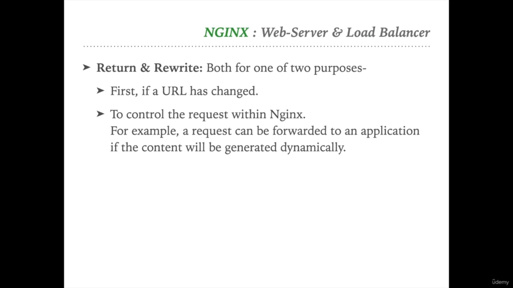
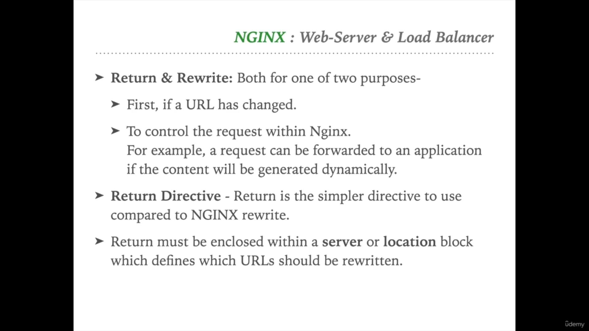
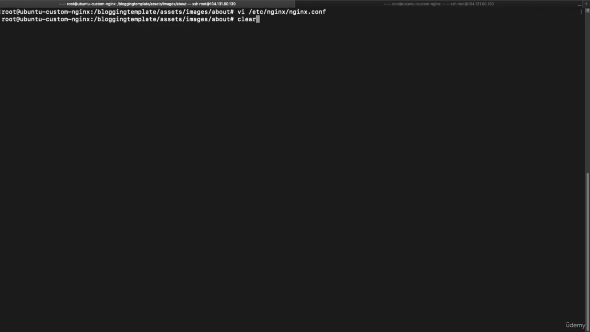
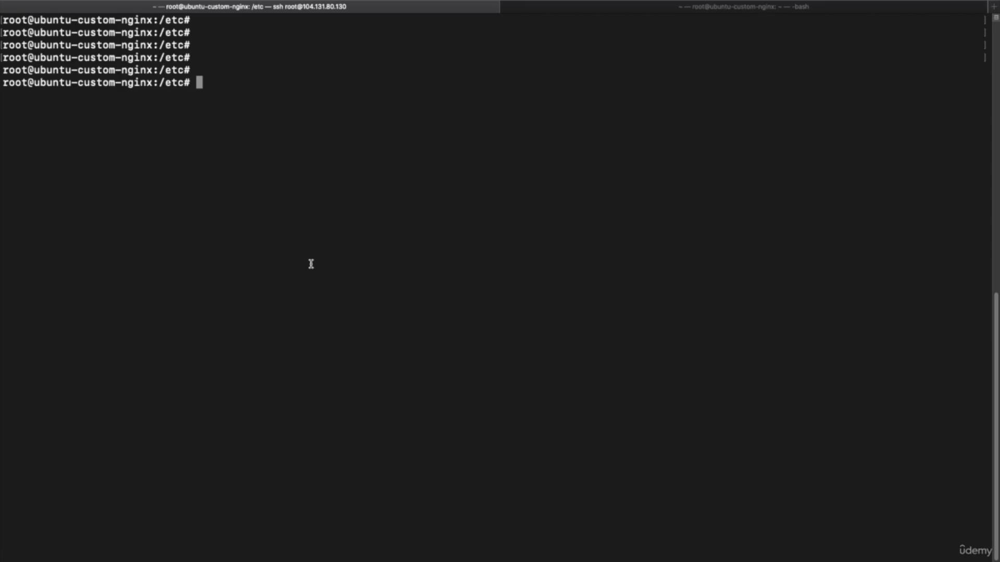
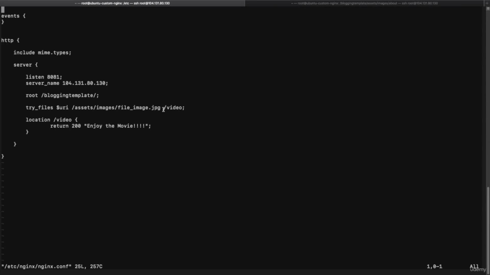
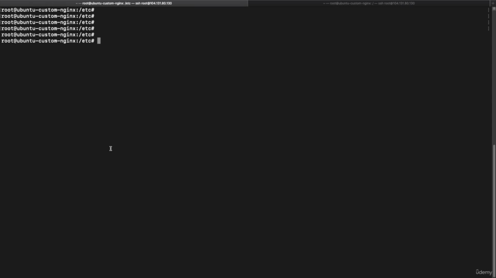
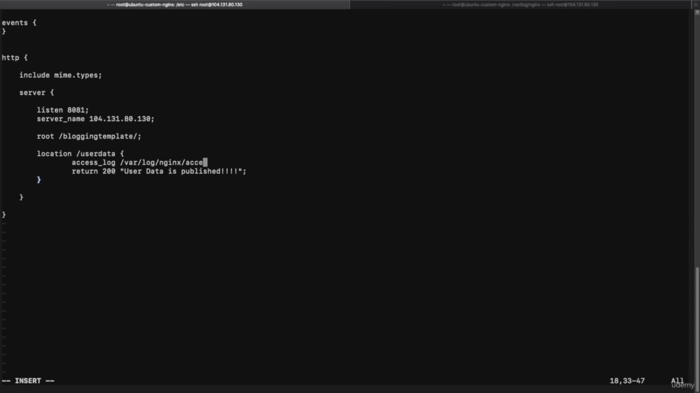
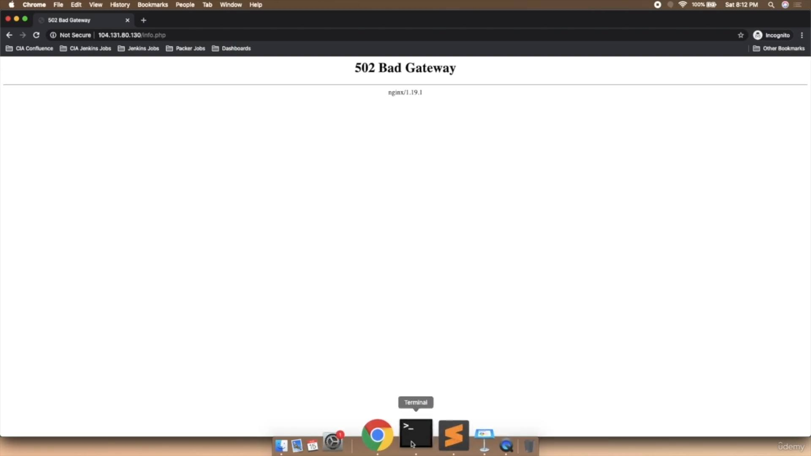
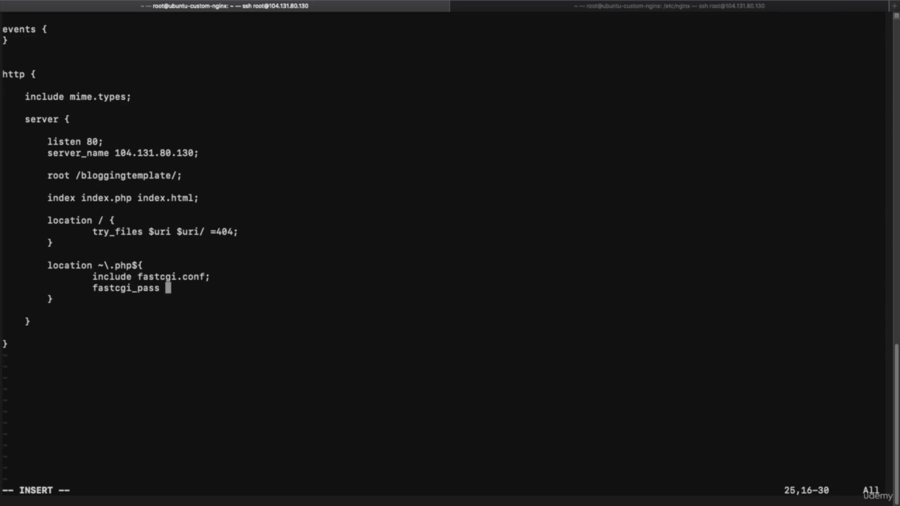

# NGINX 动态与静态请求处理实验课（P017–P020）复现文档

> 适用对象：前端转 AI 应用工程师。本文按「能照着把服务跑起来」的标准写，所有配置都是完整文件，可直接保存。涉及进程/并发的地方会补一句在 Node 里的对应概念，标注「类比」。
>
> 课程：NGINX MasterClass（BV1vkAczWEmr），覆盖 P017–P020。

---

## 1. 这一节做什么

P017–P020 这四节是一条完整的「从静态到动态」的动手链路，最终产出是一台能同时干四件事的 nginx：

1. **P017：URL 改写与重定向**。用 `return` 和 `rewrite` 把用户看到的短 URL 映射到真实资源，并对比两者的差别——`return` 直接吐一个状态码/URL 给客户端，`rewrite` 会在 nginx 内部重新走一遍 location 匹配。
2. **P018：`try_files` 多级回退**。让 nginx 按顺序「试」若干个候选路径：先试 `$uri`，再试一个兜底文件，再试一个内部 location，最后落到 404。
3. **P019：日志分流**。搞清楚 `access.log` 和 `error.log` 各记什么（重点：**404 两个文件都会写**），然后用 `access_log` 指令把某个 URI 的访问日志单独写到另一个文件，或者干脆关掉。
4. **P020：接 PHP-FPM 处理动态请求**。装 php-fpm、写 `index` 优先级、配 `fastcgi_pass` 指向 FPM 的 unix socket、踩到 502 并从 `error.log` 里读出 `permission denied`、最后用 `user www-data;` 修掉。

学完你手上会有一个跑在 `8081`（或 `80`）端口的 nginx，它能：返回静态 HTML、返回一段字符串、按规则重定向、把 `.php` 请求转给 PHP-FPM 执行并返回 `phpinfo()` 页面。



---

## 2. 讲师原话（带出处）

关于 `return` 和 `rewrite` 的分工：

> "return 指令比 Nginx 的 rewrite 指令更简单……从逻辑流程上看，return 比 rewrite 简单得多；而且与 rewrite 相比，return 的资源消耗也更低。"
> —— p017 [01:26]

> "rewrite 和 return 在功能上的基本区别在于：rewrite 指令并不在所有情况下都直接向客户端发送重定向。如果重写后的 URL 与后续的另一条指令匹配，Nginx 会再次重写该 URL。也就是说，每当我们定义 rewrite 时，它都会遍历所有 location，并找出最佳匹配。"
> —— p017 [03:46]

关于 `try_files` 的作用：

> "try_files 指令可用于检查指定的文件或目录是否存在……一旦调用 try_files，Nginx 就会发起内部重定向，验证请求的路径是否存在；如果该路径不存在，则返回特定的状态码。"
> —— p018 [00:27]

关于日志里 404 落在哪：

> "很多人认为，如果收到 404，那么这个请求一定只会出现在错误日志里，而不会出现在访问日志中，但这是错的。404 同样是有效的状态码；按照 HTTP 请求的规范，404 也是有效状态码，因此你同样会在访问日志中看到 404 请求。"
> —— p019 [04:11]

关于为什么要单独给某个 URI 开日志文件：

> "如果你想为每个 URI 分别设置访问日志，可以针对对应的 URI 定义 access_log。"
> —— p019 [08:59]

关于 nginx 为什么要靠 FPM 处理动态请求：

> "动态请求需要由不同的进程处理，而不是由 Nginx 进程本身处理。这也是 Nginx 要作为反向代理工作的原因：Nginx 主进程会初始化一个 PHP FPM 进程，由 PHP FPM 处理并完成动态请求，然后把请求提交给 Nginx 主进程，再由 Nginx 主进程将响应返回给客户端。"
> —— p020 [00:27]

502 的定位过程：

> "我们现在收到的是 502，而不是 404。这说明资源是存在的，只是作为网关的 Nginx 无法连接到 PHP 进程。"
> —— p020 [11:20]

> "报错显示，在 Unix 上连接 PHP FPM 套接字时出现连接错误：连接上游客户端服务器请求时权限被拒绝。"
> —— p020 [12:16]

修法：

> "在全局层面，需要先定义 user，也就是用户名 www-data。这是我正在定义的全局指令。这样，这个 Nginx 的所有工作进程都会由该用户来执行。"
> —— p020 [13:42]

关于日志的最终建议：

> "较好的做法是只保留一个错误日志文件，而把访问日志文件分散开来。"
> —— p019 [10:25]

---

## 3. 从零复现

### 3.1 环境与前置

- 一台 Ubuntu 20.04 / 22.04 的机器或虚拟机（讲师用的是自己的一台 lab 机器）。需要 `sudo`。
- nginx 用 apt 装，不自己编译。
- **版本说明**：逐字稿里讲师装到的 PHP 是 **7.2**，socket 路径是 `/run/php/php7.2-fpm.sock`。你在 2024 年之后的 Ubuntu 上 `apt-get install php-fpm` 大概率拿到 8.x，socket 名会变成 `php8.1-fpm.sock` / `php8.3-fpm.sock`。**所有出现 `php7.2-fpm.sock` 的地方，你都要换成自己机器上的实际文件名**，这一点在第 7 节会再展开。

```bash
sudo apt-get update
sudo apt-get install -y nginx
nginx -v          # 确认装上了
systemctl status nginx
```

### 3.2 目录结构（建出和讲师一致的资源树）

讲师站点根目录叫 `blogging-template`，里面有 `index.html` 和 `assets/images/about/` 下的一批图片。逐字稿里他执行过 `pwd` 但输出没被念出来，所以这里的绝对路径用 `/var/www/blogging-template`，你换成自己实际的路径即可，只要后面 `root` 指令跟着改。

```bash
sudo mkdir -p /var/www/blogging-template/assets/images/about
sudo chown -R www-data:www-data /var/www/blogging-template

# 放一张你自己的 jpg 进去，命名成讲师用的那几个名字
sudo cp /path/to/your/photo.jpg /var/www/blogging-template/assets/images/about/welcome-banner.jpg
sudo cp /path/to/your/photo.jpg /var/www/blogging-template/assets/images/about/profile_image.jpg

# 一个最简 index.html，用来验证静态页面能出
sudo tee /var/www/blogging-template/index.html > /dev/null <<'EOF'
<!doctype html>
<html><head><meta charset="utf-8"><title>blogging-template</title></head>
<body><h1>blogging-template index.html</h1></body></html>
EOF
```

> 注意：P017 的 `return 301` 演示会把你重定向到 `welcome-banner.jpg`。如果这张图不存在，浏览器跟过去就是 404，看起来像「重定向没生效」。所以这一步不能省。

### 3.3 第 1 组实验：`return` 与 `rewrite`（P017）

**目的**：先看到 `return 301` 会把完整资源路径暴露在浏览器地址栏，再用 `rewrite` 把它藏起来。

**第 1 步：确认原始资源可访问。** 编辑 `/etc/nginx/nginx.conf`，把 `http { }` 里放一个 `server`：

```nginx
server {
    listen 8081;
    root /var/www/blogging-template;
    index index.html;
}
```

```bash
sudo nginx -t
sudo nginx -s reload
curl -I http://localhost:8081/assets/images/about/welcome-banner.jpg
```

浏览器打开 `http://<你的IP>:8081/assets/images/about/welcome-banner.jpg` 能看到图，地址栏里是完整长路径——这就是讲师说的「complete path of the file is being exposed」。

**第 2 步：用 `return` 做一个短地址。** 在 `server` 块里加：

```nginx
location /welcome-legacy {
    return 301 /assets/images/about/welcome-banner.jpg;
}
```

reload 后访问 `http://<IP>:8081/welcome-legacy`，浏览器的地址栏会**跳成** `/assets/images/about/welcome-banner.jpg`。讲师在日志里看到的正是这一行：`you can see you are getting the 301. This is the redirection call`（p017 [08:05]）。



**第 3 步：换成 `rewrite`，让地址栏不变。** 删掉上面的 location，改成：

```nginx
rewrite ^/guest/(.*) /welcome/$1;

location /welcome {
    return 301 /assets/images/about/welcome-banner.jpg;
}

location = /welcome/anshul {
    return 307 "This is Anshul";
}

rewrite ^/user/(\w+) /hello/$1;

location = /hello/anshul {
    return 200 "Hello Anshul welcome";
}
```

reload 后：

```bash
curl -i http://localhost:8081/guest/maria      # 307 会跟随，用 -i 看状态行
curl -i http://localhost:8081/guest/anshul
curl -i http://localhost:8081/user/anshul
curl -i http://localhost:8081/user/tom
```

- `/guest/maria` → rewrite 成 `/welcome/maria` → 命中 `location /welcome` → 301 → 图片。
- `/guest/anshul` → rewrite 成 `/welcome/anshul` → 命中**精确** location → 307，body 是 `This is Anshul`。
- `/user/anshul` → rewrite 成 `/hello/anshul` → 200，body 是 `Hello Anshul welcome`。
- `/user/tom` → rewrite 成 `/hello/tom` → 没有精确匹配，也没前缀 location，落到 `location /` 的 `try_files` → 404。

**关于讲师这段的两处口误，必须替他修掉才能跑：**

1. 讲师在描述第二个 rewrite 时，说新的 location 也叫 `welcome`（"我在这里再定义一个 location，并把它设为相等匹配。可选修饰符，/welcome。"）。但 nginx **不允许两个同名的精确 location**，保存配置会直接 `duplicate location` 报错。上面的写法把第二组改成了 `/hello/anshul`，语义和讲师演示的效果一致（`user anshul` 出那段字符串）。
2. 讲师用 `return 307 "This is Anshul";` 返回纯文本。307 是重定向状态码，浏览器收到没有 `Location` 头的 307 会显示错误页，**看不到这段文字**。想肉眼看到文字，用 `curl -i` 看响应体，或者把 307 改成 200。文档里的配置保留了讲师的 307，方便你验证「状态码确实是 307」。

另外，讲师念正则时说的是 `carrot corrector`（即 `^`）、`W plus`（即 `\w+`），逐字稿转写成了 `write character guest` 这类乱码，上面已按 nginx 语法还原。



### 3.4 第 2 组实验：`try_files` 多级回退（P018）

**目的**：理解「按顺序试，第一个命中的就赢，全不命中走最后一个」。

**第 1 步：先做一个不存在的路径对应的 location。**

```nginx
location /video {
    return 200 "Enjoy the movie";
}
```

reload 后 `curl -i http://localhost:8081/video` → 200 `Enjoy the movie`。

**第 2 步：在 server 级加 `try_files`。**

```nginx
try_files /test-object /video;
```

访问 `http://localhost:8081/test-object`，拿到的却是 `Enjoy the movie`。原因：`/test-object` 在磁盘上不存在，`try_files` 退到第二个候选 `/video`，触发内部跳转，命中 `location /video`。

**第 3 步：把第一个候选换成一个真实文件。**

```nginx
try_files /assets/images/about/profile_image.jpg /video;
```

现在**任意** URI 都会返回那张图——包括 `/nothing`、`/hi`、`/you`。讲师原话："一旦第一个匹配发生，try_files 就不会继续匹配 URI 的其余部分，而是直接重定向到第一个对象。"（p018 [05:14]）

**第 4 步：把 `$uri` 放回第一位，恢复「先试原路径」。**

```nginx
try_files $uri /assets/images/about/profile_image.jpg /video;
```

行为变成：
- `/index.html` 存在 → 返回 `index.html`
- `/assets/images/about/welcome-banner.jpg` 存在 → 返回图片
- `/home-alone` 不存在 → 落到第二候选，返回 `profile_image.jpg`



**第 5 步：把第二候选改成故意不存在的路径，让它一路掉到 `/video`。** 讲师做这一步是为了演示「兜底可以被设计成任意一层」：

```nginx
try_files $uri /assets/images/about/images_file.jpg /video;
```

访问 `/assets/image` → 前两个都不存在 → 返回 `Enjoy the movie`。

**第 6 步：加上 404 兜底，让「全都不存在」有一个明确的出口。**

```nginx
try_files $uri /assets/images/about/images_file.jpg /video /404;

location /404 {
    return 404 "Sorry. This resource doesn't exist";
}
```

验证：

```bash
curl -I http://localhost:8081/index.html     # 200
curl -I http://localhost:8081/video          # 200
curl -I http://localhost:8081/user.json      # 404
```

最后一行就是讲师在 p018 [08:56] 讲的那句：`first it will check for the uri if you are I will not match it will check for the second option... Now it will go for the last one which is 404`。



### 3.5 第 3 组实验：日志分流（P019）

**第 1 步：找到并清空日志。** 讲师说的 "where log nginx" 指的就是 nginx 的日志目录，Debian/Ubuntu 下默认是 `/var/log/nginx`：

```bash
cd /var/log/nginx
ls -lh                    # 能看到 access.log 和 error.log
sudo truncate -s 0 access.log error.log
```

**第 2 步：开两个窗口，一个盯日志，一个发请求。**

窗口 A：
```bash
cd /var/log/nginx
tail -f *
```

窗口 B：
```bash
curl -I http://localhost:8081/
curl -I http://localhost:8081/nothing-here
```

窗口 A 里会看到 `/` 的 200，也会看到 `/nothing-here` 的 404。**重点**：这个 404 同时出现在 `access.log`（记 `GET /nothing-here 404`）和 `error.log`（记类似 `open() "/var/www/blogging-template/nothing-here" failed (2: No such file or directory)` 这样的行）。字段名以你机器上的实际输出为准。

用手敲一个语法错误也可以验证 `error.log`：

```nginx
# 故意漏掉一个分号
    return 200 "oops"
```

```bash
sudo nginx -s reload     # 终端会报 unexpected ...
tail -n 5 /var/log/nginx/error.log
```

修好后 reload，`error.log` 里会出现 `signal process started` 这类行。



**第 3 步：给单个 URI 单独开日志文件。**

```nginx
location /user-data {
    return 200 "user data is published";
    access_log /var/log/nginx/access_user.log;
}
```

reload 后 `curl http://localhost:8081/user-data`，然后：

```bash
tail -f /var/log/nginx/access_user.log
```

`/user-data` 的这条记录**只**会出现在 `access_user.log` 里，`access.log` 里没有。这就是讲师说的 "这一行不会写入访问日志。你可以看到，访问日志中没有这个特定请求，只有用户访问日志中才有这个特定请求。"（p019 [08:01]）。



**第 4 步：整体关掉某个 URI 的日志。**

```nginx
location /user-data {
    return 200 "user data is published";
    access_log off;
}
```

再 curl 几次，两个日志文件都不动。讲师在实际站点上的结论是：错误日志保持单文件，访问日志按 URI 拆分（p019 [10:25]）。

### 3.6 第 4 组实验：接入 PHP-FPM（P020）

**第 1 步：装 php-fpm。**

```bash
sudo apt-get update
sudo apt-get install -y php-fpm
systemctl status php          # 讲师这里先打成 php7.2-fpm，再改成 php
ps -aux | grep php
```

`ps` 的结果里会有 1 个 master（root 用户）+ N 个 worker（`www-data` 用户）。记下 worker 跑在哪个用户下——第 5 步要用。

> 类比：nginx 的 master/worker 模型 + FPM 的 master/worker 池，在 Node 里对应「主进程 + 一组 `child_process.fork()` 出来的工作进程」，主进程只做调度，真正干活的是子进程。

**第 2 步：查 FPM 的 socket 路径。**

```bash
find / -name "*fpm.sock" 2>/dev/null
# 讲师机器上是 /run/php/php7.2-fpm.sock
```

**第 3 步：写 `index` 优先级 + `.php` 转发。**

```nginx
server {
    listen 8081;
    root /var/www/blogging-template;

    index index.php index.html;

    location / {
        try_files $uri $uri/ =404;
    }

    location ~ \.php$ {
        include fastcgi_params;
        fastcgi_param SCRIPT_FILENAME $document_root$fastcgi_script_name;
        fastcgi_pass unix:/run/php/php7.2-fpm.sock;   # 换成你 find 出来的实际路径
    }
}
```

`nginx -t` 报错就先修括号/空格，讲师在 p020 [09:59] 就是漏了一个空格导致 reload 失败。


**第 4 步：造一个 `info.php` 验证 FPM 通了。**

```bash
sudo tee /var/www/blogging-template/info.php > /dev/null <<'EOF'
<?php
phpinfo();
EOF
```

```bash
curl -I http://localhost:8081/info.php
```

如果拿到 **502**，别慌，这正是讲师踩的坑。去 `error.log` 里捞原因：

```bash
tail -n 10 /var/log/nginx/error.log
```

讲师机器上读出来的是「unix socket 连接 permission denied」：

```
connect() to unix:/run/php/php7.2-fpm.sock failed (13: Permission denied) while connecting to upstream
```

具体文本以你机器上的实际输出为准。



**第 5 步：修权限——把 nginx worker 的用户改成和 FPM worker 一致。**

在 `nginx.conf` **最顶层**（`events` 块外面、`http` 块外面）加一行：

```nginx
user www-data;
```

```bash
sudo ps -aux | grep nginx     # 确认 worker 已变成 www-data
sudo nginx -s reload
curl -I http://localhost:8081/info.php
```

这次应该是 200，浏览器里能看到 phpinfo 的大表格。

> 注意：Ubuntu 官方 apt 包默认已经是 `user www-data;`，讲师那台机器是 `nobody`，所以他需要显式改。**你先跑 `ps -aux | grep nginx` 看实际用户**，已经是 `www-data` 就跳过这一步，直接查别的原因（比如 socket 文件权限、`listen.owner`）。



**第 6 步：造 `index.php`，验证 `index` 优先级。**

```bash
sudo tee /var/www/blogging-template/index.php > /dev/null <<'EOF'
<?php
echo "Hello";
echo "Welcome to Nginx training";
echo "Enjoy all of the next lectures";
EOF
```

```bash
curl http://localhost:8081/            # 走 index.php，输出三句话
curl http://localhost:8081/index.html  # 显式指定时走 index.html
```

这正是讲师在 p020 [16:06] 的收尾：`if you directly go with the base URL As per my configuration file, you will get the PHP file`。

---

## 4. 完整代码

### 4.1 `/etc/nginx/nginx.conf`（全量，可直接覆盖）

```nginx
user www-data;
worker_processes auto;
pid /run/nginx.pid;

events {
    worker_connections 1024;
}

http {
    include       /etc/nginx/mime.types;
    default_type  application/octet-stream;

    sendfile           on;
    keepalive_timeout  65;

    server {
        listen       8081;
        server_name  localhost;

        root  /var/www/blogging-template;
        index index.php index.html;

        # ---------- P020: 根路径，先试原 URI，再试目录，最后 404 ----------
        location / {
            try_files $uri $uri/ =404;
        }

        # ---------- P020: 所有 .php 交给 PHP-FPM ----------
        location ~ \.php$ {
            include fastcgi_params;
            fastcgi_param SCRIPT_FILENAME $document_root$fastcgi_script_name;
            fastcgi_pass unix:/run/php/php7.2-fpm.sock;
        }

        # ---------- P018: 一个永远返回字符串的 location，用作 try_files 的兜底 ----------
        location /video {
            return 200 "Enjoy the movie";
        }

        # ---------- P018: 自定义 404 出口 ----------
        location /404 {
            return 404 "Sorry. This resource doesn't exist";
        }

        # ---------- P018: try_files 五段式回退链（先注释掉，做实验时逐段放开）----------
        # try_files $uri /assets/images/about/images_file.jpg /video /404;

        # ---------- P017: return 直跳，会把完整资源路径暴露在地址栏 ----------
        location /welcome-legacy {
            return 301 /assets/images/about/welcome-banner.jpg;
        }

        # ---------- P017: rewrite 组一 ----------
        rewrite ^/guest/(.*) /welcome/$1;

        location /welcome {
            return 301 /assets/images/about/welcome-banner.jpg;
        }

        location = /welcome/anshul {
            return 307 "This is Anshul";
        }

        # ---------- P017: rewrite 组二 ----------
        rewrite ^/user/(\w+) /hello/$1;

        location = /hello/anshul {
            return 200 "Hello Anshul welcome";
        }

        # ---------- P019: 日志分流 ----------
        location /user-data {
            return 200 "user data is published";
            access_log /var/log/nginx/access_user.log;
            # 想整体关掉这个 URI 的日志，把上面一行换成：access_log off;
        }
    }
}
```

> 关于 `include fastcgi_params;`：讲师在这一步只说「include 里已经定义好的 fastcgi 配置」，逐字稿没念出完整文件名。Ubuntu 的 `/etc/nginx` 下同时存在 `fastcgi_params` 和 `fastcgi.conf`，两者任选其一，但 `fastcgi_params` **不含** `SCRIPT_FILENAME`，所以上面额外补了一行，否则 PHP-FPM 会报 `File not found`（这是第 7 节要展开的坑）。

### 4.2 `/var/www/blogging-template/index.html`

```html
<!doctype html>
<html lang="en">
<head>
  <meta charset="utf-8">
  <title>blogging-template</title>
</head>
<body>
  <h1>blogging-template index.html</h1>
</body>
</html>
```

### 4.3 `/var/www/blogging-template/index.php`

```php
<?php
echo "Hello";
echo "Welcome to Nginx training";
echo "Enjoy all of the next lectures";
```

### 4.4 `/var/www/blogging-template/info.php`

```php
<?php
phpinfo();
```

### 4.5 目录最终形态

```
/var/www/blogging-template/
├── index.html
├── index.php
├── info.php
└── assets/
    └── images/
        └── about/
            ├── welcome-banner.jpg
            └── profile_image.jpg
```

---

## 5. 逐行解释

### 5.1 `return` 的两行

```nginx
location /welcome-legacy {
    return 301 /assets/images/about/welcome-banner.jpg;
}
```

- `return` 有两种形式：`return <code>;` 和 `return <code> <text-or-url>;`。这里是后者。
- 第二参数以 `/` 开头时，nginx 把它当 URL，生成 `Location: /assets/images/about/welcome-banner.jpg` 响应头；以 `http://` 或 `https://` 开头时同理，用于跨域跳转（讲师在 PPT 上举的就是 `www.oldwebsite.com → www.newwebsite.com` 那种整域迁移，用 `return 301 https://新版域名$request_uri;` 保留原路径）。不以这三者开头时，nginx 把它当响应体文本。
- `301` 是永久重定向，会被浏览器和搜索引擎缓存；临时迁移用 `302`/`307`。讲师说状态码「whatever the return code you want to mention」（p017 [07:08]）。
- 因为 `return` 在 nginx 的 rewrite 阶段**直接结束处理**，不会再去找别的 location，所以它「便宜」。

### 5.2 `rewrite` 的三行

```nginx
rewrite ^/guest/(.*) /welcome/$1;
```

- 语法是 `rewrite <正则> <替换目标> [flag];`，`flag` 可省。
- `^/guest/(.*)`：`^` 锚定开头，`(.*)` 捕获后面全部，存进 `$1`。
- 替换目标 `/welcome/$1`：把捕获的内容拼到 `/welcome/` 后面。
- **不带 flag** 时，rewrite 完成后 nginx 会**重新走一遍 location 匹配**，这才让 `/welcome/anshul` 命中那个精确 location。这也是讲师说 rewrite 会「traverse all the location and find out the best match」的原因。常用 flag 有 `last`（重走匹配）、`break`（停在当前 location）、`redirect`（302）、`permanent`（301）——**这四个 flag 课上没讲**，这里只是提示存在，别当成课程内容。
- 有一个必须知道的坑：`rewrite` 写在 `server` 块里、location 之外时，它在 location 匹配**之前**执行；写在 location 里时，行为受 flag 影响。上面把 rewrite 放在 server 级，是为了让它对 `/guest/*`、`/user/*` 全局生效。

### 5.3 `location = /welcome/anshul`

```nginx
location = /welcome/anshul {
    return 307 "This is Anshul";
}
```

- `=` 是**精确匹配**修饰符：URI 必须一字不差。
- location 的优先级顺序是：`=` 精确 → `^~` 前缀且不再匹配正则 → `~` / `~*` 正则（按出现顺序）→ 普通前缀（最长者胜）。所以 `/welcome/anshul` 会先命中精确 location，不会掉进 `location /welcome` 那个前缀。
- 这里 `307` + 纯文本，返回体是文本但没有 `Location` 头，浏览器不认，必须用 `curl -i` 看。

### 5.4 `try_files`

```nginx
try_files $uri $uri/ =404;
```

- `try_files` 后面是一串候选，**从左到右试**，第一个在磁盘上存在的就用它，然后内部跳转过去。
- `$uri` 是当前请求的路径（不含 query string）；`$uri/` 是把它当目录再试一次，配合 `index` 指令完成「访问 `/` 出首页」。
- 最后一个参数如果是 `=404` 这种带等号的，表示「全都不存在就返回这个状态码」，不做内部跳转；如果是不带等号的 URI（如 `/video`、`/404`），表示「全都不存在就内部跳转到这个 location」。
- 讲师在 p018 演示的多级链 `try_files $uri /assets/images/about/images_file.jpg /video /404;` 里，`/video` 和 `/404` 都是内部跳转目标，`images_file.jpg` 是文件候选。注意：`try_files` 的中间候选如果是绝对路径（`/xxx`），nginx 是拿它去拼 `root` 的，不是从文件系统根开始找。

### 5.5 `access_log`

```nginx
location /user-data {
    return 200 "user data is published";
    access_log /var/log/nginx/access_user.log;
}
```

- `access_log` 可以出现在 `http`、`server`、`location` 三级，**就近覆盖**。
- 路径写绝对路径时直接落到该文件；也可以写相对路径，相对的是 nginx 的 `prefix`（apt 装的一般是 `/var/log/nginx`）。
- 想完全关闭：`access_log off;`。
- 讲师提醒过：`error_log` 也有同样的指令，但他建议错误日志保持单文件、只拆访问日志（p019 [10:25]）。
- 类比：Node 里用 pino 时给不同路由挂不同 `destination`，思路完全一致——都是「同一个进程，按请求来源把日志写到不同 sink」。

### 5.6 `index` 与 `fastcgi_pass`

```nginx
index index.php index.html;

location ~ \.php$ {
    include fastcgi_params;
    fastcgi_param SCRIPT_FILENAME $document_root$fastcgi_script_name;
    fastcgi_pass unix:/run/php/php7.2-fpm.sock;
}
```

- `index` 是**从左到右**试：`index.php` 存在就用它，否则用 `index.html`。讲师在 p020 [04:16] 强调的就是这个顺序——「first preference is for the PHP index then for the HTML index」。
- `location ~ \.php$`：`~` 表示区分大小写的正则匹配，`\.php$` 表示以 `.php` 结尾。所有 `.php` 请求进这里。**注意正则 location 的优先级高于普通前缀 location**，所以它不会被 `location /` 的 `try_files` 拦掉。
- `fastcgi_pass` 指定 FPM 的通信端点。可以是 `unix:/path/to.sock`（本机 socket，最快），也可以是 `127.0.0.1:9000`（TCP）。讲师用的是 unix socket，路径靠 `find / -name "*fpm.sock"` 找出来。
- `include fastcgi_params;` 把一批 `fastcgi_param` 变量（`QUERY_STRING`、`REQUEST_METHOD`、`CONTENT_TYPE` 等）塞进请求；`SCRIPT_FILENAME` 不在里面，要手写，告诉 FPM「要执行的脚本文件在哪」。少了这行，FPM 找不到文件，你会在 `error.log` 里看到 `File not found` 或 `Primary script unknown`。
- 这块本质是 nginx 当反向代理：nginx 把请求转成 FastCGI 协议发给 FPM，FPM 执行完把响应交回来，nginx 再回给客户端。这就是讲师说的「engine X work as a reverse proxy」（p020 [00:27]）。

### 5.7 `user www-data;`

```nginx
user www-data;
```

- 只能写在主配置上下文（最顶层），不能写进 `http`/`server`/`location`。
- 它决定 nginx worker 进程以哪个用户身份运行，也就决定了 worker 有没有权限去 `connect()` 那个 unix socket 文件。
- Unix socket 的权限是文件权限：`/run/php/*.sock` 默认属主 `www-data:www-data`、权限 `0660` 左右。nginx worker 不是 `www-data` 就 connect 不上 → `(13: Permission denied)` → nginx 对客户端返回 502。

---

## 6. 复现检查清单

按顺序打勾，每一步都过了再进下一步。

**P017**

- [ ] `curl -I http://localhost:8081/assets/images/about/welcome-banner.jpg` 返回 200
- [ ] 浏览器访问 `/welcome-legacy`，地址栏**跳成** `/assets/images/about/welcome-banner.jpg`
- [ ] `curl -i http://localhost:8081/guest/maria` 返回 301 + `Location: /assets/...`
- [ ] `curl -i http://localhost:8081/guest/anshul` 返回 **307**，body 是 `This is Anshul`
- [ ] `curl -i http://localhost:8081/user/anshul` 返回 **200**，body 是 `Hello Anshul welcome`
- [ ] `curl -I http://localhost:8081/user/tom` 返回 404
- [ ] `access.log`

## 7. 课里没讲但你会撞上的

| 现象 | 原因 | 怎么办 |
|---|---|---|
| `nginx -t` 报 `duplicate location "/welcome/anshul"` 或类似重复 location 错误 | 逐字稿里讲师描述第二组 rewrite 时把新 location 也叫 `welcome`（"我在这里再定义一个 location，并把它设为相等匹配。可选修饰符，/welcome。"），但 nginx 不允许两个同名精确 location。文档 3.3 已把第二组改成 `/hello/anshul` 规避。**课里没讲**这个冲突，是文档替你修的。 | 照文档用 `/hello/anshul`，不要照讲师口述原样写两个 `= /welcome/anshul`。 |
| 浏览器访问 `/guest/anshul` 显示错误页，看不到 `This is Anshul` | `return 307 "This is Anshul";` 返回的是 307 状态码 + 纯文本 body，但没有 `Location` 头，浏览器不认这种 307，直接显示错误页。**课里没讲**这个行为（讲师只演示了配置，没在浏览器里展示这段文字）。 | 用 `curl -i http://localhost:8081/guest/anshul` 看响应体和状态行；想肉眼在浏览器看到文字就把 307 改成 200。文档 3.3 已注明保留 307 是为了验证状态码。 |
| `curl -I http://localhost:8081/welcome-legacy` 跟过去是 404，看起来像重定向没生效 | `return 301` 指向的 `welcome-banner.jpg` 在磁盘上不存在。**课里没讲**这个前置依赖（讲师机器上图片本来就在）。 | 先按文档 3.2 把 `welcome-banner.jpg`、`profile_image.jpg` 放进 `assets/images/about/`，再验证重定向。 |
| `curl -I http://localhost:8081/info.php` 返回 502，`error.log` 里是 `connect() to unix:/run/php/php7.2-fpm.sock failed (13: Permission denied)` | nginx worker 用户和 FPM socket 属主不一致。这是讲师踩的坑，文档 3.6 第 5 步已覆盖。**课里没讲**的是：Ubuntu 官方 apt 包默认已经是 `user www-data;`，你机器上很可能本来就是对的，改了也没用。 | 先 `ps -aux \| grep nginx` 看 worker 实际用户，已经是 `www-data` 就跳过改 `user`，转去查 socket 文件权限（`ls -l /run/php/*.sock`）或 FPM 池配置里的 `listen.owner`/`listen.group`。 |
| `fastcgi_pass` 路径写死 `php7.2-fpm.sock`，reload 后 502，`error.log` 里是 `no such file or directory` | 你机器上装的是 PHP 8.x，socket 名是 `php8.1-fpm.sock` / `php8.3-fpm.sock`，不是 7.2。**课里没讲**版本差异（讲师机器就是 7.2）。 | 按文档 3.1 的版本说明，先 `find / -name "*fpm.sock" 2>/dev/null` 查出实际路径，把配置里所有 `php7.2-fpm.sock` 换掉。 |
| `info.php` 返回 200 但页面是空白，或 `error.log` 里是 `File not found` / `Primary script unknown` | `include fastcgi_params;` 里**不含** `SCRIPT_FILENAME`，少了文档 3.6 第 3 步那行 `fastcgi_param SCRIPT_FILENAME $document_root$fastcgi_script_name;`，FPM 不知道要执行哪个文件。**课里没讲**（讲师只说「include 里已经定义好的 fastcgi 配置」，没念出文件名，也没提 `SCRIPT_FILENAME` 要手写）。 | 照文档 4.1 补上 `fastcgi_param SCRIPT_FILENAME ...` 那一行。 |
| `try_files $uri /assets/images/about/images_file.jpg /video /404;` 里 `/video` 和 `/404` 没按预期命中 | `try_files` 的中间候选如果是绝对路径（`/xxx`），nginx 是拿它去拼 `root` 找文件的，不是当 location 名去跳转；只有**最后一个**参数才被当作内部跳转目标或 `=code`。**课里没讲**这个语义细节（讲师演示时 `/video` 恰好是最后一个候选才生效）。 | 把要跳转的 location 放在 `try_files` 的**最后一位**；中间候选只放真实文件路径。文档 5.4 已说明这一点。 |
| `access_log /var/log/nginx/access_user.log;` 后 `tail -f access_user.log` 没内容，或 nginx reload 报权限错误 | 该文件由 nginx worker 用户创建，若 worker 不是 `www-data` 或目录权限不对，写不进去。**课里没讲**日志文件的属主/权限问题（讲师机器上目录权限本来就对）。 | `ls -l /var/log/nginx/` 看属主；必要时 `sudo chown www-data:www-data /var/log/nginx` 或先 `sudo touch` 出文件再 `chown`。 |
| 按文档 3.5 第 2 步手敲漏分号后 `nginx -s reload`，终端报错但 `error.log` 里没看到对应行 | `nginx -s reload` 在配置语法错误时**不会**把错误写进 `error.log`，只在终端 stderr 输出；`error.log` 里只有 reload 成功后的 `signal process started` 之类。**课里没讲**这个区别（讲师说「same error you will get inside the error log」，实际语法错误是终端报的）。 | 语法错误看终端输出；`error.log` 用来查运行时错误（如 502 的 `permission denied`、404 的 `open() failed`）。 |
| 访问 `/user/tom` 期望 404，却返回了 `profile_image.jpg` 或别的图 | 文档 3.4 第 4 步的 `try_files $uri /assets/images/about/profile_image.jpg /video;` 是 server 级指令，对所有 URI 生效；`/user/tom` rewrite 成 `/hello/tom` 后没命中精确 location，落到 `location /` 的 `try_files`，第二候选图片存在就返回了图。**课里没讲** server 级 `try_files` 和 rewrite 的交互。 | 做 P017 验证时先把 P018 的 server 级 `try_files` 注释掉（文档 4.1 已默认注释），或把第二候选改成不存在的路径。 |
| `curl -I http://localhost:8081/` 返回 `index.php` 的三句话而不是 `index.html` | 文档 3.6 第 6 步造了 `index.php` 后，`index index.php index.html;` 让 PHP 优先。**课里没讲**这个顺序副作用（讲师是分步演示，没提醒造完 `index.php` 后根路径行为会变）。 | 想验证 `index.html` 就显式访问 `/index.html`；想恢复静态首页就把 `index` 改成 `index.html index.php;` 或删掉 `index.php`。 |
