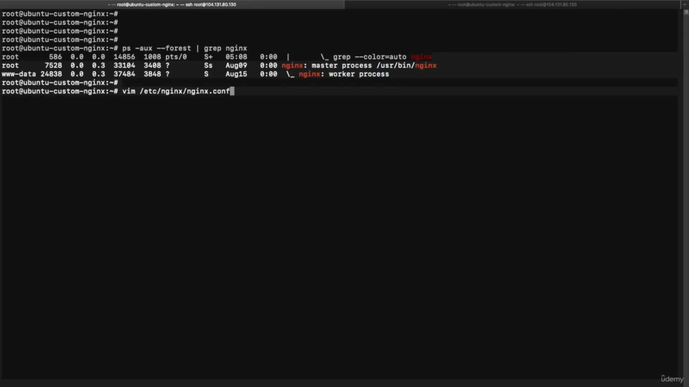
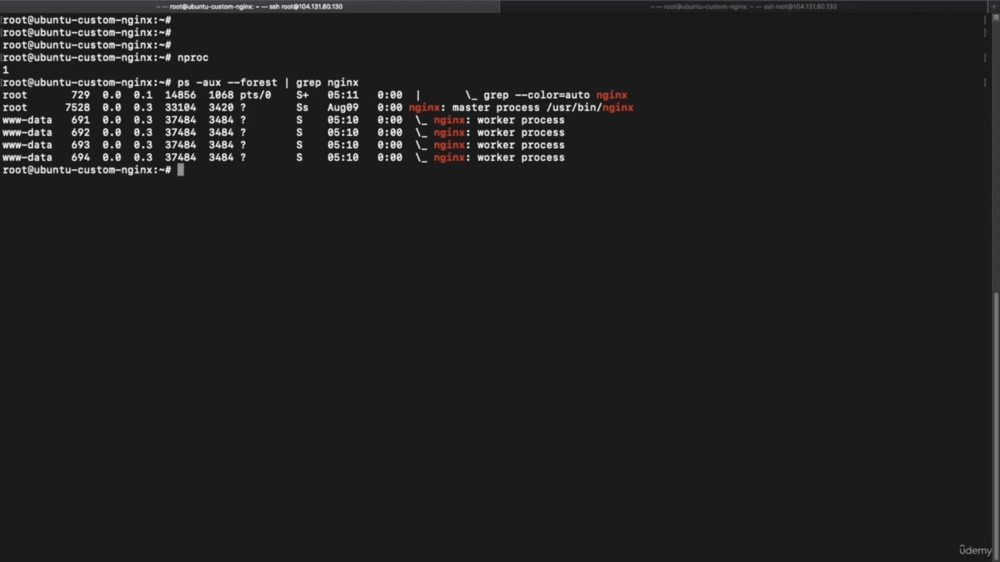
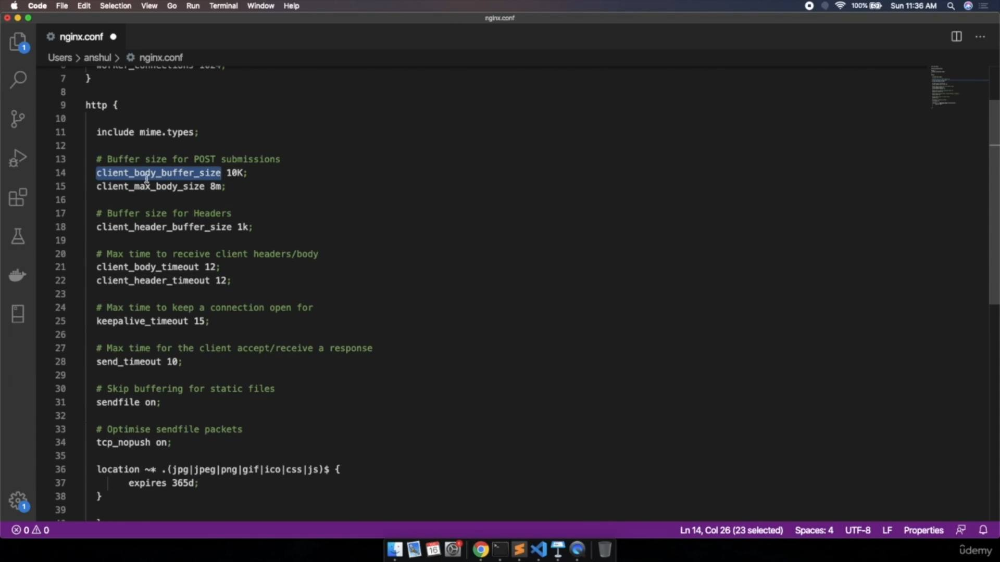
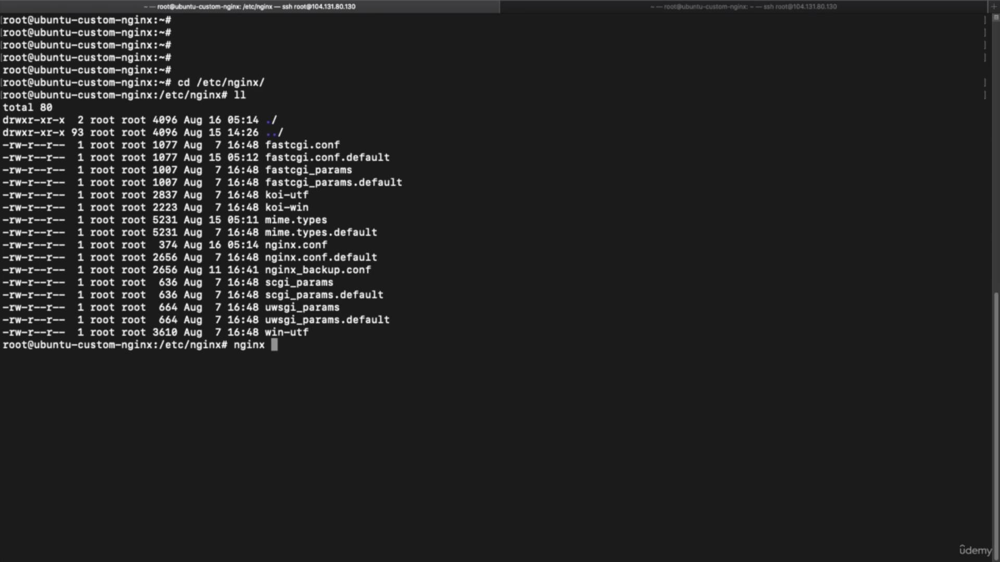
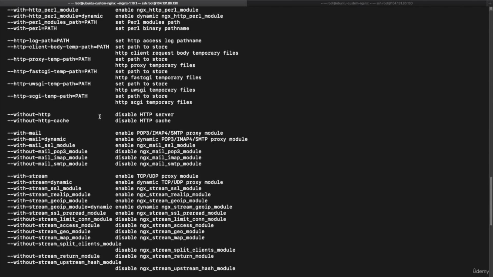
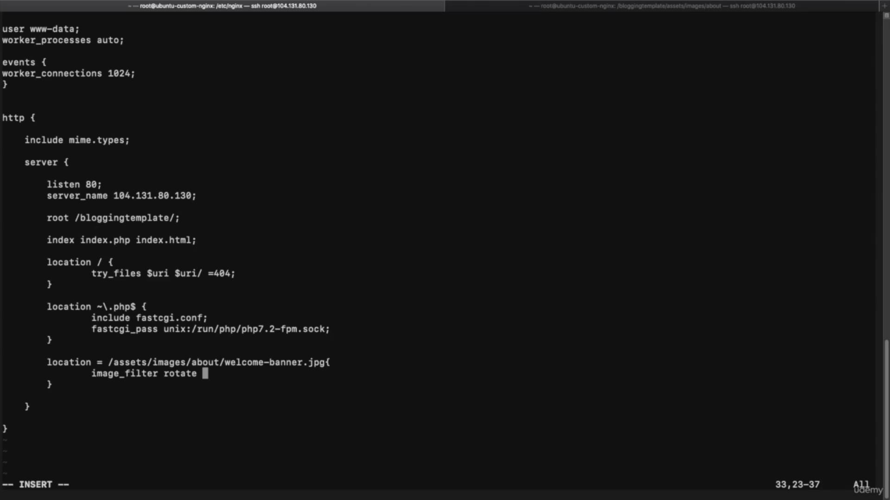
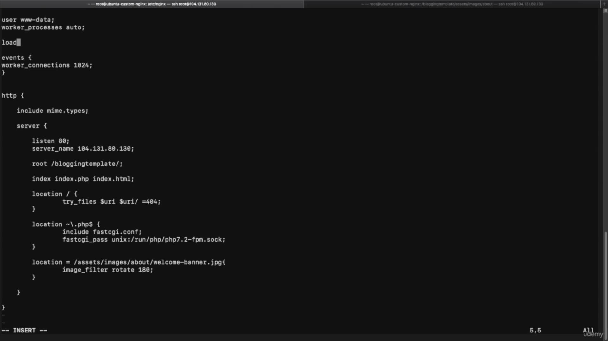

# NGINX 性能调优与动态模块实战（P21–P24 复现手册）

> 适用读者：会用 Node/Express 起服务、但没系统运维过 Linux 的前端工程师。
> 复现环境：Ubuntu/Debian 系；nginx 由**源码编译安装**（讲师的配置目录是 `/etc/nginx`，源码目录在 `/root/nginx`）。你的路径可能不同，凡出现路径处都会说明怎么替换——用 `nginx -V` 输出的 `--conf-path` 就能确认自己的配置目录。
> 完成本节你会得到：一台按 CPU 核数自动开 worker、并发上限对着系统 `ulimit` 设、对请求体/请求头有明确缓冲区与超时、开启 gzip 与静态资源长缓存、并且能加载第三方动态模块（把一张真实图片旋转 180°）的 nginx；同时理解反向代理为什么必须挡在应用服务器前面。

---

## 1. 这一节做什么

这四讲不是四个孤立知识点，而是一条递进的线：**先让 nginx 把机器的 CPU 用满（P21），再让它别把内存和连接浪费在无谓的等待与磁盘 IO 上（P22），然后让它具备"装插件"的能力（P23），最后把它推到应用服务器前面当门面（P24）**。

最终交付物是四样东西：

1. 一份改好的 `/etc/nginx/nginx.conf`：`worker_processes auto` + `worker_connections` 对齐 `ulimit -n`，并且 http 块里写全缓冲区、超时、gzip、静态缓存、`sendfile`/`tcp_nopush`。
2. 一个**能被验证**的结果：`ps aux --forest | grep nginx` 看到的 worker 数量随着 CPU 核数变化；`curl -I` 看到静态资源的 `Expires` 是一年后；发一个超大 POST 拿到 413。
3. 一个从源码重新编译出来的 nginx 二进制 + `/etc/nginx/modules/` 下的 `.so` 文件，配置里 `load_module` 之后 `image_filter rotate 180;` 真的生效。
4. 一张反向代理的概念图（这一讲只有概念，配置在后续课时）。

---

## 2. 讲师原话

> "用户启动的 Nginx 二进制程序称为 Nginx 主进程。而工作进程是由 Nginx 自身启动的进程，工作进程才是负责与客户端通信的主要进程。"
> —— p021 [00:26]

> "因此，通常的做法是每个 CPU 核心配一个工作进程。也就是说，如果机器只有一个 CPU 核心，就只需要初始化一个工作进程；如果有四个 CPU 核心，就需要初始化四个工作进程。"
> —— p021 [02:18]

> "因此，可以借助 ulimit 确定操作系统能够支持的操作数量，然后在 worker_connections 中定义这个数字。"
> —— p021 [06:34]

> "如果缓冲区大小过低，Nginx 就不得不写入临时文件，导致磁盘持续读写。也就是说，缓冲区大小较低时，Nginx 需要把文件写入系统内存；这会引发磁盘读写，而磁盘读写始终很慢。"
> —— p022 [00:57]

> "client_max_body_size 基本上用于限制客户端请求的最大大小。如果客户端发送的请求体超过这个限制，用户就会收到状态码 413，以及“请求实体过大”的消息。"
> —— p022 [03:21]

> "这个错误是因为，虽然我们已经在配置中包含了动态模块，但 Nginx 仍然不知道这些动态模块。因此，我们需要让 Nginx 知道：我们也有针对这些特定指令的动态模块。"
> —— p023 [08:31]

> "反向代理是一台位于 Web 服务器前面的服务器，它把客户端请求转发给这些 Web 服务器。"
> —— p024 [00:00]

> "因此，只要在客户端和应用服务器之间设置了 Web 代理，应用服务器的 IP 地址就不会暴露给外部世界。"
> —— p024 [05:09]

---

## 3. 从零复现

### 3.0 前置检查（两分钟，别跳过）

```bash
# 1) nginx 是否在跑
ps aux --forest | grep nginx

# 2) 这个 nginx 是不是源码装的（决定了后面 make install 装到哪）
nginx -V

# 3) 你的 CPU 核数
nproc
lscpu | grep -i '^cpu(s)'

# 4) 系统允许你打开的最大文件描述符数
ulimit -n
```

判断标准：第 2 条命令的输出里如果能看到 `configure arguments:` 且路径是 `/etc/nginx/...`，说明你沿着讲师前面的课时用源码装过，本节可以原样跟着走。如果你的 nginx 是 `apt-get install nginx` 装的、`nginx -V` 里 prefix 是 `/usr/share/nginx` 之类，后面 P23 的 `make install` 会装到别处，先看第 7 节第一条。

### 3.1 先看清"谁在干活"：master 与 worker

```bash
ps aux --forest | grep nginx
```

`--forest` 是让 ps 用树形缩进显示父子关系，你会看到若干行里只有一行带 `master process`，其余都是它的子进程 `worker process`。**讲师强调的正是这个结构**：master 只负责管理，一个请求都不接；真正和客户端打交道的是 worker。所以"有多少个工作进程，每个能承载多少连接？"就是性能的全部。



如果你忘了上一讲为什么 502，这里再提一句：讲师在上一讲里是因为 worker 以 `nobody` 用户跑、读不到文件才 502 的。**本节所有改动都不要顺手删掉 `user` 那一行**，否则 502 会回来。

### 3.2 worker_processes：先故意犯错，再改成 auto

第一步，编辑配置文件（讲师用的是 vim，你用什么编辑器都行）：

```bash
sudo vim /etc/nginx/nginx.conf
```

在最外层（global / main 上下文，也就是 `events { }` 和 `http { }` 的**外面**）写入：

```nginx
worker_processes 4;
```

然后老三步——**改、测、载**：

```bash
sudo nginx -t          # 输出 syntax is ok / test is successful 才算过
sudo nginx -s reload
ps aux --forest | grep nginx
```

现在你会看到 1 个 master + 4 个 worker。但讲师的机器是**1 核**（`nproc` 输出 1），4 个 worker 挤在 1 个核上，按他自己的话说就是"每个只能用 25%"。



第二步，把它改成自适应：

```nginx
worker_processes auto;
```

再 `nginx -t` → `nginx -s reload` → `ps aux --forest | grep nginx`，这次只剩 1 个 worker，因为机器只有 1 核。**同一份配置文件拿到 4 核、16 核机器上，会自动开 4 个、16 个**——这就是 `auto` 的全部价值：配置不再和机器规格绑死。

### 3.3 worker_connections：上限不是你拍脑袋定的

`worker_connections` 属于 `events` 上下文，**不是** global，写错位置 `nginx -t` 会直接报错。先问系统能给你多少：

```bash
ulimit -n
```

讲师机器上输出是 `1024`。这个数字是"这个 shell 里一个进程最多能同时持有的文件描述符数量"。nginx 每接一个连接就消耗 fd（读文件、连上游都是 fd），所以：

```nginx
events {
    worker_connections 1024;
}
```

含义是：**每个 worker 最多同时处理 1024 个连接**。总容量 = `worker_processes × worker_connections`，讲师的原话是"两个 worker、每个 600，那总共就是 1200 个连接可用"。

改完照例 `nginx -t` → `nginx -s reload`。

> 注意：`worker_connections 1024` 是讲师照着 `ulimit -n` 的值填的示例，不是放之四海皆准的推荐值。真实生产里 `ulimit -n` 通常被调到 65535 以上，你这个数字也应该跟着变。

### 3.4 缓冲区、超时、gzip、静态缓存：一次性写进 http 块

这一批指令**全部属于 http 上下文**，也就是要写在 `http { ... }` 里面。为了避免改乱，建议整段复制、再按需微调：

```nginx
http {
    # ---------- 缓冲区 ----------
    client_body_buffer_size      10k;
    client_header_buffer_size    1k;
    client_max_body_size         8m;
    large_client_header_buffers  4 8k;

    # ---------- 超时 ----------
    client_body_timeout    12s;
    client_header_timeout  12s;
    keepalive_timeout      15s;
    send_timeout           10s;

    # ---------- 传输优化 ----------
    sendfile   on;
    tcp_nopush on;

    # ---------- gzip ----------
    gzip              on;
    gzip_comp_level   2;
    gzip_min_length   1000;
    gzip_types        text/plain text/css text/xml
                      application/x-javascript application/xml application/json;
    # …… 省略其余 server 块
}
```


几个数怎么来的，讲师的思路是这样的：

- `client_body_buffer_size`：先量一下你应用里最常见的 POST 请求有多大，按那个量级设。讲师在演示里写的是 `10k`，并专门演示了 `100`、`100k`、`100m` 几种写法，说明**单位 K/M 大小写都行**。
- `client_max_body_size`：超过这个值直接 413。讲师写的是 `8m`。
- `client_header_buffer_size`：讲师写 `1k`，并解释了"如果客户端 header 有 1KB 但 buffer 只有 100 字节，nginx 就得把整个 header 落到硬盘上再读回来，性能就废了"。
- `client_body_timeout` / `client_header_timeout`：讲师口述为 12 毫秒，配置里写的是 `12`；nginx 里不带单位的数字默认按秒算，所以这里写 `12s` 更明确。超时后返回 408。
- `keepalive_timeout 15s`：连接保持多久不关。`send_timeout`：往客户端写响应时，两次写操作之间最多等多久，等不到就断。

gzip 那段，讲师的原话是"压缩等级调太高会让服务器白白浪费 CPU 周期"，所以他给的是 `gzip_comp_level 2`——**低等级、够用就行**，别一上来就 9。

最后是静态文件缓存，**这段要写在 `server` 块里面**：

```nginx
location ~* \.(jpg|jpeg|png|gif|ico|css|js)$ {
    expires 365d;
}
```

效果是：这些后缀的文件响应头里带上一年后的过期时间，浏览器第二次就不用回来了。



改完还是老三步。然后验证一下：

```bash
curl -I http://127.0.0.1:8080/style.css
curl -I -X POST --data-binary @/tmp/big.bin http://127.0.0.1:8080/ -H 'Content-Type: application/octet-stream'
```

第一条应该能看到 `Expires` 字段；第二条用一个大于 8MB 的文件，应该拿到 `413`。**具体响应头字段名和顺序以你机器的实际输出为准。**

### 3.5 动态模块：给一个正在跑的 nginx 装 image_filter

这是四讲里唯一需要重新编译的环节。讲师在 P023 一开始就点明了前提：**因为 nginx 是源码编译的，加模块就必须再编译一次**。

**第 1 步：确认现在没有模块目录。**

```bash
cd /etc/nginx && ls
```

讲师的原话是"如果没有手写的模块，这里就不会有 `modules` 目录"。

**第 2 步：把当初的编译参数原样捞出来。**

```bash
nginx -V            # 注意是大写 V，小写 v 只输出版本号
```

输出里有一行 `configure arguments: ...`，把它保存下来（手工复制粘贴也行）：

```bash
nginx -V 2>&1 | sed -n 's/^configure arguments: //p' > /root/nginx-args.txt
```



**第 3 步：看这套源码支持哪些动态模块。**

```bash
cd /root/nginx
./configure --help | grep dynamic
```

会列出一堆可选模块，包括讲师提到的 image filter、xslt、geoip、mail、stream 等。



**第 4 步：在原参数基础上加两样东西，重新 configure。**

```bash
./configure $(cat /root/nginx-args.txt) \
  --with-http_image_filter_module=dynamic \
  --modules-path=/etc/nginx/modules
```

> 选项名以你第 3 步 `grep dynamic` 出来的那一行为准。如果你的原始参数里已经带了 `--modules-path`，先把它从 `/root/nginx-args.txt` 里删掉，否则会重复。

**第一次一定失败**——讲师的终端上明确报了 image filter 模块依赖 gd 库：

```bash
apt-get install libgd-dev
```

装完重跑同一条 configure 命令，这次应该走到结尾出现 `Configuration summary`。

**第 5 步：编译并安装。**

```bash
make
make install
```

`make` 会跑几分钟。装完先确认服务还活着：

```bash
ps aux | grep nginx
nginx -V              # 应该能在 configure arguments 里看到 image filter
```

**第 6 步：确认 `.so` 落地了。**

```bash
ls /etc/nginx/modules
```

应该能看到一个 `ngx_http_image_filter_module.so` 之类的文件。**文件名以你 `ls` 出来的为准。**

**第 7 步：先写 location，撞一次墙。**

如果直接写：

```nginx
location = /img/banner.jpg {
    image_filter rotate 180;
}
```

`nginx -t` 会报 `unknown directive "image_filter"`。讲师的原话是"虽然我们包含了动态模块，但 nginx 还不知道这个模块"。



**第 8 步：加 load_module，位置在 main 上下文（文件最顶部、`events` 之前）。**

```nginx
load_module /etc/nginx/modules/ngx_http_image_filter_module.so;
```



**第 9 步：验证。**

```bash
nginx -t && nginx -s reload
curl -o /tmp/out.jpg http://127.0.0.1:8081/img/banner.jpg
```

用浏览器打开对比原图，应该已经转了 180°。**如果你改成了 270° 却没变，是浏览器缓存——讲师专门讲了这个坑：换浏览器、开无痕、或清缓存再看。**

### 3.6 反向代理：本节只到概念为止

P024 全程没有敲任何配置命令，讲师在结尾明确说"在接下来的课程里，我会演示如何在 NGINX 里配置反向代理"。所以**这一讲不要试图复现配置**，你要带走的是这张数据流：

```
Web Client  →  NGINX (反向代理)  →  Application Server
     ↑                ↓                    │
     └──── 响应 ←──────┘  ←──── 响应 ───────┘
```

客户端只认识 nginx，从不知道应用服务器的 IP。讲师列了四条收益：

1. **负载均衡**——在 nginx 里定义多个 upstream/后端，按 URI 把请求分给不同服务器，单台挂了其他台还能接。
2. **防攻击**——源站 IP 不暴露，攻击者打的是代理层。
3. **缓存**——东京的源站 + 伦敦的 nginx，第二次请求同样的资源直接从伦敦的缓存出，不走跨洋链路。
4. **SSL 卸载**——加密解密由 nginx 干，应用服务器不用为百万请求反复做加解密。


---

## 4. 完整代码

### 4.1 文件 A：`/etc/nginx/nginx.conf`（P21 + P22，可直接跑）

```nginx
# ================= main / global 上下文 =================
# 注意：user 指令保持你上一讲的设置，本节不要动它，否则可能重现 502
# user  nobody;

worker_processes auto;
# worker_rlimit_nofile 65535;   # 课里没讲，需要时自行开启

events {
    worker_connections 1024;
}

http {
    include       /etc/nginx/mime.types;
    default_type  application/octet-stream;

    # ---------- 日志 ----------
    access_log /var/log/nginx/access.log;
    error_log  /var/log/nginx/error.log warn;

    # ---------- 缓冲区 ----------
    client_body_buffer_size      10k;
    client_header_buffer_size    1k;
    client_max_body_size         8m;
    large_client_header_buffers  4 8k;

    # ---------- 超时 ----------
    client_body_timeout    12s;
    client_header_timeout  12s;
    keepalive_timeout      15s;
    send_timeout           10s;

    # ---------- 传输优化 ----------
    sendfile    on;
    tcp_nopush  on;

    # ---------- gzip ----------
    gzip              on;
    gzip_comp_level   2;
    gzip_min_length   1000;
    gzip_types        text/plain text/css text/xml
                      application/x-javascript application/xml application/json;

    # ---------- 站点（静态资源 + 长缓存） ----------
    server {
        listen      8080;
        server_name _;
        root        /var/www/html;

        location / {
            try_files $uri $uri/ =404;
        }

        location ~* \.(jpg|jpeg|png|gif|ico|css|js)$ {
            expires 365d;
        }
    }
}
```

配套的静态资源（用 ImageMagick 造一张测试图，讲师用的是他自己站点里的图）：

```bash
sudo apt-get install -y imagemagick
sudo mkdir -p /var/www/html/img
sudo convert -size 400x200 xc:steelblue /var/www/html/img/banner.jpg
echo '<h1>nginx ok</h1>' | sudo tee /var/www/html/index.html
```

### 4.2 文件 B：`/etc/nginx/nginx.conf`（做完 P23 之后的完整版本）

与文件 A 的差别只有三处：顶部加了 `load_module`、多了一个监听 8081 的 server 块、其余完全一致。

```nginx
# ================= main / global 上下文 =================
load_module /etc/nginx/modules/ngx_http_image_filter_module.so;

worker_processes auto;

events {
    worker_connections 1024;
}

http {
    include       /etc/nginx/mime.types;
    default_type  application/octet-stream;

    access_log /var/log/nginx/access.log;
    error_log  /var/log/nginx/error.log warn;

    # ---------- 缓冲区 ----------
    client_body_buffer_size      10k;
    client_header_buffer_size    1k;
    client_max_body_size         8m;
    large_client_header_buffers  4 8k;

    # ---------- 超时 ----------
    client_body_timeout    12s;
    client_header_timeout  12s;
    keepalive_timeout      15s;
    send_timeout           10s;

    # ---------- 传输优化 ----------
    sendfile    on;
    tcp_nopush  on;

    # ---------- gzip ----------
    gzip              on;
    gzip_comp_level   2;
    gzip_min_length   1000;
    gzip_types        text/plain text/css text/xml
                      application/x-javascript application/xml application/json;

    # ---------- 主站点 ----------
    server {
        listen      8080;
        server_name _;
        root        /var/www/html;

        location / {
            try_files $uri $uri/ =404;
        }

        location ~* \.(jpg|jpeg|png|gif|ico|css|js)$ {
            expires 365d;
        }
    }

    # ---------- image_filter 演示站点 ----------
    server {
        listen      8081;
        server_name _;
        root        /var/www/html;

        location = /img/banner.jpg {
            image_filter rotate 180;
        }
    }
}
```

> `.so` 文件名和 `/etc/nginx/modules/` 路径都要换成你自己 `ls` 出来的那个，不一致会启动失败。

---

## 5. 逐行解释

**`worker_processes auto;`**
必须写在 main 上下文（`events` 之前）。`auto` = 让 nginx 自己数 CPU 核数。写死数字的坏处是配置和机器绑死，讲师原话是"同一份配置可能在 2 核机器跑、也可能在 16 核机器跑"。

> **对 Node 的说法**：这就是 `pm2 start app.js -i max`，或者 `cluster` 模块里 `numCPUs` 那一套。Node 的单进程 = 单个 CPU 核；nginx 的 worker = 单核。原理完全一样。

**`events { worker_connections 1024; }`**
`events` 是独立上下文，和 main、http 平级。数字要 ≤ `ulimit -n`。总并发 = `worker_processes × worker_connections`。

> **对 Node 的说法**：Node 没有等价配置项，只有 `server.maxConnections`，而且真正卡住你的是 `ulimit -n`——同一个天花板。

**`client_body_buffer_size 10k;`**
POST/PUT 的 body 先往内存里攒，超过这个数就落临时文件。"落盘"是性能杀手，所以这个值要贴着你的真实请求体大小设。**注意它和 `client_max_body_size` 不是一回事**：前者决定"攒在内存还是写硬盘"，后者决定"允不允许进来"。

> **对 Node 的说法**：Express 的 `express.json({ limit: '8mb' })` 是把 body 全攒在内存里再解析，没有"落盘"这一档；nginx 是在它前面先把大盘子拦住。

**`client_max_body_size 8m;`**
超过直接 413，讲师原话是"你就会看到 request entity too large 这个开发时常见的错误码"。

> **对 Node 的说法**：`body-parser` 的 `limit` 超了也是 413，只是错误由 Node 抛。两层都设成一样的值，否则你会在前端看到两种不同来源的 413。

**`client_header_buffer_size 1k;` / `large_client_header_buffers 4 8k;`**
前者是单个请求头的默认 buffer 大小，后者是"当默认 buffer 放不下时，最多给几个、每个多大"。header 里塞了太多 cookie/token 就会用到后者。**这两个值课里只讲了原理，具体数值请以你的实际 header 大小为准。**

**`client_body_timeout 12s;` / `client_header_timeout 12s;`**
从连接建立开始，等客户端把 header / body 发完的最长时间，超了返回 408。讲师口述为 12 毫秒，这里显式写成 `12s` 避免歧义（nginx 不带单位默认按秒）。

> **对 Node 的说法**：Node 18+ 的 `server.headersTimeout` / `server.requestTimeout` 干的是同一件事。

**`keepalive_timeout 15s;`**
连接空闲多久后关闭。太长会占着 fd 不干活，太短会导致频繁重连。

> **对 Node 的说法**：`server.keepAliveTimeout`。

**`send_timeout 10s;`**
两次向客户端写数据之间的最长间隔。讲师的原话是"超时后就把这个响应丢掉"。适合大响应体、慢客户端场景。

**`sendfile on;` / `tcp_nopush on;`**
`sendfile on` 让 nginx 把静态文件直接从内核态发给 socket，**不经过用户态 buffer**，这是静态资源性能的关键开关。`tcp_nopush` 只在 `sendfile on` 的前提下才有意义，作用是攒满一个包再发，减少小包数量。

> **对 Node 的说法**：`res.sendFile()` 底层就是 sendfile；`tcp_nopush` 对应 TCP_CORK，Node 没有直接开关。

**`gzip on; gzip_comp_level 2; gzip_min_length 1000; gzip_types ...;`**
`gzip_min_length 1000` 是"小于 1KB 的文件不值得压"的门槛。`gzip_comp_level 2` 是讲师刻意选的低档——他明确说"等级调太高服务器会浪费 CPU 周期"。`gzip_types` 是"哪些 MIME 类型要压"，讲师念的那串是 text/plain、application/x-javascript、text/xml、text/css、application/xml，按你项目实际资源类型补。

> **对 Node 的说法**：`compression` 中间件，`level: 2` 和 `threshold: 1000` 是两个同名参数。

**`expires 365d;`**
给静态资源加 `Expires` 响应头，一年后过期。

> **对 Node 的说法**：`res.setHeader('Cache-Control', 'public, max-age=31536000')`。注意这只对"文件名不变"的文件安全，带 hash 的构建产物才有资格用一年。

**`load_module .../ngx_http_image_filter_module.so;`**
必须写在 main 上下文（文件顶部），写在 `http` 里会报错。它告诉 nginx "这个 `.so` 里有一批指令可以用"。

**`image_filter rotate 180;`**
来自 image_filter 模块，作用是把图片旋转 180 度后输出。讲师的口径是"180 度、270 度都可以，改完 reload 刷新就行"。

---

## 6. 复现检查清单

- [ ] `nproc` 有输出，记下核数
- [ ] `ulimit -n` 有输出，记下数值
- [ ] `nginx.conf` 里有 `worker_processes auto;`，且**在 events/http 之外**
- [ ] `events` 块里有 `worker_connections`，数值 ≤ `ulimit -n`
- [ ] `nginx -t` 通过（否则绝对不要 reload）
- [ ] `nginx -s reload` 无报错
- [ ] `ps aux --forest | grep nginx` 里 worker 数 = CPU 核数
- [ ] http 块里有 `client_body_buffer_size`、`client_header_buffer_size`、`client_max_body_size`
- [ ] http 块里有 `client_body_timeout`、`client_header_timeout`、`keepalive_timeout`、`send_timeout`
- [ ] http 块里有 `gzip on` 和 `gzip_types`
- [ ] `sendfile on;` 和 `tcp_nopush on;` 都在
- [ ] `server` 块里有针对图片/CSS/JS 的 `expires` 规则
- [ ] `curl -I` 静态资源能看到 `Expires`
- [ ] 发一个 >8MB 的 POST 能拿到 `413`
- [ ] `/etc/nginx/modules/` 目录存在且有 `.so` 文件
- [ ] `load_module` 在配置文件顶部
- [ ] `image_filter rotate 180;` 生效，用**无痕窗口**验证过
- [ ] 用 270 度再改一次，确认改动可复现

---

## 7. 课里没讲但你会撞上的

**① `make install` 之后 reload 不生效。**
`nginx -s reload` 是让**正在运行的旧 master** 重新读配置，它用的还是内存里那份旧二进制。真正换二进制要 `nginx -s stop && nginx`（或 `systemctl restart nginx`）。讲师在视频里是直接 reload 成功的，但你如果 reload 之后仍然报 `unknown directive`，先把进程停干净再起。

**② `apt` 装的 nginx 和源码装的不是一回事。**
`make install` 会装到 configure 时的 prefix，通常是 `/usr/local/nginx`，而 `apt` 版的配置在 `/etc/nginx`。两者混用会出现"我明明改了配置却一点反应没有"。复现前先确认 `nginx -V` 里的 `--conf-path`。

**③ `worker_processes auto` 在容器里会被骗。**
Docker/K8s 里 `nproc` 读到的常常是宿主机的核数，而你的容器被 cgroup 限了 1 核。这时候 `auto` 会开出远超你配额的 worker，反而互相抢 CPU。生产容器里建议写死数字。

**④ `client_max_body_size` 要和应用层对齐。**
nginx 放行了 8MB，Express 那边 `limit` 还是默认 100KB，用户看到的是 Node 抛的 413，排查时容易一头雾水。两边设成同一个值。

**⑤ 改静态图片后浏览器不变，不止缓存问题。**
讲师讲的是浏览器缓存，但如果你把 nginx 放在 CDN 后面，CDN 也会缓存。`expires 365d` 的文件名不变就永远拿不到新版——构建产物要带 hash 才有资格配一年。

**⑥ image_filter 是同步处理。**
课里只演示了"能把图转 180 度"，没讨论并发开销。大图 + 高并发时它会占住 worker 线程，**别拿它当图片处理服务用**。这条是通用经验，不是讲师观点。

**⑦ `tcp_nopush` 单独开是没用的。**
它是配合 `sendfile on` 的，两个都要开。

**⑧ 反向代理的配置这一讲确实没有。**
讲师明确说放在后续课时，本节只到概念。你如果现在就想在自己项目里加，需要自己去查 `proxy_pass` 的用法——**那是课外内容，不在这一讲的范围内**。