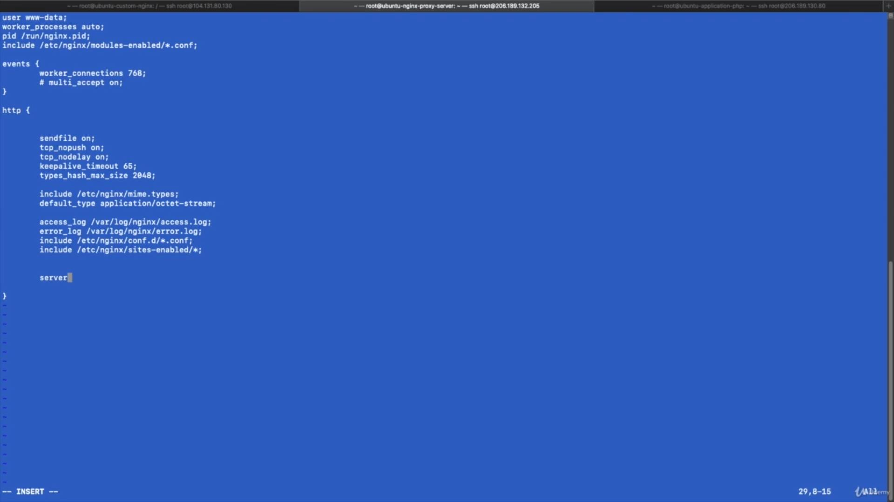
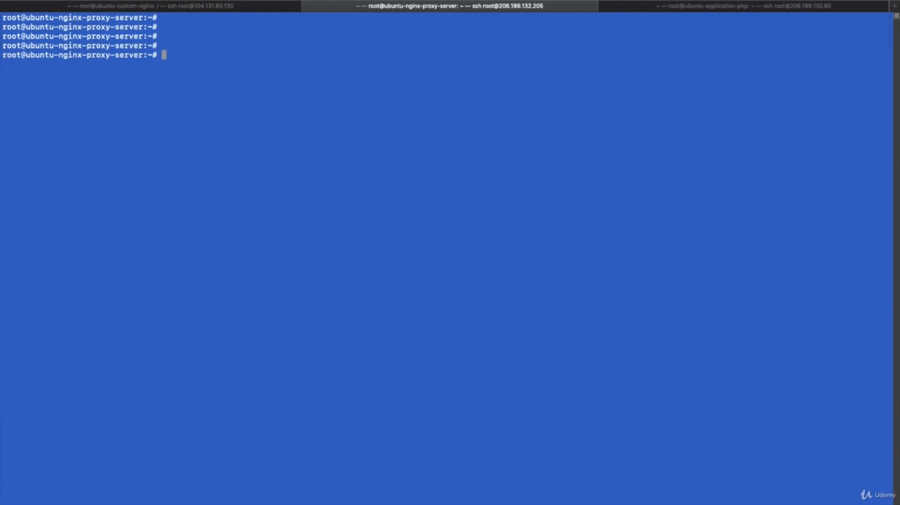
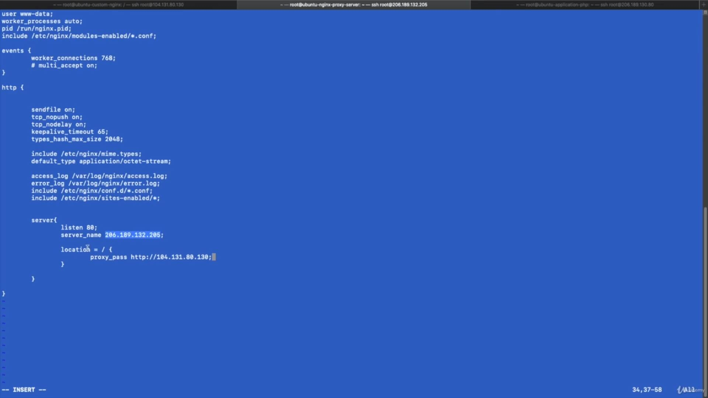
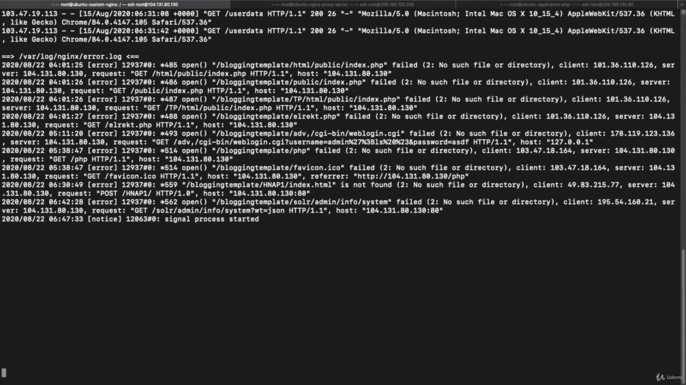
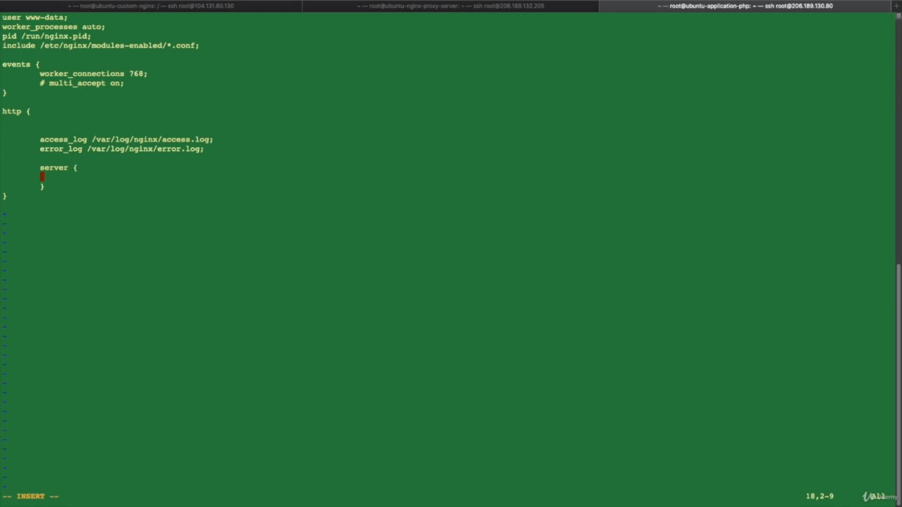
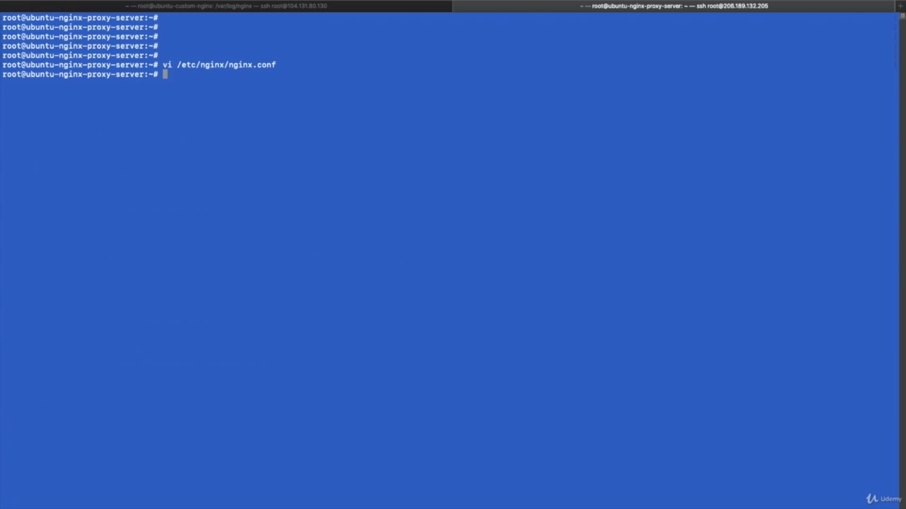
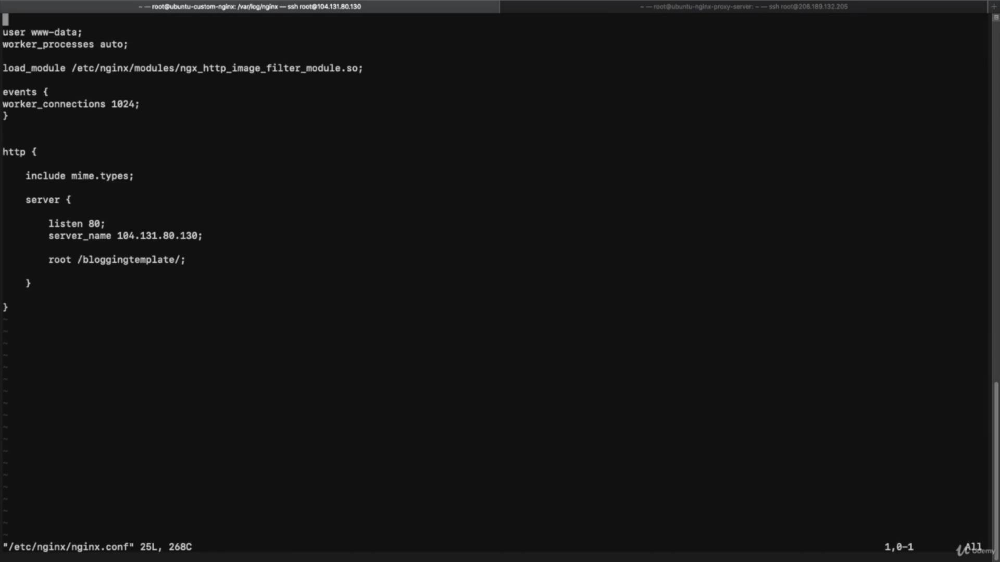
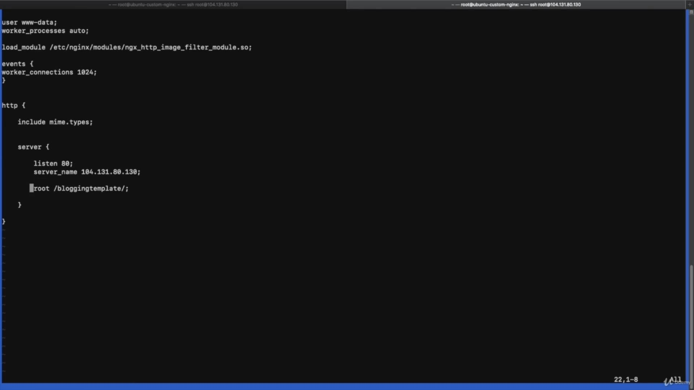
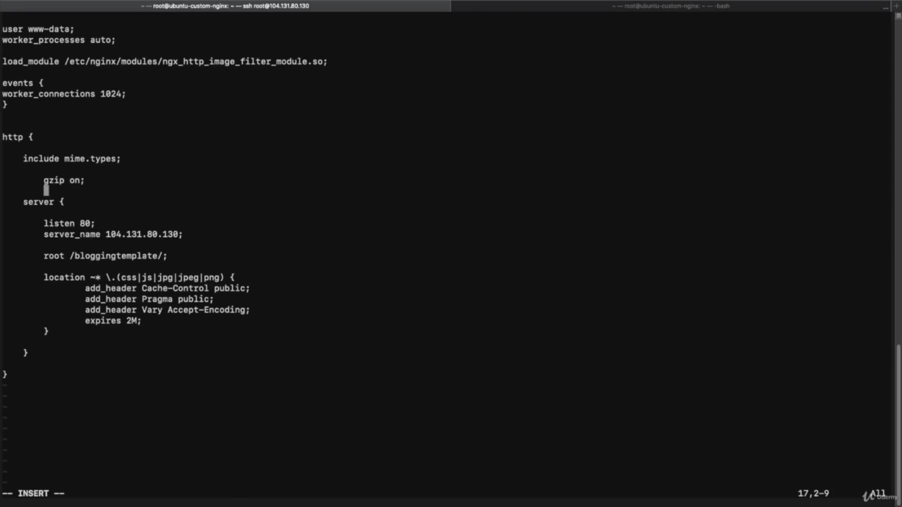
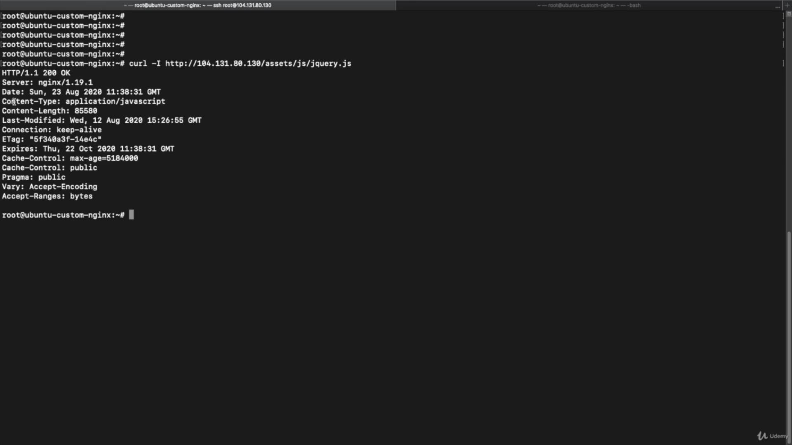

# NGINX MasterClass P25–P28：反向代理 · 真实 IP · 客户端缓存 · Gzip 压缩



---

## 1. 这一节做什么

这四节课是一条完整的「上线前调优 + 可观测」链路，四节叠加起来最终产物是一套 **3 台机器的拓扑**：

| 角色 | 讲师机器上的 IP | 作用 | 本文占位符 |
|---|---|---|---|
| 反向代理 proxy | `206.189.130.205` | 唯一对外入口，按端口把流量分给后端 | `$PROXY_IP` |
| 静态站 brownie | `206.189.130.130` | 前面课程做的静态站点（静态 HTML/CSS/JS/图片） | `$BROWNIE_IP` |
| PHP 应用站 | `206.189.130.80` | 装了 php-fpm 的应用服务器 | `$PHP_IP` |

四节各自解决一个具体问题：

- **P025**：把 proxy 配成反向代理。访问 `http://$PROXY_IP/` 时页面其实来自 `$BROWNIE_IP`；访问 `http://$PROXY_IP:8080/` 时页面其实来自 `$PHP_IP`。**一台代理机，用端口区分两套后端**。
- **P026**：反向代理上线后，后端 `access.log` 里记录的客户端 IP 全变成了代理机 IP。这节用 `X-Real-IP` / `X-Forwarded-For` 两条请求头 + 一个自定义 `log_format`，把真实客户端 IP 打到一份独立的日志文件里。
- **P027**：客户端缓存。用 `Cache-Control` / `Pragma` / `Vary` / `Expires` 让浏览器把 CSS/JS/图片缓存起来，减少重复请求。
- **P028**：服务端 gzip 压缩。用 `gzip on` + `gzip_comp_level` + `gzip_types`，把文本类响应在发出去之前压缩，课上实测把传输量从 972KB 降到 557KB。

这四节都不涉及业务代码，全是 **nginx.conf 的配置 + curl/浏览器验证**。所以本文的「完整代码」就是四份可以直接落盘的 `nginx.conf` 和一份 `index.php`。

---

## 2. 讲师原话（带「—— pNNN [MM:SS]」）

关于拓扑，讲师一开场就把三台机器的分工定死了：

> 「我们需要三台机器。第一台是 nginx，作为反向代理；另外两台也是 nginx 机器，作为应用服务器。」—— p025 [00:00]

反向代理的核心就一个指令，讲师在写配置时解释得很直白：

> 「在 location 里，我们用 `proxy_pass` 这个指令，然后定义完整的域名或者 IP 地址，也就是你希望把请求渲染到哪台机器上。」—— p025 [07:00]

> 「我在这里定义了 server 块：所有打到这台机器 80 端口的请求，如果命中 root，就把这个请求转发到这台服务器。」—— p025 [07:53]

验证成功那一刻：

> 「虽然我打的是运行在 205 上的 nginx，但这个请求直接去了 130 那台机器。为什么？因为我们配了反向代理。」—— p025 [08:52]

P026 讲的是反向代理带来的副作用：

> 「用了反向代理之后，前端应用拿到的是 192.0.0.2，也就是反向代理节点的 IP，而不是客户端的 IP。」—— p026 [01:25]

> 「如果 1000 个客户端同时在发请求，web server 会认为这 1000 个请求来自同一个 IP，它没法区分。这时候你想按 IP 做限流就做不了。」—— p026 [02:41]

解决手段是两条请求头：

> 「我需要加 `proxy_set_header X-Real-IP $remote_addr`，还有 `proxy_add_x_forwarded_for`。」—— p026 [10:09]

然后是后端侧的动作——**不是改 `$remote_addr`，而是另开一份日志格式**：

> 「在这里我们定义 log format，`specialLog` 是这条日志格式的名字，第一段我们取的是 `$http_x_real_ip`。」—— p026 [12:07]

> 「在 special log 这个文件里，我们拿到的请求来自这个 IP，这是我本地机器的 IP。而 access.log 里显示的仍然是反向代理的 IP。」—— p026 [14:22]

P027 讲客户端缓存，讲师先纠正了一个常见误解：

> 「web server 并不能完全控制客户端缓存，因为客户端是用户侧的另一方。但 web server 可以发出一些建议，这些建议通过 HTTP 响应头传递给客户端。」—— p027 [02:21]

关于 `public` 与 `private` 的取舍，讲师态度很明确：

> 「理想情况下，缓存头应该是 public，而不是 private。」—— p027 [06:07]

关于两个时间指令谁优先：

> 「如果 `expires` 和 `max-age` 同时存在，那么 `max-age` 会优先。」—— p027 [08:02]

P028 讲 gzip，两个关键数字：

> 「压缩级别保持在 0 到 10 中间。级别 10 会消耗大量服务器资源，所以取中间值，三、四、五都行，我最喜欢的是 4。」—— p028 [06:40]

> 「为什么没有定义 JPG 和 PNG？因为 JPG 和 PNG 本身已经是压缩文件了。你再压，会消耗服务器资源，但文件大小几乎没变化。」—— p028 [09:58]

---

## 3. 从零复现

### 阶段 0：准备三台 Ubuntu 机器

讲师用的是 DigitalOcean 的 $5 基础套餐 droplet，密码登录，三台都放在同一个数据中心（所以 IP 前三段相同）。你在别的云上开三台 Ubuntu 20.04/22.04 也一样，**只要三台能互相 ping 通**。

> 注意：课里用的是 2020 年前后的 Ubuntu + nginx 1.18 + php7.4。如果你用 Ubuntu 22.04，PHP 版本号会变成 8.1，socket 路径随之变成 `/run/php/php8.1-fpm.sock`，其他命令不变。

先把三个占位符替换成你自己的 IP，后面所有命令都基于它们：

```bash
# 记在你自己的记事本里，下面所有命令都要用
PROXY_IP=206.189.130.205      # 反向代理机
BROWNIE_IP=206.189.130.130    # 静态站机
PHP_IP=206.189.130.80         # PHP 应用机
```

### 阶段 1：两台新机器装 nginx

讲师在 proxy 机和 PHP 机上分别执行（他是 root 登录，普通用户请在前面加 `sudo`）：

```bash
apt-get update
apt-get -y install nginx
```

讲师特别解释了 `-y` 的作用：

> 「执行 `apt-get -y`，这样运行的时候就不会再问你确认了。」—— p025 [03:11]



装完确认进程：

```bash
ps -ef | grep nginx
```

再装一个可选工具，讲师说得很清楚它只是方便看 IP：

> 「这是可选的，你想装就装，不想装可以跳过。我装它是为了运行时能用 `ifconfig` 查 IP。」—— p025 [03:41]

```bash
apt-get -y install net-tools
ifconfig
```

把你查到的 IP 记下来，后面配置里的 `server_name` 和 `proxy_pass` 都要用它。

### 阶段 2：让 proxy 的 80 端口打到静态站（P025 主线）

**2.1 先修好静态站**。静态站机上前几节做过一个「图片旋转 270 度」的 location，讲师现场把它删掉再 reload：

```bash
vi /etc/nginx/nginx.conf     # 删掉那个做旋转的 location 块
nginx -t                     # 语法检查
nginx -s reload
```

**2.2 在代理机上清空默认配置**。讲师的做法是保留文件骨架，把 `http` 块里的注释和默认 `server` 全部删掉，`mail` 块整个删掉：

> 「这是默认配置。我不改别的，只是把 http 块清干净，把 mail 块整个删掉，这就是基础文件了。」—— p025 [05:35]

**2.3 写第一个 server 块**。用第 4 章 4.1 的完整文件覆盖 `/etc/nginx/nginx.conf`，重点是这一段：

```nginx
server {
    listen 80;
    server_name 206.189.130.205;
    location / {
        proxy_pass http://206.189.130.130;
    }
}
```

讲师提醒了两个细节：`server_name` 里 **不要带 `http://`**，只写 IP；`proxy_pass` 后面 **不要留结尾斜杠**。

> 「请确保你把 http 和其他东西都去掉，只写 IP。」—— p025 [07:00]

> 「把浏览器里复制来的地址粘过来，去掉最后的斜杠，加上分号。」—— p025 [07:30]

**2.4 检查 + 重载**：

```bash
nginx -t
nginx -s reload
```

**2.5 验证**：浏览器访问 `http://$PROXY_IP/`，页面内容和 `http://$BROWNIE_IP/` 必须完全一致。讲师的做法是先在浏览器开两个标签对比，reload 前 205 显示的是 nginx 默认欢迎页，reload 后变成 brownie：



**2.6 用日志确认流量确实穿过了代理**。两台机器各开一个终端：

```bash
# 代理机
tail -f /var/log/nginx/access.log

# 静态站机
tail -f /var/log/nginx/access.log
```

刷新浏览器后，代理机上记录的客户端 IP 是**你的公网 IP**，静态站机上记录的客户端 IP 是 **`$PROXY_IP`**。这就是 P026 要解决的问题。



### 阶段 3：PHP 站上线，并按端口做第二路分流（P025 后半）

**3.1 在 PHP 机上装 php-fpm**：

```bash
apt-get -y install php-fpm
```

**3.2 找到 php-fpm 的 socket 路径**。讲师用 find 找的：

```bash
find / -name 'www.conf' 2>/dev/null
# /etc/php/7.4/fpm/pool.d/www.conf

grep -n '^listen' /etc/php/7.4/fpm/pool.d/www.conf
# listen = /run/php/php7.4-fpm.sock
```

课上拿到的结果就是 `/run/php/php7.4-fpm.sock`：

> 「我们拿到了 socket 路径，`run/php/php7.4-fpm.sock`。」—— p025 [13:12]

**3.3 把 PHP 机的 nginx 换成第 4 章 4.2 的配置**，重点是把 `index` 改成 `index.php index.html`，并加一个匹配 `.php` 的 location，里面 `include` fastcgi 配置 + 指定 socket。

**3.4 造一个 PHP 页面**。讲师直接进 nginx 默认站点根目录：

```bash
cd /usr/share/nginx/html
ls            # 里面只有 nginx 的 index.html / index.nginx-debian.html
vi index.php
```

内容就一行 `phpinfo()`（见 4.3）。

**3.5 检查、重载、访问**：

```bash
nginx -t
nginx -s reload
```

浏览器打开 `http://$PHP_IP/`，应该看到紫色的 phpinfo 页面，上面写着 PHP 版本、`Server API: FPM/FastCGI`、以及 `_SERVER["SERVER_ADDR"]` 等你机器的信息。



**3.6 回到代理机，加第二个 server 块**。把 4.1 文件里第二个 `server` 块加上：`listen 8080`，`proxy_pass http://$PHP_IP;`。

讲师的顺序是这样：先复制第一个 server 块、改端口、再改 `proxy_pass` 的目标 IP：

> 「复制这个块粘过来，改一下缩进，把端口改成 8080，server name 不变，location 里换成另一台机器的 IP——我的 PHP 跑在 206 那台。」—— p025 [18:49]

```bash
nginx -t
nginx -s reload
```

**3.7 验收两条链路**：

```
http://$PROXY_IP/       →  brownie 静态站
http://$PROXY_IP:8080/  →  PHP info 页
```

讲师在现场是这么确认的：8080 上刷新后，PHP 机的 `access.log` 里出现了一条记录，客户端 IP 是 `$PROXY_IP`：

> 「在 205 的 8080 端口我去的是 PHP，日志里能看到请求来自我的 Mac 的 IP，同时在 PHP 的 access log 里也能看到，而这个请求实际上是从 205 这台反向代理过来的。」—— p025 [20:16]

> 讲师中间还试过用 `location /php` 这种「同端口、按路径分流」的写法，最后改成了按端口 80 / 8080 分流。复现时直接用端口方案，不要走那条弯路。

**3.8 收尾**：讲师把 PHP 那台 droplet destroy 了，只留 proxy 和静态站给后面几节用：

> 「我们不需要这台了，因为已经在 DigitalOcean 上跑了三台。我把 PHP 机器销毁，保留代理服务器，下一节课还要用。」—— p025 [21:13]

**如果你要接着做 P026–P028，就不要销毁 PHP 机**，或者把 8080 那一段先注释掉——P026 之后只用 80 这一条链路。

### 阶段 4：把真实客户端 IP 传到后端（P026）

**4.1 先复现问题**。两台机器各自 tail：

```bash
# 静态站机
tail -f /var/log/nginx/access.log
```

浏览器访问 `http://$BROWNIE_IP/`，日志里是**你的公网 IP**；改访问 `http://$PROXY_IP/`，日志里变成 **`$PROXY_IP`**。

**4.2 给 nginx 加上 realip 模块**。讲师先查文档确认模块名，再在源码目录里 `configure --help` 过滤：

```bash
cd /root/nginx
./configure --help | grep realip
#   --with-http_realip_module            enable ngx_http_realip_module
#   --with-stream_realip_module          enable ngx_stream_realip_module
```

然后他把机器上**原来那套 configure 参数**原样取出来，追加一个模块重新编译：

```bash
nginx -V
# 输出里有一行：configure arguments: --prefix=... --with-http_ssl_module ...
```

```bash
cd /root/nginx
./configure <把上面 configure arguments: 后面的内容原样粘贴，去掉前缀> \
  --with-http_realip_module
make
make install
nginx -V        # 确认输出里出现了 --with-http_realip_module
```



**4.3 代理机加两条请求头**。在 4.1 文件的两个 location 里各加两行（最终形态见第 4 章）：

```nginx
proxy_set_header X-Real-IP $remote_addr;
proxy_set_header X-Forwarded-For $proxy_add_x_forwarded_for;
```

```bash
nginx -t && nginx -s reload
```

**4.4 后端加自定义日志格式**。在静态站机的 `http` 块里加 `log_format specialLog ...`，并加一条 `access_log ... specialLog;`（见 4.4）。讲师对这一段的口径是：

> 「在这里定义 log format，`specialLog` 是这条格式的名字，第一段取 `$http_x_real_ip`，然后是 remote user、本地时间戳、request、status、body bytes sent、referer、user agent，最后我们还带了 `$remote_addr`。」—— p026 [12:28]

```bash
nginx -t && nginx -s reload
```

**4.5 验证**。两个文件同时 tail：

```bash
tail -f /var/log/nginx/access.log           # 仍然是代理 IP
tail -f /var/log/nginx/access-special.log   # 变成你的真实公网 IP
```



讲师还用一个在线代理网站（"最快的免费代理"，选 Netherlands / Germany 节点）从不同出口 IP 访问，确认 special log 里跟着变：

> 「你可以看到这次 IP 是 109.201.133.6，同一个 IP 在代理的日志里也能看到。换到德国，又变成另一个 IP，special log 里也跟着变。」—— p026 [15:45]

### 阶段 5：客户端缓存头（P027）

**5.1 先用一个假 location 验证 header 生效**。在静态站机的 server 块里临时加：

```nginx
location = /port.jpg {
    return 200 "Hello. This is dummy location";
    add_header my_header "dummy value";
}
```

```bash
nginx -t && nginx -s reload
curl -I http://$BROWNIE_IP/port.jpg
```

响应里会出现 `my_header: dummy value`——先确认「加头」这件事本身是通的。

**5.2 换成真实的缓存头**，并按扩展名匹配（见 4.4 的 location 块）：

```nginx
location ~* \.(css|js|jpg|jpeg|png)$ {
    add_header Cache-Control "public";
    add_header Pragma "public";
    add_header Vary "Accept-Encoding";
    expires 2M;
}
```



**5.3 验证**：

```bash
# 命中的资源
curl -I http://$BROWNIE_IP/assets/xxx.js
# 应该看到：expires / cache-control: max-age=... , public / pragma: public / vary: Accept-Encoding

# 不命中的资源（HTML）
curl -I http://$BROWNIE_IP/
# 上面那些头一个都不会有
```

讲师对「HTML 没有头」这件事的解释：

> 「因为 HTML 的扩展名没有定义在里面。如果你把 HTML 也写进 location，HTML 页面同样会被缓存在浏览器里。」—— p027 [15:33]

### 阶段 6：gzip（P028）

**6.1 先量一个基线**。开一个**全新的无痕窗口**（重要，否则你会命中阶段 5 的浏览器缓存），F12 → Network，访问 `http://$BROWNIE_IP/`，记下底部的 `transferred` 数值——讲师这里是 **972 KB**。

**6.2 在静态站机的 `http` 块加 gzip**（见 4.4）：

```nginx
gzip on;
gzip_comp_level 4;
gzip_types text/plain text/css application/json application/x-javascript application/javascript text/xml application/xml application/xml+rss;
```



**6.3 再量一次**。关掉无痕窗口，**重开一个新的无痕窗口**，同样 F12 → Network，访问同一地址。讲师的数据变化是：

| 阶段 | transferred |
|---|---|
| 无 gzip | 972 KB |
| 加 gzip（缺 `application/javascript`） | 718 KB |
| 补上 `application/javascript` | **557 KB** |

> 「我们减少了 200KB 的网络传输。现在只有总资源的 60%，也就是减少了 40% 到 45% 的传输量。」—— p028 [14:39]

**6.4 用 curl 手动验证并落盘对比大小**：

```bash
# 不声明 Accept-Encoding —— 拿不到压缩
curl -I http://$BROWNIE_IP/assets/xxx.js

# 声明 Accept-Encoding —— 才有 Content-Encoding: gzip
curl -I -H "Accept-Encoding: gzip, deflate" http://$BROWNIE_IP/assets/xxx.js

# 落盘对比
curl    -o min.js     http://$BROWNIE_IP/assets/xxx.js
curl -H "Accept-Encoding: gzip, deflate" -o min.zip.js http://$BROWNIE_IP/assets/xxx.js
ls -lrt min.js min.zip.js
```



这一步关键点在于：**curl 不像浏览器，它不会自动带上 `Accept-Encoding`，也不会自动解压**。所以 `min.zip.js` 里存的是 gzip 后的字节流，体积明显更小——这正好可以拿来展示压缩比。

---

## 4. 完整代码

下面四份文件直接保存即可运行。**所有 IP 请替换成你自己的**。

### 4.1 代理机 `/etc/nginx/nginx.conf`（P025 + P026 最终形态）

```nginx
# /etc/nginx/nginx.conf  ——  反向代理机 ($PROXY_IP)
user www-data;
worker_processes auto;
pid /run/nginx.pid;

events {
    worker_connections 768;
}

http {
    include       /etc/nginx/mime.types;
    default_type  application/octet-stream;

    sendfile        on;
    tcp_nopush      on;
    keepalive_timeout 65;

    access_log /var/log/nginx/access.log;
    error_log  /var/log/nginx/error.log;

    # ---------- 80 端口：静态站 brownie ----------
    server {
        listen 80;
        server_name 206.189.130.205;          # 改成你的 $PROXY_IP

        location / {
            proxy_pass http://206.189.130.130; # 改成你的 $BROWNIE_IP，末尾不要斜杠
            proxy_set_header X-Real-IP $remote_addr;
            proxy_set_header X-Forwarded-For $proxy_add_x_forwarded_for;
        }
    }

    # ---------- 8080 端口：PHP 应用站 ----------
    server {
        listen 8080;
        server_name 206.189.130.205;          # 改成你的 $PROXY_IP

        location / {
            proxy_pass http://206.189.130.80;  # 改成你的 $PHP_IP，末尾不要斜杠
            proxy_set_header X-Real-IP $remote_addr;
            proxy_set_header X-Forwarded-For $proxy_add_x_forwarded_for;
        }
    }
}
```

### 4.2 PHP 应用机 `/etc/nginx/nginx.conf`

```nginx
# /etc/nginx/nginx.conf  ——  PHP 应用机 ($PHP_IP)
user www-data;
worker_processes auto;
pid /run/nginx.pid;

events {
    worker_connections 768;
}

http {
    include       /etc/nginx/mime.types;
    default_type  application/octet-stream;

    sendfile        on;
    keepalive_timeout 65;

    access_log /var/log/nginx/access.log;
    error_log  /var/log/nginx/error.log;

    server {
        listen 80;
        server_name 206.189.130.80;           # 改成你的 $PHP_IP

        root  /usr/share/nginx/html;
        index index.php index.html;

        location / {
            try_files $uri $uri/ =404;
        }

        location ~ \.php$ {
            include snippets/fastcgi-php.conf;
            fastcgi_pass unix:/run/php/php7.4-fpm.sock;   # 用 find 查到的实际路径
        }
    }
}
```

### 4.3 PHP 应用机 `/usr/share/nginx/html/index.php`

```php
<?php
phpinfo();
```

### 4.4 静态站机 `/etc/nginx/nginx.conf`（P026 日志 + P027 缓存 + P028 gzip 三合一）

```nginx
# /etc/nginx/nginx.conf  ——  静态站 brownie ($BROWNIE_IP)
user www-data;
worker_processes auto;
pid /run/nginx.pid;

events {
    worker_connections 768;
}

http {
    include       /etc/nginx/mime.types;
    default_type  application/octet-stream;

    sendfile        on;
    tcp_nopush      on;
    keepalive_timeout 65;

    # ================= P026：自定义日志格式，记录真实客户端 IP =================
    log_format specialLog '$http_x_real_ip - $remote_user [$time_local] '
                          '"$request" $status $body_bytes_sent '
                          '"$http_referer" "$http_user_agent" - $remote_addr';

    access_log /var/log/nginx/access.log;
    access_log /var/log/nginx/access-special.log specialLog;
    error_log  /var/log/nginx/error.log;

    # ================= P028：gzip 压缩 =================
    gzip              on;
    gzip_comp_level   4;
    gzip_min_length   1024;
    gzip_types        text/plain
                      text/css
                      application/json
                      application/x-javascript
                      application/javascript
                      text/xml
                      application/xml
                      application/xml+rss;

    server {
        listen 80;
        server_name 206.189.130.130;          # 改成你的 $BROWNIE_IP

        root  /usr/share/nginx/html;
        index index.html;

        location / {
            try_files $uri $uri/ =404;
        }

        # ================= P027：客户端缓存头 =================
        location ~* \.(css|js|jpg|jpeg|png)$ {
            add_header Cache-Control "public";
            add_header Pragma "public";
            add_header Vary "Accept-Encoding";
            expires 2M;
        }
    }
}
```

---

## 5. 逐行解释

### 5.1 代理机（4.1）

**`listen 80;` / `listen 8080;`**
同一台机器上两个 server 块靠端口区分。80 走静态站，8080 走 PHP 站。浏览器里 `http://IP:8080` 的 `:8080` 就是命中第二个块的条件。**这是「一台代理机服务多个后端」最省事的做法**——不需要额外域名，也不需要 `location /php` 这种路径前缀（讲师先试过路径前缀，最后改成端口）。

**`server_name 206.189.130.205;`**
只写裸 IP。写成 `http://206.189.130.205` 或 `206.189.130.205:80` 都会导致这个 server 块匹配不上，请求落到 default server。讲师专门强调过「把 http 和其他东西都去掉」。

**`proxy_pass http://206.189.130.130;`**
末尾**没有斜杠**，这点很关键：

| 写法 | 客户端请求 | 转发到后端的目标 |
|---|---|---|
| `proxy_pass http://a.b.c.d;` | `/assets/x.js` | `http://a.b.c.d/assets/x.js` ✅ 原样透传 |
| `proxy_pass http://a.b.c.d/;` | `/assets/x.js` | `http://a.b.c.d//assets/x.js` ❌ 路径被替换 |

讲师特意「把浏览器复制来的地址去掉最后的斜杠」，就是为了走第一种。在 Node 里，这等价于 `http-proxy-middleware` 的 `target: 'http://a.b.c.d'` 且 `pathRewrite` 什么都不做。

**`proxy_set_header X-Real-IP $remote_addr;`**
`$remote_addr` 是 nginx 变量，含义是「跟本机直接建 TCP 连接的对端 IP」。在**代理机**上，它就是真实客户端 IP（因为客户端直连代理）。这条指令把这个 IP 塞进一个自定义请求头 `X-Real-IP` 传给后端。后端拿不到 TCP 层信息了，但能读到这个头。

**`proxy_set_header X-Forwarded-For $proxy_add_x_forwarded_for;`**
`$proxy_add_x_forwarded_for` 是 nginx 内置变量，行为是：如果请求里已经有 `X-Forwarded-For`，就在后面追加 `, $remote_addr`；如果没有，就直接等于 `$remote_addr`。这样多级代理时能保留整条链路 `client, proxy1, proxy2`。

> 注意：这两条只是「把 IP 塞进头里」。「谁信任这个头」是后端的事——见 5.3。

### 5.2 PHP 机（4.2）

**`index index.php index.html;`**
顺序很重要。`index.php` 排在前面，所以访问 `/` 时会优先找 `index.php`。讲师先在浏览器里刷新看到的是 nginx 默认页，因为当时目录里只有 `index.html`；创建 `index.php` 并 reload 之后就变成 phpinfo 了。

**`location ~ \.php$ { ... }`**
`~` 表示区分大小写的正则匹配。URL 以 `.php` 结尾的请求全部进这个块，交给 php-fpm 处理，而不是当静态文件返回源码。

**`include snippets/fastcgi-php.conf;`**
把 FastCGI 的通用参数（`QUERY_STRING`、`REQUEST_METHOD`、`SCRIPT_FILENAME` 等）批量引入。讲师口述的是「include fastcgi configuration」，Ubuntu 默认站点里现成的文件就是 `snippets/fastcgi-php.conf`。**这个文件里已经包含 `fastcgi_param SCRIPT_FILENAME $document_root$fastcgi_script_name;`**——少了它，PHP 会报 "File not found"（见第 7 章）。

**`fastcgi_pass unix:/run/php/php7.4-fpm.sock;`**
告诉 nginx：PHP 请求通过这个 Unix socket 交给 php-fpm 进程，而不是走 TCP 端口。路径必须和 `/etc/php/7.4/fpm/pool.d/www.conf` 里 `listen =` 的值完全一致。这也是为什么讲师要先 `find` 一遍——版本号写错就 502。

### 5.3 静态站（4.4）

**`log_format specialLog '...';`**
定义一条命名的日志格式。字段拆解：

| 片段 | 含义 |
|---|---|
| `$http_x_real_ip` | 请求头 `X-Real-IP` 的值，也就是代理机塞进来的真实客户端 IP |
| `$remote_user` | HTTP Basic Auth 的用户名，没开认证时是 `-` |
| `[$time_local]` | 本机时间 |
| `"$request"` | 原始请求行，如 `GET /assets/x.js HTTP/1.1` |
| `$status` | 响应状态码 |
| `$body_bytes_sent` | 响应体字节数（不含头） |
| `"$http_referer"` | 来源页 |
| `"$http_user_agent"` | UA |
| `$remote_addr` | **TCP 对端 IP**，在这台机器上永远等于代理机 IP——留它是为了让两条日志能对照 |

`$http_xxx` 这个命名规则是 nginx 的通用约定：任何请求头 `Xxx-Yyy`，都对应变量 `$http_xxx_yyy`（小写、下划线）。

**`access_log /var/log/nginx/access-special.log specialLog;`**
把同一次请求**再写一份**到另一个文件，用新格式。原来的 `access_log /var/log/nginx/access.log;` 保持不变，所以 `access.log` 里仍然是代理 IP。

**这一点必须说清楚**：讲师编译了 `--with-http_realip_module`，但**没有在配置里使用 `set_real_ip_from` / `real_ip_header`**。所以 `$remote

## 6. 复现检查清单

- [ ] 三台机器能互相通信：在 proxy 上分别 `ping -c 3 $BROWNIE_IP`、`ping -c 3 $PHP_IP`，反向也各测一次；应看到 `0% packet loss`。
- [ ] proxy 和 PHP 机 nginx 已安装并运行：`ps -ef | grep nginx` 应看到 master/worker 进程；改配置前访问各自 IP 应看到 nginx 默认页。
- [ ] 静态站机已删掉「图片旋转 270 度」的 location：`nginx -t` 通过，`nginx -s reload` 无报错；访问 `http://$BROWNIE_IP/` 图片方向正常。
- [ ] proxy 的 `server_name` 只写裸 IP：`grep -n "server_name" /etc/nginx/nginx.conf`，应看到 `server_name $PROXY_IP;` 这类形式，不能带 `http://`，也不要带 `:80`。
- [ ] `proxy_pass` 末尾没有斜杠：`grep -n "proxy_pass" /etc/nginx/nginx.conf`，应形如 `proxy_pass http://$BROWNIE_IP;`，不能是 `http://$BROWNIE_IP/;`。
- [ ] 第一路反向代理生效：`nginx -t && nginx -s reload` 后访问 `http://$PROXY_IP/`，页面应与 `http://$BROWNIE_IP/` 完全一致，不再是 nginx 默认欢迎页。
- [ ] 代理链路能在日志里对上：proxy 的 `access.log` 里客户端 IP 是你的公网 IP；brownie 的 `access.log` 里客户端 IP 是 `$PROXY_IP`。
- [ ] PHP 机 socket 路径与 nginx 配置一致：`grep '^listen' /etc/php/*/fpm/pool.d/www.conf` 得到的路径，必须和 `fastcgi_pass unix:...;` 完全一致；`nginx -t` 应通过。
- [ ] PHP 机 `index` 顺序正确：`grep -n "index" /etc/nginx/nginx.conf` 应看到 `index.php` 排在 `index.html` 前面。
- [ ] PHP 文件已创建：`ls -l /usr/share/nginx/html/index.php` 应存在；访问 `http://$PHP_IP/` 应看到紫色 phpinfo 页，且 `Server API` 为 `FPM/FastCGI`。
- [ ] proxy 的 8080 server 块已生效：`grep -n "listen 8080" /etc/nginx/nginx.conf` 有输出；`nginx -t && nginx -s reload` 后访问 `http://$PROXY_IP:8080/` 应看到 phpinfo 页。
- [ ] 两条链路都验收过：`http://$PROXY_IP/` 是 brownie 静态站；`http://$PROXY_IP:8080/` 是 PHP info 页；此时 PHP 机 `access.log` 里客户端 IP 应显示为 `$PROXY_IP`。
- [ ] P026 问题已复现：直接访问 `http://$BROWNIE_IP/` 时日志是你的公网 IP；改访问 `http://$PROXY_IP/` 后，brownie 日志里变成 `$PROXY_IP`。
- [ ] realip 模块已编译进去：`nginx -V 2>&1 | grep -- --with-http_realip_module` 应有输出；`ps -ef | grep nginx` 应显示 nginx 正在运行。
- [ ] proxy 的两个 location 都加了转发头：`grep -n "proxy_set_header" /etc/nginx/nginx.conf`，应看到 `X-Real-IP $remote_addr` 和 `X-Forwarded-For $proxy_add_x_forwarded_for`；保留 8080 时两处都应存在。
- [ ] brownie 已配置自定义日志：`grep -n "log_format specialLog | access_log" /etc/nginx/nginx.conf`，应看到 `log_format specialLog ...`，以及 `access.log` 和 `access-special.log specialLog` 两条 `access_log`。
- [ ] P026 验证通过：`tail -f /var/log/nginx/access.log` 里仍是 `$PROXY_IP`；`tail -f /var/log/nginx/access-special.log` 第一段应变成你的真实公网 IP；用在线代理换出口访问时，special log 里的 IP 应跟着变。
- [ ] P027 假 location 验证通过：`curl -I http://$BROWNIE_IP/port.jpg` 应看到 `my_header: dummy value`；验证后删掉这个临时 location 并 reload，避免干扰后续。
- [ ] 缓存头只对指定扩展名生效：`curl -I http://$BROWNIE_IP/assets/xxx.js` 应看到 `expires`、`cache-control: max-age=..., public`、`pragma: public`、`vary: Accept-Encoding`；`curl -I http://$BROWNIE_IP/` 的 HTML 响应不应出现这些头。
- [ ] gzip 配置已生效：`grep -n "gzip" /etc/nginx/nginx.conf` 应看到 `gzip on;`、`gzip_comp_level 4;`，且 `gzip_types` 里包含 `application/javascript`；`nginx -t` 通过。
- [ ] gzip 体积对比做过：用全新无痕窗口 F12 → Network 访问 `http://$BROWNIE_IP/`，记下 `transferred`；加 gzip 后重开新的无痕窗口再测，`transferred` 应明显下降（讲师数据是 972 KB → 557 KB）。
- [ ] curl 验证 gzip 通过：不带 `Accept-Encoding` 的 `curl -I http://$BROWNIE_IP/assets/xxx.js` 不应有 `Content-Encoding: gzip`；带 `-H "Accept-Encoding: gzip, deflate"` 后应出现；`ls -l min.js min.zip.js` 应看到 `min.zip.js` 明显更小。
- [ ] 日志查看权限没问题：用 `sudo tail -f /var/log/nginx/access.log` 能持续输出，不应出现 Permission denied。

## 7. 课里没讲但你会撞上的

| 现象 | 原因 | 怎么办 |
|---|---|---|
| 浏览器访问 `http://$PROXY_IP:8080/` 一直超时，但 proxy 本机 `curl` 正常 | 课里没讲（补充）：云主机安全组/防火墙未放行 TCP 8080 | 在云控制台放行 8080；先在 proxy 本机 `curl -I http://127.0.0.1:8080/` 确认 proxy 到后端链路。 |
| PHP 页 502 Bad Gateway，`nginx -t` 却通过 | 课里没讲（补充）：Ubuntu 22.04 的 socket 是 `/run/php/php8.1-fpm.sock`，配置里仍写 `php7.4-fpm.sock`；或 php-fpm 没运行 | `grep '^listen' /etc/php/*/fpm/pool.d/www.conf` 按实际路径改 `fastcgi_pass`；`systemctl status php*-fpm` 确认服务在跑。 |
| 直接访问 `$BROWNIE_IP/` 时，`access-special.log` 第一段是 `-` 或空 | 课里没讲（补充）：`specialLog` 取的是 `$http_x_real_ip`，直连后端时没有代理塞进来的 `X-Real-IP` 头 | 经 `http://$PROXY_IP/` 访问再看；直连时为空是预期，不是日志格式写错。 |
| `access.log` 里还是代理 IP，以为 realip 模块没生效 | 课里没讲（补充）：只编译了 `--with-http_realip_module`，没有配 `set_real_ip_from` / `real_ip_header`，`$remote_addr` 仍是 TCP 对端；真实 IP 在 special log 的 `$http_x_real_ip` 里 | 按 4.4 看 `access-special.log`；不要期待 `access.log` 变成客户端 IP。 |
| `tail -f /var/log/nginx/access.log` 报 Permission denied | 课里没讲（补充）：普通用户没有 nginx 日志读权限 | 用 `sudo tail -f ...`，或直接 root 登录。 |
| 复制 4.4 的多行 `log_format` / `gzip_types` 后，`nginx -t` 报 unexpected 或 unknown directive | 课里没讲（补充）：多行指令漏分号、引号不配对，或把注释粘进了配置 | 对照 4.4 检查每条指令以 `;` 结尾，`log_format` 整条引号闭合；改完先 `nginx -t` 再 reload。 |
| `curl -I http://$BROWNIE_IP/assets/xxx.js` 看不到 `Content-Encoding: gzip` | 课里没讲（补充）：curl 默认不会发送 `Accept-Encoding` | 加 `-H "Accept-Encoding: gzip, deflate"` 再请求；浏览器测则看 Network 里的响应头。 |
| gzip 前后 `transferred` 没明显下降 | 课里没讲（补充）：浏览器命中了 P027 的缓存，或没在全新无痕窗口测；也可能 `gzip_types` 缺 `application/javascript` | 关掉旧无痕，重开全新无痕再测；补 `application/javascript` 后 `nginx -t && nginx -s reload`。 |
| 按 P025 收尾销毁 PHP 机后，`http://$PROXY_IP:8080/` 变 502 | 课里没讲（补充）：P026–P028 只用 80 链路，但 8080 server 块还指向已销毁的 `$PHP_IP` | 不销毁 PHP 机；或注释 8080 server 块后 `nginx -t && nginx -s reload`。 |
