# NGINX MasterClass P29–P32 复现文档：FastCGI 微缓存 → 自签 SSL/HTTPS → HTTP/2 原理

> 覆盖范围：P29（微缓存原理）、P30（微缓存实验 + Apache Bench 压测）、P31（自签证书 + HTTPS）、P32（HTTP/2 理论，无实验）。
> 本文只做一件事：让你在一台干净的 Ubuntu 上，从空白配置一路做到「动态 PHP 页面被 nginx 缓存、能用 `X-Cache-Status` 看到 HIT/MISS、能用 HTTPS 打开站点、能用 ab 量出性能差异」。凡是逐字稿里没说的，我都会明确标成「**课里没讲**」。

---

## 1. 这一节做什么

这四集的真正主线是**「让 nginx 在不去打扰后端 PHP 的前提下，把动态页面也缓存起来」**，然后顺手把站点从 HTTP 抬到 HTTPS，最后用一集理论解释为什么要换 HTTP/2。

拆成可交付的四块：

| 阶段 | 来源 | 你要做出来的东西 | 验收方式 |
|---|---|---|---|
| A. 微缓存原理 | P29 | 理解 FastCGI 缓存的两条核心指令：`fastcgi_cache_path`（存哪、存多大、几层目录）和 `fastcgi_cache_key`（用什么当 key） | 能口头说出 key 由 `scheme + method + host + request_uri` 四段拼成 |
| B. 微缓存实验 | P30 | 一个会输出当前日期的 `index.php`，先用 `sleep(1)` 模拟慢后端，再用 nginx 缓存把它救回来 | `ab -n 200 -c 20` 的 `Requests per second` 从个位数涨到几千/上万 |
| C. HTTPS | P31 | 用 `openssl req -x509` 自签一套 `self.key` + `self.cert`，让 nginx 监听 443 | 浏览器（或 `curl -k`）能打开 `https://...`，F12 里出现小锁 |
| D. HTTP/2 | P32 | **只出结论不出配置**——讲师明确说「in the coming lecture I will show you how we can add the HTTP to in our engine X」，所以这一集没有可复现的操作 | 能说出多路复用 / server push / 二进制分帧 / HPACK 四条差异 |

本节最终产出的文件树（**这就是你做完之后磁盘上应该有的东西**）：

```
/var/www/brownie/
└── index.php                     # 动态页面，输出当天日期

/etc/nginx/
├── nginx.conf                    # 主配置（本文第 4 节给完整内容）
└── ssl/
    ├── self.key                  # 自签私钥（openssl 生成）
    └── self.cert                 # 自签证书（openssl 生成）

/tmp/cache_nginx/                 # 微缓存落盘目录，由 nginx 自动创建
└── <1 位十六进制>/<2 位十六进制>/<MD5 文件名>
```

**前置条件**（讲师的环境是 Ubuntu + nginx + PHP-FPM，本机 IP 那段他用 `130` 结尾的地址）：

- Ubuntu 18.04/20.04 一台（虚拟机即可），root 或 sudo 权限
- nginx（讲师屏幕上的 `ab` 输出里 `Server Software` 一行显示的是 `nginx/1.19.1`，版本不必一致）
- PHP-FPM（讲师配置里写的 socket 是 `/run/php/php7.2-fpm.sock`）
- `apache2-utils`（提供 `ab` 命令）

```bash
sudo apt update
sudo apt install -y nginx php-fpm curl apache2-utils
nginx -v
php -v
ls /run/php/          # 这一步很重要：看清你机器上的 fpm socket 到底叫什么
```

> ⚠️ 最后那条 `ls /run/php/` 是我加的，**课里没讲**。讲师直接写了 `php7.2-fpm.sock`，如果你装的是 PHP 8.x，socket 会叫 `php8.1-fpm.sock` 之类，写错就是 502。**以你 `ls` 出来的文件名为准，全文所有 socket 路径都要跟着改。**

---

## 2. 讲师原话（带时间码）

> 下面引号内是讲师原话（英文逐字稿照抄，个别明显口误用方括号补正），破折号后是出处。中文是我加的注解。

**① 微缓存的定位：静态内容好缓存，个性化内容不能缓存，中间那层「公共的动态内容」可以缓存。**

> "但如果你选择右侧的个性化内容，那部分数据是无法缓存的。然后是中间层，也就是动态内容。"
> —— p029 [00:00]–[00:57]

**② 为什么动态内容可以缓存：它对「一批人」是相同的。**

> "这些数据对一百个用户可能是相似的，对一千个用户也可能是相似的。一个繁忙的新闻和博客网站首页，每隔几秒就有新文章发布，那就是动态内容。"
> —— p029 [01:55]–[02:50]

**③ 微缓存的定义：缓存时间很短，几十分钟甚至几秒。**

> "微缓存是一种缓存技术，内容只被缓存非常短的时间。你几乎不会把缓存设置成30分钟、20分钟、10分钟，有时甚至只有几秒。"
> —— p029 [05:11]–[06:04]

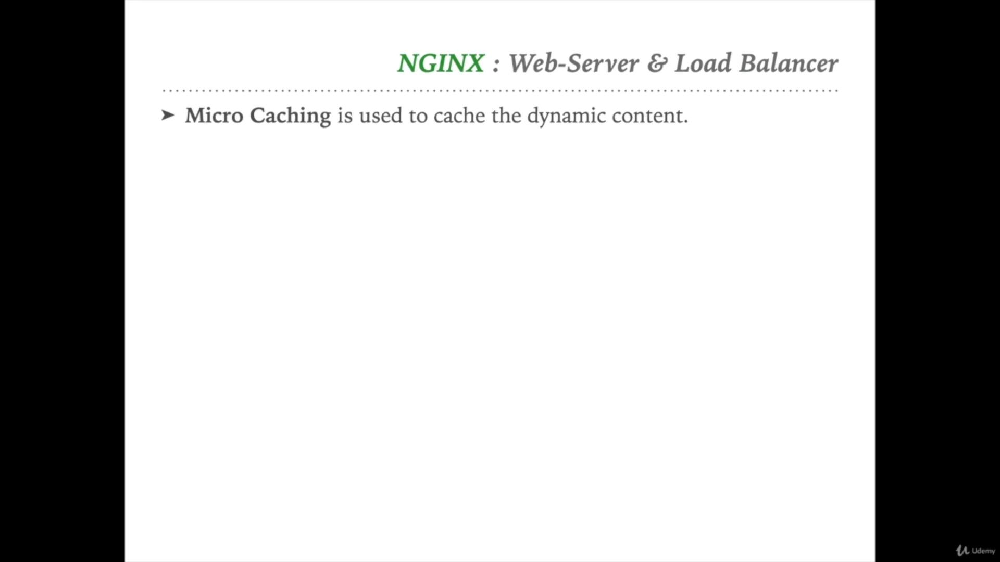

**④ 两条核心指令：`fastcgi_cache_path` 声明缓存区，`fastcgi_cache_key` 定义 key。**

> "第一个 FastCGI 内容缓存是通过名为 fastcgi_cache_path 的指令声明的。该指令必须定义在 HTTP 上下文的顶层。"
> —— p029 [10:14]–[10:41]

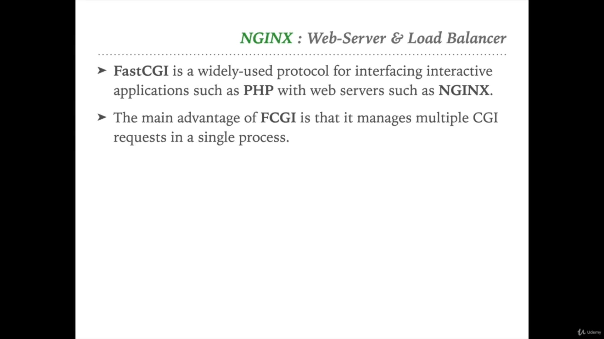

**⑤ `levels=1:2` 的意义：用两级目录把海量 MD5 文件摊开。**

> "如果你不定义层级，Nginx 会把每个缓存键的 MD5 值都存储在缓存目录下的同一层目录中，这会让 Nginx 很难处理。所以我们要做的是定义两级目录层级。"
> —— p029 [11:38]–[12:08]

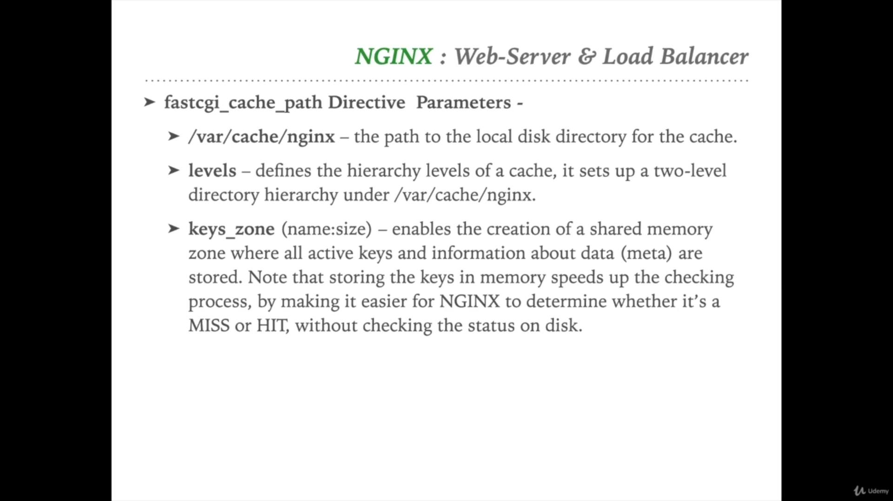

**⑥ key 的四段组成。**

> "首先是 scheme，然后是请求方法，再是主机名。最后一部分是请求 URI。"
> —— p029 [15:27]–[17:24]

**⑦ 实验的动机：单机也能演示，用 Apache Bench 打并发。**

> "要测试这个，你不能只用一个终端来测。你需要下载 Apache Bench。你需要执行命令 apt-get -y install apache2-utils。"
> —— p030 [08:11]–[08:52]

**⑧ 压测前后差距（讲师机器实测）：**

> "之前是每秒4158个请求，如果每个请求只花一秒处理时间的话。现在只有每秒4.79个请求。"
> —— p030 [13:58]–[14:22]

> "一旦我缓存了动态内容，我的处理能力将提升到每秒11000个请求。"
> —— p030 [21:27]–[21:53]

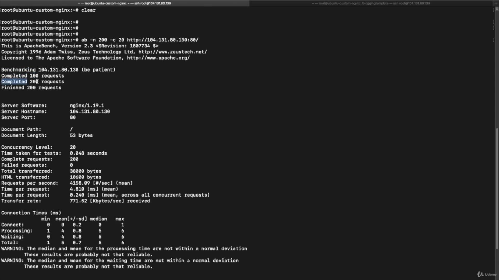

**⑨ 用响应头验证命中。**

> "我会再定义一个响应头，添加 X-Cache-Upstream-Cache-Status 头。现在我们得到的是命中，这意味着我第一次请求这个特定资源时还没有缓存。"
> —— p030 [17:09]–[18:06]

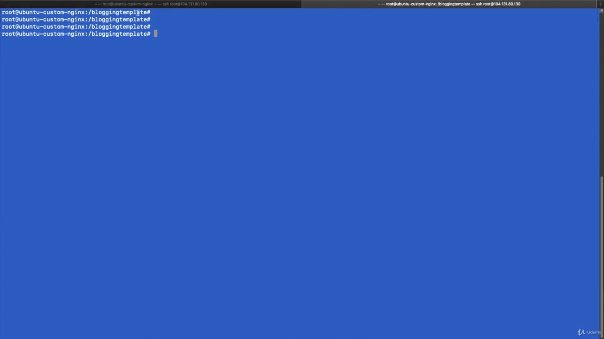

**⑩ HTTPS 与证书。**

> "我们会用 openssl req 命令。定义格式为 X.509，过期时间设为100天，RSA 密钥长度为2048位。"
> —— p031 [07:06]–[08:02]

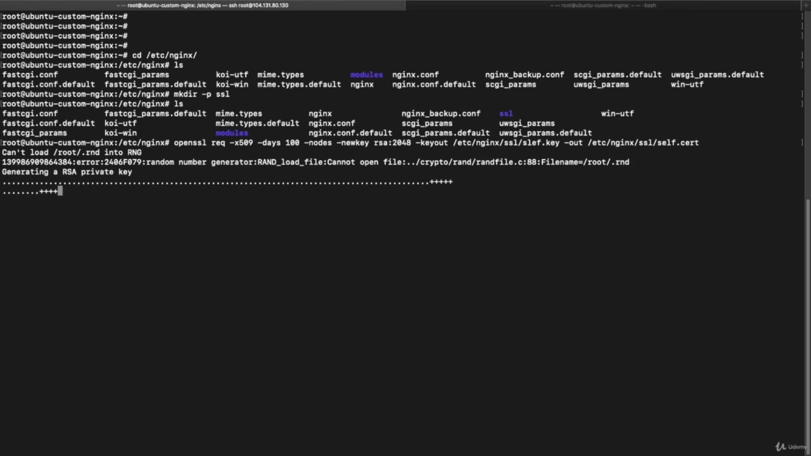

> "HTTPS 协议将监听443端口。我们需要定义 SSL。我会使用 ssl_certificate 指令。之后我们还需要定义公钥。"
> —— p031 [09:57]–[11:23]

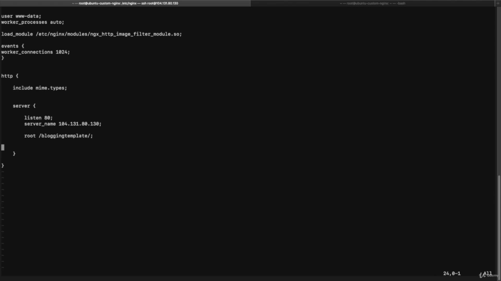

**⑪ HTTP/1.1 的病根：一个 TCP 连接一次只能跑一个请求。**

> "HTTP 1.1 在每个 TCP 连接上只能处理一个未完成的请求，迫使浏览器使用多个 TCP 连接来同时处理多个请求。"
> —— p032 [01:23]–[01:52]

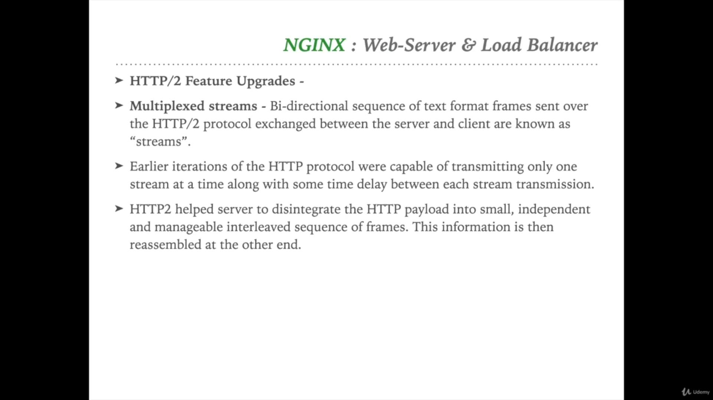

**⑫ HTTP/2 的四条改进。**

> "第一个是多路复用流。下一个优势是 HTTP/2 服务器推送。下一个特性是二进制协议。再下一个特性是有状态头部压缩。"
> —— p032 [04:41]–[11:13]

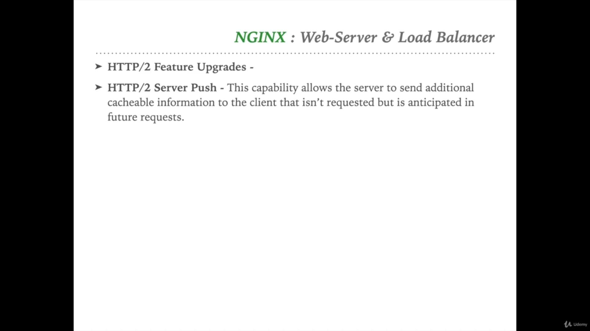

**⑬ 讲师自己承认 HTTP/2 只讲理论。**

> "在接下来的课程中，我会展示如何在 Nginx 中添加 HTTP/2。"
> —— p032 [15:49]–[16:05]

---

## 3. 从零复现

下面的顺序就是你要敲的顺序，中间不要跳步。每一步都给了「预期结果」和「失败了先看哪里」。

### Step 0：确认后端能跑（PHP-FPM）

```bash
php -v
systemctl status php7.2-fpm --no-pager     # 版本号按你的实际情况替换
ls -l /run/php/
```

**预期**：`ls -l /run/php/` 里能看到一个 `phpX.Y-fpm.sock`。这个文件名后面要原样复制进 nginx 配置。**记不住就先写下来。**

### Step 1：建站点目录和动态页面

```bash
sudo mkdir -p /var/www/brownie
sudo chown -R "$USER":www-data /var/www/brownie
```

先用 `vi /var/www/brownie/index.php` 写入**第 4 节文件 1** 的内容（一个输出当天日期的 PHP 页面）。注意：讲师在 P30 一开始是先看到「PHP 源码被当成纯文本吐出来」的，然后才去补 `location ~ \.php$`，**所以如果你的 PHP 源码直接显示在浏览器里，不要慌，那是正常的中间态**：

> "为什么这里会出现文件语法错误？因为我们在配置中没有初始化 PHP 进程的位置。"
> —— p030 [02:14]–[02:42]

### Step 2：写 nginx 主配置（先不带缓存）

```bash
sudo cp /etc/nginx/nginx.conf /etc/nginx/nginx.conf.bak
sudo vi /etc/nginx/nginx.conf
```

写入**第 4 节文件 2**（阶段 A 版本）。`fastcgi_cache` / `fastcgi_cache_valid` / `add_header` 这三行**先注释掉**，我们第一步只要「动态页面能正常显示」。

```bash
sudo nginx -t
sudo systemctl reload nginx
curl -i http://127.0.0.1/
```

**预期**：`HTTP/1.1 200 OK`，body 里是 `<h1>Today's date</h1>` 加上当天日期，例如讲师屏幕上的 `Sunday 23rd of August 2020`。

```bash
curl -i http://127.0.0.1/index.php
```

**同样应该 200。** 如果 502，九成是 `fastcgi_pass` 的 socket 路径写错了（回到 Step 0 看 `ls /run/php/`）；如果 404，看 `root` 是否指向 `/var/www/brownie`。

### Step 3：制造「慢后端」，先量出难看的基线

打开 `index.php`，把 `sleep(1);` 这一行的注释去掉（就是讲师说的「I don't have any system where I can put some database query, so I will put some sleep inside my PHP file」——p030 [12:34]）。

```bash
curl -i http://127.0.0.1/          # 体感会卡 1 秒
ab -n 200 -c 20 http://127.0.0.1:80/
```

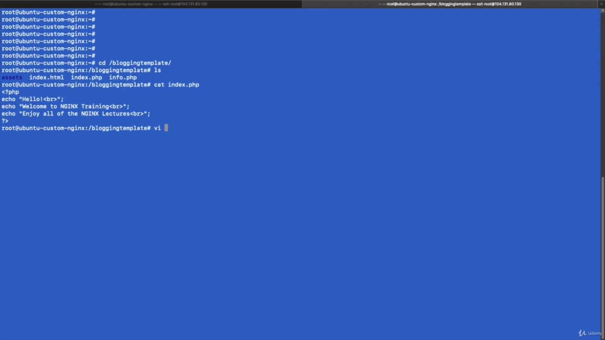

**预期**：`Requests per second` 掉到个位数（讲师机器上是 **4.75 / 4.79**），`Time per request` 涨到 **4179 ms** 这个量级。

> 📌 讲师踩过一个坑：`ab` 如果不带端口会直接报 `invalid URL`。**端口 80 必须显式写出来**（p030 [10:16]–[10:44]）。

### Step 4：打开微缓存，再量一次

回到 `nginx.conf`，取消这三行的注释：

```nginx
fastcgi_cache        zone_one;
fastcgi_cache_valid  200 60m;
add_header X-Cache-Status $upstream_cache_status;
```

并确认 http 上下文里这两行存在（第 4 节文件 2 已包含）：

```nginx
fastcgi_cache_path /tmp/cache_nginx levels=1:2 keys_zone=zone_one:100m inactive=60m;
fastcgi_cache_key  "$scheme$request_method$host$request_uri";
```

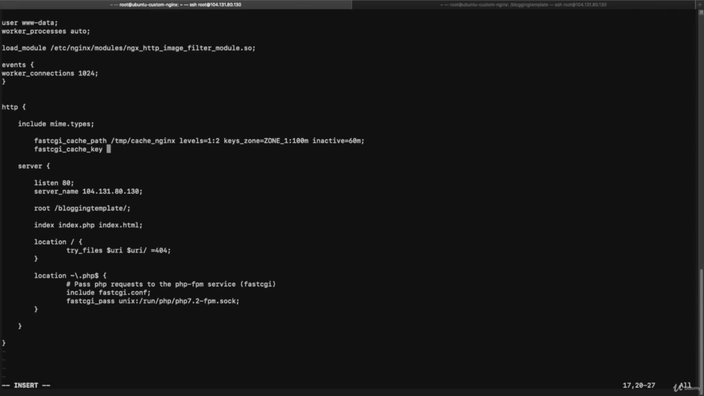

```bash
sudo nginx -t
sudo systemctl reload nginx          # 讲师中途用过 restart，改配置用 reload 就够
ab -n 200 -c 20 http://127.0.0.1:80/
ab -n 200 -c 20 http://127.0.0.1:80/   # 第二次会更高，因为缓存已经热了
```

**预期**：第一次从个位数跳到几十（讲师说 "从 4.9 到 39.75"，p030 [15:46]），第二次几千到上万（讲师说 **10000**、后面又说 **11000** 量级，p030 [15:46]–[16:15]）。讲师的原话总结：

> "容量下降了一百多倍。一旦我缓存了动态内容，我的处理能力将提升到每秒11000个请求。"
> —— p030 [14:22]–[21:53]

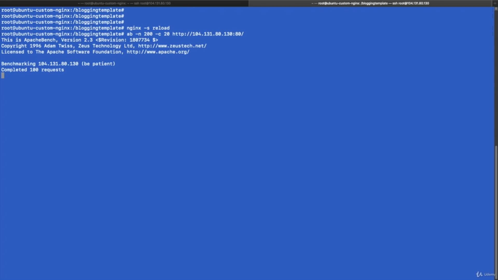

### Step 5：用 `curl` 看命中状态

```bash
curl -i http://127.0.0.1/index.php | grep -i x-cache
```

**预期**：第一次 `X-Cache-Status: MISS`（说明 vhost 前缀/这个 URL 之前没缓存），紧接着再执行一次，变成 `HIT`。讲师现场就是这样验的：

> "这里我们看到的是未命中。如果我再次执行 curl，现在得到的是命中。让我们稍微修改一下。现在我要再次访问完整的文件 index.php。再请求一次，我们会得到未命中。再请求一次这个 URL，我们会得到命中。"
> —— p030 [18:06]–[18:35]

> ⚠️ 「访问了别的 URL 再回来会重新 MISS」这句：讲师现场是改动了 PHP 文件后再次命中 MISS。**原因是 key 里含 `$request_uri`，不同 URI 是不同 key**，与文件内容改动本身无关（改文件内容不会让 nginx 缓存失效——这一点**课里没讲**，见第 7 节）。

### Step 6：进缓存目录，亲眼看见 `levels=1:2`

```bash
sudo ls -l /tmp/cache_nginx
sudo ls -l /tmp/cache_nginx/0/
sudo ls -l /tmp/cache_nginx/0/9d/
```

**预期**：第一层是一堆 1 位十六进制目录（讲师机器上看到的是 `0`、`3`、`5`），第二层是 2 位（如 `9d`、`6c`），第三层是 32 位 MD5 文件名——**那个 MD5 就是 key 的哈希**：

> "1:2 的意思是，我们定义这是第一级目录，然后它下面会有子目录，缓存就存放在那里。这是我们在 Nginx 配置文件中定义的键值。先是 scheme，然后是请求方法，再是主机名，最后是 URI。"
> —— p030 [20:02]–[21:00]

```bash
sudo ls -l /tmp/cache_nginx | head
```

> 讲师在 P29 讲惯例时说的是 `/var/cache/nginx`，但 P30 实验里他实际用的是 `/tmp/cache_nginx`（"在临时目录中。假设我定义某个目录，比如 cache/nginx"，p030 [05:03]–[05:32]）。**本文跟实验保持一致，用 `/tmp/cache_nginx`。**

### Step 7：自签证书

```bash
sudo mkdir -p /etc/nginx/ssl
cd /etc/nginx/ssl
sudo openssl req -x509 -nodes -days 100 -newkey rsa:2048 \
     -keyout /etc/nginx/ssl/self.key \
     -out    /etc/nginx/ssl/self.cert
```

交互过程按讲师的做法随便填（他说了 "你可以提供任意数据"，p031 [08:30]）：Country Name → State → City → Organization → Organizational Unit → **Common Name** → Email。

```bash
sudo ls -l /etc/nginx/ssl/
```

**预期**：`self.key` 和 `self.cert` 两个文件都有内容、非 0 字节。

> 📌 讲师口述里有两处口误，照抄会配错：
> 1. 他说 RSA "2048 kilobyte"，实际单位是 **bit**，写 `rsa:2048`。
> 2. 他说私钥指令也叫 `ssl_certificate`，实际 nginx 里私钥是 **`ssl_certificate_key`**（他在同段后半句才说对："我们将使用 ssl_certificate 和 ssl_certificate_key"，p031 [10:56]–[11:23]）。

### Step 8：切到 443

把 `nginx.conf` 换成**第 4 节文件 3**（阶段 B / 合并版），关键三行：

```nginx
listen 443 ssl;
ssl_certificate     /etc/nginx/ssl/self.cert;
ssl_certificate_key /etc/nginx/ssl/self.key;
```

```bash
sudo nginx -t
sudo systemctl restart nginx        # 讲师这里用的是 restart，不是 reload（p031 [11:49]）
systemctl status nginx --no-pager
ps -ef | grep nginx
```

验证：

```bash
curl -k -i https://127.0.0.1/
```

**预期**：`HTTP/1.1 200 OK`。**注意必须带 `-k`**，因为证书是自签的，curl 默认会校验失败。

浏览器部分，讲师遇到了两个坑，你一定会遇到：

1. **Chrome 直接不给过**——"Google Chrome 不允许我们继续往下进行。也就是说，我们无法继续使用 Google Chrome。"（p031 [12:44]）
2. **Firefox 可以强行放行**——`Advanced` → `Accept the Risk and Continue`，然后站点就能打开，F12 的 Network 里会出现小锁和 "用于获取此资源的连接是安全的"。（p031 [13:13]–[13:41]）


### Step 9：HTTP/2（**本节无实验**）

P32 整集是 PPT 讲解，讲师在结尾明确说配置留到下一节。所以这一阶段的「复现」只有一件事：**把下面四条记进脑子**，然后去你的生产站点按 F12 看 Protocol 列。

| 特性 | HTTP/1.1 的做法 | HTTP/2 的做法 | 讲师的说法 |
|---|---|---|---|
| 连接 | 一个 TCP 连接一次一个请求，浏览器开多条连接 | 一条 TCP 连接上跑多条 stream | multiplexed stream |
| 主动推 | 没有，客户端要什么给什么 | 服务端可以「预判」并推送 CSS/图片 | server push |
| 数据格式 | 纯文本命令 | 二进制分帧 | binary protocols |
| 头部 | 每个请求都重复发一堆一样的 header | HPACK 压缩，只发相对变化 | stateful header compression |

> 关于「怎么在 nginx 里开 HTTP/2」：**课里没讲**。讲师的原话是 "在接下来的课程中，我将展示如何在 Nginx 中添加 HTTP/2"（p032 [15:49]）。本文不替你补这段配置，避免和课程内容混淆。

---

## 4. 完整代码

### 文件 1：`/var/www/brownie/index.php`

```php
<?php
// 想复现「慢后端」场景：把下面这行的注释去掉，重新压测
// sleep(1);
?>
<!DOCTYPE html>
<html lang="en">
<head>
    <meta charset="utf-8">
    <title>brownie</title>
</head>
<body>
    <h1>Today's date</h1>
    <p><?php echo date('l jS \of F Y'); ?></p>
</body>
</html>
```

### 文件 2：`/etc/nginx/nginx.conf`（阶段 A：80 端口 + FastCGI 微缓存）

```nginx
user  www-data;
worker_processes  auto;
pid /run/nginx.pid;

events {
    worker_connections  1024;
}

http {
    include       /etc/nginx/mime.types;
    default_type  application/octet-stream;

    sendfile        on;
    keepalive_timeout  65;

    # ─────── 微缓存：全局声明（必须在 http 上下文内）───────
    # 目录、目录层级 1:2、共享内存区名 zone_one 大小 100m、60 分钟没被访问就淘汰
    fastcgi_cache_path /tmp/cache_nginx
                       levels=1:2
                       keys_zone=zone_one:100m
                       inactive=60m;

    # 缓存 key：协议 + 请求方法 + 主机名 + 完整请求 URI
    fastcgi_cache_key "$scheme$request_method$host$request_uri";

    server {
        listen       80;
        server_name  brownie.local;

        root   /var/www/brownie;
        index  index.php index.html;

        location / {
            try_files $uri $uri/ =404;
        }

        location ~ \.php$ {
            include        fastcgi_params;
            fastcgi_pass   unix:/run/php/php7.2-fpm.sock;
            fastcgi_param  SCRIPT_FILENAME $document_root$fastcgi_script_name;

            # ─────── 微缓存：只对 PHP 生效 ───────
            fastcgi_cache        zone_one;
            fastcgi_cache_valid  200 60m;

            # 把命中状态回写给客户端，方便 curl 验证
            add_header X-Cache-Status $upstream_cache_status;
        }
    }
}
```

### 文件 3：`/etc/nginx/nginx.conf`（阶段 B：443 + 自签证书，保留微缓存）

```nginx
user  www-data;
worker_processes  auto;
pid /run/nginx.pid;

events {
    worker_connections  1024;
}

http {
    include       /etc/nginx/mime.types;
    default_type  application/octet-stream;

    sendfile        on;
    keepalive_timeout  65;

    fastcgi_cache_path /tmp/cache_nginx
                       levels=1:2
                       keys_zone=zone_one:100m
                       inactive=60m;

    fastcgi_cache_key "$scheme$request_method$host$request_uri";

    # 课里没讲：把 80 跳 443（可选，不需要就整段删掉）
    server {
        listen       80;
        server_name  brownie.local;
        return 301 https://$host$request_uri;
    }

    server {
        listen       443 ssl;
        server_name  brownie.local;

        # 自签证书（openssl 生成的两个文件）
        ssl_certificate     /etc/nginx/ssl/self.cert;
        ssl_certificate_key /etc/nginx/ssl/self.key;

        root   /var/www/brownie;
        index  index.php index.html;

        location / {
            try_files $uri $uri/ =404;
        }

        location ~ \.php$ {
            include        fastcgi_params;
            fastcgi_pass   unix:/run/php/php7.2-fpm.sock;
            fastcgi_param  SCRIPT_FILENAME $document_root$fastcgi_script_name;

            fastcgi_cache        zone_one;
            fastcgi_cache_valid  200 60m;

            add_header X-Cache-Status $upstream_cache_status;
        }
    }
}
```

### 文件 4：命令清单（可直接粘进终端）

```bash
# 0) 环境
sudo apt update
sudo apt install -y nginx php-fpm curl apache2-utils
ls -l /run/php/

# 1) 站点
sudo mkdir -p /var/www/brownie
sudo chown -R "$USER":www-data /var/www/brownie
vi /var/www/brownie/index.php

# 2) 配置 + 校验 + 重载
sudo cp /etc/nginx/nginx.conf /etc/nginx/nginx.conf.bak
sudo vi /etc/nginx/nginx.conf
sudo nginx -t
sudo systemctl reload nginx

# 3) 功能验证
curl -i http://127.0.0.1/index.php
curl -i http://127.0.0.1/index.php | grep -i x-cache

# 4) 压测（端口必须写）
ab -n 200 -c 20 http://127.0.0.1:80/

# 5) 看缓存目录
sudo ls -l /tmp/cache_nginx

# 6) 自签证书
sudo mkdir -p /etc/nginx/ssl
cd /etc/nginx/ssl
sudo openssl req -x509 -nodes -days 100 -newkey rsa:2048 \
     -keyout /etc/nginx/ssl/self.key \
     -out    /etc/nginx/ssl/self.cert
sudo ls -l /etc/nginx/ssl/

# 7) 切 443 后重启
sudo nginx -t
sudo systemctl restart nginx
curl -k -i https://127.0.0.1/
```

### 附：`ab` 输出长什么样（数值为讲师机器实测，字段名以你本机 ab 输出为准）

```
Server Software:        nginx/1.19.1
Server Hostname:        127.0.0.1
Server Port:            80

Document Path:          /
Document Length:        53 bytes

Concurrency Level:      20
Time taken for tests:   0.048 seconds
Complete requests:      200
Total transferred:      38000 bytes
HTML transferred:       10600 bytes
Requests per second:    4158.00 [#/sec] (mean)
Time per request:       4.18 [ms] (mean)

Percentage of the requests served within a certain time (ms)
  50%      5
  99%      6
 100%      6 (longest request)
```

> 讲师现场读的就是这几项：`Document Length` 53 byte、`Concurrency Level` 20、`Time taken for tests` 0.048 秒、`Total transferred` 约 38000 byte、`HTML transferred` 约 10600 byte、`Requests per second` 4158、每请求 4.18 ms，50% 在 5 ms 内、99% 在 6 ms 内（p030 [11:12]–[12:08]）。**不同 ab 版本行的排列和措辞可能有差别，字段名请以你实际输出为准。**

---

## 5. 逐行解释

### 5.1 nginx 指令

**`fastcgi_cache_path /tmp/cache_nginx levels=1:2 keys_zone=zone_one:100m inactive=60m;`**

- 位置：**只能在 `http` 上下文**（讲师原话 "该指令必须定义在 HTTP 上下文的顶层"，p029 [10:14]）。放进 `server` 或 `location` 里 `nginx -t` 会直接失败。
- `/tmp/cache_nginx`：缓存文件落盘的真实目录。nginx **自己会创建**，你不用 `mkdir`；创建它的用户是 worker 进程用户（讲师看到目录属主是 `www-data`，原话 "这些目录基本上是由 www-data 创建的，而 www-data 就是 Nginx 用户"，p030 [19:34]）。
- `levels=1:2`：目录层级。nginx 对每个 key 取 MD5，然后**从后往前**取字符做目录名：1 级目录取 1 个字符，2 级目录取 2 个字符，剩下 32 位做文件名。讲师在终端里看到的 `0/9d/<32位>`、`3/6c/<32位>` 就是这个结构（p030 [20:02]–[21:00]）。
  - 为什么需要它：如果不设 `levels`，所有缓存文件挤在同一层目录里，文件一多，`readdir` 级别的查找就开始拖慢（讲师原话 "这又会令 Nginx 很难处理"，p029 [11:38]）。
- `keys_zone=zone_one:100m`：开一块名为 `zone_one` 的**共享内存区**，100 MB，用来存「key → 缓存文件位置」的索引。讲师对它的解释是「zone 定义缓存边界，边界内放 key 信息和数据信息，查 hit/miss 不用碰磁盘」（p029 [12:37]–[13:32]）。
  - ⚠️ **这里最容易误解**：`100m` 限的是**内存索引**，不是磁盘上缓存文件的总大小。讲师把两件事混在一句话里说了（"这个特定区域的最大大小将是 100 兆字节"，p030 [05:32]）。要限制磁盘总量得另加 `max_size=`，**这个参数课里提到了名字但没演示**（p029 [14:28]）。
- `inactive=60m`：60 分钟内**没有被任何人访问**的缓存就被删掉，不管它「新鲜不新鲜」。讲师的原话就是「regardless of their freshness」（p029 [13:59]）。注意这跟 `fastcgi_cache_valid 200 60m` 不是一回事：`valid` 管「多久算过期」，`inactive` 管「多久没人访问就清走」。

**`fastcgi_cache_key "$scheme$request_method$host$request_uri";`**

- 四段拼起来：`$scheme`（http/https）+ `$request_method`（GET/POST/…）+ `$host`（域名）+ `$request_uri`（路径+查询串）。
- 讲师强调了两个反直觉点：
  - **同一个 URL，http 和 https 是两个 key**——"如果方案不同，就会生成一个新的键"（p029 [15:56]）。这对你后面做 HTTPS 迁移很关键：切到 443 之后所有缓存相当于全量重建。
  - **URI 一变就是新 key**——"每当你更改请求 URI 时，就会生成一个新的键"（p029 [15:27]）。
- 小纠正：讲师把 `?name=Tom` 这一段说成 "the request URI"（p029 [16:54]），实际 `$request_uri` 是**整个** `/path?query`，带问号一起。
- **前端类比**：这就是一个 `Map` 的 key 生成函数。你在 Node 里写缓存服务，大概会写 `` const key = `${scheme}:${method}:${host}:${url}` ``，语义一模一样；`X-Cache-Status` 就相当于 `res.set('X-Cache', hit ? 'HIT' : 'MISS')`。

**`fastcgi_cache zone_one;`**

- 写在 `location ~ \.php$` 里，意思是「这个 location 的响应，存进 `zone_one` 这个区」。讲师说的就是「in which particular zone this particular location cache will be mapped」（p030 [07:26]）。
- 一个 zone 可以被多个 location 共用，一个 location 也可以只用一个 zone——讲师明确说「multiple locations can cache in the same zone as well. There's no restrictions」（p030 [07:26]）。

**`fastcgi_cache_valid 200 60m;`**

- 只有响应码 200 的响应才缓存，缓存 60 分钟。讲师现场只给了 200 一个状态码（"所有响应码为 200 的请求，此缓存都将有效"，p030 [07:53]）。

**`add_header X-Cache-Status $upstream_cache_status;`**

- 把「这次请求到底走没走缓存」写进响应头。讲师口音把 `$upstream_cache_status` 念成了 "stream 缓存状态"（p030 [17:09]），变量真名是 `$upstream_cache_status`。
- 课里实际出现过的值只有两个：**`MISS`（第一次）** 和 **`HIT`（后续）**。其它还能取什么值——**课里没讲**，需要时查 nginx 官方文档。

### 5.2 `/var/www/brownie/index.php`

```php
// sleep(1);
```
模拟「后端要做一次数据库查询/一次模型推理」。讲师明说了他手上没有可查的数据库，所以用 `sleep` 顶替（p030 [12:34]）。**这段一开，压测基线立刻从 4158 掉到个位数**，这就是这个实验的核心对比。

```php
<?php echo date('l jS \of F Y'); ?>
```
- `l`（小写 L）= 星期全称 → `Sunday`
- `jS` = 日 + 序数后缀 → `23rd`
- `\of` = 反斜杠转义，输出字面 `of`
- `F` = 月份全称 → `August`
- `Y` = 四位年份 → `2020`
合起来就是讲师屏幕上的 `Sunday 23rd of August 2020`（p030 [04:07]）。

**为什么这个页面必须被缓存？** 前端同学容易有个错觉：「日期每秒都在变，缓存不就等于给用户看旧时间？」——这正是微缓存的核心取舍：**你能接受 60 分钟粒度的「旧」**，才能换来上万 QPS。讲师的原话是缓存时间「you hardly put the cache for 30 minute 20 minute 10 minute sometimes in second」（p029 [05:37]），生产上你通常会把 `fastcgi_cache_valid` 调到 10s–60s，而不是 60 分钟。**这个调参建议课里没给具体数值**，他只说了「不能缓两年」（p029 [05:37]）。

### 5.3 openssl 那条命令

```bash
openssl req -x509 -nodes -days 100 -newkey rsa:2048 \
        -keyout /etc/nginx/ssl/self.key \
        -out    /etc/nginx/ssl/self.cert
```

- `req`：走证书请求流程（讲师念成 "openssl req"，p031 [07:32]）。
- `-x509`：直接产出自签证书，而不是产出一个待签名的 CSR。讲师说的是 "定义格式。我定义的是 X.509。这是标准格式"（p031 [07:32]）。
- `-nodes`：私钥不加密（no DES），nginx 启动时不用交互输密码。讲师念作 "the node"。
- `-days 100`：有效期 100 天。
- `-newkey rsa:2048`：现场生成一把 2048 位 RSA 私钥。**讲师说的是 "kilobyte"，单位应为 bit。**
- `-keyout` / `-out`：私钥 / 证书的落地路径。
- 交互里那个 **Common Name** 要填你访问用的域名或 IP，否则浏览器报的错会更莫名其妙。讲师这里随便填了个 `team`（p031 [08:30]）——所以后面 Chrome 直接不给过。

### 5.4 为什么讲师要 `restart` 而不是 `reload`

> "我建议不要用 reload，而是直接重启你的 Nginx 服务。"
> —— p031 [11:49]

改证书路径、改 `listen` 端口这类结构性变更，讲师的做法是 `systemctl restart nginx`。日常改 `location` 用 `reload` 更平滑（P30 里他全程用的 `nginx -s reload`）。**两者差异的完整解释课里没讲**，记住结论即可。

---

## 6. 复现检查清单

按顺序打勾，每一项都能独立验证：

- [ ] **1. PHP-FPM 在跑。** `ls -l /run/php/` 能列出 socket 文件，且文件名已复制进 `nginx.conf` 的 `fastcgi_pass`。
- [ ] **2. `nginx -t` 通过。** 每次改完配置必须跑，且输出 `syntax is ok` / `test is successful` 两行。
- [ ] **3. 动态页面真的动态。** `curl -i http://127.0.0.1/index.php` 返回 200，body 里有 `<h1>Today's date</h1>` 和当天日期。
- [ ] **4. PHP 源码不再被当纯文本吐出。** 如果你看到 `<?php`

## 7. 课里没讲但你会撞上的

| 现象 | 原因 | 怎么办 |
|---|---|---|
| 访问 `http://127.0.0.1/index.php` 返回 `502 Bad Gateway` | 配置里写死了 `unix:/run/php/php7.2-fpm.sock`，但本机 PHP 版本不同；**课里没讲**要先确认 socket 文件名 | `ls -l /run/php/` 看实际 `phpX.Y-fpm.sock`，改 `fastcgi_pass` 后 `sudo nginx -t && sudo systemctl reload nginx` |
| 改了 `index.php`，页面日期仍是旧的，`X-Cache-Status` 一直 `HIT` | `fastcgi_cache_valid 200 60m` 让 200 响应缓存 60 分钟；改源文件不会自动让 nginx 缓存失效；**课里没讲**缓存清理/失效 | 删除 `/tmp/cache_nginx` 下缓存，或换 URI/加查询串；或把 `fastcgi_cache_valid` 调短（具体值课里没给） |
| 以为 `keys_zone=zone_one:100m` 已经把磁盘缓存限制在 100MB，结果 `/tmp/cache_nginx` 继续变大 | `100m` 是共享内存索引大小，不是磁盘缓存上限；`max_size` **课里没讲**（只提过名字） | 在 `fastcgi_cache_path` 加 `max_size=...`，并监控缓存目录 |
| `curl -i https://127.0.0.1/` 报证书校验失败 | 自签证书不被信任；**课里没讲** `curl` 测试要加 `-k`（或只讲了浏览器接受风险） | 测试用 `curl -k -i https://127.0.0.1/`；浏览器用 Firefox 接受风险 |
| Chrome 直接拦截自签 HTTPS，无法继续 | 自签证书 + Common Name 随便填（讲师填 `team`）；**课里没讲** CN 要匹配访问域名/IP | 重新生成证书时 CN 填 `127.0.0.1` 或域名；或换 Firefox/`curl -k` 做实验 |
| 看到 `X-Cache-Status` 不是 `MISS`/`HIT`，而是 `BYPASS`、`EXPIRED` 等值 | 课里只演示了 `MISS` 和 `HIT`；**课里没讲**其它状态值的含义 | 查 nginx 官方文档；复现实验时固定用同一 URL 先看 `MISS` 再看 `HIT` |
| 压测数字和讲师差很多（不是 4158/10000） | 讲师数字来自他的机器和 nginx/ab 版本；**课里没讲**硬件、负载、PHP 版本都会影响绝对值 | 只看开缓存前后的相对提升；不要死盯固定 QPS |
| 想复现 P32 的 HTTP/2 配置却找不到 | P32 只讲理论，**课里没讲** nginx 开 HTTP/2 的配置 | 本节不配 HTTP/2；只记多路复用/server push/二进制分帧/HPACK 四条差异，等下一节 |
