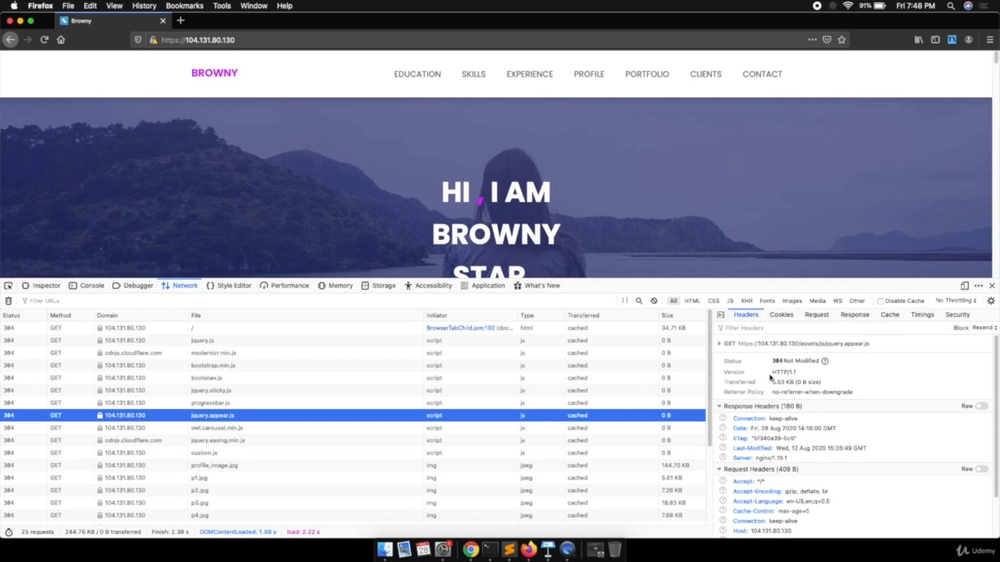
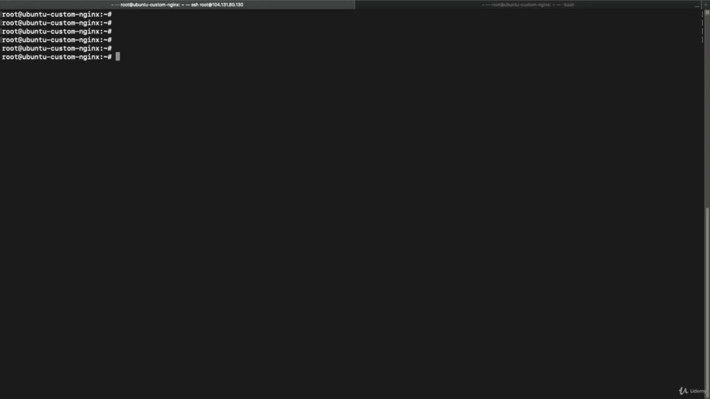
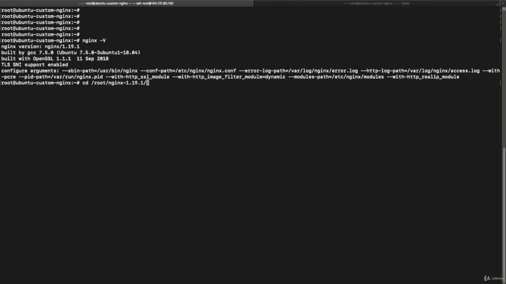
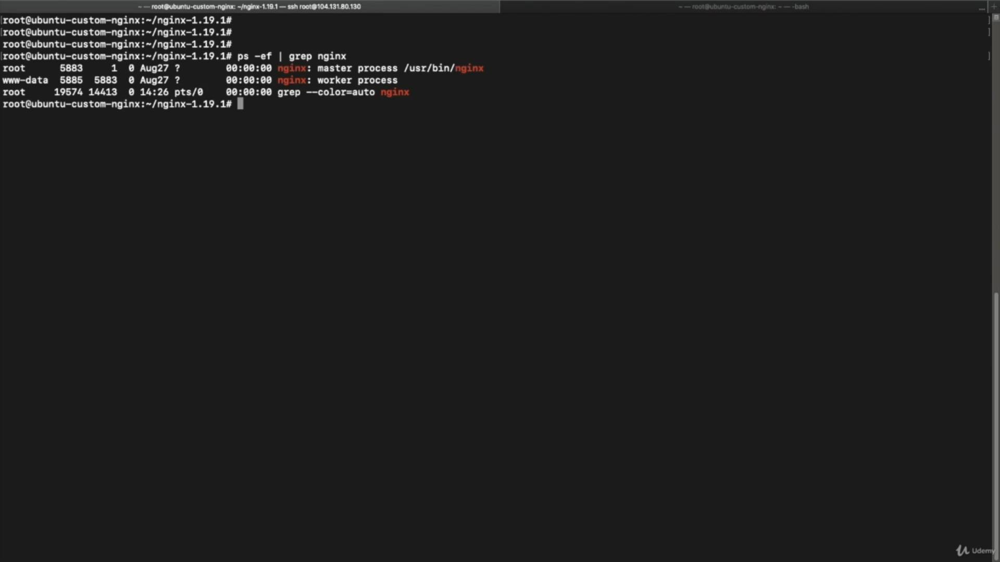
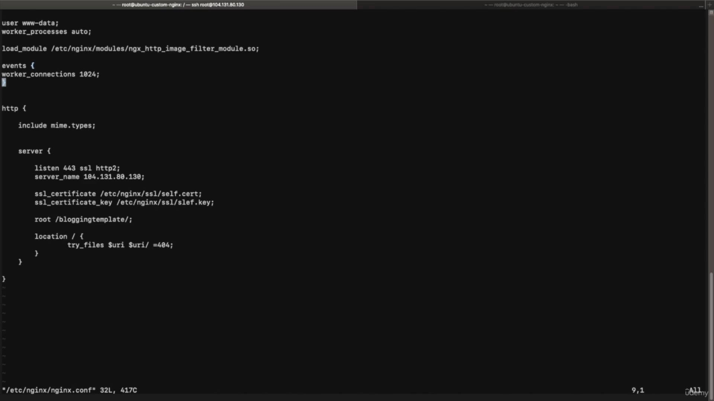
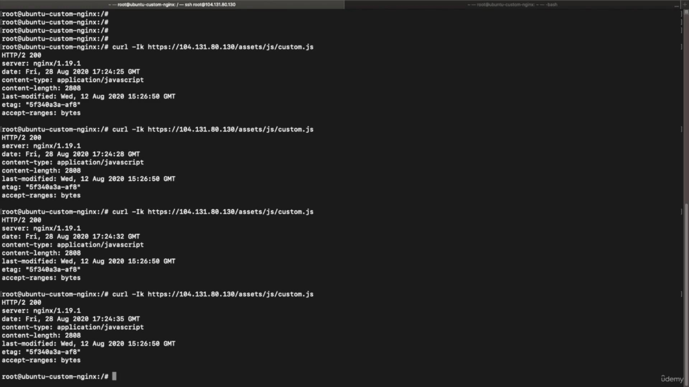
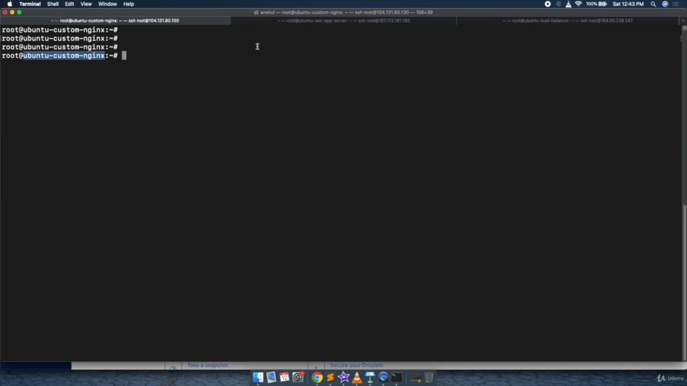

# NGINX MasterClass（P33–P36）复现文档

> 覆盖内容：P33 启用 HTTP/2；P34 配置请求速率限制；P35 负载均衡概念；P36 用三台机器搭一个最小 NGINX 负载均衡实验。  
> 读者定位：前端转 AI 应用工程师。命令能直接照抄的地方我会写全；课程没有讲清楚的地方会明确标注「课里没讲」。  
> 版本说明：课程没有固定 NGINX 版本，P33 以你机器上 `nginx -V` 的输出为基准；P36 使用 Ubuntu 18.04 云主机和 `apt-get install nginx`。本文中的 IP 使用课程里出现的示例段，实际复现时请换成你自己的机器 IP。

---

## 1 这一节做什么

这一节不是单纯讲概念，而是把三个可以独立验证的 NGINX 能力串起来：

1. **把站点从 HTTP/1.1 切到 HTTP/2**：先用浏览器 Network 工具确认当前请求版本，再回到源码目录重新 `configure`，加上 `--with-http_v2_module`，然后 `make`、`make install`，最后在 `listen 443 ssl` 后面加 `http2`，重载 NGINX，用浏览器确认请求协议变成 HTTP/2。
2. **给静态资源加请求速率限制**：在 `http` 上下文定义 `limit_req_zone`，在 `location` 里用 `limit_req` 引用 zone；先用压测工具观察不加限流时大量并发会把 CPU 打高，再加 `burst` 和 `nodelay` 观察“允许少量突发、但不无限排队”的效果。
3. **用 NGINX 做最小负载均衡器**：准备三台机器，两台跑应用页面，一台跑 NGINX 作为负载均衡器；在负载均衡器的 `http` 上下文写 `upstream`，在 `server/location` 里写 `proxy_pass http://upstream名`，然后用 `curl` 连续请求，观察请求在兩個后端之间轮询。

P35 是负载均衡概念课，没有代码；它解释“为什么需要负载均衡、轮询/最少连接/最少响应时间/最少带宽/哈希、会话保持、动态扩缩容、硬件与软件负载均衡”。这些概念会作为 P36 实验的设计依据。

从学习路径上看，这三节分别对应反向代理前端的三个常见问题：**协议升级、入口限流、流量分发**。前端同学平时更容易接触浏览器 Network、CDN、网关和接口限流，但很少直接改 NGINX 编译参数或手工搭 upstream。复现时建议不要只“看一遍命令”，而是每做一步都留下可验证的证据：`nginx -V` 的输出、`nginx -t` 的结果、浏览器 Network 的 Protocol 列、`curl -i` 的状态码、后端 `access.log` 的来源记录。这样即使环境与讲师不同，也能判断是哪一层没有生效。

需要提前说明：P33 的 HTTP/2 实验涉及修改 `listen` 与重新编译；P34 的限流实验会覆盖或修改同一个 `nginx.conf`；P36 又会换到另外两台应用服务器和一台负载均衡器。复现时最稳妥的做法是**先备份 `/etc/nginx/nginx.conf`**，每完成一个实验就用 `sudo nginx -t` 做语法检查，再决定 `reload` 还是 `restart`。课里没有强制要求备份，但这是避免把实验机配置改坏的必要习惯。

另外，本文会反复出现“与前端对照”的解释。例如：HTTP/2 在浏览器 Network 里表现为 Protocol 列变成 `h2`；限流不是前端 `debounce`，而是服务端入口按时间窗口决定放行还是返回 `503`；负载均衡也不是前端轮询接口，而是反向代理把 TCP/HTTP 请求分给不同后端。把这些差异想清楚，复现时就不容易把“浏览器缓存没刷新”误判成“配置没生效”。

---

## 2 讲师原话（带「—— pNNN [MM:SS]」）

> "要从 HTTP/1.1 切换到 HTTP/2，需要重新构建 NGINX。"
> —— p033 [00:56]

> "需要修改 NGINX 配置文件，在 `ssl` 后面再加一个参数 `http2`。"
> —— p033 [03:17]

> "在某些情况下，仅执行 `reload` 不够，需要执行 `systemctl restart nginx` 来重启 NGINX 服务。"
> —— p033 [05:13]

> "NGINX 的限流用于限制用户在给定时间段内可以发起多少 HTTP 请求。"
> —— p034 [00:00]

> "NGINX 的限流使用漏桶算法。"
> —— p034 [02:15]

> "`burst` 参数定义客户端在 `zone` 规定速率之外还能额外发起多少请求。"
> —— p034 [14:10]

> "负载均衡是指将进入的流量高效地分发到后端服务器组。"
> —— p035 [00:29]

> "要让 NGINX 作为负载均衡器，需要在 `http` 上下文中再增加一个 `upstream` 上下文。"
> —— p036 [06:11]

> "用 `nginx -t` 验证 NGINX 配置，然后重启 NGINX。"
> —— p036 [08:32]

上面这些原话分别对应三个动作：P33 强调“重新构建 + 改 listen + 必要时 restart”；P34 强调“按时间限制请求量 + 漏桶 + burst”；P36 强调“用 upstream + 先 `nginx -t` 再重启”。复现时可以把原话当作检查点：如果你没有重新构建却只改 `listen ... http2`，或者配置写错却没有先 `nginx -t`，就会在对应步骤卡住。课里没有逐字给出所有文件的完整内容，所以第 4 节会给出“按课程操作整理出的最小可用示例”，并标明哪些是课程明确讲过的、哪些是复现时补上的通用做法。

---

## 3 从零复现

### 3.0 机器、目录与依赖

P36 明确用了三台 Ubuntu 18.04 云主机，每台 $5/月档位：

| 机器 | 作用 | 课程里的名字 | 本文占位 |
|---|---|---|---|
| A | 跑 brownie 站点，同时用于 P33/P34 实验 | Ubuntu custom engine X | `APP1_IP`，示例 `167.172.161.130` |
| B | 跑第二个静态页面 / 默认 NGINX 页 | Ubuntu second app server | `APP2_IP`，示例 `167.172.161.192` |
| C | 跑 NGINX 作为负载均衡器 | Ubuntu load balancer | `LB_IP`，示例 `167.172.161.226` |

课程里出现过的示例 IP 段是 `167.172.161.x`，其中第二台应用服务器出现过 `167.172.161.192`，负载均衡器日志里出现过结尾 `226`。复现时不要照抄，先在你自己的云控制台确认公网 IP。尤其要注意：**云主机的内网 IP 与公网 IP 可能不同**，P36 的三台机器如果在同一个 VPC/私有网络内，upstream 里写内网 IP 通常更稳；如果跨公网，则要确认安全组和防火墙允许 80 端口。课里没有展开网络层细节，复现时以能 `curl` 通为准。

目录结构如下：

```text
# P33 / P34 所在机器
/etc/nginx/nginx.conf
/etc/nginx/tls/self.crt              # 仅本文最小 HTTP/2 实验需要；课里没讲证书生成
/etc/nginx/tls/self.key
/var/www/http2/index.html
/var/www/ratelimit/index.html
/var/www/ratelimit/custom.js
/var/log/nginx/access.log
/var/log/nginx/error.log

# P36 应用服务器 A
/etc/nginx/nginx.conf
/var/www/brownie/index.html
/var/log/nginx/access.log

# P36 应用服务器 B
/etc/nginx/nginx.conf
/var/www/html/index.html
/var/log/nginx/access.log

# P36 负载均衡器 C
/etc/nginx/nginx.conf
/var/log/nginx/access.log
/var/log/nginx/error.log
```

依赖说明：

- 操作系统：Ubuntu 18.04（P36 讲师创建 droplet 时明确选 18.04）。
- NGINX：课程没有锁定版本。P33 的第一步就是 `nginx -V`，你应以自己的输出为准。
- 浏览器：P33 使用 Firefox，按 F12 打开 Network。
- 压测工具：逐字稿里写作 `sees` / `C's`，安装命令又写成 `apt-get install seas`，拼写不一致；课里没有给出可确认的包名。本文保留课里写法，并在第 7 节说明替代验证方式。
- `curl`：系统自带，用于单请求验证。

复现前建议先执行几个环境确认命令，避免后面把“环境问题”误判成“配置问题”：

```bash
# 确认系统版本与 NGINX 版本
lsb_release -a
nginx -v
nginx -V

# 确认 80/443 端口是否被占用
sudo ss -ltnp | grep -E ':80|:443'

# 确认配置语法
sudo nginx -t
```

`nginx -V` 输出的是编译参数，`nginx -v` 只输出版本号；P33 必须看 `nginx -V`，因为要看 `configure arguments:` 里是否包含 `--with-http_v2_module`。`ss -ltnp` 用来确认监听端口，若 80 或 443 已被别的进程占用，`nginx -t` 可能通过但启动会失败。课里没有讲这些排查命令，但复现时非常常用。

---

### 3.1 实验一：启用 HTTP/2（P33）

#### 步骤 1：浏览器确认当前协议

在 Firefox 打开你的站点，按 F12，进入 Network，刷新页面。点任意一个 JS/CSS/图片请求，在请求详情里看版本/协议。课程里看到的是 HTTP/1.1。



常见错误：只刷新页面但没有打开 Network 的 Protocol 列；或者看的是缓存请求。验证时要确认请求确实是当前页面发出的，并且看的是 `Protocol` 或 `Version` 字段。若看不到该列，可以右键表头勾选 Protocol。前端对照：浏览器 DevTools 的 Network 面板是客户端视角，它显示的是协商后的协议；如果显示 `http/1.1`，说明至少当前这条连接没有用上 HTTP/2。

#### 步骤 2：记录当前 NGINX 编译参数

SSH 到机器：

```bash
nginx -V
```

课程里讲师把 `nginx -V` 输出的配置参数复制下来，保存到安全位置。下面截图是终端查看 NGINX 配置参数的画面。



这个输出通常很长，关键是最后一行 `configure arguments:`。它代表当前 NGINX 编译时启用的模块和路径。重新 `configure` 时不能只写 `--with-http_v2_module`，否则可能丢掉原来的模块和安装路径。课里没有逐字展示完整参数，复现时请把你机器上的输出原样保存，例如先重定向到文件：

```bash
nginx -V 2> /root/nginx-configure-args.txt
```

注意 `nginx -V` 把信息输出到 stderr，所以用 `2>` 捕获。若你直接复制终端文本，也要确认没有漏掉 `--prefix`、`--conf-path`、`--with-*` 等参数。

#### 步骤 3：回到源码目录重新 configure

进入你解压 NGINX 源码的目录。课程只说是 root 下的 nginx 目录，没有给出具体版本目录名，所以下面用 `/root/nginx` 作为示例，请替换成你的实际目录。

```bash
cd /root/nginx
```

把 `nginx -V` 输出中 `configure arguments:` 后面的参数原样保留，再追加 `--with-http_v2_module`。如果你的输出字段名不同，就手动复制。下面给一个自动提取的写法，执行前先看一眼 `nginx -V` 的实际输出：

```bash
NGINX_ARGS="$(nginx -V 2>&1 | sed -n 's/^configure arguments: //p')"
./configure $NGINX_ARGS --with-http_v2_module
```

课程里讲师是在 `./configure` 后搜索 `HTTP`，找到 `HTTP version 2` 相关模块，然后重新配置。下面截图是终端搜索/配置过程。



常见错误与排查：

- **`./configure` 报找不到编译器**：需要先安装构建依赖，Ubuntu 上通常需要 `build-essential`、`libpcre3-dev`、`zlib1g-dev`、`libssl-dev`。课里没有列依赖，复现时按编译报错补装即可。
- **参数复制不完整**：如果丢了原来的 `--prefix`，`make install` 可能装到不同目录，后续 `systemctl` 启动的还是旧二进制。验证方法是 `which nginx` 与 `nginx -V` 看路径是否一致。
- **源码目录不对**：`./configure` 必须在包含 `auto/`、`src/` 的源码根目录执行。若提示 `./configure: No such file or directory`，先 `pwd` 和 `ls` 确认。
- 课里没有讲 `--with-http_v2_module` 是否默认启用；不同版本/打包方式不同，所以以 `nginx -V` 输出为准。如果输出里已经有该模块，仍然可以按课程重新配置，但要知道这不是唯一路径。

与前端对照：这一步类似前端项目里改构建配置后重新 `npm install && npm run build`。只改运行参数不重新构建，二进制里没有对应模块，配置写了也不会生效。

#### 步骤 4：编译并安装

```bash
make
sudo make install
```

如果你当前就是 root，可以去掉 `sudo`。课程里依次执行 `make`、`make install`，然后清屏继续验证。

`make` 是编译，`make install` 是安装到 `configure` 指定的 `--prefix`。如果 `make` 报错，先看第一条错误，不要只看最后一行。常见是缺少 OpenSSL/PCRE/zlib 开发包。`make install` 后如果 `nginx -V` 仍然没有 `--with-http_v2_module`，通常是你执行的是系统包安装的 nginx，而不是刚安装的二进制；用 `which nginx`、`nginx -V`、`systemctl cat nginx` 对照路径。

#### 步骤 5：确认 NGINX 还在运行、HTTP/2 模块已编入

```bash
ps -ef | grep nginx
nginx -V
```

`nginx -V` 输出里应能看到 `--with-http_v2_module`。课程里讲师确认 “HTTP module is present”，说明已经用 HTTP/2 模块构建。



验证要点：`ps -ef | grep nginx` 应看到 master 和 worker 进程；如果没看到，说明服务没起来。`nginx -V` 的 `configure arguments:` 必须包含目标模块。若包含但浏览器仍不是 HTTP/2，继续看 `listen` 和 TLS。课里没有讲用 `curl --http2` 验证，复现时可以补一个：

```bash
curl -I --http2 -k https://YOUR_DOMAIN_OR_IP/
```

如果 `curl` 不支持 `--http2`，可以先用浏览器验证。`-k` 仅用于自签名证书实验，生产不要忽略证书校验。

#### 步骤 6：修改 `nginx.conf`

打开 `/etc/nginx/nginx.conf`，找到现有的 SSL `listen` 行。课程里是在 `ssl` 后面加一个空格和 `http2`，最终形态类似：

```nginx
listen 443 ssl http2;
```

保存后检查并重载：

```bash
sudo nginx -t
sudo nginx -s reload
```

如果浏览器里协议没有变化，课程明确说要重启服务：

```bash
sudo systemctl restart nginx
```

常见错误：只监听 80 端口却期待 HTTP/2；HTTP/2 在浏览器中通常要求 TLS（课程场景是 443 + ssl），如果只写 `listen 443 ssl;` 没加 `http2`，协议不会升级。`nginx -t` 用于语法检查，必须看到 `syntax is ok` 和 `test is successful` 再 reload。reload 是平滑重载，restart 是停起服务；课程原话说明某些情况下 reload 不够，所以浏览器没变化时按课程 restart。

与前端对照：前端常以为“换个 header 就升级协议”，实际 HTTP/2 是连接层协商，需要 TLS/ALPN 和服务器监听配置共同满足。浏览器新标签页可以避免旧连接复用造成误判。

#### 步骤 7：用新标签页验证

不要在旧标签页里直接刷新看缓存。课程里是复制 URL，开新标签页，打开 Network，再访问。点任意 CSS、JPG、JS 请求，协议应显示 HTTP/2。

验证时注意：如果页面只有一个请求，也可能显示 `h2`；如果显示 `http/1.1`，先确认地址是 `https://`，不是 `http://`；再确认 `listen` 行、`nginx -t`、restart、证书是否被浏览器接受。自签名证书需要手动信任或忽略警告，否则 HTTPS 页面可能根本没建立成功。课里没有讲证书生成，本文在第 4 节给了一个最小自签名示例，仅用于实验。

---

### 3.2 实验二：配置请求速率限制（P34）

这一节的配置会覆盖前面的 `nginx.conf`。如果你要在同一台机器保留 HTTP/2，请把 `limit_req_zone` 合并进原来的 `http` 块，不要整文件覆盖。

#### 步骤 1：准备静态资源

```bash
sudo mkdir -p /var/www/ratelimit
sudo tee /var/www/ratelimit/index.html >/dev/null <<'EOF'
<!doctype html>
<html>
  <head><meta charset="utf-8"><title>Rate Limit Lab</title></head>
  <body><h1>Rate Limit Lab</h1><script src="/custom.js"></script></body>
</html>
EOF

sudo tee /var/www/ratelimit/custom.js >/dev/null <<'EOF'
console.log("custom.js loaded");
EOF
```

`custom.js` 的内容课程没有展示；这里只是为了让请求有明确资源可访问。`tee` 会写入文件，`>/dev/null` 只是不把内容回显到终端，`<<'EOF'` 是 here-doc，表示原样写入多行文本。若当前用户没有权限，命令前加 `sudo`。验证文件：

```bash
ls -l /var/www/ratelimit
curl -ik http://SERVER_IP/custom.js
```

如果 `curl` 返回 403，检查目录权限和 NGINX worker 用户是否有读权限；如果 404，检查 `root` 路径和 `try_files`。

#### 步骤 2：写入带限流的 `nginx.conf`

完整文件见第 4.2 节。核心是：

```nginx
limit_req_zone $request_uri zone=test_zone:10m rate=1r/s;

location / {
    limit_req zone=test_zone burst=5 nodelay;
    try_files $uri $uri/ =404;
}
```

课程里先在 `http` 上下文定义 `limit_req_zone`，key 选择 `$request_uri`，zone 名 `test_zone`，大小 `10m`，速率先设 `1r/s`。然后在 `location` 里用 `limit_req` 引用 zone。下面截图是配置限流指令的画面。



常见错误：把 `limit_req_zone` 写进 `server` 或 `location`，会报 `"limit_req_zone" directive is not allowed here`。它必须放在 `http` 上下文。`$request_uri` 是包含参数的完整 URI；课程用它做 key，意味着不同 URI 各自计数。生产更常用 `$binary_remote_addr` 按客户端 IP 限流，课里没讲，但复现时要知道两者语义不同。

#### 步骤 3：先验证不限流时的并发效果

课程里先用 `curl -ik` 确认资源能访问：

```bash
curl -ik http://SERVER_IP/custom.js
```

然后用压测工具制造并发。逐字稿里的命令形态是：

```bash
sees -v -r 2 -c 5 http://SERVER_IP/custom.js
```

含义按讲师的解释：`-v` verbose，`-r` 请求数，`-c` 连接数；`-r 2 -c 5` 就是 5 个连接各发 2 次，总共 10 次请求。课程里观察到 10 次都成功、事务速率很高。随后讲师把连接数开得很大，CPU 被打到 80% 以上，说明没有限流时突发流量会压垮服务器。

> 注意：`sees` 这个命令名在逐字稿里拼写不一致。如果你的系统没有这个命令，不要硬编包名；可以用第 7 节的 `curl` 并发替代命令验证同样的“同一秒内多请求”现象。

验证不限流效果时，除了看压测工具输出，还要看 NGINX 的 `access.log` 是否连续出现多条同一资源请求。前端对照：这相当于浏览器里同时发很多个 `fetch('/custom.js')`，如果没有服务端限流，每个请求都会进入 worker 处理，CPU 会上升。

#### 步骤 4：加 `limit_req` 后观察拒绝

先只用：

```nginx
limit_req zone=test_zone;
```

重载：

```bash
sudo nginx -t
sudo nginx -s reload
```

再发 4 个几乎同时到达的请求，课程里只有 1 个成功，其余被丢弃。原因是 `rate=1r/s`，同一秒内只放行 1 个。被限流的请求默认返回 `503 Service Temporarily Unavailable`。验证时可以开两个终端，几乎同时执行多次 `curl -i`，观察状态码。若你没有看到 503，可能是请求间隔超过 1 秒，或者 key 对应的桶已经恢复。

#### 步骤 5：加 `burst` 和 `nodelay`

课程里为了不让正常用户的突发请求立刻被拒，在 `limit_req` 后加：

```nginx
limit_req zone=test_zone burst=5 nodelay;
```

`burst=5` 表示在 1r/s 之外再允许 5 个突发请求进入队列；`nodelay` 表示这 5 个突发请求不要按队列慢慢延迟转发，而是在当前时间槽里尽快处理。课程里观察到 10 个请求中 6 个成功、4 个失败，处理时间从之前的约 9 秒降到约 0.3 秒。下面截图是加入 `burst`/`nodelay` 后的配置画面。



常见错误：只加 `burst` 不加 `nodelay`，请求会被延迟排队，虽然最终可能成功，但响应时间变长；课程里用 `nodelay` 就是为了让突发请求立刻处理，超过 burst 的仍然拒绝。另一个误区是以为 `burst=5` 表示“每秒 5 个”，实际上它是在 `rate` 之外的额外突发容量。

#### 步骤 6：用 `curl` 顺序验证

```bash
curl -ik http://SERVER_IP/custom.js
sleep 1
curl -ik http://SERVER_IP/custom.js
```

课程里讲师连续按回车，每次间隔超过 1 秒，所以每次都能成功；而压测工具把请求压在同一秒内，所以只有 1 个（或加 burst 后的 6 个）成功。这个对比说明限流是按时间窗口和队列工作的。

> 在 JS/Node 里可以这样理解：这类限流通常放在 API 网关或 Express 中间件之前，由反向代理先挡住突发流量；不是在每个业务请求里 `setTimeout`。课程没有讲 Node 实现，这里只做类比。

前端对照再强调一次：前端的 `debounce` 是减少自己主动发请求的次数，服务端限流是即便客户端不听话也能拒绝；二者不能互相替代。复现时如果 `curl` 每次都能成功，不要急着说限流失效，先确认两次请求间隔是否真的小于 1 秒，或者 key 是否因为 URI 不同而进了不同桶。

---

### 3.3 实验三：NGINX 作为最小负载均衡器（P36）

#### 步骤 1：创建三台机器并登录

在 DigitalOcean 创建两台新的 Ubuntu 18.04 机器：

- 一台命名 `Ubuntu second app server`；
- 一台命名 `Ubuntu load balancer`。

加上原来的 `Ubuntu custom engine X`，一共三台。分别开三个终端登录。课程里三个终端颜色不同：黑色是 custom engine X，绿色是 second app server，白色是 load balancer。



复现时先在每台机器上执行 `hostname -I` 和 `curl ifconfig.me`，分别记录内网/公网 IP，写进表格，避免后面把 IP 写反。课里没有讲安全组，但云主机默认可能只开放 SSH；如果后面 `curl` 不通，先检查云控制台防火墙和机器上的 `ufw`。三个终端建议用不同颜色或不同标题，减少“在错误机器上改配置”的概率。

#### 步骤 2：应用服务器 A 简化配置并确认 brownie 站点

在 APP1 上编辑 `/etc/nginx/nginx.conf`，把默认站点的 `root` 指向 brownie 页面所在目录，并确认 `index.html` 能访问。课程里应用服务器 A 跑的是 brownie 站点；下面是一个最小可用示例，实际操作时保留你机器上原有的 `events`、`http` 结构，只改 `server` 块：

```nginx
server {
    listen 80;
    server_name _;

    root /var/www/brownie;
    index index.html;

    location / {
        try_files $uri $uri/ =404;
    }
}
```

确认文件存在：

```bash
ls -l /var/www/brownie/index.html
sudo nginx -t
sudo systemctl reload nginx
curl -i http://APP1_IP/
```

如果访问到默认欢迎页，说明 `root` 没生效或你改错了 `server` 块；如果 403，检查目录和文件权限；如果 404，检查路径拼写。课里没有给出 brownie 页面源码，复现时用任意静态 `index.html` 代替即可，只要能区分 A/B 两台后端返回不同内容。与前端对照：这一步相当于把一个静态站点部署到服务器，`root` 就是静态资源根目录。

#### 步骤 3：应用服务器 B 准备第二个页面

在 APP2 上使用默认 NGINX 页面即可，也可以放一个能区分于 APP1 的静态页。课程里第二台是 `Ubuntu second app server`，默认页就能证明请求落到了 B。验证：

```bash
curl -i http://APP2_IP/
```

如果 A 和 B 返回内容相同，后面轮询时就无法用肉眼判断，所以建议让 A 显示 “brownie / APP1”，B 显示 “second app / APP2”，或者至少看响应头、日志来区分。课里没有要求改装页面，复现时以能区分后端为准。

#### 步骤 4：负载均衡器 C 配置 upstream

在 LB 机器上编辑 `/etc/nginx/nginx.conf`。课程明确说要在 `http` 上下文增加 `upstream`，然后在 `server/location` 里用 `proxy_pass` 指向 upstream。最小示例：

```nginx
http {
    upstream app_backend {
        server APP1_IP:80;
        server APP2_IP:80;
    }

    server {
        listen 80;
        server_name _;

        location / {
            proxy_pass http://app_backend;
            proxy_set_header Host $host;
            proxy_set_header X-Real-IP $remote_addr;
        }
    }
}
```

上面 `proxy_set_header` 是常见反向代理做法，课里没有逐字强调；不加也能做最小轮询实验，但后端日志里看到的客户端 IP 会变成负载均衡器 IP，排查时容易混淆。写完后必须按讲师原话先验证再重启：

```bash
sudo nginx -t
sudo systemctl restart nginx
```

常见错误：`upstream` 写成 `upstream app_backend { server ...; }` 但 `proxy_pass` 写成 `http://app_backend/` 多加斜杠，路径可能被改写；或者把 `upstream` 写进 `server` 块导致语法错误。`nginx -t` 报错时按行号检查上下文。另一个常见问题是 APP1/APP2 的 80 端口从 LB 上不可达，此时 `curl http://APP1_IP/` 在 LB 上先测通，再测 LB 自身。

#### 步骤 5：验证轮询

在任意能访问 LB 的机器上连续请求：

```bash
curl -i http://LB_IP/
curl -i http://LB_IP/
curl -i http://LB_IP/
curl -i http://LB_IP/
```

默认 upstream 使用轮询，理论上请求会交替落到 APP1 和 APP2。判断方式有三种：看响应正文（如果两页不同）、看响应头（自定义头）、看两台后端的 `/var/log/nginx/access.log`。课程里是通过日志/页面观察请求在两个后端之间轮询。若你看到一直落到同一台，可能是浏览器/`curl` 连接复用、缓存、upstream 只写了一台、或者后端不可达被跳过。可以每次用新连接或直接看后端日志。

与前端对照：这类似前端请求一个统一网关地址，网关后面有多个服务实例；前端不需要知道实例 IP。轮询不是浏览器行为，而是 NGINX 在反向代理层做的选择。

---

## 4 完整代码

以下代码是按课程操作整理的**最小复现示例**，用于让你有一个可对照的完整文件；不是讲师逐字文件。实际机器上的 `user`、`pid`、`include`、日志路径可能不同，合并时保留原有公共配置。所有示例在修改前都建议先备份：

```bash
sudo cp /etc/nginx/nginx.conf /etc/nginx/nginx.conf.bak.$(date +%F-%H%M%S)
```

### 4.1 P33 HTTP/2 最小配置

课里没讲证书生成；如果只是实验，可以生成自签名证书。生产环境请用正式证书。下面 `listen 443 ssl http2;` 是课程讲法，较新版本 NGINX 也支持 `http2 on;` 的新写法，复现时以你的版本和 `nginx -t` 为准。

```nginx
events {
    worker_connections 1024;
}

http {
    include       /etc/nginx/mime.types;
    default_type  application/octet-stream;
    sendfile      on;

    server {
        listen 80;
        server_name _;
        return 301 https://$host$request_uri;
    }

    server {
        listen 443 ssl http2;
        server_name _;

        ssl_certificate     /etc/nginx/tls/self.crt;
        ssl_certificate_key /etc/nginx/tls/self.key;

        root  /var/www/http2;
        index index.html;

        location / {
            try_files $uri $uri/ =404;
        }
    }
}
```

生成自签名证书的实验命令（课里没讲，仅用于本地/实验机）：

```bash
sudo mkdir -p /etc/nginx/tls
sudo openssl req -x509 -nodes -newkey rsa:2048 -days 365 \
  -keyout /etc/nginx/tls/self.key \
  -out /etc/nginx/tls/self.crt \
  -subj "/CN=localhost"
```

### 4.2 P34 限流完整配置

```nginx
events {
    worker_connections 1024;
}

http {
    include       /etc/nginx/mime.types;
    default_type  application/octet-stream;
    sendfile      on;

    limit_req_zone $request_uri zone=test_zone:10m rate=1r/s;

    server {
        listen 80;
        server_name _;

        root  /var/www/ratelimit;
        index index.html;

        location / {
            limit_req zone=test_zone burst=5 nodelay;
            try_files $uri $uri/ =404;
        }
    }
}
```

如果你要保留 P33 的 HTTPS/HTTP2，把 `limit_req_zone` 放到同一个 `http` 块，把 `limit_req` 放到对应 `location` 即可，不要整文件覆盖。

### 4.3 P36 三台机器最小配置

APP1（应用服务器 A，brownie 站点）：

```nginx
events {
    worker_connections 1024;
}

http {
    include       /etc/nginx/mime.types;
    default_type  application/octet-stream;

    server {
        listen 80;
        server_name _;

        root  /var/www/brownie;
        index index.html;

        location / {
            try_files $uri $uri/ =404;
        }
    }
}
```

APP2（应用服务器 B，默认页或第二个静态页）：

```nginx
events {
    worker_connections 1024;
}

http {
    include       /etc/nginx/mime.types;
    default_type  application/octet-stream;

    server {
        listen 80;
        server_name _;

        root  /var/www/html;
        index index.html;

        location / {
            try_files $uri $uri/ =404;
        }
    }
}
```

LB（负载均衡器 C）：

```nginx
events {
    worker_connections 1024;
}

http {
    upstream app_backend {
        server APP1_IP:80;
        server APP2_IP:80;
    }

    server {
        listen 80;
        server_name _;

        location / {
            proxy_pass http://app_backend;
            proxy_set_header Host $host;
            proxy_set_header X-Real-IP $remote_addr;
            proxy_set_header X-Forwarded-For $proxy_add_x_forwarded_for;
        }
    }
}
```

`proxy_set_header` 这几行课里没有逐字讲，但它们是反向代理排查真实客户端 IP 的常用配置；最小轮询实验不加也能跑，只是后端日志里客户端 IP 会显示为 LB 的 IP。

---

## 5 逐行解释

1. `listen 443 ssl http2;`：监听 443，启用 SSL，并启用 HTTP/2。课程里明确说在 `ssl` 后加 `http2`。如果只写 `ssl`，浏览器仍可能用 HTTP/1.1。
2. `ssl_certificate` / `ssl_certificate_key`：证书和私钥路径。课里没讲证书生成，实验可用自签名；生产必须用可信证书。
3. `return 301 https://$host$request_uri;`：把 80 端口跳转到 HTTPS，便于浏览器直接进入 HTTP/2 场景。课里没有要求这一行，属于复现辅助。
4. `limit_req_zone $request_uri zone=test_zone:10m rate=1r/s;`：在 `http` 上下文定义限流桶。`$request_uri` 是 key，`test_zone` 是共享内存名，`10m` 是大小，`rate=1r/s` 是每秒 1 个请求。课程用 `$request_uri`，所以同一 URI 共用一个桶；换 URI 会换桶。
5. `limit_req zone=test_zone burst=5 nodelay;`：在 `location` 引用限流桶。`burst=5` 表示允许 5 个额外突发，`nodelay` 表示这 5 个不排队延迟，而是立即处理；超过容量返回 503。课程观察到 10 个请求 6 成功 4 失败，正是 rate 1 + burst 5 的效果。
6. `try_files $uri $uri/ =404;`：先找文件，再找目录，都没有返回 404。静态站点常用；如果路径写错，限流实验会先看到 404，不要误判成限流失效。
7. `upstream app_backend { server APP1_IP:80; server APP2_IP:80; }`：定义后端组，默认轮询。课程原话说要让 NGINX 做负载均衡，需要在 `http` 里增加 `upstream` 上下文。
8. `proxy_pass http://app_backend;`：把请求转发给 upstream。注意 `proxy_pass` 后面不要随手加多余路径，除非你明确知道路径重写规则。
9. `proxy_set_header Host $host;`：把原始 Host 传给后端。`proxy_set_header X-Real-IP $remote_addr;` 和 `X-Forwarded-For` 用于后端获取真实客户端 IP；课里没讲，但排查时有用。
10. `nginx -t`：只检查配置语法和文件可达性，不改变运行状态。课程原话要求先 `nginx -t` 再重启。`nginx -s reload` 是平滑重载；`systemctl restart nginx` 是停起服务，课程明确说某些情况 reload 不够。

与前端对照：HTTP/2 像“浏览器和服务器之间的连接协议升级”，限流像“服务端网关的节流阀”，负载均衡像“请求分发器”。前端的 `fetch`、`axios` 代码通常不需要改，改的是入口层；但调试时要看 Network 的 Protocol、响应状态码和后端日志，而不是只看前端控制台。

---

## 6 复现检查清单

1. **修改前已备份配置**：验证方法：`ls -l /etc/nginx/nginx.conf.bak.*` 能看到备份文件；出问题时可以 `cp` 回去再 `nginx -t`。
2. **`nginx -V` 能看到 HTTP/2 模块**：验证方法：`nginx -V 2>&1 | grep -- --with-http_v2_module` 有输出；否则回到源码重新 `configure`、`make`、`make install`。
3. **`nginx -t` 通过**：验证方法：每次改完配置执行 `sudo nginx -t`，必须看到 `syntax is ok` 和 `test is successful`；失败时按报错行号修。
4. **443 端口实际监听**：验证方法：`sudo ss -ltnp | grep ':443'` 有 nginx 进程；没有则检查 `listen`、服务状态、端口占用。
5. **浏览器新标签页显示 HTTP/2**：验证方法：Firefox F12 → Network → 刷新 → 看 Protocol 为 `h2` 或 HTTP/2；旧标签页先关掉，避免连接复用。
6. **`curl` 能访问自定义静态资源**：验证方法：`curl -ik http://SERVER_IP/custom.js` 返回 200 且内容正确；404/403 先修路径和权限。
7. **不限流时并发请求都能进日志**：验证方法：压测或并发 `curl` 后看 `/var/log/nginx/access.log` 连续出现请求；同时观察 CPU 是否上升。
8. **只加 `limit_req` 时出现 503**：验证方法：同一秒内快速执行多次 `curl -i`，应看到部分请求返回 `503`；若全 200，检查请求间隔和 zone 名。
9. **加 `burst=5 nodelay` 后部分成功**：验证方法：同样 10 个并发请求，预期约 6 成功 4 失败（课程观察）；用 `curl` 循环时注意不要人为 `sleep`。
10. **三台机器网络互通**：验证方法：在 LB 上 `curl -I http://APP1_IP/` 和 `curl -I http://APP2_IP/` 都返回 200；不通先查安全组、防火墙、服务状态。
11. **LB 配置 `nginx -t` 通过并重启**：验证方法：`sudo nginx -t && sudo systemctl restart nginx`；`systemctl status nginx` 为 active。
12. **LB 连续请求能轮询到两台后端**：验证方法：连续 `curl -i http://LB_IP/` 多次，页面内容或后端 `access.log` 应交替出现；若只到一台，检查 upstream 是否写了两台、后端是否可达。
13. **日志能辅助定位**：验证方法：`tail -f /var/log/nginx/access.log` 和 `error.log`；502 看 error log，404 看请求路径，403 看权限。
14. **实验结束能回滚**：验证方法：恢复备份配置，`nginx -t`，`systemctl restart nginx`；确认原站点恢复。

---

## 7 课里没讲但你会撞上的（表格：现象 / 原因 / 怎么办）

| 现象 | 原因 | 怎么办 |
|---|---|---|
| 浏览器 Network 仍显示 HTTP/1.1 | 旧标签页复用连接、缓存、没 restart、`listen` 没加 `http2`、访问的是 80 端口 | 开新标签页；确认 `https://`；`nginx -t` 后 `systemctl restart nginx`；检查 `listen 443 ssl http2;` |
| `nginx -t` 报 `unknown directive "http2"` | NGINX 版本/模块不支持当前写法 | 先 `nginx -V` 看模块；按版本改用 `listen 443 ssl; http2 on;` 或回到课程方式重新编译 |
| 改完 `listen` 后 HTTPS 打不开 | 证书路径错、证书未生成、443 被防火墙挡住 | 检查 `ssl_certificate` 路径和文件权限；`ss -ltnp` 看 443；云安全组放行 443 |
| `reload` 后配置没生效 | 改的不是运行中的配置文件、master 未重载、或需要 restart | `nginx -T` 看实际加载配置；按课程原话尝试 `systemctl restart nginx` |
| 限流实验一直 200，没有 503 | 请求间隔超过 1 秒、key 是 `$request_uri` 导致不同 URI 分桶、zone 名写错 | 同一秒内并发请求；统一请求同一 URI；核对 `limit_req_zone` 与 `limit_req` 的 zone 名 |
| 加了 `burst` 但响应很慢 | 没有 `nodelay`，突发请求在队列里延迟处理 | 按课程加 `nodelay`；理解 burst 是额外容量不是速率 |
| 所有请求都 503 | `rate` 太小、burst 为 0、压测过猛 | 先用单请求验证；适当调大 `rate`/`burst`；确认不是把 `$request_uri` 写成了固定值 |
| `limit_req_zone` 报 `directive is not allowed here` | 放错上下文，写进了 `server` 或 `location` | 移到 `http` 块内；`nginx -t` 再重载 |
| LB 访问 502 Bad Gateway | 后端 80 不通、upstream IP/端口错、后端 NGINX 没起 | 在 LB 上 `curl -I http://APP1_IP/`；查后端 `systemctl status nginx`；查安全组 |
| LB 一直只打到一台后端 | upstream 只写了一台、另一台不可达、连接复用/缓存 | 检查 upstream 列表；看两台 `access.log`；用新连接多次请求 |
| 后端日志客户端 IP 都是 LB 的 IP | 反向代理未传真实 IP | 加 `proxy_set_header X-Real-IP` 和 `X-Forwarded-For`；后端日志格式按需引用 |
| `proxy_pass` 后路径 404 | `proxy_pass` 末尾斜杠或 location 路径导致 URI 重写 | 先保持 `proxy_pass http://app_backend;` 不加多余路径；对照 `nginx -T` |
| `sees`/`seas` 命令找不到 | 逐字稿拼写不一致，课程未给出可确认包名 | 不要硬装；用 `curl` 循环、`ab`、`wrk` 或浏览器并发替代验证同一秒多请求 |
| 压测把机器 CPU 打满甚至 SSH 卡顿 | 无限流实验本身就会制造高并发 | 在实验机做；限制并发数；结束后停止压测；必要时重启实例 |
| 403 Forbidden | 静态目录权限不足、SELinux/AppArmor、索引文件不存在 | `ls -l` 检查权限；确认 `index.html`；看 `error.log` |
| 404 Not Found | `root` 路径错、`try_files` 找不到文件 | `nginx -T` 看 root；`curl -I` 对照路径；确认文件实际存在 |
| 云主机公网能 ping 不能访问 80 | 云安全组/防火墙未放行 | 控制台放行 80/443；`ufw status`；`ss -ltnp` 确认监听 |
| `systemctl restart nginx` 失败 | 配置语法错、端口占用、证书文件不可读 | 先 `nginx -t`；`journalctl -u nginx`；`ss -ltnp` 查端口 |
| 新版 NGINX 对 `listen ... http2` 有警告 | 版本语法演进 | 以 `nginx -t` 和版本文档为准；实验环境可沿用课程写法，生产按当前版本推荐写法 |
| 修改配置后页面仍旧 | 浏览器缓存、CDN、代理缓存 | 强制刷新/新标签；看响应头；确认请求到达当前机器 |

以上表格把复现时最容易把“环境问题”误判成“课程步骤失败”的点列出来。处理顺序建议固定为：先 `nginx -t` 看语法，再 `systemctl status nginx` 看服务，再 `ss -ltnp` 看端口，再 `curl -i` 看状态码，最后看 `access.log`/`error.log`。这套顺序对 P33/P34/P36 都适用，也能避免在错误机器上反复改配置。