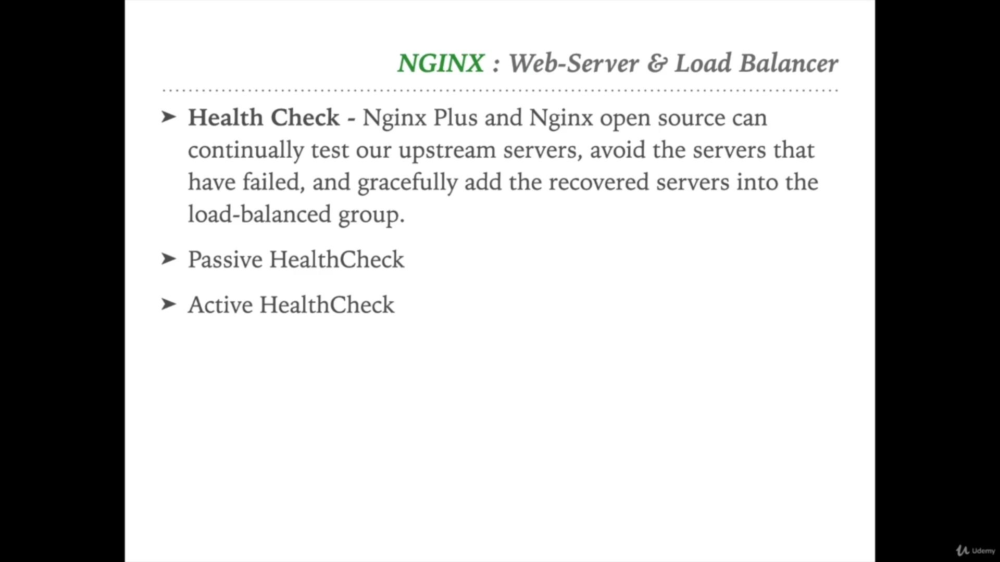
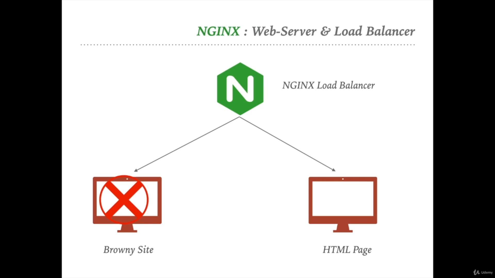
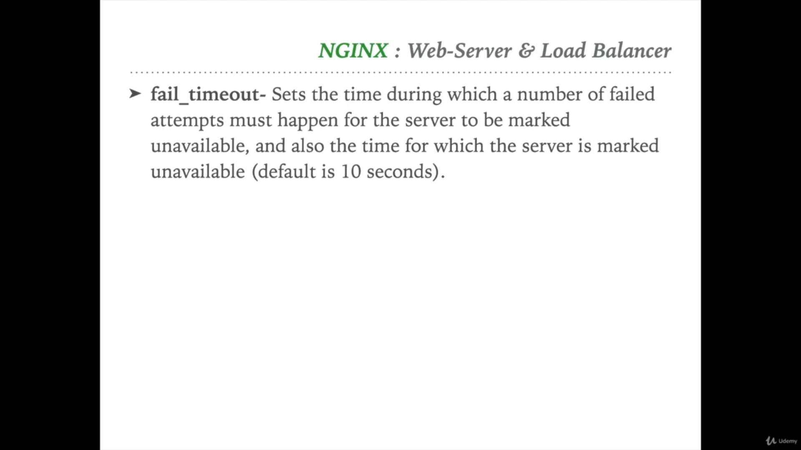
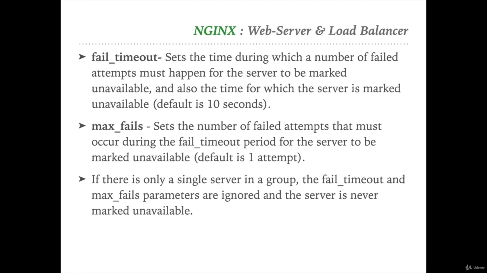
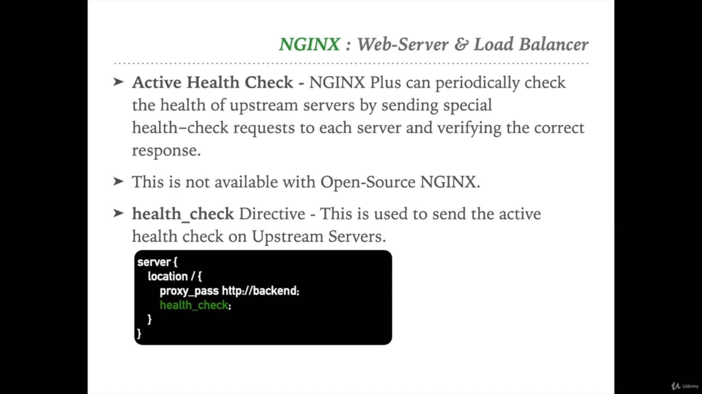
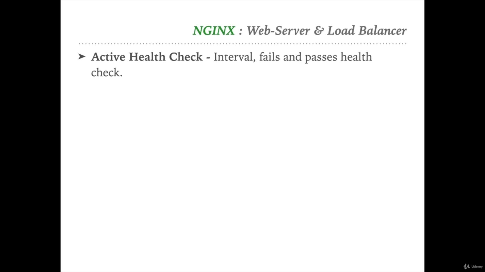
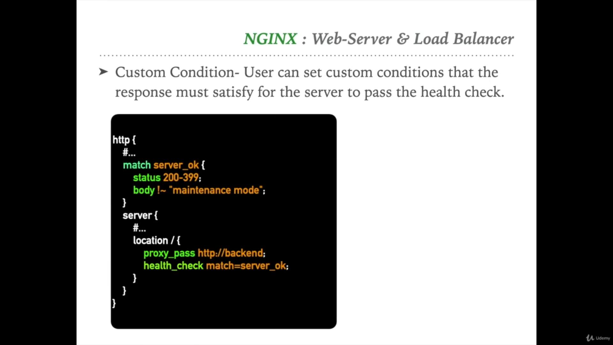
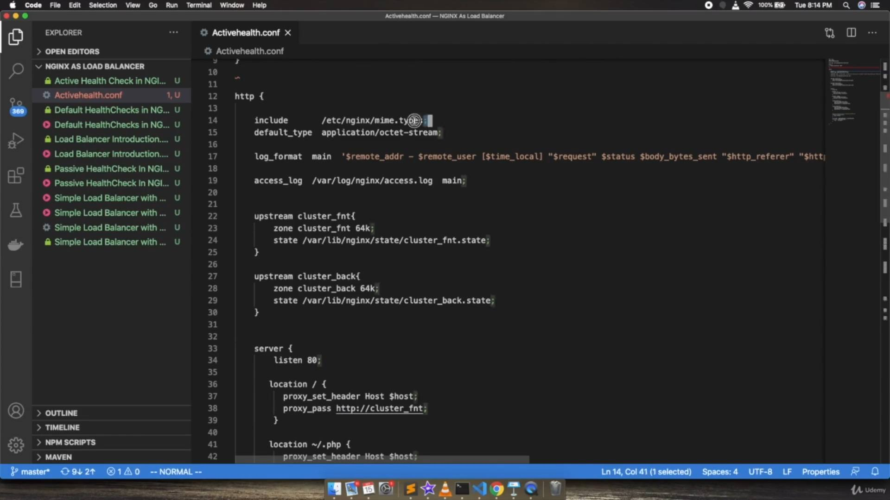
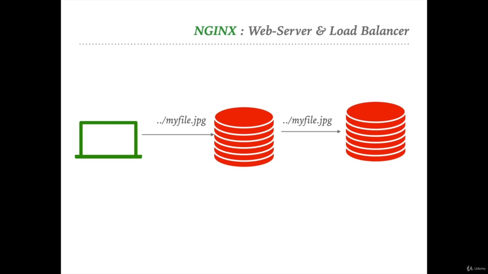
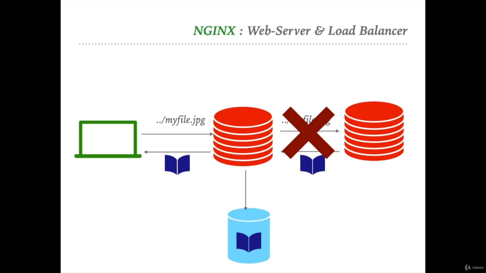

# NGINX MasterClass P37–P40：负载均衡健康检查与 HTTP 缓存入门

> 覆盖课时：P37（默认健康检查）、P38（被动健康检查参数）、P39（主动健康检查 / NGINX Plus）、P40（HTTP 缓存系统导论）
> 读者定位：前端转 AI 应用工程师。本文凡是涉及并发/状态的地方会补一句 Node 里的对应概念。

---

## 1. 这一节做什么

这四讲围绕 NGINX 作为**负载均衡器**和**缓存层**这两件事展开，核心是三个可交付的产物：

1. **一个能跑起来的三机实验拓扑**：两台应用服务器（一台跑 brownie 站点、一台跑 NGINX 默认页）+ 一台 NGINX 负载均衡器，用 `curl` 反复请求，肉眼观察请求在两端之间来回切换。这是 P37 的全部内容。
2. **一份带被动健康检查参数的 `nginx.conf`**：在 `upstream` 的 `server` 行上加 `max_fails` 与 `fail_timeout`，把"失败多少次 / 多长时间窗口内失败"判定为不可用，以及"不可用之后冷却多久再放回来"，变成你自己可控的数字。这是 P38 的交付物。
3. **一份主动健康检查的参考配置 `active_health.conf`**：`health_check` 指令、`interval / fails / passes / uri / port / match`，以及 `upstream` 里用 `zone` + `state` 把服务器列表放到状态文件里的写法。**注意：这一段讲师明确说做不了实验**，因为他没有 NGINX Plus 的订阅证书，所以只演示了配置文件。这是 P39。

P40 是缓存专题的**开场**：讲师先用浏览器和静态资源解释了"为什么要缓存"（服务器资源、带宽、时间三个成本），再把缓存服务器作为中间层画进请求链路，最后打开 Firefox 的 `about:cache` 让你亲眼看到浏览器本身就是一个缓存节点。**P40 里没有出现任何 `proxy_cache` 配置**——NGINX 侧缓存的配置被明确留到了后续课时。这一点非常重要，不要指望在这四讲里学会 `proxy_cache_path`。

学完这四讲，你应该能做到：把负载均衡器的健康检查参数按业务改掉，并且能解释"为什么我关掉一台后端，NGINX 还会给它发几个请求才把它踢掉"。

---

## 2. 讲师原话

关于健康检查的定义，讲师给的说法是"同一个请求发给每一个成员"：

> "健康检查是一种按计划执行的规则，用于向每个成员发送相同的请求……健康检查会向负载均衡组中的每个成员发送请求，以确认每台成员服务器是否可用并能接受客户端请求。"
> —— p037 [00:00]

关于被动与主动的分界线，这是他反复强调了三次的一句话：

> "开源版 NGINX 支持被动健康检查，但主动健康检查仅限 NGINX Plus 使用。因此，如果要配置主动健康检查，就必须使用 NGINX Plus 或 NGINX 商业版。"
> —— p037 [02:45]



关于"网上说的不一定是真的"，他在 P37 结尾埋了一个非常重要的钩子：

> "网上很多网站都提到 NGINX 不会向无响应的服务器发送请求，但实际上 NGINX 也会向那台服务器发送请求……在接下来的课程中，我会展示这件事在内部是如何工作的。"
> —— p037 [07:02]

P38 把这个钩子兑现了——被动健康检查的本质是"先发、失败了再换一台"，不是"先探活、活着才发"：

> "这并不意味着请求失败后，NGINX 就会接下一个请求并丢弃第一个请求。不是的，NGINX 会把那个请求发送给第二台服务器。一旦请求成功，NGINX 会再取一个请求，并再次把这个请求发送到 Brownie 站点。如果 Brownie 站点宕机，它就会再次失败。于是 NGINX 会再次把同一个请求发送给另一台服务器。"
> —— p038 [02:47]



关于 `fail_timeout` 的双重含义（这是最容易记错的一个参数）：

> "fail_timeout 参数设置两个时间：失败尝试次数必须在这个时间内发生，服务器才会被标记为不可用；以及服务器被标记为不可用的持续时间。"
> —— p038 [04:13]



关于只有一个上游服务器时的特例：

> "假设我们只有一台服务器。上游中只有一台服务器，在这种情况下，如果我们忽略 fail_timeout 和 max_fails 参数，那么 NGINX 负载均衡器就永远不会把服务器标记为不可用。"
> —— p038 [06:38]



关于主动健康检查的默认节奏：

> "默认情况下，NGINX Plus 每五秒向根路径发送一次请求。也就是说，向属于后端上游组的每台服务器发送 / 路径请求。如果任意服务器发生通信错误或超时错误……如果收到的响应状态码不在 200 到 399 之间，健康检查就会失败。"
> —— p039 [02:17]



关于三个可调参数：

> "这里 interval 参数将健康检查请求之间的间隔从 5 秒增加到 10 秒……fails 参数要求服务器连续三次健康检查失败，才会被标记为不健康……passes 参数表示服务器必须连续两次健康检查通过，才会被重新标记为健康。"
> —— p039 [04:11]



关于 `match` 块的能力边界：

> "match 指令可以包含一个状态条件、一个响应体条件和多个响应头条件。响应必须满足 match 块中定义的所有条件，服务器才能通过健康检查。"
> —— p039 [07:55]



关于为什么没有 Plus 实验：

> "我们没有 NGINX Plus 订阅，因为它是商业产品。虽然我有可用的 NGINX Plus，但无法在它上面创建实验环境，因为这需要大量配置……你需要由 NGINX 商业版 F5 社区签发的公钥/私钥证书。"
> —— p039 [08:25]



关于缓存的动机，他给了三个成本：

> "这种机制的第一个缺点是服务器资源利用率，第二个是网络带宽利用率，第三个是时间。"
> —— p040 [03:19]



关于浏览器自己就是缓存节点：

> "你的浏览器也有缓存系统……这里可以看到，我们有 16,370 条缓存条目……我们先获取缓存的键，然后获取该缓存条目的数据大小，再获取抓取次数、该缓存的上次修改日期以及该缓存的过期日期。"
> —— p040 [09:25]



---

## 3. 从零复现

### 3.0 环境与拓扑

讲师用的是一台物理/虚拟宿主上开的三台 **Ubuntu** 机器，全部装**开源版 NGINX**（发行版包管理器安装）。逐字稿里没有给出具体 NGINX 版本号，也没有给出安装命令，**版本请按你系统仓库里的稳定版即可**；如果要做 P39 的主动健康检查，必须换成 NGINX Plus，开源版写了 `health_check` 会直接启动失败。

拓扑（这是从 P37 里讲师口述的机器角色还原出来的）：

| 角色 | 主机名（讲师叫法） | IP | 装什么 |
|---|---|---|---|
| 应用服务器 1 | Ubuntu machine（custom nginx） | 结尾是 `130`（讲师原话 "拥有 IP 130 的 brownie 那一侧"） | 开源 NGINX + brownie 静态站点 |
| 应用服务器 2 | Ubuntu secondary application server | 讲师未念出 | 开源 NGINX，只留默认欢迎页 |
| 负载均衡器 | Ubuntu load balancer | 讲师未念出 | 开源 NGINX，配 `upstream` + `proxy_pass` |

由于讲师只念出了 `130` 这一段，下面所有配置里我用 `192.168.1.130` / `192.168.1.131` / `192.168.1.132` 作为占位示例，**你必须换成自己环境的真实 IP**。三台机器要能互相 ping 通、HTTP 端口互通。

### 3.1 第一步：确认三台机器的 NGINX 都在跑

讲师做的第一件事是逐台确认进程：

```bash
# 在 app server 1 / app server 2 / load balancer 上分别执行
ps -ef | grep nginx
```

> 讲师原话把这条命令念成 "来自 EF 的 PSI，抓取 engine X"，对应的就是 `ps -ef | grep nginx`。输出里能看到 `nginx: master process` 与若干 `nginx: worker process` 就说明在跑。

如果没跑：

```bash
sudo service nginx start
```

> 讲师全程用的是 `service nginx start` / `service nginx stop` 这种老式写法，不是 `systemctl`。两者在 Ubuntu 上都能用，`service` 最终会转发给 systemd。

### 3.2 第二步：准备两台应用服务器的内容

**app server 1（brownie 站点）**：把站点文件放到 `/var/www/brownie`，并让 NGINX 的 `root` 指过去。逐字稿没有给出这个站点的任何配置内容，只说了"我的第一个应用服务器基本上就是在运行 brownie 站点"，所以下面这份是**能让你复现出"两个后端返回不同内容"这一观察结果的最小配置**：

```bash
sudo mkdir -p /var/www/brownie
sudo tee /var/www/brownie/index.html > /dev/null <<'EOF'
<!doctype html>
<html>
  <head><meta charset="utf-8"><title>Brownie</title></head>
  <body><h1>BROWNIE SITE</h1><p>served by app server 1</p></body>
</html>
EOF
```

**app server 2（默认页）**：什么都不用改，保持 NGINX 装完自带的 `/var/www/html/index.nginx-debian.html` 即可，这样它的返回内容天然和 brownie 不一样，`curl` 一眼能分辨。

### 3.3 第三步：写负载均衡器配置（先不加任何健康检查）

这是 P37 的状态——**配置文件里一条健康检查都没有**：

```bash
sudo cp /etc/nginx/nginx.conf /etc/nginx/nginx.conf.bak
sudo tee /etc/nginx/nginx.conf > /dev/null <<'EOF'
user  nginx;
worker_processes  auto;

error_log  /var/log/nginx/error.log notice;
pid        /var/run/nginx.pid;

events {
    worker_connections  1024;
}

http {
    include       /etc/nginx/mime.types;
    default_type  application/octet-stream;

    log_format  main  '$remote_addr - $remote_user [$time_local] "$request" '
                      '$status $body_bytes_sent "$http_referer" '
                      '"$http_user_agent" "$http_x_forwarded_for"';

    access_log  /var/log/nginx/access.log  main;

    upstream backend {
        server 192.168.1.130;   # app server 1: brownie
        server 192.168.1.131;   # app server 2: default nginx page
    }

    server {
        listen 80;
        server_name _;

        location / {
            proxy_set_header Host $host;
            proxy_pass http://backend;
        }
    }
}
EOF

sudo nginx -t
sudo service nginx restart
```

> `upstream backend` 这个名字是**我起的占位名**——P37/P38 里讲师没有念出 upstream 的名字，到 P39 才出现 `cluster_front` / `cluster_back` 这两个名字。名字本身不影响行为。

`nginx -t` 讲师念作 "NGINX ip_hash"，输出应为 `syntax is ok` 和 `test is successful`。

### 3.4 第四步：验证轮询

在**任意一台机器**上（或你自己的笔记本上）执行：

```bash
curl http://192.168.1.132
```

反复执行三四次，你应该看到输出在 "BROWNIE SITE" 和 NGINX 默认页之间交替。讲师的原话就是这个现象：

> "我第一次访问时，它可能由 Brownie 站点响应，也可能由默认的 NGINX 响应。因此，第一个请求由默认的 NGINX 处理。如果我再访问一次，这个请求就会由 Brownie 处理。"
> —— p037 [04:36]

这里有一个**必须知道的坑**：如果你用浏览器刷新来验证，很可能看起来"永远是同一个后端"，因为浏览器有缓存（P40 讲的正是这个）。讲师全程用 `curl`，就是因为 `curl` 每次都是干净的请求。

### 3.5 第五步：把 brownie 停掉，观察默认行为

```bash
# 在 app server 1 上
sudo service nginx stop
ps -ef | grep nginx     # 确认进程已经没了
```

回到客户端连续 `curl` 三次：

```bash
curl http://192.168.1.132
curl http://192.168.1.132
curl http://192.168.1.132
```

讲师观察到的结果三次都是 app server 2 的默认页：

> "第一个 curl 请求由 NGINX 服务器处理，第二个同样由 NGINX 服务器处理，第三个也再次由 NGINX 服务器处理。"
> —— p037 [05:36]

**但关键点在后台**：前面那几次请求里，NGINX 其实已经把请求发给过已经死掉的 app server 1，失败之后才转给 app server 2。这就是 P38 要放大的那个真相。

### 3.6 第六步：把 brownie 启动回来，观察"延迟恢复"

```bash
# 在 app server 1 上
sudo service nginx start
ps -ef | grep nginx
```

立刻连续 `curl`：

```bash
curl http://192.168.1.132
curl http://192.168.1.132
curl http://192.168.1.132
```

讲师的结果是：**前两次仍然是 app server 2，第三次才回到 brownie**：

> "第一个 curl 请求在这里，又发往默认的 NGINX。第二个 curl 请求在这里，也再次发往默认的 NGINX。但第三个命令发往 Brownie。这意味着，一旦我们在这里启动 NGINX 服务器……NGINX 负载均衡器需要一些时间才能识别出该服务器已启动并正在运行。"
> —— p037 [07:30]

这个"took some time"就是 `fail_timeout` 的默认值 **10 秒**。P38 里讲师明确点破了：

> "默认情况下，这个时间是 10 秒；因此在上一节课中，每当我们在 Brownie 侧启动 NGINX 服务器时，请求却并没有发往 Brownie 侧。所以 NGINX 花了 10 秒才把该服务器标记为可用。"
> —— p038 [05:11]

### 3.7 第七步：改被动健康检查参数并重测

在**负载均衡器**上打开配置（讲师用 `vi`/`vim` 编辑 `/etc/nginx/nginx.conf`）：

```bash
sudo vim /etc/nginx/nginx.conf
```

把 `upstream` 段改成：

```nginx
upstream backend {
    server 192.168.1.130 max_fails=5 fail_timeout=30s;   # brownie
    server 192.168.1.131;                                  # default page
}
```

讲师对单位说得很清楚：

> "如果要把它配置为 60 秒，就需要写成 60s。如果要配置为 5 分钟，可以写成 5m。"
> —— p038 [07:07]

保存后验证并重启：

```bash
sudo nginx -t
sudo service nginx restart
```

然后复测：先确认两台都活着，`curl` 应该能拿到两个不同页面；再 `sudo service nginx stop` 停掉 brownie，连续 `curl`——讲师的结果是连续四次都返回 app server 2，说明 brownie 已经被判定为不健康：

> "看，应用二又反复响应了。这意味着 Brownie 站点已经被标记为不健康。"
> —— p038 [08:06]

最后把 brownie 启回来，**等大约 30 秒**再 `curl`：

> "在第 32 秒之后执行 curl。我们会收到第二台服务器的响应，也会收到 Brownie 站点的响应。"
> —— p038 [08:36]

这一步是本讲的精髓：改 `fail_timeout` 之后，"恢复延迟"从默认 10 秒变成了 30 秒，你能直接用秒表测出来。

### 3.8 第八步：主动健康检查（只有配置，没有实验）

讲师明确说了做不了实验，原因是没有 Plus 的商用证书。你如果只是想"把配置写对并验证语法"，需要一台 **NGINX Plus** 机器；开源版执行 `nginx -t` 会报 `unknown directive "health_check"`。

配置在 P39 里是讲师自己写好的 `active_health.conf`，完整内容见第 4 节。观察要点有三个：

1. `health_check` 写在 `location` 里，和 `proxy_pass` 并列；
2. 默认每 5 秒向 `/` 发一次请求，状态码不在 200–399 就算失败；
3. `match` 块写在 `http` 上下文，`health_check` 里用 `match=名字` 引用。

### 3.9 第九步：P40 的缓存观察（不需要任何 NGINX 配置）

P40 完全在浏览器里做。讲师用的是 **Firefox**：

1. 打开 `about:cache`；
2. 页面显示 "network caches"、"memory maximum storage size"、"disk" 等区块；
3. 点开 "列出缓存条目"，能看到缓存条目列表：**key、data size、fetch count、last modified、expires**；
4. 讲师当时看到 **16,370 条**；打开 `rediff.com` 之后刷新 `about:cache`，变成 **16,900 左右**，再刷新一次还会继续涨。

这个实验的意义是让你接受一件事：**缓存不是只有服务端在做，浏览器本身就是一层缓存**。所以后面讲 NGINX 缓存时，你脑子里要有"多层缓存"的概念，而不是"加了 NGINX 缓存就不会有请求了"。

---

## 4. 完整代码

### 4.1 应用服务器 1：brownie 站点（`/etc/nginx/sites-available/brownie.conf`）

> 逐字稿**没有**给出这台机器的配置内容，以下是让它能作为可区分后端工作的最小可用配置。

```nginx
server {
    listen 80 default_server;
    listen [::]:80 default_server;

    root /var/www/brownie;
    index index.html;

    server_name _;

    location / {
        try_files $uri $uri/ =404;
    }
}
```

启用它：

```bash
sudo ln -sf /etc/nginx/sites-available/brownie.conf /etc/nginx/sites-enabled/brownie.conf
sudo rm -f /etc/nginx/sites-enabled/default
sudo nginx -t && sudo service nginx restart
```

### 4.2 应用服务器 2：保持默认页

不需要额外文件。确认 `/etc/nginx/sites-enabled/default` 存在且 `root /var/www/html;` 指向存在 `index.nginx-debian.html` 的目录即可。

### 4.3 负载均衡器——阶段 A：无健康检查（P37 状态，`/etc/nginx/nginx.conf` 完整文件）

```nginx
user  nginx;
worker_processes  auto;

error_log  /var/log/nginx/error.log notice;
pid        /var/run/nginx.pid;

events {
    worker_connections  1024;
}

http {
    include       /etc/nginx/mime.types;
    default_type  application/octet-stream;

    log_format  main  '$remote_addr - $remote_user [$time_local] "$request" '
                      '$status $body_bytes_sent "$http_referer" '
                      '"$http_user_agent" "$http_x_forwarded_for"';

    access_log  /var/log/nginx/access.log  main;

    upstream backend {
        server 192.168.1.130;   # app server 1: brownie
        server 192.168.1.131;   # app server 2: default nginx page
    }

    server {
        listen 80;
        server_name _;

        location / {
            proxy_set_header Host $host;
            proxy_pass http://backend;
        }
    }
}
```

### 4.4 负载均衡器——阶段 B：开启被动健康检查参数（P38 状态）

只替换 `upstream` 段，其余不变：

```nginx
    upstream backend {
        # brownie 站点：30 秒窗口内失败 5 次即判定不可用，
        # 判定后冷却 30 秒再放回轮询
        server 192.168.1.130 max_fails=5 fail_timeout=30s;

        # 默认页：不写参数，走 NGINX 内置默认值
        server 192.168.1.131;
    }
```

应用并验证：

```bash
sudo nginx -t
sudo service nginx restart
```

> 关于默认值：讲师在 P38 说得很明确——"默认尝试次数是 1 次，默认失败超时是 10 秒，如果你没有定义那个特定项的话。"（p038 [06:08]）也就是 `max_fails=1`、`fail_timeout=10s`。

### 4.5 NGINX Plus 专用：`active_health.conf`（P39）

下面这份是根据讲师在编辑器里逐条念出的内容还原的。**凡是逐字稿听写不清的地方，我都在注释里标了出来，没有替他补全**。

```nginx
user  nginx;
worker_processes  auto;

error_log  logs/error.log;

events {
    worker_connections  1024;
}

http {
    include       mime.types;
    # 讲师口述为 "octane streams"，对应 NGINX 默认配置里的这一行
    default_type  application/octet-stream;

    log_format  main  '$remote_addr - $remote_user [$time_local] "$request" '
                      '$status $body_bytes_sent "$http_referer" '
                      '"$http_user_agent" "$http_x_forwarded_for" '
                      '$upstream_connect_time $upstream_header_time '
                      '$upstream_response_time $request_uri';

    access_log  logs/access.log  main;

    # 自定义健康检查判定条件：写在 http 上下文，由 health_check match= 引用
    match server_ok {
        status 200-399;
        body !~ "maintenance mode";
    }

    upstream cluster_front {
        zone  cluster_front 64k;
        # 逐字稿只说 "state file location ... cluster_front.state"，
        # 具体目录未念清；下面是示例路径，请按你的实际部署改
        state /etc/nginx/state/cluster_front.state;
    }

    upstream cluster_back {
        zone  cluster_back 64k;
        state /etc/nginx/state/cluster_back.state;
    }

    server {
        listen 80;

        location / {
            proxy_set_header Host $host;
            proxy_pass http://cluster_front;
        }

        location ~ \.php$ {
            proxy_set_header Host $host;
            proxy_pass http://cluster_back;
        }

        # 讲师口述为 "at the rate FNT"，对应命名 location @front
        # （逐字稿此处发音含混，实际写法以讲师屏幕为准）
        location @front {
            proxy_set_header Host $host;
            proxy_pass http://cluster_front;
            health_check uri=/health interval=10s fails=3 passes=2;
        }

        location @back {
            proxy_set_header Host $host;
            proxy_pass http://cluster_back;
            health_check uri=/health interval=10s fails=3 passes=2;
        }

        error_page 500 502 503 504 /50x.html;

        location = /50x.html {
            root /etc/nginx/html;
        }
    }
}
```

**这份配置里讲师没有演示过的部分**：`location @back` 的具体写法（他只说"我们用类似的方式定义健康检查"）、`state` 的绝对路径、`error_page` 对应的 `50x.html` 的文件内容。其余指令名、参数名、数值（`64k`、`interval=10s`、`fails=3`、`passes=2`、`200-399`、`!~ "maintenance mode"`）全部来自逐字稿原文。

> 状态文件里的内容讲师描述过：会包含 server、IP/域名、`max_fails`、`fail_timeout`，"你可以在状态文件中定义任意数量的服务器"。具体文件格式逐字稿没有展开，**以 Plus 实际生成的为准**，不要手写。

### 4.6 P40 的缓存：本讲没有代码

P40 全程没有出现任何配置文件、命令行或代码，只有浏览器操作。NGINX 侧的 `proxy_cache_path` / `proxy_cache` **在这四讲里完全没有出现**，讲师明确说"在接下来的课程中，我们将详细讨论 NGINX 缓存"。

---

## 5. 逐行解释

### 5.1 `upstream backend { ... }`

`upstream` 块就是"服务器组"的容器。P40 讲师提到缓存时也用了同样的中间层思路：客户端不再直接面向 web server，而是面向一个中间节点。`upstream` 就是那个中间节点的选路表。

### 5.2 `server 192.168.1.130 max_fails=5 fail_timeout=30s;`

这一行是整个 P38 的全部内容，两个参数必须**一起理解**：

- **`fail_timeout=30s` 的第一个身份是"统计窗口"**：失败次数必须在这 30 秒内累积够，才触发判定。讲师原话是 "设置失败尝试次数必须发生的时间段，超过该时间段服务器才会被标记为不可用"。
- **`fail_timeout=30s` 的第二个身份是"冷却时间"**：一旦被标记不可用，接下来 30 秒内 NGINX 不会再把它当候选，之后放回来重新试。这就是 P37 里"启动了 brownie 却还要等一会儿"的原因（那时是默认的 10 秒）。
- **`max_fails=5` 是窗口内的失败次数阈值**：讲师说 "如果在 30 秒内有五个请求失败……NGINX 就会把该服务器标记为不可用"。

**默认值**：`max_fails=1`、`fail_timeout=10s`。不写就等于每失败一次就踢 10 秒。

**不这样会怎样**：如果只写 `max_fails=5` 不写 `fail_timeout`，窗口是默认的 10 秒，你原本以为"5 次失败"的宽容度会缩水成"10 秒内 5 次"——在低流量场景下可能几天都攒不够 5 次，反过来在高流量场景下 10 秒内轻松失败 5 次。

### 5.3 为什么"只有一个 server 时永远不会被标记不可用"

讲师在 P38 [06:38] 专门点了这个：`upstream` 里只有一台机器，且没写 `max_fails` / `fail_timeout` 时，NGINX 不会把它踢掉。道理很直白——踢掉之后就没人能接请求了，与其返回 502 不如继续把请求打过去碰运气。这是**只影响单人环境**的边界条件，多后端时按参数走。

### 5.4 `proxy_pass http://backend;`

`proxy_pass` 指向的是 `upstream` 的名字而不是具体 IP，这是"让 NGINX 帮你选机器"的唯一前提。如果你在这里直接写 `proxy_pass http://192.168.1.130;`，那 `upstream` 里配的所有健康检查参数都不生效。

### 5.5 `health_check uri=/health interval=10s fails=3 passes=2;`

逐个参数（全部来自 P39）：

- **`uri=/health`**：默认是往 `/` 发请求。讲师说 "如果我不打算在根路径发送健康检查，我可以定义特定的 URI"，并且会把 uri 拼到 server 的域名或 IP 后面，比如 `10.10.8.8/some/path`。
- **`interval=10s`**：把默认的 5 秒拉长到 10 秒。讲师："interval 参数会把健康检查请求之间的延迟从 5 秒增加到 10 秒"。
- **`fails=3`**：连续 3 次健康检查失败才标记不健康，默认是 1。
- **`passes=2`**：连续 2 次成功才恢复健康。
- **`port=8080`**：讲师也讲了，"作为后端 upstream 一部分的每台服务器都会在 8080 端口收到健康检查请求"，用于健康检查端口和业务端口不同的场景。

**为什么 fails 和 passes 要分开配**：`fails=3` 是防抖动（避免一次网络毛刺就踢人），`passes=2` 是防"刚起来又挂"（避免一次侥幸成功就立刻放全量流量进去）。这是典型的"进入条件严格、退出条件宽松"设计。在 Node 里你可能用过熔断器（circuit breaker）的 `errorThresholdPercentage` + `resetTimeout`，思路一致——但**注意这是概念类比，NGINX 这里做的是转发重试与选路，不是应用层熔断**，课里没有提到任何 Node 侧的库。

### 5.6 `match server_ok { status 200-399; body !~ "maintenance mode"; }`

`match` 块写在 `http` 上下文，作用是**把"什么算健康"从"能连上"升级为"返回内容符合预期"**。讲师讲了三条硬限制：

1. **一个 `status` 条件**；
2. **一个 `body` 条件**；
3. **多个 `header` 条件**；
4. **所有条件必须同时满足**才算健康，任何一条不满足就判失败。

`status 200-399` 是白名单区间——注意 3xx 重定向也算健康。`body !~ "维护模式"` 是黑名单匹配：如果你的应用在维护模式下会返回一张写着 "维护模式" 的 200 页面，只有状态码就抓不到，必须看 body。这就是讲师说的 "你在自己的应用程序中定义健康检查 API"。

### 5.7 `zone cluster_front 64k;` 与 `state /etc/nginx/state/cluster_front.state;`

讲师对这两条的解释是：`zone` 让 upstream 状态占 64KB 共享内存；`state` 把"服务器列表"持久化到一个状态文件里，文件里存 server、IP/域名、`max_fails`、`fail_timeout`，可以放任意多台。他管这叫 "维护 upstream 的专业做法"——配置里不直接列 server，而是让状态文件承载。

**注意**：这两条指令出现在讲师的 Plus 配置里，**开源版 upstream 里没有这两条**，写了会启动失败。讲师没有展开 Plus 的共享内存细节，不要在这里深究语义。

### 5.8 `log_format main ...` 里的四个 `$upstream_*` 变量

讲师特意强调这是 "非常丰富的日志格式"，并说 "如果你想复制它，也可以复制。"。其中：

- `$upstream_connect_time`：和后端建立连接花了多久；
- `$upstream_header_time`：从后端拿到响应头花了多久；
- `$upstream_response_time`：后端整体响应耗时；
- `$request_uri`：原始请求 URI（含 query string）。

**为什么这对排查健康检查有用**：当某台后端很慢（但没挂）时，它不会触发被动健康检查的失败计数——被动健康检查只看"请求成不成功"，不看"有多慢"。要看慢，只能靠日志里的这三个时间字段。

### 5.9 `error_page 500 502 503 504 /50x.html;`

把 5xx 统一导向一个自定义页面，避免把 NGINX 默认的错误页暴露给用户。讲师说的是"如果我们遇到 500、502、503、504 状态码，就直接把用户渲染到自定义的 50x HTML 页面"，页面放在 `root /etc/nginx/html;`。**这个 50x.html 的内容逐字稿没有给**，你需要自己写一个。

---

## 6. 复现检查清单

按顺序打勾，每一步失败都先停下来修，不要往下走。

**环境层**

- [ ] 三台 Ubuntu 机器能互相 `ping` 通
- [ ] 三台都装了开源版 NGINX，`ps -ef | grep nginx` 都能看到 master + worker
- [ ] 防火墙放行 80 端口（讲师没提，但你不放行会卡住）
- [ ] app server 1 的 `/var/www/brownie/index.html` 存在且内容里带 `BROWNIE`
- [ ] app server 2 的默认页能直接访问：`curl http://192.168.1.131` 返回 NGINX 欢迎页

**负载均衡阶段（P37）**

- [ ] 负载均衡器 `nginx -t` 通过（`syntax is ok` + `test is successful`）
- [ ] `curl http://<LB_IP>` 连续 4 次，输出在 brownie 与默认页之间交替
- [ ] `sudo service nginx stop` 停掉 app server 1 后，连续 3 次 `curl` 全部返回默认页
- [ ] `sudo service nginx start` 起回来之后，**立刻** curl 仍然是默认页
- [ ] 等待约 10 秒后，`curl` 能重新拿到 brownie（验证默认 `fail_timeout=10s`）

**被动健康检查参数阶段（P38）**

- [ ] 在 `upstream` 里给 brownie 那行加上 `max_fails=5 fail_timeout=30s`
- [ ] `nginx -t` 通过后 `service nginx restart`
- [ ] 两台都活着时，`curl` 仍能看到两个不同页面
- [ ] 停掉 brownie 后连续 4 次 `curl` 全部返回默认页
- [ ] 起回 brownie 后**立即** curl 仍是默认页，**等 30 秒以上**才重新出现 brownie
- [ ] 把 `fail_timeout` 改成 `1m`，重复一次，恢复延迟变成约 60 秒（可选，但强烈建议做一次，能证明参数真的生效）

**主动健康检查阶段（P39）**

- [ ] 如果你只有开源版：在开源版上写 `health_check`，`nginx -t` 应报错——**这个报错本身就是预期的实验结果**，说明你读懂了讲师的划线
- [ ] 如果你有 Plus：`match` 块写在 `http` 里而不是 `server` 里
- [ ] `health_check` 与 `proxy_pass` 在**同一个** `location` 里
- [ ] `match=server_ok` 的名字与 `match` 块的名字完全一致

**缓存观察阶段（P40）**

- [ ] Firefox 打开 `about:cache`，能看到 "列出缓存条目"
- [ ] 条目列表里能看到 key、size、fetch count、last modified、expires 这几列
- [ ] 记录当前条目数 → 访问一个新站点 → 回到 `about:cache` 刷新 → 条目数增加

---

## 7. 课里没讲但你会撞上

这一节全部是**逐字稿没有覆盖**的内容，属于我自己踩过的坑，写在这里是为了让你别卡在同样的地方。

**1. 用浏览器验证轮询，你会怀疑配置写错了。**
讲师全程用 `curl`。如果你用浏览器刷新，很可能一直看到同一个后端，因为浏览器有缓存——P40 恰好就是在讲这个。**验证负载均衡一定要用 `curl`**，或者打开 DevTools 勾掉缓存。

**2. `curl` 也不一定每次换后端。**
HTTP/1.1 默认 keep-alive，同一条连接上的多个请求会打到同一台后端。如果你想严格看到"逐请求轮询"，每次请求之间要断开连接（比如 `curl --no-keepalive`）。**课里没有提到这一点**，但它会直接影响你"验证轮询"的判断。

**3. `nginx -t` 通过 ≠ 配置生效。**
`nginx -t` 只查语法，不重载。改完必须 `service nginx restart`（讲师用的是 restart 而不是 reload）。如果你只跑了 `-t` 就以为完事，会一直看到旧行为。

**4. 开源版写 `health_check` 会直接启动失败。**
报错大致是 `unknown directive "health_check"`。这不是你写错了，是 Plus 专属指令。讲师在 P39 [01:48] 已经明确划线："这个功能在开源版 NGINX 中不可用"。

**5. NGINX Plus 需要商用证书。**
讲师说的 "由 NGINX 商业版 F5 社区签发的公钥私钥证书" 就是 Plus 的 license。没有它，Plus 的二进制跑不起来。所以 P39 你只能对着配置学，不能跑。

**6. `state` 文件的绝对路径逐字稿没念清。**
我在第 4 节里用了 `/etc/nginx/state/`，这是**示例**。这个目录需要你自己创建并且给 NGINX 工作进程写权限，否则 Plus 启动时会报权限错误。文件格式也不要手写，让 Plus 自己生成。

**7. 三台机器复现成本高，单机也能做，但这是课里没讲的替代方案。**
你可以在**一台**机器上起三个 `server` 块，分别 `listen 8081` / `8082` / `80`，把 `upstream` 的 `server` 指向 `127.0.0.1:8081` / `127.0.0.1:8082`。行为完全一致，`max_fails` / `fail_timeout` 的观察效果也一样。**注意这是我为方便复现补充的做法，讲师全程用的是三台独立机器**。

**8. `max_fails=0` 的含义。**
讲师没有提。实际行为是"禁用失败计数"，也就是这台机器永远不会因为被动健康检查被踢掉。某些场景下（比如后端是同一进程的两个端口）会用到，但没验证过就别乱用。

**9. 被动健康检查不管"慢"，只管"错"。**
一个响应 8 秒但返回 200 的后端，在被动健康检查眼里是完全健康的。要发现慢后端，只能靠第 5.8 节那三个 `$upstream_*` 时间字段写进日志。

**10. P40 讲的缓存和 NGINX 配置之间还差很远。**
`proxy_cache_path`、`proxy_cache`、`proxy_cache_valid`、`Cache-Control` / `Expires` 响应头、缓存 key 怎么设计、`X-Cache-Status` 怎么看——**这四讲一个都没有**，讲师明确说留到后续课时。所以你现在能做的只有两件事：理解"为什么要缓存"，以及在浏览器 `about:cache` 里亲眼看缓存条目。不要在这四讲里试图把 NGINX 缓存配出来。

**11. 加一个 JS/Node 视角的对照（课里没有，纯补充）。**
前端的"重试 + 熔断"（比如请求失败重试 N 次后暂时不再请求某接口）在思路上和被动健康检查很像：都是"先发，失败后计数，达到阈值就冷却一段时间"。但 NGINX 做的是**在网络转发层选一台机器**，Node 侧做的是**在应用层决定要不要发请求**，两者不冲突，可以同时存在。至于 NGINX 的 `zone` 共享内存在多 worker 间怎么同步状态——**课里没讲**，属于 Plus 的内部实现，查文档比猜快。