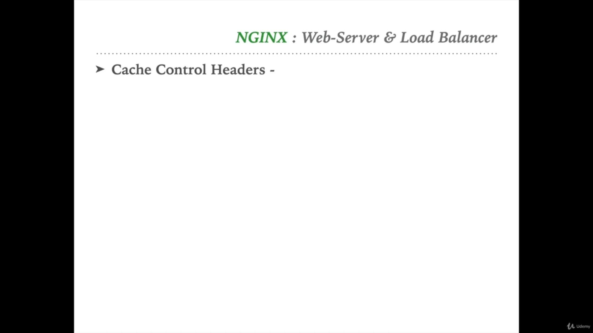
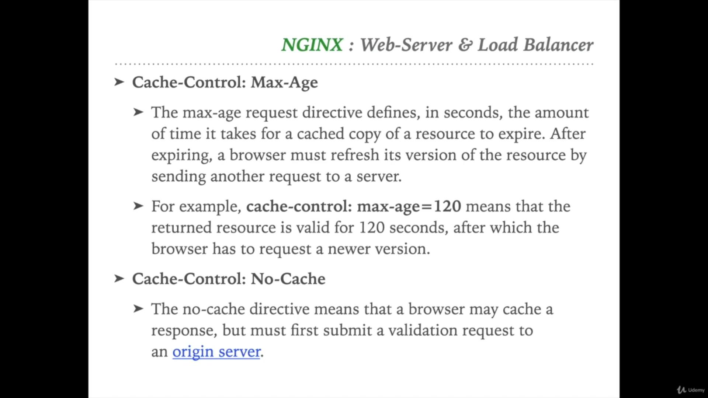
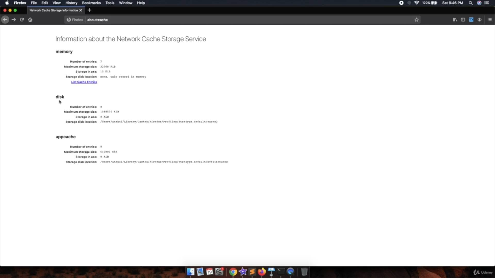
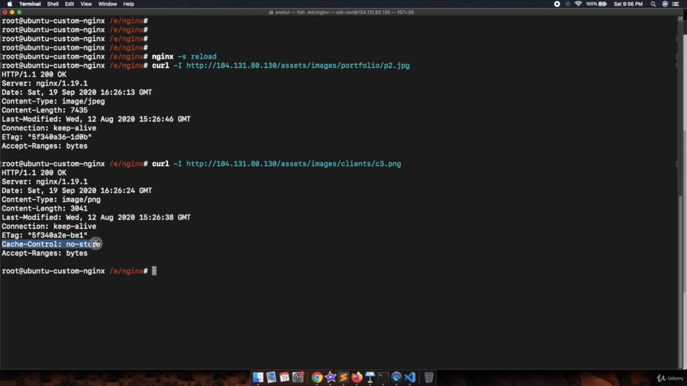
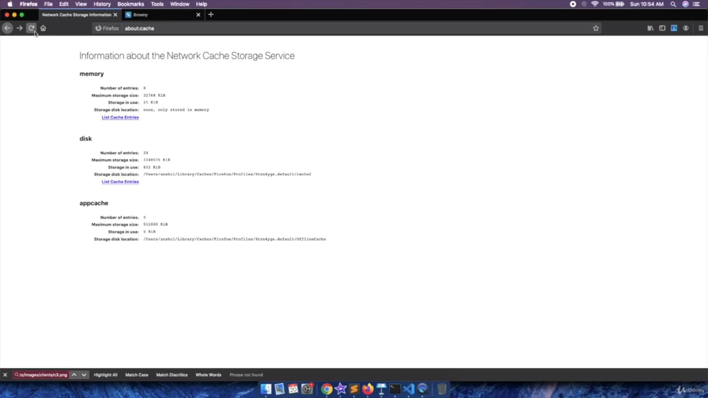
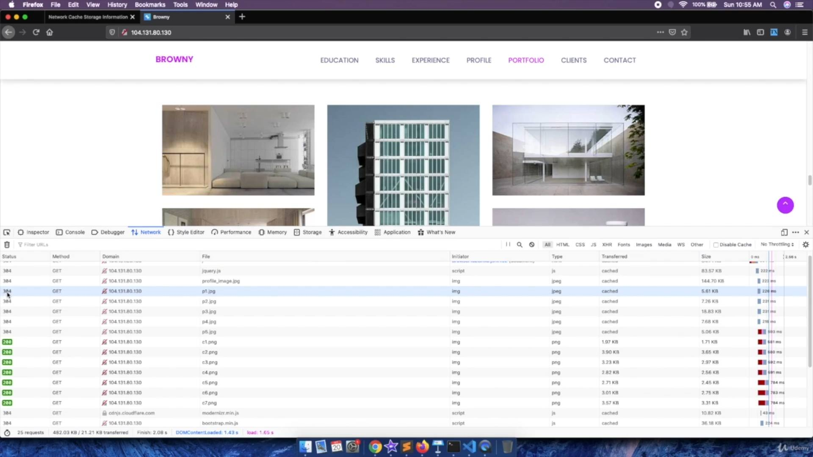
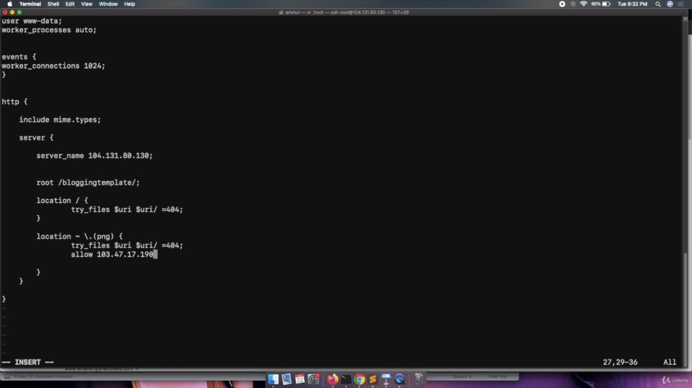
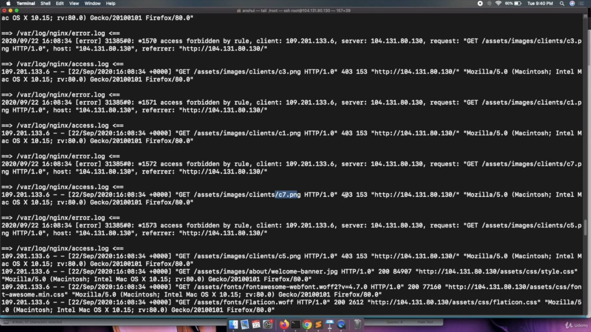
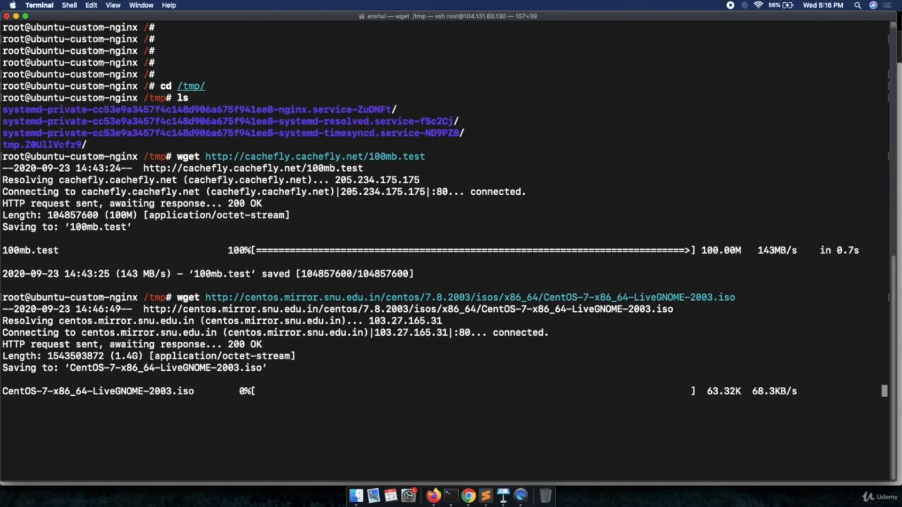
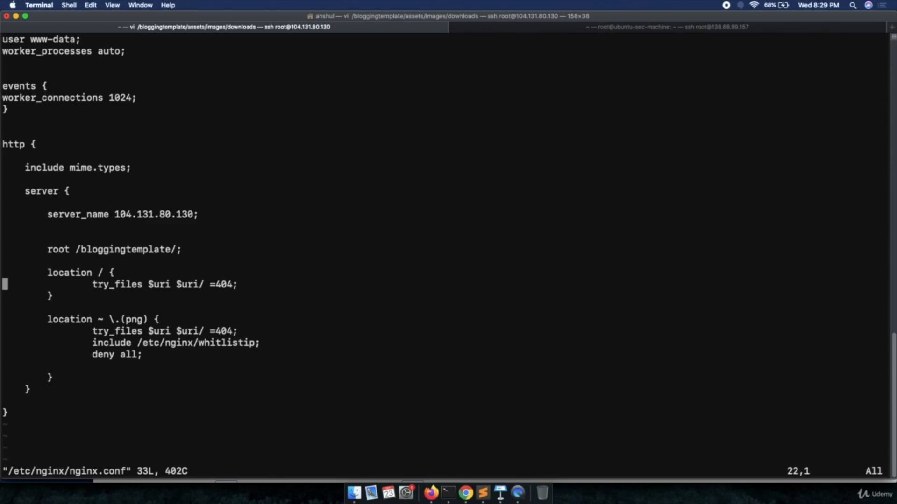

# NGINX MasterClass P41–P45 复现文档：HTTP 缓存头、`If-Modified-Since`、IP 白名单与下载限速

## 1. 这一节做什么

P41–P45 不是单纯讲概念，而是把一组“静态资源缓存 + 访问控制 + 下载限速”的 Nginx 实验完整跑一遍。你最终会得到一个可运行的 Ubuntu + Nginx 站点，目录里放 HTML、JPG、PNG 和一个 100MB 测试文件，然后依次验证：

1. **HTTP 缓存头**：给 PNG 加 `Cache-Control: no-store`，用浏览器 `about:cache` 看缓存条目减少，用 `curl -I` 看响应头。
2. **协商缓存**：不改 Nginx 配置，利用浏览器自动发送的 `If-Modified-Since` 请求头，观察 JPG 第一次 `200`、再次刷新 `304`、修改文件后重新变回 `200`。
3. **IP 白名单**：用 `allow` / `deny all` 限制 PNG 只允许指定 IP 或网段访问，非白名单客户端得到 `403`。
4. **下载限速**：用 `limit_rate_after` + `limit_rate` 让 100MB 文件前 30MB 按客户端带宽下载，之后降到约 500KB/s 量级。

课里使用的机器是 Ubuntu + Nginx，站点是 Brownie 模板，站点目录里包含 `assets/images` 等静态资源。下面文档会把课里的路径等价落到 `/var/www/html/blogging-template`，并给出完整文件。课里没有给 Nginx 具体版本号，所以不要照抄版本号，安装后用 `nginx -v` 记录你自己的版本即可。

这一节的学习重点不是背指令，而是把“浏览器看到什么、`curl` 看到什么、Nginx 日志看到什么”三件事对齐。缓存头要看响应头是否出现、浏览器是否还保存资源；协商缓存要看第一次请求和第二次请求的状态码差异；IP 白名单要看 `403` 与资源是否存在无关；下载限速要看 `wget` 输出速度是否在前 30MB 后发生变化。复现时建议每改一次配置都执行 `nginx -t` 和 `nginx -s reload`，再用浏览器 F12 Network 或 `curl -I` 观察结果。前端对照上，可以把 `Cache-Control: no-store` 理解成浏览器 HTTP 缓存层不再保存该响应，刷新时更倾向于重新向服务器请求；而 `304` 表示浏览器带着协商缓存条件去问服务器，服务器确认文件没变，只返回状态而不返回完整文件体。

---

## 2. 讲师原话（带「—— pNNN [MM:SS]」）

> "缓存控制头是 HTTP 头，用来在客户端请求和服务端响应中指定浏览器缓存策略。"
> —— p041 [03:44]

> "`no-store` 指令表示浏览器不允许缓存响应，每次请求都必须从服务器重新拉取。"
> —— p041 [06:36]

> "用同样的方式对 PNG 文件执行，可以看到 PNG 文件多了一个名为 `Cache-Control: no-store` 的响应头。"
> —— p042 [07:03]

> "`If-Modified-Since` 头主要出现在客户端请求里；它不是服务端指令，也不应该配置在 Nginx 配置文件中。"
> —— p043 [01:23]

> "如果文件没有变化，服务器会直接返回 `304`；如果文件有变化，服务器会返回 `200` 并带上该文件。"
> —— p043 [02:20]

> "`deny all` 表示只有指定 IP 能访问管理面板，除此之外的其他 IP 都会得到 `403`。"
> —— p044 [03:19]

> "`403` 并不表示资源不存在；它表示资源存在，但当前客户端无权访问该资源。"
> —— p044 [11:29]

> "`limit_rate 50k` 表示用户从你的服务器获得的下载速度大约为 50kbps。"
> —— p045 [02:50]

> "`limit_rate_after 30m` 表示前 30MB 不限速，超过 30MB 后用户会按 `limit_rate 500k` 被限速。"
> —— p045 [13:29]





引用部分建议按“讲师原话 + 中文理解 + 时间戳”对照看：`Cache-Control` 是头，不是 Nginx 专属语法；`no-store` 的重点是不要存；`If-Modified-Since` 是浏览器发出去的请求头，不是你在 `nginx.conf` 里写的指令；`403` 表示资源存在但当前客户端无权访问；`limit_rate_after` 与 `limit_rate` 组合时，先放行一段字节数，再开始限速。复现时如果结果与引用不一致，先检查是否 reload、是否命中正确的 `location`、是否被浏览器缓存或代理影响，而不是先怀疑引用本身。

---

## 3. 从零复现

### 3.1 准备机器与依赖

课里机器是 Ubuntu custom NGINX，站点通过 IP 直接访问。你准备一台 Ubuntu 机器即可。Nginx 版本课里没讲，安装后用 `nginx -v` 记录实际版本。

```bash
sudo apt-get update
sudo apt-get install -y nginx curl wget
nginx -v
```

启动并确认 Nginx：

```bash
sudo systemctl enable nginx
sudo systemctl start nginx
ps -ef | grep nginx
```

课里在 P042 用 `ps -ef | grep nginx` 确认 Nginx 正在运行。

为了后面命令简短，本文定义两个环境变量。**注意：`nginx.conf` 不读取这两个变量，本文配置文件里写的是绝对路径；变量只用于 shell 命令简写。** 课里没有讲环境变量，这是本文为了复现方便加的。

```bash
export SITE_ROOT=/var/www/html/blogging-template
export SERVER_IP=你的服务器IP
```

把 `SERVER_IP` 换成你机器的公网 IP 或内网 IP。后面看到 `$SERVER_IP` 就替换成真实 IP。

命令解释：`apt-get update` 只更新软件包索引，不升级系统；`apt-get install -y` 安装 Nginx、curl、wget，其中 curl 用来取响应头，wget 用来观察下载速度；`nginx -v` 看版本，不启动服务。`systemctl enable nginx` 让开机自启，`systemctl start nginx` 立即启动；`ps -ef | grep nginx` 用来确认 master 和 worker 进程存在。常见错误是机器上已有 Apache 或另一个 Nginx 占用 80 端口，此时 `systemctl start nginx` 可能失败，应看 `systemctl status nginx` 和 `error.log`。前端对照上，浏览器访问站点和 `curl` 访问站点走的是同一个 HTTP 服务，区别只是浏览器会额外处理缓存、Cookie、F12 Network 等。

### 3.2 建立目录结构

课里站点目录叫 `blogging template`，里面有 `assets/images`，P045 又在 `assets/images` 下建了 `downloads`。本文等价使用：

```text
/var/www/html/blogging-template/
├── index.html
└── assets/
    └── images/
        ├── p1.jpg
        ├── p2.png
        └── downloads/
            └── 100mb.test
```

执行：

```bash
sudo mkdir -p "$SITE_ROOT/assets/images/downloads"
sudo chown -R www-data:www-data "$SITE_ROOT"
sudo chmod -R 755 "$SITE_ROOT"
```

准备两个图片。图片内容不影响 HTTP 头实验，你可以把任意 JPG/PNG 放到这两个路径。如果手头没有素材，可以安装 ImageMagick 生成简单图片；课里没有讲 ImageMagick，这一步是可选的：

```bash
sudo apt-get install -y imagemagick
convert -size 64x64 xc:red  "$SITE_ROOT/assets/images/p1.jpg"
convert -size 64x64 xc:blue "$SITE_ROOT/assets/images/p2.png"
```

生成 100MB 测试文件。课里直接使用了现成的 `100 MB.test`，没有讲怎么造；这里给等价命令：

```bash
sudo dd if=/dev/zero of="$SITE_ROOT/assets/images/downloads/100mb.test" bs=1M count=100
sudo chown www-data:www-data "$SITE_ROOT/assets/images/downloads/100mb.test"
ls -lh "$SITE_ROOT/assets/images/downloads/100mb.test"
```

命令解释：`mkdir -p` 会一次性创建多级目录，已存在也不报错；`chown -R www-data:www-data` 让 Nginx worker 用户能读站点文件；`chmod -R 755` 让目录可进入、文件可读。常见错误是只改了站点根目录权限，没有递归改内部文件，导致图片返回 `403`；另一个常见错误是把文件放在 `/root` 或用户家目录下，`www-data` 无权限读取。`dd` 的 `bs=1M count=100` 表示每次写 1MB，共写 100 次，生成约 100MB 文件；`ls -lh` 用来确认大小。前端对照上，HTML 中的 `` 会让浏览器再发一个 PNG 请求，所以缓存头和 IP 白名单实验都能在 F12 Network 里直接看到。

### 3.3 写 Nginx 配置和 IP 白名单

完整文件见第 4 节。你需要创建两个文件：

- `/etc/nginx/nginx.conf`
- `/etc/nginx/whitelist.ip`

先备份原配置：

```bash
sudo cp /etc/nginx/nginx.conf /etc/nginx/nginx.conf.bak
```

然后把第 4 节的 `nginx.conf` 内容保存到 `/etc/nginx/nginx.conf`，把 `whitelist.ip` 内容保存到 `/etc/nginx/whitelist.ip`。

**重要：** `whitelist.ip` 里默认写了 `127.0.0.1` 和 `192.168.10.0/24`。如果你从自己的电脑访问服务器，要把你的公网 IP 或办公网段加进去，否则 PNG 会按预期返回 `403`。课里 P044 就是用这个机制验证“非白名单 IP 访问 PNG 得到 403”。

`cp ... .bak` 的目的是保留 Ubuntu 包默认配置，便于你对照和回滚。常见错误是直接覆盖后忘记原配置里可能包含 `include /etc/nginx/sites-enabled/*` 或其他 server 块；本文为了实验给的是单文件完整配置，覆盖前应先确认你的环境是否需要保留其他站点。另一个常见错误是 `whitelist.ip` 没有分号，Nginx 会在 `nginx -t` 阶段报语法错误。前端对照上，白名单限制的是服务器端 HTTP 访问，浏览器无论怎样清缓存都不能绕过；非白名单客户端看到的是 `403`，而不是 404。

### 3.4 检查配置并重载

```bash
sudo nginx -t
sudo nginx -s reload
```

课里 P042 也是先 `nginx -t`，再 `nginx -s reload`。`reload` 不是重启，它让 Nginx 平滑加载新配置。

如果 `nginx -t` 报 `no such file or directory`，先检查 `include /etc/nginx/whitelist.ip;` 路径和文件名拼写。P044 讲师就遇到了 `whit` 和 `white` 的拼写问题。

`nginx -t` 只检查语法和部分文件路径，不会真正处理业务请求；`nginx -s reload` 会给 master 发信号，让 worker 平滑切换配置。常见错误是改完配置只执行了 `nginx -t` 没有 reload，导致浏览器仍然看到旧行为；也可能 reload 失败但终端没细看，应结合 `systemctl status nginx` 和 `tail -n 50 /var/log/nginx/error.log` 排查。前端对照上，reload 后浏览器再次刷新即可看到新响应头，但如果浏览器已经缓存了旧 PNG，可能需要强制刷新或清缓存再观察。

### 3.5 验证 `Cache-Control: no-store`

先用浏览器访问：

```text
http://$SERVER_IP/
```

课里用 Firefox 的 `about:cache` 看缓存条目。P042 中清空缓存后条目为 0，访问 Brownie 站点后变成 46 条，加上 PNG 的 `no-store` 后减少到 28 条。你的站点资源少，数字会不同，重点看“PNG 是否还出现在缓存里”。



用 `curl -I` 看 PNG 响应头：

```bash
curl -I "http://$SERVER_IP/assets/images/p2.png"
```

预期能看到类似：

```text
HTTP/1.1 200 OK
Server: nginx/...
Date: ...
Content-Type: image/png
Content-Length: ...
Last-Modified: ...
Connection: keep-alive
ETag: "..."
Cache-Control: no-store
```

字段顺序以实际输出为准。课里 P042 对 JPG 执行 `curl -I` 时没有看到缓存头，对 PNG 执行时看到了 `Cache-Control: no-store`，说明 PNG 的 location 生效了。



`curl -I` 等价于只发 HEAD 请求并显示响应头，不下载文件体；如果把 `-I` 换成 `-i`，会同时显示响应头和响应体。常见错误是 `curl` 请求到了 HTML 而不是 PNG，通常是因为路径拼错或 `root` 指错；也可能是浏览器里看到的是旧缓存，此时清缓存或用无痕窗口再验证。前端对照上，`about:cache` 是 Firefox 查看缓存条目的入口；F12 Network 里看 PNG 的 Response Headers 也能看到 `Cache-Control: no-store`。如果 `curl -I` 有头但浏览器缓存里仍看到 PNG，注意浏览器可能保存的是内存缓存、service worker 或其他资源，应结合强制刷新判断。

### 3.6 验证 `If-Modified-Since` 与 `304`

课里 P043 用浏览器 F12 Network 验证：第一次 JPG 是 `200`，缓存后再次刷新是 `304`；修改服务器上的文件后再次刷新又变成 `200`。

你可以这样复现：

1. 浏览器打开 `http://$SERVER_IP/`，按 F12 打开 Network。
2. 刷新页面，点一个 JPG，比如 `/assets/images/p1.jpg`，看到 `200` 和 `Last-Modified`。
3. 再刷新一次，看到 `304 Not Modified`。
4. 在服务器上执行 `sudo touch "$SITE_ROOT/assets/images/p1.jpg"` 改变文件修改时间。
5. 浏览器再刷新，看到该 JPG 重新变成 `200`，并且 `Last-Modified` 变了。





课里强调：`If-Modified-Since` 是浏览器自动带在请求里的，不是 Nginx 配置指令。**不要试图在 `nginx.conf` 里写 `if_modified_since`。** 你能配置的是资源是否带 `Last-Modified` / `ETag`，以及缓存策略头。

也可以用 `curl` 做等价验证。先取 `Last-Modified`：

```bash
curl -sI "http://$SERVER_IP/assets/images/p1.jpg"
```

复制返回的 `Last-Modified` 值，再发：

```bash
curl -sI -H "If-Modified-Since: 这里粘贴Last-Modified的值" \
  "http://$SERVER_IP/assets/images/p1.jpg"
```

预期返回：

```text
HTTP/1.1 304 Not Modified
```

如果返回 `200`，检查你粘贴的时间格式是否与原响应完全一致，或者文件是否刚被 `touch` 过。

`curl -sI` 中的 `-s` 让进度信息安静，`-I` 只取头。常见错误是手工改写了 `Last-Modified` 的时区或格式，导致服务器无法正确比较；也可能是中间代理改写了头。`touch` 改变的是文件修改时间，所以浏览器再次协商时会发现时间变了。前端对照上，F12 Network 的 Request Headers 里可以看到 `If-Modified-Since`，Response 里看到 `304` 时通常没有响应体；这不代表请求没发出去，而是服务器确认可以复用缓存。

### 3.7 验证 IP 白名单与 `403`

`nginx.conf` 里的 PNG location 包含：

```nginx
include /etc/nginx/whitelist.ip;
deny all;
```

`whitelist.ip` 里只有白名单 IP 的 `allow`。执行：

```bash
sudo nginx -t
sudo nginx -s reload
```

从**不在白名单**的机器访问 PNG：

```bash
curl -I "http://$SERVER_IP/assets/images/p2.png"
```

预期：

```text
HTTP/1.1 403 Forbidden
```

从白名单 IP 访问则应为 `200`。课里 P044 用在线代理模拟外部 IP，浏览器 Network 里所有 PNG 都变成 `403`，而 JPG 仍然正常。P044 还演示了把多个 IP 放进 `/etc/nginx/whitelist.ip`，再用 `include` 引入，避免在 `nginx.conf` 里写一长串 `allow`。





命令解释：`include` 文件里每行 `allow` 要加分号；`deny all` 放在 `allow` 之后，表示除前面允许的地址外全部拒绝。常见错误是你从本机公网访问，但白名单只写了 `127.0.0.1`，于是 PNG 返回 `403`；也可能是经过代理、负载均衡或 CDN 后，Nginx 看到的客户端 IP 不是你的真实 IP。排查时看 access.log 里的来源 IP，必要时把代理网段加入白名单或用真实 IP 透传方案。前端对照上，浏览器里 JPG 正常而 PNG 全部 `403`，说明命中了 PNG 的 location 而不是 JPG 的普通静态文件处理。

### 3.8 验证下载限速

课里 P045 在第二台机器上用 `wget` 下载 100MB 文件，先看到不限速时约 20MB/s 以上，配置 `limit_rate 100k` 后降到约 100KB/s 量级，改成 `500k` 后接近 500KB/s 量级；再加 `limit_rate_after 30m` 后，前 30MB 快，之后降速。

在第二台机器执行：

```bash
wget -O /dev/null "http://$SERVER_IP/assets/images/downloads/100mb.test"
```

如果配置里是：

```nginx
limit_rate_after 30m;
limit_rate 500k;
```

你会看到前 30MB 下载较快，之后速度明显下降。课里口头说 `500 kbps`，Nginx 的 `k` 是按字节单位配置的，工具显示单位可能不同，以实际 `wget` 输出为准。





`wget -O /dev/null` 把下载内容丢掉，只看速度，不占磁盘。常见错误是第一次下载被浏览器或代理缓存影响，导致测速不准；也可能文件小于 30MB，根本触发不到 `limit_rate`。另外 `limit_rate` 限制的是单连接速率，不是全站总带宽。前端对照上，浏览器下载大文件同样会受该指令影响，但浏览器下载管理器显示单位可能是 MB/s，需要换算后与 `500k` 量级比较。

---

## 4. 完整代码

### 4.1 `/etc/nginx/nginx.conf`

下面是一份完整可保存的配置。它把 P042 的 PNG `no-store`、P044 的 PNG IP 白名单、P045 的下载限速合并到一个文件里。课堂在 P044 演示时把 PNG 的 `no-store` 换成了 `allow/deny`；本文为了让你一次跑通所有实验，把两者放在同一个 PNG location 里。你可以按实验拆开验证。

```nginx
user www-data;
worker_processes auto;
pid /run/nginx.pid;

events {
    worker_connections 768;
}

http {
    sendfile on;
    tcp_nopush on;
    types_hash_max_size 2048;

    include /etc/nginx/mime.types;
    default_type application/octet-stream;

    access_log /var/log/nginx/access.log;
    error_log /var/log/nginx/error.log;

    gzip on;

    server {
        listen 80 default_server;
        listen [::]:80 default_server;

        server_name _;
        root /var/www/html/blogging-template;
        index index.html index.htm;

        location / {
            try_files $uri $uri/ =404;
        }

        # P042：所有 .png 响应加 no-store，禁止浏览器缓存
        # P044：同时用 include 引入 IP 白名单，非白名单得到 403
        location ~* \.png$ {
            add_header Cache-Control "no-store";
            include /etc/nginx/whitelist.ip;
            deny all;
        }

        # P045：100MB 测试文件下载限速
        # 前 30MB 不限制，之后限制到 500k
        location /assets/images/downloads/ {
            limit_rate_after 30m;
            limit_rate 500k;
            try_files $uri =404;
        }
    }
}
```

这段配置把几个实验放在同一个 server 里，因此观察时要注意 location 的匹配顺序：`location ~* \.png$` 是正则匹配，`location /assets/images/downloads/` 是前缀匹配。PNG 实验看 `p2.png`，下载限速看 `downloads/100mb.test`，两者路径不同，正常不会互相覆盖。常见错误是 `add_header` 写入后没有 reload，或者 `whitelist.ip` 文件不存在导致 `nginx -t` 失败；如果 `403` 意外出现在 JPG 上，检查是否把白名单写进了错误的 location。前端对照上，浏览器请求 PNG 时会先命中正则 location，所以 F12 里能看到 `Cache-Control` 和 `403` 的组合结果。

### 4.2 `/etc/nginx/whitelist.ip`

```nginx
allow 127.0.0.1;
allow 192.168.10.0/24;
```

把 `192.168.10.0/24` 换成你的办公网段，或者再加一行你的公网 IP：

```nginx
allow 你的公网IP;
```

每条 `allow` 必须以分号结尾。

这个文件只放 `allow` 行，然后由 `nginx.conf` 的 `include` 引入，便于维护多个 IP。常见错误是写成 `allow 192.168.10.0/24` 却漏了分号；或者只写了网段但实际客户端不在该网段。排查时看 `error.log` 和 `access.log`，确认 Nginx 看到的来源地址。前端对照上，白名单是服务端判断，浏览器开发者工具只能看到结果，不能看到白名单文件内容。

### 4.3 `/var/www/html/blogging-template/index.html`

```html
<!doctype html>
<html lang="zh-CN">
<head>
  <meta charset="utf-8">
  <title>Brownie Cache Lab</title>
</head>
<body>
  <h1>Brownie Cache Lab</h1>
  <p>用于验证 Nginx 缓存头、IP 白名单和下载限速。</p>

  
  

  <p>
    <a href="/assets/images/downloads/100mb.test">下载 100MB 测试文件</a>
  </p>
</body>
</html>
```

这个页面故意同时放 JPG 和 PNG：JPG 用来观察协商缓存 `304`，PNG 用来观察 `no-store` 和 IP 白名单，下载链接用来做限速实验。常见错误是图片文件名与磁盘文件名大小写不一致，Linux 下路径区分大小写，会导致 404。前端对照上，打开 F12 Network 后刷新页面，可以分别点 JPG、PNG 和下载链接查看请求头、响应头和状态码。

### 4.4 目录和文件创建命令汇总

```bash
export SITE_ROOT=/var/www/html/blogging-template
export SERVER_IP=你的服务器IP

sudo mkdir -p "$SITE_ROOT/assets/images/downloads"
sudo chown -R www-data:www-data "$SITE_ROOT"
sudo chmod -R 755 "$SITE_ROOT"

# 可选：生成测试图片；没有 ImageMagick 就换成你自己的 JPG/PNG
sudo apt-get install -y imagemagick
convert -size 64x64 xc:red  "$SITE_ROOT/assets/images/p1.jpg"
convert -size 64x64 xc:blue "$SITE_ROOT/assets/images/p2.png"

# 生成 100MB 测试文件
sudo dd if=/dev/zero of="$SITE_ROOT/assets/images/downloads/100mb.test" bs=1M count=100
sudo chown www-data:www-data "$SITE_ROOT/assets/images/downloads/100mb.test"

# 写入第 4.1、4.2、4.3 节的文件后：
sudo nginx -t
sudo nginx -s reload
```

这组命令可以按顺序执行。若你不是用 ImageMagick，而是拷贝自己的图片，要确保最终文件名就是 `p1.jpg` 和 `p2.png`，否则 HTML 里的路径对不上。`dd` 生成的文件内容全是零，只用于测速，不需要真实业务内容。执行完 `nginx -t` 成功后再 reload；如果 reload 报错，先不要反复重启，优先看错误日志定位 include 路径、分号、花括号等问题。

---

## 5. 逐行解释

- `user www-data;`：Nginx worker 进程运行用户。Ubuntu 包默认就是 `www-data`，和站点目录属主保持一致，避免 403 权限问题。
- `worker_processes auto;`：按 CPU 核数自动开 worker。课里没深入讲，知道即可。
- `events { worker_connections 768; }`：单个 worker 的连接数上限。课里 P045 讲限速时提到连接和带宽，但实验没有改这里。
- `include /etc/nginx/mime.types;`：让 Nginx 按扩展名返回 `Content-Type`，比如 `.png` 返回 `image/png`。`curl -I` 里能看到 `Content-Type`。
- `root /var/www/html/blogging-template;`：站点根目录。课里实际目录是 Brownie 模板目录，本文等价落在这里。
- `location / { try_files $uri $uri/ =404; }`：普通静态文件匹配。找不到就 404。
- `location ~* \.png$`：正则 location，匹配所有以 `.png` 结尾的 URI，不区分大小写。P042 就是靠它只影响 PNG，不影响 JPG。
- `add_header Cache-Control "no-store";`：给 PNG 响应加缓存控制头。`no-store` 表示浏览器不要存缓存。P042 用 `curl -I` 验证过这个头。
- `include /etc/nginx/whitelist.ip;`：把白名单文件内容原地展开。P044 用这个方式避免在 `nginx.conf` 里写多个 `allow`。
- `deny all;`：白名单 `allow` 之后，其余全拒绝。非白名单访问 PNG 返回 `403`。注意 `403` 不是文件不存在，是拒绝访问。
- `location /assets/images/downloads/`：前缀匹配下载目录。P045 把 100MB 文件放在这里。
- `limit_rate_after 30m;`：前 30MB 不限速。小于 30MB 的文件基本看不到降速效果，所以课里用 100MB 文件。
- `limit_rate 500k;`：30MB 之后限速。课里先试 `100k`，再改 `500k`，用 `wget` 观察速度变化。
- `try_files $uri =404;`：下载目录里文件不存在就 404，避免返回目录列表。
- `nginx -t`：只检查配置语法，不重载。P042、P044、P045 都先执行它。
- `nginx -s reload`：平滑重载配置。不是重启进程；如果配置没生效，先确认是否执行了 reload。
- `curl -I`：只取响应头。P042 用它对比 JPG 和 PNG 的响应头差异。
- `If-Modified-Since`：浏览器请求头，不是 Nginx 指令。浏览器第二次请求 JPG 时带上它，Nginx 发现文件没变就返回 `304`；文件变了返回 `200`。课里特别强调不要把它写进 `nginx.conf`。
- `limit_conn`：P045 理论部分提到“限制每连接/每 IP 并发”的思路，但实验主要做的是 `limit_rate`。在 Node/JS 里，连接级并发限制类似“按 IP 维护计数器，超过阈值就排队或拒绝”，不是数据库锁；课里没有给 Node 实现。

补充解释：`listen 80 default_server` 表示监听 IPv4 的 80 端口并作为默认 server；`listen [::]:80 default_server` 是 IPv6 对应写法；`server_name _;` 是占位名，课里通过 IP 直接访问，所以不依赖域名。`index index.html index.htm;` 让访问目录时优先找 `index.html`。`sendfile on;` 和 `tcp_nopush on;` 是静态文件传输优化项，课里没有重点改，保留即可。`gzip on;` 影响压缩文本资源，不改变 PNG/JPEG 这类已压缩图片的主要行为。`access_log` 和 `error_log` 是排查 200/304/403 的关键文件。`add_header` 只对成功响应等特定状态生效，排查缓存头时优先看 `curl -I` 的实际响应。`allow` 与 `deny` 按顺序匹配，`deny all` 放在最后表示兜底拒绝。`304` 不是 Nginx 单独写出来的状态，而是根据请求里的 `If-Modified-Since` 和文件时间比较后返回；如果文件时间变了，就回到 `200` 并返回文件。前端对照上，`Cache-Control` 影响浏览器缓存策略，`If-Modified-Since` 是浏览器协商缓存请求头，二者不是同一个层面的东西。

---

## 6. 复现检查清单

- [ ] `nginx -v` 能输出版本号，记录你的实际版本。验证方法：执行后在输出里看到 `nginx version: nginx/...`，把版本号记到笔记里，后续排查默认配置差异时使用。
- [ ] `ps -ef | grep nginx` 能看到 Nginx 进程。验证方法：输出里应看到 master 和至少一个 worker；如果只看到 grep 自身，说明 Nginx 没启动。
- [ ] `sudo nginx -t` 输出语法成功。验证方法：看到 `syntax is ok` 和 `test is successful`；若失败，按报错行号检查分号、花括号和 include 路径。
- [ ] 浏览器访问 `http://$SERVER_IP/` 能看到测试页面和两张图片。验证方法：F12 Network 里 `index.html`、`p1.jpg`、`p2.png` 都应有请求记录；图片裂开时看状态码是 403 还是 404。
- [ ] `curl -I http://$SERVER_IP/assets/images/p1.jpg` 返回 `200`，包含 `Last-Modified`、`ETag` 等头。验证方法：在响应头里找 `HTTP/1.1 200 OK`、`Last-Modified`，并复制该时间供下一步使用。
- [ ] `curl -I http://$SERVER_IP/assets/images/p2.png` 返回 `200`，包含 `Cache-Control: no-store`。验证方法：如果在白名单 IP 上访问，应同时看到 `200` 和 `Cache-Control: no-store`；若看到 `403`，先检查白名单。
- [ ] 从非白名单 IP 访问 `p2.png` 返回 `403`；把该 IP 加入 `/etc/nginx/whitelist.ip` 并 reload 后返回 `200`。验证方法：用另一台机器或代理访问，reload 后用同一个 `curl -I` 对比状态码变化。
- [ ] 浏览器 F12 Network 中，JPG 第一次 `200`，再次刷新 `304`。验证方法：勾选 Disable cache 时可能看不到 304，应关闭禁用缓存后普通刷新，观察 Status 列。
- [ ] 执行 `sudo touch "$SITE_ROOT/assets/images/p1.jpg"` 后刷新，JPG 重新 `200`，`Last-Modified` 变化。验证方法：对比 touch 前后 `curl -sI` 输出里的 `Last-Modified` 值。
- [ ] 用 `curl -H "If-Modified-Since：……"` 请求 JPG，能复现 `304 Not Modified`。验证方法：把第一次响应里的 `Last-Modified` 原样粘贴到请求头，观察状态行是否为 304。
- [ ] 在第二台机器 `wget -O /dev/null http://$SERVER_IP/assets/images/downloads/100mb.test`，能看到前 30MB 较快，之后降到约 `500k` 量级。验证方法：观察 wget 的进度速度变化，并确认文件确实大于 30MB。
- [ ] `tail -f /var/log/nginx/access.log` 能看到对应的 `200`、`304`、`403` 状态码。验证方法：一边刷新浏览器或执行 curl，一边看日志新增行里的状态码和请求路径。

---

## 7. 课里没讲但你会撞上的

| 现象 | 原因 | 怎么办 |
| --- | --- | --- |
| Nginx 版本和默认配置不一样 | 课里没给版本号，不同 Ubuntu 版本的 `/etc/nginx/nginx.conf` 默认内容不同 | 直接覆盖前先备份原配置，用 `nginx -v` 记录版本，按自己的默认配置调整，不要照抄版本号 |
| `nginx -t` 报 `no such file or directory` | `include /etc/nginx/whitelist.ip;` 路径或文件名拼写错误 | 检查文件名是 `whitelist.ip` 还是 `whit...`，确认文件存在，再执行 `sudo nginx -t` |
| 改完配置浏览器没变化 | 只执行了 `nginx -t`，没有执行 `nginx -s reload` | 先 `nginx -t` 确认成功，再 `nginx -s reload`，然后强制刷新浏览器 |
| PNG 返回 `403` 但文件明明存在 | 客户端 IP 不在 `whitelist.ip` 允许范围内，命中 `deny all` | 把真实来源 IP 或网段加入 `whitelist.ip`，reload 后用 `curl -I` 复测 |
| 浏览器里 JPG 看不到 `304` | 浏览器禁用了缓存，或强制刷新，或缓存已失效 | 关闭 Disable cache，用普通刷新；用 `curl` 手动带 `If-Modified-Since` 验证服务器行为 |
| `curl -I` 看到 `Cache-Control`，浏览器缓存里仍觉得没变化 | 浏览器可能使用内存缓存、Service Worker 或其他缓存层 | 清缓存、开无痕窗口、看 F12 Response Headers，并用 `curl` 直接确认服务端响应头 |
| `limit_rate` 配了但速度没降 | 文件小于 `limit_rate_after`，还没触发限速；或测的是缓存/代理后的速度 | 用大于 30MB 的文件，绕过浏览器缓存和代理，在另一台机器用 `wget` 观察 |
| `wget` 显示单位与 `500k` 不好直接比较 | 工具显示可能是 KB/s、MB/s 或 bit/s，`k` 是 Nginx 配置单位 | 以实际速度和文件大小变化判断趋势，必要时换算后再比较前 30MB 与之后的速度 |
| 修改文件后仍返回 `304` | 只改了内容但文件修改时间没变化，或浏览器仍用旧缓存 | 用 `touch` 改变修改时间，或改内容后确认 `Last-Modified` 变化，再用 `curl -sI` 对比 |
| 手写 `If-Modified-Since` 返回 `200` | 时间格式、时区或值与响应头不完全一致 | 从 `curl -sI` 输出里原样复制 `Last-Modified` 值，不要手工改写 |
| 站点图片 404 | HTML 里的路径与磁盘路径大小写或目录层级不一致 | 对照 `root` 和 `try_files`，确认 `/assets/images/p1.jpg` 等文件真实存在且可读 |
| 站点图片 403 但不是白名单导致 | 文件权限或目录权限不足，`www-data` 读不到 | 检查 `ls -l`，确保站点目录和文件属主/权限允许 Nginx worker 读取 |
| 访问日志里看不到 304 | 304 可能来自浏览器缓存，或请求没有真正发到服务器 | 用 `curl` 手动发条件请求；同时看 access.log 是否新增对应请求行 |
| 多个 `allow` 写进 `nginx.conf` 很乱 | 白名单分散在配置里，后续维护容易漏改 | 使用 `include /etc/nginx/whitelist.ip;` 集中管理，每行 `allow` 记得加分号 |
| 从代理或 CDN 后面访问，白名单判断不准 | Nginx 看到的客户端 IP 可能是代理 IP，不是最终用户 IP | 查 access.log 来源地址，必要时配置真实 IP 透传或把可信代理网段纳入白名单 |