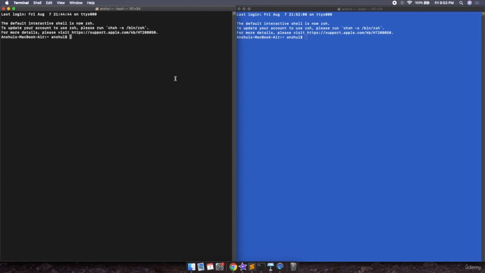
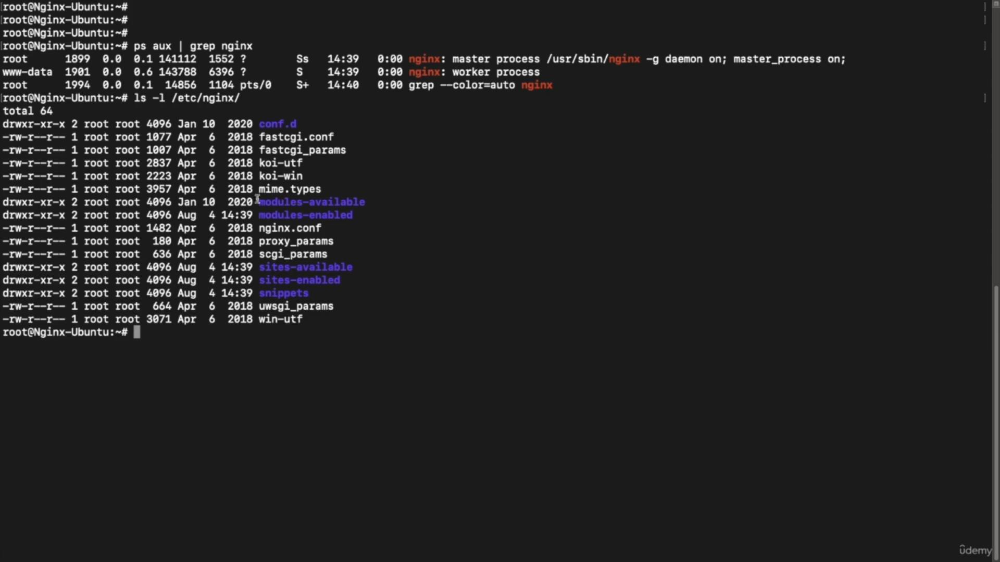
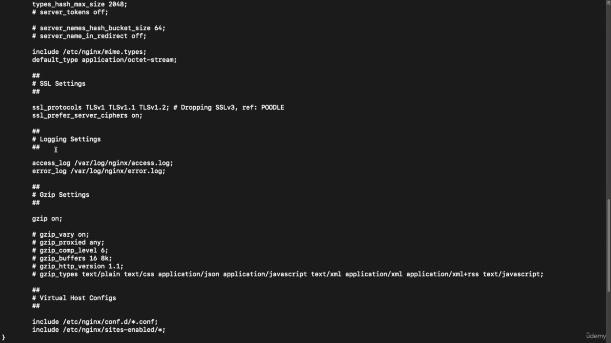
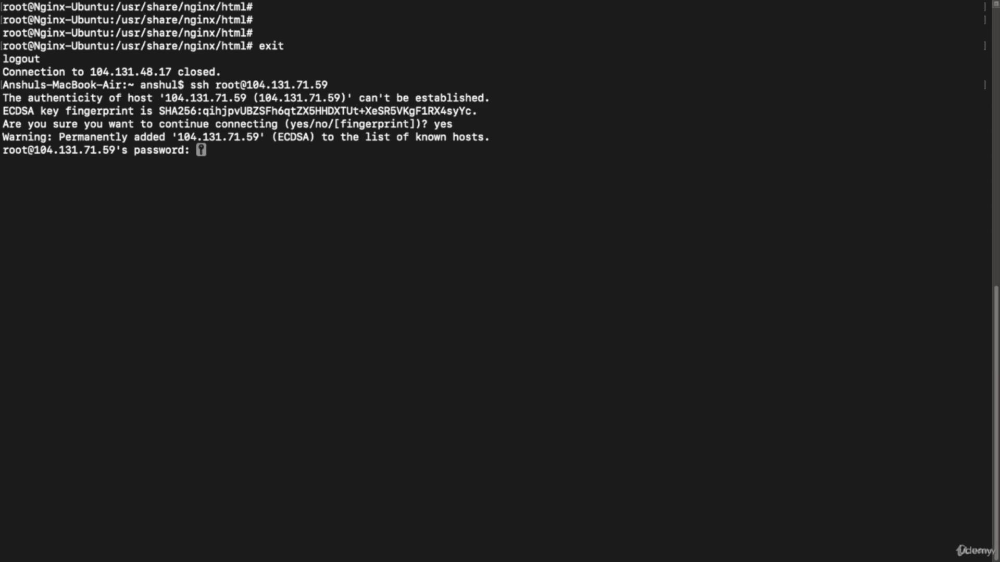
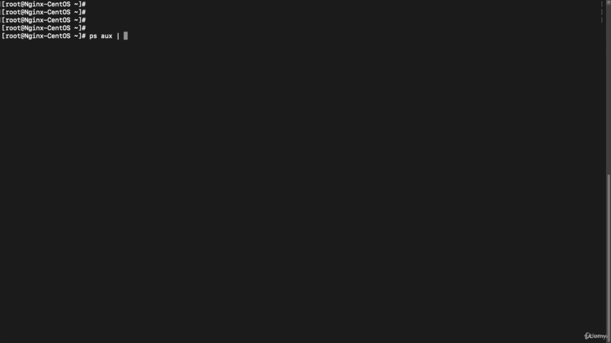
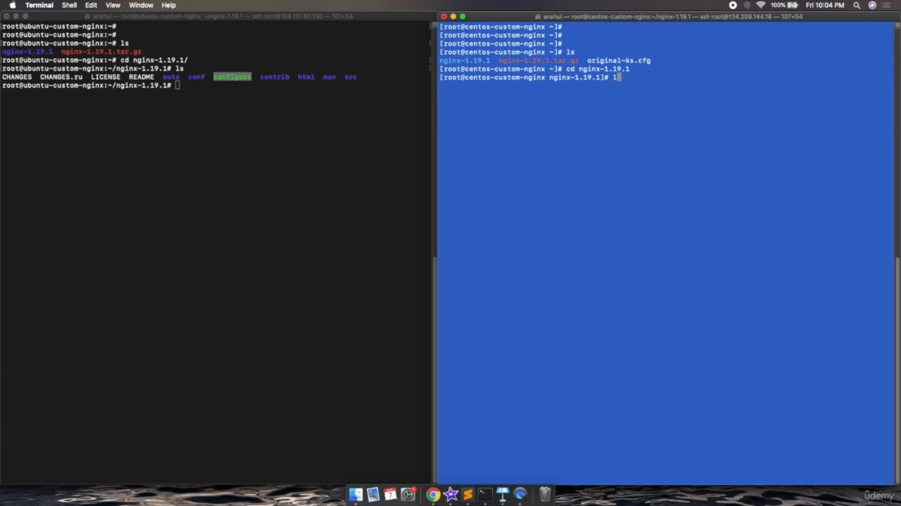
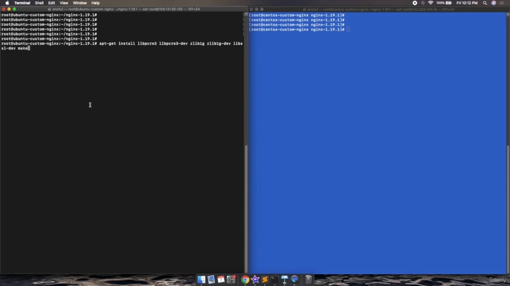
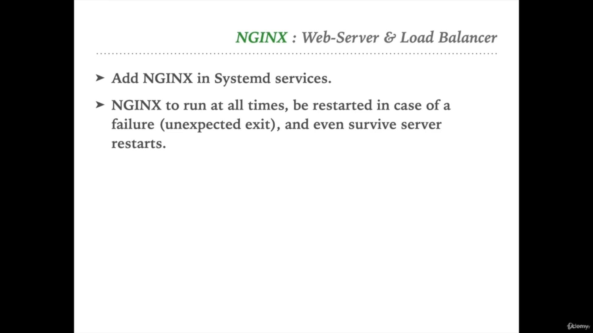
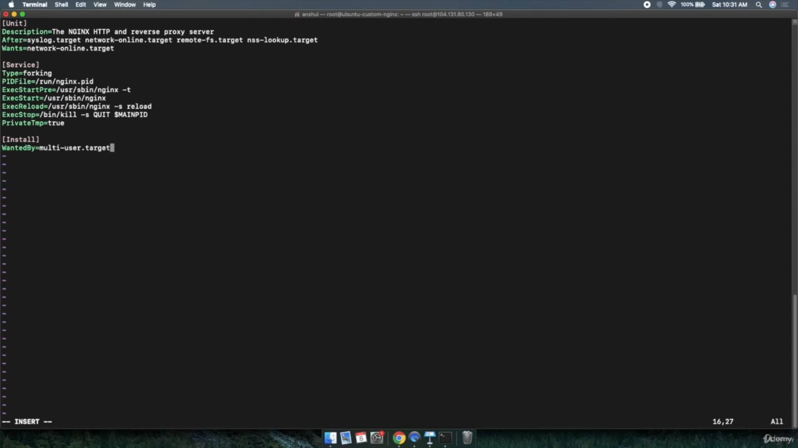

# NGINX MasterClass（P5–P8）复现文档：Ubuntu/CentOS 安装、源码编译与 systemd 守护

> 覆盖范围：P5–P8。  
> 目标：读者从零创建机器，能分别在 Ubuntu、CentOS 上安装 NGINX；再完成源码编译安装；最后把 NGINX 注册成 systemd 服务，并验证重启后自动拉起。  
> 课中环境：DigitalOcean Droplet；Ubuntu 18.04；CentOS 8 系列（讲师口述为 8.2/8.02，按你实际镜像为准）；源码版本为 NGINX 1.19.1 mainline。  
> 说明：以下命令默认以 `root` 登录执行。课里没有讲到的内容，我会在最后“课里没讲但你会撞上的”里单独标注。

---

## 1. 这一节做什么

这一节不是单纯背 NGINX 命令，而是把一条完整的生产前练习链路跑通：

1. 在 Ubuntu 上用 `apt` 安装 NGINX，确认 master/worker 进程、配置文件、日志文件，并用浏览器访问默认页。
2. 在 CentOS 上用 `yum` 安装 NGINX，理解 CentOS 下安装后不会像 Ubuntu 那样自动启动，需要 `systemctl start nginx`。
3. 在 Ubuntu 和 CentOS 上分别从源码编译 NGINX 1.19.1，解决 `cc` 编译器缺失、PCRE 库缺失等问题，最后 `make install`。
4. 把源码安装出来的 NGINX 写成 `/lib/systemd/system/nginx.service`，用 `systemctl start/status/restart/enable` 管理，并验证机器 reboot 后服务能自动起来。

最终你会得到一台“可以开机自启 NGINX”的 Ubuntu 机器；CentOS 机器在 P7 结束后按讲师操作可以销毁。学习时建议把每一步都当成一次可验证的小实验：命令执行完不要只看“有没有刷屏”，而要用进程、端口、配置测试、日志和浏览器响应互相印证。这样后面源码编译和 systemd 出问题时，你才能判断是“包管理器安装的 NGINX 还在”、还是“新编译的路径没有对上”、还是“服务文件没有被 systemd 正确加载”。从 Node/前端视角看，P5/P6 类似用系统包安装一个全局服务，P7 类似自己下载源码构建，P8 类似给这个服务补上 OS 层的守护和开机自启。

---

## 2. 讲师原话（带「—— pNNN [MM:SS]」）

> "Ubuntu 默认就带有 APT 包管理器，借助 APT 包管理器，我们将下载 NGINX……"
> —— p005 [00:27]

> "可以看到有两个 NGINX 进程正在运行，一个由 root 用户运行，另一个由 www-data 用户运行。第一个进程是 NGINX 主进程……第二个进程是工作进程。"
> —— p005 [02:21]

> "第一次向该 IP 发起请求时，NGINX 会从资源文件中读取那个特定的 HTML 文件；但资源文件一旦被读取，就会留在 NGINX 缓存中，之后每次刷新时，NGINX 都会返回 304……"
> —— p005 [06:13]

> "NGINX 默认会启动，但 yum 包管理器默认不会启动 NGINX。那么如何在 CentOS 中启动 NGINX 呢……执行 systemctl start 命令……"
> —— p006 [02:23]

> "当我们通过包管理器安装 NGINX 时，无法在 NGINX 中加入模块，对吧？我们无法添加自定义模块……要加入自定义模块或引入第三方库，我们必须了解如何从源代码安装 NGINX。"
> —— p007 [00:00]

> "它会要求 PCRE 库，可以看到我们遇到了同样的错误：该模块需要 PCRE 库。这说明仅有源代码还不够，我们还需要安装几个额外的库才能让 NGINX 正常工作。"
> —— p007 [09:26]

> "我们将把 NGINX 添加为 systemd 服务……systemd 服务有助于让进程更具韧性。"
> —— p008 [00:29]

> "仅添加该文件还不足以处理服务的开机或上电启动顺序……你还需要再执行一条 systemctl enable 命令。"
> —— p008 [11:17]

以上原话分别对应安装方式、进程模型、缓存与 304、CentOS 启动方式、源码编译动机、依赖库问题、systemd 话题和 `enable` 的作用。复现时不必逐字背英文，但要知道每句话在命令链路中的落点：看到 master/worker 时对应 `ps aux | grep nginx`；看到 `cc is not found` 时对应安装编译工具；看到 service 文件还不够时对应 `systemctl enable`。

---

## 3. 从零复现

### 3.1 准备两台 Droplet 并 SSH 登录

在 DigitalOcean 创建两台机器：

- 一台 Ubuntu 18.04，命名例如 `Ubuntu-Custom-ngx`；
- 一台 CentOS 8 系列，命名例如 `CentOS-Custom-ngx`；
- 认证方式选择密码，记下 root 密码；
- 创建完成后复制公网 IP。


登录命令：

```bash
ssh root@<UBUNTU_IP>
ssh root@<CENTOS_IP>
```

第一次连接会提示 `yes/no`，输入 `yes`，再输入创建机器时设置的 root 密码。


这里有两个容易卡住的点。第一，`<UBUNTU_IP>` 和 `<CENTOS_IP>` 是占位符，复制命令时不要原样保留尖括号，要换成 Droplet 列表里的公网 IP；如果连接超时，先确认机器已经 Running、IP 没有复制错、云厂商安全组或防火墙是否允许 22 端口。第二，输入 root 密码时终端通常不显示星号，这是正常的，粘贴后直接回车即可。第一次连接会询问是否信任主机指纹，输入 `yes` 后才会进入密码环节；如果换了机器但 IP 相同，还可能出现 host key 变更提示，这时应确认是否真的是自己重建的机器，再按提示处理。

P7 里讲师同时开了两个终端，一个黑色终端操作 Ubuntu，一个蓝色终端操作 CentOS：



实际复现时，建议给两个终端做好标记，例如在标题里写 `ubuntu` 和 `centos`，命令粘贴前先看提示符或 `hostname`，避免把 Ubuntu 的 `apt` 命令贴到 CentOS，或者把 CentOS 的 `yum` 命令贴到 Ubuntu。后面源码编译和 systemd 操作都依赖这个区分。

---

### 3.2 P5：Ubuntu 使用 APT 安装 NGINX

在 Ubuntu 终端执行：

```bash
apt-get update
apt install nginx
```

`apt-get update` 的作用是刷新软件包索引，它本身不是升级已安装软件；`apt install nginx` 才会从 Ubuntu 仓库安装 NGINX 的预编译包。安装过程中会提示确认，按 `Y` 回车。若命令提示找不到包，先看网络是否可用、`/etc/apt/sources.list` 是否可用，而不是直接怀疑 NGINX 命令写错。

安装完成后检查进程：

```bash
ps aux | grep nginx
```

你会看到类似：

- 一个 `nginx: master process`，用户是 `root`；
- 一个 `nginx: worker process`，用户是 `www-data`；
- 还有一个是你刚才执行的 `grep nginx` 命令本身。



这里的 `master` 负责读取配置、管理 worker、处理信号；`worker` 才是实际处理 HTTP 请求的进程。`www-data` 是 Ubuntu 包默认配置里的 `user`，后面打开 `nginx.conf` 可以看到。看到 `grep nginx` 自身不要误以为多了一个 NGINX 进程，这是 `grep` 命令包含关键字造成的。

查看配置目录：

```bash
ls /etc/nginx
cat /etc/nginx/nginx.conf
```

课里重点看了 `nginx.conf` 里的 `user www-data`、`worker_processes auto`、`pid`、`include /etc/nginx/modules-enabled/*.conf`、`http`、`server`、日志路径等内容。



读配置时先不要被所有指令淹没，抓住几个锚点即可：`user` 对应 worker 以哪个用户运行；`worker_processes auto` 对应自动按 CPU 核数决定 worker 数；`pid` 告诉服务主进程号写到哪里；`include` 表示继续加载其他片段；`http` 块里再分 `server`，最终对应你浏览器访问的站点。与前端项目对照，`nginx.conf` 有点像项目里的入口配置，`include` 有点像模块化拆分，`server` 有点像 dev server 或反向代理规则，只是 NGINX 是在系统层运行。

查看日志：

```bash
ls /var/log/nginx
tail -f /var/log/nginx/access.log
tail -f /var/log/nginx/error.log
```

`tail -f` 会持续跟踪文件变化，验证完用 `Ctrl+C` 退出。`access.log` 看请求路径、状态码、客户端地址等；`error.log` 看配置、权限、上游转发等错误。若 `access.log` 没有变化，先确认浏览器访问的是这台机器、不是缓存出来的页面，再看是否访问了 80 端口、是否被云防火墙拦截。

再开一个终端查 IP：

```bash
ifconfig
```

浏览器访问：

```text
http://<UBUNTU_IP>
```

第一次访问默认页通常返回 `200`；连续刷新后，`access.log` 里会出现 `304`。讲师解释：第一次 NGINX 从文件系统读静态 HTML，之后浏览器/NGINX 缓存命中，返回 `304 Not Modified`，表示资源未修改。复现时可以在浏览器开发者工具的 Network 面板看状态码和响应头；如果强制刷新或禁用缓存，也可能重新看到 `200`，这并不矛盾，因为是否产生条件请求取决于客户端缓存状态。

---

### 3.3 P6：CentOS 使用 YUM 安装 NGINX

在 CentOS 终端执行：

```bash
yum install nginx
```

中途会多次询问确认，按 `Y` 回车。安装完成后先检查进程：

```bash
ps aux | grep nginx
```

课里强调：CentOS 的 `yum` 安装后不会像 Ubuntu 的 `apt` 那样自动把 NGINX 拉起来，所以需要手动启动服务：

```bash
systemctl start nginx
```

再检查：

```bash
ps aux | grep nginx
systemctl status nginx
```

`systemctl status nginx` 会显示服务处于 `active` 状态，并给出主进程 ID、配置文件路径、配置测试结果等信息。字段名请以你机器实际输出为准。若状态是 `failed`，先看输出里提示的配置测试行，再执行 `nginx -t` 或查看 `journalctl -xe`，不要反复 `systemctl start` 掩盖根因。



停止与再次启动：

```bash
systemctl stop nginx
systemctl status nginx
systemctl start nginx
systemctl status nginx
```

停止后 `status` 应显示 inactive 或 dead；再次 `start` 后回到 active。这里的重点不是死记状态词，而是体会 CentOS 下“安装”和“启动”是两件事：`yum install nginx` 把文件放到系统里，`systemctl start nginx` 才把服务进程拉起来。浏览器访问 CentOS 的 IP，会看到 CentOS 包管理器安装出来的默认页。讲师提到：这个页面和 Ubuntu 上 `apt` 安装出来的默认页 UI 不一样，这是正常的，因为包管理器安装的版本/默认页面不同。



P6 结束后，按讲师操作可以销毁 CentOS Droplet。销毁前如果还想复盘，可以先执行 `systemctl status nginx`、`nginx -v`、`cat /etc/nginx/nginx.conf` 留存输出；但不要把它和 P7 源码安装混在一起，否则后面 `nginx` 命令到底指向包管理器版本还是源码版本会变得难以排查。

---

### 3.4 P7：从源码编译安装 NGINX 1.19.1

#### 3.4.1 更新系统包

Ubuntu：

```bash
apt-get update
```

CentOS：

```bash
yum update
```

CentOS 更新时可能多次询问确认，按 `Y` 回车。讲师说明 CentOS 包更新可能耗时几分钟，这是正常的。更新期间不要因为长时间没有新输出就强行中断；如果确实失败，先记录报错来自网络、仓库元数据还是依赖冲突。对于复现实验来说，更新不是 NGINX 本身的编译步骤，但它能减少系统工具过旧带来的干扰。

#### 3.4.2 下载 NGINX 源码

去 `nginx.org`，不要用 `nginx.com` 的业务站。课里选择 mainline 版本 `1.19.1`。

Ubuntu 下载：

```bash
wget https://nginx.org/download/nginx-1.19.1.tar.gz
tar -zxvf nginx-1.19.1.tar.gz
cd nginx-1.19.1
```

CentOS 如果提示 `wget` 不存在，先安装：

```bash
yum install wget
```

再下载解压：

```bash
wget https://nginx.org/download/nginx-1.19.1.tar.gz
tar -zxvf nginx-1.19.1.tar.gz
cd nginx-1.19.1
```

`wget` 负责从 URL 下载 `.tar.gz`；`tar -zxvf` 里 `z` 表示 gzip 解压，`x` 表示抽取，`v` 表示显示过程，`f` 表示指定文件名。解压后必须 `cd nginx-1.19.1`，后续 `./configure` 要在源码目录里执行；如果提示找不到 `configure`，通常是你不在解压后的目录。可用 `pwd` 和 `ls` 确认。

#### 3.4.3 第一次 `./configure`：报 `cc` 编译器缺失

执行：

```bash
./configure
```

课里 Ubuntu 和 CentOS 都报 `c compiler cc is not found`。这说明需要先安装编译工具。

Ubuntu 安装编译工具：

```bash
apt-get install build-essential
```

CentOS 安装开发工具组：

```bash
yum groupinstall "Development Tools"
```



`./configure` 不是“安装 NGINX”，而是在探测系统环境、检查依赖、生成后续 `make` 需要的构建文件。没有 C 编译器时，它连探测都做不下去，所以先报 `cc is not found`。Ubuntu 的 `build-essential` 和 CentOS 的 `Development Tools` 都是把编译所需的基础工具补齐。安装后可用 `cc --version` 或 `gcc --version` 确认命令存在；若仍报告缺失，检查命令是否真的装上，以及当前 shell 的 `PATH` 是否正常。

#### 3.4.4 第二次 `./configure`：报 PCRE 库缺失

再次执行：

```bash
./configure
```

这次会继续编译一段，然后报 PCRE 库缺失。讲师解释：NGINX 源码编译不仅需要源码本身，还需要 PCRE、zlib、OpenSSL 等库。

Ubuntu 安装依赖：

```bash
apt-get install libpcre3 libpcre3-dev zlib1g zlib1g-dev libssl-dev make
```

CentOS 安装依赖：

```bash
yum install pcre pcre-devel zlib zlib-devel openssl openssl-devel make
```

这里的 `-dev` / `-devel` 包很关键：运行库提供已经编译好的 `.so`，开发包才提供编译时需要的头文件和链接信息。只装运行库有时仍会在 `./configure` 阶段失败。PCRE 与正则匹配相关，zlib 与 gzip 压缩相关，OpenSSL 与 HTTPS/TLS 相关；课里先解决 PCRE，是因为 configure 会按依赖顺序把问题暴露出来。遇到缺失时不要猜，直接把报错里缺失的库名对应到系统包。

#### 3.4.5 带参数 `./configure`

依赖装好后，使用讲师口述的 configure 选项：

```bash
./configure \
  --sbin-path=/usr/bin/nginx \
  --conf-path=/etc/nginx/nginx.conf \
  --error-log-path=/var/log/nginx/error.log \
  --http-log-path=/var/log/nginx/access.log \
  --pid-path=/var/run/nginx.pid \
  --with-pcre \
  --with-http_ssl_module
```

执行成功后会看到 `Configuration summary`，里面会显示使用系统 PCRE 库、OpenSSL 库、Zlib 库等信息。写多行命令时，反斜杠 `\` 后面不要留空格；复制到终端后如果提示 `--sbin-path` 之类的参数不完整，通常是换行被破坏。看到 summary 后不要急着重跑 configure，先确认路径和模块是否就是你要的，再进入 `make`。



#### 3.4.6 编译与安装

```bash
make
make install
```

编译时间可能较长，两台机器可以并行执行。安装完成后检查版本：

```bash
nginx -v
```

课里输出为 `nginx/1.19.1`。

启动 NGINX：

```bash
nginx
```

检查进程：

```bash
ps -ef | grep nginx
```

浏览器访问 Ubuntu 和 CentOS 的 IP，应该都能看到源码目录里的默认页。讲师特别说明：这次两台机器 UI 一样，因为不是包管理器安装，而是直接用了源码里的 HTML 文件。若启动时报端口占用，通常是之前 `apt`/`yum` 安装的 NGINX 还在运行；先确认到底是哪一个 `nginx` 正在监听 80 端口，再决定停止哪个服务。`make install` 只是把文件复制到指定路径，不负责 systemd 管理，这一点要到 P8 才补上。


---

### 3.5 P8：把 NGINX 注册成 systemd 服务

P8 在 Ubuntu 上操作。先确认 NGINX 正在运行，然后创建 service 文件：

```bash
touch /lib/systemd/system/nginx.service
vi /lib/systemd/system/nginx.service
```

按 `i` 进入插入模式，粘贴完整内容：

```ini
[Unit]
Description=nginx - high performance web server
After=network.target

[Service]
Type=forking
PIDFile=/var/run/nginx.pid
ExecStartPre=/usr/bin/nginx -t -c /etc/nginx/nginx.conf
ExecStart=/usr/bin/nginx -c /etc/nginx/nginx.conf
ExecReload=/usr/bin/nginx -s reload
ExecStop=/usr/bin/nginx -s stop

[Install]
WantedBy=multi-user.target
```

保存退出：

```text
Esc
:wq
Enter
```



先停掉手动启动的 NGINX：

```bash
nginx -s stop
```

确认进程：

```bash
ps aux | grep nginx
```

然后用 systemd 启动：

```bash
systemctl start nginx
systemctl status nginx
```

`systemctl status nginx` 会显示服务 active、主进程 ID、配置文件路径、配置测试成功等信息。字段名以实际输出为准。如果新增 service 文件后直接 `systemctl start nginx` 提示找不到 unit，先执行 `systemctl daemon-reload` 再试；如果启动失败，先看 `status` 里的报错，再手动执行 `ExecStartPre` 中的 `/usr/bin/nginx -t -c /etc/nginx/nginx.conf` 复现问题。课里先 `nginx -s stop` 的动作很关键，否则 systemd 可能因为端口被手动进程占用而启动失败。


测试重启：

```bash
systemctl restart nginx
systemctl status nginx
```

此时直接 `reboot`，重连后会发现服务没有自动起来。讲师解释：只创建 service 文件还不够，需要 `enable`：

```bash
systemctl start nginx
systemctl status nginx
systemctl enable nginx
```

`systemctl enable nginx` 会创建类似 `/etc/systemd/system/multi-user.target.wants/nginx.service` 的软链接。



再次重启：

```bash
reboot
```

重连后检查：

```bash
systemctl status nginx
```

此时 NGINX 应该自动处于运行状态。这样就把 NGINX 做成了“崩溃可被 systemd 拉起、机器重启可自动启动”的服务。若 reboot 后仍没起来，检查三件事：`systemctl is-enabled nginx` 是否显示 `enabled`；`systemctl status nginx` 是否显示 unit 路径和实际运行路径一致；`ExecStart` 中的 `/usr/bin/nginx` 是否真的存在。systemd 的日志可用 `journalctl -u nginx` 查看，但课里没有展开，复现时先以 `status` 输出为主要线索。

---

## 4. 完整代码

### 4.1 `/lib/systemd/system/nginx.service`

```ini
[Unit]
Description=nginx - high performance web server
After=network.target

[Service]
Type=forking
PIDFile=/var/run/nginx.pid
ExecStartPre=/usr/bin/nginx -t -c /etc/nginx/nginx.conf
ExecStart=/usr/bin/nginx -c /etc/nginx/nginx.conf
ExecReload=/usr/bin/nginx -s reload
ExecStop=/usr/bin/nginx -s stop

[Install]
WantedBy=multi-user.target
```

### 4.2 Ubuntu 源码编译命令清单

```bash
apt-get update
wget https://nginx.org/download/nginx-1.19.1.tar.gz
tar -zxvf nginx-1.19.1.tar.gz
cd nginx-1.19.1
./configure
apt-get install build-essential
./configure
apt-get install libpcre3 libpcre3-dev zlib1g zlib1g-dev libssl-dev make
./configure \
  --sbin-path=/usr/bin/nginx \
  --conf-path=/etc/nginx/nginx.conf \
  --error-log-path=/var/log/nginx/error.log \
  --http-log-path=/var/log/nginx/access.log \
  --pid-path=/var/run/nginx.pid \
  --with-pcre \
  --with-http_ssl_module
make
make install
nginx -v
nginx
ps -ef | grep nginx
```

### 4.3 CentOS 源码编译命令清单

```bash
yum update
yum install wget
wget https://nginx.org/download/nginx-1.19.1.tar.gz
tar -zxvf nginx-1.19.1.tar.gz
cd nginx-1.19.1
./configure
yum groupinstall "Development Tools"
./configure
yum install pcre pcre-devel zlib zlib-devel openssl openssl-devel make
./configure \
  --sbin-path=/usr/bin/nginx \
  --conf-path=/etc/nginx/nginx.conf \
  --error-log-path=/var/log/nginx/error.log \
  --http-log-path=/var/log/nginx/access.log \
  --pid-path=/var/run/nginx.pid \
  --with-pcre \
  --with-http_ssl_module
make
make install
nginx -v
nginx
ps -ef | grep nginx
```

---

## 5. 逐行解释

### 5.1 为什么 Ubuntu 用 `apt`，CentOS 用 `yum`

Ubuntu 默认包管理器是 APT，所以用：

```bash
apt-get update
apt install nginx
```

CentOS 默认包管理器是 YUM，所以用：

```bash
yum install nginx
```

两者都是“从系统仓库安装预编译包”。优点是简单；缺点是讲师强调的：**不能方便地加入自定义模块或第三方模块**。这就是 P7 要源码编译的原因。与前端对照，包管理器安装像直接 `npm install` 一个已经构建好的全局工具，源码编译像自己拿到源码后按参数构建。区别是 NGINX 是系统服务，安装位置、配置路径、PID 路径、systemd 路径彼此关联，不能只看“命令能跑”。如果只是完成 P5/P6，包管理器足够；但要做课程里的模块和路径控制，就必须进入源码编译。

常见错误是把 Ubuntu 命令贴到 CentOS，或者反过来。看到 `apt: command not found` 时先确认系统；看到 `yum: command not found` 也一样。两个系统都有替代方案，但复现课程时按讲师环境走最省事。

### 5.2 `ps aux | grep nginx` 在看什么

`ps aux` 列出所有用户进程；`grep nginx` 过滤出包含 `nginx` 的行。课里看到：

- `nginx: master process`：主进程，负责管理 worker；
- `nginx: worker process`：工作进程，实际处理请求；
- `grep nginx`：你刚才执行的过滤命令本身。

在 Node 里你可以把 master/worker 类比成 PM2 的守护进程 + 工作进程，但 NGINX 是 C 写的 Web Server，机制不同，这里只做概念类比。实际排查时，看到 master 但没有 worker，可能是 worker 启动失败；看到多个 `nginx` 但 `systemctl status` 不对应，可能是手动启动的进程和 systemd 托管的进程混在一起。此时不要直接 `kill -9`，先确认 PID、端口和 unit 状态，按课程顺序先 `nginx -s stop` 再交给 systemd。

### 5.3 200 和 304 的区别

第一次访问：

```text
200
```

表示 NGINX 从文件系统读取并返回了静态 HTML。

后续刷新：

```text
304
```

表示资源未修改，客户端/缓存命中。讲师原话是：第一次从资源文件读取，之后放在 NGINX 缓存里，直到刷新或清缓存。注意：`304` 不是错误，是“未修改”的重定向响应。更准确地说，浏览器会带条件请求头询问服务器资源是否变化，服务器判断未变就返回 304，不重复传正文。与前端对照，这和你做静态资源缓存、ETag、Last-Modified 是同一类问题；调试时可以在 DevTools 里看请求头、响应头、是否来自 cache。如果日志里状态码和浏览器面板不一致，先确认是否刷新了另一个页面或用了不同 URL。

### 5.4 源码编译为什么先报 `cc` 再报 PCRE

`./configure` 需要 C 编译器来探测和生成构建文件。没有 `cc` 就报：

```text
c compiler cc is not found
```

安装 `build-essential` 或 `Development Tools` 后，编译器有了，但 NGINX 还依赖 PCRE、zlib、OpenSSL。所以第二次 `./configure` 会报 PCRE 缺失。把依赖库装上后，`./configure` 才能输出 `Configuration summary`。这个顺序很重要：先解决编译器，再解决库，最后才进入 `make`。如果顺序反了，比如还没装开发工具就先反复安装 PCRE，configure 仍会失败。排查时看报错最后一行和 `checking for ...` 的上下文，不要只看开头。

### 5.5 `--sbin-path`、`--conf-path`、`--pid-path` 是什么

这些是源码编译时的安装路径：

- `--sbin-path=/usr/bin/nginx`：把 `nginx` 可执行文件放到 `/usr/bin/nginx`；
- `--conf-path=/etc/nginx/nginx.conf`：主配置放到 `/etc/nginx/nginx.conf`；
- `--error-log-path=/var/log/nginx/error.log`：错误日志路径；
- `--http-log-path=/var/log/nginx/access.log`：访问日志路径；
- `--pid-path=/var/run/nginx.pid`：PID 文件路径；
- `--with-pcre`：启用 PCRE；
- `--with-http_ssl_module`：启用 HTTP SSL 模块，对应讲师说的 OpenSSL 安全连接。

这些路径必须和后面的 systemd service 文件一致。如果你改了 `--sbin-path`，却还在 service 里写 `/usr/bin/nginx`，systemd 启动时就会找不到可执行文件。可用 `nginx -V` 查看编译参数和路径，用 `command -v nginx` 查看当前 shell 找到的是哪一个 nginx。与前端对照，这类似构建输出目录、启动脚本入口和进程管理配置必须对齐。

### 5.6 `nginx.service` 每一段在做什么

```ini
[Unit]
Description=nginx - high performance web server
After=network.target
```

`Description` 是服务描述；`After=network.target` 表示在网络就绪后再启动。注意 `After` 只表达启动顺序，不表示强依赖，但课程场景下够用。

```ini
[Service]
Type=forking
PIDFile=/var/run/nginx.pid
```

`Type=forking` 表示 NGINX 会 fork 到后台；`PIDFile` 告诉 systemd 主进程 PID 写在哪里。如果实际 PID 文件和这里不一致，systemd 可能无法正确跟踪服务。

```ini
ExecStartPre=/usr/bin/nginx -t -c /etc/nginx/nginx.conf
ExecStart=/usr/bin/nginx -c /etc/nginx/nginx.conf
```

`ExecStartPre` 在启动前先做配置测试；`ExecStart` 才是真正启动命令。这样配置有语法错误时，systemd 会先失败在测试阶段，而不是把坏配置带起来。

```ini
ExecReload=/usr/bin/nginx -s reload
ExecStop=/usr/bin/nginx -s stop
```

`reload` 是热重载配置；`stop` 是停止。讲师在 P8 里用 `nginx -h` 展示过 `-s` 可以发送 `stop`、`quit`、`reopen`、`reload` 等信号。

```ini
[Install]
WantedBy=multi-user.target
```

表示 `systemctl enable` 时，把服务挂到多用户运行级别下，实现开机自启。与前端对照，systemd 更像 OS 层的 PM2 或进程守护器，但配置文件不是 `ecosystem.config.js`，而是 INI 格式的 unit 文件。

### 5.7 `systemctl start` 和 `systemctl enable` 的区别

- `systemctl start nginx`：现在立刻启动；
- `systemctl enable nginx`：设置开机自启，创建软链接；
- `systemctl status nginx`：查看状态；
- `systemctl restart nginx`：重启；
- `systemctl stop nginx`：停止。

讲师在 P8 里先只创建 service 文件，reboot 后服务没起来；执行 `enable` 后再次 reboot，服务才自动起来。这就是两者区别。验证时可用 `systemctl is-active nginx` 看当前是否运行，用 `systemctl is-enabled nginx` 看是否开机自启；`enable` 不等于 `start`，`start` 也不等于 `enable`。如果希望一步完成，可以自行查 `enable --now`，但本节按课程原操作先区分两者，避免混淆。

---

## 6. 复现检查清单

| 检查项 | 命令 | 预期 |
|---|---|---|
| SSH 能登录 Ubuntu | `ssh root@<UBUNTU_IP>` | 输入密码后进入 Ubuntu |
| SSH 能登录 CentOS | `ssh root@<CENTOS_IP>` | 输入密码后进入 CentOS |
| Ubuntu 安装 NGINX | `apt install nginx` | 安装完成，提示确认 |
| Ubuntu 进程存在 | `ps aux \| grep nginx` | 看到 master/worker |
| Ubuntu 配置存在 | `cat /etc/nginx/nginx.conf` | 能看到 `user`、`worker_processes`、`http` 等 |
| Ubuntu 日志存在 | `tail -f /var/log/nginx/access.log` | 浏览器访问后有访问记录 |
| 浏览器访问 | `http://<UBUNTU_IP>` | 默认 NGINX 页面 |
| CentOS 安装 NGINX | `yum install nginx` | 安装完成 |
| CentOS 手动启动 | `systemctl start nginx` | 服务 active |
| CentOS 状态 | `systemctl status nginx` | 显示 active，字段以实际输出为准 |
| 源码下载 | `wget https://nginx.org/download/nginx-1.19.1.tar.gz` | 得到 tar.gz |
| 解压 | `tar -zxvf nginx-1.19.1.tar.gz` | 生成 `nginx-1.19.1` 目录 |
| 编译工具 | `apt-get install build-essential` 或 `yum groupinstall "开发工具"` | 解决 `cc` 缺失 |
| 依赖库 | 安装 PCRE/zlib/OpenSSL 相关包 | `./configure` 通过 |
| 编译安装 | `make && make install` | 无报错 |
| 版本 | `nginx -v` | `nginx/1.19.1` |
| 手动启动 | `nginx` | 进程存在 |
| systemd 文件 | `/lib/systemd/system/nginx.service` | 内容完整 |
| systemd 启动 | `systemctl start nginx` | 服务 active |
| 开机自启 | `systemctl enable nginx` | 创建软链接 |
| 重启验证 | `reboot` 后 `systemctl status nginx` | 服务自动运行 |

逐条验证时建议按以下方式确认，而不是只看“命令没报错”。SSH 登录后执行 `hostname`、`whoami`、`cat /etc/os-release` 确认机器和系统没有串；`apt install nginx` 后执行 `nginx -v`、`systemctl status nginx` 交叉确认。`ps aux | grep nginx` 要区分 master/worker 和 grep 自身；`cat /etc/nginx/nginx.conf` 至少找到 `user`、`worker_processes`、`http`、`server` 这几个关键字。日志验证不能只看文件存在，要在浏览器访问后观察 `access.log` 新增行，状态码与浏览器 Network 面板对应。CentOS 的 `systemctl start nginx` 后要用 `systemctl is-active nginx` 或 `status` 确认 active；如果失败，先记录输出再处理。源码下载后检查文件大小和目录；`./configure` 通过的标准是出现 `Configuration summary`，而不是“最后一行没有红字”。`make install` 后 `nginx -v` 输出 `nginx/1.19.1`，若输出包管理器旧版本，要用 `command -v nginx` 确认路径。手动 `nginx` 后检查进程和 80 端口，必要时用 `ss -ltnp` 或 `netstat` 查看监听。systemd 文件写完后用 `systemctl cat nginx` 核对内容，`start` 后用 `status` 看进程和配置测试，`enable` 后用 `systemctl is-enabled nginx` 以及 `ls -l /etc/systemd/system/multi-user.target.wants/nginx.service` 验证软链接，最终 reboot 后再次 `systemctl status nginx` 确认自动运行。

---

## 7. 课里没讲但你会撞上的

| 现象 | 原因 | 怎么办 |
|---|---|---|
| 创建完 service 文件后，`systemctl` 提示找不到 unit 或仍用旧配置 | systemd 还没有重新读取新增/修改的 unit 文件 | 执行 `systemctl daemon-reload`，再用 `systemctl cat nginx`、`systemctl status nginx` 确认 systemd 看的是哪个文件；检查文件名是否确实是 `nginx.service` |
| 手动 `nginx` 已经启动，再执行 `systemctl start nginx` 失败 | 80 端口或 PID 文件已被手动启动的 NGINX 占用，systemd 再次启动发生冲突 | 先 `nginx -s stop`，用 `ps aux \| grep nginx` 和 `ss -ltnp` 确认没有旧进程占用，再 `systemctl start nginx`；课里也是先停掉手动进程再交给 systemd |
| `ExecStartPre` 配置测试失败，`status` 显示配置错误 | service 文件里的 `-t`/`-T`、配置路径或 `nginx` 可执行文件路径与实际不一致 | 手动执行 service 中 `ExecStartPre` 那一行复现错误；以 `nginx -h`、`nginx -t -c /etc/nginx/nginx.conf` 的实际输出为准；确认写的是测试配置还是打印配置 |
| systemd 启动时报找不到 `/usr/bin/nginx` | 源码编译时改了 `--sbin-path`，但 service 文件仍写 `/usr/bin/nginx` | 用 `command -v nginx`、`nginx -V` 查实际路径，把 `ExecStartPre`、`ExecStart`、`ExecReload`、`ExecStop` 里的路径统一改成实际可执行文件路径 |
| `nginx: command not found` 或运行了旧版本 | 当前 shell 的 `PATH` 没包含安装路径，或系统里同时存在包管理器版本和源码版本 | 用 `command -v nginx` 确认命中的是哪一个；必要时写绝对路径 `/usr/bin/nginx -v`；检查 `--sbin-path` 是否为 `/usr/bin/nginx` |
| `bind() to 0.0.0.0:80 failed` 或启动后端口被占用 | 已有 NGINX、Apache 或其他程序监听 80 端口；也可能是旧 master 进程未退出 | 用 `ss -ltnp \| grep :80` 或 `netstat -ltnp \| grep :80` 找占用者；如果是 apt/yum 安装的 NGINX，先停止对应服务；确认后再启动源码版 |
| CentOS 8 的仓库/镜像下载慢或失败 | 环境、网络、仓库配置或镜像状态不同；课里也提到 CentOS 包更新可能耗时几分钟 | 先等待并观察是否仍有进度；检查网络、DNS、仓库地址；不要因为暂时无输出就误以为卡死。若仓库确实不可用，先记录报错，优先保证系统工具和依赖可用 |
| 浏览器访问不了，但本机 `ps` 能看到 NGINX | 云主机安全组/防火墙未放行 80，或访问了错误 IP；NGINX 也可能只监听了本机地址 | 先在本机 `curl -I http://127.0.0.1`，再查 `ss -ltnp` 看监听地址；然后检查云厂商安全组、系统防火墙和公网 IP，课里只演示了本机 `ifconfig` 和浏览器访问，这属于课里没讲的部分 |
| `systemctl enable nginx` 后以为服务马上会启动 | `enable` 只负责设置开机自启，不会立刻启动当前进程 | 先 `systemctl start nginx` 再 `systemctl enable nginx`；用 `systemctl is-active nginx` 和 `systemctl is-enabled nginx` 分别确认“现在是否运行”和“是否开机自启” |
| 在 Node/前端视角下把 `nginx -s reload` 理解成 Node 进程重启 | NGINX 的 `reload` 是重新加载配置并由 master 平滑处理 worker，不是简单重启 Node 进程 | 记住 systemd 是 OS 层守护，PM2 是 Node 进程管理器；`nginx -s reload` 类似热重载配置，验证时看 `status`、日志和实际请求是否仍正常 |