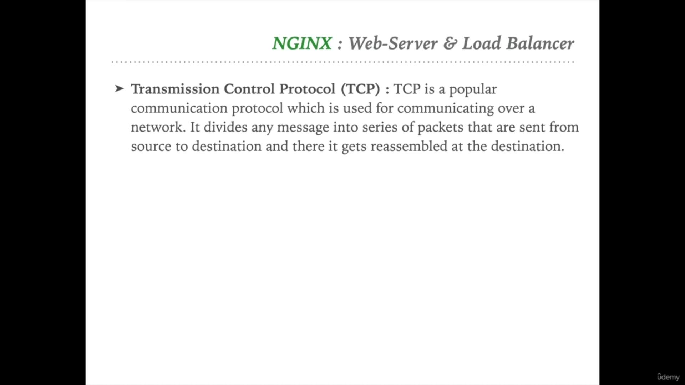
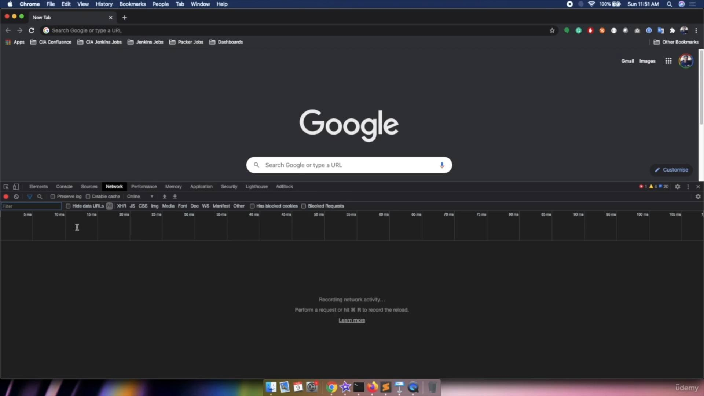
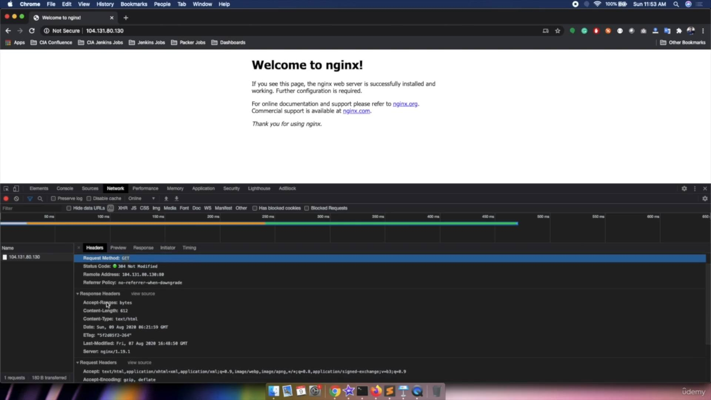
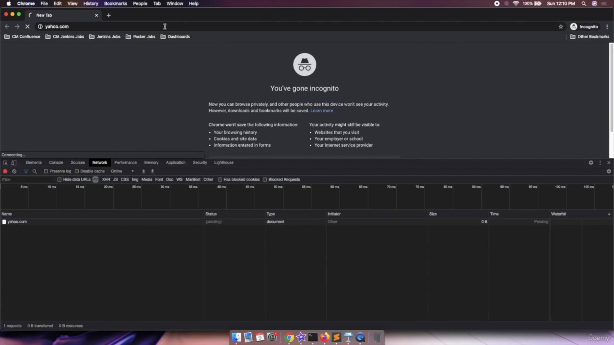
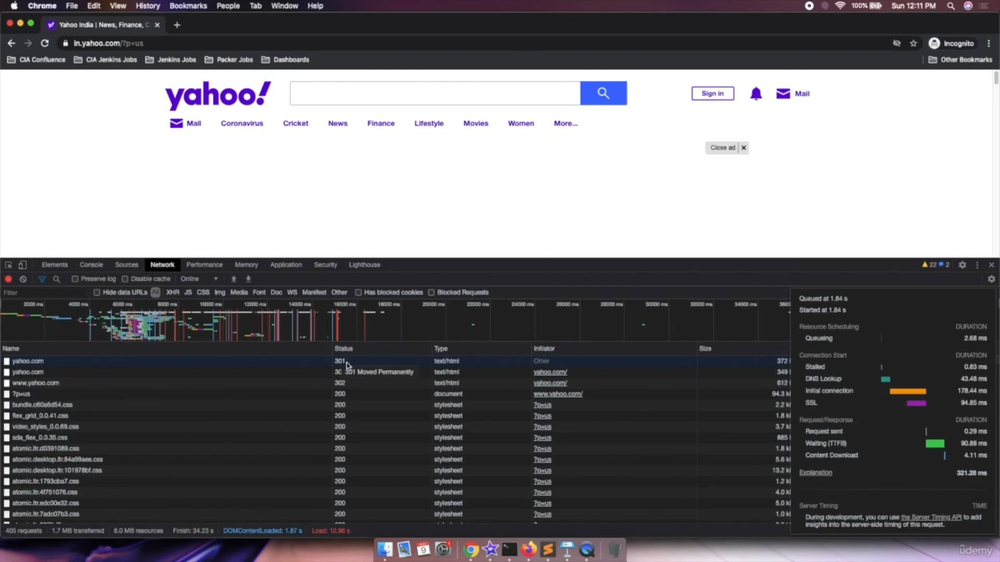

# NGINX MasterClass（BV1vkAczWEmr）P9–P12：HTTP 协议基础与动手验证

## 1. 这一节做什么

P9–P12 是 NGINX MasterClass 系列中“进入配置之前”的理论地基。讲师用四节课依次讲了：

- **HTTP 是什么**：一种数字语言、一套通信双方都要遵守的规则，是 Web 上最核心的应用层协议；
- **HTTP 的工作模型**：请求→处理→响应→断开，连接无关（connectionless）、无状态（stateless）、媒体独立；
- **HTTP 请求的组成**：请求行（方法 + URI + 协议版本）、请求头、空行、请求体；
- **HTTP 响应状态码**：1xx 信息、2xx 成功、3xx 重定向、4xx 客户端错误、5xx 服务端错误。

课程里没有写任何代码，讲师全程用浏览器 DevTools 观察真实流量。所以这份文档的“复现”目标不是写一个 Web 应用，而是：

1. 在你自己的电脑上装好 nginx；
2. 启动它，用浏览器访问到默认页；
3. 打开 DevTools 的 Network 面板，亲眼看到请求行、请求头和状态码；
4. 用 `curl` 在终端里看到同样的信息；
5. 用一个 Node.js 小脚本验证不同状态码的产生条件。

最终效果：你亲手看到了 HTTP 请求/响应在浏览器和终端里的真实样子，后面学 nginx 配置时，看到 `location`、`return 301`、`proxy_pass` 这些指令，就能对应到这节课的概念上。



---

## 2. 讲师原话

> "协议是一种数字语言，我们通过它在互联网上与他人通信……因此，协议是一种媒介，也是一种数字语言，多台机器通过它在互联网上通信。"
> —— p009 [00:28]

> "HTTP 是无连接的。HTTP 客户端或网页浏览器发起 HTTP 请求，请求发出后，客户端等待响应……一旦访问网址，服务器会处理你的请求，将响应返回给浏览器，随后服务器会断开该连接。"
> —— p010 [02:15]

> "请求行以方法标记开始，后面依次是请求 URI 和协议版本……HTTP 协议有多种方法，例如 GET、POST、PUT、DELETE。"
> —— p011 [01:51]

> "响应码定义请求的状态……HTTP 响应码是三位整数，其中第一位数字决定响应的类别。"
> —— p012 [00:55]

> "如果收到 5xx 响应，说明发生了内部服务器错误或服务器错误……在 4xx 中，服务器不接受你的请求，它不认识该请求；而在 5xx 中，服务器接受了请求，请求本身有效，但服务器无法完成该请求。"
> —— p012 [03:18]

> "如果我刷新此页面，内容可能会变化……网站服务器每次都会执行一些服务端脚本，访问数据库获取数据，再展示给用户。"
> —— p010 [06:53]

讲师原话里的“STDP/STTP”是语音转写错误，实际都是 HTTP；“STTPS”是 HTTPS；“UDB”是 UDP；“FPP”是 FTP。下文统一用正确缩写。

---

## 3. 从零复现

下面所有步骤都在你本机完成。课程里讲师用了自己的 IP `104.131.80.130` 访问 nginx，你不需要公网 IP，`localhost` 就够了。

### 3.1 安装 nginx

**macOS（Homebrew）：**

```bash
brew install nginx
```

这条命令调用 Homebrew 包管理器安装 nginx。Homebrew 会下载对应 macOS 版本的 nginx 二进制、默认配置文件和依赖库，并把 `nginx` 命令放进 Homebrew 的可执行路径中。安装完成后，Homebrew 通常会把默认站点目录、日志目录和配置文件放在 Homebrew 前缀下，因此后面查配置路径时不能照搬 Ubuntu 的 `/etc/nginx/nginx.conf`。常见错误是 `brew: command not found`，说明 Homebrew 本身没装或 PATH 没配好；另一个常见错误是权限错误，通常是因为用 `sudo brew` 或 Homebrew 目录权限混乱，Homebrew 一般不建议用 `sudo` 安装。浏览器侧没有直接对应操作，这一步只是准备服务器程序。

**Ubuntu/Debian：**

```bash
sudo apt update
sudo apt install nginx
```

`sudo apt update` 先刷新软件源索引，让系统知道软件仓库里有哪些最新包；`sudo apt install nginx` 再从仓库安装 nginx。两条命令分开写的原因是：如果索引太旧，直接安装可能找不到包或装到旧版本。常见错误是 `Unable to locate package nginx`，通常先检查网络、软件源和是否执行过 `apt update`；如果提示权限不足，检查是否漏了 `sudo`。安装完成后，Ubuntu 一般会用 systemd 管理 nginx，默认配置在 `/etc/nginx/nginx.conf`，默认站点目录在 `/var/www/html` 或 `/usr/share/nginx/html` 一类路径，具体以发行版为准。与浏览器前台的对照是：安装完成后浏览器还看不到页面，必须启动服务并访问对应端口。

安装完成后检查版本：

```bash
nginx -v
```

`nginx -v` 只打印 nginx 的版本号，然后立即退出，不会启动服务。它最适合确认三件事：命令是否在 PATH 中、nginx 是否真的安装成功、你当前调用的是哪个版本。预期输出类似（实际版本号以你的环境为准）：

```
nginx version: nginx/1.27.0
```

如果这里报 `command not found`，说明 shell 找不到 `nginx`，常见原因是安装没完成、Homebrew 路径没加载、或者你刚装完但终端会话还没刷新 PATH。与前台对照：版本号本身不在浏览器里显示，但后续 DevTools 响应头里的 `Server: nginx/1.27.0` 会和它对应。

### 3.2 启动 nginx

**macOS（Homebrew 安装）：**

```bash
brew services start nginx
```

这条命令把 nginx 注册成 Homebrew 管理的后台服务并启动。它适合日常开发，因为服务会在后台运行，也方便用 `brew services stop nginx` 停止。常见错误是启动后浏览器仍打不开，这时先看 `brew services list` 里 nginx 的状态，再检查 80 端口是否被别的程序占用。另一个常见错误是配置文件语法错误导致服务起不来，可以先用 `nginx -t` 检查配置。浏览器侧对应操作就是访问 `http://localhost/`，如果服务没起来，浏览器会显示“无法连接”或“拒绝连接”。

**Ubuntu（apt 安装）：**

```bash
sudo systemctl start nginx
```

这条命令通过 systemd 启动 nginx 服务。`systemctl` 是 Ubuntu 的服务管理器，`start` 表示立即启动一次；如果你希望开机自启，还需要 `sudo systemctl enable nginx`，但本节只要求先启动。常见错误是 `Job for nginx.service failed`，通常要用 `sudo systemctl status nginx` 看失败原因，再用 `sudo nginx -t` 检查配置语法。浏览器侧同样是访问 `http://localhost/`，成功时看到 nginx 欢迎页。

**两个平台都能用的方式：**

```bash
nginx
```

这条命令直接执行 nginx 二进制。默认情况下 nginx 会按自己的配置启动 master 进程和 worker 进程，然后回到 shell。常见错误是 `bind() to 0.0.0.0:80 failed (98: Address already in use)`，说明 80 端口已被占用，可能是 AirPlay、Apache、另一个 nginx 实例或 Docker 容器。另一个常见错误是配置路径不对，尤其是你用了自定义配置时。与浏览器前台对照：命令执行成功不等于浏览器一定看到欢迎页，还要确认监听端口、默认站点和 Host 是否匹配。

启动后验证进程在跑：

```bash
ps aux | grep nginx
```

`ps aux` 列出当前系统中的进程，`grep nginx` 过滤出包含 nginx 的行。正常时会看到至少一个 master 进程和若干 worker 进程。常见现象是只看到 `grep nginx` 自己，说明 nginx 没启动；如果看到多个 master，可能是重复启动或不同配置路径各起了一份。浏览器侧无法直接看到进程，但浏览器能否连接成功，取决于这些进程是否在监听端口。

### 3.3 用浏览器访问默认页

打开浏览器，访问：

```
http://localhost/
```

你会看到 nginx 的欢迎页（“Welcome to nginx!”）。这说明：你的浏览器作为 HTTP 客户端，向 nginx 这个 Web 服务器发出了一个 GET 请求，服务器返回了 200 和 HTML 页面。

从 HTTP 角度看，浏览器在这里做了几件事：解析 `http://localhost/`，确定协议是 HTTP、主机是 `localhost`、URI 是 `/`；建立到本机 80 端口的连接；发送请求行 `GET / HTTP/1.1` 和若干请求头；等待服务器响应。服务器返回状态行、响应头和 HTML 响应体。常见错误与排查：如果浏览器提示“拒绝连接”，优先检查 nginx 是否启动、80 端口是否被占用；如果打开的是别的页面，检查 80 端口是否被 Apache、AirPlay 或其他服务占用；如果返回 403，检查默认站点目录权限和 index 文件；如果返回 404，检查 `root` 和 `index` 配置。浏览器前台对应看 DevTools 的 Network 面板。


### 3.4 用 DevTools 看真实请求

1. 在欢迎页按 `F12` 打开开发者工具；
2. 切到 **Network（网络）** 标签；
3. 刷新页面（`Cmd+R` / `Ctrl+R`）；
4. 列表里会出现一条 `localhost` 或 `127.0.0.1` 的记录，点击它。

你会看到三个关键信息：

- **Request Method**: `GET`
- **Status Code**: `200`
- **Request URL**: `http://localhost/`

这就是 p011 里讲师演示的操作。课程里讲师访问自己的 nginx 时看到的状态码是 `304`（浏览器缓存），你第一次访问通常看到 `200`，刷新第二次可能变 `304`——原因见第 7 节。

常见错误与排查：如果 Network 面板是空的，先确认面板处于录制状态，再刷新页面；如果开了过滤器，检查是否把 `All` 切成了 `Fetch/XHR` 等子类型；如果状态码是 `304`，说明缓存命中，不是错误；如果状态码是 `200` 但响应体为空，检查是否点到其他请求。与终端对照：你在 DevTools 里看到的 `Request Method`、`Status Code`、`Request URL`，就是后面 `curl -i` 和 `curl -v` 要验证的同一组 HTTP 信息。



再点进 **Headers（请求头）** 面板，往下拉到 **Request Headers**，你会看到类似这样的内容：

```
GET / HTTP/1.1
Host: localhost
Accept: text/html,application/xhtml+xml,...
Accept-Encoding: gzip, deflate, br
Connection: keep-alive
```

对照 p011 的逐字稿，讲师在浏览器里看到的请求头有 `Accept`、`Accept-Encoding`、`Connection: keep-alive`、`Host` 等字段。这就是 HTTP 请求的“头”部分。

这一段是与前台对照最直接的地方：浏览器 DevTools 把请求行、请求头、响应头、响应体拆成面板展示；终端 `curl` 则按原始文本顺序打印。两者内容一致，但浏览器的请求头通常更多，因为浏览器会自动附加 `User-Agent`、`Sec-Fetch-*`、`Cookie` 等字段，而 `curl` 只带最基础的字段。排查时不要因为两边请求头数量不同就以为服务器有问题。



### 3.5 用 curl 在终端里看请求和响应

浏览器能看，终端也能看。`curl` 是 mac 和 Linux 自带的命令行 HTTP 客户端。

```bash
curl -i http://localhost/
```

`-i` 意思是把响应头也打印出来。你会看到类似：

```http
HTTP/1.1 200 OK
Server: nginx/1.27.0
Date: Mon, 03 Jun 2025 02:00:00 GMT
Content-Type: text/html
Content-Length: 615
Last-Modified: Tue, 28 May 2025 08:00:00 GMT
Connection: keep-alive
ETag: "..."
Accept-Ranges: bytes

<!DOCTYPE html>
<html>
...
```

字段名和值以你本机实际输出为准，但 `HTTP/1.1 200 OK`、`Server`、`Content-Type`、`Content-Length` 这几项一定会出现。这就是 HTTP 响应的“状态行 + 响应头 + 响应体”，和上一节 DevTools 里看到的是同一个东西。

这条命令的完整解释：`curl` 是命令行 HTTP 客户端；`-i` 是 `--include` 的短写，表示在输出中包含响应头；`http://localhost/` 是目标 URL。常见错误与排查：如果提示 `Could not connect` 或 `Connection refused`，先检查 nginx 是否启动、端口是否是 80；如果返回 `404`，检查 URI 是否写错；如果返回 `403`，检查文件权限；如果输出很慢，检查代理环境变量或 DNS。与前台对照：DevTools 的 `Status Code` 对应这里第一行 `200`，`Response Headers` 对应 `Server`、`Date`、`Content-Type` 等字段，`Response` 面板对应空行后的 HTML。

### 3.6 用 curl 看请求行

`curl -v` 会打印更详细的通信过程，包括客户端发出的请求行：

```bash
curl -v http://localhost/ 2>&1 | head -30
```

输出里的关键几行：

```
> GET / HTTP/1.1
> Host: localhost
> User-Agent: curl/8.5.0
> Accept: */*
```

注意每行开头的 `>` 表示这是**你发出**的请求。第一行 `GET / HTTP/1.1` 就是 p011 讲的**请求行**：方法（GET）、URI（/）、协议版本（HTTP/1.1）。

命令解释：`-v` 是 verbose，打印连接、请求头和响应头细节；`2>&1` 把标准错误重定向到标准输出，因为 `curl -v` 的调试信息通常走 stderr；`| head -30` 只取前 30 行，避免输出太长。常见错误：如果没看到 `>` 行，可能是 `head` 截断太早、请求被代理接管、或 URL 触发了重定向；如果看到 `* Connected to` 但后面失败，检查端口和防火墙。与前台对照：`>` 行对应 DevTools 的 Request Headers；`<` 行对应 Response Headers。

### 3.7 验证不同的状态码

nginx 默认配置下，访问不存在的路径会返回 404：

```bash
curl -i http://localhost/no-such-page
```

响应第一行是：

```http
HTTP/1.1 404 Not Found
```

对应 p012 讲的 **4xx 客户端错误**——你请求的资源不存在，服务器“不认识”这个路径。

命令解释：这条命令仍然使用 `-i` 显示响应头；`/no-such-page` 是你故意构造的不存在 URI。常见错误与排查：如果返回 `200`，说明服务器有通配规则、前端路由回退或自定义错误页把 404 改写了；如果返回 `403`，说明路径存在但权限不允许；如果返回 `301/302`，说明配置了重定向。与前台对照：在 DevTools 里访问同样的不存在路径，Status Code 也应该显示 404，除非浏览器缓存或前端框架接管了路由。

现在你已经有三个真实观察结果：

| 请求 | 状态码 | 类别 |
|---|---|---|
| `GET /` | 200 | 2xx 成功 |
| `GET /no-such-page` | 404 | 4xx 客户端错误 |
| 刷新欢迎页时 | 304 | 3xx 重定向/缓存（见第 7 节） |



讲师在 p012 里打开 yahoo.com 时，看到前几个请求是 `301 Move Permanently`（重定向），之后是 `200 OK`（成功）。你可以在浏览器里访问 `http://yahoo.com`，用 DevTools 看同样的重定向链——`http://yahoo.com` 会 301 到 `https://www.yahoo.com`。



### 3.8 用 Node.js 脚本观察 POST 请求

GET 请求在 URL 里就能看到，但 POST 请求的请求体在 DevTools 里更容易观察。课程里讲师提到“发评论、提交表单、上传文件”都是 POST（p011 [05:26]）。我们写一个极简 HTTP 服务器来接收 POST 请求，然后从浏览器/curl 里观察。

```js
// http-demo-server.js
const http = require('http');

http.createServer((req, res) => {
  console.log(`收到 ${req.method} 请求，URI = ${req.url}`);

  res.writeHead(200, { 'Content-Type': 'application/json' });
  res.end(JSON.stringify({
    message: 'ok',
    method: req.method,
    url: req.url
  }));
}).listen(3000, () => {
  console.log('服务已启动：http://localhost:3000');
});
```

启动：

```bash
node http-demo-server.js
```

`node http-demo-server.js` 用 Node.js 执行这个脚本。执行后终端会打印“服务已启动”，表示 3000 端口已监听。常见错误：`Cannot find module` 通常是文件名或路径不对；`EADDRINUSE` 表示 3000 端口被占用，可以换端口或停掉占用进程；如果浏览器访问不了，检查是否真的运行在 3000 而不是 80。与前台对照：这个 Node 服务就是一个最小 Web 服务器，浏览器 DevTools 里访问 `localhost:3000` 时看到的请求，和访问 nginx 时是同一套 HTTP 结构。

另开一个终端发 POST 请求：

```bash
curl -X POST http://localhost:3000/users -H "Content-Type: application/json" -d '{"name":"张三"}'
```

命令解释：`-X POST` 指定请求方法为 POST；`-H "Content-Type: application/json"` 添加请求头，告诉服务器请求体是 JSON；`-d '{"name":"张三"}'` 是请求体数据。常见错误：如果服务器收不到 JSON，检查是否漏了 `Content-Type`；如果 shell 报引号错误，检查 JSON 外层单引号和内部双引号；如果返回 404，检查 URI `/users` 是否被服务器处理。与前台对照：浏览器里提交表单或 `fetch` 发 POST 时，DevTools 的 Payload 面板就对应这里的 `-d` 内容，Request Headers 里对应 `Content-Type`。

服务器终端会打印：

```
收到 POST 请求，URI = /users
```

curl 会收到服务器返回的 JSON。这个演示对应 p011 讲的：POST 请求有请求体（`-d` 后面的内容），并且 URI（`/users`）和 GET 一样写在请求行里。

### 3.9 浏览器与 curl 的对照表

| 观察点 | 浏览器 DevTools | curl 命令 | 说明 |
|---|---|---|---|
| 请求行 | Headers → General → Request Method / Request URL | `curl -v` 里的 `> GET / HTTP/1.1` | 方法、URI、协议版本 |
| 请求头 | Request Headers | `curl -v` 里的 `>` 行 | 浏览器通常比 curl 多 |
| 状态行 | Status Code | `curl -i` 第一行 | 200、304、404 等 |
| 响应头 | Response Headers | `curl -i` 空行前内容 | Server、Content-Type 等 |
| 响应体 | Response / Preview | `curl -i` 空行后内容 | HTML 或 JSON |
| POST 请求体 | Payload | `curl -d` | 表单、JSON 等 |

---

## 4. 完整代码

课程本身没有教写配置文件，但为了“能跑起来”，你需要两个文件。

### 4.1 nginx.conf（最小可运行配置）

nginx 安装后自带配置文件，路径因平台而异：

- macOS（Homebrew）：`/usr/local/etc/nginx/nginx.conf` 或 `/opt/homebrew/etc/nginx/nginx.conf`
- Ubuntu：`/etc/nginx/nginx.conf`

课程里讲师没有展示配置文件内容，但为了让 nginx 返回一个自定义页面，你需要一个最小配置。以下配置可直接保存为 `~/nginx-demo/nginx.conf`（建议先备份原配置再替换）：

```nginx
worker_processes  1;

events {
    worker_connections  1024;
}

http {
    include       mime.types;
    default_type  text/html;

    server {
        listen       8080;
        server_name  localhost;

        location / {
            root   /usr/share/nginx/html;
            index  index.html;
        }

        location /about {
            return 200 'This is the /about page.';
        }
    }
}
```

启动时指定这个配置文件：

```bash
nginx -c ~/nginx-demo/nginx.conf
```

`nginx -c` 的 `-c` 表示指定配置文件路径。它不会自动帮你检查语法，也不会自动停止已经在跑的 nginx。常见错误与排查：如果报 `open() ... failed`，检查路径是否存在、`~` 是否被当前 shell 正确展开；如果报端口占用，先停掉已有 nginx；如果配置里有相对路径，注意 nginx 可能按前缀目录解析，不要假设是当前目录。与前台对照：启动后浏览器访问 `http://localhost:8080/`，DevTools 里看到的端口就是 8080，而不是默认的 80。

注意：如果系统 nginx 已经在跑，需要先停掉（`nginx -s stop` 或 `brew services stop nginx`），再换配置启动。

访问：

```bash
curl -i http://localhost:8080/
curl -i http://localhost:8080/about
```

第一条访问根路径，预期由 `location /` 处理并返回 index 页面；第二条访问 `/about`，预期由 `location /about` 直接返回字符串。常见错误：如果 8080 拒绝连接，检查 nginx 是否真的用这份配置启动；如果 `/about` 返回 404，检查 `location /about` 是否在同一个 `server` 块里；如果返回的不是预期字符串，检查是否有其他 server 匹配了 `localhost:8080`。浏览器侧对照：在 DevTools 里访问这两个 URL，Status Code 应分别为 200，Response 分别对应 HTML 和纯文本。

### 4.2 http-demo-server.js

同上，完整文件：

```js
const http = require('http');

http.createServer((req, res) => {
  console.log(`[${new Date().toISOString()}] ${req.method} ${req.url}`);

  res.writeHead(200, { 'Content-Type': 'application/json' });
  res.end(JSON.stringify({
    message: 'ok',
    method: req.method,
    url: req.url
  }));
}).listen(3000, () => {
  console.log('服务已启动：http://localhost:3000');
});
```

运行前确认 Node.js 已安装，可用 `node -v` 检查。常见错误：如果 `node` 命令不存在，先安装 Node；如果端口 3000 被占用，换端口或停掉旧进程；如果修改脚本后行为没变，检查是否重启了 Node 进程。浏览器侧对照：访问 `http://localhost:3000` 时，DevTools 的 Response 会显示 JSON，`Content-Type` 会显示 `application/json`。

---

## 5. 逐行解释

### 5.1 nginx.conf

```nginx
worker_processes  1;
```

nginx 启动的 worker 进程数。`1` 表示单进程，学习环境足够。生产环境通常是 `auto`，让 nginx 按 CPU 核数自动决定。前端开发者可类比 Node.js 的 cluster 模块——多个进程分担并发请求。

```nginx
events {
    worker_connections  1024;
}
```

每个 worker 同时最多保持 1024 个连接。这是 nginx 的“并发能力”参数，不是内存或线程数。在 JS/Node 里对应“并发连接数”的概念，但 Node 单线程靠事件循环，nginx 靠多进程 + 事件驱动，两者都不是“一个请求一个线程”。

```nginx
http {
    include       mime.types;
    default_type  text/html;
```

`http` 块是 Web 服务的核心容器，所有 Web 相关配置都写在里面。`include mime.types` 导入文件扩展名和 Content-Type 的映射表，这样 `.html` 返回 `text/html`，`.jpg` 返回 `image/jpeg`。前端开发者可以理解为：这是服务器告诉浏览器“这段响应体是什么类型”的地方。

```nginx
server {
    listen       8080;
    server_name  localhost;
```

`server` 块定义一个虚拟主机。`listen 8080` 表示监听 8080 端口；`server_name localhost` 表示匹配请求头 `Host: localhost` 的请求。课程里讲师访问 `http://104.131.80.130` 能打开 nginx 欢迎页，就是因为默认 server 监听 80 端口并对任意域名生效。

```nginx
location / {
    root   /usr/share/nginx/html;
    index  index.html;
}
```

`location /` 匹配所有以 `/` 开头的路径。`root` 指定文件根目录，`index` 指定默认首页。当你访问 `/` 时，nginx 会尝试返回 `/usr/share/nginx/html/index.html`。这就是 p011 讲的“资源 URI 映射到服务器上的实际资源”。

```nginx
location /about {
    return 200 'This is the /about page.';
}
```

访问 `/about` 时直接返回字符串，状态码 200。这个指令在课程里没讲，但它能让你亲手制造一个“2xx 成功”的响应，用来验证 curl 和浏览器里的状态码。

### 5.2 http-demo-server.js

```js
const http = require('http');
```

Node.js 内置 HTTP 模块，不需要 `npm install`。

```js
http.createServer((req, res) => {
```

创建 HTTP 服务器。`req` 是请求对象，`res` 是响应对象。回调函数会在每次收到请求时执行。在 JS/Node 里你应该很熟：这是事件回调，不是 Java 里的 `@Override`（知道即可，两者不是一个东西）。

```js
console.log(`[${new Date().toISOString()}] ${req.method} ${req.url}`);
```

日志打印请求方法和 URI。这就是 p011 里“请求行”的两个核心字段——方法（GET/POST）和请求 URI（`/users`）。

```js
res.writeHead(200, { 'Content-Type': 'application/json' });
```

写响应状态码和响应头。`200` 对应 p012 的“2xx 请求成功”；`Content-Type` 告诉客户端响应体是 JSON。

```js
res.end(JSON.stringify({ message: 'ok', method: req.method, url: req.url }));
```

发送响应体并结束响应。这里把收到的请求信息原样返回给客户端，方便你验证“服务器确实收到了我的请求”。

```js
}).listen(3000, () => {
  console.log('服务已启动：http://localhost:3000');
});
```

监听 3000 端口。`listen` 在 Node 里是异步的，回调函数在端口绑定成功后执行（对应到 HTTP 协议里，这是“服务器已就绪，可以接受 TCP 连接”的状态）。

---

## 6. 复现检查清单

按顺序做完，每一项都通过，说明你已经完整复现了这节课：

- [ ] `nginx -v` 能输出版本号
- [ ] 浏览器打开 `http://localhost/` 出现 nginx 欢迎页
- [ ] F12 → Network 面板里能看到一条请求，点开后 Request Method 是 `GET`，Status Code 是 `200` 或 `304`
- [ ] 在同一个面板里能看到 Request Headers，里面有 `Host`、`Accept` 等字段
- [ ] `curl -i http://localhost/` 输出以 `HTTP/1.1 200 OK` 开头
- [ ] `curl -v http://localhost/ 2>&1 | head -30` 能看到 `> GET / HTTP/1.1`
- [ ] `curl -i http://localhost/no-such-page` 输出 `HTTP/1.1 404 Not Found`
- [ ] 运行 `http-demo-server.js` 后，`curl -X POST http://localhost:3000/users` 能收到 JSON 响应
- [ ] 换用自定义 `nginx.conf` + `listen 8080` 后，`curl -i http://localhost:8080/about` 返回 `200` 和 `This is the /about page.`

### 6.1 检查清单逐条说明

1. **`nginx -v` 能输出版本号**：这条检查的是安装和 PATH。只要能看到 `nginx version:`，就说明命令可执行。若失败，先排查安装是否完成、终端是否重启、Homebrew 路径是否加载。

2. **浏览器打开 `http://localhost/` 出现 nginx 欢迎页**：这条检查的是服务已启动、80 端口可连接、默认站点存在。若“拒绝连接”，查服务和端口；若打开别的页面，查端口占用；若 403/404，查默认目录和 index。

3. **Network 面板里请求方法是 `GET`，状态码是 `200` 或 `304`**：这条检查的是 DevTools 能抓到请求，并且响应正常。`200` 表示首次返回内容，`304` 表示缓存未修改，不是错误。若面板为空，检查录制和过滤器。

4. **Request Headers 里有 `Host`、`Accept` 等字段**：这条检查的是请求头确实存在。`Host` 告诉服务器你访问的主机名，`Accept` 告诉服务器客户端能接受什么类型。若看不到，展开 Headers 面板并确认选中的是正确的请求。

5. **`curl -i` 输出以 `HTTP/1.1 200 OK` 开头**：这条检查的是终端也能得到同样的成功响应。若连接失败，查服务；若首行是 301/302，查重定向；若首行是 404，查 URI。

6. **`curl -v` 能看到 `> GET / HTTP/1.1`**：这条检查的是请求行。`>` 表示客户端发出，`GET` 是方法，`/` 是 URI，`HTTP/1.1` 是协议版本。若看不到，检查输出是否被 `head` 截断或代理干扰。

7. **`curl -i /no-such-page` 输出 404**：这条检查的是 4xx 客户端错误。若返回 200，说明服务器有回退或错误页改写；若返回 403，说明路径权限问题；若返回 301，说明被重定向。

8. **运行 `http-demo-server.js` 后 POST 能收到 JSON**：这条检查的是 POST 方法、请求体、请求头和 Node 服务。若连接失败，查 Node 是否启动和 3000 端口；若收不到 JSON，查 `-H` 和 `-d`；若返回 404，查 URI。

9. **自定义 `nginx.conf` + `listen 8080` 后 `/about` 返回 200 和指定字符串**：这条检查的是自定义配置、端口和 `location` 匹配。若失败，先 `nginx -t` 查语法，再确认是否停掉旧 nginx、是否用 `-c` 指定了这份配置、8080 是否被占用。

---

## 7. 课里没讲但你会撞上的

**304 从哪来？**
p011 里讲师访问 nginx 看到状态码是 304，但 p012 里访问 Yahoo 看到 301 和 200。304 是“Not Modified”（未修改）——浏览器本地已有缓存，服务器说“你缓存的版本还是最新的，直接用吧”，所以响应体是空的。首次访问通常是 200，刷新后变 304 是正常的。课程没有系统讲缓存机制，但作为前端你应该见过 `Cache-Control` 和 `ETag`——nginx 默认开启 `ETag`，304 就是它产生的。

**80 端口被占用**
macOS 的 AirPlay 接收器默认占用 80 端口，Ubuntu 的 Apache 也可能占用 80。如果 `http://localhost/` 打不开或打开的页面不是 nginx，先检查端口：

```bash
lsof -i :80
```

（macOS 的 `lsof` 命令；Ubuntu 可以用 `sudo netstat -tlnp | grep :80`。）解决方法是把 nginx 的 `listen` 改成 8080，就是用第 4 节自定义配置的原因。

`lsof -i :80` 的意思是列出使用 80 端口的进程，`-i` 表示按网络端口筛选。常见错误是权限不足看不到进程信息，可以加 `sudo`；如果输出为空，说明当前没有进程监听 80。与浏览器对照：浏览器报“拒绝连接”通常就是这里没有 nginx 在监听；浏览器打开别的页面则可能是别的进程占用了 80。

**修改配置后必须 reload**
改了 `nginx.conf` 后不会自动生效。执行：

```bash
nginx -s reload
```

或：

```bash
nginx -t   # 先检查语法，输出 syntax is ok 再 reload
```

命令解释：`-s reload` 向正在运行的 nginx 发送重载信号，nginx 会重新读取配置并平滑切换 worker；`nginx -t` 只做配置语法检查，不启动也不重载。常见错误：如果 `nginx -t` 报错，先修配置再 reload；如果 reload 没效果，检查你改的是不是当前正在使用的那份配置文件，尤其是用 `-c` 启动时。课程里没讲这个操作，但不做这一步，你改的配置永远不生效。

**curl 的请求头和浏览器的不同**
浏览器发请求会自动带 `Sec-Fetch-*`、`Cookie` 等字段，curl 只带最基础的 `Host`、`User-Agent`、`Accept`。课程里讲师在 DevTools 看到的 head 明显比 curl 多——这不是服务器区别对待，只是客户端不同。调试时别拿 curl 的输出和浏览器的 DevTools 逐字段对比，会困惑。

**前端本地调试的 CORS 问题**
p010 说“HTTP 是媒体独立的，可以传任何数据”，但浏览器还有一个安全机制叫同源策略。你在 `localhost:5173`（Vite）开发前端，请求 `localhost:3000`（Node 后端），如果后端没有设置 `Access-Control-Allow-Origin` 响应头，浏览器会拦截响应。课程完全没讲跨域，但前端转岗做 AI 应用时，这是最快撞上的一堵墙。到时候在服务器代码里加一句：

```js
res.setHeader('Access-Control-Allow-Origin', '*');
```

开发环境就能放行。这是 Node 侧的写法，nginx 侧对应 `add_header Access-Control-Allow-Origin *;`——课程也没讲，等你学到 nginx 配置时自然明白。常见排查是：浏览器 Console 出现 CORS 报错，但 `curl` 请求同一接口却成功，这正说明服务器返回了数据，是浏览器同源策略在拦截；此时看 DevTools 的 Network 请求头/响应头，确认是否缺少 `Access-Control-Allow-Origin`。